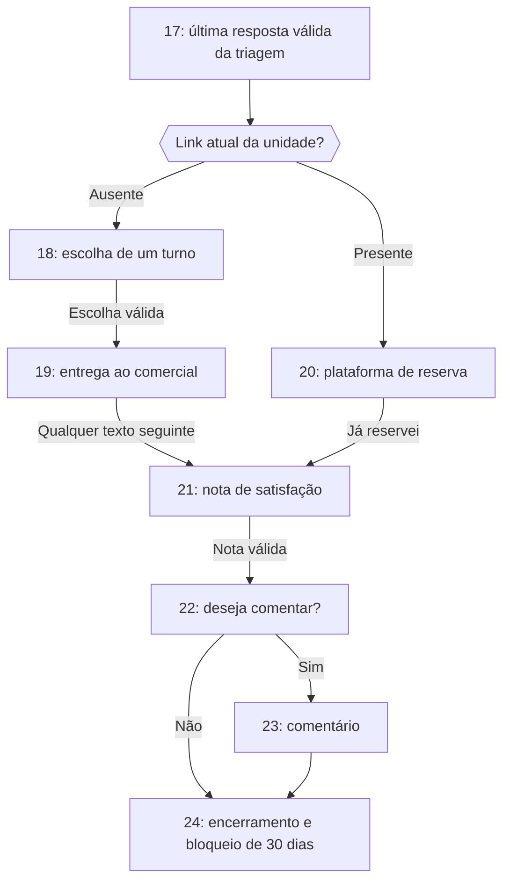

# Plano prático — reserva com e sem link da unidade

Revisão: **03/10/2026**, sobre o projeto atual na **V1.8.1**.
HEAD de referência: `2f4e2c9433d03b21d608c795c0d4cc6a0a3b7e2f`.

**Situação em 03/10/2026: implementação local da segunda tarefa concluída;
implantação na VM pendente.** A primeira revisão reconciliou os arquivos completos
abaixo com a V1.8.1. A aplicação partiu do backup
`ad096710be96b59158aaa9c13e98c516734f3d84`, cujos 121 hashes conferidos coincidiam
com essa base. O código aplicado foi revisado e recebeu os ajustes descritos
abaixo; esses ajustes prevalecem sobre os blocos originais de aplicação.

Os blocos completos e hashes permanecem como registro do plano aprovado e da
base anterior, **não como instrução para sobrescrever novamente o projeto**.
Para implantação, usar os arquivos atuais do repositório e o
[procedimento de deploy](../deploy/reserva_com_sem_link.md). O plano e o
comparativo de IA continuam congelados para a terceira tarefa.

### Ajustes e validação da aplicação

- Criados o SQL incremental `deploy/migrations/20261003_reserva_com_sem_link.sql`
  e sua reversão restrita, preservando as referências antigas por significado,
  os IDs das transições existentes, histórico particionado e demais dados.
- A recuperação de resposta já enviada na 20 dispensa remontar o contexto de
  plataforma: retirar o link depois do envio não invalida a resposta persistida.
  Para um envio novo na 20, o link continua obrigatório, conforme a regra abaixo.
- Ajustadas as quebras de parágrafo nas apresentações das novas etapas 18/19,
  a organização do despacho por etapa e a versão do JavaScript no template.
  A única mudança no template protegido é esse identificador de cache.
- O antigo contexto de despedida `contextos/etapa22.py` foi substituído por
  `contextos/etapa24.py`, sem manter uma segunda implementação com nome antigo.
- Fixtures de follow-up atualizadas para as 24 etapas e para o número comercial
  obrigatório já existente no projeto. Acrescentados testes reais da migração.
- 452 testes aprovados na suíte completa, incluindo PostgreSQL descartável;
  revisão visual do painel no computador e em 390 px, com dados fictícios.
- Sem alterações em requisitos, `.env`, lógica de Consumo Meta ou documentos de IA.
  Sem executar migração na base de produção, publicar código ou enviar mensagens.

Os critérios locais estão cobertos. O corte do banco, a subida dos serviços e
a homologação real de WhatsApp/CRM devem seguir o procedimento de implantação.

## Base atual e alterações preservadas

A base inclui o estado local dos arquivos, além do commit indicado. As impressões
SHA-256 ao final identificam o texto UTF-8 normalizado para LF de cada arquivo
anterior à aplicação. Se qualquer arquivo divergir, incorporar a mudança antes
de substituir seu conteúdo. Não voltar aos arquivos completos da revisão de
setembro deste plano.

| Área | Comportamento da base que deve continuar funcionando |
|---|---|
| Consumo Meta | Worker, coleta por número/unidade, fusos, tabelas, agenda, apuração mensal, seção Consumo, seletor, PDFs e navegação responsiva |
| Follow-up | Dois lembretes, encerramento no segundo, retorno válido com avanço, tratamentos prioritários, repetição neutra, exceção 8 → 9 e recuperação atômica |
| Mensagens | Oferta de experiência gratuita, aceites flexíveis, apresentação única, contextos inválidos autônomos, saudação de retorno e texto enviado igual ao histórico |
| Satisfação | Comentário livre, incluindo texto curto/emojis, recusa ou ausência aceita com valor nulo, e despedida específica de titular/dependente |
| Idade | Universal 90+, suporte configurável, BPA, motivos de encerramento, evidência do envio no retry e filtros comerciais do painel |
| E-mail e profissão | Políticas atuais, exceção de titular 60+, captura do titular e snapshots da própria conversa no Funil |
| Infraestrutura | PyWa 4.5.0, extração de IDs, locks versionados, fila, retry, idempotência, limites e transações atuais |
| Monitoramento | Isolamento por unidade, perfis etários, filtros, contatos, CSVs, relatórios e seção Consumo |

A rota nova acrescenta a preferência de turno e a entrega ao comercial. Não
exige atualizar dependências, tokens ou variáveis de ambiente existentes.
Arquivos de Consumo, requisitos, templates e estilos que não aparecem nos
passos continuam sendo os da base atual.

## Comportamento acordado

| Configuração atual da unidade | Depois da última resposta válida na 17 | Pesquisa | Elegibilidade do Funil | Follow-up proativo |
|---|---|---|---|---|
| Sem link | 18: turno → 19: contato comercial | Qualquer texto na 19 apresenta 21 | 19 e 21–24 | 1–18 |
| Com link | 20: plataforma, antiga etapa 18 | Confirmação na 20 apresenta 21 | 20–24 | 1–17 |

Em ambas as rotas, a etapa 21 recebe a nota, a 22 pergunta se deseja comentar,
a 23 recebe o comentário e a 24 encerra com bloqueio de 30 dias. A recusa de
comentário salta de 22 para 24. As etapas 1–17 mantêm seu significado.



### Escolha e persistência do turno

`turno` é uma coluna opcional da **conversa**, não do cliente nem da unidade.
O banco aceita somente `manha`, `tarde`, `noite` ou `NULL`. As mensagens usam
manhã, tarde e noite com grafia apropriada. A escolha é uma preferência;
não confirma disponibilidade, dia ou horário.

Os botões são **Pela manhã**, **Pela tarde** e **Pela noite**. A pergunta informa
que é necessário escolher o melhor turno, mesmo quando a pessoa pode em mais
de um, e que uma correção posterior pode ser combinada com o consultor.

Também são aceitos textos como `Posso pela manha`, `somente pela tarde` e
`pela noite`. A normalização ignora caixa e acentos, exige apenas um turno
distinto e recusa negações. Perguntas, `talvez`, `qualquer turno` e outras
expressões de indefinição também são recusadas. `amanhã` não é confundido com
`manhã`. Mencionar dois ou três turnos exige nova escolha; o bot não decide pelo
cliente. Essa regra é determinística e conservadora, sem promessa de interpretar
toda frase possível. Mídia, financeiro e reforço escolar têm tratamentos próprios.

Somente a escolha válida prepara a etapa 19. A gravação da preferência ocorre
nos efeitos finais do ciclo, na mesma transação da transição, com o lock e o
fencing existentes. Se já há resposta do bot salva, o retry recupera a preferência
da entrada original sem reenviar. Um valor persistido conflitante não é substituído
silenciosamente. Tratamentos sem avanço não salvam preferências. A reação ao primeiro follow-up passa pelo resolver normal: quando trouxer um turno válido, salva a preferência e avança para a 19 no mesmo ciclo.

### Entrega ao comercial

Na 19, a mensagem identifica titular ou dependente, oferece a experiência
Supera gratuita e o botão **Falar com consultor**. Não depende de cadastro
de diretor. O agente mantém seu nome e gênero próprios.

Exemplos do texto preenchido no botão:

- Titular: “Olá, venho do atendimento com a Suh, me chamo Ana, tenho 40 anos e
  gostaria de reservar uma demonstração prática para mim no turno da manhã.”
- Dependente: “Olá, venho do atendimento com a Suh, me chamo Ana e gostaria de
  reservar uma demonstração prática para João, que tem 12 anos. Prefiro o turno
  da manhã.”

O turno vem de uma única escolha normalizada; nome e idade pertencem ao
participante correto. Não inferir o gênero do dependente. Os encaminhamentos
por idade da etapa 6 também recebem texto preenchido, **sem turno** porque a
preferência não foi coletada nesse caminho.

Abrir o botão comercial não é uma resposta ao bot e não comprova mensagem
enviada ao consultor. O texto abre preenchido para a pessoa confirmar o envio.
Qualquer texto posterior **ao bot** na 19 apresenta a pergunta da 21: `5`,
`não` e perguntas sobre valores não viram nota nem acionam validações de turno.
Mídia repete a 19, pedindo texto para iniciar a pesquisa. Sem resposta, a conversa
permanece na 19, elegível para o Funil enquanto a unidade continuar sem link,
sem follow-up ou bloqueio por silêncio.

### Configuração atual, retomadas e Funil

Ausência é `NULL`, vazio ou apenas espaços; o Admin normaliza vazio para `NULL`.
Unidade sem link precisa de número comercial válido. A decisão 17 → 18/20 usa
o contexto consultado diretamente no banco naquele ciclo, sem snapshot permanente
do link. Resposta já enviada é preservada em retries mesmo que o link mude.

Adicionar um link enquanto a conversa já está na 18 ou 19 não a redireciona:
ela conclui 18 → 19 → 21. Novas decisões na 17 usam o link adicionado.
O Funil consulta a configuração atual na seleção, no claim e no snapshot:
se o link for adicionado enquanto o cliente espera na 19, um envio ainda
pendente só volta a ser elegível ao chegar à 21. Isso implementa a regra
solicitada de configuração vigente, sem congelar a modalidade na conversa.

Se o CRM já aceitou o envio e o link muda durante essa chamada, registrar o
sucesso continua obrigatório. Não descartar esse efeito externo nem criar
outro envio por causa da mudança: `lead_no_funil` e `funil_envios` mantêm a
confirmação local. A janela preexistente entre aceite externo e falha de commit
continua tendo a mesma limitação de idempotência da integração atual.

As observações do Funil orientam conferir a plataforma/Calendly e o painel
quando existe link, ou o painel e o número comercial quando não existe.
Incluem a preferência quando coletada. E-mail e profissão conservam os
snapshots atuais, e nota/comentário da satisfação ficam fora do payload.

Follow-up conserva as duas camadas atuais: primeiro lembrete após sete horas;
segundo após outras sete horas desde o primeiro envio confirmado, encerrando com
`followup_sem_resposta`, sem bloqueio de 30 dias e sem terceiro lembrete. Uma nova
mensagem após esse encerramento abre outra conversa, conforme a regra atual.

Preservar janela de mensagem do cliente, bloqueios, unicidade, lock, fencing,
recibos, checkpoint e persistência atômica. A ampliação proativa é permitir
a etapa 18 quando a unidade está sem link. Adicionar link nessa etapa impede
novos lembretes. A reação ao primeiro lembrete usa a validação normal, inclusive
um turno válido na 18: avança e salva. Mídia, financeiro e reforço continuam com
seus tratamentos; contexto inválido genérico repete a pergunta neutra. A exceção
8 → 9 permanece. Recuperações pendentes continuam válidas mesmo sem elegibilidade
proativa, e o retry não apaga um novo ciclo de follow-up.

Remover o link enquanto existem conversas na etapa 20 exige cuidado: essa etapa
continua dependendo de um link válido para reapresentar a plataforma. Esta revisão
preserva essa exigência e não inventa uma transição 20 → 18. Antes de retirar um
link, concluir ou tratar administrativamente os atendimentos dessa etapa. A
homologação da segunda tarefa deverá conferir essa condição; permitir a remoção
com atendimentos pendentes exigiria uma regra explícita adicional.

O painel mostra a preferência nos detalhes da conversa exibida, sem puxar turno
de outra conversa antiga do mesmo contato. O catálogo passa a 24 etapas; tags
etárias e formatos de CSV permanecem. O motivo técnico legado `foi_agendado`
continua na terminal 24 por compatibilidade e não comprova reserva efetiva
na rota sem link.

## Banco existente: migração da segunda tarefa

A migração incremental será criada e validada na segunda tarefa, junto da aplicação autorizada. Conferir o schema instalado e cumprir os seguintes requisitos:

1. Tornar `unidade.link_agendamento` opcional e adicionar `conversa.turno`
   com o domínio descrito. Conversas anteriores começam sem preferência;
   não inventar um turno para atendimentos históricos.
2. Remapear etapas antigas por **significado**, sem confundir as antigas 18/19
   com as novas etapas que passam a usar esses números:

   | Etapa anterior | Etapa nova | Significado preservado |
   |---|---|---|
   | 18 | 20 | Plataforma e confirmação de sua reserva |
   | 19 | 21 | Nota de satisfação |
   | 20 | 22 | Opção de comentário |
   | 21 | 23 | Comentário |
   | 22 | 24 | Encerramento com bloqueio |

3. Preservar referências de `conversa.id_etapa_atual`,
   `historico_mensagens.id_etapa` (inclusive partições),
   `respostas_desafios.id_etapa`, `followup_retomada.id_etapa` e origens/destinos
   de `etapa_transicao`. Conferir as FKs reais e demais dependências no banco
   atualizado antes de escolher a estratégia de remapeamento. As respostas da
   triagem continuam em 12–17 e não devem ser deslocadas.
4. Preservar mensagens, WAMIDs, horários, vínculos com filas, IDs de conversas,
   preferências ausentes, pesquisas, bloqueios de 30 dias, recibos de follow-up
   e confirmações do Funil. `followup_stage` é contador de ciclo, não ID de etapa:
   **não renumerar esse campo**. Não reescrever o conteúdo textual histórico.
5. Sincronizar as 24 políticas e o mapa final, tratando colisões de IDs e
   restrições de unicidade na mesma migração. A terminal 24 é a única que
   encerra automaticamente com bloqueio de 30 dias.
6. Testar migração, preservação dos dados e retomada de filas antes de publicar.
   Manter código, catálogo e schema compatíveis no mesmo corte de deploy, com
   os processos parados. Não usar `setup` ou seeds como atualização de produção.

7. Preservar os motivos de encerramento atuais, inclusive o segundo follow-up e
   as restrições por idade. Não substituir constraints por versões históricas.
8. Preservar `unidade.id_fuso`, `nome_fuso`, `fuso_verificado_em`, o schema de
   Consumo Meta e os registros/agenda de coleta. A mudança de etapas não altera
   períodos mensais, status de apuração nem volumes de mensagens.
9. Preparar backup e rollback da migração e do código no mesmo corte. Pausar os
   processos que usam etapas antes de renumerar, verificar contagens e FKs e só
   reiniciar com código compatível. Manter o Consumo Meta na parada controlada
   se houver indisponibilidade do banco, preservando sua configuração.

As migrações históricas não serão editadas nem reaplicadas. A rota sem link terá
sua própria migração. Não instalar banco de teste na VM de produção. O DDL de
instalação limpa contido neste plano conserva os campos e tabelas da base atual.

## Aplicação futura dos arquivos

Cada passo contém **um arquivo inteiro** em seu estado final. São **87 passos**.
Criar os caminhos ausentes e preparar todas as substituições antes de executar
o código, pois alguns imports dependem de arquivos criados em outros passos.
Nenhum arquivo precisa ser excluído. Os caminhos antigos 18/19 recebem suas
novas responsabilidades, e os módulos deslocados são apresentados nos caminhos
corretos. O antigo contexto de finalização na 22 deixa de ser importado pelo
fluxo, que passa a usar o novo contexto da 24.

Os passos 79–80 mantêm integralmente o comportamento atual de idade e fechamento;
os passos 81–87 incorporam os arquivos adicionais identificados nesta revisão.
Eles fazem parte da mesma aplicação. A numeração de passos é de edição e não
corresponde à numeração das etapas do atendimento.

## Validação desta revisão

- **444 testes descobertos: 395 aprovados e 49 integrações condicionais puladas**,
  pois não foi configurado um PostgreSQL descartável para elas. A suíte executou
  os arquivos propostos sobre a cópia da base atual, com rede externa bloqueada.
- Os testes cobrem rotas com/sem link, persistência e replay do turno, entrega
  ao comercial, satisfação, idade, e-mail, follow-up, Funil, monitoramento,
  Consumo Meta e compatibilidade PyWa 4.5.0.
- Após a correção pontual do detalhe de turno no JavaScript e dos comentários
  de numeração, **75 testes diretamente relacionados ao fluxo passaram**. Esse
  número representa testes já incluídos na suíte, não testes adicionais.
- Sintaxe de todos os **71 blocos Python** e do JavaScript conferida. Verificação
  de sistema do Django sem problemas, com configuração de teste e caminhos de
  módulos ajustados somente no executor temporário.
- Nenhuma migração, consulta ao RDS, envio Meta ou envio CRM foi executado.
  Homologação PostgreSQL, migração incremental e verificação visual no navegador
  continuam como gates da segunda tarefa. Resultados históricos do plano antigo
  não são apresentados como validação desta base.

Para repetir a suíte em uma cópia de desenvolvimento com dependências instaladas:

```bash
python -m unittest discover -s tests -t .
python callback/manage.py check
```

As integrações exigem DSNs explícitas e bancos locais descartáveis definidos
nos testes. A migração da rota sem link deve ser validada separadamente quanto
à preservação dos dados existentes.

## Índice dos arquivos completos

1. Criar `core/validacoes/turno.py` — [abrir passo](#passo-1).
2. Atualizar `core/database/deploy_database/bank_script.py` — [abrir passo](#passo-2).
3. Atualizar `core/database/deploy_database/etapa_transicao_script.py` — [abrir passo](#passo-3).
4. Atualizar `core/database/deploy_database/povoar_etapas.py` — [abrir passo](#passo-4).
5. Atualizar `callback/webhook/models.py` — [abrir passo](#passo-5).
6. Criar `core/integrations/whatsapp/messages/contato_comercial.py` — [abrir passo](#passo-6).
7. Atualizar `core/integrations/whatsapp/messages/etapa18_messages.py` — [abrir passo](#passo-7).
8. Atualizar `core/integrations/whatsapp/messages/etapa19_messages.py` — [abrir passo](#passo-8).
9. Atualizar `core/integrations/whatsapp/messages/etapa20_messages.py` — [abrir passo](#passo-9).
10. Atualizar `core/integrations/whatsapp/messages/etapa21_messages.py` — [abrir passo](#passo-10).
11. Atualizar `core/integrations/whatsapp/messages/etapa22_messages.py` — [abrir passo](#passo-11).
12. Criar `core/integrations/whatsapp/messages/etapa23_messages.py` — [abrir passo](#passo-12).
13. Criar `core/integrations/whatsapp/messages/etapa24_messages.py` — [abrir passo](#passo-13).
14. Atualizar `core/integrations/whatsapp/numero_comercial.py` — [abrir passo](#passo-14).
15. Atualizar `core/integrations/whatsapp/pywa_functions/pywa_senders/etapa6.py` — [abrir passo](#passo-15).
16. Atualizar `core/integrations/whatsapp/pywa_functions/pywa_senders/etapa18.py` — [abrir passo](#passo-16).
17. Atualizar `core/integrations/whatsapp/pywa_functions/pywa_senders/etapa19.py` — [abrir passo](#passo-17).
18. Atualizar `core/integrations/whatsapp/pywa_functions/pywa_senders/etapa20.py` — [abrir passo](#passo-18).
19. Atualizar `core/integrations/whatsapp/pywa_functions/pywa_senders/etapa21.py` — [abrir passo](#passo-19).
20. Atualizar `core/integrations/whatsapp/pywa_functions/pywa_senders/etapa22.py` — [abrir passo](#passo-20).
21. Criar `core/integrations/whatsapp/pywa_functions/pywa_senders/etapa23.py` — [abrir passo](#passo-21).
22. Criar `core/integrations/whatsapp/pywa_functions/pywa_senders/etapa24.py` — [abrir passo](#passo-22).
23. Atualizar `core/repositories/fluxo/contextos/etapa6.py` — [abrir passo](#passo-23).
24. Atualizar `core/repositories/fluxo/contextos/etapa18.py` — [abrir passo](#passo-24).
25. Criar `core/repositories/fluxo/contextos/etapa20.py` — [abrir passo](#passo-25).
26. Criar `core/repositories/atendimento/turnos.py` — [abrir passo](#passo-26).
27. Atualizar `workers/worker_flow/response_flow/transicoes/eventos.py` — [abrir passo](#passo-27).
28. Atualizar `workers/worker_flow/response_flow/etapas/validadores_contexto/valida_etapa18.py` — [abrir passo](#passo-28).
29. Atualizar `workers/worker_flow/response_flow/etapas/validadores_contexto/valida_etapa19.py` — [abrir passo](#passo-29).
30. Atualizar `workers/worker_flow/response_flow/etapas/validadores_contexto/valida_etapa20.py` — [abrir passo](#passo-30).
31. Atualizar `workers/worker_flow/response_flow/etapas/validadores_contexto/valida_etapa21.py` — [abrir passo](#passo-31).
32. Criar `workers/worker_flow/response_flow/etapas/validadores_contexto/valida_etapa22.py` — [abrir passo](#passo-32).
33. Criar `workers/worker_flow/response_flow/etapas/validadores_contexto/valida_etapa23.py` — [abrir passo](#passo-33).
34. Criar `workers/worker_flow/response_flow/contato_comercial.py` — [abrir passo](#passo-34).
35. Atualizar `workers/worker_flow/response_flow/etapas/resolver_etapa6.py` — [abrir passo](#passo-35).
36. Atualizar `workers/worker_flow/response_flow/etapas/resolver_etapa17.py` — [abrir passo](#passo-36).
37. Atualizar `workers/worker_flow/response_flow/etapas/resolver_etapa18.py` — [abrir passo](#passo-37).
38. Atualizar `workers/worker_flow/response_flow/etapas/resolver_etapa19.py` — [abrir passo](#passo-38).
39. Atualizar `workers/worker_flow/response_flow/etapas/resolver_etapa20.py` — [abrir passo](#passo-39).
40. Atualizar `workers/worker_flow/response_flow/etapas/resolver_etapa21.py` — [abrir passo](#passo-40).
41. Criar `workers/worker_flow/response_flow/etapas/resolver_etapa22.py` — [abrir passo](#passo-41).
42. Criar `workers/worker_flow/response_flow/etapas/resolver_etapa23.py` — [abrir passo](#passo-42).
43. Atualizar `workers/worker_flow/response_flow/flow_sender.py` — [abrir passo](#passo-43).
44. Atualizar `workers/worker_flow/response_flow/repeticao_followup.py` — [abrir passo](#passo-44).
45. Atualizar `workers/worker_flow/transacoes/efeitos_transicao.py` — [abrir passo](#passo-45).
46. Atualizar `workers/worker_flow/valida_historico.py` — [abrir passo](#passo-46).
47. Atualizar `core/repositories/atendimento/followup.py` — [abrir passo](#passo-47).
48. Atualizar `tests/unit/test_followup.py` — [abrir passo](#passo-48).
49. Atualizar `core/integrations/funil/oportunidades.py` — [abrir passo](#passo-49).
50. Atualizar `core/repositories/funil/envios.py` — [abrir passo](#passo-50).
51. Atualizar `core/repositories/funil/leads.py` — [abrir passo](#passo-51).
52. Atualizar `callback/monitoramento/apresentacao.py` — [abrir passo](#passo-52).
53. Atualizar `callback/monitoramento/static/monitoramento/js/painel.js` — [abrir passo](#passo-53).
54. Atualizar `core/repositories/monitoramento/painel.py` — [abrir passo](#passo-54).
55. Atualizar `tests/fixtures/monitoramento_painel.py` — [abrir passo](#passo-55).
56. Atualizar `tests/integration/test_followup_postgres.py` — [abrir passo](#passo-56).
57. Criar `tests/integration/test_reserva_link_postgres.py` — [abrir passo](#passo-57).
58. Criar `tests/unit/test_fluxo_reserva_link.py` — [abrir passo](#passo-58).
59. Atualizar `tests/unit/test_monitoramento_painel.py` — [abrir passo](#passo-59).
60. Atualizar `tests/unit/test_monitoramento_unidade.py` — [abrir passo](#passo-60).
61. Atualizar `tests/unit/test_persistencia_essencial.py` — [abrir passo](#passo-61).
62. Atualizar `tests/unit/test_mensagens_reserva.py` — [abrir passo](#passo-62).
63. Atualizar `tests/unit/test_suporte_idoso_email_obrigatorio.py` — [abrir passo](#passo-63).
64. Atualizar `tests/unit/test_suporte_por_idade.py` — [abrir passo](#passo-64).
65. Atualizar `PADROES_DE_ARQUITETURA.md` — [abrir passo](#passo-65).
66. Atualizar `README.md` — [abrir passo](#passo-66).
67. Atualizar `REGRAS_DE_NEGOCIO.md` — [abrir passo](#passo-67).
68. Atualizar `ROTINA_IMPLEMENTACAO_ETAPAS.md` — [abrir passo](#passo-68).
69. Atualizar `callback/README.md` — [abrir passo](#passo-69).
70. Atualizar `core/README.md` — [abrir passo](#passo-70).
71. Atualizar `core/database/README.md` — [abrir passo](#passo-71).
72. Atualizar `core/integrations/funil/README.md` — [abrir passo](#passo-72).
73. Atualizar `core/integrations/whatsapp/README.md` — [abrir passo](#passo-73).
74. Atualizar `core/integrations/whatsapp/pywa_functions/ferramentas.md` — [abrir passo](#passo-74).
75. Atualizar `core/repositories/README.md` — [abrir passo](#passo-75).
76. Atualizar `deploy/README.md` — [abrir passo](#passo-76).
77. Atualizar `tests/README.md` — [abrir passo](#passo-77).
78. Atualizar `workers/README.md` — [abrir passo](#passo-78).
79. Atualizar `core/integrations/whatsapp/messages/etapa6_messages.py` — [abrir passo](#passo-79).
80. Atualizar `workers/worker_flow/transacoes/encerramento_atendimento.py` — [abrir passo](#passo-80).
81. Criar `core/repositories/fluxo/contextos/etapa24.py` — [abrir passo](#passo-81).
82. Atualizar `workers/worker_flow/transacoes/retorno_followup.py` — [abrir passo](#passo-82).
83. Atualizar `tests/unit/test_pywa_compatibilidade.py` — [abrir passo](#passo-83).
84. Atualizar `tests/unit/test_comentario_finalizacao.py` — [abrir passo](#passo-84).
85. Atualizar `tests/unit/test_mensagens_contexto.py` — [abrir passo](#passo-85).
86. Atualizar `tests/unit/test_retomada_followup.py` — [abrir passo](#passo-86).
87. Atualizar `core/integrations/whatsapp/messages/README.md` — [abrir passo](#passo-87).

## Passos de implementação

<a id="passo-1"></a>

### Passo 1 — Criar `core/validacoes/turno.py`

````python
"""Domínio persistido da preferência de turno; não representa uma reserva."""

TURNOS = ("manha", "tarde", "noite")
ROTULOS_TURNO = {"manha": "manhã", "tarde": "tarde", "noite": "noite"}


def validar_turno(turno):
    if turno not in TURNOS:
        raise ValueError("Turno deve ser manha, tarde ou noite")
    return turno
````

<a id="passo-2"></a>

### Passo 2 — Atualizar `core/database/deploy_database/bank_script.py`

DDL completo para instalação limpa; não executar como migração de banco existente.

````python
import logging

from core.database.deploy_database.transacao_deploy import transacao_deploy
from core.database.deploy_database.followup_script import criar_tabelas_followup
from core.database.deploy_database.consumo_meta_script import criar_tabelas_consumo_meta

logger = logging.getLogger("db.deploy_database")


def criar_funcoes_lock():
    with transacao_deploy("criar_funcoes_lock", logger) as cursor:
        cursor.execute("""
        CREATE OR REPLACE FUNCTION chatbot.lock_conversa(p_id_conversa INT)
        RETURNS TABLE (
            lock_ok BOOLEAN,
            lock_version_atual INT
        )
        LANGUAGE plpgsql
        AS $$

        DECLARE
            v_lock_version INT;

        BEGIN
            UPDATE chatbot.conversa c
            SET
                processing = TRUE,
                processing_started_at = NOW(),
                lock_version = COALESCE(c.lock_version, 0) + 1
            WHERE
                c.id_conversa = p_id_conversa
                AND (
                    c.processing = FALSE
                    OR c.processing_started_at
                        < NOW() - INTERVAL '110.0 seconds'
                )
            RETURNING c.lock_version INTO v_lock_version;

            IF v_lock_version IS NULL THEN
                RETURN QUERY SELECT FALSE, NULL::INT;
                RETURN;
            END IF;

            RETURN QUERY SELECT TRUE, v_lock_version;
        END;

        $$;
        """)

        cursor.execute("""
        CREATE OR REPLACE FUNCTION chatbot.unlock_conversa(
            p_id_conversa INT,
            p_lock_version INT
        )
        RETURNS BOOLEAN
        LANGUAGE plpgsql
        AS $$

        DECLARE
            updated_rows INTEGER;

        BEGIN
            UPDATE chatbot.conversa
            SET
                processing = FALSE,
                processing_started_at = NULL
            WHERE id_conversa = p_id_conversa
              AND lock_version = p_lock_version;

            GET DIAGNOSTICS updated_rows = ROW_COUNT;

            RETURN updated_rows = 1;
        END;

        $$;
        """)

    logger.info("banco_setup_ok | acao=criar_funcoes_lock")


def criar_funcao_dequeue_message():
    with transacao_deploy("criar_funcao_dequeue_message", logger) as cursor:
        cursor.execute("""
        CREATE OR REPLACE FUNCTION chatbot.dequeue_message()
        RETURNS TABLE (
            id_mensagem INT,
            cliente_telefone VARCHAR,
            conteudo_texto TEXT,
            tipo_mensagem VARCHAR,
            id_phone_unidade VARCHAR,
            unidade_telefone VARCHAR,
            received_data_hora TIMESTAMPTZ,
            id_hash_msg VARCHAR,
            retry_count INT
        )
        LANGUAGE plpgsql
        AS $$

        BEGIN
            RETURN QUERY

            WITH next_job AS (
                SELECT f.id_mensagem
                FROM chatbot.fila_mensagens f
                WHERE
                    (
                        f.status = 'pending'
                        AND f.next_attempt_at <= NOW()
                    )
                    OR
                    (
                        f.status = 'processing'
                        AND f.processing_started_at
                            < NOW() - INTERVAL '2 minutes'
                    )
                ORDER BY
                    CASE
                        WHEN f.status = 'pending' THEN f.next_attempt_at
                        WHEN f.status = 'processing'
                            THEN f.processing_started_at
                    END NULLS FIRST,
                    f.id_mensagem
                FOR UPDATE SKIP LOCKED
                LIMIT 1
            )

            UPDATE chatbot.fila_mensagens f
            SET
                status = 'processing',
                retry_count = f.retry_count + 1,
                processing_started_at = NOW()
            FROM next_job
            WHERE f.id_mensagem = next_job.id_mensagem

            RETURNING
                f.id_mensagem,
                f.cliente_telefone,
                f.conteudo_texto,
                f.tipo_mensagem,
                f.id_phone_unidade,
                f.unidade_telefone,
                f.received_data_hora,
                f.id_hash_msg,
                f.retry_count;
        END;

        $$;
        """)

    logger.info("banco_setup_ok | acao=criar_funcao_dequeue_message")


def criar_tabelas():
    """Cria o schema final da V1 em ordem de dependência, sem migrações."""
    with transacao_deploy("criar_tabelas", logger) as cursor:
        cursor.execute("""
        CREATE SCHEMA IF NOT EXISTS chatbot;

        DO $dependencia_django$
        BEGIN
            IF TO_REGCLASS('chatbot.auth_user') IS NULL THEN
                RAISE EXCEPTION
                    'Prepare o schema chatbot e execute as migrations do Django antes do DDL de negocio: chatbot.auth_user deve existir.';
            END IF;
        END
        $dependencia_django$;

        -- 1. CLIENTE E UNIDADE (AUTH_USER PREPARADA PELO DJANGO)

        CREATE TABLE IF NOT EXISTS chatbot.cliente (
            id_cliente SERIAL PRIMARY KEY,
            nome VARCHAR(200),
            waid_telefone VARCHAR(50) UNIQUE NOT NULL,
            email VARCHAR(200) UNIQUE,
            idade INTEGER,
            profissao VARCHAR(100)
        );

        CREATE TABLE IF NOT EXISTS chatbot.unidade (
            id_unidade SERIAL PRIMARY KEY,
            nome_unidade VARCHAR(300) NOT NULL,
            nome_agente VARCHAR(100) NOT NULL,
            genero VARCHAR(9) NOT NULL,
            cnpj VARCHAR(50) UNIQUE NOT NULL,
            email_responsavel VARCHAR(255) UNIQUE NOT NULL,
            telefone VARCHAR(20) UNIQUE NOT NULL,
            numero_comercial VARCHAR(30) NOT NULL
                CONSTRAINT ck_unidade_numero_comercial CHECK (
                    regexp_replace(numero_comercial, '[^0-9]', '', 'g')
                    ~ '^([0-9]{10,11}|55[0-9]{10,11})$'
                ),
            idade_minima_suporte INTEGER DEFAULT NULL
                CONSTRAINT ck_unidade_idade_minima_suporte CHECK (
                    idade_minima_suporte IS NULL
                    OR idade_minima_suporte IN (50, 60, 70, 80)
                ),
            email_obrigatorio BOOLEAN NOT NULL DEFAULT TRUE,
            waba_id VARCHAR(100) UNIQUE NOT NULL,
            phone_number_id VARCHAR(100) UNIQUE NOT NULL,
            link_agendamento VARCHAR(400) UNIQUE,
            link_instagram VARCHAR(400),
            bpa_ativo BOOLEAN NOT NULL DEFAULT FALSE,
            status_pagamento BOOLEAN DEFAULT TRUE,
            id_usuario_monitoramento INT NULL,

            CONSTRAINT uq_unidade_nome_unidade
                UNIQUE (nome_unidade),

            CONSTRAINT ck_unidade_nome_unidade_nao_vazio
                CHECK (nome_unidade ~ '[^[:space:]]'),

            CONSTRAINT ck_unidade_nome_agente_nao_vazio
                CHECK (nome_agente ~ '[^[:space:]]'),

            CONSTRAINT ck_unidade_genero
                CHECK (genero IN ('masculino', 'feminino')),


            CONSTRAINT uq_unidade_usuario_monitoramento
                UNIQUE (id_usuario_monitoramento),
            CONSTRAINT unidade_id_usuario_monitoramento_fkey
                FOREIGN KEY (id_usuario_monitoramento)
                REFERENCES chatbot.auth_user(id)
                ON DELETE SET NULL
        );

        CREATE TABLE IF NOT EXISTS chatbot.etapa (
            id_etapa SERIAL PRIMARY KEY,
            nome_etapa VARCHAR(100) UNIQUE NOT NULL,
            encerra_automaticamente BOOLEAN NOT NULL DEFAULT FALSE,
            bloqueio_dias INTEGER NOT NULL DEFAULT 0,
            elegivel_funil BOOLEAN NOT NULL DEFAULT FALSE,

            CONSTRAINT ck_etapa_bloqueio_dias
                CHECK (bloqueio_dias >= 0)
        );

        -- 2. CONFIGURACAO DO FUNIL POR UNIDADE

        CREATE TABLE IF NOT EXISTS chatbot.integracao_funil_unidade (
            id_integracao_funil SERIAL PRIMARY KEY,
            id_unidade INT NOT NULL UNIQUE,

            nome_widget VARCHAR(300) NOT NULL,
            data_salvamento_widget DATE,
            codigo_widget VARCHAR(100) UNIQUE NOT NULL,
            link_api_carrossel VARCHAR(500) UNIQUE NOT NULL,
            codigo_canal_venda VARCHAR(100) NOT NULL,

            widget_ativo BOOLEAN NOT NULL DEFAULT TRUE,
            integracao_ativa BOOLEAN NOT NULL DEFAULT TRUE,

            criado_em TIMESTAMPTZ NOT NULL DEFAULT NOW(),
            atualizado_em TIMESTAMPTZ NOT NULL DEFAULT NOW(),

            CONSTRAINT ck_integracao_funil_nome_widget
                CHECK (BTRIM(nome_widget) <> ''),

            CONSTRAINT ck_integracao_funil_codigo_widget
                CHECK (BTRIM(codigo_widget) <> ''),

            CONSTRAINT ck_integracao_funil_link_api
                CHECK (BTRIM(link_api_carrossel) <> ''),

            CONSTRAINT ck_integracao_funil_codigo_canal
                CHECK (BTRIM(codigo_canal_venda) <> ''),

            CONSTRAINT integracao_funil_unidade_id_unidade_fkey
                FOREIGN KEY (id_unidade)
                REFERENCES chatbot.unidade(id_unidade)
                ON DELETE CASCADE
        );

        -- 3. CONVERSA: RAIZ TRANSACIONAL DO ATENDIMENTO

        CREATE TABLE IF NOT EXISTS chatbot.conversa (
            id_conversa SERIAL PRIMARY KEY,
            id_cliente INT NOT NULL,
            id_unidade INT NOT NULL,
            id_etapa_atual INT,

            status_ativa BOOLEAN NOT NULL DEFAULT TRUE,
            turno VARCHAR(5) CONSTRAINT ck_conversa_turno
                CHECK (turno IS NULL OR turno IN ('manha', 'tarde', 'noite')),
            status_dependente BOOLEAN DEFAULT FALSE,
            profissao VARCHAR(100) NULL,

            last_interaction_at TIMESTAMPTZ,

            last_message_from VARCHAR(10)
                CHECK (last_message_from IN ('cliente', 'bot')),

            followup_stage INTEGER DEFAULT 0,
            followup_last_sent_at TIMESTAMPTZ NULL,

            lead_no_funil BOOLEAN DEFAULT FALSE,

            processing BOOLEAN DEFAULT FALSE,
            processing_started_at TIMESTAMPTZ NULL,
            lock_version INTEGER DEFAULT 0,
            turnos_sem_avanco INTEGER NOT NULL DEFAULT 0,

            iniciou_em TIMESTAMPTZ NOT NULL DEFAULT NOW(),
            finalizou_em TIMESTAMPTZ,
            motivo_encerramento VARCHAR(30),

            CONSTRAINT ck_conversa_motivo_encerramento
                CHECK (
                    motivo_encerramento IS NULL
                    OR motivo_encerramento IN (
                        'idade_invalida',
                        'foi_agendado',
                        'encaminhado_suporte_idoso',
                        'followup_sem_resposta',
                        'titular_menor_18', 'dependente_menor_4', 'dependente_menor_5',
                        'suporte_idoso_50', 'suporte_idoso_60', 'suporte_idoso_70', 'suporte_idoso_80',
                        'idade_universal_90'
                    )
                ),

            CONSTRAINT ck_conversa_turnos_sem_avanco
                CHECK (turnos_sem_avanco BETWEEN 0 AND 12),

            FOREIGN KEY (id_cliente)
                REFERENCES chatbot.cliente(id_cliente)
                ON DELETE CASCADE,

            FOREIGN KEY (id_unidade)
                REFERENCES chatbot.unidade(id_unidade)
                ON DELETE CASCADE,

            FOREIGN KEY (id_etapa_atual)
                REFERENCES chatbot.etapa(id_etapa)
                ON DELETE SET NULL
        );

        CREATE UNIQUE INDEX IF NOT EXISTS idx_conversa_unica_ativa
        ON chatbot.conversa (id_cliente, id_unidade)
        WHERE status_ativa = TRUE;

        CREATE INDEX IF NOT EXISTS idx_conversa_followup
        ON chatbot.conversa (
            last_message_from,
            followup_stage,
            last_interaction_at
        );

        CREATE INDEX IF NOT EXISTS idx_conversa_processing
        ON chatbot.conversa (processing, processing_started_at);

        CREATE INDEX IF NOT EXISTS idx_conversa_ultima_inativa
        ON chatbot.conversa (id_cliente, id_unidade, finalizou_em DESC)
        INCLUDE (id_conversa, id_etapa_atual)
        WHERE status_ativa = FALSE;

        CREATE INDEX IF NOT EXISTS idx_conversa_funil_pendente
        ON chatbot.conversa (id_etapa_atual, id_conversa)
        WHERE lead_no_funil IS NOT TRUE;

        -- 4. DEPENDENTE: EXISTE SOMENTE DENTRO DE UMA CONVERSA

        CREATE TABLE IF NOT EXISTS chatbot.dependente (
            id_dependente SERIAL PRIMARY KEY,
            id_cliente INT NOT NULL,
            id_conversa INT,
            nome_dependente VARCHAR(200),
            idade INTEGER,

            FOREIGN KEY (id_cliente)
                REFERENCES chatbot.cliente(id_cliente)
                ON DELETE CASCADE,

            CONSTRAINT dependente_id_conversa_fkey
                FOREIGN KEY (id_conversa)
                REFERENCES chatbot.conversa(id_conversa)
                ON DELETE CASCADE
        );

        CREATE INDEX IF NOT EXISTS idx_dependente_cliente
        ON chatbot.dependente (id_cliente);

        CREATE UNIQUE INDEX IF NOT EXISTS uq_dependente_conversa
        ON chatbot.dependente (id_conversa)
        WHERE id_conversa IS NOT NULL;

        CREATE INDEX IF NOT EXISTS idx_dependente_conversa
        ON chatbot.dependente (id_conversa);

        -- 5. FILA: CRIADA ANTES DO HISTÓRICO PARA A FK NASCER PRONTA

        CREATE TABLE IF NOT EXISTS chatbot.fila_mensagens (
            id_mensagem SERIAL PRIMARY KEY,
            id_conversa INT NULL,
            status VARCHAR(20) NOT NULL DEFAULT 'pending',
            retry_count INTEGER DEFAULT 0,
            next_attempt_at TIMESTAMPTZ DEFAULT NOW(),
            processing_started_at TIMESTAMPTZ NULL,
            received_data_hora TIMESTAMPTZ NOT NULL,
            cliente_telefone VARCHAR(100) NOT NULL,
            conteudo_texto TEXT,
            tipo_mensagem VARCHAR(20) NOT NULL,
            id_hash_msg VARCHAR(255) UNIQUE NOT NULL,
            id_phone_unidade VARCHAR(100) NOT NULL,
            unidade_telefone VARCHAR(100) NOT NULL,
            last_error TEXT,

            FOREIGN KEY (id_conversa)
                REFERENCES chatbot.conversa(id_conversa)
                ON DELETE SET NULL,

            CHECK (status IN ('pending', 'processing', 'sent', 'failed'))
        );

        CREATE INDEX IF NOT EXISTS idx_fila_pending_next_attempt
        ON chatbot.fila_mensagens (next_attempt_at, id_mensagem)
        WHERE status = 'pending';

        CREATE INDEX IF NOT EXISTS idx_fila_processing_timeout
        ON chatbot.fila_mensagens (processing_started_at, id_mensagem)
        WHERE status = 'processing';

        CREATE INDEX IF NOT EXISTS idx_fila_conversa_aberta_data
        ON chatbot.fila_mensagens (
            id_conversa,
            received_data_hora,
            id_mensagem
        )
        WHERE id_conversa IS NOT NULL
          AND status IN ('pending', 'processing');

        -- 6. HISTÓRICO PARTICIONADO E RESPOSTAS DA TRIAGEM

        CREATE TABLE IF NOT EXISTS chatbot.historico_mensagens (
            id_mensagem SERIAL,
            id_conversa INT NOT NULL,
            id_etapa INT,
            received_data_hora TIMESTAMPTZ NOT NULL,
            cliente_telefone VARCHAR(100) NOT NULL,
            conteudo_texto TEXT,
            tipo_mensagem VARCHAR(20) NOT NULL,
            id_hash_msg VARCHAR(255) NOT NULL,
            id_mensagem_fila INT,
            id_hash_cliente_origem VARCHAR(255),
            id_phone_unidade VARCHAR(100) NOT NULL,
            unidade_telefone VARCHAR(100) NOT NULL,
            quem_enviou VARCHAR(10) NOT NULL,
            status_envio VARCHAR(20),

            PRIMARY KEY (id_mensagem, received_data_hora),

            FOREIGN KEY (id_conversa)
                REFERENCES chatbot.conversa(id_conversa)
                ON DELETE CASCADE,

            FOREIGN KEY (id_etapa)
                REFERENCES chatbot.etapa(id_etapa)
                ON DELETE SET NULL,

            CONSTRAINT fk_historico_mensagem_fila
                FOREIGN KEY (id_mensagem_fila)
                REFERENCES chatbot.fila_mensagens(id_mensagem)
                ON DELETE SET NULL,

            CONSTRAINT chk_historico_quem_enviou
                CHECK (quem_enviou IN ('cliente', 'bot')),

            CONSTRAINT chk_historico_status_envio
                CHECK (
                    (quem_enviou = 'cliente' AND status_envio IS NULL)
                    OR
                    (
                        quem_enviou = 'bot'
                        AND status_envio IS NOT NULL
                        AND status_envio IN ('pending', 'sent', 'failed')
                    )
                )
        )
        PARTITION BY RANGE (received_data_hora);

        CREATE TABLE IF NOT EXISTS chatbot.historico_mensagens_default
        PARTITION OF chatbot.historico_mensagens
        DEFAULT;

        CREATE INDEX IF NOT EXISTS idx_historico_conversa_data
        ON chatbot.historico_mensagens (
            id_conversa,
            received_data_hora DESC,
            id_mensagem DESC
        );

        CREATE INDEX IF NOT EXISTS idx_historico_cliente_mensagem_fila
        ON chatbot.historico_mensagens (
            id_conversa,
            id_mensagem_fila,
            id_hash_msg,
            received_data_hora DESC,
            id_mensagem DESC
        )
        WHERE quem_enviou = 'cliente'
          AND id_mensagem_fila IS NOT NULL;

        CREATE INDEX IF NOT EXISTS idx_historico_bot_mensagem_fila
        ON chatbot.historico_mensagens (
            id_conversa,
            id_mensagem_fila,
            id_hash_cliente_origem,
            received_data_hora DESC,
            id_mensagem DESC
        )
        WHERE quem_enviou = 'bot'
          AND id_mensagem_fila IS NOT NULL
          AND id_hash_cliente_origem IS NOT NULL;

        CREATE TABLE IF NOT EXISTS chatbot.respostas_desafios (
            id_resposta_desafio SERIAL PRIMARY KEY,
            id_conversa INT NOT NULL,
            id_etapa INT NOT NULL,
            resposta VARCHAR(20) NOT NULL,
            id_historico_mensagem_cliente INT NULL,
            criado_em TIMESTAMPTZ NOT NULL DEFAULT NOW(),

            FOREIGN KEY (id_conversa)
                REFERENCES chatbot.conversa(id_conversa)
                ON DELETE CASCADE,

            FOREIGN KEY (id_etapa)
                REFERENCES chatbot.etapa(id_etapa),

            CONSTRAINT uq_respostas_desafios_conversa_etapa
                UNIQUE (id_conversa, id_etapa)
        );

        -- 7. PESQUISA DE SATISFACAO DO ATENDIMENTO

        CREATE TABLE IF NOT EXISTS chatbot.pesquisa_satisfacao (
            id_pesquisa_satisfacao SERIAL PRIMARY KEY,
            id_conversa INT NOT NULL UNIQUE,
            nota SMALLINT,
            comentario TEXT,
            criado_em TIMESTAMPTZ NOT NULL DEFAULT NOW(),
            atualizado_em TIMESTAMPTZ NOT NULL DEFAULT NOW(),

            CONSTRAINT pesquisa_satisfacao_id_conversa_fkey
                FOREIGN KEY (id_conversa)
                REFERENCES chatbot.conversa(id_conversa)
                ON DELETE CASCADE,

            CONSTRAINT ck_pesquisa_satisfacao_nota
                CHECK (nota IS NULL OR nota BETWEEN 1 AND 5)
        );

        -- 8. FILA OPERACIONAL DO WORKER DE FUNIL

        CREATE TABLE IF NOT EXISTS chatbot.funil_envios (
            id_funil_envio SERIAL PRIMARY KEY,
            id_conversa INT NOT NULL UNIQUE,
            status VARCHAR(20) NOT NULL DEFAULT 'pending',
            attempt_count INTEGER NOT NULL DEFAULT 0,
            next_attempt_at TIMESTAMPTZ NOT NULL DEFAULT NOW(),
            processing_started_at TIMESTAMPTZ,
            enviado_em TIMESTAMPTZ,
            ultimo_erro TEXT,
            resposta_funil TEXT,
            criado_em TIMESTAMPTZ NOT NULL DEFAULT NOW(),
            atualizado_em TIMESTAMPTZ NOT NULL DEFAULT NOW(),

            CONSTRAINT funil_envios_id_conversa_fkey
                FOREIGN KEY (id_conversa)
                REFERENCES chatbot.conversa(id_conversa)
                ON DELETE CASCADE,

            CONSTRAINT ck_funil_envios_status
                CHECK (status IN ('pending', 'processing', 'sent')),

            CONSTRAINT ck_funil_envios_attempt_count
                CHECK (attempt_count >= 0)
        );

        CREATE INDEX IF NOT EXISTS idx_funil_envios_disponiveis
        ON chatbot.funil_envios (
            status,
            next_attempt_at,
            processing_started_at,
            id_funil_envio
        )
        WHERE status IN ('pending', 'processing');
        """)

        criar_tabelas_followup(cursor)
        criar_tabelas_consumo_meta(cursor)

    logger.info("banco_setup_ok | acao=criar_tabelas")


def configurar_role_banco():
    """Aplica timezone e limites operacionais da role em uma transação."""
    with transacao_deploy("configurar_role_banco", logger) as cursor:
        cursor.execute("""
            ALTER ROLE fushi
            SET timezone TO 'America/Sao_Paulo';

            ALTER ROLE fushi
            SET idle_in_transaction_session_timeout = '30min';

            ALTER ROLE fushi
            SET statement_timeout = '10min';

            ALTER ROLE fushi
            SET lock_timeout = '15s';
        """)

    logger.info("banco_setup_ok | acao=configurar_role_banco role=fushi")
````

<a id="passo-3"></a>

### Passo 3 — Atualizar `core/database/deploy_database/etapa_transicao_script.py`

````python
import logging

from core.database.deploy_database.transacao_deploy import transacao_deploy


logger = logging.getLogger("db.etapa_transicao")


TRANSICOES_INICIAIS = (
    (1, "nome_cliente_valido", 2),
    (2, "destino_atendimento_definido", 3),
    (3, "destino_atendimento_confirmado", 4),
    # A profissão é obrigatória para titular e dependente. Somente depois dela
    # o status salvo escolhe nome do dependente (5) ou idade do titular (6).
    (4, "profissao_dependente_valida", 5),
    (4, "profissao_titular_valida", 6),
    (5, "nome_dependente_valido", 6),
    (6, "idade_valida", 7),
    (7, "oferta_aceita", 10),
    (7, "oferta_adiada", 8),
    (8, "cliente_retornou", 9),
    (9, "retorno_confirmado", 10),
    (9, "retorno_adiado", 8),
    (10, "email_valido", 11),
    (11, "triagem_iniciada", 12),
    (12, "triagem_pergunta_1_respondida", 13),
    (13, "triagem_pergunta_2_respondida", 14),
    (14, "triagem_pergunta_3_respondida", 15),
    (15, "triagem_pergunta_4_respondida", 16),
    (16, "triagem_pergunta_5_respondida", 17),
    (17, "triagem_pergunta_6_respondida", 20),
    (17, "triagem_concluida_sem_link", 18),
    (18, "turno_escolhido", 19),
    (19, "avaliacao_solicitada", 21),
    (20, "agendamento_confirmado", 21),
    (21, "satisfacao_avaliada", 22),
    (22, "comentario_satisfacao_aceito", 23),
    (22, "comentario_satisfacao_recusado", 24),
    (23, "comentario_satisfacao_recebido", 24),
)

# O mapa declara o fluxo completo conhecido. Resolvers e senders continuam
# responsáveis por produzir somente eventos já implementados na aplicação.


def criar_e_povoar_transicoes_etapa():
    with transacao_deploy("sincronizar_mapa_transicoes", logger) as cursor:
        cursor.execute(
            """
            CREATE TABLE IF NOT EXISTS chatbot.etapa_transicao (
                id_transicao SERIAL PRIMARY KEY,
                id_etapa_origem INT NOT NULL,
                evento VARCHAR(100) NOT NULL,
                id_etapa_destino INT NOT NULL,

                CONSTRAINT etapa_transicao_origem_fkey
                    FOREIGN KEY (id_etapa_origem)
                    REFERENCES chatbot.etapa(id_etapa)
                    ON DELETE RESTRICT,

                CONSTRAINT etapa_transicao_destino_fkey
                    FOREIGN KEY (id_etapa_destino)
                    REFERENCES chatbot.etapa(id_etapa)
                    ON DELETE RESTRICT,

                CONSTRAINT etapa_transicao_sem_auto_salto
                    CHECK (id_etapa_origem <> id_etapa_destino),

                CONSTRAINT etapa_transicao_origem_evento_unique
                    UNIQUE (id_etapa_origem, evento),

                CONSTRAINT etapa_transicao_origem_destino_unique
                    UNIQUE (id_etapa_origem, id_etapa_destino)
            );
            """
        )

        # Isto sincroniza dados de catálogo, não migra schema. A whitelist
        # precisa ser exata e manter IDs previsíveis após uma reexecução.
        cursor.execute(
            "TRUNCATE TABLE chatbot.etapa_transicao RESTART IDENTITY;"
        )

        cursor.executemany(
            """
            INSERT INTO chatbot.etapa_transicao (
                id_etapa_origem,
                evento,
                id_etapa_destino
            )
            VALUES (%s, %s, %s);
            """,
            TRANSICOES_INICIAIS,
        )

    logger.info(
        "etapa_transicao_setup_ok | acao=sincronizar_mapa quantidade=%s",
        len(TRANSICOES_INICIAIS),
    )
````

<a id="passo-4"></a>

### Passo 4 — Atualizar `core/database/deploy_database/povoar_etapas.py`

````python
import logging

from core.database.deploy_database.transacao_deploy import transacao_deploy


logger = logging.getLogger("db.seed")


ETAPAS = (
    (1, "Saudação e nome do cliente", False, 0, False),
    (2, "Destino do atendimento", False, 0, False),
    (3, "Confirmação do destino do atendimento", False, 0, False),
    (4, "Profissão do cliente", False, 0, False),
    (5, "Nome do dependente", False, 0, False),
    (6, "Idade do aluno", False, 0, False),
    (7, "Oferta de aula experimental e avaliação cognitiva", False, 0, False),
    (8, "Oferta adiada e Instagram", False, 0, False),
    (9, "Confirmação de retorno ao atendimento", False, 0, False),
    (10, "Email", False, 0, False),
    (11, "Introdução à triagem cognitiva", False, 0, False),
    (12, "Triagem cognitiva - pergunta 1", False, 0, False),
    (13, "Triagem cognitiva - pergunta 2", False, 0, False),
    (14, "Triagem cognitiva - pergunta 3", False, 0, False),
    (15, "Triagem cognitiva - pergunta 4", False, 0, False),
    (16, "Triagem cognitiva - pergunta 5", False, 0, False),
    (17, "Triagem cognitiva - pergunta 6", False, 0, False),
    (18, "Escolha do turno para a demonstração prática", False, 0, False),
    (19, "Encaminhamento ao comercial após a triagem", False, 0, True),
    (20, "Sua reserva pela plataforma da unidade", False, 0, True),
    (21, "Pesquisa de satisfação - nota", False, 0, True),
    (22, "Pesquisa de satisfação - opção de comentário", False, 0, True),
    (23, "Pesquisa de satisfação - comentário", False, 0, True),
    (24, "Finalização do atendimento", True, 30, True),
)

SINCRONIZAR_ETAPA_SQL = """
    INSERT INTO chatbot.etapa (
        id_etapa,
        nome_etapa,
        encerra_automaticamente,
        bloqueio_dias,
        elegivel_funil
    )
    VALUES (%s, %s, %s, %s, %s)
    ON CONFLICT (id_etapa)
    DO UPDATE SET
        nome_etapa = EXCLUDED.nome_etapa,
        encerra_automaticamente = EXCLUDED.encerra_automaticamente,
        bloqueio_dias = EXCLUDED.bloqueio_dias,
        elegivel_funil = EXCLUDED.elegivel_funil;
"""


def _recusar_catalogo_legado(cursor):
    """Exige a migração incremental antes de sincronizar IDs em uso."""
    cursor.execute(
        """
        SELECT
            id_etapa,
            nome_etapa,
            encerra_automaticamente,
            bloqueio_dias,
            elegivel_funil
        FROM chatbot.etapa
        WHERE id_etapa BETWEEN 3 AND 24
        ORDER BY id_etapa;
        """
    )
    etapas_existentes = cursor.fetchall()

    if not etapas_existentes:
        return

    etapas_esperadas = {
        etapa[0]: etapa
        for etapa in ETAPAS
    }
    divergencias = [
        id_etapa
        for (
            id_etapa,
            nome_etapa,
            encerra_automaticamente,
            bloqueio_dias,
            elegivel_funil,
        ) in etapas_existentes
        if etapas_esperadas.get(id_etapa) != (
            id_etapa,
            nome_etapa,
            encerra_automaticamente,
            bloqueio_dias,
            elegivel_funil,
        )
    ]

    if divergencias:
        raise RuntimeError(
            "Catalogo de etapas legado detectado. Aplique primeiro a "
            "migracao SQL correspondente ao catalogo de 24 etapas. "
            "Os seeds nao remapeiam historico nem conversas existentes "
            f"(etapas_divergentes={divergencias})"
        )


def insere_etapa_once():
    with transacao_deploy("sincronizar_etapas", logger) as cursor:
        _recusar_catalogo_legado(cursor)
        cursor.executemany(SINCRONIZAR_ETAPA_SQL, ETAPAS)

        cursor.execute(
            """
            SELECT setval(
                pg_get_serial_sequence('chatbot.etapa', 'id_etapa'),
                (SELECT MAX(id_etapa) FROM chatbot.etapa),
                TRUE
            );
            """
        )

    logger.info(
        "banco_seed_ok | acao=sincronizar_etapas quantidade=%s",
        len(ETAPAS),
    )
````

<a id="passo-5"></a>

### Passo 5 — Atualizar `callback/webhook/models.py`

````python
from core.integrations.whatsapp.numero_comercial import numero_comercial_whatsapp_valido
from core.validacoes.turno import ROTULOS_TURNO
from core.validacoes.suporte_por_idade import IDADES_MINIMAS_SUPORTE

from django.conf import settings
from django.core.exceptions import ValidationError
from django.db import models
from core.validacoes.encerramento_por_idade import ROTULOS_MOTIVOS


class Cliente(models.Model):
    id_cliente = models.AutoField(primary_key=True)
    nome = models.CharField(max_length=200, blank=True, null=True)
    waid_telefone = models.CharField(unique=True, max_length=50)
    email = models.CharField(unique=True, max_length=200, blank=True, null=True)
    idade = models.IntegerField(blank=True, null=True)
    profissao = models.CharField(max_length=100, blank=True, null=True)

    def __str__(self):
        return self.nome or self.waid_telefone

    class Meta:
        managed = False
        db_table = 'cliente'


class Dependente(models.Model):
    id_dependente = models.AutoField(primary_key=True)
    id_cliente = models.ForeignKey(
        Cliente,
        models.CASCADE,
        db_column='id_cliente',
        related_name='dependentes',
    )
    id_conversa = models.ForeignKey(
        'Conversa',
        models.CASCADE,
        db_column='id_conversa',
        related_name='dependentes_atendidos',
        blank=True,
        null=True,
    )
    nome_dependente = models.CharField(max_length=200, blank=True, null=True)
    idade = models.IntegerField(blank=True, null=True)

    def __str__(self):
        return self.nome_dependente or str(self.id_dependente)

    class Meta:
        managed = False
        db_table = 'dependente'


class Conversa(models.Model):
    turno = models.CharField(
        "turno de preferência", max_length=5, blank=True, null=True,
        choices=list(ROTULOS_TURNO.items()),
        help_text="Preferência informada no atendimento; não confirma dia ou horário.",
    )
    id_conversa = models.AutoField(primary_key=True)
    id_cliente = models.ForeignKey(Cliente, models.DO_NOTHING, db_column='id_cliente')
    id_unidade = models.ForeignKey('Unidade', models.DO_NOTHING, db_column='id_unidade')
    id_etapa_atual = models.ForeignKey('Etapa', models.DO_NOTHING, db_column='id_etapa_atual', blank=True, null=True)
    status_ativa = models.BooleanField(default=True)
    status_dependente = models.BooleanField(blank=True, null=True, default=False)
    profissao = models.CharField(max_length=100, blank=True, null=True)
    last_interaction_at = models.DateTimeField(blank=True, null=True)
    last_message_from = models.CharField(
        max_length=10,
        blank=True,
        null=True,
        choices=[("cliente", "cliente"), ("bot", "bot")],
    )
    followup_stage = models.IntegerField(blank=True, null=True, default=0)
    followup_last_sent_at = models.DateTimeField(blank=True, null=True)
    lead_no_funil = models.BooleanField(blank=True, null=True, default=False)
    processing = models.BooleanField(blank=True, null=True, default=False)
    processing_started_at = models.DateTimeField(blank=True, null=True)
    lock_version = models.IntegerField(blank=True, null=True, default=0)
    turnos_sem_avanco = models.IntegerField(default=0)
    iniciou_em = models.DateTimeField()
    finalizou_em = models.DateTimeField(blank=True, null=True)
    motivo_encerramento = models.CharField(
        max_length=30,
        blank=True,
        null=True,
        choices=[*ROTULOS_MOTIVOS.items(),
                 ("foi_agendado", "Foi agendado"),
                 ("followup_sem_resposta", "Segundo follow-up sem resposta")],
    )

    class Meta:
        managed = False
        db_table = 'conversa'


class Etapa(models.Model):
    id_etapa = models.AutoField(primary_key=True)
    nome_etapa = models.CharField(unique=True, max_length=100)
    encerra_automaticamente = models.BooleanField(default=False)
    bloqueio_dias = models.PositiveIntegerField(default=0)
    elegivel_funil = models.BooleanField(default=False)

    class Meta:
        managed = False
        db_table = 'etapa'


class FilaMensagens(models.Model):
    id_mensagem = models.AutoField(primary_key=True)
    id_conversa = models.ForeignKey(
        Conversa,
        models.SET_NULL,
        db_column='id_conversa',
        blank=True,
        null=True,
    )
    status = models.CharField(
        max_length=20,
        default="pending",
        choices=[
            ("pending", "pending"),
            ("processing", "processing"),
            ("sent", "sent"),
            ("failed", "failed"),
        ],
    )
    retry_count = models.IntegerField(blank=True, null=True, default=0)
    next_attempt_at = models.DateTimeField(blank=True, null=True)
    processing_started_at = models.DateTimeField(blank=True, null=True)
    received_data_hora = models.DateTimeField()
    cliente_telefone = models.CharField(max_length=100)
    conteudo_texto = models.TextField(blank=True, null=True)
    tipo_mensagem = models.CharField(max_length=20)
    id_hash_msg = models.CharField(unique=True, max_length=255)
    id_phone_unidade = models.CharField(max_length=100)
    unidade_telefone = models.CharField(max_length=100)
    last_error = models.TextField(blank=True, null=True)

    class Meta:
        managed = False
        db_table = 'fila_mensagens'


class HistoricoMensagens(models.Model):
    id_mensagem = models.AutoField(primary_key=True)

    id_conversa = models.ForeignKey(
        Conversa,
        models.DO_NOTHING,
        db_column='id_conversa'
    )

    id_etapa = models.ForeignKey(
        Etapa,
        models.DO_NOTHING,
        db_column='id_etapa',
        blank=True,
        null=True
    )

    received_data_hora = models.DateTimeField()

    cliente_telefone = models.CharField(max_length=100)
    conteudo_texto = models.TextField(blank=True, null=True)
    tipo_mensagem = models.CharField(max_length=20)
    id_hash_msg = models.CharField(max_length=255)
    id_mensagem_fila = models.ForeignKey(
        FilaMensagens,
        models.SET_NULL,
        db_column='id_mensagem_fila',
        blank=True,
        null=True,
        related_name='historicos_originados',
    )
    id_hash_cliente_origem = models.CharField(max_length=255, blank=True, null=True)
    id_phone_unidade = models.CharField(max_length=100)
    unidade_telefone = models.CharField(max_length=100)
    quem_enviou = models.CharField(
        max_length=10,
        choices=[
            ("cliente", "cliente"),
            ("bot", "bot"),
        ],
    )
    status_envio = models.CharField(
        max_length=20,
        blank=True,
        null=True,
        choices=[
            ("pending", "pending"),
            ("sent", "sent"),
            ("failed", "failed"),
        ],
    )

    class Meta:
        managed = False
        db_table = 'historico_mensagens'
        constraints = [
            models.UniqueConstraint(
                fields=["id_mensagem", "received_data_hora"],
                name="uq_historico_mensagens_id_data",
            ),
        ]


class RespostasDesafios(models.Model):
    id_resposta_desafio = models.AutoField(primary_key=True)
    id_conversa = models.ForeignKey(
        Conversa,
        models.CASCADE,
        db_column='id_conversa',
        related_name='respostas_desafios',
    )
    id_etapa = models.ForeignKey(
        Etapa,
        models.DO_NOTHING,
        db_column='id_etapa',
        related_name='respostas_desafios',
    )
    resposta = models.CharField(max_length=20)
    id_historico_mensagem_cliente = models.IntegerField(blank=True, null=True)
    criado_em = models.DateTimeField()

    class Meta:
        managed = False
        db_table = 'respostas_desafios'
        constraints = [
            models.UniqueConstraint(
                fields=["id_conversa", "id_etapa"],
                name="uq_respostas_desafios_conversa_etapa",
            ),
        ]


class PesquisaSatisfacao(models.Model):
    id_pesquisa_satisfacao = models.AutoField(primary_key=True)
    id_conversa = models.OneToOneField(
        Conversa,
        models.CASCADE,
        db_column='id_conversa',
        related_name='pesquisa_satisfacao',
    )
    nota = models.PositiveSmallIntegerField(blank=True, null=True)
    comentario = models.TextField(blank=True, null=True)
    criado_em = models.DateTimeField()
    atualizado_em = models.DateTimeField()

    class Meta:
        managed = False
        db_table = 'pesquisa_satisfacao'
        verbose_name = 'Pesquisa de satisfação'
        verbose_name_plural = 'Pesquisas de satisfação'


class Unidade(models.Model):
    class Genero(models.TextChoices):
        MASCULINO = "masculino", "Masculino"
        FEMININO = "feminino", "Feminino"

    id_unidade = models.AutoField(primary_key=True)
    nome_unidade = models.CharField(
        "nome da unidade",
        unique=True,
        max_length=300,
    )
    nome_agente = models.CharField("nome do agente", max_length=100)
    genero = models.CharField(
        "gênero do agente",
        max_length=9,
        choices=Genero.choices,
    )
    cnpj = models.CharField(unique=True, max_length=50)
    email_responsavel = models.CharField(unique=True, max_length=255)
    telefone = models.CharField(unique=True, max_length=20)
    numero_comercial = models.CharField(
        max_length=30,
        help_text="Contato comercial obrigatório para toda unidade.",
    )
    idade_minima_suporte = models.IntegerField(
        "encaminhar titular ao comercial a partir de",
        blank=True,
        null=True,
        default=None,
        choices=[(None, "Desativado")] + [
            (idade, f"{idade}+") for idade in IDADES_MINIMAS_SUPORTE
        ],
        help_text=(
            "Na etapa de idade, encaminha somente o titular a partir do limite "
            "até 89 anos e encerra sem bloqueio; 90+ é universal. Não altera a regra de e-mail."
        ),
    )
    email_obrigatorio = models.BooleanField(
        "e-mail obrigatório",
        default=True,
        help_text=(
            "Exige um e-mail válido, exceto do titular com 60 anos ou mais."
        ),
    )
    waba_id = models.CharField(
        unique=True,
        max_length=100,
    )
    phone_number_id = models.CharField(unique=True, max_length=100)
    id_fuso = models.IntegerField(blank=True, null=True, editable=False)
    nome_fuso = models.TextField(blank=True, null=True, editable=False)
    fuso_verificado_em = models.DateTimeField(blank=True, null=True, editable=False)
    link_agendamento = models.CharField(
        unique=True, max_length=400, blank=True, null=True,
        help_text="Vazio: coleta o turno e entrega ao comercial após a triagem.",
    )
    link_instagram = models.CharField(
        max_length=400,
        blank=True,
        null=True,
    )
    bpa_ativo = models.BooleanField(default=False)
    status_pagamento = models.BooleanField(blank=True, null=True, default=True)
    id_usuario_monitoramento = models.OneToOneField(
        settings.AUTH_USER_MODEL,
        models.SET_NULL,
        db_column='id_usuario_monitoramento',
        related_name='unidade_monitorada',
        verbose_name='usuário de monitoramento',
        blank=True,
        null=True,
        limit_choices_to={'is_staff': False, 'is_superuser': False},
        help_text=(
            'Selecione uma conta comum cadastrada em Usuários. '
            'Cada conta pode monitorar somente uma unidade. '
            'Deixe vazio para manter a unidade sem acesso de monitoramento.'
        ),
    )

    def clean(self):
        super().clean()
        self.link_agendamento = (self.link_agendamento or "").strip() or None
        if self.link_agendamento is None and not numero_comercial_whatsapp_valido(self.numero_comercial):
            raise ValidationError({"numero_comercial": "Informe um número comercial válido para atender sem link."})
        if self.id_usuario_monitoramento_id and (
            self.id_usuario_monitoramento.is_staff
            or self.id_usuario_monitoramento.is_superuser
        ):
            raise ValidationError({
                'id_usuario_monitoramento': (
                    'O monitoramento exige uma conta sem acesso ao Admin '
                    'e sem status de superusuário.'
                ),
            })

    def __str__(self):
        return self.nome_unidade

    class Meta:
        managed = False
        db_table = 'unidade'


class IntegracaoFunilUnidade(models.Model):
    id_integracao_funil = models.AutoField(primary_key=True)
    id_unidade = models.OneToOneField(
        Unidade,
        models.CASCADE,
        db_column='id_unidade',
        related_name='integracao_funil',
    )
    nome_widget = models.CharField(max_length=300)
    data_salvamento_widget = models.DateField(blank=True, null=True)
    codigo_widget = models.CharField(unique=True, max_length=100)
    link_api_carrossel = models.URLField(unique=True, max_length=500)
    codigo_canal_venda = models.CharField(max_length=100)
    widget_ativo = models.BooleanField(default=True)
    integracao_ativa = models.BooleanField(default=True)
    criado_em = models.DateTimeField(auto_now_add=True)
    atualizado_em = models.DateTimeField(auto_now=True)

    def __str__(self):
        return f"{self.id_unidade} / {self.nome_widget}"

    class Meta:
        managed = False
        db_table = 'integracao_funil_unidade'
        verbose_name = 'Integração do Funil por unidade'
        verbose_name_plural = 'Integrações do Funil por unidade'


class FunilEnvio(models.Model):
    id_funil_envio = models.AutoField(primary_key=True)
    id_conversa = models.OneToOneField(
        Conversa,
        models.CASCADE,
        db_column='id_conversa',
        related_name='envio_funil',
    )
    status = models.CharField(
        max_length=20,
        default='pending',
        choices=[
            ('pending', 'pending'),
            ('processing', 'processing'),
            ('sent', 'sent'),
        ],
    )
    attempt_count = models.IntegerField(default=0)
    next_attempt_at = models.DateTimeField()
    processing_started_at = models.DateTimeField(blank=True, null=True)
    enviado_em = models.DateTimeField(blank=True, null=True)
    ultimo_erro = models.TextField(blank=True, null=True)
    resposta_funil = models.TextField(blank=True, null=True)
    criado_em = models.DateTimeField()
    atualizado_em = models.DateTimeField()

    class Meta:
        managed = False
        db_table = 'funil_envios'
        verbose_name = 'Envio ao Funil'
        verbose_name_plural = 'Envios ao Funil'


class ClienteBloqueadoMeta(models.Model):
    id_bloqueio = models.AutoField(primary_key=True)
    id_cliente = models.ForeignKey(
        Cliente,
        models.SET_NULL,
        db_column='id_cliente',
        blank=True,
        null=True,
        related_name='bloqueios_meta',
    )
    nome = models.CharField(max_length=200, blank=True, null=True)
    wa_id_cliente = models.CharField(max_length=50)
    id_unidade = models.ForeignKey(
        Unidade,
        models.DO_NOTHING,
        db_column='id_unidade',
        related_name='bloqueios_meta',
    )
    phone_id_unidade = models.CharField(max_length=100)

    def __str__(self):
        return f"{self.wa_id_cliente} / {self.phone_id_unidade}"

    class Meta:
        managed = False
        db_table = 'cliente_bloqueado_meta'
        constraints = [
            models.UniqueConstraint(
                fields=["wa_id_cliente", "id_unidade"],
                name="uq_cliente_bloqueado_meta_wa_unidade",
            ),
        ]


class WebhookFloodEvento(models.Model):
    id_evento = models.BigAutoField(primary_key=True)
    wa_id_cliente = models.CharField(max_length=50)
    phone_id_unidade = models.CharField(max_length=100)
    id_hash_msg = models.CharField(unique=True, max_length=255)
    received_at = models.DateTimeField()

    def __str__(self):
        return f"{self.wa_id_cliente} / {self.phone_id_unidade}"

    class Meta:
        managed = False
        db_table = 'webhook_flood_evento'


class CacheControle(models.Model):
    nome = models.CharField(primary_key=True, max_length=100)
    versao = models.BigIntegerField(default=1)
    atualizado_em = models.DateTimeField()

    def __str__(self):
        return self.nome

    class Meta:
        managed = False
        db_table = 'cache_controle'


class ConsumoMensalMeta(models.Model):
    """Espelho de leitura; o worker persiste pelo repositório e a migração é SQL."""

    id_registro = models.BigAutoField(primary_key=True)
    id_unidade = models.ForeignKey(Unidade, models.DO_NOTHING, db_column='id_unidade')
    mes_referencia = models.DateField()
    waba_id = models.CharField(max_length=100)
    phone_number_id = models.CharField(max_length=100)
    timezone_id = models.IntegerField()
    fuso_horario = models.TextField()
    data_hora_inicio = models.DateTimeField()
    data_hora_fim = models.DateTimeField()
    qtd_janela_gratuita = models.BigIntegerField()
    qtd_franquia_consumida = models.BigIntegerField()
    qtd_cobradas_meta = models.BigIntegerField()
    franquia_meta_mensal = models.IntegerField(default=1000)
    beneficio_esl_mensal = models.IntegerField(default=1000)
    tarifa_referencia_brl = models.DecimalField(max_digits=12, decimal_places=6)
    tarifa_vigencia = models.DateField()
    consultado_ate = models.DateTimeField()
    ultimo_sucesso_em = models.DateTimeField()
    status_apuracao = models.CharField(max_length=20, choices=[
        ('em_andamento', 'Em andamento'), ('em_conferencia', 'Em conferência'),
        ('consolidado', 'Consolidado'),
    ])
    data_proxima_consolidacao = models.DateField(null=True, blank=True)
    consolidado_em = models.DateTimeField(null=True, blank=True)
    ultima_decisao_consolidacao_em = models.DateTimeField(null=True, blank=True)
    criado_em = models.DateTimeField()
    atualizado_em = models.DateTimeField()

    class Meta:
        managed = False
        db_table = 'consumo_mensal_meta'
        constraints = [models.UniqueConstraint(fields=['id_unidade', 'mes_referencia'], name='uq_consumo_unidade_mes')]


class ConsumoMetaColeta(models.Model):
    """Agenda de conta/período; também existe quando a primeira consulta falha."""

    pk = models.CompositePrimaryKey('id_unidade', 'periodo')
    id_unidade = models.IntegerField()
    periodo = models.CharField(max_length=7)
    proxima_consulta_em = models.DateTimeField()
    ultima_tentativa_em = models.DateTimeField(null=True, blank=True)
    ultimo_erro = models.TextField(null=True, blank=True)
    falhas_consecutivas = models.IntegerField(default=0)

    class Meta:
        managed = False
        db_table = 'consumo_meta_coletas'
````

<a id="passo-6"></a>

### Passo 6 — Criar `core/integrations/whatsapp/messages/contato_comercial.py`

````python
"""Texto que o cliente pode enviar ao consultor ao abrir o botão comercial."""

from core.validacoes.turno import ROTULOS_TURNO, validar_turno


def montar_mensagem_contato_comercial(
    *,
    nome_agente,
    genero_agente,
    nome_cliente,
    idade_aluno,
    nome_dependente=None,
    turno=None,
):
    if genero_agente not in {"masculino", "feminino"}:
        raise ValueError("Gênero do agente ausente para contato comercial")
    nomes = (nome_agente, nome_cliente)
    if any(not isinstance(nome, str) or not nome.strip() for nome in nomes):
        raise ValueError("Nome do agente e do cliente são necessários")
    if type(idade_aluno) is not int or idade_aluno <= 0:
        raise ValueError("Idade do participante ausente para contato comercial")
    artigo = "a" if genero_agente == "feminino" else "o"
    inicio = f"Olá, venho do atendimento com {artigo} {nome_agente.strip()}, me chamo {nome_cliente.strip()}"
    preferencia = (
        f" no turno da {ROTULOS_TURNO[validar_turno(turno)]}"
        if turno is not None
        else ""
    )
    if nome_dependente:
        # Não há gênero do dependente no cadastro; não inferir 'ele' ou 'ela'.
        return (
            f"{inicio} e gostaria de reservar uma demonstração prática para "
            f"{nome_dependente.strip()}, que tem {idade_aluno} anos."
            + (
                f" Prefiro o turno da {ROTULOS_TURNO[validar_turno(turno)]}."
                if turno is not None
                else ""
            )
        )
    return (
        f"{inicio}, tenho {idade_aluno} anos e gostaria de reservar "
        f"uma demonstração prática para mim{preferencia}."
    )
````

<a id="passo-7"></a>

### Passo 7 — Atualizar `core/integrations/whatsapp/messages/etapa18_messages.py`

````python
"""Escolha de turno: padrão, repetição e tratamentos compartilhados."""

from core.integrations.whatsapp.messages.componentes_compartilhados import (
    RODAPE_OPCAO_UNICA,
    montar_texto_com_rodape,
)
from core.integrations.whatsapp.messages.tratamentos.composicao import (
    compor_mensagem_inicial,
    compor_tratamento,
)
from core.integrations.whatsapp.messages.tratamentos.financeiro import (
    montar_mensagem_tratamento_financeiro,
)
from core.integrations.whatsapp.messages.tratamentos.midia import (
    montar_mensagem_tratamento_midia,
)
from core.integrations.whatsapp.messages.tratamentos.reforco_escolar import (
    montar_mensagem_tratamento_reforco_escolar,
)

MENSAGEM_REPETICAO_ETAPA18 = (
    "Qual turno fica melhor para reservar {participante}?\n\n"
    "Mesmo que você possa em mais de um turno, escolha o de sua preferência. "
    "Se precisar corrigir depois, basta combinar com nosso consultor."
)
MENSAGEM_PADRAO_ETAPA18 = compor_mensagem_inicial(
    "Agradeço por responder às perguntas! ☺️",
    MENSAGEM_REPETICAO_ETAPA18,
)


def montar_botoes_etapa18():
    return ["Pela manhã", "Pela tarde", "Pela noite"]


def montar_mensagem_etapa18(nome_dependente=None, *, tratamento=None, repeticao=False):
    participante = (
        f"a *experiência Supera gratuita* de {nome_dependente}"
        if nome_dependente
        else "sua *experiência Supera gratuita*"
    )
    pergunta = MENSAGEM_REPETICAO_ETAPA18.format(participante=participante)
    if tratamento == "financeiro":
        texto = montar_mensagem_tratamento_financeiro(pergunta)
    elif tratamento == "reforco_escolar":
        texto = montar_mensagem_tratamento_reforco_escolar(pergunta)
    elif tratamento == "midia":
        texto = montar_mensagem_tratamento_midia(pergunta, aceita_botoes=True)
    elif tratamento == "contexto_invalido":
        texto = (
            "Olha, não consegui identificar um único turno. "
            "Escolha *Pela manhã*, *Pela tarde* ou *Pela noite*."
        )
    elif tratamento is None:
        texto = (
            pergunta
            if repeticao
            else MENSAGEM_PADRAO_ETAPA18.format(participante=participante)
        )
    else:
        raise ValueError("Tratamento desconhecido para escolha de turno")
    return montar_texto_com_rodape(texto, RODAPE_OPCAO_UNICA)
````

<a id="passo-8"></a>

### Passo 8 — Atualizar `core/integrations/whatsapp/messages/etapa19_messages.py`

````python
"""Entrega ao comercial: dia e horário ainda serão combinados."""

from core.integrations.whatsapp.messages.tratamentos.composicao import (
    compor_mensagem_inicial,
)
from core.integrations.whatsapp.messages.tratamentos.midia import (
    montar_mensagem_tratamento_midia,
)

TITULO_BOTAO_COMERCIAL = "Falar com consultor"
MENSAGEM_REPETICAO_ETAPA19 = (
    "Nossa equipe entrará em contato para reservar {participante} na nossa unidade.\n\n"
    "Você também pode falar com nosso consultor pelo botão abaixo "
    "para combinar o melhor dia e horário para sua reserva.\n\n"
    "Se quiser avaliar nosso atendimento, é só me avisar por aqui!"
)
MENSAGEM_PADRAO_ETAPA19 = compor_mensagem_inicial("Perfeito! ☺️", MENSAGEM_REPETICAO_ETAPA19)


def montar_mensagem_etapa19(
    nome_dependente=None, *, pedir_texto=False, repeticao=False
):
    participante = (
        f"a *experiência Supera gratuita* de {nome_dependente}"
        if nome_dependente
        else "sua *experiência Supera gratuita*"
    )
    pergunta = MENSAGEM_REPETICAO_ETAPA19.format(participante=participante)
    if pedir_texto:
        return montar_mensagem_tratamento_midia(pergunta)
    return (
        pergunta
        if repeticao
        else MENSAGEM_PADRAO_ETAPA19.format(participante=participante)
    )
````

<a id="passo-9"></a>

### Passo 9 — Atualizar `core/integrations/whatsapp/messages/etapa20_messages.py`

````python
"""Etapa 20: sua reserva pelo link, apresentação e repetição."""

from core.integrations.whatsapp.messages.componentes_compartilhados import (
    montar_texto_com_rodape,
)

from core.integrations.whatsapp.messages.tratamentos.composicao import (
    compor_mensagem_inicial,
)
from core.integrations.whatsapp.messages.tratamentos.financeiro import (
    montar_mensagem_tratamento_financeiro,
)
from core.integrations.whatsapp.messages.tratamentos.midia import (
    montar_mensagem_tratamento_midia,
)
from core.integrations.whatsapp.messages.tratamentos.reforco_escolar import (
    montar_mensagem_tratamento_reforco_escolar,
)


TEXTO_BOTAO_JA_AGENDEI_ETAPA20 = "Já reservei"

RODAPE_ETAPA20_AGENDAMENTO = (
    "Quando finalizar nos avisa aqui!"
)

### TRECHO COM O LINK, REUTILIZADO NA INICIAL E NOS TRATAMENTOS
MENSAGEM_REPETICAO_ETAPA20 = (
    "Para reservar {experiencia}, basta clicar neste link e escolher o melhor "
    "dia e horário:\n\n "
    "{link_agendamento}"
)


### MENSAGEM INICIAL: AGRADECIMENTO + TRECHO DA RESERVA
APRESENTACAO_ETAPA20 = "Obrigado por responder às perguntas! ☺️\n\n"


# A repetição mantém o link e o rodapé, sem agradecer novamente pelas perguntas.
def montar_mensagem_etapa20(link_agendamento, nome_dependente=None, *, repeticao=False):
    mensagem = _montar_repeticao(link_agendamento, nome_dependente)
    if not repeticao:
        mensagem = compor_mensagem_inicial(
            APRESENTACAO_ETAPA20, mensagem
        )
    return _com_rodape(mensagem)


### TRATAMENTOS: ORIENTAÇÃO + REPETIÇÃO COM O PARTICIPANTE CORRETO
def montar_mensagem_midia_etapa20(link_agendamento, nome_dependente=None):
    mensagem = montar_mensagem_tratamento_midia(
        _montar_repeticao(link_agendamento, nome_dependente),
        aceita_botoes=True,
    )
    return _com_rodape(mensagem)


def montar_mensagem_financeiro_etapa20(link_agendamento, nome_dependente=None):
    mensagem = montar_mensagem_tratamento_financeiro(
        _montar_repeticao(link_agendamento, nome_dependente),
    )
    return _com_rodape(mensagem)


def montar_mensagem_reforco_escolar_etapa20(link_agendamento, nome_dependente=None):
    mensagem = montar_mensagem_tratamento_reforco_escolar(
        _montar_repeticao(link_agendamento, nome_dependente),
    )
    return _com_rodape(mensagem)


### CONTEXTO INVÁLIDO: MENSAGEM PRÓPRIA, SEM CONCATENAR A REPETIÇÃO
def montar_mensagem_contexto_invalido_etapa20(link_agendamento, nome_dependente=None):
    experiencia = _descrever_experiencia(nome_dependente)
    link = _normalizar_link_agendamento(link_agendamento)
    return _com_rodape(
        f"Olha, não consegui entender. "
        f"Para escolher o melhor o dia e horário para {experiencia}, basta clicar este link:\n\n "
        f"{link}"
    )


def montar_botoes_etapa20():
    return (TEXTO_BOTAO_JA_AGENDEI_ETAPA20,)


# Apenas formata titular/dependente e link; o contexto fornece os dados da rota.
def _descrever_experiencia(nome_dependente):
    experiencia = "sua *experiência Supera gratuita*"
    if nome_dependente is not None:
        if not isinstance(nome_dependente, str) or not nome_dependente.strip():
            raise ValueError("Nome do dependente inválido para apresentar sua reserva")
        experiencia = f"a *experiência Supera gratuita* de {nome_dependente.strip()}"
    return experiencia


def _montar_repeticao(link_agendamento, nome_dependente):
    return MENSAGEM_REPETICAO_ETAPA20.format(
        experiencia=_descrever_experiencia(nome_dependente),
        link_agendamento=_normalizar_link_agendamento(link_agendamento),
    )


def _com_rodape(mensagem):
    return montar_texto_com_rodape(mensagem, RODAPE_ETAPA20_AGENDAMENTO)


def _normalizar_link_agendamento(link_agendamento):
    link = str(link_agendamento or "").strip()

    if not link:
        raise ValueError("Link de agendamento da unidade não configurado")

    if not link.startswith(("https://", "http://")):
        raise ValueError("Link de agendamento da unidade é inválido")

    return link
````

<a id="passo-10"></a>

### Passo 10 — Atualizar `core/integrations/whatsapp/messages/etapa21_messages.py`

````python
"""Etapa 21: avaliação do atendimento, sem confundir nota com aceite."""

from core.integrations.whatsapp.messages.tratamentos.composicao import (
    compor_mensagem_inicial,
)


OPCOES_SATISFACAO_ETAPA21 = (
    (5, "Excelente"),
    (4, "Muito bom"),
    (3, "Regular"),
    (2, "Ruim"),
    (1, "Muito ruim"),
)

### PERGUNTA DE SATISFAÇÃO, REUTILIZADA NA INICIAL E NA REPETIÇÃO
MENSAGEM_REPETICAO_ETAPA21 = (
    "Antes de finalizarmos, qual seu grau de satisfação com o nosso atendimento?"
)


### MENSAGEM INICIAL: ACOLHIMENTO + PERGUNTA; REPETIÇÃO SEM NOVA CELEBRAÇÃO
APRESENTACAO_ETAPA21 = "Maravilha, {nome_titular}! 😊\n\n"


def montar_mensagem_etapa21(nome_titular, *, repeticao=False):
    if repeticao:
        return MENSAGEM_REPETICAO_ETAPA21
    return compor_mensagem_inicial(
        APRESENTACAO_ETAPA21.format(nome_titular=nome_titular),
        MENSAGEM_REPETICAO_ETAPA21,
    )


### CONTEXTO INVÁLIDO: MENSAGEM PRÓPRIA, SEM CONCATENAR A REPETIÇÃO
def montar_mensagem_contexto_invalido_etapa21():
    return (
        "Olha, não consegui identificar sua avaliação do atendimento. "
        "Escolha uma nota de 1 (muito ruim) a 5 (excelente)."
    )


def montar_opcoes_satisfacao_etapa21():
    return [
        (nota, f"{nota} - {descricao}") for nota, descricao in OPCOES_SATISFACAO_ETAPA21
    ]
````

<a id="passo-11"></a>

### Passo 11 — Atualizar `core/integrations/whatsapp/messages/etapa22_messages.py`

````python
"""Etapa 22: apresentação, repetição e tratamentos compostos."""

from core.integrations.whatsapp.messages.tratamentos.financeiro import (
    montar_mensagem_tratamento_financeiro,
)
from core.integrations.whatsapp.messages.tratamentos.midia import (
    montar_mensagem_tratamento_midia,
)
from core.integrations.whatsapp.messages.tratamentos.reforco_escolar import (
    montar_mensagem_tratamento_reforco_escolar,
)


### MENSAGEM COMPLETA PARA A ENTRADA NA ETAPA
MENSAGEM_PADRAO_ETAPA22 = (
    "Você tem algum comentário ou sugestão para melhorar nosso atendimento?\n"
    "Seu feedback é muito importante para nós! 😊"
)

### REPETIÇÃO DA PERGUNTA, SEM REAPRESENTAR A ABERTURA
MENSAGEM_REPETICAO_ETAPA22 = (
    "Você gostaria de deixar um comentário ou sugestão sobre nosso atendimento?"
)

ORIENTACAO_CONTEXTO_ETAPA22 = (
    "Olha, não consegui entender. Deseja fazer algum comentário sobre nosso atendimento?"
)


def montar_mensagem_etapa22(*, repeticao=False):
    mensagem = MENSAGEM_REPETICAO_ETAPA22 if repeticao else MENSAGEM_PADRAO_ETAPA22
    return mensagem


### TRATAMENTOS: ORIENTAÇÃO + REPETIÇÃO, SEM A MENSAGEM INICIAL
def montar_mensagem_financeiro_etapa22():
    return montar_mensagem_tratamento_financeiro(MENSAGEM_REPETICAO_ETAPA22)


def montar_mensagem_midia_etapa22():
    return montar_mensagem_tratamento_midia(
        MENSAGEM_REPETICAO_ETAPA22, aceita_botoes=True
    )


def montar_mensagem_reforco_escolar_etapa22():
    return montar_mensagem_tratamento_reforco_escolar(MENSAGEM_REPETICAO_ETAPA22)


### CONTEXTO INVÁLIDO: MENSAGEM PRÓPRIA, SEM CONCATENAR A REPETIÇÃO
def montar_mensagem_contexto_invalido_etapa22():
    return ORIENTACAO_CONTEXTO_ETAPA22


TEXTO_BOTAO_COMENTAR_ETAPA22 = "Sim, quero comentar"


TEXTO_BOTAO_SEM_COMENTARIO_ETAPA22 = "Prefiro não comentar"


def montar_botoes_etapa22():
    return [
        TEXTO_BOTAO_COMENTAR_ETAPA22,
        TEXTO_BOTAO_SEM_COMENTARIO_ETAPA22,
    ]
````

<a id="passo-12"></a>

### Passo 12 — Criar `core/integrations/whatsapp/messages/etapa23_messages.py`

````python
"""Etapa 23: comentário livre; somente mídia precisa de orientação para texto."""

from core.integrations.whatsapp.messages.tratamentos.midia import (
    montar_mensagem_tratamento_midia,
)


### MENSAGEM COMPLETA PARA A ENTRADA NA ETAPA
MENSAGEM_PADRAO_ETAPA23 = (
    "Perfeito! 😊\n\nDeixe aqui abaixo seu comentário para melhorar nosso atendimento."
)

### REPETIÇÃO DA PERGUNTA, SEM REAPRESENTAR A ABERTURA
MENSAGEM_REPETICAO_ETAPA23 = (
    "Deixe aqui abaixo seu comentário para melhorar nosso atendimento."
)


def montar_mensagem_etapa23(*, repeticao=False):
    mensagem = MENSAGEM_REPETICAO_ETAPA23 if repeticao else MENSAGEM_PADRAO_ETAPA23
    return mensagem


### MÍDIA: ORIENTAÇÃO + REPETIÇÃO, SEM JULGAR O CONTEÚDO DO COMENTÁRIO
def montar_mensagem_midia_etapa23():
    return montar_mensagem_tratamento_midia(MENSAGEM_REPETICAO_ETAPA23)
````

<a id="passo-13"></a>

### Passo 13 — Criar `core/integrations/whatsapp/messages/etapa24_messages.py`

````python
# ETAPA 24 - MENSAGEM TERMINAL DO ATENDIMENTO

### ENCERRAMENTO DO TITULAR: QUEM CONVERSA TAMBÉM FARÁ A EXPERIÊNCIA
MENSAGEM_ETAPA24_TITULAR = (
    "Perfeito, foi um prazer falar com você, estamos ansiosos para te receber na nossa unidade! 🥰🧡\n\n"
    "No próximo dia útil, nossa equipe entrará em contato.\n "
    "Até breve! 👋🏼😉"
)


### ENCERRAMENTO DO DEPENDENTE: ACOLHER O CLIENTE E O PARTICIPANTE PELO NOME
MENSAGEM_ETAPA24_DEPENDENTE = (
    "Perfeito, foi um prazer falar com você, estamos ansiosos para receber você e {nome_dependente} na nossa unidade!  🥰🧡\n\n"
    "No próximo dia útil, nossa equipe entrará em contato.\n "
    "Até breve! 👋🏼😉"
)


def montar_mensagem_etapa24(*, status_dependente=False, nome_dependente=None):
    """A despedida mantém o participante definido ao longo do atendimento."""
    if type(status_dependente) is not bool:
        raise ValueError("Rota do atendimento inválida para a finalização")
    if not status_dependente:
        return MENSAGEM_ETAPA24_TITULAR
    if not isinstance(nome_dependente, str) or not nome_dependente.strip():
        raise ValueError("Nome do dependente ausente para a finalização")
    return MENSAGEM_ETAPA24_DEPENDENTE.format(nome_dependente=nome_dependente.strip())
````

<a id="passo-14"></a>

### Passo 14 — Atualizar `core/integrations/whatsapp/numero_comercial.py`

````python
import re
from urllib.parse import urlencode


def normalizar_numero_comercial_whatsapp(numero_comercial):
    """Normaliza um telefone comercial brasileiro para o formato do wa.me."""
    numero = re.sub(r"\D", "", str(numero_comercial or ""))

    if len(numero) in {10, 11}:
        numero = f"55{numero}"

    if not numero.startswith("55") or len(numero) not in {12, 13}:
        raise ValueError(
            "Número comercial da unidade inválido para link do WhatsApp"
        )

    return numero


def montar_link_numero_comercial_whatsapp(numero_comercial, mensagem=None):
    numero = normalizar_numero_comercial_whatsapp(numero_comercial)
    link = f"https://wa.me/{numero}"
    if mensagem is not None:
        if not isinstance(mensagem, str) or not mensagem.strip():
            raise ValueError("Mensagem do contato comercial vazia ou inválida")
        link = f"{link}?{urlencode({'text': mensagem})}"
    return link


def numero_comercial_whatsapp_valido(numero_comercial):
    try:
        normalizar_numero_comercial_whatsapp(numero_comercial)
    except ValueError:
        return False

    return True
````

<a id="passo-15"></a>

### Passo 15 — Atualizar `core/integrations/whatsapp/pywa_functions/pywa_senders/etapa6.py`

````python
import logging
from pywa.types import URLButton

from core.integrations.whatsapp.exceptions import ErroEnvioMeta
from core.integrations.whatsapp.messages.etapa6_messages import (
    montar_botao_idade_acima_99_etapa6,
    montar_botao_suporte_idoso_etapa6,
    montar_mensagem_cliente_menor_18_etapa6,
    montar_mensagem_contexto_idade_dependente_invalida_etapa6,
    montar_mensagem_contexto_idade_invalida_etapa6,
    montar_mensagem_dependente_menor_5_etapa6,
    montar_mensagem_idade_acima_99_etapa6,
    montar_mensagem_idade_dependente_etapa6,
    montar_mensagem_idade_dependente_etapa6_financeiro,
    montar_mensagem_idade_dependente_etapa6_midia,
    montar_mensagem_idade_dependente_etapa6_reforco_escolar,
    montar_mensagem_idade_etapa6,
    montar_mensagem_idade_etapa6_financeiro,
    montar_mensagem_idade_etapa6_midia,
    montar_mensagem_idade_etapa6_reforco_escolar,
    montar_mensagem_suporte_idoso_etapa6,
)
from core.integrations.whatsapp.numero_comercial import (
    montar_link_numero_comercial_whatsapp,
)
from core.integrations.whatsapp.pywa_functions.cliente import conta_wa
from core.integrations.whatsapp.pywa_functions.resposta_envio import (
    extrair_id_hash_msg_bot,
)
from core.logging_config import short_value


logger = logging.getLogger("whatsapp.etapa6")

ID_ETAPA6 = 6
TIPO_TRATAMENTO_MIDIA = "tipo_mensagem_nao_suportado"
TIPO_TRATAMENTO_FINANCEIRO = "pergunta_financeira"
TIPO_TRATAMENTO_REFORCO_ESCOLAR = "duvida_reforco_escolar"
TIPO_TRATAMENTO_IDADE_INVALIDA = "idade_invalida"


# CENARIO NORMAL: PERGUNTAR A IDADE DO PROPRIO CLIENTE
def enviar_etapa6_cliente(
    cliente_telefone,
    phone_id_unidade,
    *,
    repeticao=False,
):
    mensagem_bot = montar_mensagem_idade_etapa6(repeticao=repeticao)

    return _enviar_texto_etapa6(
        cliente_telefone,
        phone_id_unidade,
        mensagem_bot,
        evento="enviar_etapa6_cliente",
    )


# CENARIO NORMAL: PERGUNTAR A IDADE DO DEPENDENTE
def enviar_etapa6_dependente(
    cliente_telefone,
    phone_id_unidade,
    nome_dependente,
    *,
    repeticao=False,
):
    mensagem_bot = montar_mensagem_idade_dependente_etapa6(
        nome_dependente, repeticao=repeticao
    )

    return _enviar_texto_etapa6(
        cliente_telefone,
        phone_id_unidade,
        mensagem_bot,
        evento="enviar_etapa6_dependente",
    )


# CLIENTE RESPONDE A ETAPA 6 COM MIDIA
def enviar_etapa6_cliente_midia(cliente_telefone, phone_id_unidade):
    mensagem_bot = montar_mensagem_idade_etapa6_midia()

    return _enviar_texto_etapa6(
        cliente_telefone,
        phone_id_unidade,
        mensagem_bot,
        evento="enviar_etapa6_cliente_midia",
        tipo_tratamento=TIPO_TRATAMENTO_MIDIA,
    )


# CLIENTE RESPONDE A IDADE DO DEPENDENTE COM MIDIA
def enviar_etapa6_dependente_midia(
    cliente_telefone,
    phone_id_unidade,
    nome_dependente,
):
    mensagem_bot = montar_mensagem_idade_dependente_etapa6_midia(nome_dependente)

    return _enviar_texto_etapa6(
        cliente_telefone,
        phone_id_unidade,
        mensagem_bot,
        evento="enviar_etapa6_dependente_midia",
        tipo_tratamento=TIPO_TRATAMENTO_MIDIA,
    )


# CLIENTE RESPONDE A IDADE COM PERGUNTA FINANCEIRA
def enviar_etapa6_cliente_financeiro(
    cliente_telefone,
    phone_id_unidade,
):
    mensagem_bot = montar_mensagem_idade_etapa6_financeiro()

    return _enviar_texto_etapa6(
        cliente_telefone,
        phone_id_unidade,
        mensagem_bot,
        evento="enviar_etapa6_cliente_financeiro",
        tipo_tratamento=TIPO_TRATAMENTO_FINANCEIRO,
    )


# CLIENTE RESPONDE A IDADE DO DEPENDENTE COM PERGUNTA FINANCEIRA
def enviar_etapa6_dependente_financeiro(
    cliente_telefone,
    phone_id_unidade,
    nome_dependente,
):
    mensagem_bot = montar_mensagem_idade_dependente_etapa6_financeiro(
        nome_dependente,
    )

    return _enviar_texto_etapa6(
        cliente_telefone,
        phone_id_unidade,
        mensagem_bot,
        evento="enviar_etapa6_dependente_financeiro",
        tipo_tratamento=TIPO_TRATAMENTO_FINANCEIRO,
    )


# CLIENTE PERGUNTA SE O SUPERA É REFORÇO ESCOLAR
def enviar_etapa6_cliente_reforco_escolar(
    cliente_telefone,
    phone_id_unidade,
):
    mensagem_bot = montar_mensagem_idade_etapa6_reforco_escolar()

    return _enviar_texto_etapa6(
        cliente_telefone,
        phone_id_unidade,
        mensagem_bot,
        evento="enviar_etapa6_cliente_reforco_escolar",
        tipo_tratamento=TIPO_TRATAMENTO_REFORCO_ESCOLAR,
    )


def enviar_etapa6_dependente_reforco_escolar(
    cliente_telefone,
    phone_id_unidade,
    nome_dependente,
):
    mensagem_bot = montar_mensagem_idade_dependente_etapa6_reforco_escolar(
        nome_dependente
    )

    return _enviar_texto_etapa6(
        cliente_telefone,
        phone_id_unidade,
        mensagem_bot,
        evento="enviar_etapa6_dependente_reforco_escolar",
        tipo_tratamento=TIPO_TRATAMENTO_REFORCO_ESCOLAR,
    )


# CLIENTE RESPONDE A ETAPA 6 COM IDADE INVALIDA
def enviar_etapa6_cliente_contexto_idade_invalida(
    cliente_telefone,
    phone_id_unidade,
):
    mensagem_bot = montar_mensagem_contexto_idade_invalida_etapa6()

    return _enviar_texto_etapa6(
        cliente_telefone,
        phone_id_unidade,
        mensagem_bot,
        evento="enviar_etapa6_cliente_contexto_idade_invalida",
        tipo_tratamento=TIPO_TRATAMENTO_IDADE_INVALIDA,
    )


# CLIENTE RESPONDE A IDADE DO DEPENDENTE COM IDADE INVALIDA
def enviar_etapa6_dependente_contexto_idade_invalida(
    cliente_telefone,
    phone_id_unidade,
    nome_dependente,
):
    mensagem_bot = montar_mensagem_contexto_idade_dependente_invalida_etapa6(
        nome_dependente
    )

    return _enviar_texto_etapa6(
        cliente_telefone,
        phone_id_unidade,
        mensagem_bot,
        evento="enviar_etapa6_dependente_contexto_idade_invalida",
        tipo_tratamento=TIPO_TRATAMENTO_IDADE_INVALIDA,
    )


# CLIENTE COM MENOS DE 18 ANOS
def enviar_etapa6_cliente_menor_18(
    cliente_telefone,
    phone_id_unidade,
):
    mensagem_bot = montar_mensagem_cliente_menor_18_etapa6()

    return _enviar_texto_etapa6(
        cliente_telefone,
        phone_id_unidade,
        mensagem_bot,
        evento="enviar_etapa6_cliente_menor_18",
    )


# DEPENDENTE COM MENOS DE 5 ANOS
def enviar_etapa6_dependente_menor_5(
    cliente_telefone,
    phone_id_unidade,
    nome_dependente,
    idade_minima=5,
):
    mensagem_bot = montar_mensagem_dependente_menor_5_etapa6(
        nome_dependente,
        idade_minima,
    )

    return _enviar_texto_etapa6(
        cliente_telefone,
        phone_id_unidade,
        mensagem_bot,
        evento="enviar_etapa6_dependente_menor_5",
    )


# CLIENTE OU DEPENDENTE COM MAIS DE 99 ANOS
def enviar_etapa6_idade_acima_99(
    cliente_telefone,
    phone_id_unidade,
    numero_comercial,
    *,
    mensagem_comercial,
):
    mensagem_bot = montar_mensagem_idade_acima_99_etapa6()
    botao_url = URLButton(
        title=montar_botao_idade_acima_99_etapa6(),
        url=montar_link_numero_comercial_whatsapp(numero_comercial, mensagem_comercial),
    )

    return _enviar_texto_etapa6(
        cliente_telefone,
        phone_id_unidade,
        mensagem_bot,
        evento="enviar_etapa6_idade_acima_99",
        botao_url=botao_url,
    )


def enviar_etapa6_suporte_idoso(
    cliente_telefone,
    phone_id_unidade,
    numero_comercial,
    idade_minima,
    *,
    mensagem_comercial,
):
    mensagem_bot = montar_mensagem_suporte_idoso_etapa6(idade_minima)
    botao_url = URLButton(
        title=montar_botao_suporte_idoso_etapa6(),
        url=montar_link_numero_comercial_whatsapp(numero_comercial, mensagem_comercial),
    )

    return _enviar_texto_etapa6(
        cliente_telefone,
        phone_id_unidade,
        mensagem_bot,
        evento="enviar_etapa6_suporte_idoso",
        botao_url=botao_url,
    )


# CONSTRUTOR DE ENVIO DE TEXTO DA ETAPA 6
def _enviar_texto_etapa6(
    cliente_telefone,
    phone_id_unidade,
    mensagem_bot,
    *,
    evento,
    tipo_tratamento=None,
    botao_url=None,
):
    try:
        cliente_wa = conta_wa(phone_id_unidade)
        parametros_envio = {
            "to": cliente_telefone,
            "text": mensagem_bot,
        }

        if botao_url is not None:
            parametros_envio["buttons"] = botao_url

        sent_message = cliente_wa.send_message(
            **parametros_envio,
        )
        id_hash_msg_bot = extrair_id_hash_msg_bot(sent_message)

        logger.info(
            "%s_ok | acao=enviar_meta cliente=%s phone_number_id=%s id_hash_msg_bot=%s tratamento=%s",
            evento,
            short_value(cliente_telefone),
            short_value(phone_id_unidade),
            id_hash_msg_bot,
            tipo_tratamento,
        )

        contexto_envio = {
            "enviou": True,
            "resposta_ja_existia": False,
            "mensagem_bot": mensagem_bot,
            "id_hash_msg_bot": id_hash_msg_bot,
            "id_etapa_resultante": ID_ETAPA6,
            "tipo_mensagem": ("interactive_cta_url" if botao_url else "text"),
            "canal": "meta_whatsapp",
            "atualizar_conversa": True,
            "atualizar_last_from_bot": True,
        }

        if tipo_tratamento:
            contexto_envio["tratamento"] = True
            contexto_envio["tipo_tratamento"] = tipo_tratamento

        return contexto_envio

    except Exception as erro:
        logger.exception(
            "%s_erro | motivo=meta_falhou acao=levantar_erro cliente=%s phone_number_id=%s erro=%s",
            evento,
            short_value(cliente_telefone),
            short_value(phone_id_unidade),
            erro,
        )
        raise ErroEnvioMeta(
            "Meta falhou ao enviar mensagem da etapa 6",
            id_etapa=ID_ETAPA6,
            phone_id_unidade=phone_id_unidade,
            cliente_telefone=cliente_telefone,
        ) from erro
````

<a id="passo-16"></a>

### Passo 16 — Atualizar `core/integrations/whatsapp/pywa_functions/pywa_senders/etapa18.py`

````python
"""Transporte da escolha de turno, sem validação da resposta ou persistência."""

import logging
from pywa.types import Button

from core.integrations.whatsapp.exceptions import ErroEnvioMeta
from core.integrations.whatsapp.messages.etapa18_messages import (
    montar_botoes_etapa18,
    montar_mensagem_etapa18,
)
from core.integrations.whatsapp.pywa_functions.cliente import conta_wa
from core.integrations.whatsapp.pywa_functions.resposta_envio import (
    extrair_id_hash_msg_bot,
)

logger = logging.getLogger("whatsapp.etapa18")


def enviar_etapa18(
    cliente_telefone,
    phone_id_unidade,
    nome_dependente=None,
    *,
    tratamento=None,
    repeticao=False,
):
    texto = montar_mensagem_etapa18(
        nome_dependente, tratamento=tratamento, repeticao=repeticao
    )
    try:
        resposta = conta_wa(phone_id_unidade).send_message(
            to=cliente_telefone,
            text=texto,
            buttons=[Button(title=t, callback_data=t) for t in montar_botoes_etapa18()],
        )
        id_hash = extrair_id_hash_msg_bot(resposta)
    except Exception as erro:
        logger.exception("etapa18_envio_falhou")
        raise ErroEnvioMeta(
            "Meta falhou ao enviar escolha de turno",
            id_etapa=18,
            phone_id_unidade=phone_id_unidade,
            cliente_telefone=cliente_telefone,
        ) from erro
    envio = {
        "enviou": True,
        "resposta_ja_existia": False,
        "mensagem_bot": texto,
        "id_hash_msg_bot": id_hash,
        "id_etapa_resultante": 18,
        "tipo_mensagem": "interactive_button",
        "canal": "meta_whatsapp",
        "atualizar_conversa": True,
        "atualizar_last_from_bot": True,
    }
    if tratamento:
        envio.update(tratamento=True, tipo_tratamento=tratamento)
    logger.info("etapa18_envio_confirmado | tratamento=%s", tratamento)
    return envio
````

<a id="passo-17"></a>

### Passo 17 — Atualizar `core/integrations/whatsapp/pywa_functions/pywa_senders/etapa19.py`

````python
"""Transporte da entrega ao comercial com mensagem previamente preenchida."""

import logging
from pywa.types import URLButton

from core.integrations.whatsapp.exceptions import ErroEnvioMeta
from core.integrations.whatsapp.messages.etapa19_messages import (
    TITULO_BOTAO_COMERCIAL,
    montar_mensagem_etapa19,
)
from core.integrations.whatsapp.numero_comercial import (
    montar_link_numero_comercial_whatsapp,
)
from core.integrations.whatsapp.pywa_functions.cliente import conta_wa
from core.integrations.whatsapp.pywa_functions.resposta_envio import (
    extrair_id_hash_msg_bot,
)

logger = logging.getLogger("whatsapp.etapa19")


def enviar_etapa19(
    cliente_telefone,
    phone_id_unidade,
    numero_comercial,
    mensagem_comercial,
    nome_dependente=None,
    *,
    pedir_texto=False,
    repeticao=False,
):
    texto = montar_mensagem_etapa19(
        nome_dependente, pedir_texto=pedir_texto, repeticao=repeticao
    )
    botao = URLButton(
        title=TITULO_BOTAO_COMERCIAL,
        url=montar_link_numero_comercial_whatsapp(numero_comercial, mensagem_comercial),
    )
    try:
        resposta = conta_wa(phone_id_unidade).send_message(
            to=cliente_telefone, text=texto, buttons=botao
        )
        id_hash = extrair_id_hash_msg_bot(resposta)
    except Exception as erro:
        logger.exception("etapa19_envio_falhou")
        raise ErroEnvioMeta(
            "Meta falhou ao enviar contato comercial",
            id_etapa=19,
            phone_id_unidade=phone_id_unidade,
            cliente_telefone=cliente_telefone,
        ) from erro
    envio = {
        "enviou": True,
        "resposta_ja_existia": False,
        "mensagem_bot": texto,
        "id_hash_msg_bot": id_hash,
        "id_etapa_resultante": 19,
        "tipo_mensagem": "interactive_cta_url",
        "canal": "meta_whatsapp",
        "atualizar_conversa": True,
        "atualizar_last_from_bot": True,
    }
    if pedir_texto:
        envio.update(tratamento=True, tipo_tratamento="tipo_mensagem_nao_suportado")
    logger.info("etapa19_envio_confirmado | tratamento=%s", pedir_texto)
    return envio
````

<a id="passo-18"></a>

### Passo 18 — Atualizar `core/integrations/whatsapp/pywa_functions/pywa_senders/etapa20.py`

````python
import logging

from pywa.types import Button

from core.integrations.whatsapp.exceptions import ErroEnvioMeta
from core.integrations.whatsapp.messages.etapa20_messages import (
    RODAPE_ETAPA20_AGENDAMENTO,
    montar_botoes_etapa20,
    montar_mensagem_contexto_invalido_etapa20,
    montar_mensagem_etapa20,
    montar_mensagem_financeiro_etapa20,
    montar_mensagem_midia_etapa20,
    montar_mensagem_reforco_escolar_etapa20,
)
from core.integrations.whatsapp.pywa_functions.cliente import conta_wa
from core.integrations.whatsapp.pywa_functions.resposta_envio import (
    extrair_id_hash_msg_bot,
)
from core.logging_config import short_value


logger = logging.getLogger("whatsapp.etapa20")

ID_ETAPA20 = 20
TIPO_TRATAMENTO_MIDIA = "tipo_mensagem_nao_suportado"
TIPO_TRATAMENTO_FINANCEIRO = "pergunta_financeira"
TIPO_TRATAMENTO_REFORCO_ESCOLAR = "duvida_reforco_escolar"
TIPO_TRATAMENTO_CONTEXTO_INVALIDO = "agendamento_nao_confirmado"


# CENARIO NORMAL: A PERGUNTA 6 DA TRIAGEM FOI RESPONDIDA
def enviar_etapa20(
    cliente_telefone,
    phone_id_unidade,
    link_agendamento,
    nome_dependente=None,
    *,
    repeticao=False,
):
    mensagem_bot = montar_mensagem_etapa20(
        link_agendamento, nome_dependente, repeticao=repeticao
    )

    return _enviar_texto_etapa20(
        cliente_telefone,
        phone_id_unidade,
        mensagem_bot,
        evento="enviar_etapa20",
    )


# CLIENTE RESPONDE À ETAPA 20 COM MIDIA
def enviar_etapa20_midia(
    cliente_telefone,
    phone_id_unidade,
    link_agendamento,
    *,
    nome_dependente=None,
):
    mensagem_bot = montar_mensagem_midia_etapa20(
        link_agendamento, nome_dependente=nome_dependente
    )

    return _enviar_texto_etapa20(
        cliente_telefone,
        phone_id_unidade,
        mensagem_bot,
        evento="enviar_etapa20_midia",
        tipo_tratamento=TIPO_TRATAMENTO_MIDIA,
    )


# CLIENTE RESPONDE À ETAPA 20 COM PERGUNTA FINANCEIRA
def enviar_etapa20_financeiro(
    cliente_telefone,
    phone_id_unidade,
    link_agendamento,
    *,
    nome_dependente=None,
):
    mensagem_bot = montar_mensagem_financeiro_etapa20(
        link_agendamento, nome_dependente=nome_dependente
    )

    return _enviar_texto_etapa20(
        cliente_telefone,
        phone_id_unidade,
        mensagem_bot,
        evento="enviar_etapa20_financeiro",
        tipo_tratamento=TIPO_TRATAMENTO_FINANCEIRO,
    )


# CLIENTE PERGUNTA SE O SUPERA É REFORÇO ESCOLAR
def enviar_etapa20_reforco_escolar(
    cliente_telefone,
    phone_id_unidade,
    link_agendamento,
    *,
    nome_dependente=None,
):
    mensagem_bot = montar_mensagem_reforco_escolar_etapa20(
        link_agendamento, nome_dependente=nome_dependente
    )

    return _enviar_texto_etapa20(
        cliente_telefone,
        phone_id_unidade,
        mensagem_bot,
        evento="enviar_etapa20_reforco_escolar",
        tipo_tratamento=TIPO_TRATAMENTO_REFORCO_ESCOLAR,
    )


# CLIENTE RESPONDE À ETAPA 20 FORA DO CONTEXTO
def enviar_etapa20_contexto_invalido(
    cliente_telefone,
    phone_id_unidade,
    link_agendamento,
    *,
    nome_dependente=None,
):
    mensagem_bot = montar_mensagem_contexto_invalido_etapa20(
        link_agendamento, nome_dependente=nome_dependente
    )

    return _enviar_texto_etapa20(
        cliente_telefone,
        phone_id_unidade,
        mensagem_bot,
        evento="enviar_etapa20_contexto_invalido",
        tipo_tratamento=TIPO_TRATAMENTO_CONTEXTO_INVALIDO,
    )


# CONSTRUTOR DE ENVIO DA ETAPA 20 COM UM BOTAO DE RESPOSTA
def _enviar_texto_etapa20(
    cliente_telefone,
    phone_id_unidade,
    mensagem_bot,
    *,
    evento,
    tipo_tratamento=None,
):
    try:
        cliente_wa = conta_wa(phone_id_unidade)
        sent_message = cliente_wa.send_message(
            to=cliente_telefone,
            text=mensagem_bot,
            buttons=_montar_botoes_pywa_etapa20(),
        )
        id_hash_msg_bot = extrair_id_hash_msg_bot(sent_message)

        logger.info(
            "%s_ok | acao=enviar_meta cliente=%s phone_number_id=%s "
            "id_hash_msg_bot=%s tratamento=%s",
            evento,
            short_value(cliente_telefone),
            short_value(phone_id_unidade),
            id_hash_msg_bot,
            tipo_tratamento,
        )

        contexto_envio = {
            "enviou": True,
            "resposta_ja_existia": False,
            "mensagem_bot": mensagem_bot,
            "rodape_mensagem": RODAPE_ETAPA20_AGENDAMENTO,
            "id_hash_msg_bot": id_hash_msg_bot,
            "id_etapa_resultante": ID_ETAPA20,
            "tipo_mensagem": "interactive_button",
            "canal": "meta_whatsapp",
            "atualizar_conversa": True,
            "atualizar_last_from_bot": True,
        }

        if tipo_tratamento:
            contexto_envio["tratamento"] = True
            contexto_envio["tipo_tratamento"] = tipo_tratamento

        return contexto_envio

    except Exception as erro:
        logger.exception(
            "%s_erro | motivo=meta_falhou acao=levantar_erro cliente=%s "
            "phone_number_id=%s erro=%s",
            evento,
            short_value(cliente_telefone),
            short_value(phone_id_unidade),
            erro,
        )
        raise ErroEnvioMeta(
            "Meta falhou ao enviar mensagem da etapa 20",
            id_etapa=ID_ETAPA20,
            phone_id_unidade=phone_id_unidade,
            cliente_telefone=cliente_telefone,
        ) from erro


def _montar_botoes_pywa_etapa20():
    return [
        Button(
            title=titulo,
            callback_data=titulo,
        )
        for titulo in montar_botoes_etapa20()
    ]
````

<a id="passo-19"></a>

### Passo 19 — Atualizar `core/integrations/whatsapp/pywa_functions/pywa_senders/etapa21.py`

````python
import logging

from pywa.types import Section, SectionList, SectionRow

from core.integrations.whatsapp.exceptions import ErroEnvioMeta
from core.integrations.whatsapp.messages.componentes_compartilhados import (
    CABECALHO_PESQUISA_SATISFACAO,
    RODAPE_OPCAO_UNICA,
    montar_texto_com_cabecalho,
    montar_texto_com_rodape,
)
from core.integrations.whatsapp.messages.etapa21_messages import (
    montar_mensagem_contexto_invalido_etapa21,
    montar_mensagem_etapa21,
    montar_opcoes_satisfacao_etapa21,
)
from core.integrations.whatsapp.pywa_functions.cliente import conta_wa
from core.integrations.whatsapp.pywa_functions.resposta_envio import (
    extrair_id_hash_msg_bot,
)
from core.logging_config import short_value


logger = logging.getLogger("whatsapp.etapa21")

ID_ETAPA21 = 21
TIPO_TRATAMENTO_CONTEXTO_INVALIDO = "satisfacao_invalida"


# CENARIO NORMAL: SOLICITA UMA UNICA NOTA PARA O ATENDIMENTO
def enviar_etapa21(
    cliente_telefone,
    phone_id_unidade,
    nome_titular,
    *,
    repeticao=False,
):
    mensagem_bot = montar_mensagem_etapa21(nome_titular, repeticao=repeticao)

    return _enviar_lista_etapa21(
        cliente_telefone,
        phone_id_unidade,
        mensagem_bot,
        evento="enviar_etapa21",
    )


# CLIENTE RESPONDE A ETAPA 21 FORA DAS OPCOES DA PESQUISA
def enviar_etapa21_contexto_invalido(
    cliente_telefone,
    phone_id_unidade,
):
    mensagem_bot = montar_texto_com_rodape(
        montar_mensagem_contexto_invalido_etapa21(),
        RODAPE_OPCAO_UNICA,
    )

    return _enviar_lista_etapa21(
        cliente_telefone,
        phone_id_unidade,
        mensagem_bot,
        evento="enviar_etapa21_contexto_invalido",
        tipo_tratamento=TIPO_TRATAMENTO_CONTEXTO_INVALIDO,
    )


# CONSTRUTOR DA LISTA INTERATIVA COMPARTILHADA PELA ETAPA 21
def _enviar_lista_etapa21(
    cliente_telefone,
    phone_id_unidade,
    mensagem_bot,
    *,
    evento,
    tipo_tratamento=None,
):
    try:
        cliente_wa = conta_wa(phone_id_unidade)
        sent_message = cliente_wa.send_message(
            to=cliente_telefone,
            text=montar_texto_com_cabecalho(
                mensagem_bot,
                CABECALHO_PESQUISA_SATISFACAO,
            ),
            buttons=_montar_lista_pywa_etapa21(),
        )
        id_hash_msg_bot = extrair_id_hash_msg_bot(sent_message)

        logger.info(
            "%s_ok | acao=enviar_meta cliente=%s phone_number_id=%s "
            "id_hash_msg_bot=%s tratamento=%s cabecalho=corpo_negrito",
            evento,
            short_value(cliente_telefone),
            short_value(phone_id_unidade),
            id_hash_msg_bot,
            tipo_tratamento,
        )

        contexto_envio = {
            "enviou": True,
            "resposta_ja_existia": False,
            "mensagem_bot": mensagem_bot,
            "cabecalho_mensagem": CABECALHO_PESQUISA_SATISFACAO,
            "id_hash_msg_bot": id_hash_msg_bot,
            "id_etapa_resultante": ID_ETAPA21,
            "tipo_mensagem": "interactive_list",
            "canal": "meta_whatsapp",
            "atualizar_conversa": True,
            "atualizar_last_from_bot": True,
        }

        if tipo_tratamento:
            contexto_envio["tratamento"] = True
            contexto_envio["tipo_tratamento"] = tipo_tratamento
            contexto_envio["rodape_mensagem"] = RODAPE_OPCAO_UNICA

        return contexto_envio

    except Exception as erro:
        logger.exception(
            "%s_erro | motivo=meta_falhou acao=levantar_erro cliente=%s "
            "phone_number_id=%s erro=%s",
            evento,
            short_value(cliente_telefone),
            short_value(phone_id_unidade),
            erro,
        )
        raise ErroEnvioMeta(
            "Meta falhou ao enviar mensagem da etapa 21",
            id_etapa=ID_ETAPA21,
            phone_id_unidade=phone_id_unidade,
            cliente_telefone=cliente_telefone,
        ) from erro


def _montar_lista_pywa_etapa21():
    linhas = [
        SectionRow(
            title=titulo,
            callback_data=f"satisfacao_{nota}",
        )
        for nota, titulo in montar_opcoes_satisfacao_etapa21()
    ]

    return SectionList(
        button_title="Avaliar atendimento",
        sections=[
            Section(
                title="Escolha uma nota",
                rows=linhas,
            )
        ],
    )
````

<a id="passo-20"></a>

### Passo 20 — Atualizar `core/integrations/whatsapp/pywa_functions/pywa_senders/etapa22.py`

````python
import logging

from pywa.types import Button

from core.integrations.whatsapp.exceptions import ErroEnvioMeta
from core.integrations.whatsapp.messages.componentes_compartilhados import (
    CABECALHO_PESQUISA_SATISFACAO,
    montar_texto_com_cabecalho,
)
from core.integrations.whatsapp.messages.etapa22_messages import (
    montar_botoes_etapa22,
    montar_mensagem_contexto_invalido_etapa22,
    montar_mensagem_etapa22,
    montar_mensagem_financeiro_etapa22,
    montar_mensagem_midia_etapa22,
    montar_mensagem_reforco_escolar_etapa22,
)
from core.integrations.whatsapp.pywa_functions.cliente import conta_wa
from core.integrations.whatsapp.pywa_functions.resposta_envio import (
    extrair_id_hash_msg_bot,
)
from core.logging_config import short_value


logger = logging.getLogger("whatsapp.etapa22")

ID_ETAPA22 = 22
TIPO_TRATAMENTO_MIDIA = "tipo_mensagem_nao_suportado"
TIPO_TRATAMENTO_FINANCEIRO = "pergunta_financeira"
TIPO_TRATAMENTO_REFORCO_ESCOLAR = "duvida_reforco_escolar"
TIPO_TRATAMENTO_CONTEXTO_INVALIDO = "opcao_comentario_invalida"


# CENARIO NORMAL: SOLICITA A DECISAO SOBRE COMENTAR OU NAO
def enviar_etapa22(
    cliente_telefone,
    phone_id_unidade,
    *,
    repeticao=False,
):
    return _enviar_botoes_etapa22(
        cliente_telefone,
        phone_id_unidade,
        montar_mensagem_etapa22(repeticao=repeticao),
        evento="enviar_etapa22",
    )


def enviar_etapa22_midia(cliente_telefone, phone_id_unidade):
    return _enviar_botoes_etapa22(
        cliente_telefone,
        phone_id_unidade,
        montar_mensagem_midia_etapa22(),
        evento="enviar_etapa22_midia",
        tipo_tratamento=TIPO_TRATAMENTO_MIDIA,
    )


def enviar_etapa22_financeiro(cliente_telefone, phone_id_unidade):
    return _enviar_botoes_etapa22(
        cliente_telefone,
        phone_id_unidade,
        montar_mensagem_financeiro_etapa22(),
        evento="enviar_etapa22_financeiro",
        tipo_tratamento=TIPO_TRATAMENTO_FINANCEIRO,
    )


def enviar_etapa22_reforco_escolar(cliente_telefone, phone_id_unidade):
    return _enviar_botoes_etapa22(
        cliente_telefone,
        phone_id_unidade,
        montar_mensagem_reforco_escolar_etapa22(),
        evento="enviar_etapa22_reforco_escolar",
        tipo_tratamento=TIPO_TRATAMENTO_REFORCO_ESCOLAR,
    )


def enviar_etapa22_contexto_invalido(
    cliente_telefone,
    phone_id_unidade,
):
    return _enviar_botoes_etapa22(
        cliente_telefone,
        phone_id_unidade,
        montar_mensagem_contexto_invalido_etapa22(),
        evento="enviar_etapa22_contexto_invalido",
        tipo_tratamento=TIPO_TRATAMENTO_CONTEXTO_INVALIDO,
    )


def _enviar_botoes_etapa22(
    cliente_telefone,
    phone_id_unidade,
    mensagem_bot,
    *,
    evento,
    tipo_tratamento=None,
):
    try:
        cliente_wa = conta_wa(phone_id_unidade)
        sent_message = cliente_wa.send_message(
            to=cliente_telefone,
            text=montar_texto_com_cabecalho(
                mensagem_bot,
                CABECALHO_PESQUISA_SATISFACAO,
            ),
            buttons=_montar_botoes_pywa_etapa22(),
        )
        id_hash_msg_bot = extrair_id_hash_msg_bot(sent_message)

        logger.info(
            "%s_ok | acao=enviar_meta cliente=%s "
            "phone_number_id=%s id_hash_msg_bot=%s "
            "tratamento=%s cabecalho=corpo_negrito",
            evento,
            short_value(cliente_telefone),
            short_value(phone_id_unidade),
            id_hash_msg_bot,
            tipo_tratamento,
        )

        contexto_envio = {
            "enviou": True,
            "resposta_ja_existia": False,
            "mensagem_bot": mensagem_bot,
            "cabecalho_mensagem": CABECALHO_PESQUISA_SATISFACAO,
            "id_hash_msg_bot": id_hash_msg_bot,
            "id_etapa_resultante": ID_ETAPA22,
            "tipo_mensagem": "interactive_button",
            "canal": "meta_whatsapp",
            "atualizar_conversa": True,
            "atualizar_last_from_bot": True,
        }

        if tipo_tratamento:
            contexto_envio["tratamento"] = True
            contexto_envio["tipo_tratamento"] = tipo_tratamento

        return contexto_envio

    except Exception as erro:
        logger.exception(
            "%s_erro | motivo=meta_falhou "
            "acao=levantar_erro cliente=%s phone_number_id=%s erro=%s",
            evento,
            short_value(cliente_telefone),
            short_value(phone_id_unidade),
            erro,
        )
        raise ErroEnvioMeta(
            "Meta falhou ao enviar mensagem da etapa 22",
            id_etapa=ID_ETAPA22,
            phone_id_unidade=phone_id_unidade,
            cliente_telefone=cliente_telefone,
        ) from erro


def _montar_botoes_pywa_etapa22():
    return [
        Button(
            title=titulo,
            callback_data=titulo,
        )
        for titulo in montar_botoes_etapa22()
    ]
````

<a id="passo-21"></a>

### Passo 21 — Criar `core/integrations/whatsapp/pywa_functions/pywa_senders/etapa23.py`

````python
import logging

from core.integrations.whatsapp.exceptions import ErroEnvioMeta
from core.integrations.whatsapp.messages.componentes_compartilhados import (
    CABECALHO_PESQUISA_SATISFACAO,
    montar_texto_com_cabecalho,
)
from core.integrations.whatsapp.messages.etapa23_messages import (
    montar_mensagem_etapa23,
    montar_mensagem_midia_etapa23,
)
from core.integrations.whatsapp.pywa_functions.cliente import conta_wa
from core.integrations.whatsapp.pywa_functions.resposta_envio import (
    extrair_id_hash_msg_bot,
)
from core.logging_config import short_value


logger = logging.getLogger("whatsapp.etapa23")

ID_ETAPA23 = 23
TIPO_TRATAMENTO_MIDIA = "tipo_mensagem_nao_suportado"


# CENARIO NORMAL: SOLICITA O TEXTO DO COMENTARIO
def enviar_etapa23(
    cliente_telefone,
    phone_id_unidade,
    *,
    repeticao=False,
):
    return _enviar_texto_etapa23(
        cliente_telefone,
        phone_id_unidade,
        montar_mensagem_etapa23(repeticao=repeticao),
        evento="enviar_etapa23",
    )


def enviar_etapa23_midia(cliente_telefone, phone_id_unidade):
    return _enviar_texto_etapa23(
        cliente_telefone,
        phone_id_unidade,
        montar_mensagem_midia_etapa23(),
        evento="enviar_etapa23_midia",
        tipo_tratamento=TIPO_TRATAMENTO_MIDIA,
    )


def _enviar_texto_etapa23(
    cliente_telefone,
    phone_id_unidade,
    mensagem_bot,
    *,
    evento,
    tipo_tratamento=None,
):
    try:
        cliente_wa = conta_wa(phone_id_unidade)
        sent_message = cliente_wa.send_message(
            to=cliente_telefone,
            text=montar_texto_com_cabecalho(
                mensagem_bot,
                CABECALHO_PESQUISA_SATISFACAO,
            ),
        )
        id_hash_msg_bot = extrair_id_hash_msg_bot(sent_message)

        logger.info(
            "%s_ok | acao=enviar_meta cliente=%s "
            "phone_number_id=%s id_hash_msg_bot=%s "
            "tratamento=%s cabecalho=corpo_negrito",
            evento,
            short_value(cliente_telefone),
            short_value(phone_id_unidade),
            id_hash_msg_bot,
            tipo_tratamento,
        )

        contexto_envio = {
            "enviou": True,
            "resposta_ja_existia": False,
            "mensagem_bot": mensagem_bot,
            "cabecalho_mensagem": CABECALHO_PESQUISA_SATISFACAO,
            "id_hash_msg_bot": id_hash_msg_bot,
            "id_etapa_resultante": ID_ETAPA23,
            "tipo_mensagem": "text",
            "canal": "meta_whatsapp",
            "atualizar_conversa": True,
            "atualizar_last_from_bot": True,
        }

        if tipo_tratamento:
            contexto_envio["tratamento"] = True
            contexto_envio["tipo_tratamento"] = tipo_tratamento

        return contexto_envio

    except Exception as erro:
        logger.exception(
            "%s_erro | motivo=meta_falhou "
            "acao=levantar_erro cliente=%s phone_number_id=%s erro=%s",
            evento,
            short_value(cliente_telefone),
            short_value(phone_id_unidade),
            erro,
        )
        raise ErroEnvioMeta(
            "Meta falhou ao enviar mensagem da etapa 23",
            id_etapa=ID_ETAPA23,
            phone_id_unidade=phone_id_unidade,
            cliente_telefone=cliente_telefone,
        ) from erro
````

<a id="passo-22"></a>

### Passo 22 — Criar `core/integrations/whatsapp/pywa_functions/pywa_senders/etapa24.py`

````python
import logging

from core.integrations.whatsapp.exceptions import ErroEnvioMeta
from core.integrations.whatsapp.messages.etapa24_messages import (
    montar_mensagem_etapa24,
)
from core.integrations.whatsapp.pywa_functions.cliente import conta_wa
from core.integrations.whatsapp.pywa_functions.resposta_envio import (
    extrair_id_hash_msg_bot,
)
from core.logging_config import short_value


logger = logging.getLogger("whatsapp.etapa24")

ID_ETAPA24 = 24
# ETAPA TERMINAL: ENVIADA APOS COMENTARIO OU RECUSA EXPLICITA
def enviar_etapa24(
    cliente_telefone,
    phone_id_unidade,
    *,
    status_dependente=False,
    nome_dependente=None,
):
    mensagem_bot = montar_mensagem_etapa24(
        status_dependente=status_dependente,
        nome_dependente=nome_dependente,
    )

    try:
        cliente_wa = conta_wa(phone_id_unidade)
        sent_message = cliente_wa.send_message(
            to=cliente_telefone,
            text=mensagem_bot,
        )
        id_hash_msg_bot = extrair_id_hash_msg_bot(sent_message)

        logger.info(
            "enviar_etapa24_ok | acao=enviar_meta cliente=%s "
            "phone_number_id=%s id_hash_msg_bot=%s",
            short_value(cliente_telefone),
            short_value(phone_id_unidade),
            id_hash_msg_bot,
        )

        return {
            "enviou": True,
            "resposta_ja_existia": False,
            "mensagem_bot": mensagem_bot,
            "id_hash_msg_bot": id_hash_msg_bot,
            "id_etapa_resultante": ID_ETAPA24,
            "tipo_mensagem": "text",
            "canal": "meta_whatsapp",
            "atualizar_conversa": True,
            "atualizar_last_from_bot": True,
        }

    except Exception as erro:
        logger.exception(
            "enviar_etapa24_erro | motivo=meta_falhou "
            "acao=levantar_erro cliente=%s phone_number_id=%s erro=%s",
            short_value(cliente_telefone),
            short_value(phone_id_unidade),
            erro,
        )
        raise ErroEnvioMeta(
            "Meta falhou ao enviar mensagem da etapa 24",
            id_etapa=ID_ETAPA24,
            phone_id_unidade=phone_id_unidade,
            cliente_telefone=cliente_telefone,
        ) from erro
````

<a id="passo-23"></a>

### Passo 23 — Atualizar `core/repositories/fluxo/contextos/etapa6.py`

````python
import logging

from core.validacoes.suporte_por_idade import validar_idade_minima_suporte


logger = logging.getLogger("db.contexto_etapa6")


def buscar_contexto_etapa6(id_conversa, id_unidade, cursor):
    cursor.execute(
        """
        SELECT
            u.numero_comercial,
            u.bpa_ativo,
            u.idade_minima_suporte,
            cl.nome,
            d.nome_dependente,
            u.nome_agente,
            u.genero,
            u.nome_unidade
        FROM chatbot.unidade u
        JOIN chatbot.conversa c
          ON c.id_conversa = %s
         AND c.id_unidade = u.id_unidade
        JOIN chatbot.cliente cl
          ON cl.id_cliente = c.id_cliente
        LEFT JOIN chatbot.dependente d
          ON d.id_conversa = c.id_conversa
        WHERE u.id_unidade = %s
        LIMIT 1;
        """,
        (id_conversa, id_unidade),
    )

    resultado = cursor.fetchone()

    if not resultado:
        raise ValueError(
            "Contexto da etapa 6 não encontrado "
            f"(id_conversa={id_conversa}, id_unidade={id_unidade})"
        )

    (
        numero_comercial,
        bpa_ativo,
        idade_minima_suporte,
        nome_titular,
        nome_dependente,
        nome_agente,
        genero_agente,
        nome_unidade,
    ) = resultado

    logger.debug(
        "contexto_etapa6_consultado | id_conversa=%s id_unidade=%s "
        "numero_comercial_configurado=%s bpa_ativo=%s idade_minima_suporte=%s "
        "cliente_nomeado=%s dependente_nomeado=%s",
        id_conversa,
        id_unidade,
        bool(numero_comercial),
        bool(bpa_ativo),
        idade_minima_suporte,
        bool(nome_titular),
        bool(nome_dependente),
    )

    validar_idade_minima_suporte(idade_minima_suporte)

    return {
        "numero_comercial_unidade": numero_comercial,
        "bpa_ativo_unidade": bool(bpa_ativo),
        "idade_minima_suporte": idade_minima_suporte,
        "nome_titular": nome_titular,
        "nome_dependente": nome_dependente,
        "nome_agente": nome_agente,
        "genero_agente_unidade": genero_agente,
        "nome_unidade": nome_unidade,
    }
````

<a id="passo-24"></a>

### Passo 24 — Atualizar `core/repositories/fluxo/contextos/etapa18.py`

````python
"""Contexto da escolha de turno e da entrega ao comercial, por conversa/unidade."""


def buscar_contexto_etapa18(id_conversa, id_unidade, cursor):
    cursor.execute(
        """
        SELECT NULLIF(BTRIM(u.link_agendamento), ''), u.numero_comercial,
               u.nome_agente, u.genero, cl.nome, cl.idade,
               d.nome_dependente, d.idade, c.status_dependente, c.turno
        FROM chatbot.conversa c
        JOIN chatbot.unidade u ON u.id_unidade = c.id_unidade
        JOIN chatbot.cliente cl ON cl.id_cliente = c.id_cliente
        LEFT JOIN chatbot.dependente d ON d.id_conversa = c.id_conversa
        WHERE c.id_conversa = %s AND c.id_unidade = %s;
        """,
        (id_conversa, id_unidade),
    )
    row = cursor.fetchone()
    if row is None:
        raise ValueError("Conversa/unidade ausente no contexto de sua reserva")
    if not isinstance(row[8], bool):
        raise ValueError("Destino de atendimento ausente no contexto de sua reserva")
    if not row[4] or (row[8] and not row[6]):
        raise ValueError("Nome do titular ou do dependente ausente")
    return dict(
        zip(
            (
                "link_agendamento_unidade",
                "numero_comercial_unidade",
                "nome_agente_unidade",
                "genero_agente_unidade",
                "nome_cliente",
                "idade_cliente",
                "nome_dependente",
                "idade_dependente",
                "status_dependente_reserva",
                "turno",
            ),
            row,
        )
    )
````

<a id="passo-25"></a>

### Passo 25 — Criar `core/repositories/fluxo/contextos/etapa20.py`

````python
import logging


logger = logging.getLogger("db.contexto_etapa20")


def buscar_contexto_etapa20(id_conversa, id_unidade, cursor):
    """Carrega link, cliente e participante para apresentar ou repetir sua reserva."""
    cursor.execute(
        """
        SELECT
            u.link_agendamento,
            cl.nome,
            c.status_dependente,
            d.nome_dependente
        FROM chatbot.conversa c
        JOIN chatbot.unidade u
          ON u.id_unidade = c.id_unidade
        JOIN chatbot.cliente cl
          ON cl.id_cliente = c.id_cliente
        LEFT JOIN chatbot.dependente d
          ON d.id_conversa = c.id_conversa
        WHERE c.id_conversa = %s
          AND c.id_unidade = %s
        LIMIT 1;
        """,
        (id_conversa, id_unidade),
    )

    resultado = cursor.fetchone()

    if not resultado:
        raise ValueError(
            "Contexto da etapa 20 não encontrado "
            f"(id_conversa={id_conversa}, id_unidade={id_unidade})"
        )

    link_agendamento, nome_cliente, status_dependente, nome_dependente = resultado

    if not isinstance(status_dependente, bool):
        raise ValueError("Destino do atendimento ausente para sua reserva")
    if status_dependente and (
        not isinstance(nome_dependente, str) or not nome_dependente.strip()
    ):
        raise ValueError("Nome do dependente ausente para sua reserva")

    if not link_agendamento or not str(link_agendamento).strip():
        raise ValueError(
            "Unidade sem link de agendamento configurado " f"(id_unidade={id_unidade})"
        )

    if not nome_cliente or not str(nome_cliente).strip():
        raise ValueError(
            "Cliente sem nome para iniciar a pesquisa de satisfação "
            f"(id_conversa={id_conversa})"
        )

    logger.debug(
        "contexto_etapa20_consultado | id_conversa=%s id_unidade=%s "
        "link_agendamento_configurado=%s nome_cliente_configurado=%s",
        id_conversa,
        id_unidade,
        True,
        True,
    )

    return {
        "link_agendamento_unidade": str(link_agendamento).strip(),
        "nome_cliente": str(nome_cliente).strip(),
        "nome_dependente": nome_dependente.strip() if status_dependente else None,
    }
````

<a id="passo-26"></a>

### Passo 26 — Criar `core/repositories/atendimento/turnos.py`

````python
"""Persistência da preferência, sob a transação final do worker."""

from core.validacoes.turno import validar_turno


def salvar_turno_conversa(id_conversa, id_unidade, turno, cursor):
    validar_turno(turno)
    cursor.execute(
        """
        UPDATE chatbot.conversa SET turno = %s
        WHERE id_conversa = %s AND id_unidade = %s
          AND (turno IS NULL OR turno = %s)
        RETURNING turno;
        """,
        (turno, id_conversa, id_unidade, turno),
    )
    if cursor.fetchone() is None:
        raise ValueError("Conversa ausente ou turno divergente no replay")
    return {"turno_persistido": True, "turno": turno}
````

<a id="passo-27"></a>

### Passo 27 — Atualizar `workers/worker_flow/response_flow/transicoes/eventos.py`

````python
ETAPA_1_NOME_CLIENTE = 1
ETAPA_2_DESTINO_ATENDIMENTO = 2
ETAPA_3_CONFIRMACAO_DESTINO = 3
ETAPA_4_PROFISSAO = 4
ETAPA_5_NOME_DEPENDENTE = 5
ETAPA_6_IDADE_ALUNO = 6
ETAPA_7_OFERTA_AULA = 7
ETAPA_8_OFERTA_ADIADA = 8
ETAPA_9_RETORNO_OFERTA = 9
ETAPA_10_EMAIL = 10
ETAPA_11_INTRODUCAO_TRIAGEM = 11
ETAPA_12_TRIAGEM_PERGUNTA_1 = 12
ETAPA_13_TRIAGEM_PERGUNTA_2 = 13
ETAPA_14_TRIAGEM_PERGUNTA_3 = 14
ETAPA_15_TRIAGEM_PERGUNTA_4 = 15
ETAPA_16_TRIAGEM_PERGUNTA_5 = 16
ETAPA_17_TRIAGEM_PERGUNTA_6 = 17
ETAPA_20_AGENDAMENTO = 20
ETAPA_21_PESQUISA_SATISFACAO = 21
ETAPA_22_DECISAO_COMENTARIO = 22
ETAPA_23_COMENTARIO_SATISFACAO = 23
ETAPA_24_FINALIZACAO = 24

EVENTO_NOME_CLIENTE_VALIDO = "nome_cliente_valido"
EVENTO_DESTINO_ATENDIMENTO_DEFINIDO = "destino_atendimento_definido"
EVENTO_DESTINO_ATENDIMENTO_CONFIRMADO = "destino_atendimento_confirmado"
EVENTO_PARA_MIM = "para_mim"
EVENTO_PARA_OUTRA_PESSOA = "para_outra_pessoa"
EVENTO_PROFISSAO_TITULAR_VALIDA = "profissao_titular_valida"
EVENTO_PROFISSAO_DEPENDENTE_VALIDA = "profissao_dependente_valida"
EVENTO_NOME_DEPENDENTE_VALIDO = "nome_dependente_valido"
EVENTO_IDADE_VALIDA = "idade_valida"
EVENTO_OFERTA_ACEITA = "oferta_aceita"
EVENTO_OFERTA_ADIADA = "oferta_adiada"
EVENTO_CLIENTE_RETORNOU = "cliente_retornou"
EVENTO_RETORNO_CONFIRMADO = "retorno_confirmado"
EVENTO_RETORNO_ADIADO = "retorno_adiado"
EVENTO_EMAIL_VALIDO = "email_valido"
EVENTO_TRIAGEM_INICIADA = "triagem_iniciada"
EVENTO_TRIAGEM_PERGUNTA_1_RESPONDIDA = "triagem_pergunta_1_respondida"
EVENTO_TRIAGEM_PERGUNTA_2_RESPONDIDA = "triagem_pergunta_2_respondida"
EVENTO_TRIAGEM_PERGUNTA_3_RESPONDIDA = "triagem_pergunta_3_respondida"
EVENTO_TRIAGEM_PERGUNTA_4_RESPONDIDA = "triagem_pergunta_4_respondida"
EVENTO_TRIAGEM_PERGUNTA_5_RESPONDIDA = "triagem_pergunta_5_respondida"
EVENTO_TRIAGEM_PERGUNTA_6_RESPONDIDA = "triagem_pergunta_6_respondida"
EVENTO_AGENDAMENTO_CONFIRMADO = "agendamento_confirmado"
EVENTO_SATISFACAO_AVALIADA = "satisfacao_avaliada"
EVENTO_COMENTARIO_SATISFACAO_ACEITO = "comentario_satisfacao_aceito"
EVENTO_COMENTARIO_SATISFACAO_RECUSADO = "comentario_satisfacao_recusado"
EVENTO_COMENTARIO_SATISFACAO_RECEBIDO = "comentario_satisfacao_recebido"

ETAPA_18_ESCOLHA_TURNO = 18
ETAPA_19_ENCAMINHAMENTO_COMERCIAL = 19
EVENTO_TRIAGEM_CONCLUIDA_SEM_LINK = "triagem_concluida_sem_link"
EVENTO_TURNO_ESCOLHIDO = "turno_escolhido"
EVENTO_AVALIACAO_SOLICITADA = "avaliacao_solicitada"
````

<a id="passo-28"></a>

### Passo 28 — Atualizar `workers/worker_flow/response_flow/etapas/validadores_contexto/valida_etapa18.py`

````python
"""Aceita uma única preferência explícita de turno, sem inferir disponibilidade."""

import re
import unicodedata

PADRAO_TURNOS = re.compile(r"\b(manha|tarde|noite)\b")
PADRAO_RECUSA = re.compile(r"\b(nao|n|nunca|nem|sem|nenhum|nenhuma|impossivel)\b")
PADRAO_INDEFINICAO = re.compile(
    r"\b(talvez|qualquer|indiferente|depende|duvida)\b|\btanto faz\b"
)


def validar_etapa18(texto, tipo_mensagem="text"):
    """Retorna o valor persistível, ou None para repetir a escolha.

    Botões usam o próprio título como callback. A grafia 'amanhã' não é
    confundida com o turno 'manhã'. Repetir o mesmo turno não cria dois turnos.
    A presença de negação rejeita a frase inteira, como definido no produto.
    """
    if tipo_mensagem not in {"text", "interactive_button"} or not isinstance(
        texto, str
    ):
        return None
    normalizado = "".join(
        c
        for c in unicodedata.normalize("NFD", texto.casefold())
        if unicodedata.category(c) != "Mn"
    )
    if (
        "?" in texto
        or PADRAO_RECUSA.search(normalizado)
        or PADRAO_INDEFINICAO.search(normalizado)
    ):
        return None
    turnos = set(PADRAO_TURNOS.findall(normalizado))
    return next(iter(turnos)) if len(turnos) == 1 else None
````

<a id="passo-29"></a>

### Passo 29 — Atualizar `workers/worker_flow/response_flow/etapas/validadores_contexto/valida_etapa19.py`

````python
"""A resposta textual ao repasse inicia a pesquisa, sem interpretar uma nota."""


def validar_etapa19(texto, tipo_mensagem):
    return tipo_mensagem in {"text", "interactive_button"} and bool(
        isinstance(texto, str) and texto.strip()
    )
````

<a id="passo-30"></a>

### Passo 30 — Atualizar `workers/worker_flow/response_flow/etapas/validadores_contexto/valida_etapa20.py`

````python
import re

from workers.worker_flow.response_flow.etapas.validadores_universais.validador_financeiro import (
    normalizar_texto,
)
from workers.worker_flow.response_flow.transicoes.eventos import (
    EVENTO_AGENDAMENTO_CONFIRMADO,
)


TIPO_TRATAMENTO_AGENDAMENTO_NAO_CONFIRMADO = (
    "agendamento_nao_confirmado"
)

_CONFIRMACOES_ACEITAS = {
    "ja reservei",
    "reservei",
    "ja fiz minha reserva",
    "minha reserva esta concluida",
    "consegui reservar",
    "ja agendei",
    "agendei",
    "agendado",
    "ja esta agendado",
    "esta agendado",
    "consegui agendar",
    "agendamento feito",
    "agendamento realizado",
}


def validar_etapa20(conteudo_texto):
    """Aceita somente confirmações curtas de conclusão da reserva.

    O webhook coloca o título do botão no mesmo campo usado pelo texto. Assim,
    clique e resposta digitada percorrem a mesma validação estrita.
    """
    if not isinstance(conteudo_texto, str):
        return None

    texto_normalizado = _normalizar_resposta(conteudo_texto)

    if texto_normalizado in _CONFIRMACOES_ACEITAS:
        return EVENTO_AGENDAMENTO_CONFIRMADO

    return None


def _normalizar_resposta(texto):
    texto_sem_acento = normalizar_texto(texto)
    texto_sem_pontuacao = re.sub(
        r"[^a-z0-9\s]",
        " ",
        texto_sem_acento,
    )
    return " ".join(texto_sem_pontuacao.split())
````

<a id="passo-31"></a>

### Passo 31 — Atualizar `workers/worker_flow/response_flow/etapas/validadores_contexto/valida_etapa21.py`

````python
import re

from workers.worker_flow.response_flow.etapas.validadores_universais.validador_financeiro import (
    normalizar_texto,
)


TIPO_TRATAMENTO_SATISFACAO_INVALIDA = "satisfacao_invalida"

_NOTAS_POR_RESPOSTA = {
    "1": 1,
    "muito ruim": 1,
    "1 muito ruim": 1,
    "2": 2,
    "ruim": 2,
    "2 ruim": 2,
    "3": 3,
    "regular": 3,
    "3 regular": 3,
    "4": 4,
    "muito bom": 4,
    "4 muito bom": 4,
    "5": 5,
    "excelente": 5,
    "5 excelente": 5,
}


def validar_etapa21(conteudo_texto):
    """Traduz uma unica opcao coerente da pesquisa para uma nota de 1 a 5."""
    if not isinstance(conteudo_texto, str):
        return None

    texto_normalizado = _normalizar_resposta(conteudo_texto)

    # Suporta o callback_data caso algum payload nao traga o titulo da linha.
    if texto_normalizado.startswith("satisfacao "):
        texto_normalizado = texto_normalizado.removeprefix(
            "satisfacao "
        )

    return _NOTAS_POR_RESPOSTA.get(texto_normalizado)


def _normalizar_resposta(texto):
    texto_sem_acento = normalizar_texto(texto)
    texto_sem_pontuacao = re.sub(
        r"[^a-z0-9\s]",
        " ",
        texto_sem_acento,
    )
    return " ".join(texto_sem_pontuacao.split())
````

<a id="passo-32"></a>

### Passo 32 — Criar `workers/worker_flow/response_flow/etapas/validadores_contexto/valida_etapa22.py`

````python
import re

from workers.worker_flow.response_flow.etapas.validadores_universais.validador_financeiro import (
    normalizar_texto,
)
from workers.worker_flow.response_flow.transicoes.eventos import (
    EVENTO_COMENTARIO_SATISFACAO_ACEITO,
    EVENTO_COMENTARIO_SATISFACAO_RECUSADO,
)


TIPOS_MENSAGEM_ACEITOS_ETAPA22 = {
    "text",
    "interactive",
    "button",
}

RESPOSTAS_COMENTARIO_ACEITO = {
    "sim",
    "sim quero comentar",
    "sim quero sugerir",
    "quero comentar",
    "quero sugerir",
    "quero deixar um comentario",
    "quero deixar uma sugestao",
    "eu quero comentar",
    "eu quero sugerir",
    "gostaria de comentar",
    "gostaria de sugerir",
}

RESPOSTAS_COMENTARIO_RECUSADO = {
    "nao",
    "nao quero comentar",
    "nao quero sugerir",
    "prefiro nao comentar",
    "prefiro nao sugerir",
}


def validar_decisao_comentario_etapa22(
    conteudo_texto,
    tipo_mensagem,
):
    """Traduz somente intenções inequívocas em eventos da etapa 22."""
    if tipo_mensagem not in TIPOS_MENSAGEM_ACEITOS_ETAPA22:
        return None

    if not isinstance(conteudo_texto, str):
        return None

    resposta = normalizar_resposta_comentario(conteudo_texto)

    if resposta in RESPOSTAS_COMENTARIO_ACEITO:
        return EVENTO_COMENTARIO_SATISFACAO_ACEITO

    if resposta in RESPOSTAS_COMENTARIO_RECUSADO:
        return EVENTO_COMENTARIO_SATISFACAO_RECUSADO

    return None


def normalizar_resposta_comentario(texto):
    texto_sem_acento = normalizar_texto(texto)
    texto_sem_pontuacao = re.sub(
        r"[^a-z0-9\s]",
        " ",
        texto_sem_acento,
    )
    return " ".join(texto_sem_pontuacao.split())
````

<a id="passo-33"></a>

### Passo 33 — Criar `workers/worker_flow/response_flow/etapas/validadores_contexto/valida_etapa23.py`

````python
from workers.worker_flow.response_flow.etapas.validadores_contexto.valida_etapa22 import (
    RESPOSTAS_COMENTARIO_RECUSADO,
    TIPOS_MENSAGEM_ACEITOS_ETAPA22,
    normalizar_resposta_comentario,
)


def normalizar_comentario_etapa23(conteudo_texto, tipo_mensagem):
    """Prepara o texto para persistência, sem julgar se é um bom comentário.

    Texto curto, emoji e pontuação são comentários válidos. Ausência de texto,
    botão antigo ou recusa explícita resultam em NULL, sem impedir o encerramento.
    """
    if tipo_mensagem != "text":
        return None

    if not isinstance(conteudo_texto, str):
        return None

    comentario = conteudo_texto.strip()

    if not comentario:
        return None

    if recusou_comentario_etapa23(comentario, tipo_mensagem):
        return None

    return comentario


def recusou_comentario_etapa23(conteudo_texto, tipo_mensagem):
    """Permite desistência explícita, inclusive por botão antigo já exibido."""
    if tipo_mensagem not in TIPOS_MENSAGEM_ACEITOS_ETAPA22:
        return False

    if not isinstance(conteudo_texto, str):
        return False

    return (
        normalizar_resposta_comentario(conteudo_texto)
        in RESPOSTAS_COMENTARIO_RECUSADO
    )
````

<a id="passo-34"></a>

### Passo 34 — Criar `workers/worker_flow/response_flow/contato_comercial.py`

````python
"""Seleciona os dados da pessoa atendida para a mensagem do botão comercial."""

from core.integrations.whatsapp.messages.contato_comercial import (
    montar_mensagem_contato_comercial,
)


def preparar_mensagem_comercial(contexto, *, idade_aluno=None, turno=None):
    dependente = contexto.get("status_dependente")
    if not isinstance(dependente, bool):
        raise ValueError("Destino indefinido para contato comercial")
    nome_dependente = contexto.get("nome_dependente") if dependente else None
    if dependente and not nome_dependente:
        raise ValueError("Dependente sem nome para contato comercial")
    if idade_aluno is None:
        idade_aluno = contexto.get(
            "idade_dependente" if dependente else "idade_cliente"
        )
    return montar_mensagem_contato_comercial(
        nome_agente=contexto.get("nome_agente_unidade"),
        genero_agente=contexto.get("genero_agente_unidade"),
        nome_cliente=contexto.get("nome_cliente"),
        idade_aluno=idade_aluno,
        nome_dependente=nome_dependente,
        turno=turno,
    )
````

<a id="passo-35"></a>

### Passo 35 — Atualizar `workers/worker_flow/response_flow/etapas/resolver_etapa6.py`

````python
import logging

from core.validacoes.encerramento_por_idade import IDADE_UNIVERSAL

from workers.worker_flow.response_flow.repeticao_followup import (
    enviar_repeticao_followup,
)

from core.validacoes.suporte_por_idade import validar_idade_minima_suporte
from core.integrations.whatsapp.messages.etapa6_messages import (
    montar_mensagem_contato_comercial_etapa6,
)

from core.integrations.whatsapp.pywa_functions.pywa_senders.etapa6 import (
    enviar_etapa6_cliente_contexto_idade_invalida,
    enviar_etapa6_cliente_financeiro,
    enviar_etapa6_cliente_menor_18,
    enviar_etapa6_cliente_midia,
    enviar_etapa6_cliente_reforco_escolar,
    enviar_etapa6_dependente_contexto_idade_invalida,
    enviar_etapa6_dependente_financeiro,
    enviar_etapa6_dependente_menor_5,
    enviar_etapa6_dependente_midia,
    enviar_etapa6_dependente_reforco_escolar,
    enviar_etapa6_idade_acima_99,
    enviar_etapa6_suporte_idoso,
)
from core.integrations.whatsapp.pywa_functions.pywa_senders.etapa7 import (
    enviar_etapa7_cliente,
    enviar_etapa7_dependente,
)
from core.logging_config import short_value
from workers.worker_flow.response_flow.etapas.validadores_contexto.valida_etapa6 import (
    obter_idade_minima_dependente,
    validar_idade,
)
from workers.worker_flow.response_flow.etapas.validadores_universais.validador_financeiro import (
    TIPO_TRATAMENTO_FINANCEIRO,
    validar_pergunta_financeira,
)
from workers.worker_flow.response_flow.etapas.validadores_universais.validador_midia import (
    validar_midia,
)
from workers.worker_flow.response_flow.etapas.validadores_universais.validador_reforco_escolar import (
    TIPO_TRATAMENTO_REFORCO_ESCOLAR,
    validar_duvida_reforco_escolar,
)
from workers.worker_flow.response_flow.transicoes.eventos import (
    ETAPA_7_OFERTA_AULA,
    EVENTO_IDADE_VALIDA,
)
from workers.worker_flow.response_flow.transicoes.resolver_transicao import (
    anexar_transicao_ao_contexto_envio,
    resolver_destino_transicao,
)


logger = logging.getLogger("worker.etapa6")

MOTIVO_CLIENTE_MENOR_18 = "cliente_menor_18"
MOTIVO_DEPENDENTE_MENOR_5 = "dependente_menor_5"
MOTIVO_IDADE_ACIMA_99 = "idade_acima_99"
MOTIVO_SUPORTE_IDOSO = "encaminhado_suporte_idoso"


def resolve_etapa6(contexto_historico):
    """
    Valida a idade do aluno e decide tratamento, encerramento ou 6 -> 7.
    """
    tipo_mensagem = contexto_historico.get("tipo_mensagem_atual")
    texto_cliente = contexto_historico.get("texto_cliente_atual") or ""
    status_dependente = bool(
        contexto_historico.get("status_dependente")
    )
    bpa_ativo = bool(contexto_historico.get("bpa_ativo_unidade"))
    nome_dependente = contexto_historico.get("nome_dependente")
    nome_titular = contexto_historico.get("nome_titular")
    mensagem_cliente = contexto_historico["mensagem_cliente_atual"]
    cliente_telefone = mensagem_cliente["cliente_telefone"]
    phone_id_unidade = mensagem_cliente["id_phone_unidade"]

    # Mídia tem prioridade sobre todas as validações de texto.
    if validar_midia(tipo_mensagem):
        _logar_tratamento(
            contexto_historico,
            "tipo_mensagem_nao_suportado",
        )
        return _enviar_tratamento_midia(
            status_dependente,
            cliente_telefone,
            phone_id_unidade,
            nome_dependente,
        )

    # A dúvida sobre reforço é mais específica que o financeiro e a idade.
    if validar_duvida_reforco_escolar(texto_cliente):
        _logar_tratamento(
            contexto_historico,
            TIPO_TRATAMENTO_REFORCO_ESCOLAR,
        )
        return _enviar_tratamento_reforco_escolar(
            status_dependente,
            cliente_telefone,
            phone_id_unidade,
            nome_dependente,
        )

    if validar_pergunta_financeira(texto_cliente):
        _logar_tratamento(
            contexto_historico,
            TIPO_TRATAMENTO_FINANCEIRO,
        )
        return _enviar_tratamento_financeiro(
            status_dependente,
            cliente_telefone,
            phone_id_unidade,
            nome_dependente,
        )

    resultado_idade = validar_idade(texto_cliente)

    if not resultado_idade.valida and not resultado_idade.acima_limite:
        if contexto_historico.get("retorno_followup"):
            return enviar_repeticao_followup(contexto_historico)
        _logar_tratamento(
            contexto_historico,
            "idade_invalida",
            motivo_detalhado=resultado_idade.motivo,
        )
        return _enviar_tratamento_idade_invalida(
            status_dependente,
            cliente_telefone,
            phone_id_unidade,
            nome_dependente,
        )

    if resultado_idade.idade >= IDADE_UNIVERSAL:
        contexto_envio = enviar_etapa6_idade_acima_99(
            cliente_telefone,
            phone_id_unidade,
            contexto_historico.get("numero_comercial_unidade"),
            mensagem_comercial=_montar_mensagem_comercial(
                contexto_historico,
                resultado_idade.idade,
            ),
        )
        return _anexar_encerramento(
            contexto_envio,
            resultado_idade.idade,
            MOTIVO_IDADE_ACIMA_99,
        )

    idade = resultado_idade.idade

    # A chave ausente é erro; None é a configuração explicitamente desativada.
    idade_minima = validar_idade_minima_suporte(
        contexto_historico["idade_minima_suporte"]
    )

    # O tratamento universal de 90+ já ocorreu. Dependentes seguem seu fluxo.
    if (
        not status_dependente
        and idade_minima is not None
        and idade >= idade_minima
    ):
        contexto_envio = enviar_etapa6_suporte_idoso(
            cliente_telefone,
            phone_id_unidade,
            contexto_historico.get("numero_comercial_unidade"),
            idade_minima,
            mensagem_comercial=_montar_mensagem_comercial(
                contexto_historico,
                idade,
            ),
        )
        return _anexar_encerramento(
            contexto_envio,
            idade,
            MOTIVO_SUPORTE_IDOSO,
            limite_idade_encerramento=idade_minima,
        )

    if not status_dependente and idade < 18:
        contexto_envio = enviar_etapa6_cliente_menor_18(
            cliente_telefone,
            phone_id_unidade,
        )
        return _anexar_encerramento(
            contexto_envio,
            idade,
            MOTIVO_CLIENTE_MENOR_18,
        )

    idade_minima_dependente = obter_idade_minima_dependente(
        bpa_ativo
    )

    if status_dependente and idade < idade_minima_dependente:
        contexto_envio = enviar_etapa6_dependente_menor_5(
            cliente_telefone,
            phone_id_unidade,
            nome_dependente,
            idade_minima_dependente,
        )
        return _anexar_encerramento(
            contexto_envio,
            idade,
            MOTIVO_DEPENDENTE_MENOR_5,
            excluir_dependente=True,
            limite_idade_encerramento=idade_minima_dependente,
        )

    # VALIDANDO DESTINO(S)
    # A resposta passou pelos tratamentos; agora o mapa autoriza 6 -> 7.
    etapa_destino = resolver_destino_transicao(
        contexto_historico,
        EVENTO_IDADE_VALIDA,
        destinos_esperados={ETAPA_7_OFERTA_AULA},
    )

    logger.info(
        "etapa6_idade_validada | acao=enviar_etapa7 "
        "id_conversa=%s id_mensagem_fila=%s evento=%s "
        "etapa_destino=%s idade=%s status_dependente=%s",
        contexto_historico["id_conversa"],
        mensagem_cliente["id_mensagem_fila"],
        EVENTO_IDADE_VALIDA,
        etapa_destino,
        idade,
        status_dependente,
    )

    if status_dependente:
        contexto_envio = enviar_etapa7_dependente(
            cliente_telefone,
            phone_id_unidade,
            nome_titular=nome_titular,
            nome_dependente=nome_dependente,
        )
    else:
        contexto_envio = enviar_etapa7_cliente(
            cliente_telefone,
            phone_id_unidade,
            nome_titular=nome_titular,
        )

    contexto_envio["idade_aluno"] = idade

    return anexar_transicao_ao_contexto_envio(
        contexto_historico,
        contexto_envio,
        EVENTO_IDADE_VALIDA,
        etapa_destino,
    )


def _montar_mensagem_comercial(contexto_historico, idade_participante):
    # A etapa 6 coleta a idade do participante. Não reutilizar idade antiga do banco
    # nem atribuir ao titular a idade que ele informou sobre o dependente.
    return montar_mensagem_contato_comercial_etapa6(
        nome_agente=contexto_historico.get("nome_agente"),
        genero_agente=contexto_historico.get("genero_agente_unidade"),
        nome_unidade=contexto_historico.get("nome_unidade"),
        nome_titular=contexto_historico.get("nome_titular"),
        idade_participante=idade_participante,
        status_dependente=contexto_historico.get("status_dependente"),
        nome_dependente=contexto_historico.get("nome_dependente"),
    )


def _enviar_tratamento_midia(
    status_dependente,
    cliente_telefone,
    phone_id_unidade,
    nome_dependente,
):
    if status_dependente:
        return enviar_etapa6_dependente_midia(
            cliente_telefone,
            phone_id_unidade,
            nome_dependente,
        )

    return enviar_etapa6_cliente_midia(
        cliente_telefone,
        phone_id_unidade,
    )


def _enviar_tratamento_financeiro(
    status_dependente,
    cliente_telefone,
    phone_id_unidade,
    nome_dependente,
):
    if status_dependente:
        return enviar_etapa6_dependente_financeiro(
            cliente_telefone,
            phone_id_unidade,
            nome_dependente,
        )

    return enviar_etapa6_cliente_financeiro(
        cliente_telefone,
        phone_id_unidade,
    )


def _enviar_tratamento_reforco_escolar(
    status_dependente,
    cliente_telefone,
    phone_id_unidade,
    nome_dependente,
):
    if status_dependente:
        return enviar_etapa6_dependente_reforco_escolar(
            cliente_telefone,
            phone_id_unidade,
            nome_dependente,
        )

    return enviar_etapa6_cliente_reforco_escolar(
        cliente_telefone,
        phone_id_unidade,
    )


def _enviar_tratamento_idade_invalida(
    status_dependente,
    cliente_telefone,
    phone_id_unidade,
    nome_dependente,
):
    if status_dependente:
        return enviar_etapa6_dependente_contexto_idade_invalida(
            cliente_telefone,
            phone_id_unidade,
            nome_dependente,
        )

    return enviar_etapa6_cliente_contexto_idade_invalida(
        cliente_telefone,
        phone_id_unidade,
    )


def _anexar_encerramento(
    contexto_envio,
    idade,
    motivo,
    *,
    excluir_dependente=False,
    limite_idade_encerramento=None,
):
    contexto_envio.update(
        {
            "idade_aluno": idade,
            "encerrar_atendimento": True,
            "motivo_encerramento": motivo,
            "excluir_dependente": excluir_dependente,
            "limite_idade_encerramento": limite_idade_encerramento,
        }
    )
    return contexto_envio


def _logar_tratamento(
    contexto_historico,
    motivo,
    *,
    motivo_detalhado=None,
):
    mensagem = contexto_historico["mensagem_cliente_atual"]

    logger.info(
        "resposta_cliente_tratamento | motivo=%s motivo_detalhado=%s "
        "acao=tratar_sem_avancar id_conversa=%s id_mensagem_fila=%s "
        "cliente=%s phone_number_id=%s etapa_cliente=%s",
        motivo,
        motivo_detalhado,
        contexto_historico["id_conversa"],
        mensagem["id_mensagem_fila"],
        short_value(mensagem["cliente_telefone"]),
        short_value(mensagem["id_phone_unidade"]),
        contexto_historico["id_etapa_cliente"],
    )
````

<a id="passo-36"></a>

### Passo 36 — Atualizar `workers/worker_flow/response_flow/etapas/resolver_etapa17.py`

````python
import logging

from workers.worker_flow.response_flow.repeticao_followup import (
    enviar_repeticao_followup,
)

from core.integrations.whatsapp.pywa_functions.pywa_senders.etapa18 import enviar_etapa18

from core.integrations.whatsapp.pywa_functions.pywa_senders.etapa17 import (
    enviar_etapa17_cliente_contexto_invalido,
    enviar_etapa17_dependente_contexto_invalido,
)
from core.integrations.whatsapp.pywa_functions.pywa_senders.etapa20 import (
    enviar_etapa20,
)
from core.logging_config import short_value
from workers.worker_flow.response_flow.etapas.validadores_universais.validador_triagem import (
    TIPO_TRATAMENTO_RESPOSTA_TRIAGEM_INVALIDA,
    validar_resposta_triagem,
)
from workers.worker_flow.response_flow.transicoes.eventos import (
    ETAPA_18_ESCOLHA_TURNO,
    ETAPA_20_AGENDAMENTO,
    EVENTO_TRIAGEM_CONCLUIDA_SEM_LINK,
    EVENTO_TRIAGEM_PERGUNTA_6_RESPONDIDA,
)
from workers.worker_flow.response_flow.transicoes.resolver_transicao import (
    anexar_transicao_ao_contexto_envio,
    resolver_destino_transicao,
)


"""
ESSE ARQUIVO TEM DUAS RESPONSABILIDADES

- VALIDAR A RESPOSTA DA PERGUNTA 6
- ESCOLHER TURNO OU PLATAFORMA CONFORME O LINK ATUAL E O MAPA
"""


logger = logging.getLogger("worker.etapa17")


def resolve_etapa17(contexto_historico):
    tipo_mensagem = contexto_historico.get("tipo_mensagem_atual")
    texto_cliente = contexto_historico.get("texto_cliente_atual") or ""
    status_dependente = bool(contexto_historico.get("status_dependente"))
    nome_dependente = contexto_historico.get("nome_dependente")
    idade_pessoa_triagem = contexto_historico[
        "idade_pessoa_triagem"
    ]
    link_agendamento = contexto_historico.get(
        "link_agendamento_unidade"
    )
    mensagem_cliente = contexto_historico["mensagem_cliente_atual"]
    cliente_telefone = mensagem_cliente["cliente_telefone"]
    phone_id_unidade = mensagem_cliente["id_phone_unidade"]

    # VALIDANDO A OPCAO DA PERGUNTA 6
    resposta_triagem = validar_resposta_triagem(
        texto_cliente,
        tipo_mensagem,
    )

    if resposta_triagem is None:
        if contexto_historico.get("retorno_followup"):
            return enviar_repeticao_followup(contexto_historico)
        _logar_tratamento_contexto(contexto_historico)

        if status_dependente:
            return enviar_etapa17_dependente_contexto_invalido(
                cliente_telefone,
                phone_id_unidade,
                nome_dependente,
                idade_pessoa_triagem,
            )

        return enviar_etapa17_cliente_contexto_invalido(
            cliente_telefone,
            phone_id_unidade,
        )

    evento = (
        EVENTO_TRIAGEM_PERGUNTA_6_RESPONDIDA if link_agendamento
        else EVENTO_TRIAGEM_CONCLUIDA_SEM_LINK
    )
    # VALIDANDO DESTINOS
    # O contexto leu o link atual da unidade neste ciclo; não congelamos a configuração.
    etapa_destino = resolver_destino_transicao(
        contexto_historico, evento,
        destinos_esperados=_destinos_esperados_por_evento(evento),
    )
    if etapa_destino == ETAPA_18_ESCOLHA_TURNO:
        contexto_envio = enviar_etapa18(
            cliente_telefone, phone_id_unidade,
            nome_dependente if status_dependente else None,
        )
    else:
        contexto_envio = enviar_etapa20(
            cliente_telefone, phone_id_unidade, link_agendamento,
            nome_dependente=nome_dependente if status_dependente else None,
        )
    contexto_envio["resposta_triagem"] = resposta_triagem
    logger.info("triagem_concluida | id_conversa=%s destino=%s", contexto_historico["id_conversa"], etapa_destino)
    return anexar_transicao_ao_contexto_envio(
        contexto_historico, contexto_envio, evento, etapa_destino,
    )


def _destinos_esperados_por_evento(evento):
    return {
        EVENTO_TRIAGEM_PERGUNTA_6_RESPONDIDA: {ETAPA_20_AGENDAMENTO},
        EVENTO_TRIAGEM_CONCLUIDA_SEM_LINK: {ETAPA_18_ESCOLHA_TURNO},
    }[evento]


def _logar_tratamento_contexto(contexto_historico):
    mensagem = contexto_historico["mensagem_cliente_atual"]

    logger.info(
        "resposta_cliente_tratamento | motivo=%s "
        "acao=tratar_sem_avancar id_conversa=%s id_mensagem_fila=%s "
        "cliente=%s phone_number_id=%s tipo=%s etapa_cliente=%s",
        TIPO_TRATAMENTO_RESPOSTA_TRIAGEM_INVALIDA,
        contexto_historico["id_conversa"],
        mensagem["id_mensagem_fila"],
        short_value(mensagem["cliente_telefone"]),
        short_value(mensagem["id_phone_unidade"]),
        contexto_historico.get("tipo_mensagem_atual"),
        contexto_historico["id_etapa_cliente"],
    )
````

<a id="passo-37"></a>

### Passo 37 — Atualizar `workers/worker_flow/response_flow/etapas/resolver_etapa18.py`

````python
"""Valida um turno e prepara a entrega ao comercial, sem gravar no banco."""

from workers.worker_flow.response_flow.repeticao_followup import enviar_repeticao_followup
from core.integrations.whatsapp.pywa_functions.pywa_senders.etapa18 import (
    enviar_etapa18,
)
from core.integrations.whatsapp.pywa_functions.pywa_senders.etapa19 import (
    enviar_etapa19,
)
from workers.worker_flow.response_flow.contato_comercial import (
    preparar_mensagem_comercial,
)
from workers.worker_flow.response_flow.etapas.validadores_contexto.valida_etapa18 import (
    validar_etapa18,
)
from workers.worker_flow.response_flow.etapas.validadores_universais.validador_midia import (
    validar_midia,
)
from workers.worker_flow.response_flow.etapas.validadores_universais.validador_financeiro import (
    validar_pergunta_financeira,
)
from workers.worker_flow.response_flow.etapas.validadores_universais.validador_reforco_escolar import (
    validar_duvida_reforco_escolar,
)
from workers.worker_flow.response_flow.transicoes.eventos import (
    ETAPA_19_ENCAMINHAMENTO_COMERCIAL,
    EVENTO_TURNO_ESCOLHIDO,
)
from workers.worker_flow.response_flow.transicoes.resolver_transicao import (
    anexar_transicao_ao_contexto_envio,
    resolver_destino_transicao,
)


def resolve_etapa18(contexto_historico):
    tipo = contexto_historico.get("tipo_mensagem_atual")
    texto = contexto_historico.get("texto_cliente_atual") or ""
    msg = contexto_historico["mensagem_cliente_atual"]
    dependente = contexto_historico.get("status_dependente")
    if not isinstance(dependente, bool):
        raise ValueError("Destino de atendimento ausente na escolha de turno")
    nome_dependente = contexto_historico.get("nome_dependente") if dependente else None
    if dependente and not nome_dependente:
        raise ValueError("Nome do dependente ausente na escolha de turno")

    tratamento = None
    if validar_midia(tipo):
        tratamento = "midia"
    elif validar_duvida_reforco_escolar(texto):
        tratamento = "reforco_escolar"
    elif validar_pergunta_financeira(texto):
        tratamento = "financeiro"
    turno = validar_etapa18(texto, tipo) if tratamento is None else None
    if turno is None:
        if tratamento is None and contexto_historico.get("retorno_followup"):
            return enviar_repeticao_followup(contexto_historico)
        return enviar_etapa18(
            msg["cliente_telefone"],
            msg["id_phone_unidade"],
            nome_dependente,
            tratamento=tratamento or "contexto_invalido",
        )

    # VALIDANDO DESTINO
    destino = resolver_destino_transicao(
        contexto_historico,
        EVENTO_TURNO_ESCOLHIDO,
        destinos_esperados={ETAPA_19_ENCAMINHAMENTO_COMERCIAL},
    )
    envio = enviar_etapa19(
        msg["cliente_telefone"],
        msg["id_phone_unidade"],
        contexto_historico["numero_comercial_unidade"],
        preparar_mensagem_comercial(contexto_historico, turno=turno),
        nome_dependente,
    )
    envio["turno"] = turno
    return anexar_transicao_ao_contexto_envio(
        contexto_historico,
        envio,
        EVENTO_TURNO_ESCOLHIDO,
        destino,
    )
````

<a id="passo-38"></a>

### Passo 38 — Atualizar `workers/worker_flow/response_flow/etapas/resolver_etapa19.py`

````python
"""Uma mensagem textual após o repasse apresenta a pergunta de satisfação."""

from core.integrations.whatsapp.pywa_functions.pywa_senders.etapa19 import (
    enviar_etapa19,
)
from core.integrations.whatsapp.pywa_functions.pywa_senders.etapa21 import (
    enviar_etapa21,
)
from core.validacoes.turno import validar_turno
from workers.worker_flow.response_flow.contato_comercial import (
    preparar_mensagem_comercial,
)
from workers.worker_flow.response_flow.etapas.validadores_contexto.valida_etapa19 import (
    validar_etapa19,
)
from workers.worker_flow.response_flow.transicoes.eventos import (
    ETAPA_21_PESQUISA_SATISFACAO,
    EVENTO_AVALIACAO_SOLICITADA,
)
from workers.worker_flow.response_flow.transicoes.resolver_transicao import (
    anexar_transicao_ao_contexto_envio,
    resolver_destino_transicao,
)


def resolve_etapa19(contexto_historico):
    msg = contexto_historico["mensagem_cliente_atual"]
    if not validar_etapa19(
        contexto_historico.get("texto_cliente_atual"),
        contexto_historico.get("tipo_mensagem_atual"),
    ):
        # Mídia não contém a manifestação textual solicitada para começar a pesquisa.
        turno = validar_turno(contexto_historico.get("turno"))
        return enviar_etapa19(
            msg["cliente_telefone"],
            msg["id_phone_unidade"],
            contexto_historico["numero_comercial_unidade"],
            preparar_mensagem_comercial(contexto_historico, turno=turno),
            (
                contexto_historico.get("nome_dependente")
                if contexto_historico["status_dependente"]
                else None
            ),
            pedir_texto=True,
        )

    # VALIDANDO DESTINO
    # Não interpretar o texto (mesmo '5') como nota antes de fazer a pergunta.
    destino = resolver_destino_transicao(
        contexto_historico,
        EVENTO_AVALIACAO_SOLICITADA,
        destinos_esperados={ETAPA_21_PESQUISA_SATISFACAO},
    )
    envio = enviar_etapa21(
        msg["cliente_telefone"],
        msg["id_phone_unidade"],
        contexto_historico["nome_cliente"],
    )
    return anexar_transicao_ao_contexto_envio(
        contexto_historico,
        envio,
        EVENTO_AVALIACAO_SOLICITADA,
        destino,
    )
````

<a id="passo-39"></a>

### Passo 39 — Atualizar `workers/worker_flow/response_flow/etapas/resolver_etapa20.py`

````python
import logging

from workers.worker_flow.response_flow.repeticao_followup import (
    enviar_repeticao_followup,
)

from core.integrations.whatsapp.pywa_functions.pywa_senders.etapa20 import (
    enviar_etapa20_contexto_invalido,
    enviar_etapa20_financeiro,
    enviar_etapa20_midia,
    enviar_etapa20_reforco_escolar,
)
from core.integrations.whatsapp.pywa_functions.pywa_senders.etapa21 import (
    enviar_etapa21,
)
from core.logging_config import short_value
from workers.worker_flow.response_flow.etapas.validadores_contexto.valida_etapa20 import (
    TIPO_TRATAMENTO_AGENDAMENTO_NAO_CONFIRMADO,
    validar_etapa20,
)
from workers.worker_flow.response_flow.etapas.validadores_universais.validador_financeiro import (
    TIPO_TRATAMENTO_FINANCEIRO,
    validar_pergunta_financeira,
)
from workers.worker_flow.response_flow.etapas.validadores_universais.validador_midia import (
    validar_midia,
)
from workers.worker_flow.response_flow.etapas.validadores_universais.validador_reforco_escolar import (
    TIPO_TRATAMENTO_REFORCO_ESCOLAR,
    validar_duvida_reforco_escolar,
)
from workers.worker_flow.response_flow.transicoes.eventos import (
    ETAPA_21_PESQUISA_SATISFACAO,
)
from workers.worker_flow.response_flow.transicoes.resolver_transicao import (
    anexar_transicao_ao_contexto_envio,
    resolver_destino_transicao,
)


"""
ESSE ARQUIVO TEM DUAS RESPONSABILIDADES

- APLICAR OS TRATAMENTOS DA ETAPA 20
- ENCAMINHAR PARA A PESQUISA DE SATISFACAO AUTORIZADA PELO MAPA
"""


logger = logging.getLogger("worker.etapa20")


def resolve_etapa20(contexto_historico):
    tipo_mensagem = contexto_historico.get("tipo_mensagem_atual")
    texto_cliente = contexto_historico.get("texto_cliente_atual") or ""
    link_agendamento = contexto_historico.get(
        "link_agendamento_unidade"
    )
    nome_titular = contexto_historico.get("nome_titular")
    nome_dependente = (
        contexto_historico.get("nome_dependente")
        if contexto_historico.get("status_dependente") else None
    )
    mensagem_cliente = contexto_historico["mensagem_cliente_atual"]
    cliente_telefone = mensagem_cliente["cliente_telefone"]
    phone_id_unidade = mensagem_cliente["id_phone_unidade"]

# VALIDANDO MIDIA NA ETAPA 20
    if validar_midia(tipo_mensagem):
        _logar_tipo_nao_suportado(contexto_historico)

        return enviar_etapa20_midia(
            cliente_telefone,
            phone_id_unidade,
            link_agendamento,
            nome_dependente=nome_dependente,
        )

    if validar_duvida_reforco_escolar(texto_cliente):
        _logar_tratamento_texto(
            contexto_historico,
            TIPO_TRATAMENTO_REFORCO_ESCOLAR,
        )

        return enviar_etapa20_reforco_escolar(
            cliente_telefone,
            phone_id_unidade,
            link_agendamento,
            nome_dependente=nome_dependente,
        )

# VALIDANDO PERGUNTA FINANCEIRA NA ETAPA 20
    if validar_pergunta_financeira(texto_cliente, referencia_experiencia=True):
        _logar_tratamento_texto(
            contexto_historico,
            TIPO_TRATAMENTO_FINANCEIRO,
        )

        return enviar_etapa20_financeiro(
            cliente_telefone,
            phone_id_unidade,
            link_agendamento,
            nome_dependente=nome_dependente,
        )

    # VALIDANDO A CONFIRMACAO DE AGENDAMENTO
    evento_transicao = validar_etapa20(texto_cliente)

    if evento_transicao is None:
        if contexto_historico.get("retorno_followup"):
            return enviar_repeticao_followup(contexto_historico)
        _logar_tratamento_texto(
            contexto_historico,
            TIPO_TRATAMENTO_AGENDAMENTO_NAO_CONFIRMADO,
        )

        return enviar_etapa20_contexto_invalido(
            cliente_telefone,
            phone_id_unidade,
            link_agendamento,
            nome_dependente=nome_dependente,
        )

    # VALIDANDO DESTINO
    # A etapa 20 produz um único evento e um único destino.
    etapa_destino = resolver_destino_transicao(
        contexto_historico,
        evento_transicao,
        destinos_esperados={ETAPA_21_PESQUISA_SATISFACAO},
    )

    logger.info(
        "etapa20_agendamento_confirmado | acao=enviar_etapa21 "
        "id_conversa=%s id_mensagem_fila=%s evento=%s etapa_destino=%s",
        contexto_historico["id_conversa"],
        mensagem_cliente["id_mensagem_fila"],
        evento_transicao,
        etapa_destino,
    )

    contexto_envio = enviar_etapa21(
        cliente_telefone,
        phone_id_unidade,
        nome_titular,
    )

    return anexar_transicao_ao_contexto_envio(
        contexto_historico,
        contexto_envio,
        evento_transicao,
        etapa_destino,
    )


def _logar_tipo_nao_suportado(contexto_historico):
    mensagem = contexto_historico["mensagem_cliente_atual"]

    logger.info(
        "resposta_cliente_invalida | motivo=tipo_mensagem_nao_suportado "
        "acao=tratar_sem_avancar id_conversa=%s id_mensagem_fila=%s "
        "cliente=%s phone_number_id=%s tipo=%s etapa_cliente=%s",
        contexto_historico["id_conversa"],
        mensagem["id_mensagem_fila"],
        short_value(mensagem["cliente_telefone"]),
        short_value(mensagem["id_phone_unidade"]),
        contexto_historico.get("tipo_mensagem_atual"),
        contexto_historico["id_etapa_cliente"],
    )


def _logar_tratamento_texto(contexto_historico, motivo):
    mensagem = contexto_historico["mensagem_cliente_atual"]

    logger.info(
        "resposta_cliente_tratamento | motivo=%s "
        "acao=tratar_sem_avancar id_conversa=%s id_mensagem_fila=%s "
        "cliente=%s phone_number_id=%s etapa_cliente=%s",
        motivo,
        contexto_historico["id_conversa"],
        mensagem["id_mensagem_fila"],
        short_value(mensagem["cliente_telefone"]),
        short_value(mensagem["id_phone_unidade"]),
        contexto_historico["id_etapa_cliente"],
    )
````

<a id="passo-40"></a>

### Passo 40 — Atualizar `workers/worker_flow/response_flow/etapas/resolver_etapa21.py`

````python
import logging

from workers.worker_flow.response_flow.repeticao_followup import (
    enviar_repeticao_followup,
)

from core.integrations.whatsapp.pywa_functions.pywa_senders.etapa21 import (
    enviar_etapa21_contexto_invalido,
)
from core.integrations.whatsapp.pywa_functions.pywa_senders.etapa22 import (
    enviar_etapa22,
)
from core.logging_config import short_value
from workers.worker_flow.response_flow.etapas.validadores_contexto.valida_etapa21 import (
    TIPO_TRATAMENTO_SATISFACAO_INVALIDA,
    validar_etapa21,
)
from workers.worker_flow.response_flow.transicoes.eventos import (
    ETAPA_22_DECISAO_COMENTARIO,
    EVENTO_SATISFACAO_AVALIADA,
)
from workers.worker_flow.response_flow.transicoes.resolver_transicao import (
    anexar_transicao_ao_contexto_envio,
    resolver_destino_transicao,
)


"""
ESSE ARQUIVO TEM DUAS RESPONSABILIDADES

- VALIDAR UMA UNICA NOTA DA PESQUISA DE SATISFACAO
- ENCAMINHAR PARA A DECISAO DE COMENTARIO AUTORIZADA PELO MAPA
"""


logger = logging.getLogger("worker.etapa21")


def resolve_etapa21(contexto_historico):
    texto_cliente = contexto_historico.get("texto_cliente_atual") or ""
    mensagem_cliente = contexto_historico["mensagem_cliente_atual"]
    cliente_telefone = mensagem_cliente["cliente_telefone"]
    phone_id_unidade = mensagem_cliente["id_phone_unidade"]

    # VALIDANDO A NOTA DA PESQUISA
    nota_satisfacao = validar_etapa21(texto_cliente)

    if nota_satisfacao is None:
        if contexto_historico.get("retorno_followup"):
            return enviar_repeticao_followup(contexto_historico)
        _logar_tratamento_contexto(contexto_historico)
        return enviar_etapa21_contexto_invalido(
            cliente_telefone,
            phone_id_unidade,
        )

    # VALIDANDO DESTINO
    # A etapa 21 produz um unico evento e um unico destino.
    etapa_destino = resolver_destino_transicao(
        contexto_historico,
        EVENTO_SATISFACAO_AVALIADA,
        destinos_esperados={ETAPA_22_DECISAO_COMENTARIO},
    )

    logger.info(
        "etapa21_satisfacao_validada | acao=enviar_etapa22 "
        "id_conversa=%s id_mensagem_fila=%s evento=%s "
        "etapa_destino=%s nota=%s",
        contexto_historico["id_conversa"],
        mensagem_cliente["id_mensagem_fila"],
        EVENTO_SATISFACAO_AVALIADA,
        etapa_destino,
        nota_satisfacao,
    )

    contexto_envio = enviar_etapa22(
        cliente_telefone,
        phone_id_unidade,
    )
    contexto_envio["nota_satisfacao"] = nota_satisfacao

    return anexar_transicao_ao_contexto_envio(
        contexto_historico,
        contexto_envio,
        EVENTO_SATISFACAO_AVALIADA,
        etapa_destino,
    )


def _logar_tratamento_contexto(contexto_historico):
    mensagem = contexto_historico["mensagem_cliente_atual"]

    logger.info(
        "resposta_cliente_tratamento | motivo=%s "
        "acao=tratar_sem_avancar id_conversa=%s id_mensagem_fila=%s "
        "cliente=%s phone_number_id=%s tipo=%s etapa_cliente=%s",
        TIPO_TRATAMENTO_SATISFACAO_INVALIDA,
        contexto_historico["id_conversa"],
        mensagem["id_mensagem_fila"],
        short_value(mensagem["cliente_telefone"]),
        short_value(mensagem["id_phone_unidade"]),
        contexto_historico.get("tipo_mensagem_atual"),
        contexto_historico["id_etapa_cliente"],
    )
````

<a id="passo-41"></a>

### Passo 41 — Criar `workers/worker_flow/response_flow/etapas/resolver_etapa22.py`

````python
import logging

from workers.worker_flow.response_flow.repeticao_followup import (
    enviar_repeticao_followup,
)

from core.integrations.whatsapp.pywa_functions.pywa_senders.etapa22 import (
    enviar_etapa22_contexto_invalido,
    enviar_etapa22_financeiro,
    enviar_etapa22_midia,
    enviar_etapa22_reforco_escolar,
)
from core.integrations.whatsapp.pywa_functions.pywa_senders.etapa23 import (
    enviar_etapa23,
)
from core.integrations.whatsapp.pywa_functions.pywa_senders.etapa24 import (
    enviar_etapa24,
)
from core.logging_config import short_value
from workers.worker_flow.response_flow.etapas.validadores_contexto.valida_etapa22 import (
    TIPOS_MENSAGEM_ACEITOS_ETAPA22,
    validar_decisao_comentario_etapa22,
)
from workers.worker_flow.response_flow.etapas.validadores_universais.validador_financeiro import (
    TIPO_TRATAMENTO_FINANCEIRO,
    validar_pergunta_financeira,
)
from workers.worker_flow.response_flow.etapas.validadores_universais.validador_reforco_escolar import (
    TIPO_TRATAMENTO_REFORCO_ESCOLAR,
    validar_duvida_reforco_escolar,
)
from workers.worker_flow.response_flow.transicoes.eventos import (
    ETAPA_23_COMENTARIO_SATISFACAO,
    ETAPA_24_FINALIZACAO,
    EVENTO_COMENTARIO_SATISFACAO_ACEITO,
    EVENTO_COMENTARIO_SATISFACAO_RECUSADO,
)
from workers.worker_flow.response_flow.transicoes.resolver_transicao import (
    anexar_transicao_ao_contexto_envio,
    resolver_destino_transicao,
)


logger = logging.getLogger("worker.etapa22")

TIPO_TRATAMENTO_MIDIA = "tipo_mensagem_nao_suportado"
TIPO_TRATAMENTO_CONTEXTO_INVALIDO = "opcao_comentario_invalida"


def resolve_etapa22(contexto_historico):
    """Exige uma decisão inequívoca antes de comentar ou finalizar."""
    tipo_mensagem = contexto_historico.get("tipo_mensagem_atual")
    texto_cliente = contexto_historico.get("texto_cliente_atual") or ""
    mensagem_cliente = contexto_historico["mensagem_cliente_atual"]
    cliente_telefone = mensagem_cliente["cliente_telefone"]
    phone_id_unidade = mensagem_cliente["id_phone_unidade"]

    if tipo_mensagem not in TIPOS_MENSAGEM_ACEITOS_ETAPA22:
        _logar_tratamento(
            contexto_historico,
            TIPO_TRATAMENTO_MIDIA,
        )
        return enviar_etapa22_midia(
            cliente_telefone,
            phone_id_unidade,
        )

    if validar_duvida_reforco_escolar(texto_cliente):
        _logar_tratamento(
            contexto_historico,
            TIPO_TRATAMENTO_REFORCO_ESCOLAR,
        )
        return enviar_etapa22_reforco_escolar(
            cliente_telefone,
            phone_id_unidade,
        )

    if validar_pergunta_financeira(texto_cliente):
        _logar_tratamento(
            contexto_historico,
            TIPO_TRATAMENTO_FINANCEIRO,
        )
        return enviar_etapa22_financeiro(
            cliente_telefone,
            phone_id_unidade,
        )

    evento = validar_decisao_comentario_etapa22(
        texto_cliente,
        tipo_mensagem,
    )

    if evento is None:
        if contexto_historico.get("retorno_followup"):
            return enviar_repeticao_followup(contexto_historico)
        _logar_tratamento(
            contexto_historico,
            TIPO_TRATAMENTO_CONTEXTO_INVALIDO,
        )
        return enviar_etapa22_contexto_invalido(
            cliente_telefone,
            phone_id_unidade,
        )

    if evento == EVENTO_COMENTARIO_SATISFACAO_ACEITO:
        destino_esperado = ETAPA_23_COMENTARIO_SATISFACAO
    elif evento == EVENTO_COMENTARIO_SATISFACAO_RECUSADO:
        destino_esperado = ETAPA_24_FINALIZACAO
    else:
        raise ValueError(
            f"Evento inesperado na decisao de comentario: {evento}"
        )

    etapa_destino = resolver_destino_transicao(
        contexto_historico,
        evento,
        destinos_esperados={destino_esperado},
    )

    if evento == EVENTO_COMENTARIO_SATISFACAO_ACEITO:
        contexto_envio = enviar_etapa23(
            cliente_telefone,
            phone_id_unidade,
        )
    else:
        contexto_envio = enviar_etapa24(
            cliente_telefone,
            phone_id_unidade,
            status_dependente=contexto_historico["status_dependente"],
            nome_dependente=contexto_historico.get("nome_dependente"),
        )
        contexto_envio["comentario_satisfacao"] = None

    logger.info(
        "etapa22_decisao_validada | acao=avancar_fluxo "
        "id_conversa=%s id_mensagem_fila=%s evento=%s "
        "etapa_destino=%s",
        contexto_historico["id_conversa"],
        mensagem_cliente["id_mensagem_fila"],
        evento,
        etapa_destino,
    )

    contexto_envio["decisao_comentario"] = evento

    return anexar_transicao_ao_contexto_envio(
        contexto_historico,
        contexto_envio,
        evento,
        etapa_destino,
    )


def _logar_tratamento(contexto_historico, motivo):
    mensagem = contexto_historico["mensagem_cliente_atual"]

    logger.info(
        "resposta_cliente_tratamento | motivo=%s "
        "acao=tratar_sem_avancar id_conversa=%s id_mensagem_fila=%s "
        "cliente=%s phone_number_id=%s tipo=%s etapa_cliente=%s",
        motivo,
        contexto_historico["id_conversa"],
        mensagem["id_mensagem_fila"],
        short_value(mensagem["cliente_telefone"]),
        short_value(mensagem["id_phone_unidade"]),
        contexto_historico.get("tipo_mensagem_atual"),
        contexto_historico["id_etapa_cliente"],
    )
````

<a id="passo-42"></a>

### Passo 42 — Criar `workers/worker_flow/response_flow/etapas/resolver_etapa23.py`

````python
import logging

from core.integrations.whatsapp.pywa_functions.pywa_senders.etapa23 import (
    enviar_etapa23_midia,
)
from core.integrations.whatsapp.pywa_functions.pywa_senders.etapa24 import (
    enviar_etapa24,
)
from core.logging_config import short_value
from workers.worker_flow.response_flow.etapas.validadores_contexto.valida_etapa22 import (
    TIPOS_MENSAGEM_ACEITOS_ETAPA22,
)
from workers.worker_flow.response_flow.etapas.validadores_contexto.valida_etapa23 import (
    normalizar_comentario_etapa23,
    recusou_comentario_etapa23,
)
from workers.worker_flow.response_flow.transicoes.eventos import (
    ETAPA_24_FINALIZACAO,
    EVENTO_COMENTARIO_SATISFACAO_RECEBIDO,
)
from workers.worker_flow.response_flow.transicoes.resolver_transicao import (
    anexar_transicao_ao_contexto_envio,
    resolver_destino_transicao,
)


logger = logging.getLogger("worker.etapa23")

TIPO_TRATAMENTO_MIDIA = "tipo_mensagem_nao_suportado"


def resolve_etapa23(contexto_historico):
    """Coleta o comentário livre e encaminha para a etapa terminal."""
    tipo_mensagem = contexto_historico.get("tipo_mensagem_atual")
    texto_cliente = contexto_historico.get("texto_cliente_atual") or ""
    mensagem_cliente = contexto_historico["mensagem_cliente_atual"]
    cliente_telefone = mensagem_cliente["cliente_telefone"]
    phone_id_unidade = mensagem_cliente["id_phone_unidade"]

    if tipo_mensagem not in TIPOS_MENSAGEM_ACEITOS_ETAPA22:
        _logar_tratamento(
            contexto_historico,
            TIPO_TRATAMENTO_MIDIA,
        )
        return enviar_etapa23_midia(
            cliente_telefone,
            phone_id_unidade,
        )

    desistiu = recusou_comentario_etapa23(
        texto_cliente,
        tipo_mensagem,
    )
    comentario_satisfacao = normalizar_comentario_etapa23(
        texto_cliente,
        tipo_mensagem,
    )

    # Comentário livre não tem resposta certa: frases curtas, emojis e pontuação
    # também concluem a etapa. Uma recusa explícita encerra com comentário NULL.
    etapa_destino = resolver_destino_transicao(
        contexto_historico,
        EVENTO_COMENTARIO_SATISFACAO_RECEBIDO,
        destinos_esperados={ETAPA_24_FINALIZACAO},
    )

    logger.info(
        "etapa23_comentario_recebido | acao=enviar_etapa24 "
        "id_conversa=%s id_mensagem_fila=%s evento=%s "
        "etapa_destino=%s comentario_preenchido=%s desistiu=%s tipo=%s",
        contexto_historico["id_conversa"],
        mensagem_cliente["id_mensagem_fila"],
        EVENTO_COMENTARIO_SATISFACAO_RECEBIDO,
        etapa_destino,
        bool(comentario_satisfacao),
        desistiu,
        tipo_mensagem,
    )

    contexto_envio = enviar_etapa24(
        cliente_telefone,
        phone_id_unidade,
        status_dependente=contexto_historico["status_dependente"],
        nome_dependente=contexto_historico.get("nome_dependente"),
    )
    contexto_envio["comentario_satisfacao"] = comentario_satisfacao

    return anexar_transicao_ao_contexto_envio(
        contexto_historico,
        contexto_envio,
        EVENTO_COMENTARIO_SATISFACAO_RECEBIDO,
        etapa_destino,
    )


def _logar_tratamento(contexto_historico, motivo):
    mensagem = contexto_historico["mensagem_cliente_atual"]

    logger.info(
        "resposta_cliente_tratamento | motivo=%s "
        "acao=tratar_sem_avancar id_conversa=%s id_mensagem_fila=%s "
        "cliente=%s phone_number_id=%s tipo=%s etapa_cliente=%s",
        motivo,
        contexto_historico["id_conversa"],
        mensagem["id_mensagem_fila"],
        short_value(mensagem["cliente_telefone"]),
        short_value(mensagem["id_phone_unidade"]),
        contexto_historico.get("tipo_mensagem_atual"),
        contexto_historico["id_etapa_cliente"],
    )
````

<a id="passo-43"></a>

### Passo 43 — Atualizar `workers/worker_flow/response_flow/flow_sender.py`

````python
import logging

from core.integrations.whatsapp.messages.componentes_compartilhados import (
    montar_texto_com_cabecalho,
)

from workers.worker_flow.response_flow.etapas.resolver_etapa19 import resolve_etapa19
from workers.worker_flow.response_flow.etapas.resolver_etapa18 import resolve_etapa18

from core.integrations.whatsapp.pywa_functions.cliente import (
    aplicar_prefixo_mensagem_bot,
    usar_prefixo_mensagem_bot,
)
from workers.worker_flow.response_flow.etapas.resolver_etapa1 import (
    resolve_etapa1,
)
from workers.worker_flow.response_flow.etapas.resolver_etapa2 import (
    resolve_etapa2,
)
from workers.worker_flow.response_flow.etapas.resolver_etapa3 import (
    resolve_etapa3,
)
from workers.worker_flow.response_flow.etapas.resolver_etapa4 import (
    resolve_etapa4,
)
from workers.worker_flow.response_flow.etapas.resolver_etapa5 import (
    resolve_etapa5,
)
from workers.worker_flow.response_flow.etapas.resolver_etapa6 import (
    resolve_etapa6,
)
from workers.worker_flow.response_flow.etapas.resolver_etapa7 import (
    resolve_etapa7,
)
from workers.worker_flow.response_flow.etapas.resolver_etapa8 import (
    resolve_etapa8,
)
from workers.worker_flow.response_flow.etapas.resolver_etapa9 import (
    resolve_etapa9,
)
from workers.worker_flow.response_flow.etapas.resolver_etapa10 import (
    resolve_etapa10,
)
from workers.worker_flow.response_flow.etapas.resolver_etapa11 import (
    resolve_etapa11,
)
from workers.worker_flow.response_flow.etapas.resolver_etapa12 import (
    resolve_etapa12,
)
from workers.worker_flow.response_flow.etapas.resolver_etapa13 import (
    resolve_etapa13,
)
from workers.worker_flow.response_flow.etapas.resolver_etapa14 import (
    resolve_etapa14,
)
from workers.worker_flow.response_flow.etapas.resolver_etapa15 import (
    resolve_etapa15,
)
from workers.worker_flow.response_flow.etapas.resolver_etapa16 import (
    resolve_etapa16,
)
from workers.worker_flow.response_flow.etapas.resolver_etapa17 import (
    resolve_etapa17,
)
from workers.worker_flow.response_flow.etapas.resolver_etapa20 import (
    resolve_etapa20,
)
from workers.worker_flow.response_flow.etapas.resolver_etapa21 import (
    resolve_etapa21,
)
from workers.worker_flow.response_flow.etapas.resolver_etapa22 import (
    resolve_etapa22,
)
from workers.worker_flow.response_flow.etapas.resolver_etapa23 import (
    resolve_etapa23,
)
from workers.worker_flow.response_flow.transicoes.resolver_transicao import (
    identificar_evento_por_destino,
)
from workers.worker_flow.response_flow.transicoes.eventos import (
    ETAPA_3_CONFIRMACAO_DESTINO,
    EVENTO_DESTINO_ATENDIMENTO_CONFIRMADO,
)


logger = logging.getLogger("worker.sender")


def flow_sender(contexto_historico):
    id_conversa = contexto_historico["id_conversa"]
    id_etapa_atual = contexto_historico.get("id_etapa_atual")
    retry_count = contexto_historico["retry_count"]

    mensagem_cliente_atual = contexto_historico["mensagem_cliente_atual"]
    cliente_atual_id_mensagem_fila = mensagem_cliente_atual["id_mensagem_fila"]
    cliente_atual_id_hash_msg = mensagem_cliente_atual["id_hash_msg"]

    resposta_bot_atual = (
        contexto_historico["resposta_bot_para_mensagem_atual"] or {}
    )

    # Esta barreira continua antes de qualquer resolver ou sender.
    if resposta_bot_atual:
        id_etapa_resposta = resposta_bot_atual.get("id_etapa")
        evento_transicao = identificar_evento_por_destino(
            contexto_historico,
            id_etapa_resposta,
        )

        logger.info(
            "flow_sender_idempotencia_ok | motivo=resposta_bot_ja_registrada acao=nao_enviar id_conversa=%s id_mensagem_fila=%s id_hash_cliente=%s id_resposta_bot=%s etapa_resposta=%s evento_transicao=%s retry=%s",
            id_conversa,
            cliente_atual_id_mensagem_fila,
            cliente_atual_id_hash_msg,
            resposta_bot_atual.get("id_mensagem"),
            id_etapa_resposta,
            evento_transicao,
            retry_count,
        )

        contexto_envio = {
            "enviou": False,
            "resposta_ja_existia": True,
            "id_hash_msg_bot": resposta_bot_atual.get("id_hash_msg"),
            "id_etapa_resultante": id_etapa_resposta,
            "id_etapa_origem_transicao": contexto_historico.get(
                "id_etapa_origem_transicao"
            ),
        }

        if evento_transicao:
            contexto_envio["evento_transicao"] = evento_transicao

        # Movimento e efeito são confirmados na mesma transação. No replay da
        # etapa 3, o status atual da conversa já é o valor final absoluto; não
        # reinterpretamos "Não" nem reaplicamos uma inversão.
        if (
            contexto_historico.get("id_etapa_origem_transicao")
            == ETAPA_3_CONFIRMACAO_DESTINO
            and evento_transicao
            == EVENTO_DESTINO_ATENDIMENTO_CONFIRMADO
        ):
            status_dependente_final = contexto_historico.get(
                "status_dependente"
            )
            if not isinstance(status_dependente_final, bool):
                raise ValueError(
                    "Replay da confirmacao da etapa 3 sem "
                    "status_dependente booleano persistido "
                    f"(valor={status_dependente_final!r})"
                )
            contexto_envio["status_dependente_final"] = (
                status_dependente_final
            )

        return contexto_envio

    if retry_count > 1:
        logger.info(
            "flow_sender_reprocessamento | motivo=retry_maior_que_um acao=continuar_sem_resposta_previa id_conversa=%s id_mensagem_fila=%s id_hash_cliente=%s retry=%s",
            id_conversa,
            cliente_atual_id_mensagem_fila,
            cliente_atual_id_hash_msg,
            retry_count,
        )

    if id_etapa_atual is None or id_etapa_atual == 1:
        return _resolver_com_saudacao(resolve_etapa1, contexto_historico)

    if id_etapa_atual == 2:
        return _resolver_com_saudacao(
            resolve_etapa2,
            contexto_historico,
        )

    if id_etapa_atual == 3:
        return _resolver_com_saudacao(
            resolve_etapa3,
            contexto_historico,
        )

    if id_etapa_atual == 4:
        return _resolver_com_saudacao(
            resolve_etapa4,
            contexto_historico,
        )

    if id_etapa_atual == 5:
        return _resolver_com_saudacao(
            resolve_etapa5,
            contexto_historico,
        )

    if id_etapa_atual == 6:
        return _resolver_com_saudacao(
            resolve_etapa6,
            contexto_historico,
        )

    if id_etapa_atual == 7:
        return _resolver_com_saudacao(
            resolve_etapa7,
            contexto_historico,
        )

    if id_etapa_atual == 8:
        return _resolver_com_saudacao(
            resolve_etapa8,
            contexto_historico,
        )

    if id_etapa_atual == 9:
        return _resolver_com_saudacao(
            resolve_etapa9,
            contexto_historico,
        )

    if id_etapa_atual == 10:
        return _resolver_com_saudacao(
            resolve_etapa10,
            contexto_historico,
        )

    if id_etapa_atual == 11:
        return _resolver_com_saudacao(
            resolve_etapa11,
            contexto_historico,
        )

    if id_etapa_atual == 12:
        return _resolver_com_saudacao(
            resolve_etapa12,
            contexto_historico,
        )

    if id_etapa_atual == 13:
        return _resolver_com_saudacao(
            resolve_etapa13,
            contexto_historico,
        )

    if id_etapa_atual == 14:
        return _resolver_com_saudacao(
            resolve_etapa14,
            contexto_historico,
        )

    if id_etapa_atual == 15:
        return _resolver_com_saudacao(
            resolve_etapa15,
            contexto_historico,
        )

    if id_etapa_atual == 16:
        return _resolver_com_saudacao(
            resolve_etapa16,
            contexto_historico,
        )

    if id_etapa_atual == 17:
        return _resolver_com_saudacao(
            resolve_etapa17,
            contexto_historico,
        )

    if id_etapa_atual == 20:
        return _resolver_com_saudacao(
            resolve_etapa20,
            contexto_historico,
        )

    if id_etapa_atual == 21:
        return _resolver_com_saudacao(
            resolve_etapa21,
            contexto_historico,
        )

    if id_etapa_atual == 22:
        return _resolver_com_saudacao(
            resolve_etapa22,
            contexto_historico,
        )

    if id_etapa_atual == 23:
        return _resolver_com_saudacao(
            resolve_etapa23,
            contexto_historico,
        )

    if id_etapa_atual == 18:
        return _resolver_com_saudacao(resolve_etapa18, contexto_historico)

    if id_etapa_atual == 19:
        return _resolver_com_saudacao(resolve_etapa19, contexto_historico)

    # A etapa 24 é terminal e não possui resolver. Conversas encerradas são
    # barradas pelo cache/webhook e pelo fallback transacional do worker.

    logger.warning(
        "flow_sender_etapa_pendente | acao=nao_enviar id_conversa=%s etapa=%s",
        id_conversa,
        id_etapa_atual,
    )
    raise NotImplementedError(
        f"Sender da etapa atual {id_etapa_atual} ainda nao implementado"
    )


def _resolver_com_saudacao(resolver, contexto_historico):
    """Aplica a saudação sem alterar o despacho legado das etapas."""
    saudacao_retorno = contexto_historico.get("saudacao_retorno")

    with usar_prefixo_mensagem_bot(saudacao_retorno):
        contexto_envio = resolver(contexto_historico)

    if saudacao_retorno and contexto_envio.get("mensagem_bot"):
        contexto_envio = dict(contexto_envio)
        texto = contexto_envio["mensagem_bot"]
        if contexto_envio.get("cabecalho_mensagem"):
            # O sender enviou este cabeçalho no corpo, antes de aplicar o prefixo.
            # O histórico deve refletir exatamente a mesma ordem do WhatsApp.
            texto = montar_texto_com_cabecalho(
                texto, contexto_envio["cabecalho_mensagem"]
            )
        contexto_envio["mensagem_bot"] = aplicar_prefixo_mensagem_bot(
            texto,
            saudacao_retorno,
        )
        contexto_envio["saudacao_retorno_aplicada"] = True

    return contexto_envio
````

<a id="passo-44"></a>

### Passo 44 — Atualizar `workers/worker_flow/response_flow/repeticao_followup.py`

````python
"""Repetição neutra para retorno sem resposta válida nem tratamento específico.

A validação fica nos resolvers normais. Mantém também a recuperação sem envio
de respostas já confirmadas e a compatibilidade do retorno especial 8 -> 9.
"""

from core.integrations.whatsapp.messages.contato_comercial import montar_mensagem_contato_comercial
from core.validacoes.turno import validar_turno
from core.integrations.whatsapp.pywa_functions.pywa_senders import etapa18, etapa19

from core.integrations.whatsapp.messages.componentes_compartilhados import (
    montar_texto_com_cabecalho,
)
from core.integrations.whatsapp.messages.tratamentos.retorno_followup import (
    montar_saudacao_retomada_followup,
)
from core.integrations.whatsapp.pywa_functions.cliente import (
    aplicar_prefixo_mensagem_bot,
    usar_prefixo_mensagem_bot,
)
from core.integrations.whatsapp.pywa_functions.pywa_senders import (
    etapa1,
    etapa2,
    etapa3,
    etapa4,
    etapa5,
    etapa6,
    etapa7,
    etapa9,
    etapa10,
    etapa11,
    etapa12,
    etapa13,
    etapa14,
    etapa15,
    etapa16,
    etapa17,
    etapa20,
    etapa21,
    etapa22,
    etapa23,
)

from workers.worker_flow.response_flow.etapas.resolver_etapa8 import resolve_etapa8
from workers.worker_flow.response_flow.transicoes.eventos import (
    ETAPA_1_NOME_CLIENTE,
    ETAPA_2_DESTINO_ATENDIMENTO,
    ETAPA_3_CONFIRMACAO_DESTINO,
    ETAPA_4_PROFISSAO,
    ETAPA_5_NOME_DEPENDENTE,
    ETAPA_6_IDADE_ALUNO,
    ETAPA_7_OFERTA_AULA,
    ETAPA_8_OFERTA_ADIADA,
    ETAPA_9_RETORNO_OFERTA,
    ETAPA_10_EMAIL,
    ETAPA_11_INTRODUCAO_TRIAGEM,
    ETAPA_12_TRIAGEM_PERGUNTA_1,
    ETAPA_13_TRIAGEM_PERGUNTA_2,
    ETAPA_14_TRIAGEM_PERGUNTA_3,
    ETAPA_15_TRIAGEM_PERGUNTA_4,
    ETAPA_16_TRIAGEM_PERGUNTA_5,
    ETAPA_17_TRIAGEM_PERGUNTA_6,
    ETAPA_18_ESCOLHA_TURNO,
    ETAPA_19_ENCAMINHAMENTO_COMERCIAL,
    ETAPA_20_AGENDAMENTO,
    ETAPA_21_PESQUISA_SATISFACAO,
    ETAPA_22_DECISAO_COMENTARIO,
    ETAPA_23_COMENTARIO_SATISFACAO,
)

SENDERS_SIMPLES = {
    ETAPA_4_PROFISSAO: etapa4.enviar_etapa4,
    ETAPA_5_NOME_DEPENDENTE: etapa5.enviar_etapa5,
    ETAPA_10_EMAIL: etapa10.enviar_etapa10,
    ETAPA_22_DECISAO_COMENTARIO: etapa22.enviar_etapa22,
    ETAPA_23_COMENTARIO_SATISFACAO: etapa23.enviar_etapa23,
}
SENDERS_TRIAGEM = {
    ETAPA_12_TRIAGEM_PERGUNTA_1: (
        etapa12.enviar_etapa12_cliente,
        etapa12.enviar_etapa12_dependente,
    ),
    ETAPA_13_TRIAGEM_PERGUNTA_2: (
        etapa13.enviar_etapa13_cliente,
        etapa13.enviar_etapa13_dependente,
    ),
    ETAPA_14_TRIAGEM_PERGUNTA_3: (
        etapa14.enviar_etapa14_cliente,
        etapa14.enviar_etapa14_dependente,
    ),
    ETAPA_15_TRIAGEM_PERGUNTA_4: (
        etapa15.enviar_etapa15_cliente,
        etapa15.enviar_etapa15_dependente,
    ),
    ETAPA_16_TRIAGEM_PERGUNTA_5: (
        etapa16.enviar_etapa16_cliente,
        etapa16.enviar_etapa16_dependente,
    ),
    ETAPA_17_TRIAGEM_PERGUNTA_6: (
        etapa17.enviar_etapa17_cliente,
        etapa17.enviar_etapa17_dependente,
    ),
}


def _texto(dados, chave):
    valor = dados.get(chave)
    if not isinstance(valor, str) or not valor.strip():
        raise ValueError(f"Dado persistido ausente para repetição: {chave}")
    return valor.strip()


def _selecionar_sender(etapa, dados):
    dependente = dados.get("status_dependente")
    if not isinstance(dependente, bool):
        raise ValueError("Destino de atendimento ausente para repetição")
    if etapa in SENDERS_SIMPLES:
        return SENDERS_SIMPLES[etapa], ()
    if etapa in SENDERS_TRIAGEM:
        titular, dp = SENDERS_TRIAGEM[etapa]
        if not dependente:
            return titular, ()
        idade = dados.get("idade_dependente")
        if type(idade) is not int or not 4 <= idade < 100:
            raise ValueError("Idade do dependente inválida para triagem")
        return dp, (_texto(dados, "nome_dependente"), idade)
    if etapa == ETAPA_1_NOME_CLIENTE:
        return etapa1.enviar_etapa1, tuple(
            _texto(dados, k) for k in ("nome_unidade", "nome_agente", "genero")
        )
    if etapa == ETAPA_2_DESTINO_ATENDIMENTO:
        return etapa2.enviar_etapa2, (_texto(dados, "nome_titular"),)
    if etapa == ETAPA_3_CONFIRMACAO_DESTINO:
        return etapa3.enviar_etapa3, (dependente,)
    if etapa == ETAPA_6_IDADE_ALUNO:
        return (
            (etapa6.enviar_etapa6_dependente, (_texto(dados, "nome_dependente"),))
            if dependente
            else (etapa6.enviar_etapa6_cliente, ())
        )
    if etapa == ETAPA_7_OFERTA_AULA:
        return (
            (
                etapa7.enviar_etapa7_dependente,
                (dados.get("nome_titular"), _texto(dados, "nome_dependente")),
            )
            if dependente
            else (etapa7.enviar_etapa7_cliente, (_texto(dados, "nome_titular"),))
        )
    if etapa == ETAPA_9_RETORNO_OFERTA:
        nome_titular = _texto(dados, "nome_titular")
        return (
            (
                etapa9.enviar_etapa9_dependente,
                (nome_titular, _texto(dados, "nome_dependente")),
            )
            if dependente
            else (etapa9.enviar_etapa9_cliente, (nome_titular,))
        )
    if etapa == ETAPA_11_INTRODUCAO_TRIAGEM:
        return etapa11.enviar_etapa11, (
            dependente,
            _texto(dados, "nome_dependente") if dependente else None,
        )
    if etapa == ETAPA_18_ESCOLHA_TURNO:
        return etapa18.enviar_etapa18, (
            _texto(dados, "nome_dependente") if dependente else None,
        )
    if etapa == ETAPA_19_ENCAMINHAMENTO_COMERCIAL:
        # Suporte à retomada já registrada, sem ampliar a elegibilidade proativa.
        turno = validar_turno(dados.get("turno"))
        nome_dependente = _texto(dados, "nome_dependente") if dependente else None
        texto = montar_mensagem_contato_comercial(
            nome_agente=_texto(dados, "nome_agente"),
            genero_agente=_texto(dados, "genero"),
            nome_cliente=_texto(dados, "nome_titular"),
            nome_dependente=nome_dependente,
            idade_aluno=dados.get(
                "idade_dependente" if dependente else "idade_cliente"
            ),
            turno=turno,
        )
        return etapa19.enviar_etapa19, (
            _texto(dados, "numero_comercial"),
            texto,
            nome_dependente,
        )
    if etapa == ETAPA_20_AGENDAMENTO:
        return etapa20.enviar_etapa20, (
            _texto(dados, "link_agendamento"),
            _texto(dados, "nome_dependente") if dependente else None,
        )
    if etapa == ETAPA_21_PESQUISA_SATISFACAO:
        return etapa21.enviar_etapa21, (_texto(dados, "nome_titular"),)
    raise ValueError(f"Etapa não repetível: {etapa}")


def enviar_repeticao_followup(contexto):
    resposta = contexto.get("resposta_bot_para_mensagem_atual")
    if resposta:
        return {
            "enviou": False,
            "resposta_ja_existia": True,
            "id_hash_msg_bot": resposta["id_hash_msg"],
            "id_etapa_resultante": resposta.get("id_etapa", contexto["id_etapa_atual"]),
        }
    mensagem = contexto["mensagem_cliente_atual"]
    # Na etapa 1, o nome ainda não foi coletado neste atendimento. O cadastro
    # pode ter um nome de conversa anterior e não autoriza essa personalização.
    nome_titular = (
        None
        if contexto["id_etapa_atual"] == ETAPA_1_NOME_CLIENTE
        else contexto["dados_repeticao"].get("nome_titular")
    )
    saudacao = montar_saudacao_retomada_followup(nome_titular)
    # Fora da triagem, a etapa possui uma repetição neutra. As perguntas
    # canônicas da triagem já são iguais na apresentação e na reapresentação.
    opcoes_envio = (
        {} if contexto["id_etapa_atual"] in SENDERS_TRIAGEM else {"repeticao": True}
    )
    with usar_prefixo_mensagem_bot(saudacao):
        if contexto["id_etapa_atual"] == ETAPA_8_OFERTA_ADIADA:
            envio = _enviar_retorno_etapa8(contexto, saudacao)
        else:
            sender, extras = _selecionar_sender(
                contexto["id_etapa_atual"], contexto["dados_repeticao"]
            )
            envio = sender(
                mensagem["cliente_telefone"],
                mensagem["id_phone_unidade"],
                *extras,
                **opcoes_envio,
            )
    # O cabeçalho já foi ao WhatsApp no corpo. O histórico recebe o mesmo texto.
    texto = envio["mensagem_bot"]
    if envio.get("cabecalho_mensagem"):
        texto = montar_texto_com_cabecalho(texto, envio["cabecalho_mensagem"])
    texto = aplicar_prefixo_mensagem_bot(texto, saudacao)
    resultado = {
        "enviou": envio["enviou"],
        "resposta_ja_existia": False,
        "id_hash_msg_bot": envio["id_hash_msg_bot"],
        "mensagem_bot": texto,
        "tipo_mensagem": envio["tipo_mensagem"],
        "id_etapa_resultante": envio["id_etapa_resultante"],
    }
    if contexto["id_etapa_atual"] == ETAPA_8_OFERTA_ADIADA:
        resultado.update(
            id_etapa_origem_transicao=envio["id_etapa_origem_transicao"],
            evento_transicao=envio["evento_transicao"],
        )
    return resultado


def _enviar_retorno_etapa8(contexto, saudacao):
    """Qualquer reação retoma a oferta; não interpreta aceite nem envia a etapa 8."""
    dados = contexto["dados_repeticao"]
    dependente = dados.get("status_dependente")
    if not isinstance(dependente, bool):
        raise ValueError("Destino de atendimento ausente para retorno da etapa 8")
    contexto_retorno = dict(
        contexto,
        status_dependente=dependente,
        nome_titular=_texto(dados, "nome_titular"),
        nome_dependente=_texto(dados, "nome_dependente") if dependente else None,
        # Suprime a saudação própria da etapa 9; o prefixo de follow-up já a acolhe.
        saudacao_retorno=saudacao,
    )
    return resolve_etapa8(contexto_retorno)
````

<a id="passo-45"></a>

### Passo 45 — Atualizar `workers/worker_flow/transacoes/efeitos_transicao.py`

````python
import logging

from core.repositories.atendimento.turnos import salvar_turno_conversa
from workers.worker_flow.response_flow.etapas.validadores_contexto.valida_etapa18 import validar_etapa18

from core.logging_config import short_value
from core.repositories.atendimento.clientes import (
    atualizar_email_cliente,
    atualizar_idade_cliente,
    atualizar_nome_cliente_por_telefone,
    atualizar_profissao_cliente,
)
from core.repositories.atendimento.conversas import (
    atualizar_profissao_conversa,
    atualizar_status_dependente_conversa,
)
from core.repositories.atendimento.dependentes import (
    atualizar_idade_dependente,
    atualizar_nome_dependente_por_conversa,
    inserir_dependente_para_conversa,
    remover_dependente_placeholder_da_conversa,
)
from core.repositories.fluxo.triagem import registrar_resposta_triagem
from core.repositories.fluxo.pesquisa_satisfacao import (
    salvar_comentario_satisfacao,
    salvar_nota_satisfacao,
)
from workers.worker_flow.response_flow.etapas.validadores_contexto.valida_etapa21 import (
    validar_etapa21,
)
from workers.worker_flow.response_flow.etapas.validadores_contexto.valida_etapa22 import (
    TIPOS_MENSAGEM_ACEITOS_ETAPA22,
)
from workers.worker_flow.response_flow.etapas.validadores_contexto.valida_etapa23 import (
    normalizar_comentario_etapa23,
)
from workers.worker_flow.response_flow.etapas.validadores_universais.validador_nome import (
    validar_nome_cliente,
)
from workers.worker_flow.response_flow.etapas.validadores_universais.validador_triagem import (
    validar_resposta_triagem,
)
from workers.worker_flow.response_flow.etapas.validadores_contexto.valida_etapa6 import (
    validar_idade,
)
from workers.worker_flow.response_flow.etapas.validadores_contexto.valida_etapa2 import (
    OPCAO_PARA_OUTRA_PESSOA,
    validar_etapa2,
)
from workers.worker_flow.response_flow.etapas.validadores_contexto.valida_etapa4 import (
    validar_profissao_etapa4,
)
from workers.worker_flow.response_flow.etapas.validadores_contexto.valida_etapa10 import (
    CLASSIFICACAO_EMAIL_AUSENTE,
    CLASSIFICACAO_EMAIL_NAO_INFORMADO,
    CLASSIFICACAO_EMAIL_VALIDO,
    calcular_email_obrigatorio_efetivo,
    classificar_resposta_email,
    classificar_resposta_email_aceita,
    validar_etapa10,
)
from workers.worker_flow.response_flow.transicoes.eventos import (
    ETAPA_1_NOME_CLIENTE,
    ETAPA_2_DESTINO_ATENDIMENTO,
    ETAPA_3_CONFIRMACAO_DESTINO,
    ETAPA_4_PROFISSAO,
    ETAPA_5_NOME_DEPENDENTE,
    ETAPA_6_IDADE_ALUNO,
    ETAPA_7_OFERTA_AULA,
    ETAPA_8_OFERTA_ADIADA,
    ETAPA_9_RETORNO_OFERTA,
    ETAPA_10_EMAIL,
    ETAPA_11_INTRODUCAO_TRIAGEM,
    ETAPA_12_TRIAGEM_PERGUNTA_1,
    ETAPA_13_TRIAGEM_PERGUNTA_2,
    ETAPA_14_TRIAGEM_PERGUNTA_3,
    ETAPA_15_TRIAGEM_PERGUNTA_4,
    ETAPA_16_TRIAGEM_PERGUNTA_5,
    ETAPA_17_TRIAGEM_PERGUNTA_6,
    ETAPA_18_ESCOLHA_TURNO,
    ETAPA_19_ENCAMINHAMENTO_COMERCIAL,
    EVENTO_TRIAGEM_CONCLUIDA_SEM_LINK,
    EVENTO_TURNO_ESCOLHIDO,
    EVENTO_AVALIACAO_SOLICITADA,
    ETAPA_20_AGENDAMENTO,
    ETAPA_21_PESQUISA_SATISFACAO,
    ETAPA_22_DECISAO_COMENTARIO,
    ETAPA_23_COMENTARIO_SATISFACAO,
    ETAPA_24_FINALIZACAO,
    EVENTO_AGENDAMENTO_CONFIRMADO,
    EVENTO_CLIENTE_RETORNOU,
    EVENTO_COMENTARIO_SATISFACAO_ACEITO,
    EVENTO_COMENTARIO_SATISFACAO_RECUSADO,
    EVENTO_COMENTARIO_SATISFACAO_RECEBIDO,
    EVENTO_DESTINO_ATENDIMENTO_DEFINIDO,
    EVENTO_DESTINO_ATENDIMENTO_CONFIRMADO,
    EVENTO_EMAIL_VALIDO,
    EVENTO_IDADE_VALIDA,
    EVENTO_NOME_CLIENTE_VALIDO,
    EVENTO_NOME_DEPENDENTE_VALIDO,
    EVENTO_OFERTA_ACEITA,
    EVENTO_OFERTA_ADIADA,
    EVENTO_PROFISSAO_DEPENDENTE_VALIDA,
    EVENTO_PROFISSAO_TITULAR_VALIDA,
    EVENTO_RETORNO_ADIADO,
    EVENTO_RETORNO_CONFIRMADO,
    EVENTO_SATISFACAO_AVALIADA,
    EVENTO_TRIAGEM_INICIADA,
    EVENTO_TRIAGEM_PERGUNTA_1_RESPONDIDA,
    EVENTO_TRIAGEM_PERGUNTA_2_RESPONDIDA,
    EVENTO_TRIAGEM_PERGUNTA_3_RESPONDIDA,
    EVENTO_TRIAGEM_PERGUNTA_4_RESPONDIDA,
    EVENTO_TRIAGEM_PERGUNTA_5_RESPONDIDA,
    EVENTO_TRIAGEM_PERGUNTA_6_RESPONDIDA,
)


logger = logging.getLogger("worker.support")

MOTIVO_ENCAMINHAMENTO_SUPORTE_IDOSO = "encaminhado_suporte_idoso"


def atualizar_banco_conforme_transicao_de_etapa(
    contexto_historico,
    contexto_envio,
    cursor,
):
    """
    Aplica somente os efeitos de negócio da aresta já autorizada.

    A navegação é definida pelo mapa etapa_transicao e persistida antes desta
    função. Os ifs abaixo tornam explícito o efeito de cada origem + evento.
    """
    etapa_origem = contexto_historico.get(
        "id_etapa_origem_transicao"
    )
    evento = contexto_envio.get("evento_transicao")
    etapa_destino = contexto_envio.get("id_etapa_resultante")

    if (
        etapa_origem == ETAPA_6_IDADE_ALUNO
        and contexto_envio.get("encerrar_atendimento")
        and contexto_envio.get("motivo_encerramento")
        == MOTIVO_ENCAMINHAMENTO_SUPORTE_IDOSO
    ):
        return _persistir_idade_encaminhamento_suporte_idoso(
            contexto_historico,
            contexto_envio,
            cursor,
        )

    # Sem evento não existe transição nem efeito específico de etapa.
    if not evento:
        return None

    # ETAPA 1
    if etapa_origem == ETAPA_1_NOME_CLIENTE:
        # 1 -> 2: o cliente informou o próprio nome.
        if evento == EVENTO_NOME_CLIENTE_VALIDO:
            _exigir_destino(
                etapa_origem,
                evento,
                etapa_destino,
                ETAPA_2_DESTINO_ATENDIMENTO,
            )
            return _persistir_nome_cliente_capturado_na_etapa1(
                contexto_historico,
                contexto_envio,
                cursor,
            )

    # ETAPA 2
    if etapa_origem == ETAPA_2_DESTINO_ATENDIMENTO:
        # 2 -> 3: a opção foi validada e aguarda confirmação explícita.
        if evento == EVENTO_DESTINO_ATENDIMENTO_DEFINIDO:
            _exigir_destino(
                etapa_origem,
                evento,
                etapa_destino,
                ETAPA_3_CONFIRMACAO_DESTINO,
            )
            return _persistir_destino_atendimento_da_etapa2(
                contexto_historico,
                contexto_envio,
                etapa_destino,
                cursor=cursor,
            )

    # ETAPA 3
    if etapa_origem == ETAPA_3_CONFIRMACAO_DESTINO:
        if evento == EVENTO_DESTINO_ATENDIMENTO_CONFIRMADO:
            _exigir_destino(
                etapa_origem,
                evento,
                etapa_destino,
                ETAPA_4_PROFISSAO,
            )
            return _persistir_confirmacao_destino_da_etapa3(
                contexto_historico,
                contexto_envio,
                cursor,
            )

    # ETAPA 4
    if etapa_origem == ETAPA_4_PROFISSAO:
        if evento == EVENTO_PROFISSAO_DEPENDENTE_VALIDA:
            _exigir_destino(
                etapa_origem,
                evento,
                etapa_destino,
                ETAPA_5_NOME_DEPENDENTE,
            )
            return _persistir_profissao_capturada_na_etapa4(
                contexto_historico,
                contexto_envio,
                cursor,
                status_dependente_esperado=True,
            )

        if evento == EVENTO_PROFISSAO_TITULAR_VALIDA:
            _exigir_destino(
                etapa_origem,
                evento,
                etapa_destino,
                ETAPA_6_IDADE_ALUNO,
            )
            return _persistir_profissao_capturada_na_etapa4(
                contexto_historico,
                contexto_envio,
                cursor,
                status_dependente_esperado=False,
            )

    # ETAPA 5
    if etapa_origem == ETAPA_5_NOME_DEPENDENTE:
        # 5 -> 6: o cliente informou o nome do dependente.
        if evento == EVENTO_NOME_DEPENDENTE_VALIDO:
            _exigir_destino(
                etapa_origem,
                evento,
                etapa_destino,
                ETAPA_6_IDADE_ALUNO,
            )
            return _persistir_nome_dependente_capturado_na_etapa5(
                contexto_historico,
                contexto_envio,
                cursor,
            )

    # ETAPA 6
    if etapa_origem == ETAPA_6_IDADE_ALUNO:
        # 6 -> 7: a idade do aluno foi validada.
        if evento == EVENTO_IDADE_VALIDA:
            _exigir_destino(
                etapa_origem,
                evento,
                etapa_destino,
                ETAPA_7_OFERTA_AULA,
            )
            return _persistir_idade_capturada_na_etapa6(
                contexto_historico,
                contexto_envio,
                cursor,
            )

    # ETAPA 7
    if etapa_origem == ETAPA_7_OFERTA_AULA:
        # 7 -> 10: o cliente aceitou agendar.
        if evento == EVENTO_OFERTA_ACEITA:
            _exigir_destino(
                etapa_origem,
                evento,
                etapa_destino,
                ETAPA_10_EMAIL,
            )
            return _confirmar_decisao_oferta_da_etapa7(
                contexto_historico,
                evento,
                etapa_destino,
            )

        # 7 -> 8: o cliente preferiu adiar.
        if evento == EVENTO_OFERTA_ADIADA:
            _exigir_destino(
                etapa_origem,
                evento,
                etapa_destino,
                ETAPA_8_OFERTA_ADIADA,
            )
            return _confirmar_decisao_oferta_da_etapa7(
                contexto_historico,
                evento,
                etapa_destino,
            )

    # ETAPA 8
    if etapa_origem == ETAPA_8_OFERTA_ADIADA:
        # 8 -> 9: o cliente enviou uma nova mensagem após adiar a oferta.
        if evento == EVENTO_CLIENTE_RETORNOU:
            _exigir_destino(
                etapa_origem,
                evento,
                etapa_destino,
                ETAPA_9_RETORNO_OFERTA,
            )
            return _confirmar_retorno_cliente_da_etapa8(
                contexto_historico,
                evento,
                etapa_destino,
            )

    # ETAPA 9
    if etapa_origem == ETAPA_9_RETORNO_OFERTA:
        # 9 -> 10: o cliente retomou e confirmou o agendamento.
        if evento == EVENTO_RETORNO_CONFIRMADO:
            _exigir_destino(
                etapa_origem,
                evento,
                etapa_destino,
                ETAPA_10_EMAIL,
            )
            return _confirmar_decisao_retorno_da_etapa9(
                contexto_historico,
                evento,
                etapa_destino,
            )

        # 9 -> 8: o cliente preferiu adiar novamente.
        if evento == EVENTO_RETORNO_ADIADO:
            _exigir_destino(
                etapa_origem,
                evento,
                etapa_destino,
                ETAPA_8_OFERTA_ADIADA,
            )
            return _confirmar_decisao_retorno_da_etapa9(
                contexto_historico,
                evento,
                etapa_destino,
            )

    # ETAPA 10
    if etapa_origem == ETAPA_10_EMAIL:
        # 10 -> 11: a coleta foi aceita. A aresta técnica legada é única;
        # o resultado semântico distingue endereço, ausência e não informado.
        if evento == EVENTO_EMAIL_VALIDO:
            _exigir_destino(
                etapa_origem,
                evento,
                etapa_destino,
                ETAPA_11_INTRODUCAO_TRIAGEM,
            )
            return _persistir_email_capturado_na_etapa10(
                contexto_historico,
                contexto_envio,
                cursor,
            )

    # ETAPA 11
    if etapa_origem == ETAPA_11_INTRODUCAO_TRIAGEM:
        # 11 -> 12: o cliente iniciou a triagem cognitiva.
        if evento == EVENTO_TRIAGEM_INICIADA:
            _exigir_destino(
                etapa_origem,
                evento,
                etapa_destino,
                ETAPA_12_TRIAGEM_PERGUNTA_1,
            )
            return _confirmar_inicio_triagem_da_etapa11(
                contexto_historico,
                evento,
                etapa_destino,
            )

    # ETAPA 12
    if etapa_origem == ETAPA_12_TRIAGEM_PERGUNTA_1:
        # 12 -> 13: registra a resposta da pergunta 1.
        if evento == EVENTO_TRIAGEM_PERGUNTA_1_RESPONDIDA:
            _exigir_destino(
                etapa_origem,
                evento,
                etapa_destino,
                ETAPA_13_TRIAGEM_PERGUNTA_2,
            )
            return _persistir_resposta_triagem(
                contexto_historico,
                contexto_envio,
                cursor,
            )

    # ETAPA 13
    if etapa_origem == ETAPA_13_TRIAGEM_PERGUNTA_2:
        # 13 -> 14: registra a resposta da pergunta 2.
        if evento == EVENTO_TRIAGEM_PERGUNTA_2_RESPONDIDA:
            _exigir_destino(
                etapa_origem,
                evento,
                etapa_destino,
                ETAPA_14_TRIAGEM_PERGUNTA_3,
            )
            return _persistir_resposta_triagem(
                contexto_historico,
                contexto_envio,
                cursor,
            )

    # ETAPA 14
    if etapa_origem == ETAPA_14_TRIAGEM_PERGUNTA_3:
        # 14 -> 15: registra a resposta da pergunta 3.
        if evento == EVENTO_TRIAGEM_PERGUNTA_3_RESPONDIDA:
            _exigir_destino(
                etapa_origem,
                evento,
                etapa_destino,
                ETAPA_15_TRIAGEM_PERGUNTA_4,
            )
            return _persistir_resposta_triagem(
                contexto_historico,
                contexto_envio,
                cursor,
            )

    # ETAPA 15
    if etapa_origem == ETAPA_15_TRIAGEM_PERGUNTA_4:
        # 15 -> 16: registra a resposta da pergunta 4.
        if evento == EVENTO_TRIAGEM_PERGUNTA_4_RESPONDIDA:
            _exigir_destino(
                etapa_origem,
                evento,
                etapa_destino,
                ETAPA_16_TRIAGEM_PERGUNTA_5,
            )
            return _persistir_resposta_triagem(
                contexto_historico,
                contexto_envio,
                cursor,
            )

    # ETAPA 16
    if etapa_origem == ETAPA_16_TRIAGEM_PERGUNTA_5:
        # 16 -> 17: registra a resposta da pergunta 5.
        if evento == EVENTO_TRIAGEM_PERGUNTA_5_RESPONDIDA:
            _exigir_destino(
                etapa_origem,
                evento,
                etapa_destino,
                ETAPA_17_TRIAGEM_PERGUNTA_6,
            )
            return _persistir_resposta_triagem(
                contexto_historico,
                contexto_envio,
                cursor,
            )

    # ETAPA 17
    if etapa_origem == ETAPA_17_TRIAGEM_PERGUNTA_6:
        destinos = {
            EVENTO_TRIAGEM_PERGUNTA_6_RESPONDIDA: ETAPA_20_AGENDAMENTO,
            EVENTO_TRIAGEM_CONCLUIDA_SEM_LINK: ETAPA_18_ESCOLHA_TURNO,
        }
        if evento in destinos:
            # 17 -> 18 ou 20: as duas rotas preservam a sexta resposta da triagem.
            _exigir_destino(etapa_origem, evento, etapa_destino, destinos[evento])
            return _persistir_resposta_triagem(contexto_historico, contexto_envio, cursor)

    # ETAPA 18
    if etapa_origem == ETAPA_18_ESCOLHA_TURNO and evento == EVENTO_TURNO_ESCOLHIDO:
        # 18 -> 19: salvar o turno no mesmo commit do movimento da conversa.
        _exigir_destino(etapa_origem, evento, etapa_destino, ETAPA_19_ENCAMINHAMENTO_COMERCIAL)
        turno = contexto_envio.get("turno")
        if turno is None:
            # A resposta do bot já persistida dispensa novo envio; a mensagem
            # original contém a preferência necessária para reconstruir o efeito.
            turno = validar_etapa18(
                contexto_historico.get("texto_cliente_atual"),
                contexto_historico.get("tipo_mensagem_atual"),
            )
        return salvar_turno_conversa(
            contexto_historico["id_conversa"], contexto_historico["id_unidade"], turno, cursor,
        )

    # ETAPA 19
    if etapa_origem == ETAPA_19_ENCAMINHAMENTO_COMERCIAL and evento == EVENTO_AVALIACAO_SOLICITADA:
        # 19 -> 21: apenas apresenta a pesquisa, sem salvar uma nota nesta aresta.
        _exigir_destino(etapa_origem, evento, etapa_destino, ETAPA_21_PESQUISA_SATISFACAO)
        return {"pesquisa_apresentada": True}

    # ETAPA 20
    if etapa_origem == ETAPA_20_AGENDAMENTO:
        # 20 -> 21: o cliente confirmou o agendamento e inicia a pesquisa.
        if evento == EVENTO_AGENDAMENTO_CONFIRMADO:
            _exigir_destino(
                etapa_origem,
                evento,
                etapa_destino,
                ETAPA_21_PESQUISA_SATISFACAO,
            )
            return _confirmar_agendamento_da_etapa20(
                contexto_historico,
                evento,
                etapa_destino,
            )

    # ETAPA 21
    if etapa_origem == ETAPA_21_PESQUISA_SATISFACAO:
        # 21 -> 22: registra a nota normalizada da pesquisa de satisfacao.
        if evento == EVENTO_SATISFACAO_AVALIADA:
            _exigir_destino(
                etapa_origem,
                evento,
                etapa_destino,
                ETAPA_22_DECISAO_COMENTARIO,
            )
            return _persistir_nota_satisfacao_da_etapa21(
                contexto_historico,
                contexto_envio,
                cursor,
            )

    # ETAPA 22
    if etapa_origem == ETAPA_22_DECISAO_COMENTARIO:
        # 22 -> 23: confirma que o cliente deseja escrever um comentario.
        if evento == EVENTO_COMENTARIO_SATISFACAO_ACEITO:
            _exigir_destino(
                etapa_origem,
                evento,
                etapa_destino,
                ETAPA_23_COMENTARIO_SATISFACAO,
            )
            return _confirmar_decisao_comentario_da_etapa22(
                contexto_historico,
                evento,
                etapa_destino,
            )

        # 22 -> 24: registra a recusa explicita e encerra o atendimento.
        if evento == EVENTO_COMENTARIO_SATISFACAO_RECUSADO:
            _exigir_destino(
                etapa_origem,
                evento,
                etapa_destino,
                ETAPA_24_FINALIZACAO,
            )
            return _persistir_recusa_comentario_da_etapa22(
                contexto_historico,
                cursor,
            )

    # ETAPA 23
    if etapa_origem == ETAPA_23_COMENTARIO_SATISFACAO:
        # 23 -> 24: registra o comentario livre antes da finalizacao.
        if evento == EVENTO_COMENTARIO_SATISFACAO_RECEBIDO:
            _exigir_destino(
                etapa_origem,
                evento,
                etapa_destino,
                ETAPA_24_FINALIZACAO,
            )
            return _persistir_comentario_satisfacao_da_etapa23(
                contexto_historico,
                contexto_envio,
                cursor,
            )

    raise ValueError(
        "Transicao sem efeitos conhecidos "
        f"(origem={etapa_origem}, evento={evento}, "
        f"destino={etapa_destino})"
    )


def _exigir_destino(
    etapa_origem,
    evento,
    etapa_destino,
    destino_esperado,
):
    if etapa_destino != destino_esperado:
        raise ValueError(
            "Efeito de transicao recebeu destino incompativel "
            f"(origem={etapa_origem}, evento={evento}, "
            f"destino={etapa_destino}, "
            f"destino_esperado={destino_esperado})"
        )


def _persistir_nome_cliente_capturado_na_etapa1(
    contexto_historico,
    contexto_envio,
    cursor,
):
    primeiro_nome = _resolver_primeiro_nome_capturado(
        contexto_historico,
        contexto_envio,
        "primeiro_nome_cliente",
    )

    if not primeiro_nome:
        print(
            "\n"
            "!!!!!!!!!!!!!!!!!!!!!!!!!!!!!!!!!!!!!!!!!!!!!!!!!!!!!!!!!!!!!!!!!!!!!!!!\n"
            "!!! NOME VAZIO NA TRANSICAO 1 -> 2: ANOMALIA RARA E CRITICA !!!\n"
            "!!!!!!!!!!!!!!!!!!!!!!!!!!!!!!!!!!!!!!!!!!!!!!!!!!!!!!!!!!!!!!!!!!!!!!!!\n"
        )
        logger.critical(
            "cliente_nome_anomalia_critica | motivo=nome_vazio_na_transicao_1_2 acao=rollback_e_retry id_conversa=%s etapa_origem=%s etapa_resultante=%s",
            contexto_historico["id_conversa"],
            contexto_historico.get("id_etapa_origem_transicao"),
            contexto_envio.get("id_etapa_resultante"),
        )
        raise ValueError(
            "Nome do cliente nao foi resolvido na transicao 1 -> 2"
        )

    mensagem_cliente = contexto_historico["mensagem_cliente_atual"]
    cliente_telefone = mensagem_cliente["cliente_telefone"]

    atualizar_nome_cliente_por_telefone(
        cliente_telefone,
        primeiro_nome,
        cursor,
    )

    logger.info(
        "cliente_nome_persistido | acao=salvar_nome evento=%s etapa_origem=%s etapa_resultante=%s id_conversa=%s cliente=%s",
        EVENTO_NOME_CLIENTE_VALIDO,
        contexto_historico.get("id_etapa_origem_transicao"),
        contexto_envio.get("id_etapa_resultante"),
        contexto_historico["id_conversa"],
        short_value(cliente_telefone),
    )

    return {
        "cliente_nome_atualizado": True,
        "primeiro_nome_cliente": primeiro_nome,
    }


def _persistir_destino_atendimento_da_etapa2(
    contexto_historico,
    contexto_envio,
    etapa_destino,
    *,
    cursor,
):
    id_conversa = contexto_historico["id_conversa"]
    opcao_atendimento = contexto_envio.get("opcao_atendimento")

    if opcao_atendimento is None:
        opcao_atendimento = validar_etapa2(
            contexto_historico.get("texto_cliente_atual") or ""
        )

    if opcao_atendimento is None:
        raise ValueError(
            "Destino do atendimento nao reconstruido na transicao 2 -> 3"
        )

    status_dependente = (
        opcao_atendimento == OPCAO_PARA_OUTRA_PESSOA
    )

    atualizar_status_dependente_conversa(
        id_conversa,
        status_dependente,
        cursor,
    )

    contexto_persistido = {
        "status_dependente_atualizado": True,
        "status_dependente": status_dependente,
        "opcao_atendimento": opcao_atendimento,
        "dependente_criado": False,
    }

    if status_dependente:
        dependente = inserir_dependente_para_conversa(
            id_conversa,
            cursor,
        )
        contexto_persistido.update(
            {
                "dependente_criado": dependente["inserido"],
                "id_dependente": dependente["id_dependente"],
                "id_cliente_dependente": dependente["id_cliente"],
            }
        )

    logger.info(
        "destino_atendimento_persistido | acao=salvar_efeitos_transicao evento=%s etapa_origem=%s etapa_resultante=%s id_conversa=%s status_dependente=%s dependente_criado=%s",
        EVENTO_DESTINO_ATENDIMENTO_DEFINIDO,
        contexto_historico.get("id_etapa_origem_transicao"),
        etapa_destino,
        id_conversa,
        status_dependente,
        contexto_persistido["dependente_criado"],
    )

    return contexto_persistido


def _persistir_confirmacao_destino_da_etapa3(
    contexto_historico,
    contexto_envio,
    cursor,
):
    """Aplica o destino final como valor absoluto e seguro para replay.

    No primeiro processamento, o validador produz o valor absoluto. Em replay,
    movimento e efeito já foram confirmados juntos, então o worker relê esse
    mesmo valor da conversa. A resposta relativa nunca é reinterpretada.
    """
    status_dependente_final = contexto_envio.get(
        "status_dependente_final"
    )
    if not isinstance(status_dependente_final, bool):
        raise ValueError(
            "Confirmacao da etapa 3 sem status_dependente_final booleano "
            f"(valor={status_dependente_final!r})"
        )

    id_conversa = contexto_historico["id_conversa"]
    status_anterior = contexto_historico.get("status_dependente")
    if not isinstance(status_anterior, bool):
        raise ValueError(
            "Confirmacao da etapa 3 sem status_dependente anterior booleano "
            f"(valor={status_anterior!r})"
        )

    atualizar_status_dependente_conversa(
        id_conversa,
        status_dependente_final,
        cursor,
    )

    resultado = {
        "status_dependente_atualizado": True,
        "status_dependente": status_dependente_final,
        "status_dependente_alterado": (
            status_anterior != status_dependente_final
        ),
        "dependente_criado": False,
        "dependente_removido": False,
    }

    if status_dependente_final:
        dependente = inserir_dependente_para_conversa(id_conversa, cursor)
        resultado.update(
            {
                "dependente_criado": dependente["inserido"],
                "id_dependente": dependente["id_dependente"],
                "id_cliente_dependente": dependente["id_cliente"],
            }
        )
    else:
        resultado["dependente_removido"] = (
            remover_dependente_placeholder_da_conversa(
                id_conversa,
                cursor,
            )
        )

    logger.info(
        "destino_atendimento_confirmado | acao=aplicar_status_absoluto "
        "evento=%s etapa_origem=%s etapa_resultante=%s id_conversa=%s "
        "status_anterior=%s status_final=%s dependente_criado=%s "
        "dependente_removido=%s",
        contexto_envio.get("evento_transicao"),
        contexto_historico.get("id_etapa_origem_transicao"),
        contexto_envio.get("id_etapa_resultante"),
        id_conversa,
        status_anterior,
        status_dependente_final,
        resultado["dependente_criado"],
        resultado["dependente_removido"],
    )

    return resultado


def _persistir_profissao_capturada_na_etapa4(
    contexto_historico,
    contexto_envio,
    cursor,
    *,
    status_dependente_esperado,
):
    status_dependente = contexto_historico.get("status_dependente")
    if not isinstance(status_dependente, bool):
        raise ValueError(
            "Profissao sem status_dependente booleano persistido "
            f"(valor={status_dependente!r})"
        )

    if status_dependente != status_dependente_esperado:
        raise ValueError(
            "Evento da profissao incompativel com o destino do atendimento "
            f"(id_conversa={contexto_historico['id_conversa']}, "
            f"status_dependente={status_dependente})"
        )

    profissao = contexto_envio.get("profissao")

    if profissao is None:
        resultado = validar_profissao_etapa4(
            contexto_historico.get("texto_cliente_atual") or "",
            contexto_historico.get("tipo_mensagem_atual"),
        )
        if resultado.valida:
            profissao = resultado.profissao

    if not profissao:
        raise ValueError(
            "Profissao nao reconstruida na transicao da etapa 4"
        )

    atualizar_profissao_conversa(
        contexto_historico["id_conversa"],
        profissao,
        cursor,
    )
    atualizar_profissao_cliente(
        contexto_historico["id_cliente"],
        profissao,
        cursor,
    )

    logger.info(
        "profissao_persistida | acao=salvar_snapshot_e_atualizar_cliente "
        "evento=%s etapa_origem=%s etapa_resultante=%s "
        "id_conversa=%s id_cliente=%s profissao=%s",
        contexto_envio.get("evento_transicao"),
        contexto_historico["id_etapa_origem_transicao"],
        contexto_envio["id_etapa_resultante"],
        contexto_historico["id_conversa"],
        contexto_historico["id_cliente"],
        short_value(profissao),
    )

    return {
        "profissao_atualizada": True,
        "profissao": profissao,
    }


def _persistir_nome_dependente_capturado_na_etapa5(
    contexto_historico,
    contexto_envio,
    cursor,
):
    primeiro_nome = _resolver_primeiro_nome_capturado(
        contexto_historico,
        contexto_envio,
        "primeiro_nome_dependente",
    )

    if not primeiro_nome:
        logger.critical(
            "dependente_nome_anomalia_critica | motivo=nome_vazio_na_transicao_5_6 acao=rollback_e_retry id_conversa=%s etapa_origem=%s etapa_resultante=%s",
            contexto_historico["id_conversa"],
            contexto_historico.get("id_etapa_origem_transicao"),
            contexto_envio.get("id_etapa_resultante"),
        )
        raise ValueError(
            "Nome do dependente nao foi resolvido na transicao 5 -> 6"
        )

    id_conversa = contexto_historico["id_conversa"]
    atualizar_nome_dependente_por_conversa(
        id_conversa,
        primeiro_nome,
        cursor,
    )

    logger.info(
        "dependente_nome_persistido | acao=salvar_nome evento=%s etapa_origem=%s etapa_resultante=%s id_conversa=%s",
        EVENTO_NOME_DEPENDENTE_VALIDO,
        contexto_historico.get("id_etapa_origem_transicao"),
        contexto_envio.get("id_etapa_resultante"),
        id_conversa,
    )

    return {
        "dependente_nome_atualizado": True,
        "primeiro_nome_dependente": primeiro_nome,
    }


def _resolver_primeiro_nome_capturado(
    contexto_historico,
    contexto_envio,
    chave_contexto,
):
    primeiro_nome = contexto_envio.get(chave_contexto)

    if primeiro_nome:
        return primeiro_nome

    resultado_nome = validar_nome_cliente(
        contexto_historico.get("texto_cliente_atual") or ""
    )

    if resultado_nome.valido:
        return resultado_nome.primeiro_nome

    return None


def _persistir_idade_capturada_na_etapa6(
    contexto_historico,
    contexto_envio,
    cursor,
):
    idade = contexto_envio.get("idade_aluno")

    if idade is None:
        resultado = validar_idade(
            contexto_historico.get("texto_cliente_atual") or ""
        )
        if resultado.valida:
            idade = resultado.idade

    if idade is None:
        raise ValueError(
            "Idade não reconstruída na transição 6 -> 7"
        )

    if contexto_historico.get("status_dependente"):
        atualizar_idade_dependente(
            contexto_historico["id_conversa"],
            idade,
            cursor,
        )
        destino_dado = "dependente"
    else:
        atualizar_idade_cliente(
            contexto_historico["id_cliente"],
            idade,
            cursor,
        )
        destino_dado = "cliente"

    logger.info(
        "idade_aluno_persistida | acao=salvar_efeito_transicao "
        "evento=%s etapa_origem=%s etapa_resultante=%s "
        "id_conversa=%s idade=%s destino_dado=%s",
        EVENTO_IDADE_VALIDA,
        contexto_historico["id_etapa_origem_transicao"],
        contexto_envio["id_etapa_resultante"],
        contexto_historico["id_conversa"],
        idade,
        destino_dado,
    )

    return {
        "idade_aluno_atualizada": True,
        "idade_aluno": idade,
        "destino_dado": destino_dado,
    }


def _persistir_idade_encaminhamento_suporte_idoso(
    contexto_historico,
    contexto_envio,
    cursor,
):
    if contexto_historico.get("status_dependente"):
        raise ValueError(
            "Encaminhamento de suporte ao idoso não aceita dependente"
        )

    idade = contexto_envio.get("idade_aluno")
    if idade is None:
        resultado = validar_idade(
            contexto_historico.get("texto_cliente_atual") or ""
        )
        idade = resultado.idade if resultado.valida else None

    if (
        isinstance(idade, bool)
        or not isinstance(idade, int)
        or not 50 <= idade <= 99
    ):
        raise ValueError(
            "Idade inválida no encaminhamento de suporte ao idoso "
            f"(idade={idade!r})"
        )

    atualizar_idade_cliente(
        contexto_historico["id_cliente"],
        idade,
        cursor,
    )

    logger.info(
        "idade_titular_persistida | acao=encaminhar_suporte_idoso "
        "id_conversa=%s id_cliente=%s faixa=50_99",
        contexto_historico["id_conversa"],
        contexto_historico["id_cliente"],
    )
    return {
        "idade_aluno_atualizada": True,
        "idade_aluno": idade,
        "destino_dado": "cliente",
        "encaminhamento_suporte_idoso": True,
    }


def _confirmar_decisao_oferta_da_etapa7(
    contexto_historico,
    evento,
    etapa_destino,
):
    """
    Torna explícita a aresta da oferta sem duplicar persistência.

    A mudança de id_etapa_atual já foi executada e revalidada no PostgreSQL
    por persistir_movimento_conversa antes dos efeitos específicos.
    """
    logger.info(
        "decisao_oferta_persistida | acao=confirmar_transicao "
        "evento=%s etapa_origem=%s etapa_resultante=%s id_conversa=%s",
        evento,
        contexto_historico["id_etapa_origem_transicao"],
        etapa_destino,
        contexto_historico["id_conversa"],
    )

    return {
        "decisao_oferta_persistida": True,
        "decisao_oferta": evento,
    }


def _confirmar_retorno_cliente_da_etapa8(
    contexto_historico,
    evento,
    etapa_destino,
):
    """
    Confirma a continuidade sem criar dado de negócio adicional.

    A mudança de id_etapa_atual já foi persistida pelo movimento genérico da
    conversa. Esta etapa apenas torna explícita a aresta 8 -> 9.
    """
    logger.info(
        "retorno_cliente_persistido | acao=confirmar_transicao "
        "evento=%s etapa_origem=%s etapa_resultante=%s id_conversa=%s",
        evento,
        contexto_historico["id_etapa_origem_transicao"],
        etapa_destino,
        contexto_historico["id_conversa"],
    )

    return {
        "retorno_cliente_persistido": True,
        "evento_retorno": evento,
    }


def _confirmar_decisao_retorno_da_etapa9(
    contexto_historico,
    evento,
    etapa_destino,
):
    """
    Torna explícita a decisão do retorno sem duplicar persistência.

    A mudança de id_etapa_atual já foi persistida pelo movimento genérico da
    conversa. Esta função confirma apenas as arestas 9 -> 10 e 9 -> 8.
    """
    logger.info(
        "decisao_retorno_persistida | acao=confirmar_transicao "
        "evento=%s etapa_origem=%s etapa_resultante=%s id_conversa=%s",
        evento,
        contexto_historico["id_etapa_origem_transicao"],
        etapa_destino,
        contexto_historico["id_conversa"],
    )

    return {
        "decisao_retorno_persistida": True,
        "decisao_retorno": evento,
    }


def _persistir_email_capturado_na_etapa10(
    contexto_historico,
    contexto_envio,
    cursor,
):
    """Persiste de forma absoluta o resultado aceito na conversa atual."""
    classificacao = contexto_envio.get("resultado_coleta_email")
    email = contexto_envio.get("email_cliente")

    if classificacao is None and email:
        classificacao = CLASSIFICACAO_EMAIL_VALIDO
        email = validar_etapa10(email).email

    if classificacao is None:
        texto_cliente = contexto_historico.get("texto_cliente_atual") or ""

        if contexto_envio.get("resposta_ja_existia"):
            resultado_email = classificar_resposta_email_aceita(
                texto_cliente
            )
        else:
            email_obrigatorio = calcular_email_obrigatorio_efetivo(
                contexto_historico.get("email_obrigatorio_unidade"),
                contexto_historico.get("status_dependente"),
                contexto_historico.get("idade_cliente"),
            )
            resultado_email = classificar_resposta_email(
                texto_cliente,
                email_obrigatorio=email_obrigatorio,
            )

        if not resultado_email.aceita:
            raise ValueError(
                "Resultado de email nao reconstruido na transicao 10 -> 11"
            )

        classificacao = resultado_email.classificacao
        email = resultado_email.email

    classificacoes_validas = {
        CLASSIFICACAO_EMAIL_VALIDO,
        CLASSIFICACAO_EMAIL_AUSENTE,
        CLASSIFICACAO_EMAIL_NAO_INFORMADO,
    }
    if classificacao not in classificacoes_validas:
        raise ValueError(
            "Classificacao de email invalida na transicao 10 -> 11 "
            f"(classificacao={classificacao!r})"
        )

    if classificacao == CLASSIFICACAO_EMAIL_VALIDO:
        resultado_estrutural = validar_etapa10(email)
        if not resultado_estrutural.valido:
            raise ValueError(
                "Email valido sem endereco reconstruivel na transicao 10 -> 11"
            )
        email = resultado_estrutural.email
    else:
        email = None

    atualizar_email_cliente(
        contexto_historico["id_cliente"],
        email,
        cursor,
    )

    logger.info(
        "cliente_email_persistido | acao=salvar_efeito_transicao "
        "evento=%s etapa_origem=%s etapa_resultante=%s "
        "id_conversa=%s id_cliente=%s email_preenchido=%s "
        "resultado_coleta=%s",
        EVENTO_EMAIL_VALIDO,
        contexto_historico["id_etapa_origem_transicao"],
        contexto_envio["id_etapa_resultante"],
        contexto_historico["id_conversa"],
        contexto_historico["id_cliente"],
        bool(email),
        classificacao,
    )

    return {
        "cliente_email_atualizado": True,
        "email_preenchido": bool(email),
        "resultado_coleta_email": classificacao,
    }


def _confirmar_inicio_triagem_da_etapa11(
    contexto_historico,
    evento,
    etapa_destino,
):
    """
    Confirma a continuidade sem criar dado de negócio adicional.

    A mudança de id_etapa_atual já foi persistida pelo movimento genérico da
    conversa. Esta função torna explícita somente a aresta 11 -> 12.
    """
    logger.info(
        "inicio_triagem_persistido | acao=confirmar_transicao "
        "evento=%s etapa_origem=%s etapa_resultante=%s id_conversa=%s",
        evento,
        contexto_historico["id_etapa_origem_transicao"],
        etapa_destino,
        contexto_historico["id_conversa"],
    )

    return {
        "inicio_triagem_persistido": True,
        "evento_triagem": evento,
    }


def _persistir_resposta_triagem(
    contexto_historico,
    contexto_envio,
    cursor,
):
    """
    Persiste a opção da pergunta de origem dentro da transação final.

    Em reaplicação idempotente, o contexto de envio não possui a resposta.
    Nesse caso, a opção é reconstruída pela mensagem original do cliente.
    """
    resposta_triagem = contexto_envio.get("resposta_triagem")

    if resposta_triagem is None:
        resposta_triagem = validar_resposta_triagem(
            contexto_historico.get("texto_cliente_atual") or "",
            contexto_historico.get("tipo_mensagem_atual"),
        )

    if resposta_triagem is None:
        raise ValueError(
            "Resposta da triagem não foi reconstruída na transição "
            f"(etapa={contexto_historico.get('id_etapa_origem_transicao')})"
        )

    mensagem_cliente = contexto_historico["mensagem_cliente_atual"]
    resultado = registrar_resposta_triagem(
        contexto_historico["id_conversa"],
        contexto_historico["id_etapa_origem_transicao"],
        resposta_triagem,
        mensagem_cliente.get("id_mensagem"),
        cursor,
    )

    logger.info(
        "efeito_resposta_triagem_persistido | acao=salvar_resposta "
        "evento=%s etapa_origem=%s etapa_resultante=%s "
        "id_conversa=%s resposta=%s inserido=%s",
        contexto_envio.get("evento_transicao"),
        contexto_historico["id_etapa_origem_transicao"],
        contexto_envio["id_etapa_resultante"],
        contexto_historico["id_conversa"],
        resposta_triagem,
        resultado["inserido"],
    )

    return {
        "resposta_triagem_persistida": True,
        **resultado,
    }


def _confirmar_agendamento_da_etapa20(
    contexto_historico,
    evento,
    etapa_destino,
):
    """Confirma a aresta 20 -> 21 sem criar dado de negocio adicional."""
    logger.info(
        "agendamento_confirmado_persistido | acao=confirmar_transicao "
        "evento=%s etapa_origem=%s etapa_resultante=%s id_conversa=%s",
        evento,
        contexto_historico["id_etapa_origem_transicao"],
        etapa_destino,
        contexto_historico["id_conversa"],
    )

    return {
        "agendamento_confirmado": True,
        "evento_agendamento": evento,
    }


def _persistir_nota_satisfacao_da_etapa21(
    contexto_historico,
    contexto_envio,
    cursor,
):
    """Persiste a nota; em retry, reconstrói o valor pela mensagem original."""
    nota_satisfacao = contexto_envio.get("nota_satisfacao")

    if nota_satisfacao is None:
        nota_satisfacao = validar_etapa21(
            contexto_historico.get("texto_cliente_atual") or ""
        )

    if nota_satisfacao is None:
        raise ValueError(
            "Nota de satisfacao ausente na transicao 21 -> 22 "
            f"(id_conversa={contexto_historico['id_conversa']})"
        )

    resultado = salvar_nota_satisfacao(
        contexto_historico["id_conversa"],
        nota_satisfacao,
        cursor,
    )

    logger.info(
        "efeito_nota_satisfacao_persistido | acao=salvar_nota "
        "evento=%s etapa_origem=%s etapa_resultante=%s "
        "id_conversa=%s nota=%s inserido=%s",
        contexto_envio.get("evento_transicao"),
        contexto_historico["id_etapa_origem_transicao"],
        contexto_envio["id_etapa_resultante"],
        contexto_historico["id_conversa"],
        nota_satisfacao,
        resultado["inserido"],
    )

    return {
        "nota_satisfacao_persistida": True,
        **resultado,
    }


def _confirmar_decisao_comentario_da_etapa22(
    contexto_historico,
    evento,
    etapa_destino,
):
    """Confirma a escolha sem criar dado antes do comentário efetivo."""
    logger.info(
        "decisao_comentario_persistida | acao=confirmar_transicao "
        "evento=%s etapa_origem=%s etapa_resultante=%s id_conversa=%s",
        evento,
        contexto_historico["id_etapa_origem_transicao"],
        etapa_destino,
        contexto_historico["id_conversa"],
    )

    return {
        "decisao_comentario_persistida": True,
        "decisao_comentario": evento,
    }


def _persistir_recusa_comentario_da_etapa22(
    contexto_historico,
    cursor,
):
    """Registra NULL de forma idempotente para a recusa explícita."""
    resultado = salvar_comentario_satisfacao(
        contexto_historico["id_conversa"],
        None,
        cursor,
    )

    logger.info(
        "recusa_comentario_satisfacao_persistida | "
        "acao=salvar_comentario_nulo evento=%s etapa_origem=%s "
        "etapa_resultante=%s id_conversa=%s inserido=%s",
        EVENTO_COMENTARIO_SATISFACAO_RECUSADO,
        contexto_historico["id_etapa_origem_transicao"],
        ETAPA_24_FINALIZACAO,
        contexto_historico["id_conversa"],
        resultado["inserido"],
    )

    return {
        "comentario_satisfacao_persistido": True,
        **resultado,
    }


def _persistir_comentario_satisfacao_da_etapa23(
    contexto_historico,
    contexto_envio,
    cursor,
):
    """Persiste o texto; em retry, reconstrói a mensagem original."""
    if "comentario_satisfacao" in contexto_envio:
        comentario_satisfacao = contexto_envio["comentario_satisfacao"]
    else:
        texto_cliente = contexto_historico.get("texto_cliente_atual") or ""
        tipo_mensagem = contexto_historico.get("tipo_mensagem_atual")
        # Reconstruir o mesmo resultado do primeiro processamento, inclusive NULL
        # quando não houve texto ou o cliente recusou comentar. Mídia não avança.
        if tipo_mensagem not in TIPOS_MENSAGEM_ACEITOS_ETAPA22:
            raise ValueError(
                "Tipo de mensagem não permitido na transição 23 -> 24 "
                f"(id_conversa={contexto_historico['id_conversa']})"
            )
        comentario_satisfacao = normalizar_comentario_etapa23(
            texto_cliente,
            tipo_mensagem,
        )

    resultado = salvar_comentario_satisfacao(
        contexto_historico["id_conversa"],
        comentario_satisfacao,
        cursor,
    )

    logger.info(
        "efeito_comentario_satisfacao_persistido | "
        "acao=salvar_comentario evento=%s etapa_origem=%s "
        "etapa_resultante=%s id_conversa=%s "
        "comentario_preenchido=%s inserido=%s",
        contexto_envio.get("evento_transicao"),
        contexto_historico["id_etapa_origem_transicao"],
        contexto_envio["id_etapa_resultante"],
        contexto_historico["id_conversa"],
        bool(comentario_satisfacao),
        resultado["inserido"],
    )

    return {
        "comentario_satisfacao_persistido": True,
        **resultado,
    }
````

<a id="passo-46"></a>

### Passo 46 — Atualizar `workers/worker_flow/valida_historico.py`

````python
import logging


from core.logging_config import short_value
from core.integrations.whatsapp.messages.tratamentos.retorno_inatividade import (
    montar_saudacao_retorno,
)
from core.repositories.atendimento.conversas import (
    atualizar_conversa_mensagem_cliente,
    atualizar_conversa_resposta_bot_sem_avancar,
)
from core.repositories.atendimento.historico import (
    buscar_contexto_saudacao_retorno,
    buscar_resposta_bot_por_mensagem_cliente,
    inserir_historico_mensagem_cliente,
)
from core.repositories.fluxo.contextos.etapa1 import buscar_contexto_etapa1
from core.repositories.fluxo.contextos.etapa6 import buscar_contexto_etapa6
from core.repositories.fluxo.contextos.etapa7 import buscar_contexto_etapa7
from core.repositories.fluxo.contextos.etapa9 import buscar_contexto_etapa9
from core.repositories.fluxo.contextos.etapa10 import buscar_contexto_etapa10
from core.repositories.fluxo.contextos.etapa18 import buscar_contexto_etapa18
from core.repositories.fluxo.contextos.etapa20 import buscar_contexto_etapa20
from core.repositories.fluxo.contextos.etapa24 import buscar_contexto_etapa24
from core.repositories.fluxo.contextos.triagem import buscar_contexto_triagem
from core.repositories.fluxo.transicoes import listar_transicoes_permitidas
from workers.worker_flow.response_flow.transicoes.contexto_transicao import (
    montar_contexto_transicao,
    prever_etapa_resposta,
)
from workers.worker_flow.response_flow.transicoes.eventos import (
    ETAPA_6_IDADE_ALUNO,
    ETAPA_7_OFERTA_AULA,
    ETAPA_8_OFERTA_ADIADA,
    ETAPA_9_RETORNO_OFERTA,
    ETAPA_10_EMAIL,
    ETAPA_11_INTRODUCAO_TRIAGEM,
    ETAPA_12_TRIAGEM_PERGUNTA_1,
    ETAPA_13_TRIAGEM_PERGUNTA_2,
    ETAPA_14_TRIAGEM_PERGUNTA_3,
    ETAPA_15_TRIAGEM_PERGUNTA_4,
    ETAPA_16_TRIAGEM_PERGUNTA_5,
    ETAPA_17_TRIAGEM_PERGUNTA_6,
    ETAPA_18_ESCOLHA_TURNO,
    ETAPA_19_ENCAMINHAMENTO_COMERCIAL,
    ETAPA_20_AGENDAMENTO,
    ETAPA_22_DECISAO_COMENTARIO,
    ETAPA_23_COMENTARIO_SATISFACAO,
)


logger = logging.getLogger("worker.valida_historico")

ETAPA_INICIAL = 1

ETAPAS_TRIAGEM = {
    ETAPA_11_INTRODUCAO_TRIAGEM,
    ETAPA_12_TRIAGEM_PERGUNTA_1,
    ETAPA_13_TRIAGEM_PERGUNTA_2,
    ETAPA_14_TRIAGEM_PERGUNTA_3,
    ETAPA_15_TRIAGEM_PERGUNTA_4,
    ETAPA_16_TRIAGEM_PERGUNTA_5,
    ETAPA_17_TRIAGEM_PERGUNTA_6,
}


def valida_historico(mensagem, contexto_banco, cursor, *, retorno_followup=False):
    contexto_conversa = contexto_banco["conversa"]
    id_conversa = contexto_conversa["id_conversa"]

    last_message_from_entrada = contexto_conversa.get("last_message_from")
    id_etapa_para_insert = _resolver_etapa_cliente(contexto_conversa)

    (
        id_historico_cliente,
        data_historico_cliente,
        id_etapa_cliente,
        cliente_inserido_no_historico,
    ) = inserir_historico_mensagem_cliente(
        mensagem=mensagem,
        id_conversa=id_conversa,
        id_etapa=id_etapa_para_insert,
        cursor=cursor,
    )

    mensagem_cliente_atual = {
        "id_mensagem": id_historico_cliente,
        "id_conversa": id_conversa,
        "id_etapa": id_etapa_cliente,
        "received_data_hora": data_historico_cliente,
        "cliente_telefone": mensagem["cliente_telefone"],
        "conteudo_texto": mensagem["conteudo_texto"],
        "tipo_mensagem": mensagem["tipo_mensagem"],
        "id_hash_msg": mensagem["id_hash"],
        "id_mensagem_fila": mensagem["id_mensagem"],
        "id_hash_cliente_origem": None,
        "id_phone_unidade": mensagem["id_phone_unidade"],
        "unidade_telefone": mensagem["unidade_telefone"],
        "quem_enviou": "cliente",
        "status_envio": None,
    }

    resposta_bot_para_mensagem_atual = _normalizar_resposta_bot(
        buscar_resposta_bot_por_mensagem_cliente(
            id_conversa=id_conversa,
            id_mensagem_fila=mensagem["id_mensagem"],
            id_hash_cliente_origem=mensagem["id_hash"],
            cursor=cursor,
        )
    )

    saudacao_retorno = None
    if (
        not retorno_followup
        and not resposta_bot_para_mensagem_atual
        and contexto_conversa.get("id_etapa_atual") not in {None, 1}
    ):
        nome_titular, ultima_mensagem_bot_em = (
            buscar_contexto_saudacao_retorno(
                id_conversa,
                contexto_banco["id_cliente"],
                cursor,
            )
        )
        saudacao_retorno = montar_saudacao_retorno(
            nome_titular,
            ultima_mensagem_bot_em,
            data_historico_cliente,
            contexto_conversa.get("id_etapa_atual"),
        )

        if saudacao_retorno:
            logger.info(
                "saudacao_retorno_ativada | acao=prefixar_resposta "
                "id_conversa=%s id_cliente=%s etapa=%s "
                "ultima_mensagem_bot_em=%s mensagem_cliente_em=%s",
                id_conversa,
                contexto_banco["id_cliente"],
                contexto_conversa.get("id_etapa_atual"),
                ultima_mensagem_bot_em,
                data_historico_cliente,
            )

    transicoes_permitidas = listar_transicoes_permitidas(
        id_etapa_cliente,
        cursor,
    )
    contexto_transicao = montar_contexto_transicao(
        id_etapa_cliente,
        transicoes_permitidas,
    )
    contexto_especifico_etapa = {}

    # Os dados de apresentação da unidade vêm do banco somente no primeiro
    # contato. Respostas posteriores da etapa 1 não repetem essa apresentação.
    if contexto_conversa.get("id_etapa_atual") is None:
        contexto_especifico_etapa.update(
            buscar_contexto_etapa1(
                contexto_banco["id_unidade"],
                cursor,
            )
        )

    if id_etapa_cliente == ETAPA_6_IDADE_ALUNO:
        contexto_especifico_etapa = buscar_contexto_etapa6(
            id_conversa,
            contexto_banco["id_unidade"],
            cursor,
        )

        if (
            contexto_conversa.get("status_dependente")
            and not contexto_especifico_etapa["nome_dependente"]
        ):
            raise ValueError(
                "Etapa 6 de dependente sem nome persistido"
            )

        if (
            not contexto_conversa.get("status_dependente")
            and not contexto_especifico_etapa["nome_titular"]
        ):
            raise ValueError(
                "Etapa 6 do cliente sem nome persistido"
            )

    if id_etapa_cliente == ETAPA_7_OFERTA_AULA:
        contexto_especifico_etapa = buscar_contexto_etapa7(
            id_conversa,
            contexto_banco["id_unidade"],
            cursor,
        )

        chave_nome = (
            "nome_dependente"
            if contexto_conversa.get("status_dependente")
            else "nome_titular"
        )
        if not contexto_especifico_etapa[chave_nome]:
            raise ValueError(
                "Etapa 7 sem nome do aluno persistido "
                f"(campo={chave_nome})"
            )

    if id_etapa_cliente in {
        ETAPA_8_OFERTA_ADIADA,
        ETAPA_9_RETORNO_OFERTA,
    }:
        contexto_especifico_etapa = buscar_contexto_etapa9(
            id_conversa,
            contexto_banco["id_unidade"],
            cursor,
        )

        if not contexto_especifico_etapa["nome_titular"]:
            raise ValueError(
                "Retorno da etapa 9 sem nome do cliente persistido "
                f"(etapa={id_etapa_cliente})"
            )

        if (
            contexto_conversa.get("status_dependente")
            and not contexto_especifico_etapa["nome_dependente"]
        ):
            raise ValueError(
                "Retorno de dependente sem nome persistido "
                f"(etapa={id_etapa_cliente})"
            )

    if id_etapa_cliente == ETAPA_10_EMAIL:
        contexto_email = buscar_contexto_etapa10(
            id_conversa,
            contexto_banco["id_unidade"],
            cursor,
        )
        status_dependente_email = contexto_email.pop(
            "status_dependente_contexto_email"
        )

        if status_dependente_email != contexto_conversa.get(
            "status_dependente"
        ):
            raise ValueError(
                "Etapa 10 com destino de atendimento inconsistente "
                f"(id_conversa={id_conversa})"
            )

        contexto_especifico_etapa.update(contexto_email)

    # As etapas 11-17 relêem do banco a pessoa atendida em cada ciclo. Assim,
    # retries reconstroem a mesma variante etária sem depender de memória.
    if id_etapa_cliente in ETAPAS_TRIAGEM:
        contexto_especifico_etapa.update(
            buscar_contexto_triagem(
                id_conversa,
                contexto_banco["id_unidade"],
                cursor,
            )
        )

        status_dependente = contexto_conversa.get("status_dependente")
        status_dependente_contexto = contexto_especifico_etapa[
            "status_dependente_contexto_triagem"
        ]

        if not isinstance(status_dependente, bool):
            raise ValueError(
                "Triagem sem destino de atendimento definido "
                f"(etapa={id_etapa_cliente}, id_conversa={id_conversa})"
            )

        if (
            not isinstance(status_dependente_contexto, bool)
            or status_dependente_contexto != status_dependente
        ):
            raise ValueError(
                "Triagem com destino de atendimento inconsistente "
                f"(etapa={id_etapa_cliente}, id_conversa={id_conversa})"
            )

        idade_pessoa_triagem = contexto_especifico_etapa[
            "idade_pessoa_triagem"
        ]
        if (
            isinstance(idade_pessoa_triagem, bool)
            or not isinstance(idade_pessoa_triagem, int)
            or idade_pessoa_triagem <= 0
            or idade_pessoa_triagem >= 100
        ):
            raise ValueError(
                "Triagem sem idade valida da pessoa atendida "
                f"(etapa={id_etapa_cliente}, id_conversa={id_conversa})"
            )

        if status_dependente and idade_pessoa_triagem < 4:
            raise ValueError(
                "Triagem de dependente abaixo da idade minima suportada "
                f"(etapa={id_etapa_cliente}, id_conversa={id_conversa})"
            )

        if not status_dependente and idade_pessoa_triagem < 18:
            raise ValueError(
                "Triagem de titular menor de idade "
                f"(etapa={id_etapa_cliente}, id_conversa={id_conversa})"
            )

        nome_dependente = contexto_especifico_etapa["nome_dependente"]
        if status_dependente and (
            not nome_dependente or not str(nome_dependente).strip()
        ):
            raise ValueError(
                "Triagem de dependente sem nome persistido "
                f"(etapa={id_etapa_cliente}, id_conversa={id_conversa})"
            )

        contexto_especifico_etapa.pop(
            "status_dependente_contexto_triagem"
        )

    # As rotas de reserva compartilham dados, mas só a etapa 20 exige plataforma.
    if id_etapa_cliente in {
        ETAPA_17_TRIAGEM_PERGUNTA_6,
        ETAPA_18_ESCOLHA_TURNO,
        ETAPA_19_ENCAMINHAMENTO_COMERCIAL,
    }:
        dados_reserva = buscar_contexto_etapa18(
            id_conversa, contexto_banco["id_unidade"], cursor
        )
        if dados_reserva.pop("status_dependente_reserva") != contexto_conversa.get(
            "status_dependente"
        ):
            raise ValueError(
                "Destino de atendimento divergente na preparação de sua reserva"
            )
        contexto_especifico_etapa.update(dados_reserva)
    elif id_etapa_cliente == ETAPA_20_AGENDAMENTO:
        contexto_especifico_etapa.update(
            buscar_contexto_etapa20(id_conversa, contexto_banco["id_unidade"], cursor)
        )


    # Tanto a recusa na etapa 22 quanto o comentário na 23 podem enviar a 24.
    # Respostas já gravadas são reaproveitadas; não precisam remontar a despedida.
    if not resposta_bot_para_mensagem_atual and id_etapa_cliente in {
        ETAPA_22_DECISAO_COMENTARIO,
        ETAPA_23_COMENTARIO_SATISFACAO,
    }:
        contexto_finalizacao = buscar_contexto_etapa24(
            id_conversa,
            contexto_banco["id_unidade"],
            cursor,
        )
        status_dependente = contexto_conversa.get("status_dependente")
        if type(status_dependente) is not bool or status_dependente != (
            contexto_finalizacao.pop("status_dependente_contexto_finalizacao")
        ):
            raise ValueError("Destino do atendimento inconsistente para a finalização")
        contexto_especifico_etapa.update(contexto_finalizacao)

    if resposta_bot_para_mensagem_atual:
        id_etapa_resposta = resposta_bot_para_mensagem_atual["id_etapa"]

        if last_message_from_entrada != "bot":
            atualizar_conversa_resposta_bot_sem_avancar(
                id_conversa,
                resposta_bot_para_mensagem_atual["received_data_hora"],
                cursor,
            )

        last_message_from_saida = "bot"
    else:
        id_etapa_resposta = prever_etapa_resposta(
            contexto_conversa.get("id_etapa_atual"),
            contexto_transicao["transicoes_permitidas"],
            etapa_inicial=ETAPA_INICIAL,
        )
        atualizar_conversa_mensagem_cliente(
            id_conversa,
            data_historico_cliente,
            cursor,
        )
        last_message_from_saida = "cliente"

    logger.info(
        "historico_validado | acao=registrar_cliente id_mensagem=%s id_historico=%s inserido=%s id_conversa=%s etapa_cliente=%s etapa_resposta_previa=%s eventos_transicao=%s last_from_entrada=%s last_from_saida=%s retry=%s resposta_bot_existente=%s cliente=%s phone_number_id=%s",
        mensagem["id_mensagem"],
        id_historico_cliente,
        cliente_inserido_no_historico,
        id_conversa,
        id_etapa_cliente,
        id_etapa_resposta,
        sorted(transicoes_permitidas),
        last_message_from_entrada,
        last_message_from_saida,
        mensagem["retry_count"],
        bool(resposta_bot_para_mensagem_atual),
        short_value(mensagem["cliente_telefone"]),
        short_value(mensagem["id_phone_unidade"]),
    )

    contexto_historico = {
        "id_conversa": id_conversa,
        "id_cliente": contexto_banco.get("id_cliente"),
        "id_unidade": contexto_banco.get("id_unidade"),
        "id_etapa_atual": contexto_conversa.get("id_etapa_atual"),
        "id_etapa_cliente": id_etapa_cliente,
        # Compatibilidade apenas para logs existentes. Este campo nunca decide
        # uma transição e pode ser None quando há mais de um destino.
        "id_etapa_resposta": id_etapa_resposta,
        "id_etapa_origem_transicao": contexto_transicao[
            "id_etapa_origem_transicao"
        ],
        "transicoes_permitidas": contexto_transicao[
            "transicoes_permitidas"
        ],
        "status_dependente": contexto_conversa.get("status_dependente"),
        "last_message_from": last_message_from_saida,
        "last_message_from_entrada": last_message_from_entrada,
        "mensagem_cliente_atual": mensagem_cliente_atual,
        "mensagem_cliente_inserida": cliente_inserido_no_historico,
        "resposta_bot_para_mensagem_atual": resposta_bot_para_mensagem_atual,
        "texto_cliente_atual": mensagem["conteudo_texto"],
        "tipo_mensagem_atual": mensagem["tipo_mensagem"],
        "retry_count": mensagem["retry_count"],
        "precisa_tratamento_erro": False,
        "motivo_tratamento_erro": None,
        "saudacao_retorno": saudacao_retorno,
    }
    contexto_historico.update(contexto_especifico_etapa)
    return contexto_historico


def _resolver_etapa_cliente(contexto_conversa):
    id_etapa_atual = contexto_conversa.get("id_etapa_atual")

    if id_etapa_atual is None:
        return ETAPA_INICIAL

    return id_etapa_atual


def _normalizar_linha_historico(registro):
    (
        id_mensagem,
        id_conversa,
        id_etapa,
        received_data_hora,
        cliente_telefone,
        conteudo_texto,
        tipo_mensagem,
        id_hash_msg,
        id_mensagem_fila,
        id_hash_cliente_origem,
        id_phone_unidade,
        unidade_telefone,
        quem_enviou,
        status_envio,
    ) = registro

    return {
        "id_mensagem": id_mensagem,
        "id_conversa": id_conversa,
        "id_etapa": id_etapa,
        "received_data_hora": received_data_hora,
        "cliente_telefone": cliente_telefone,
        "conteudo_texto": conteudo_texto,
        "tipo_mensagem": tipo_mensagem,
        "id_hash_msg": id_hash_msg,
        "id_mensagem_fila": id_mensagem_fila,
        "id_hash_cliente_origem": id_hash_cliente_origem,
        "id_phone_unidade": id_phone_unidade,
        "unidade_telefone": unidade_telefone,
        "quem_enviou": quem_enviou,
        "status_envio": status_envio,
    }


def _normalizar_resposta_bot(registro):
    if not registro:
        return None

    return _normalizar_linha_historico(registro)
````

<a id="passo-47"></a>

### Passo 47 — Atualizar `core/repositories/atendimento/followup.py`

````python
"""Consultas de follow-up e fencing; commit/rollback pertencem ao orquestrador."""


class LockConversaPerdido(RuntimeError):
    """O processamento deixou de possuir a versão válida do lock."""


def proteger_conversa(id_conversa, lock_version, cursor, *, renovar=False):
    cursor.execute(
        """
        SELECT id_conversa FROM chatbot.conversa
        WHERE id_conversa = %s AND processing IS TRUE AND lock_version = %s
          AND processing_started_at > clock_timestamp() - INTERVAL '110 seconds'
        FOR UPDATE;
    """,
        (id_conversa, lock_version),
    )
    if cursor.fetchone() is None:
        raise LockConversaPerdido(
            f"Lock perdido: conversa={id_conversa}, versao={lock_version}"
        )
    if renovar:
        cursor.execute(
            """
            UPDATE chatbot.conversa SET processing_started_at = clock_timestamp()
            WHERE id_conversa = %s AND lock_version = %s AND processing IS TRUE;
        """,
            (id_conversa, lock_version),
        )


def reler_conversa(contexto_banco, lock_version, cursor):
    anterior = contexto_banco["conversa"]
    proteger_conversa(anterior["id_conversa"], lock_version, cursor)
    cursor.execute(
        """
        SELECT id_etapa_atual, status_ativa, status_dependente, last_message_from,
               followup_stage, followup_last_sent_at, lead_no_funil, finalizou_em
        FROM chatbot.conversa
        WHERE id_conversa = %s AND id_cliente = %s AND id_unidade = %s;
    """,
        (
            anterior["id_conversa"],
            contexto_banco["id_cliente"],
            contexto_banco["id_unidade"],
        ),
    )
    row = cursor.fetchone()
    if row is None or row[1] is not True or row[7] is not None:
        raise LockConversaPerdido(
            "Conversa deixou de ser ativa para este cliente/unidade"
        )
    campos = (
        "id_etapa_atual",
        "status_ativa",
        "status_dependente",
        "last_message_from",
        "followup_stage",
        "followup_last_sent_at",
        "lead_no_funil",
        "finalizou_em",
    )
    conversa = dict(anterior, **dict(zip(campos, row)), lock_version=lock_version)
    stage = conversa["followup_stage"] or 0
    if stage < 0:
        raise ValueError("followup_stage negativo; requer saneamento explícito")
    return dict(contexto_banco, conversa=conversa)


def buscar_contexto_repeticao(id_conversa, id_unidade, cursor):
    cursor.execute(
        """
        SELECT cl.nome, d.nome_dependente, d.idade, u.nome_unidade, u.nome_agente,
               u.genero, u.link_agendamento, u.link_instagram,
               c.status_dependente,
               c.turno, cl.idade, u.numero_comercial, e.encerra_automaticamente
        FROM chatbot.conversa c
        JOIN chatbot.cliente cl ON cl.id_cliente = c.id_cliente
        JOIN chatbot.unidade u ON u.id_unidade = c.id_unidade
        JOIN chatbot.etapa e ON e.id_etapa = c.id_etapa_atual
        LEFT JOIN chatbot.dependente d ON d.id_conversa = c.id_conversa
        WHERE c.id_conversa = %s AND c.id_unidade = %s AND c.status_ativa IS TRUE;
    """,
        (id_conversa, id_unidade),
    )
    row = cursor.fetchone()
    if not row or row[-1]:
        raise ValueError("Etapa inexistente, encerrada ou terminal para repetição")
    return dict(
        zip(
            (
                "nome_titular",
                "nome_dependente",
                "idade_dependente",
                "nome_unidade",
                "nome_agente",
                "genero",
                "link_agendamento",
                "link_instagram",
                "status_dependente",
                "turno",
                "idade_cliente",
                "numero_comercial",
                "terminal",
            ),
            row,
        )
    )


def buscar_retomada(id_conversa, mensagem, cursor):
    cursor.execute(
        """
        SELECT id_etapa, stage_anterior, followup_em, concluida_em
        FROM chatbot.followup_retomada
        WHERE id_conversa = %s AND id_mensagem_fila = %s AND id_hash_cliente = %s;
    """,
        (id_conversa, mensagem["id_mensagem"], mensagem["id_hash"]),
    )
    row = cursor.fetchone()
    return (
        dict(zip(("id_etapa", "stage_anterior", "followup_em", "concluida_em"), row))
        if row
        else None
    )


def registrar_retomada(conversa, mensagem, cursor):
    cursor.execute(
        """
        INSERT INTO chatbot.followup_retomada
            (id_conversa, id_mensagem_fila, id_hash_cliente, id_etapa, stage_anterior, followup_em)
        VALUES (%s, %s, %s, %s, %s, %s);
    """,
        (
            conversa["id_conversa"],
            mensagem["id_mensagem"],
            mensagem["id_hash"],
            conversa["id_etapa_atual"],
            conversa["followup_stage"],
            conversa["followup_last_sent_at"],
        ),
    )


def concluir_retomada(contexto, data_bot, cursor, *, id_etapa_resultante=None):
    """Conclui o ciclo após a resposta, na etapa repetida ou no destino autorizado."""
    etapa_esperada = (
        contexto["id_etapa_atual"]
        if id_etapa_resultante is None
        else id_etapa_resultante
    )
    proteger_conversa(contexto["id_conversa"], contexto["lock_version"], cursor)
    cursor.execute(
        """
        UPDATE chatbot.conversa
        SET followup_stage = 0, last_message_from = 'bot', last_interaction_at = %s
        WHERE id_conversa = %s AND lock_version = %s AND processing IS TRUE
          AND status_ativa IS TRUE AND finalizou_em IS NULL AND id_etapa_atual = %s
          AND followup_stage = %s AND followup_last_sent_at IS NOT DISTINCT FROM %s;
    """,
        (
            data_bot,
            contexto["id_conversa"],
            contexto["lock_version"],
            etapa_esperada,
            contexto["stage_anterior"],
            contexto["followup_em"],
        ),
    )
    if cursor.rowcount != 1:
        raise LockConversaPerdido(
            "Ciclo de follow-up mudou antes da confirmação da retomada"
        )
    msg = contexto["mensagem_cliente_atual"]
    cursor.execute(
        """
        UPDATE chatbot.followup_retomada SET concluida_em = %s
        WHERE id_conversa = %s AND id_mensagem_fila = %s AND id_hash_cliente = %s
          AND concluida_em IS NULL;
    """,
        (
            data_bot,
            contexto["id_conversa"],
            msg["id_mensagem_fila"],
            msg["id_hash_msg"],
        ),
    )
    if cursor.rowcount != 1:
        raise ValueError("Registro da retomada ausente ou já concluído")


# O SELECT é reexecutado com a posse do lock imediatamente antes do despacho.
# Pendências são filtradas pelo par cliente/unidade, inclusive sem id_conversa.
CONSULTA_ELEGIVEIS = """
    SELECT c.id_conversa, c.id_cliente, c.id_unidade, c.id_etapa_atual,
           cl.waid_telefone, u.phone_number_id, u.telefone,
           b.id_mensagem AS id_ancora, b.received_data_hora AS ancora_em,
           COALESCE(c.followup_stage, 0), cl.nome, u.nome_agente,
           c.status_dependente, d.nome_dependente
    FROM chatbot.conversa c
    JOIN chatbot.cliente cl ON cl.id_cliente = c.id_cliente
    JOIN chatbot.unidade u ON u.id_unidade = c.id_unidade
    JOIN chatbot.etapa e ON e.id_etapa = c.id_etapa_atual
    LEFT JOIN chatbot.dependente d ON d.id_conversa = c.id_conversa
    JOIN LATERAL (
        SELECT h.id_mensagem, h.received_data_hora
        FROM chatbot.historico_mensagens h
        WHERE h.id_conversa = c.id_conversa AND h.quem_enviou = 'bot' AND h.status_envio = 'sent'
        ORDER BY h.received_data_hora DESC, h.id_mensagem DESC LIMIT 1
    ) b ON TRUE
    WHERE c.status_ativa IS TRUE AND c.finalizou_em IS NULL
      AND (c.id_etapa_atual BETWEEN 1 AND 17 OR
           (c.id_etapa_atual = 18 AND NULLIF(TRIM(u.link_agendamento), '') IS NULL))
      AND e.encerra_automaticamente IS FALSE
      AND COALESCE(c.followup_stage, 0) IN (0, 1) AND c.last_message_from = 'bot'
      AND c.last_interaction_at = b.received_data_hora
      AND b.received_data_hora <= clock_timestamp() - INTERVAL '7 hours'
      AND c.turnos_sem_avanco < 12 AND u.status_pagamento IS TRUE
      AND NULLIF(TRIM(cl.waid_telefone), '') IS NOT NULL
      AND NULLIF(TRIM(u.phone_number_id), '') IS NOT NULL
      AND NULLIF(TRIM(u.telefone), '') IS NOT NULL

      AND NOT EXISTS (
          SELECT 1 FROM chatbot.conversa anterior
          JOIN chatbot.etapa terminal ON terminal.id_etapa = anterior.id_etapa_atual
          WHERE anterior.id_cliente = c.id_cliente AND anterior.id_unidade = c.id_unidade
            AND anterior.status_ativa IS FALSE AND terminal.bloqueio_dias > 0
            AND anterior.finalizou_em > clock_timestamp() - terminal.bloqueio_dias * INTERVAL '1 day'
      )
      AND NOT EXISTS (
          SELECT 1 FROM chatbot.webhook_flood_evento f
          WHERE f.wa_id_cliente = cl.waid_telefone AND f.phone_id_unidade = u.phone_number_id
            AND f.received_at >= clock_timestamp() - INTERVAL '5 seconds'
          GROUP BY f.wa_id_cliente, f.phone_id_unidade HAVING COUNT(*) >= 15
      )
      AND NOT EXISTS (
          SELECT 1 FROM chatbot.cliente_bloqueado_meta x
          WHERE x.wa_id_cliente = cl.waid_telefone AND x.phone_id_unidade = u.phone_number_id
      )
      AND NOT EXISTS (
          SELECT 1 FROM chatbot.fila_mensagens f
          WHERE (f.id_conversa = c.id_conversa OR
                 (f.cliente_telefone = cl.waid_telefone AND f.id_phone_unidade = u.phone_number_id))
            AND f.status IN ('pending', 'processing')
      )
      AND NOT EXISTS (
          SELECT 1 FROM chatbot.historico_mensagens h
          WHERE h.id_conversa = c.id_conversa AND h.quem_enviou = 'cliente'
            AND h.received_data_hora >= b.received_data_hora
      )
      AND EXISTS (
          SELECT 1 FROM chatbot.historico_mensagens h
          WHERE h.id_conversa = c.id_conversa AND h.quem_enviou = 'cliente'
            AND h.received_data_hora > clock_timestamp() - INTERVAL '24 hours' + INTERVAL '1 minute'
      )
      AND NOT EXISTS (
          SELECT 1 FROM chatbot.followup_envio f WHERE f.id_conversa = c.id_conversa
            AND f.id_ancora = b.id_mensagem AND f.ancora_em = b.received_data_hora
      )
      AND (
          (COALESCE(c.followup_stage, 0) = 0 AND NOT EXISTS (
              SELECT 1 FROM chatbot.followup_envio f WHERE f.id_conversa = c.id_conversa
                AND f.id_historico_bot = b.id_mensagem AND f.enviado_em = b.received_data_hora
          ))
          OR (c.followup_stage = 1 AND c.followup_last_sent_at = b.received_data_hora
              AND EXISTS (
                  -- Stage legado sozinho não comprova um primeiro envio.
                  SELECT 1 FROM chatbot.followup_envio primeiro
                  WHERE primeiro.id_conversa = c.id_conversa
                    AND primeiro.id_historico_bot = b.id_mensagem
                    AND primeiro.enviado_em = b.received_data_hora
                    AND NOT EXISTS (
                        SELECT 1 FROM chatbot.followup_envio anterior
                        WHERE anterior.id_conversa = primeiro.id_conversa
                          AND anterior.id_historico_bot = primeiro.id_ancora
                          AND anterior.enviado_em = primeiro.ancora_em
                    )
              ))
      )
      AND NOT EXISTS (
          SELECT 1 FROM chatbot.followup_retomada r
          WHERE r.id_conversa = c.id_conversa AND r.concluida_em IS NULL
            AND EXISTS (SELECT 1 FROM chatbot.fila_mensagens f
                        WHERE f.id_mensagem = r.id_mensagem_fila
                          AND f.id_hash_msg = r.id_hash_cliente
                          AND f.status IN ('pending', 'processing'))
      )
"""

COLUNAS_ELEGIVEL = (
    "id_conversa",
    "id_cliente",
    "id_unidade",
    "id_etapa",
    "cliente_telefone",
    "id_phone_unidade",
    "unidade_telefone",
    "id_ancora",
    "ancora_em",
    "followup_stage",
    "nome_titular",
    "nome_agente",
    "status_dependente",
    "nome_dependente",
)


def listar_elegiveis(cursor, limite=20, depois=None):
    parametros = []
    sql = CONSULTA_ELEGIVEIS
    if depois is not None:
        sql += " AND (b.received_data_hora, c.id_conversa) > (%s, %s)"
        parametros.extend(depois)
    sql += " ORDER BY b.received_data_hora, c.id_conversa LIMIT %s;"
    parametros.append(limite)
    cursor.execute(sql, parametros)
    return [dict(zip(COLUNAS_ELEGIVEL, row)) for row in cursor.fetchall()]


def reler_elegivel(id_conversa, cursor):
    cursor.execute(CONSULTA_ELEGIVEIS + " AND c.id_conversa = %s;", (id_conversa,))
    row = cursor.fetchone()
    return dict(zip(COLUNAS_ELEGIVEL, row)) if row else None


def persistir_followup(dados, envio, lock_version, cursor):
    stage_anterior = dados["followup_stage"]
    if stage_anterior not in (0, 1):
        raise ValueError("Follow-up proativo só pode partir dos stages 0 ou 1")
    stage = stage_anterior + 1
    proteger_conversa(dados["id_conversa"], lock_version, cursor)
    if not envio.get("id_hash_msg_bot") or not envio.get("enviou"):
        raise ValueError("Follow-up sem confirmação da Meta")
    cursor.execute(
        """
        INSERT INTO chatbot.historico_mensagens
            (id_conversa, id_etapa, received_data_hora, cliente_telefone, conteudo_texto,
             tipo_mensagem, id_hash_msg, id_mensagem_fila, id_hash_cliente_origem,
             id_phone_unidade, unidade_telefone, quem_enviou, status_envio)
        VALUES (%s, %s, clock_timestamp(), %s, %s, 'text', %s, NULL, NULL, %s, %s, 'bot', 'sent')
        RETURNING id_mensagem, received_data_hora;
    """,
        (
            dados["id_conversa"],
            dados["id_etapa"],
            dados["cliente_telefone"],
            envio["mensagem_bot"],
            envio["id_hash_msg_bot"],
            dados["id_phone_unidade"],
            dados["unidade_telefone"],
        ),
    )
    id_bot, data_bot = cursor.fetchone()
    cursor.execute(
        """
        INSERT INTO chatbot.followup_envio
            (id_conversa, id_ancora, ancora_em, id_historico_bot, enviado_em, id_hash_msg)
        VALUES (%s, %s, %s, %s, %s, %s);
    """,
        (
            dados["id_conversa"],
            dados["id_ancora"],
            dados["ancora_em"],
            id_bot,
            data_bot,
            envio["id_hash_msg_bot"],
        ),
    )
    # Uma entrada nova na fila após o despacho não invalida a confirmação da Meta.
    # O flow aguardará este lock: stage 1 retoma; stage 2 abre outra conversa.
    # Confirmação, histórico e encerramento pertencem à mesma transação.
    cursor.execute(
        """
        UPDATE chatbot.conversa
        SET followup_stage = %s, followup_last_sent_at = %s,
            last_message_from = 'bot', last_interaction_at = %s,
            status_ativa = CASE WHEN %s = 2 THEN FALSE ELSE status_ativa END,
            finalizou_em = CASE WHEN %s = 2 THEN %s ELSE finalizou_em END,
            motivo_encerramento = CASE WHEN %s = 2 THEN 'followup_sem_resposta'
                                      ELSE motivo_encerramento END
        WHERE id_conversa = %s AND lock_version = %s AND processing IS TRUE
          AND status_ativa IS TRUE AND finalizou_em IS NULL AND id_etapa_atual = %s
          AND COALESCE(followup_stage, 0) = %s AND last_message_from = 'bot'
          AND last_interaction_at = %s;
    """,
        (
            stage,
            data_bot,
            data_bot,
            stage,
            stage,
            data_bot,
            stage,
            dados["id_conversa"],
            lock_version,
            dados["id_etapa"],
            stage_anterior,
            dados["ancora_em"],
        ),
    )
    if cursor.rowcount != 1:
        raise LockConversaPerdido("Contexto mudou depois do despacho do follow-up")
    return id_bot, data_bot


def configurar_consulta_followup(cursor, *, sessao=False):
    if sessao:
        cursor.execute("SET statement_timeout = '15s'")
        cursor.execute("SET lock_timeout = '5s'")
    else:
        cursor.execute("SET LOCAL statement_timeout = '15s'")


def validar_schema_followup(cursor):
    """Recusa despachos antes da migração, sem depender de uma falha pós-Meta."""
    cursor.execute(
        "SELECT to_regclass('chatbot.followup_envio'), to_regclass('chatbot.followup_retomada'), to_regclass('chatbot.followup_legado')"
    )
    if not all(cursor.fetchone()):
        raise ValueError("SCHEMA_FOLLOWUP_AUSENTE")
    cursor.execute("""
        SELECT EXISTS (
            SELECT 1 FROM pg_constraint
            WHERE conrelid = 'chatbot.conversa'::regclass
              AND conname = 'ck_conversa_motivo_encerramento'
              AND contype = 'c' AND convalidated
              AND POSITION('followup_sem_resposta' IN pg_get_constraintdef(oid)) > 0
        );
    """)
    if not cursor.fetchone()[0]:
        raise ValueError(
            "SCHEMA_SEGUNDO_FOLLOWUP_AUSENTE: aplicar 20260924_segundo_followup.sql"
        )


def consultar_diagnostico(cursor):
    cursor.execute("SET TRANSACTION READ ONLY")
    configurar_consulta_followup(cursor)
    validar_schema_followup(cursor)
    cursor.execute("""
        SELECT COUNT(*) FILTER (WHERE followup_stage > 0 AND status_ativa IS TRUE),
               COUNT(*) FILTER (WHERE followup_stage < 0),
               COUNT(*) FILTER (WHERE followup_stage > 2),
               COUNT(*) FILTER (WHERE last_interaction_at > clock_timestamp()),
               COUNT(*) FILTER (WHERE followup_stage = 2 AND status_ativa IS FALSE
                                 AND motivo_encerramento = 'followup_sem_resposta')
        FROM chatbot.conversa;
    """)
    positivos, negativos, legados, futuros, encerrados = cursor.fetchone()
    cursor.execute("SELECT COUNT(*) FROM chatbot.followup_legado")
    marcadas_na_migracao = cursor.fetchone()[0]
    candidatos = listar_elegiveis(cursor, 10)
    return {
        "ciclos_aguardando_reacao": positivos,
        "conversas_marcadas_na_migracao": marcadas_na_migracao,
        "stages_negativos": negativos,
        "stages_maiores_que_dois": legados,
        "encerradas_no_segundo_followup": encerrados,
        "horarios_futuros": futuros,
        "amostra_elegiveis": [
            {k: item[k] for k in ("id_conversa", "id_unidade", "id_etapa")}
            for item in candidatos
        ],
    }
````

<a id="passo-48"></a>

### Passo 48 — Atualizar `tests/unit/test_followup.py`

````python
import unittest
from contextlib import ExitStack
from datetime import datetime, timezone
from threading import Event
from types import SimpleNamespace
from unittest.mock import MagicMock, patch

from core.repositories.atendimento import followup as repo
from core.integrations.whatsapp.messages.followup_messages import (
    MENSAGEM_FOLLOWUP,
    montar_mensagem_followup,
    montar_mensagem_encerramento_followup,
)
from core.integrations.whatsapp.pywa_functions.pywa_senders import followup as sender
from workers.worker_followup import followup_worker as worker
from workers.worker_flow.response_flow import repeticao_followup as repeticao
from workers.worker_flow.transacoes import retorno_followup as retorno
from workers.worker_flow import valida_historico as historico
from core.database.deploy_database.etapa_transicao_script import TRANSICOES_INICIAIS

AGORA = datetime(2026, 9, 7, 12, tzinfo=timezone.utc)


def banco(stage=1):
    return {
        "id_cliente": 2,
        "id_unidade": 3,
        "conversa": {
            "id_conversa": 1,
            "id_etapa_atual": 11,
            "status_ativa": True,
            "status_dependente": False,
            "followup_stage": stage,
            "followup_last_sent_at": AGORA,
            "lock_version": 4,
        },
    }


def mensagem(tipo="text"):
    return {
        "id_mensagem": 5,
        "id_hash": "wamid.entrada",
        "cliente_telefone": "5511999999999",
        "id_phone_unidade": "123456",
        "unidade_telefone": "5511888888888",
        "conteudo_texto": "Começar triagem",
        "tipo_mensagem": tipo,
        "received_data_hora": AGORA,
        "retry_count": 1,
    }


def dados():
    return {
        "nome_titular": "Ana",
        "turno": "tarde",
        "numero_comercial": "5511999990000",
        "nome_dependente": "Bia",
        "idade_dependente": 12,
        "nome_unidade": "Unidade Teste",
        "nome_agente": "Suh",
        "genero": "feminino",
        "link_agendamento": "https://example.com/agendar",
        "link_instagram": "https://example.com/rede",
        "link_instagram_unidade": "https://example.com/rede",
        "link_agendamento_unidade": "https://example.com/agendar",
        "status_dependente": False,
        "idade_cliente": 35,
        "idade_minima_suporte": None,
        "bpa_ativo_unidade": False,
        "numero_comercial_unidade": "5511999990000",
        "genero_agente_unidade": "feminino",
    }


def contexto():
    return {
        "id_conversa": 1,
        "id_unidade": 3,
        "id_etapa_atual": 11,
        "lock_version": 4,
        "stage_anterior": 1,
        "followup_em": AGORA,
        "dados_repeticao": dados(),
        "mensagem_cliente_atual": {
            "id_mensagem_fila": 5,
            "id_hash_msg": "wamid.entrada",
            "cliente_telefone": "5511999999999",
            "id_phone_unidade": "123456",
        },
        "resposta_bot_para_mensagem_atual": None,
    }


def candidato():
    return {
        "id_conversa": 1,
        "id_cliente": 2,
        "id_unidade": 3,
        "id_etapa": 11,
        "cliente_telefone": "5511999999999",
        "id_phone_unidade": "123456",
        "unidade_telefone": "5511888888888",
        "id_ancora": 8,
        "ancora_em": AGORA,
        "followup_stage": 0,
        "nome_titular": "Ana",
        "nome_dependente": "Bia",
        "status_dependente": False,
        "nome_agente": "Suh",
    }


class RetornoTests(unittest.TestCase):
    def preparar(
        self,
        stage=1,
        tipo="text",
        retomada=None,
        resposta=None,
        enviado_em=AGORA,
        etapa=11,
        dependente=False,
        texto=None,
    ):
        with ExitStack() as stack:
            mocks = {}
            dados_etapa = dict(dados(), status_dependente=dependente)
            valores = {
                "buscar_retomada": retomada,
                "buscar_resposta_bot_por_mensagem_cliente": resposta,
                "buscar_contexto_repeticao": dados_etapa,
                "registrar_retomada": None,
                "inserir_historico_mensagem_cliente": (
                    6,
                    AGORA,
                    (retomada or {}).get("id_etapa", etapa),
                    not bool(resposta),
                ),
            }
            for nome, valor in valores.items():
                mocks[nome] = stack.enter_context(
                    patch.object(retorno, nome, return_value=valor)
                )
            valores_historico = {
                "inserir_historico_mensagem_cliente": valores[
                    "inserir_historico_mensagem_cliente"
                ],
                "buscar_resposta_bot_por_mensagem_cliente": None,
                "atualizar_conversa_mensagem_cliente": None,
                "buscar_contexto_saudacao_retorno": ("Ana", AGORA),
                "listar_transicoes_permitidas": {
                    evento: destino
                    for origem, evento, destino in TRANSICOES_INICIAIS
                    if origem == etapa
                },
                **{
                    f"buscar_contexto_etapa{n}": dict(dados_etapa)
                    for n in (6, 7, 9, 20)
                },
                "buscar_contexto_etapa10": dict(
                    dados_etapa,
                    status_dependente_contexto_email=dependente,
                    email_obrigatorio=False,
                ),
                "buscar_contexto_etapa18": dict(dados_etapa, status_dependente_reserva=dependente),
                "buscar_contexto_etapa24": dict(
                    dados_etapa, status_dependente_contexto_finalizacao=dependente
                ),
                "buscar_contexto_triagem": dict(
                    dados_etapa,
                    status_dependente_contexto_triagem=dependente,
                    idade_pessoa_triagem=12 if dependente else 35,
                ),
            }
            for nome, valor in valores_historico.items():
                mocks[nome] = stack.enter_context(
                    patch.object(historico, nome, return_value=valor)
                )
            cx_banco = banco(stage)
            cx_banco["conversa"]["status_dependente"] = dependente
            cx_banco["conversa"]["id_etapa_atual"] = etapa
            cx_banco["conversa"]["followup_last_sent_at"] = enviado_em
            msg = mensagem(tipo)
            if texto is not None:
                msg["conteudo_texto"] = texto
            result = retorno.preparar_retorno_followup(msg, cx_banco, MagicMock())
        return result, mocks

    def test_zero_preserva_caminho_normal(self):
        result, mocks = self.preparar(stage=0)
        self.assertIsNone(result)
        mocks["inserir_historico_mensagem_cliente"].assert_not_called()

    def test_reacoes_carregam_contexto_normal_sem_saudacao_de_tres_horas(self):
        for stage in (1, 2, 3, 9):
            for tipo in ("text", "interactive", "image", "audio", "unsupported"):
                with self.subTest(stage=stage, tipo=tipo):
                    result, mocks = self.preparar(stage=stage, tipo=tipo)
                    self.assertEqual(result["id_etapa_resposta"], 12)
                    self.assertTrue(result["retorno_followup"])
                    self.assertEqual(
                        result["transicoes_permitidas"], {"triagem_iniciada": 12}
                    )
                    self.assertIsNone(result["saudacao_retorno"])
                    mocks["buscar_contexto_saudacao_retorno"].assert_not_called()
                    self.assertEqual(
                        result["mensagem_cliente_atual"]["tipo_mensagem"], tipo
                    )
                    mocks["registrar_retomada"].assert_called_once()

    def test_stage_negativo_falha(self):
        with self.assertRaises(ValueError):
            self.preparar(stage=-1)

    def test_legado_com_stage_positivo_sem_data_de_envio_reapresenta_etapa(self):
        result, mocks = self.preparar(enviado_em=None)
        self.assertTrue(result["retorno_followup"])
        self.assertIsNone(result["followup_em"])
        self.assertEqual(result["id_etapa_resposta"], 12)
        mocks["registrar_retomada"].assert_called_once()

    def test_retry_nao_zera_ciclo_posterior(self):
        registro = {
            "id_etapa": 11,
            "stage_anterior": 1,
            "followup_em": AGORA,
            "concluida_em": AGORA,
        }
        resposta = (
            7,
            1,
            11,
            AGORA,
            "",
            "",
            "",
            "wamid.bot",
            5,
            "",
            "",
            "",
            "bot",
            "sent",
        )
        result, mocks = self.preparar(stage=1, retomada=registro, resposta=resposta)
        mocks["buscar_contexto_repeticao"].assert_not_called()
        mocks["atualizar_conversa_mensagem_cliente"].assert_not_called()
        with patch.object(retorno, "concluir_retomada") as concluir, patch.object(
            retorno, "atualizar_banco_com_contexto_final"
        ) as inserir:
            final = retorno.persistir_retorno_followup(
                result, {"id_hash_msg_bot": "wamid.bot"}, MagicMock()
            )
        concluir.assert_not_called()
        inserir.assert_not_called()
        self.assertIsNone(final["intencao_encerramento"])

    def test_resposta_normal_existente_tem_prioridade(self):
        result, mocks = self.preparar(resposta=(1,))
        self.assertIsNone(result)
        mocks["registrar_retomada"].assert_not_called()

    def test_concluida_sem_historico_nao_reenvia(self):
        with self.assertRaises(ValueError):
            self.preparar(stage=0, retomada={"concluida_em": AGORA})

    def test_retorno_so_reseta_apos_historico(self):
        eventos = []
        envio = {
            "enviou": True,
            "id_etapa_resultante": 11,
            "id_hash_msg_bot": "wamid.bot",
        }
        with patch.object(
            retorno,
            "atualizar_banco_com_contexto_final",
            side_effect=lambda *_: eventos.append("historico")
            or {
                "data_historico_bot": AGORA,
                "id_etapa_resultante": 11,
                "intencao_encerramento": None,
            },
        ), patch.object(
            retorno,
            "concluir_retomada",
            side_effect=lambda *_, **kw: eventos.append("reset"),
        ):
            final = retorno.persistir_retorno_followup(contexto(), envio, MagicMock())
        self.assertEqual(eventos, ["historico", "reset"])
        self.assertNotIn("turnos_sem_avanco", final)
        self.assertNotIn("efeitos_transicao", final)
        self.assertIsNone(final["intencao_encerramento"])

    def test_falha_historico_nao_chega_ao_reset(self):
        envio = {"enviou": True, "id_etapa_resultante": 11}
        with patch.object(
            retorno, "atualizar_banco_com_contexto_final", side_effect=RuntimeError
        ), patch.object(retorno, "concluir_retomada") as concluir:
            with self.assertRaises(RuntimeError):
                retorno.persistir_retorno_followup(contexto(), envio, MagicMock())
            concluir.assert_not_called()


class RepeticaoTests(unittest.TestCase):
    def test_etapa1_nao_usa_nome_de_atendimento_anterior(self):
        from core.integrations.whatsapp.pywa_functions import cliente

        for nome_antigo in ("Edcarlos", "Ana", None):
            for stage in (1, 2):
                with self.subTest(nome_antigo=nome_antigo, stage=stage):
                    cx = contexto()
                    cx["id_etapa_atual"] = 1
                    cx["stage_anterior"] = stage
                    cx["dados_repeticao"]["nome_titular"] = nome_antigo
                    cx["mensagem_cliente_atual"]["conteudo_texto"] = "Opa"
                    fake = MagicMock()
                    fake.send_message.return_value = SimpleNamespace(id="wamid.bot")
                    with patch.object(cliente, "WhatsApp", return_value=fake):
                        envio = repeticao.enviar_repeticao_followup(cx)
                    self.assertTrue(
                        envio["mensagem_bot"].startswith("Bom te ver novamente ☺️\n")
                    )
                    self.assertIn(
                        "Me diz, qual o seu primeiro nome?", envio["mensagem_bot"]
                    )
                    self.assertNotIn("assistente do", envio["mensagem_bot"])
                    if nome_antigo:
                        self.assertNotIn(nome_antigo, envio["mensagem_bot"])
                    self.assertNotIn("Opa", envio["mensagem_bot"])
                    self.assertEqual(envio["id_etapa_resultante"], 1)
                    self.assertNotIn("evento_transicao", envio)
                    self.assertEqual(cx["dados_repeticao"]["nome_titular"], nome_antigo)
                    self.assertEqual(
                        envio["mensagem_bot"],
                        fake.send_message.call_args.kwargs["text"],
                    )

    def test_todas_etapas_repetiveis_usam_senders_existentes(self):
        # Executa catálogos e senders reais; substitui somente o cliente HTTP.
        from core.integrations.whatsapp.pywa_functions import cliente

        for dependente in (False, True):
            for etapa in range(1, 24):
                if etapa == 8:
                    continue  # A exceção 8 -> 9 tem cobertura própria abaixo.
                with self.subTest(etapa=etapa, dependente=dependente):
                    cx = contexto()
                    cx["id_etapa_atual"] = etapa
                    cx["dados_repeticao"]["status_dependente"] = dependente
                    fake = MagicMock()
                    fake.send_message.return_value = SimpleNamespace(id="wamid.bot")
                    with patch.object(cliente, "WhatsApp", return_value=fake):
                        envio = repeticao.enviar_repeticao_followup(cx)
                    fake.send_message.assert_called_once()
                    self.assertEqual(envio["id_etapa_resultante"], etapa)
                    self.assertEqual(
                        envio["mensagem_bot"],
                        fake.send_message.call_args.kwargs["text"],
                    )
                    self.assertNotIn("evento_transicao", envio)
                    self.assertNotIn("tratamento", envio)
                    self.assertNotIn("Olá novamente", envio["mensagem_bot"])
                    saudacao_esperada = (
                        "Bom te ver novamente ☺️\n"
                        if etapa == 1
                        else "Bom te ver novamente, Ana ☺️\n"
                    )
                    self.assertTrue(envio["mensagem_bot"].startswith(saudacao_esperada))
                    self.assertEqual(
                        envio["mensagem_bot"].count("Bom te ver novamente"), 1
                    )

    def test_sem_nome_usa_saudacao_generica_e_preserva_texto_enviado(self):
        from core.integrations.whatsapp.pywa_functions import cliente

        for nome in (None, "", "   "):
            with self.subTest(nome=nome):
                cx = contexto()
                cx["id_etapa_atual"] = 1
                cx["dados_repeticao"]["nome_titular"] = nome
                fake = MagicMock()
                fake.send_message.return_value = SimpleNamespace(id="wamid.bot")
                with patch.object(cliente, "WhatsApp", return_value=fake):
                    with cliente.usar_prefixo_mensagem_bot(
                        "Olá novamente, Nome antigo!\n\n"
                    ):
                        envio = repeticao.enviar_repeticao_followup(cx)
                self.assertTrue(
                    envio["mensagem_bot"].startswith("Bom te ver novamente ☺️\n")
                )
                self.assertEqual(
                    envio["mensagem_bot"], fake.send_message.call_args.kwargs["text"]
                )
                self.assertNotIn("Olá novamente", envio["mensagem_bot"])

    def test_falha_sender_restaura_prefixo_anterior(self):
        from core.integrations.whatsapp.pywa_functions import cliente

        with patch.object(
            repeticao,
            "_selecionar_sender",
            return_value=(MagicMock(side_effect=RuntimeError("Meta")), ()),
        ):
            with cliente.usar_prefixo_mensagem_bot("prefixo anterior: "):
                with self.assertRaises(RuntimeError):
                    repeticao.enviar_repeticao_followup(contexto())
                self.assertEqual(
                    cliente.aplicar_prefixo_mensagem_bot("teste"),
                    "prefixo anterior: teste",
                )

    def test_retry_nao_chama_sender(self):
        for etapa in (1, 11):
            with self.subTest(etapa=etapa):
                cx = contexto()
                cx["id_etapa_atual"] = etapa
                cx["resposta_bot_para_mensagem_atual"] = {"id_hash_msg": "wamid.bot"}
                with patch.object(repeticao, "_selecionar_sender") as selecionar:
                    envio = repeticao.enviar_repeticao_followup(cx)
                selecionar.assert_not_called()
                self.assertFalse(envio["enviou"])
                self.assertEqual(envio["id_hash_msg_bot"], "wamid.bot")

    def test_nome_novo_informado_na_etapa1_prevalece_sobre_cadastro_antigo(self):
        from workers.worker_flow.response_flow.etapas import resolver_etapa1

        cx = {
            "id_conversa": 1,
            "id_etapa_atual": 1,
            "id_etapa_origem_transicao": 1,
            "nome_titular": "Edcarlos",
            "tipo_mensagem_atual": "text",
            "texto_cliente_atual": "Maria",
            "transicoes_permitidas": {"nome_cliente_valido": 2},
            "mensagem_cliente_atual": contexto()["mensagem_cliente_atual"],
        }
        with patch.object(
            resolver_etapa1,
            "enviar_etapa2",
            return_value={"enviou": True, "id_etapa_resultante": 2},
        ) as enviar:
            envio = resolver_etapa1.resolve_etapa1(cx)
        self.assertEqual(enviar.call_args.kwargs["nome_titular"], "Maria")
        self.assertEqual(envio["primeiro_nome_cliente"], "Maria")
        self.assertEqual(envio["evento_transicao"], "nome_cliente_valido")

    def test_terminal_e_dado_ausente_falham_antes_da_meta(self):
        for etapa in (None, 0, 24, 25):
            with self.assertRaises(ValueError):
                repeticao._selecionar_sender(etapa, dados())
        cx = dados()
        cx["nome_dependente"] = None
        cx["status_dependente"] = True
        with self.assertRaises(ValueError):
            repeticao._selecionar_sender(12, cx)


class RetornoEtapa8Tests(unittest.TestCase):
    def test_preparacao_preserva_origem_e_carrega_mapa(self):
        for enviado_em in (None, AGORA):
            cx, mocks = RetornoTests().preparar(etapa=8, enviado_em=enviado_em)
            self.assertEqual(cx["id_etapa_atual"], 8)
            self.assertEqual(cx["id_etapa_cliente"], 8)
            self.assertEqual(cx["id_etapa_resposta"], 9)
            self.assertEqual(cx["id_etapa_origem_transicao"], 8)
            self.assertEqual(cx["transicoes_permitidas"], {"cliente_retornou": 9})
            mocks["listar_transicoes_permitidas"].assert_called_once()
            self.assertEqual(
                mocks["inserir_historico_mensagem_cliente"].call_args.kwargs[
                    "id_etapa"
                ],
                8,
            )

    def test_qualquer_reacao_apresenta_9_sem_repetir_8_nem_consumir_aceite(self):
        from core.integrations.whatsapp.pywa_functions import cliente
        from core.integrations.whatsapp.pywa_functions.pywa_senders import etapa8

        for dependente in (False, True):
            for tipo, texto in (
                ("text", "Quero reservar"),
                ("text", "Quanto custa?"),
                ("interactive", "Talvez mais tarde"),
                ("image", ""),
                ("audio", ""),
                ("unsupported", ""),
            ):
                with self.subTest(dependente=dependente, tipo=tipo, texto=texto):
                    cx, _ = RetornoTests().preparar(etapa=8, tipo=tipo)
                    cx["dados_repeticao"]["status_dependente"] = dependente
                    cx["dados_repeticao"]["link_instagram"] = None
                    cx["mensagem_cliente_atual"]["conteudo_texto"] = texto
                    fake = MagicMock()
                    fake.send_message.return_value = SimpleNamespace(
                        id="wamid.retorno9"
                    )
                    with patch.object(
                        cliente, "WhatsApp", return_value=fake
                    ), patch.object(
                        etapa8,
                        "enviar_etapa8",
                        side_effect=AssertionError("Não repetir etapa 8"),
                    ):
                        envio = repeticao.enviar_repeticao_followup(cx)
                    self.assertEqual(envio["id_etapa_resultante"], 9)
                    self.assertEqual(envio["id_etapa_origem_transicao"], 8)
                    self.assertEqual(envio["evento_transicao"], "cliente_retornou")
                    self.assertNotIn("tratamento", envio)
                    self.assertEqual(
                        envio["mensagem_bot"].count("Bom te ver novamente"), 1
                    )
                    self.assertNotIn(
                        "Que bom ver você aqui novamente", envio["mensagem_bot"]
                    )
                    self.assertNotIn("Instagram", envio["mensagem_bot"])
                    self.assertEqual("de Bia" in envio["mensagem_bot"], dependente)
                    fake.send_message.assert_called_once()
                    self.assertEqual(
                        envio["mensagem_bot"],
                        fake.send_message.call_args.kwargs["text"],
                    )
                    self.assertEqual(
                        [
                            b.title
                            for b in fake.send_message.call_args.kwargs["buttons"]
                        ],
                        ["Reservar agora", "Talvez mais tarde"],
                    )

    def test_mapa_ausente_ou_destino_errado_recusa_antes_de_enviar(self):
        from core.integrations.whatsapp.pywa_functions import cliente

        for mapa in ({}, {"cliente_retornou": 10}):
            cx, _ = RetornoTests().preparar(etapa=8)
            cx["transicoes_permitidas"] = mapa
            with patch.object(cliente, "WhatsApp") as wa:
                with self.assertRaises(ValueError):
                    repeticao.enviar_repeticao_followup(cx)
            wa.assert_not_called()

    def test_persistencia_normal_antecede_reset_no_destino_9(self):
        cx, _ = RetornoTests().preparar(etapa=8)
        envio = {
            "enviou": True,
            "id_etapa_origem_transicao": 8,
            "evento_transicao": "cliente_retornou",
            "id_etapa_resultante": 9,
        }
        final = {"data_historico_bot": AGORA, "id_etapa_resultante": 9}
        passos = []
        with patch.object(
            retorno,
            "atualizar_banco_com_contexto_final",
            side_effect=lambda *_: passos.append("persistir") or final,
        ), patch.object(
            retorno,
            "concluir_retomada",
            side_effect=lambda *_, **kw: passos.append(("reset", kw)),
        ):
            resultado = retorno.persistir_retorno_followup(cx, envio, MagicMock())
        self.assertEqual(passos, ["persistir", ("reset", {"id_etapa_resultante": 9})])
        self.assertIs(resultado, final)
        with patch.object(
            retorno, "atualizar_banco_com_contexto_final", side_effect=RuntimeError
        ), patch.object(retorno, "concluir_retomada") as concluir:
            with self.assertRaises(RuntimeError):
                retorno.persistir_retorno_followup(cx, envio, MagicMock())
        concluir.assert_not_called()
        with patch.object(retorno, "atualizar_banco_com_contexto_final") as persistir:
            with self.assertRaises(ValueError):
                retorno.persistir_retorno_followup(
                    cx, dict(envio, id_etapa_resultante=8), MagicMock()
                )
        persistir.assert_not_called()

    def test_retry_recupera_destino_gravado_sem_reenvio_ou_reset(self):
        for destino in (8, 9):  # Inclui respostas da versão anterior ao deploy.
            registro = {
                "id_etapa": 8,
                "stage_anterior": 1,
                "followup_em": AGORA,
                "concluida_em": AGORA,
            }
            resposta = (7, 1, destino, AGORA, "", "", "", "wamid.bot")
            cx, mocks = RetornoTests().preparar(
                etapa=10, retomada=registro, resposta=resposta
            )
            mocks["listar_transicoes_permitidas"].assert_not_called()
            with patch.object(
                repeticao, "_enviar_retorno_etapa8"
            ) as enviar, patch.object(
                retorno, "atualizar_banco_com_contexto_final"
            ) as persistir, patch.object(
                retorno, "concluir_retomada"
            ) as concluir:
                envio = repeticao.enviar_repeticao_followup(cx)
                final = retorno.persistir_retorno_followup(cx, envio, MagicMock())
            enviar.assert_not_called()
            persistir.assert_not_called()
            concluir.assert_not_called()
            self.assertEqual(envio["id_etapa_resultante"], destino)
            self.assertEqual(final["id_etapa_resultante"], destino)
            self.assertFalse(final["atualizar_last_from_bot"])


class ProativoTests(unittest.TestCase):
    def test_primeiro_personaliza_convite_sem_reutilizar_nomes_antigos(self):
        for etapa, dependente, nome_dependente, nome_titular, saudacao, convite in (
            (1, False, None, "Ana", "Olá! ☺️", "receber você na nossa unidade para sua"),
            (1, True, "Bia", "Ana", "Olá! ☺️", "receber você na nossa unidade para sua"),
            (2, False, "Bia", " Ana ", "Olá, Ana! ☺️", "receber você na nossa unidade para sua"),
            (8, True, " Bia ", "Ana", "Olá, Ana! ☺️", "receber você e Bia na nossa unidade para a"),
            (5, True, None, "Ana", "Olá, Ana! ☺️", "receber vocês na nossa unidade para a"),
            (5, True, "", "Ana", "Olá, Ana! ☺️", "receber vocês na nossa unidade para a"),
            (5, True, "   ", "Ana", "Olá, Ana! ☺️", "receber vocês na nossa unidade para a"),
            (2, False, None, None, "Olá! ☺️", "receber você na nossa unidade para sua"),
        ):
            with self.subTest(etapa=etapa, dependente=dependente, nome=nome_dependente):
                texto = montar_mensagem_followup(
                    id_etapa=etapa, nome_titular=nome_titular,
                    status_dependente=dependente, nome_dependente=nome_dependente,
                )
                self.assertTrue(texto.startswith(saudacao + "\n\n"))
                self.assertIn(convite + " *experiência Supera gratuita*! 🧡", texto)
                self.assertEqual(len(texto.split("\n\n")), 4)
                self.assertTrue(texto.endswith("\n\n_Estaremos te esperando!_"))
                self.assertNotIn("\n\n\n", texto)
                self.assertNotIn("{", texto)
                if etapa == 1:
                    self.assertNotIn("Ana", texto)
                    self.assertNotIn("Bia", texto)
                if not dependente:
                    self.assertNotIn("Bia", texto)

    def test_primeiro_mantem_pergunta_de_atendimento_antes_e_depois_da_oferta(self):
        for etapa, dependente, nome_dependente in (
            (1, False, None),
            (6, False, None),
            (6, True, "Bia"),
            (7, False, "Bia"),
            (7, True, " Bia "),
            (8, False, None),
            (8, True, "Bia"),
            (17, False, None),
            (17, True, "Bia"),
            (7, True, None),
            (7, True, "   "),
        ):
            with self.subTest(etapa=etapa, dependente=dependente, nome=nome_dependente):
                texto = montar_mensagem_followup(
                    id_etapa=etapa, nome_titular="Ana", status_dependente=dependente,
                    nome_dependente=nome_dependente,
                )
                self.assertEqual(texto.split("\n\n")[2], "Podemos continuar seu atendimento por aqui?")

    def test_despedida_preserva_nome_da_rota_e_oculta_cadastro_antigo_na_etapa1(self):
        for etapa, dependente, nome_dependente, inicio, beneficio in (
            (1, False, None, "Oi, tudo bem? ☺️", "pode te oferecer"),
            (1, True, "Bia", "Oi, tudo bem? ☺️", "pode te oferecer"),
            (2, False, None, "Oi Ana, tudo bem? ☺️", "pode te oferecer"),
            (11, True, "Bia", "Oi Ana, tudo bem? ☺️", "você e Bia não estão preparados"),
            (5, True, None, "Oi Ana, tudo bem? ☺️", "pode te oferecer"),
            (5, True, "", "Oi Ana, tudo bem? ☺️", "pode te oferecer"),
            (5, True, "   ", "Oi Ana, tudo bem? ☺️", "pode te oferecer"),
        ):
            with self.subTest(etapa=etapa, dependente=dependente):
                texto = montar_mensagem_encerramento_followup(
                    id_etapa=etapa, nome_titular="Ana", nome_agente="Suh",
                    status_dependente=dependente, nome_dependente=nome_dependente,
                )
                self.assertTrue(texto.startswith(inicio))
                self.assertIn(beneficio, texto)
                self.assertIn("para aproveitar todos os benefícios", texto)
                self.assertIn(
                    "Então eu vou liberar a vaga para a próxima pessoa "
                    "e encerrar o seu atendimento, tudo bem?", texto,
                )
                self.assertTrue(texto.endswith(
                    "tudo bem?\n\nFico à disposição caso precise falar comigo novamente! ☺️👋"
                    "\n\n_Abraços, Suh. 🧡_"
                ))
                self.assertEqual(texto.count("Abraços,"), 1)
                self.assertNotIn("\n\n\n", texto)
                self.assertNotIn("{", texto)
                if dependente and etapa > 1 and str(nome_dependente or "").strip():
                    self.assertIn("que o Supera pode oferecer. Então eu vou liberar a vaga", texto)
                    if nome_dependente:
                        self.assertEqual(texto.count(nome_dependente), 1)
                else:
                    self.assertEqual(texto, montar_mensagem_encerramento_followup(
                        id_etapa=etapa, nome_titular="Ana", nome_agente="Suh",
                        status_dependente=False,
                    ))
                    self.assertNotIn("você e ", texto)
                if etapa == 1:
                    self.assertNotIn("Ana", texto)

    def test_texto_exato_e_numero_da_unidade(self):
        wa = MagicMock()
        wa.send_message.return_value = SimpleNamespace(id="wamid.bot")
        with patch.object(sender, "conta_wa", return_value=wa) as conta, patch.object(
            sender.httpx, "Client"
        ):
            result = sender.enviar_followup("5511999999999", "unidade-3")
        self.assertEqual(conta.call_args.args, ("unidade-3",))
        wa.send_message.assert_called_once_with(
            to="5511999999999", text=MENSAGEM_FOLLOWUP
        )
        self.assertEqual(result["mensagem_bot"], MENSAGEM_FOLLOWUP)

    def _processar(
        self, *, elegivel=True, lock=True, erro_envio=None, erro_banco=None, parar=False,
        stage=0, dados_releitura=None,
    ):
        conn = MagicMock()
        stop = Event()
        if parar:
            stop.set()
        with ExitStack() as stack:
            stack.enter_context(patch.object(worker, "get_conn", return_value=conn))
            stack.enter_context(
                patch.object(worker, "tentar_lock_conversa", return_value=(lock, 4))
            )
            stack.enter_context(patch.object(worker, "proteger_conversa"))
            reler = stack.enter_context(
                patch.object(
                    worker,
                    "reler_elegivel",
                    return_value={**candidato(), "followup_stage": stage,
                                  **(dados_releitura or {})} if elegivel else None,
                )
            )
            enviar = stack.enter_context(
                patch.object(
                    worker,
                    "enviar_followup",
                    return_value={"enviou": True, "id_hash_msg_bot": "wamid.bot"},
                    side_effect=erro_envio,
                )
            )
            persistir = stack.enter_context(
                patch.object(
                    worker,
                    "persistir_followup",
                    return_value=(9, AGORA),
                    side_effect=erro_banco,
                )
            )
            unlock = stack.enter_context(patch.object(worker, "unlock_conversa"))
            result = worker.processar_candidato(candidato(), stop)
        return result, conn, enviar, persistir, reler, unlock

    def test_confirmacao_commit_e_unlock(self):
        ok, conn, enviar, persistir, _, unlock = self._processar()
        self.assertTrue(ok)
        enviar.assert_called_once()
        persistir.assert_called_once()
        unlock.assert_called_once()
        conn.close.assert_called_once()
        conn.rollback.assert_not_called()

    def test_primeiro_usa_rota_e_nomes_da_releitura_antes_do_envio(self):
        ok, _, enviar, persistir, _, _ = self._processar(dados_releitura={
            "id_etapa": 8, "nome_titular": "Maria", "status_dependente": True,
            "nome_dependente": "Pedro",
        })
        self.assertTrue(ok)
        texto = enviar.call_args.kwargs["mensagem"]
        self.assertTrue(texto.startswith("Olá, Maria! ☺️\n\n"))
        self.assertIn("receber você e Pedro na nossa unidade", texto)
        self.assertIn("Podemos continuar seu atendimento por aqui?", texto)
        self.assertNotIn("Ana", texto)
        self.assertTrue(texto.endswith("\n\n_Estaremos te esperando!_"))
        self.assertEqual(persistir.call_args.args[0]["followup_stage"], 0)

    def test_segundo_envia_despedida_e_so_persiste_apos_confirmacao(self):
        ok, _, enviar, persistir, _, _ = self._processar(stage=1)
        self.assertTrue(ok)
        self.assertIn("Oi Ana, tudo bem? ☺️", enviar.call_args.kwargs["mensagem"])
        self.assertIn("Abraços, Suh.", enviar.call_args.kwargs["mensagem"])
        self.assertEqual(persistir.call_args.args[0]["followup_stage"], 1)
        ok, conn, _, persistir, _, _ = self._processar(
            stage=1, erro_envio=RuntimeError("Meta")
        )
        self.assertFalse(ok)
        persistir.assert_not_called()
        conn.rollback.assert_called_once()

    def test_cliente_chegou_antes_do_envio(self):
        ok, _, enviar, persistir, _, _ = self._processar(elegivel=False)
        self.assertFalse(ok)
        enviar.assert_not_called()
        persistir.assert_not_called()

    def test_lock_recusado_nao_envia_nem_libera_lock_alheio(self):
        ok, _, enviar, _, reler, unlock = self._processar(lock=False)
        self.assertFalse(ok)
        enviar.assert_not_called()
        reler.assert_not_called()
        unlock.assert_not_called()

    def test_falha_sender_nao_persiste_stage(self):
        ok, conn, _, persistir, _, _ = self._processar(erro_envio=RuntimeError("Meta"))
        self.assertFalse(ok)
        conn.rollback.assert_called_once()
        persistir.assert_not_called()

    def test_falha_persistencia_reverte(self):
        ok, conn, _, _, _, _ = self._processar(erro_banco=RuntimeError("banco"))
        self.assertFalse(ok)
        conn.rollback.assert_called_once()

    def test_sigterm_impede_proximo_despacho(self):
        _, _, enviar, _, _, _ = self._processar(parar=True)
        enviar.assert_not_called()


class LoteTests(unittest.TestCase):
    def test_falha_nao_interrompe_lote_e_volta_apos_fim_da_varredura(self):
        config = SimpleNamespace(lote=2, intervalo=60)
        parar = MagicMock()
        parar.is_set.return_value = False
        ids_processados = []
        primeiro = candidato()
        segundo = dict(primeiro, id_conversa=2)
        terceiro = dict(primeiro, id_conversa=3)

        def processar(item, _parar):
            ids_processados.append(item["id_conversa"])
            if len(ids_processados) == 1:
                raise RuntimeError("Conexão falhou antes do despacho")
            return True

        def esperar(_intervalo):
            if len(ids_processados) == 4:
                parar.is_set.return_value = True

        parar.wait.side_effect = esperar
        with patch.object(
            worker,
            "obter_lote",
            side_effect=[[primeiro, segundo], [terceiro], [primeiro]],
        ) as obter, patch.object(worker, "processar_candidato", side_effect=processar):
            worker.executar_worker(config, parar)
        self.assertEqual(ids_processados, [1, 2, 3, 1])
        self.assertEqual(
            [c.args for c in obter.call_args_list],
            [(2, None), (2, (AGORA, 2)), (2, None)],
        )
        self.assertEqual(
            [c.args for c in parar.wait.call_args_list], [(60,), (60,), (60,)]
        )


class SQLTests(unittest.TestCase):
    def test_fencing_recusa_dono_antigo(self):
        cursor = MagicMock()
        cursor.fetchone.return_value = None
        with self.assertRaises(repo.LockConversaPerdido):
            repo.proteger_conversa(1, 3, cursor)
        self.assertIn("FOR UPDATE", cursor.execute.call_args.args[0])

    def test_reset_condicional_sem_limpar_data_auditoria(self):
        cursor = MagicMock()
        cursor.fetchone.return_value = (1,)
        cursor.rowcount = 1
        repo.concluir_retomada(contexto(), AGORA, cursor)
        sql, params = cursor.execute.call_args_list[1].args
        self.assertNotIn("followup_last_sent_at =", sql.split("WHERE")[0])
        self.assertIn("followup_stage = 0", sql)
        self.assertIn("lock_version = %s", sql)
        self.assertEqual(sql.count("%s"), len(params))

    def test_parametros_proativo_e_paginacao(self):
        cursor = MagicMock()
        cursor.fetchone.side_effect = [(1,), (9, AGORA)]
        cursor.rowcount = 1
        repo.persistir_followup(
            candidato(),
            {
                "enviou": True,
                "id_hash_msg_bot": "wamid.bot",
                "mensagem_bot": "Você viu a minha mensagem?",
            },
            4,
            cursor,
        )
        for chamada in cursor.execute.call_args_list:
            sql, params = chamada.args
            self.assertEqual(sql.count("%s"), len(params))
        insert = cursor.execute.call_args_list[1].args[0]
        self.assertIn("NULL, NULL", insert)
        cursor.reset_mock()
        cursor.fetchall.return_value = []
        repo.listar_elegiveis(cursor, 20, (AGORA, 1))
        sql, params = cursor.execute.call_args.args
        self.assertEqual(sql.count("%s"), len(params))


if __name__ == "__main__":
    unittest.main()
````

<a id="passo-49"></a>

### Passo 49 — Atualizar `core/integrations/funil/oportunidades.py`

````python
"""Monta o payload de oportunidade sem conhecer banco ou transações."""

import re

from core.validacoes.turno import ROTULOS_TURNO, validar_turno

from core.triagem.perguntas import (
    montar_pergunta_triagem,
    obter_faixa_etaria_triagem,
)
from core.validacoes.email import (
    CLASSIFICACAO_EMAIL_AUSENTE,
    CLASSIFICACAO_EMAIL_NAO_INFORMADO,
    CLASSIFICACAO_EMAIL_VALIDO,
    classificar_resposta_email_aceita,
)


ORIGEM_LEAD_CHATBOT = "Meta Chatbot"
TITULO_OPORTUNIDADE = "Chatbot Lead"

ETAPAS_TRIAGEM_ESPERADAS = tuple(range(12, 18))
RESPOSTAS_TRIAGEM_EXIBICAO = {
    "nunca": "Nunca",
    "às vezes": "Às vezes",
    "as vezes": "Às vezes",
    "frequentemente": "Frequentemente",
}

MARCADORES_API_CARROSSEL = {
    "codigo_vendedor": "Code_User",
    "codigo_metodologia": "Code_Methodology",
    "codigo_canal_venda": "Code_Channel",
    "codigo_etapa": "Code_StepMethodology",
}

PADRAO_TELEFONE_BRASIL = re.compile(
    r"^55(?P<ddd>[1-9]\d)(?P<numero>\d{8,9})$"
)
AVISO_TELEFONE_INTERNACIONAL = (
    "O cliente possui um número internacional fora do padrão brasileiro, "
    "por isso o campo Telefone 1 não foi preenchido."
)


def montar_payload_oportunidade(dados_lead):
    """Converte o snapshot validado do atendimento no contrato ApiCarrossel."""
    _validar_dados_lead(dados_lead)

    nome_cliente = dados_lead["nome_cliente"].strip()
    nome_unidade = dados_lead["nome_unidade"].strip()
    titulo = f"{TITULO_OPORTUNIDADE} {nome_unidade}"
    nome_destaque = _montar_nome_destaque(dados_lead)
    telefone_funil = _normalizar_telefone_brasileiro(
        dados_lead["telefone_cliente"]
    )
    resultado_email = _resolver_resultado_email_conversa(dados_lead)
    observacoes = montar_observacoes_lead(
        dados_lead,
        resultado_email=resultado_email,
    )

    return {
        "oportunidades": [
            {
                "titulo": titulo,
                "valor": "0",
                **MARCADORES_API_CARROSSEL,
                "personalizados": [
                    {
                        "titulo": "Observações",
                        "valor": observacoes,
                    },
                    {
                        "titulo": "Origem do lead",
                        "valor": ORIGEM_LEAD_CHATBOT,
                    },
                ],
                "empresa": {
                    # O CRM usa empresa.nome como destaque principal do card.
                    "nome": nome_destaque,
                    "cnpj": "",
                    "codigo_segmento": "0",
                    "endereco_completo": {
                        "logradouro": "",
                        "numero": "",
                        "complemento": "",
                        "bairro": "",
                        "cidade": "",
                        "uf": "",
                        "cep": "",
                    },
                    "personalizados": [],
                },
                "contato": {
                    "nome": nome_cliente,
                    # Ausência é representada pelo valor vazio já usado no
                    # contrato do projeto; placeholders nunca ocupam o campo.
                    "email": resultado_email.email or "",
                    "telefone1": telefone_funil,
                    "telefone2": "",
                    "cargo": "",
                    "cpf": "",
                    "personalizados": [],
                },
            }
        ]
    }


def montar_observacoes_lead(dados_lead, *, resultado_email=None):
    """Produz o resumo humano exibido pela oportunidade no CRM."""
    nome_cliente = dados_lead["nome_cliente"].strip()
    telefone_cliente = dados_lead["telefone_cliente"].strip()
    profissao = str(dados_lead.get("profissao") or "").strip()
    profissao = profissao or "Não informada"
    aviso_telefone = ""
    resultado_email = resultado_email or _resolver_resultado_email_conversa(
        dados_lead
    )
    email_exibicao = _montar_email_exibicao(resultado_email)

    if not _normalizar_telefone_brasileiro(telefone_cliente):
        aviso_telefone = f"\n{AVISO_TELEFONE_INTERNACIONAL}\n"

    tem_link = bool(str(dados_lead.get("link_agendamento") or "").strip())
    orientacao = (
        "Confira sua plataforma de reserva (como o Calendly) e o painel de monitoramento."
        if tem_link else
        "Confira o painel de monitoramento e o número comercial para verificar se o cliente enviou mensagem."
    )
    turno = dados_lead.get("turno")
    if turno is not None:
        validar_turno(turno)
    preferencia = f"- Turno de preferência: {ROTULOS_TURNO[turno]}\n" if turno else ""
    cabecalho = (
        "------NOVO LEAD-------\n\n"
        "Cliente concluiu a triagem cognitiva pelo chatbot. "
        f"{orientacao} A disponibilidade e a efetivação de sua reserva devem ser conferidas pela equipe.\n\n"
        f"{preferencia}"
        f"- Nome do cliente: {nome_cliente}\n"
        f"- Telefone/WhatsApp do cliente: "
        f"{telefone_cliente}\n"
        f"- E-mail do cliente: {email_exibicao}\n"
    )

    if dados_lead["status_dependente"]:
        dados_pessoa = (
            f"\nO atendimento é para um dependente de {nome_cliente}:\n\n"
            f"- Nome do dependente: "
            f"{dados_lead['nome_dependente'].strip()}\n"
            f"- Idade do dependente: {dados_lead['idade_dependente']}\n"
        )
    else:
        dados_pessoa = f"- Idade do cliente: {dados_lead['idade_cliente']}\n"

    triagem = _montar_perguntas_e_respostas_triagem(dados_lead)

    dados_profissao = f"\n- Profissão: {profissao}\n"

    return (
        cabecalho
        + dados_pessoa
        + aviso_telefone
        + dados_profissao
        + triagem
    )


def _montar_perguntas_e_respostas_triagem(dados_lead):
    respostas = _obter_respostas_triagem_validadas(dados_lead)

    if dados_lead["status_dependente"]:
        idade_pessoa = dados_lead["idade_dependente"]
        nome_dependente = dados_lead["nome_dependente"].strip()
    else:
        idade_pessoa = dados_lead["idade_cliente"]
        nome_dependente = None

    faixa_etaria = obter_faixa_etaria_triagem(idade_pessoa)
    blocos = []

    for numero, item in enumerate(respostas, start=1):
        pergunta = montar_pergunta_triagem(
            item["id_etapa"],
            faixa_etaria=faixa_etaria,
            nome_dependente=nome_dependente,
        )
        blocos.append(
            f"-Pergunta {numero}:\n\n"
            f"{pergunta}\n\n"
            f"Resposta: {item['resposta_exibicao']}"
        )

    return "\nPerguntas e respostas da triagem:\n\n" + "\n\n".join(blocos)


def _montar_nome_destaque(dados_lead):
    """Monta a linha principal do card conforme a pessoa atendida."""
    nome_cliente = dados_lead["nome_cliente"].strip()

    if dados_lead["status_dependente"]:
        return " | ".join(
            (
                nome_cliente,
                dados_lead["nome_dependente"].strip(),
                str(dados_lead["idade_dependente"]),
            )
        )

    return " | ".join((nome_cliente, str(dados_lead["idade_cliente"])))


def _normalizar_telefone_brasileiro(telefone):
    """Prepara o wa_id brasileiro para o campo Telefone 1 do CRM."""
    somente_digitos = re.sub(r"\D", "", str(telefone or ""))
    correspondencia = PADRAO_TELEFONE_BRASIL.fullmatch(somente_digitos)

    if correspondencia is None:
        return ""

    numero = correspondencia.group("numero")

    if len(numero) == 8:
        numero = f"9{numero}"
    elif not numero.startswith("9"):
        return ""

    return f"55{correspondencia.group('ddd')}{numero}"


def _validar_dados_lead(dados_lead):
    obrigatorios = (
        "id_conversa",
        "id_unidade",
        "nome_unidade",
        "nome_cliente",
        "telefone_cliente",
    )
    ausentes = [campo for campo in obrigatorios if not dados_lead.get(campo)]

    if ausentes:
        raise ValueError(
            "Dados obrigatórios ausentes para criar a oportunidade: "
            + ", ".join(ausentes)
        )

    _obter_respostas_triagem_validadas(dados_lead)

    if dados_lead.get("status_dependente"):
        if not dados_lead.get("nome_dependente"):
            raise ValueError("Nome do dependente ausente")
        if dados_lead.get("idade_dependente") is None:
            raise ValueError("Idade do dependente ausente")
    elif dados_lead.get("idade_cliente") is None:
        raise ValueError("Idade do cliente ausente")


def _resolver_resultado_email_conversa(dados_lead):
    resposta_historica = dados_lead.get("resposta_email_conversa")

    if resposta_historica is not None:
        return classificar_resposta_email_aceita(resposta_historica)

    # Compatibilidade com atendimentos legados que não possuem o vínculo
    # histórico da resposta de e-mail. Dados novos sempre usam a conversa.
    email_cadastro = dados_lead.get("email_cliente")
    if email_cadastro:
        return classificar_resposta_email_aceita(email_cadastro)

    return classificar_resposta_email_aceita("")


def _montar_email_exibicao(resultado_email):
    if resultado_email.classificacao == CLASSIFICACAO_EMAIL_VALIDO:
        return resultado_email.email

    if resultado_email.classificacao == CLASSIFICACAO_EMAIL_AUSENTE:
        return "não tem"

    if resultado_email.classificacao == CLASSIFICACAO_EMAIL_NAO_INFORMADO:
        return "não informado"

    raise ValueError(
        "Classificação de e-mail inválida para observações do Funil "
        f"(classificacao={resultado_email.classificacao!r})"
    )


def _obter_respostas_triagem_validadas(dados_lead):
    respostas = dados_lead.get("triagem_respostas")

    if not isinstance(respostas, (list, tuple)):
        raise ValueError("Respostas da triagem ausentes ou inválidas")

    ids_etapas = []
    respostas_validadas = []

    for item in respostas:
        if not isinstance(item, dict):
            raise ValueError("Item de resposta da triagem inválido")

        id_etapa = item.get("id_etapa")
        resposta = item.get("resposta")
        resposta_normalizada = str(resposta or "").strip().casefold()

        ids_etapas.append(id_etapa)

        if resposta_normalizada not in RESPOSTAS_TRIAGEM_EXIBICAO:
            raise ValueError(
                "A triagem contém resposta fora do domínio esperado "
                f"(etapa={id_etapa}, resposta={resposta})"
            )

        respostas_validadas.append(
            {
                "id_etapa": id_etapa,
                "resposta": resposta_normalizada,
                "resposta_exibicao": RESPOSTAS_TRIAGEM_EXIBICAO[
                    resposta_normalizada
                ],
            }
        )

    if tuple(ids_etapas) != ETAPAS_TRIAGEM_ESPERADAS:
        raise ValueError(
            "A oportunidade exige respostas ordenadas para as etapas "
            "12, 13, 14, 15, 16 e 17"
        )

    return respostas_validadas
````

<a id="passo-50"></a>

### Passo 50 — Atualizar `core/repositories/funil/envios.py`

````python
"""Fila transacional e idempotência local dos envios ao Funil."""


STATUS_PENDING = "pending"
STATUS_PROCESSING = "processing"
STATUS_SENT = "sent"


def sincronizar_envios_elegiveis(cursor, *, limite=100):
    """Materializa conversas elegíveis ainda não enviadas na fila local."""
    _validar_inteiro_positivo(limite, "limite")

    cursor.execute(
        """
        INSERT INTO chatbot.funil_envios (id_conversa)
        SELECT elegiveis.id_conversa
        FROM (
            SELECT c.id_conversa
            FROM chatbot.conversa c
            JOIN chatbot.unidade u ON u.id_unidade = c.id_unidade
            JOIN chatbot.etapa e
              ON e.id_etapa = c.id_etapa_atual
            JOIN chatbot.integracao_funil_unidade integracao
              ON integracao.id_unidade = c.id_unidade
            WHERE e.elegivel_funil = TRUE
              AND (
                (NULLIF(BTRIM(u.link_agendamento), '') IS NOT NULL
                 AND c.id_etapa_atual >= 20)
                OR (NULLIF(BTRIM(u.link_agendamento), '') IS NULL
                    AND (c.id_etapa_atual = 19 OR c.id_etapa_atual >= 21))
              )
              AND c.lead_no_funil IS NOT TRUE
              AND integracao.integracao_ativa = TRUE
              AND integracao.widget_ativo = TRUE
              AND NOT EXISTS (
                    SELECT 1
                    FROM chatbot.funil_envios fe_existente
                    WHERE fe_existente.id_conversa = c.id_conversa
              )
            ORDER BY c.id_conversa ASC
            LIMIT %s
        ) AS elegiveis
        ON CONFLICT (id_conversa) DO NOTHING
        RETURNING id_funil_envio;
        """,
        (limite,),
    )

    return len(cursor.fetchall())


def reivindicar_proximo_envio(cursor, *, lease_segundos=900):
    """Reserva um lead com SKIP LOCKED e recupera leases abandonados."""
    _validar_inteiro_positivo(lease_segundos, "lease_segundos")

    cursor.execute(
        """
        WITH proximo AS (
            SELECT fe.id_funil_envio
            FROM chatbot.funil_envios fe
            JOIN chatbot.conversa c
              ON c.id_conversa = fe.id_conversa
            JOIN chatbot.unidade u ON u.id_unidade = c.id_unidade
            JOIN chatbot.etapa e
              ON e.id_etapa = c.id_etapa_atual
            JOIN chatbot.integracao_funil_unidade integracao
              ON integracao.id_unidade = c.id_unidade
            WHERE (
                    (
                        fe.status = 'pending'
                        AND fe.next_attempt_at <= NOW()
                    )
                    OR
                    (
                        fe.status = 'processing'
                        AND fe.processing_started_at
                            < NOW() - (%s * INTERVAL '1 second')
                    )
                  )
              AND e.elegivel_funil = TRUE
              AND (
                (NULLIF(BTRIM(u.link_agendamento), '') IS NOT NULL
                 AND c.id_etapa_atual >= 20)
                OR (NULLIF(BTRIM(u.link_agendamento), '') IS NULL
                    AND (c.id_etapa_atual = 19 OR c.id_etapa_atual >= 21))
              )
              AND c.lead_no_funil IS NOT TRUE
              AND integracao.integracao_ativa = TRUE
              AND integracao.widget_ativo = TRUE
            -- Novos leads vencem retries; os demais criterios apenas
            -- desempatam registros com a mesma quantidade de tentativas.
            ORDER BY
                fe.attempt_count ASC,
                CASE
                    WHEN fe.status = 'pending' THEN fe.next_attempt_at
                    ELSE fe.processing_started_at
                END ASC,
                fe.id_funil_envio ASC
            FOR UPDATE OF fe SKIP LOCKED
            LIMIT 1
        )
        UPDATE chatbot.funil_envios fe
        SET
            status = 'processing',
            attempt_count = fe.attempt_count + 1,
            processing_started_at = NOW(),
            ultimo_erro = NULL,
            atualizado_em = NOW()
        FROM proximo
        WHERE fe.id_funil_envio = proximo.id_funil_envio
        RETURNING
            fe.id_funil_envio,
            fe.id_conversa,
            fe.attempt_count;
        """,
        (lease_segundos,),
    )

    resultado = cursor.fetchone()
    if resultado is None:
        return None

    return {
        "id_funil_envio": resultado[0],
        "id_conversa": resultado[1],
        "attempt_count": resultado[2],
    }


def registrar_falha_envio(
    id_funil_envio,
    erro,
    cursor,
    *,
    retry_segundos=3600,
):
    """Libera o lead para nova tentativa sem marcá-lo como enviado."""
    _validar_inteiro_positivo(retry_segundos, "retry_segundos")
    erro_resumido = str(erro)[:4000]

    cursor.execute(
        """
        UPDATE chatbot.funil_envios
        SET
            status = 'pending',
            next_attempt_at = NOW() + (%s * INTERVAL '1 second'),
            processing_started_at = NULL,
            ultimo_erro = %s,
            atualizado_em = NOW()
        WHERE id_funil_envio = %s
          AND status = 'processing'
        RETURNING id_funil_envio;
        """,
        (retry_segundos, erro_resumido, id_funil_envio),
    )

    return cursor.fetchone() is not None


def marcar_envio_como_concluido(
    id_funil_envio,
    id_conversa,
    resposta_funil,
    cursor,
):
    """Confirma conversa e fila no mesmo commit controlado pelo worker.

    O link vigente já foi conferido antes do despacho. Depois do aceite externo,
    adicionar um link não pode apagar o sucesso e provocar um segundo envio.
    """
    cursor.execute(
        """
        UPDATE chatbot.conversa c
        SET lead_no_funil = TRUE
        FROM chatbot.etapa e
        WHERE c.id_conversa = %s
          AND e.id_etapa = c.id_etapa_atual
          AND e.elegivel_funil = TRUE
          AND c.lead_no_funil IS NOT TRUE
        RETURNING c.id_conversa;
        """,
        (id_conversa,),
    )
    if cursor.fetchone() is None:
        raise RuntimeError(
            "Conversa não permaneceu elegível durante a confirmação do Funil"
        )

    cursor.execute(
        """
        UPDATE chatbot.funil_envios
        SET
            status = 'sent',
            processing_started_at = NULL,
            enviado_em = NOW(),
            resposta_funil = %s,
            ultimo_erro = NULL,
            atualizado_em = NOW()
        WHERE id_funil_envio = %s
          AND id_conversa = %s
          AND status = 'processing'
        RETURNING id_funil_envio;
        """,
        (resposta_funil, id_funil_envio, id_conversa),
    )
    if cursor.fetchone() is None:
        raise RuntimeError("Fila do Funil perdeu a reserva antes da confirmação")

    return True


def _validar_inteiro_positivo(valor, nome):
    if not isinstance(valor, int) or valor <= 0:
        raise ValueError(f"{nome} deve ser um inteiro positivo")
````

<a id="passo-51"></a>

### Passo 51 — Atualizar `core/repositories/funil/leads.py`

````python
"""Leitura do snapshot completo de uma conversa elegível ao Funil."""


def buscar_dados_lead_funil(id_conversa, cursor):
    """Retorna o snapshot da conversa, inclusive sua profissão histórica.

    ``cliente.profissao`` é mutável entre atendimentos e não participa do lead.
    """
    cursor.execute(
        """
        SELECT
            c.id_conversa,
            c.id_unidade,
            u.nome_unidade,
            COALESCE(c.status_dependente, FALSE) AS status_dependente,
            cl.nome AS nome_cliente,
            cl.waid_telefone AS telefone_cliente,
            cl.email AS email_cliente,
            cl.idade AS idade_cliente,
            c.profissao,
            d.nome_dependente,
            d.idade AS idade_dependente,
            triagem.respostas,
            coleta_email.conteudo_texto AS resposta_email_conversa,
            NULLIF(BTRIM(u.link_agendamento), '') AS link_agendamento,
            c.turno
        FROM chatbot.conversa c
        JOIN chatbot.cliente cl
          ON cl.id_cliente = c.id_cliente
        JOIN chatbot.unidade u
          ON u.id_unidade = c.id_unidade
        JOIN chatbot.etapa etapa_atual
          ON etapa_atual.id_etapa = c.id_etapa_atual
        LEFT JOIN chatbot.dependente d
          ON d.id_conversa = c.id_conversa
        CROSS JOIN LATERAL (
            SELECT
                COALESCE(
                    JSONB_AGG(
                        JSONB_BUILD_OBJECT(
                            'id_etapa', r.id_etapa,
                            'resposta', r.resposta
                        )
                        ORDER BY r.id_etapa
                    ),
                    '[]'::JSONB
                ) AS respostas
            FROM chatbot.respostas_desafios r
            WHERE r.id_conversa = c.id_conversa
              AND r.id_etapa BETWEEN 12 AND 17
        ) AS triagem
        LEFT JOIN LATERAL (
            SELECT mensagem_cliente.conteudo_texto
            FROM chatbot.historico_mensagens mensagem_bot
            JOIN chatbot.historico_mensagens mensagem_cliente
              ON mensagem_cliente.id_conversa = mensagem_bot.id_conversa
             AND mensagem_cliente.quem_enviou = 'cliente'
             AND mensagem_cliente.id_etapa = 10
             AND mensagem_cliente.id_mensagem_fila
                 = mensagem_bot.id_mensagem_fila
             AND mensagem_cliente.id_hash_msg
                 = mensagem_bot.id_hash_cliente_origem
            WHERE mensagem_bot.id_conversa = c.id_conversa
              AND mensagem_bot.quem_enviou = 'bot'
              AND mensagem_bot.status_envio = 'sent'
              AND mensagem_bot.id_etapa = 11
            ORDER BY
                mensagem_bot.received_data_hora DESC,
                mensagem_bot.id_mensagem DESC
            LIMIT 1
        ) AS coleta_email ON TRUE
        WHERE c.id_conversa = %s
          AND etapa_atual.elegivel_funil = TRUE
          AND (
                (NULLIF(BTRIM(u.link_agendamento), '') IS NOT NULL
                 AND c.id_etapa_atual >= 20)
                OR (NULLIF(BTRIM(u.link_agendamento), '') IS NULL
                    AND (c.id_etapa_atual = 19 OR c.id_etapa_atual >= 21))
              )
          AND c.lead_no_funil IS NOT TRUE
        LIMIT 1;
        """,
        (id_conversa,),
    )

    resultado = cursor.fetchone()
    if resultado is None:
        return None

    return {
        "link_agendamento": resultado[13],
        "turno": resultado[14],
        "id_conversa": resultado[0],
        "id_unidade": resultado[1],
        "nome_unidade": resultado[2],
        "status_dependente": bool(resultado[3]),
        "nome_cliente": resultado[4],
        "telefone_cliente": resultado[5],
        "email_cliente": resultado[6],
        "idade_cliente": resultado[7],
        "profissao": resultado[8],
        "nome_dependente": resultado[9],
        "idade_dependente": resultado[10],
        "triagem_respostas": resultado[11],
        "resposta_email_conversa": (
            resultado[12] if len(resultado) > 12 else None
        ),
    }
````

<a id="passo-52"></a>

### Passo 52 — Atualizar `callback/monitoramento/apresentacao.py`

````python
"""Transformações puras dos dados do painel, sem acesso ao banco."""

import re

from core.integrations.whatsapp.messages.etapa18_messages import montar_botoes_etapa18
from core.integrations.whatsapp.messages.etapa19_messages import TITULO_BOTAO_COMERCIAL

from core.integrations.whatsapp.messages.etapa2_messages import montar_botoes_etapa2
from core.integrations.whatsapp.messages.etapa3_messages import montar_botoes_etapa3
from core.integrations.whatsapp.messages.etapa7_messages import montar_botoes_etapa7
from core.integrations.whatsapp.messages.etapa9_messages import montar_botoes_etapa9
from core.integrations.whatsapp.messages.etapa11_messages import montar_botoes_etapa11
from core.integrations.whatsapp.messages.etapa20_messages import montar_botoes_etapa20
from core.integrations.whatsapp.messages.etapa21_messages import montar_opcoes_satisfacao_etapa21
from core.integrations.whatsapp.messages.etapa22_messages import montar_botoes_etapa22
from core.integrations.whatsapp.messages.triagem_componentes import montar_botoes_triagem


_BOTOES_POR_ETAPA = {
    2: montar_botoes_etapa2,
    3: montar_botoes_etapa3,
    7: montar_botoes_etapa7,
    9: montar_botoes_etapa9,
    11: montar_botoes_etapa11,
    12: montar_botoes_triagem,
    13: montar_botoes_triagem,
    14: montar_botoes_triagem,
    15: montar_botoes_triagem,
    16: montar_botoes_triagem,
    17: montar_botoes_triagem,
    18: montar_botoes_etapa18,
    19: lambda: [TITULO_BOTAO_COMERCIAL],
    20: montar_botoes_etapa20,
    21: lambda: [titulo for _, titulo in montar_opcoes_satisfacao_etapa21()],
    22: montar_botoes_etapa22,
}


# Ordem e grafia do modelo CSV distribuído pelo Google Contacts.
CABECALHO_CSV_GOOGLE_CONTATOS = (
    'Name Prefix',
    'First Name',
    'Middle Name',
    'Last Name',
    'Name Suffix',
    'Phonetic First Name',
    'Phonetic Middle Name',
    'Phonetic Last Name',
    'Nickname',
    'File As',
    'E-mail 1 - Label',
    'E-mail 1 - Value',
    'Phone 1 - Label',
    'Phone 1 - Value',
    'Address 1 - Label',
    'Address 1 - Country',
    'Address 1 - Street',
    'Address 1 - Extended Address',
    'Address 1 - City',
    'Address 1 - Region',
    'Address 1 - Postal Code',
    'Address 1 - PO Box',
    'Organization Name',
    'Organization Title',
    'Organization Department',
    'Birthday',
    'Event 1 - Label',
    'Event 1 - Value',
    'Relation 1 - Label',
    'Relation 1 - Value',
    'Website 1 - Label',
    'Website 1 - Value',
    'Custom Field 1 - Label',
    'Custom Field 1 - Value',
    'Notes',
    'Labels',
)


def botoes_para_mensagem(mensagem):
    tipo = str(mensagem.get('tipo') or '')
    if mensagem.get('quem_enviou') != 'bot' or not tipo.startswith('interactive'):
        return []
    fabrica = _BOTOES_POR_ETAPA.get(mensagem.get('id_etapa'))
    return list(fabrica()) if fabrica else []


def classificar_faixa(idade):
    if type(idade) is not int or idade <= 0 or idade >= 100:
        return None
    if idade < 18:
        return 'menor'
    if idade < 60:
        return 'adulto'
    return 'idoso'


def _perfil_resumido(status_dependente, faixa):
    if status_dependente is True:
        return f'dependente_{faixa}' if faixa else 'dependente'
    if status_dependente is False:
        return faixa
    return None


def consolidar_conversas(linhas):
    clientes = {}
    for linha in linhas:
        cliente = clientes.setdefault(linha['id_cliente'], {
            'id_cliente': linha['id_cliente'],
            'nome': linha.get('nome_cliente') or 'Cliente sem nome',
            'contato': linha.get('waid_telefone') or '',
            'email': linha.get('email') or '',
            'profissao': linha.get('profissao_cliente') or linha.get('profissao_conversa') or '',
            'ids_conversa': [], 'perfis': set(), 'perfis_resumidos': set(),
            'dependentes': set(),
            'foi_funil': False, 'avaliada': False, 'followup_stage': 0,
            'ultima_atividade': None, 'ultima_mensagem': '',
            'ultima_mensagem_id': None, 'turno': None,
        })
        cliente['ids_conversa'].append(linha['id_conversa'])
        cliente['foi_funil'] |= bool(linha.get('foi_funil'))
        cliente['avaliada'] |= bool(linha.get('avaliada'))
        # A consulta já exclui o follow-up de atendimentos substituídos por outro.
        cliente['followup_stage'] = max(
            cliente['followup_stage'], linha.get('followup_stage_atual') or 0,
        )
        status_dependente = linha.get('status_dependente')
        dependente = status_dependente is True
        if dependente:
            cliente['perfis'].add('dependente')
            if linha.get('nome_dependente'):
                cliente['dependentes'].add(str(linha['nome_dependente']))
        idade = (
            linha.get('idade_dependente') if dependente
            else linha.get('idade_titular') if status_dependente is False
            else None
        )
        faixa = classificar_faixa(idade)
        if faixa:
            cliente['perfis'].add(faixa)
        perfil_resumido = _perfil_resumido(status_dependente, faixa)
        if perfil_resumido:
            cliente['perfis_resumidos'].add(perfil_resumido)
        atividade = linha.get('ultima_atividade')
        id_mensagem = linha.get('ultima_mensagem_id') or 0
        if atividade and (
            cliente['ultima_atividade'] is None
            or atividade > cliente['ultima_atividade']
            or (
                atividade == cliente['ultima_atividade']
                and id_mensagem > (cliente['ultima_mensagem_id'] or 0)
            )
        ):
            cliente['turno'] = linha.get('turno')
            cliente['ultima_atividade'] = atividade
            cliente['ultima_mensagem'] = linha.get('ultima_mensagem') or ''
            cliente['ultima_mensagem_id'] = linha.get('ultima_mensagem_id')
    ordem = {'dependente': 0, 'menor': 1, 'adulto': 2, 'idoso': 3}
    ordem_resumida = {
        'dependente_menor': 0,
        'dependente_adulto': 1,
        'dependente_idoso': 2,
        'menor': 3,
        'adulto': 4,
        'idoso': 5,
        'dependente': 6,
    }
    for cliente in clientes.values():
        cliente['ids_conversa'].sort()
        cliente['perfis'] = sorted(cliente['perfis'], key=lambda item: ordem[item])
        cliente['perfis_resumidos'] = sorted(
            cliente['perfis_resumidos'], key=lambda item: ordem_resumida[item]
        )
        cliente['dependentes'] = sorted(cliente['dependentes'])
    return sorted(clientes.values(), key=lambda item: item['ultima_atividade'] or '', reverse=True)


def normalizar_telefone_google(valor):
    digitos = re.sub(r'\D', '', str(valor or ''))
    if len(digitos) in (10, 11):
        digitos = '55' + digitos
    if not re.fullmatch(r'[1-9]\d{7,14}', digitos):
        return ''
    return '+' + digitos


def separar_nome(valor):
    partes = str(valor or '').strip().split()
    if not partes:
        return '', ''
    return partes[0], ' '.join(partes[1:])


def proteger_celula_csv(valor):
    texto = str(valor or '')
    return "'" + texto if texto.startswith(('=', '+', '-', '@')) else texto


CABECALHO_CSV_ESSENCIAL = ('Nome', 'E-mail', 'Telefone')


def montar_linha_csv_essencial(*, primeiro_nome, sobrenome, email, telefone):
    """Mantém o nome completo em uma coluna, sem acrescentar rótulos comerciais."""
    nome = ' '.join(parte for parte in (primeiro_nome, sobrenome) if parte)
    # O telefone já está normalizado; remove só o código do Brasil, mantendo o DDD.
    telefone_essencial = telefone.removeprefix('+55')
    return [proteger_celula_csv(nome), proteger_celula_csv(email), telefone_essencial]


def montar_linha_csv_google_contatos(
    *,
    primeiro_nome,
    sobrenome,
    email,
    telefone,
    nome_unidade,
):
    """Posiciona os dados nas colunas exatas do modelo do Google Contacts."""
    valores = {
        'First Name': proteger_celula_csv(primeiro_nome),
        'Last Name': proteger_celula_csv(sobrenome),
        'E-mail 1 - Label': 'Work' if email else '',
        'E-mail 1 - Value': proteger_celula_csv(email),
        'Phone 1 - Label': 'Mobile' if telefone else '',
        'Phone 1 - Value': telefone,
        'Notes': 'Contato exportado pelo monitoramento ESL Tech',
        'Labels': proteger_celula_csv(nome_unidade),
    }
    return [valores.get(coluna, '') for coluna in CABECALHO_CSV_GOOGLE_CONTATOS]


def montar_relatorio(
    metricas, anteriores, perfis, satisfacao, etapas, atividade,
):
    def variacao(atual, anterior):
        if atual is None or anterior is None:
            return None
        if anterior == 0:
            return 100.0 if atual else 0.0
        return round((atual - anterior) / anterior * 100, 1)
    tendencias = {}
    for chave in ('leads', 'mensagens', 'funil', 'avaliacoes', 'nota_media'):
        tendencias[chave] = variacao(metricas.get(chave, 0), anteriores.get(chave) if anteriores else None)
    return {
        'metricas': metricas,
        'tendencias': tendencias,
        'perfis': perfis,
        'satisfacao': satisfacao,
        'etapas': etapas,
        'atividade': atividade,
    }
````

<a id="passo-53"></a>

### Passo 53 — Atualizar `callback/monitoramento/static/monitoramento/js/painel.js`

````javascript
(() => {
  'use strict';
  const corpo=document.body, ids=id=>document.getElementById(id);
  const urls={conversas:corpo.dataset.urlConversas,mensagens:corpo.dataset.urlMensagens,relatorio:corpo.dataset.urlRelatorio,faixaEtaria:corpo.dataset.urlFaixaEtaria,csv:corpo.dataset.urlCsv,login:corpo.dataset.urlLogin};
  const estado={secao:'conversas',periodo:'total',filtro:'todas',busca:'',conversas:[],selecionada:null,regras:{},carregandoConversas:false,recarregarConversas:false,carregandoRelatorio:false,recarregarRelatorio:false,sequenciaConversas:0,sequenciaRelatorio:0};
  const consultaIdade={cartao:null,sequencia:0,carregando:false};
  const criar=(tag,classe='',texto='')=>{const n=document.createElement(tag);if(classe)n.className=classe;if(texto!==''&&texto!==null)n.textContent=texto;return n;};
  const numero=new Intl.NumberFormat('pt-BR'), data=new Intl.DateTimeFormat('pt-BR',{dateStyle:'short',timeZone:'America/Sao_Paulo'}), dia=new Intl.DateTimeFormat('pt-BR',{dateStyle:'long',timeZone:'America/Sao_Paulo'}), hora=new Intl.DateTimeFormat('pt-BR',{hour:'2-digit',minute:'2-digit',timeZone:'America/Sao_Paulo'}), curto=new Intl.DateTimeFormat('pt-BR',{day:'2-digit',month:'short',timeZone:'America/Sao_Paulo'});
  const cores=['#37663d','#5d568f','#a35b38','#44758a','#8a4f67','#4d7468','#7b683b'];
  async function json(url){const a=new AbortController(),t=setTimeout(()=>a.abort(),15000);try{const r=await fetch(url,{headers:{Accept:'application/json'},credentials:'same-origin',cache:'no-store',signal:a.signal});let d={};try{d=await r.json();}catch(_e){}if(r.status===401){location.assign(urls.login);throw new Error('Sessão expirada.');}if(!r.ok)throw new Error(d.erro||'Não foi possível carregar os dados.');return d;}finally{clearTimeout(t);}}
  const urlPeriodo=(base,periodo=estado.periodo)=>base+'?periodo='+encodeURIComponent(periodo);
  function status(texto,tipo=''){const n=ids('estadoAtualizacao');n.className='estado-atualizacao '+tipo;n.lastChild.textContent=texto;}
  function toast(texto){const n=ids('toast');n.textContent=texto;n.hidden=false;clearTimeout(toast.timer);toast.timer=setTimeout(()=>n.hidden=true,4500);}
  const iniciais=nome=>(nome||'?').split(/\s+/).slice(0,2).map(p=>p[0]||'').join('').toUpperCase();
  const cor=id=>cores[Math.abs(Number(id)||0)%cores.length];
  const perfil=p=>({dependente:'Dependente',menor:'Menor de 18',adulto:'Adulto',idoso:'60+'}[p]||p);
  const perfisResumidos={
    dependente_menor:{curto:'DP -18',completo:'Dependente menor de 18 anos'},
    dependente_adulto:{curto:'DP 18–59',completo:'Dependente de 18 a 59 anos'},
    dependente_idoso:{curto:'DP 60+',completo:'Dependente com 60 anos ou mais'},
    dependente:{curto:'DP',completo:'Dependente sem faixa etária informada'},
    menor:{curto:'-18',completo:'Titular menor de 18 anos'},
    adulto:{curto:'18–59',completo:'Titular de 18 a 59 anos'},
    idoso:{curto:'60+',completo:'Titular com 60 anos ou mais'},
  };
  function visivel(i){if(estado.filtro==='comercial'&&!i.comercial)return false;if(estado.filtro==='followup'&&![1,2].includes(i.followup_stage))return false;if(estado.filtro==='funil'&&!i.foi_funil)return false;if(estado.filtro==='avaliadas'&&!i.avaliada)return false;const b=estado.busca.trim().toLocaleLowerCase('pt-BR');return !b||[i.nome,i.contato,i.email,i.profissao,i.ultima_mensagem,...i.dependentes].filter(Boolean).join(' ').toLocaleLowerCase('pt-BR').includes(b);}
  function mini(pai,texto,classe=''){pai.appendChild(criar('span','mini-tag '+classe,texto));}
  function renderLista(){
    const lista=ids('listaConversas');
    const itens=estado.conversas.filter(visivel);
    lista.replaceChildren();

    if(!itens.length){
      lista.appendChild(criar('div','estado-vazio',estado.conversas.length?'Nenhum contato corresponde à pesquisa ou filtro.':'Nenhuma conversa neste período.'));
      return;
    }

    itens.forEach(item=>{
      const botao=criar('button','item-conversa');
      const avatar=criar('div','avatar',iniciais(item.nome));
      const corpo=criar('div','item-corpo');
      const cabecalho=criar('div','item-linha');
      const metadados=criar('span','item-metadados');
      const perfisResumo=criar('span','perfis-resumidos-item');
      const dataAtividade=criar('time','',item.ultima_atividade?data.format(new Date(item.ultima_atividade)):'—');

      botao.type='button';
      botao.dataset.cliente=String(item.id_cliente);
      if(estado.selecionada===item.id_cliente)botao.classList.add('ativo');
      avatar.style.background=cor(item.id_cliente);

      (item.perfis_resumidos||[]).forEach(chave=>{
        const classe=chave.replaceAll('_','-');
        const perfilAtual=perfisResumidos[chave]||{curto:chave,completo:chave};
        const etiqueta=criar('span','mini-tag perfil-resumido '+classe,perfilAtual.curto);
        etiqueta.title=perfilAtual.completo;
        etiqueta.setAttribute('aria-label',perfilAtual.completo);
        perfisResumo.appendChild(etiqueta);
      });
      if(perfisResumo.childElementCount)metadados.appendChild(perfisResumo);
      metadados.appendChild(dataAtividade);
      cabecalho.append(criar('strong','',item.nome),metadados);
      corpo.append(cabecalho,criar('div','item-previa',item.ultima_mensagem||'Sem conteúdo textual'));

      const tags=criar('div','mini-tags');
      if(item.comercial){
        const etiqueta=criar('span','mini-tag comercial',item.comercial.tag);
        etiqueta.title=item.comercial.descricao;
        tags.appendChild(etiqueta);
      }else{
        if(item.ids_conversa.length>1)mini(tags,item.ids_conversa.length+' conversas');
        if([1,2].includes(item.followup_stage))mini(tags,'Follow-up '+item.followup_stage,'followup');
        if(item.foi_funil)mini(tags,'Funil','funil');
        if(item.avaliada)mini(tags,'Avaliada','nota');
      }
      corpo.appendChild(tags);
      botao.append(avatar,corpo);
      botao.addEventListener('click',()=>abrir(item.id_cliente));
      lista.appendChild(botao);
    });
  }
  function detalhes(item){
    ids('nomeContato').textContent=item.nome;
    ids('avatarContato').textContent=iniciais(item.nome);
    ids('avatarContato').style.background=cor(item.id_cliente);
    const resumo=[];
    if(item.contato)resumo.push('Contato: '+item.contato);
    if(item.profissao)resumo.push('Profissão: '+item.profissao);
    ids('detalhesContato').textContent=resumo.join(' • ')||'Dados ainda não informados';
    const tags=ids('tagsContato');
    tags.replaceChildren();
    item.perfis.forEach(p=>tags.appendChild(criar('span','tag-contato '+p,perfil(p))));
    if(item.comercial)tags.appendChild(criar('span','tag-contato comercial',item.comercial.tag));
    else if(item.foi_funil)tags.appendChild(criar('span','tag-contato funil','Funil'));
    const campos=[['Turno de preferência',({manha:'Manhã',tarde:'Tarde',noite:'Noite'})[item.turno]||'Não informado'],['Contato',item.contato||'Não informado'],['Profissão',item.profissao||'Não informada']];
    if(estado.regras.email_obrigatorio||item.email)campos.push(['E-mail',item.email||'Obrigatório · não informado']);
    if(item.dependentes.length)campos.push(['Dependente(s)',item.dependentes.join(', ')]);
    if(item.comercial){
      const encerramento=item.comercial;
      campos.push(['Motivo deste encerramento',encerramento.descricao],
        ['Participante',encerramento.participante],
        ['Resposta sobre a idade',encerramento.resposta_idade],
        ['Contato comercial',encerramento.contato_enviado?'Enviado ao cliente':'Não enviado']);
      if(encerramento.nome_dependente)campos.push(['Dependente deste atendimento',encerramento.nome_dependente]);
    }
    campos.push(['Conversas técnicas',item.ids_conversa.join(', ')]);
    campos.push(['Regras atuais da unidade',[
      estado.regras.email_obrigatorio?'E-mail obrigatório':'E-mail opcional',
      politicaSuporte(estado.regras.idade_minima_suporte),
      estado.regras.bpa_ativo?'BPA ativo · mínimo 4 anos':'BPA inativo · mínimo 5 anos',
    ].join(' · ')]);
    const lista=criar('dl');
    campos.forEach(([rotulo,valor])=>{
      const grupo=criar('div');
      grupo.append(criar('dt','',rotulo),criar('dd','',valor));
      lista.appendChild(grupo);
    });
    ids('painelDetalhes').replaceChildren(lista);
  }
  function marca(){const c=criar('div','marca-dagua');c.setAttribute('aria-hidden','true');const i=document.querySelector('.marca-app img').cloneNode();i.alt='';c.appendChild(i);return c;}
  function renderMensagens(ms,{manter=false}={}){const c=ids('mensagensChat'),final=c.scrollHeight-c.scrollTop-c.clientHeight<120,topo=c.scrollTop;c.replaceChildren(marca());let d='',conv=null;ms.forEach(m=>{const dt=new Date(m.data),nd=dia.format(dt);if(nd!==d){c.appendChild(criar('div','dia',nd));d=nd;}if(conv!==m.id_conversa){c.appendChild(criar('div','separador-conversa',(conv===null?'Início':'Continuação')+' do atendimento · conversa '+m.id_conversa));conv=m.id_conversa;}const l=criar('div','linha-mensagem '+(m.quem_enviou==='bot'?'bot':'cliente')),b=criar('div','bolha');if(m.tipo&&m.tipo!=='text')b.appendChild(criar('span','tipo-mensagem',m.tipo.replaceAll('_',' ')));b.appendChild(criar('div','texto-mensagem',m.texto));if(m.botoes?.length){const bs=criar('div','botoes-mensagem');m.botoes.forEach(x=>{const bt=criar('button','botao-mensagem',x);bt.type='button';bt.disabled=true;bt.setAttribute('aria-label',x+' (botão histórico)');bs.appendChild(bt);});b.appendChild(bs);}const mt=criar('div','meta-mensagem');mt.appendChild(criar('span','','Etapa '+(m.id_etapa??'—')+' · '+hora.format(dt)));if(m.quem_enviou==='bot')mt.appendChild(criar('span','ticks','✓✓'));b.appendChild(mt);l.appendChild(b);c.appendChild(l);});if(!ms.length)c.appendChild(criar('div','boas-vindas','Nenhuma mensagem visível no período.'));requestAnimationFrame(()=>{if(!manter||final)c.scrollTop=c.scrollHeight;else c.scrollTop=topo;});}
  async function abrir(idCliente,{silencioso=false}={}){const i=estado.conversas.find(c=>c.id_cliente===idCliente);if(!i)return;const periodo=estado.periodo;estado.selecionada=idCliente;renderLista();detalhes(i);ids('topoChat').hidden=false;document.querySelector('.app-conversas').classList.add('chat-aberto');const c=ids('mensagensChat');if(!silencioso)c.replaceChildren(marca(),criar('div','estado-vazio carregando','Carregando histórico…'));try{const d=await json(urls.mensagens+idCliente+'/?periodo='+encodeURIComponent(periodo));if(estado.selecionada===idCliente&&estado.periodo===periodo)renderMensagens(d.mensagens,{manter:silencioso});}catch(e){if(estado.periodo!==periodo)return;if(!silencioso)c.replaceChildren(marca(),criar('div','estado-vazio',e.message));else toast('Não foi possível atualizar a conversa agora.');}}
  async function carregarConversas(silencioso=false){if(estado.carregandoConversas){estado.recarregarConversas=true;return;}estado.carregandoConversas=true;const periodo=estado.periodo,seq=++estado.sequenciaConversas;if(estado.secao==='conversas')status('Atualizando…','atualizando');try{const d=await json(urlPeriodo(urls.conversas,periodo));if(seq!==estado.sequenciaConversas||periodo!==estado.periodo)return;const velha=estado.conversas.find(c=>c.id_cliente===estado.selecionada);estado.conversas=d.conversas;estado.regras=d.unidade.regras;ids('nomeUnidade').textContent=d.unidade.nome;ids('periodoConversas').textContent='Agente '+d.unidade.agente+' · '+d.periodo.texto;renderLista();const nova=estado.conversas.find(c=>c.id_cliente===estado.selecionada);if(nova&&(!silencioso||!velha||nova.ultima_mensagem_id!==velha.ultima_mensagem_id||nova.ultima_atividade!==velha.ultima_atividade))await abrir(nova.id_cliente,{silencioso});else if(nova)detalhes(nova);else if(!estado.selecionada&&matchMedia('(min-width:721px)').matches&&estado.conversas[0])await abrir(estado.conversas[0].id_cliente);if(estado.secao==='conversas')status('Atualizado agora');}catch(e){if(seq!==estado.sequenciaConversas||periodo!==estado.periodo)return;if(estado.secao==='conversas')status('Falha ao atualizar','erro');if(!silencioso)ids('listaConversas').replaceChildren(criar('div','estado-vazio',e.message));else toast(e.message);}finally{estado.carregandoConversas=false;if(estado.recarregarConversas){estado.recarregarConversas=false;void carregarConversas(true);}}}
  function tend(v){if(v==null)return['Histórico completo',''];if(v===0)return['Sem variação ante o período anterior',''];return[(v>0?'↑ ':'↓ ')+Math.abs(v).toLocaleString('pt-BR')+'% ante o período anterior',v>0?'positiva':'negativa'];}
  function kpi(rotulo,valor,v){const c=criar('article','cartao kpi'),t=tend(v);c.append(criar('span','rotulo',rotulo),criar('strong','',valor),criar('span','tendencia '+t[1],t[0]));return c;}
  function titulo(t,d,l=''){const h=criar('header','titulo-cartao'),x=criar('div');x.append(criar('h2','',t),criar('p','',d));h.appendChild(x);if(l)h.appendChild(criar('span','legenda',l));return h;}
  function atividade(ds){
    const componente=criar('div','grafico-atividade');
    if(!ds.length){
      componente.appendChild(criar('div','estado-vazio','Sem atividade no período.'));
      return componente;
    }

    const resumo=criar('p','grafico-resumo','Toque em uma barra para ver data, leads e mensagens.');
    resumo.setAttribute('aria-live','polite');
    const rolagem=criar('div','grafico-rolagem');
    const barras=criar('div','grafico-barras');
    const maximo=Math.max(1,...ds.flatMap(item=>[Number(item.leads)||0,Number(item.mensagens)||0]));

    ds.forEach((item,indice)=>{
      const leads=Number(item.leads)||0;
      const mensagens=Number(item.mensagens)||0;
      const dataCurta=curto.format(new Date(item.periodo));
      const descricao=dataCurta+': '+numero.format(leads)+' leads e '+numero.format(mensagens)+' mensagens';
      const coluna=criar('button','coluna-grafico');
      const barraLeads=criar('i');
      const barraMensagens=criar('i','barra-mensagens');

      coluna.type='button';
      coluna.title=descricao;
      coluna.setAttribute('aria-label',descricao);
      barraLeads.style.height=Math.max(2,leads/maximo*100)+'%';
      barraMensagens.style.height=Math.max(2,mensagens/maximo*100)+'%';
      coluna.append(barraLeads,barraMensagens);

      if(ds.length<35||indice%Math.ceil(ds.length/16)===0){
        coluna.appendChild(criar('span','rotulo-data',dataCurta));
      }

      const mostrarResumo=()=>{resumo.textContent=descricao;};
      coluna.addEventListener('click',mostrarResumo);
      coluna.addEventListener('focus',mostrarResumo);
      coluna.addEventListener('mouseenter',mostrarResumo);
      barras.appendChild(coluna);
    });

    rolagem.appendChild(barras);
    componente.append(resumo,rolagem);
    return componente;
  }
  function satisfacao(ds){const c=criar('article','cartao');c.appendChild(titulo('Satisfação','Distribuição das notas registradas.'));const b=criar('div','barras-satisfacao'),max=Math.max(1,...Object.values(ds).map(Number));[5,4,3,2,1].forEach(n=>{const q=Number(ds[String(n)]||0),l=criar('div','barra-linha'),tr=criar('div','trilho'),i=criar('i');i.style.width=q/max*100+'%';tr.appendChild(i);l.append(criar('span','',n+' ★'),tr,criar('strong','',String(q)));b.appendChild(l);});c.appendChild(b);return c;}
  function perfis(ds){
    const colunas=['Perfil','Leads','Conversas','Funil','Taxa'];
    const cartao=criar('article','cartao');
    const tabela=criar('table','tabela-perfis');
    const cabecalho=criar('thead');
    const linhaCabecalho=criar('tr');

    cartao.appendChild(titulo('Perfil dos atendimentos','Faixas atuais; dependentes a partir de '+ds.idade_minima_dependente+' anos.'));
    colunas.forEach(coluna=>linhaCabecalho.appendChild(criar('th','',coluna)));
    cabecalho.appendChild(linhaCabecalho);
    tabela.appendChild(cabecalho);

    const corpoTabela=criar('tbody');
    ds.linhas.forEach(item=>{
      const linha=criar('tr');
      const valores=[
        item.rotulo,
        item.leads,
        item.conversas,
        item.funil,
        item.taxa_funil==null?'—':item.taxa_funil.toLocaleString('pt-BR')+'%',
      ];

      valores.forEach((valor,indice)=>{
        const celula=criar('td','',String(valor));
        celula.dataset.rotulo=colunas[indice];
        linha.appendChild(celula);
      });
      corpoTabela.appendChild(linha);
    });

    tabela.appendChild(corpoTabela);
    cartao.appendChild(tabela);
    if(ds.sem_classificacao){
      cartao.appendChild(criar('p','tendencia',ds.sem_classificacao+' lead(s) sem classificação etária completa.'));
    }
    return cartao;
  }
  function etapas(ds){const c=criar('article','cartao');c.appendChild(titulo('Onde os atendimentos estão','Etapa atual da conversa mais recente de cada contato ativo no período.','24 etapas'));const lista=criar('div','etapas-lista'),max=Math.max(1,...ds.map(e=>Number(e.quantidade)));ds.forEach(e=>{const l=criar('div','etapa-linha'),tr=criar('div','trilho'),i=criar('i');i.style.width=Number(e.quantidade)/max*100+'%';tr.appendChild(i);l.append(criar('span','etapa-numero',String(e.id_etapa)),criar('span','etapa-nome',e.nome_etapa),tr,criar('strong','',String(e.quantidade)));lista.appendChild(l);});c.appendChild(lista);return c;}
  function exportacao(formato='google'){
    const essencial=formato==='essencial';
    const cartao=criar('article','cartao exportacao');
    const descricao=criar('div');
    const botoes=criar('div','botoes-download');
    const titulo=essencial?'Baixe os dados essenciais':'Leve os contatos para o Google Contatos';
    const explicacao=essencial
      ?'CSV com apenas Nome, E-mail e Telefone do período selecionado. O nome completo fica em uma coluna. Elegíveis possuem os três dados; campos ausentes ficam vazios no arquivo completo.'
      :'Arquivos no formato Google CSV. Elegíveis possuem nome, e-mail e telefone; campos ausentes ficam vazios no arquivo completo. Para mais de 3.000 contatos, escolha períodos menores antes de importar no Google.';

    descricao.append(criar('h2','',titulo),criar('p','',explicacao));
    [['Baixar todos os contatos','todos'],['Baixar apenas elegíveis','elegiveis']].forEach(([texto,tipo])=>{
      const link=criar('a','botao-download'+(tipo==='elegiveis'?' primario':''),texto);
      const parametros=new URLSearchParams({periodo:estado.periodo,tipo});
      if(essencial)parametros.set('formato','essencial');
      link.href=urls.csv+'?'+parametros;
      link.setAttribute('aria-label',texto+' — '+(essencial?'CSV essencial':'Google CSV'));
      botoes.appendChild(link);
    });
    cartao.append(descricao,botoes);
    return cartao;
  }
  function politicaSuporte(limite){
    return limite===null?'Encaminhamento por idade: desativado':'Encaminhamento ao comercial: '+limite+'+';
  }
  function invalidarConsultaIdade(mensagem='Informe a idade mínima, escolha o público e clique em Consultar.'){
    consultaIdade.sequencia++;
    consultaIdade.carregando=false;
    if(!consultaIdade.cartao)return;
    consultaIdade.botao.disabled=false;
    consultaIdade.botao.textContent='Consultar';
    consultaIdade.idade.removeAttribute('aria-invalid');
    consultaIdade.resultado.className='resultado-faixa vazio';
    consultaIdade.resultado.setAttribute('aria-busy','false');
    consultaIdade.resultado.replaceChildren(criar('p','',mensagem));
  }
  function validarResultadoFaixa(d,idade,publico,periodo){
    const grupos=[d.titulares,d.dependentes];
    const valido=d.idade_minima===idade&&d.publico===publico&&d.periodo?.chave===periodo
      &&Number.isSafeInteger(d.total)&&d.total>=0&&Number.isSafeInteger(d.contatos)&&d.contatos>=0
      &&grupos.every(g=>g&&Number.isSafeInteger(g.leads)&&g.leads>=0&&Number.isSafeInteger(g.funil)&&g.funil>=0&&g.funil<=g.leads)
      &&d.total===grupos[0].leads+grupos[1].leads&&d.contatos<=d.total
      &&!Number.isNaN(new Date(d.periodo.fim).getTime());
    if(!valido)throw new Error('Não foi possível conferir o resultado. Consulte novamente.');
  }
  function mostrarResultadoFaixa(d){
    const t=d.titulares,p=d.dependentes,idade=numero.format(d.idade_minima)+(d.idade_minima===1?' ano':' anos');
    const contar=(n,singular,plural)=>numero.format(n)+' '+(n===1?singular:plural);
    const tabela=criar('table','tabela-resultado-faixa');
    tabela.appendChild(criar('caption','','Leads com idade igual ou acima de '+idade));
    const cabecalho=criar('thead'),colunas=criar('tr');
    ['Público','Leads','Enviados ao funil'].forEach(texto=>{
      const coluna=criar('th','',texto);coluna.scope='col';colunas.appendChild(coluna);
    });
    cabecalho.appendChild(colunas);
    const linha=(rotulo,leads,funil)=>{
      const tr=criar('tr'),nome=criar('th','',rotulo);nome.scope='row';
      tr.append(nome,criar('td','',numero.format(leads)),criar('td','',numero.format(funil)));
      return tr;
    };
    const linhas=criar('tbody');
    if(d.publico!=='dependentes')linhas.appendChild(linha('Titulares',t.leads,t.funil));
    if(d.publico!=='titulares')linhas.appendChild(linha('Dependentes',p.leads,p.funil));
    tabela.append(cabecalho,linhas);
    if(d.publico==='todos'){
      const total=criar('tfoot');total.appendChild(linha('Total',d.total,t.funil+p.funil));tabela.appendChild(total);
    }
    const detalhe=contar(d.contatos,'contato representado','contatos representados')+' · '+d.periodo.rotulo
      +' · Consultado em '+data.format(new Date(d.periodo.fim))+' às '+hora.format(new Date(d.periodo.fim));
    consultaIdade.resultado.className='resultado-faixa';
    consultaIdade.resultado.replaceChildren(tabela,criar('p','detalhe-faixa',detalhe));
  }
  async function consultarIdade(evento){
    evento.preventDefault();
    if(consultaIdade.carregando)return;
    const texto=consultaIdade.idade.value.trim();
    if(!/^[0-9]{1,3}$/.test(texto)||Number(texto)<1){
      invalidarConsultaIdade('Informe uma idade inteira entre 1 e 999 anos.');
      consultaIdade.resultado.classList.add('erro');
      consultaIdade.idade.setAttribute('aria-invalid','true');
      consultaIdade.idade.focus();
      return;
    }
    const idade=Number(texto),publico=consultaIdade.publico.value,periodo=estado.periodo;
    const sequencia=++consultaIdade.sequencia;
    consultaIdade.carregando=true;
    consultaIdade.botao.disabled=true;
    consultaIdade.botao.textContent='Consultando…';
    consultaIdade.resultado.className='resultado-faixa vazio';
    consultaIdade.resultado.setAttribute('aria-busy','true');
    consultaIdade.resultado.replaceChildren(criar('p','','Consultando os leads deste período…'));
    try{
      const parametros=new URLSearchParams({periodo,idade_minima:String(idade),publico});
      const d=await json(urls.faixaEtaria+'?'+parametros);
      if(sequencia!==consultaIdade.sequencia||periodo!==estado.periodo)return;
      validarResultadoFaixa(d,idade,publico,periodo);
      mostrarResultadoFaixa(d);
    }catch(e){
      if(sequencia!==consultaIdade.sequencia||periodo!==estado.periodo)return;
      consultaIdade.resultado.className='resultado-faixa erro';
      consultaIdade.resultado.replaceChildren(criar('p','',e.message));
    }finally{
      if(sequencia===consultaIdade.sequencia){
        consultaIdade.carregando=false;
        consultaIdade.botao.disabled=false;
        consultaIdade.botao.textContent='Consultar';
        consultaIdade.resultado.setAttribute('aria-busy','false');
      }
    }
  }
  function faixaEtariaPersonalizada(){
    // Reutilizar o formulário preserva digitação, seleção e resultado nos refreshes.
    if(consultaIdade.cartao)return consultaIdade.cartao;
    const cartao=criar('article','cartao consulta-faixa');
    cartao.id='consultaFaixaEtaria';
    cartao.appendChild(titulo('Consulta de faixa etária personalizada','Consulte leads com idade igual ou acima da informada e veja quantos foram enviados ao funil.'));
    const formulario=criar('form','formulario-faixa');formulario.noValidate=true;
    const campoIdade=criar('label','campo-faixa','Idade mínima (anos)');
    const idade=criar('input');idade.id='idadeMinimaConsulta';idade.name='idade_minima';
    idade.type='text';idade.inputMode='numeric';idade.maxLength=3;idade.placeholder='Ex.: 60';idade.required=true;
    idade.setAttribute('aria-describedby','resultadoFaixaEtaria');campoIdade.appendChild(idade);
    const campoPublico=criar('label','campo-faixa','Público');
    const publico=criar('select');publico.id='publicoConsulta';publico.name='publico';
    [['titulares','Apenas titulares'],['dependentes','Apenas dependentes'],['todos','Todos']].forEach(([valor,rotulo])=>{
      const opcao=criar('option','',rotulo);opcao.value=valor;publico.appendChild(opcao);
    });
    publico.value='todos';campoPublico.appendChild(publico);
    const botao=criar('button','botao-consultar','Consultar');botao.type='submit';
    formulario.append(campoIdade,campoPublico,botao);
    const resultado=criar('div','resultado-faixa vazio');resultado.id='resultadoFaixaEtaria';
    resultado.setAttribute('role','status');resultado.setAttribute('aria-live','polite');
    resultado.setAttribute('aria-atomic','true');
    cartao.append(formulario,resultado,criar('p','nota-faixa',
      'Titulares contam uma vez; cada cadastro de dependente conta separadamente. Considera apenas idades informadas e envios ao funil confirmados no período.'));
    Object.assign(consultaIdade,{cartao,idade,publico,botao,resultado});
    formulario.addEventListener('submit',consultarIdade);
    idade.addEventListener('input',()=>invalidarConsultaIdade());
    publico.addEventListener('change',()=>invalidarConsultaIdade());
    invalidarConsultaIdade();
    return cartao;
  }
  function dependentesPorTitular(d){
    const cartao=criar('article','cartao dependentes-titular');
    cartao.appendChild(titulo('Dependentes por titular','Distribuição no período selecionado, considerando todas as idades.'));
    if(!d||!Array.isArray(d.grupos)){
      cartao.appendChild(criar('p','nota-faixa','A distribuição está indisponível. Atualize o relatório.'));
      return cartao;
    }
    if(!d.grupos.length){
      cartao.appendChild(criar('p','nota-faixa','Nenhum dependente identificado nos atendimentos deste período.'));
      return cartao;
    }
    const grupos=criar('ul','grupos-dependentes');
    d.grupos.forEach(g=>{
      const item=criar('li','grupo-dependentes');
      item.append(criar('strong','',numero.format(g.titulares)+(g.titulares===1?' titular':' titulares')),
        criar('span','','com '+numero.format(g.dependentes_por_titular)+(g.dependentes_por_titular===1?' dependente':' dependentes')+' cada'));
      grupos.appendChild(item);
    });
    cartao.append(grupos,criar('p','nota-faixa','Cada cadastro de dependente conta separadamente, inclusive quando o mesmo titular tem atendimentos diferentes. Cadastros ainda sem nome e idade não entram nesta distribuição.'));
    return cartao;
  }
  function encaminhamentos(d){
    const dados=d.encerramentos_por_idade;
    if(!dados||!Array.isArray(dados.linhas)||dados.linhas.some(l=>!Number.isSafeInteger(l.conversas)||l.conversas<0)){
      throw new Error('Não foi possível obter os encerramentos por idade.');
    }
    const cartao=criar('article','cartao encerramentos-idade');
    cartao.appendChild(titulo('Encaminhamentos e encerramentos por idade',
      'Conversas encerradas no período, por motivos compatíveis com as regras atuais da unidade.'));
    const tabela=criar('table','tabela-encerramentos');
    tabela.appendChild(criar('caption','sr-only','Conversas encerradas por motivo no período selecionado'));
    const cabecalho=criar('thead'),titulos=criar('tr'),linhas=criar('tbody');
    ['Motivo','Destino','Conversas'].forEach(rotulo=>{
      const celula=criar('th','',rotulo);celula.scope='col';titulos.appendChild(celula);
    });
    cabecalho.appendChild(titulos);
    dados.linhas.forEach(item=>{
      const linha=criar('tr'),motivo=criar('th','',item.rotulo);
      motivo.scope='row';
      linha.append(motivo,criar('td','',item.destino),criar('td','quantidade',numero.format(item.conversas)));
      linhas.appendChild(linha);
    });
    tabela.append(cabecalho,linhas);
    const suporte=dados.idade_minima_suporte===null?'Suporte configurável desativado.':
      'Suporte atual: '+dados.idade_minima_suporte+'+ até 89 anos.';
    cartao.append(tabela,criar('p','nota-faixa',suporte+' Regra universal: 90+. Mínimo para dependentes: '+dados.idade_minima_dependente+' anos.'));
    cartao.appendChild(criar('p','nota-faixa','Cada conversa conta uma vez, pela data de encerramento. Motivos de configurações diferentes e registros antigos sem limite identificado não entram nesta tabela. Envio do contato não confirma clique ou atendimento humano.'));
    cartao.appendChild(criar('p','nota-faixa','Para encontrar os chats que merecem a atenção do comercial, acesse a seção Conversas e selecione o filtro Comercial. O filtro considera a última conversa de cada contato com a unidade.'));
    return cartao;
  }
  function interpretar(m){const c=criar('article','cartao como-interpretar');c.appendChild(criar('h2','','Como interpretar os números'));const ul=criar('ul');['Lead é um contato único que enviou mensagem no período selecionado.','Na consulta de faixa etária personalizada, cada titular conta uma vez e cada cadastro de dependente conta separadamente. O total pode superar o número de contatos. As idades são as atualmente cadastradas.','Funil é um envio confirmado no registro local; não confirma agendamento ou venda.','A tabela de encerramentos por idade conta conversas, pela data de encerramento e pelos motivos compatíveis com a configuração atual. O filtro Comercial mostra chats cuja última conversa exige análise comercial, inclusive menores que não receberam o contato da unidade.','A comparação usa a janela imediatamente anterior com a mesma duração. O histórico total não possui comparação.','A etapa mostra o estado atual da conversa mais recente de cada contato ativo no período; não reconstrói a etapa histórica daquele dia.','Participação em avaliações: '+(m.leads?Math.round((m.avaliacoes||0)/m.leads*1000)/10:0)+'% dos leads.'].forEach(x=>ul.appendChild(criar('li','',x)));c.appendChild(ul);return c;}
  function renderRelatorio(d){
    const foco=consultaIdade.cartao?.contains(document.activeElement)?document.activeElement:null;
    const selecao=foco===consultaIdade.idade?[foco.selectionStart,foco.selectionEnd]:null;
    ids('periodoRelatorios').textContent=d.periodo.texto;
    const relatorio=ids('conteudoRelatorio');
    const metricasRelatorio=d.metricas;
    const tendencias=d.tendencias;
    const gradeKpis=criar('div','grade-kpis');
    const gradeRelatorio=criar('div','grade-relatorio');
    const cartaoAtividade=criar('article','cartao');
    const instrucaoGrafico=matchMedia('(hover: none)').matches
      ?'Toque nas barras para ver cada valor. Deslize para consultar outras datas.'
      :'Passe o cursor sobre as barras para ver cada valor.';

    relatorio.replaceChildren();
    gradeKpis.append(
      kpi('Leads em contato',numero.format(metricasRelatorio.leads||0),tendencias.leads),
      kpi('Mensagens',numero.format(metricasRelatorio.mensagens||0),tendencias.mensagens),
      kpi('Enviados ao funil',numero.format(metricasRelatorio.funil||0),tendencias.funil),
      kpi('Nota média',metricasRelatorio.nota_media==null?'—':Number(metricasRelatorio.nota_media).toLocaleString('pt-BR')+' / 5',tendencias.nota_media),
    );
    cartaoAtividade.append(
      titulo('Evolução da demanda',instrucaoGrafico,'Verde: leads · Lima: mensagens'),
      atividade(d.atividade),
    );
    gradeRelatorio.append(cartaoAtividade,satisfacao(d.satisfacao));
    relatorio.append(
      gradeKpis,
      encaminhamentos(d),
      gradeRelatorio,
      faixaEtariaPersonalizada(),
      perfis(d.perfis),
      dependentesPorTitular(d.dependentes_por_titular),
      etapas(d.etapas),
      exportacao(),
      exportacao('essencial'),
      interpretar(metricasRelatorio),
    );
    if(foco){foco.focus({preventScroll:true});if(selecao)foco.setSelectionRange(...selecao);}
  }
  async function carregarRelatorio(silencioso=false){if(estado.carregandoRelatorio){estado.recarregarRelatorio=true;return;}estado.carregandoRelatorio=true;const periodo=estado.periodo,seq=++estado.sequenciaRelatorio;if(!silencioso)ids('conteudoRelatorio').replaceChildren(criar('div','cartao carregando-relatorio','Preparando os indicadores…'));if(estado.secao==='relatorios')status('Atualizando…','atualizando');try{const d=await json(urlPeriodo(urls.relatorio,periodo));if(seq!==estado.sequenciaRelatorio||periodo!==estado.periodo)return;renderRelatorio(d);if(estado.secao==='relatorios')status('Atualizado agora');}catch(e){if(seq!==estado.sequenciaRelatorio||periodo!==estado.periodo)return;if(estado.secao==='relatorios')status('Falha ao atualizar','erro');if(!silencioso)ids('conteudoRelatorio').replaceChildren(criar('div','cartao carregando-relatorio',e.message));else toast(e.message);}finally{estado.carregandoRelatorio=false;if(estado.recarregarRelatorio){estado.recarregarRelatorio=false;void carregarRelatorio(true);}}}
  function trocar(secao) {
    estado.secao = secao;
    document.querySelectorAll('[data-secao]').forEach(botao => {
      const ativa = botao.dataset.secao === secao;
      botao.classList.toggle('ativo', ativa);
      botao.setAttribute('aria-pressed', String(ativa));
    });
    ids('secaoConversas').hidden = secao !== 'conversas';
    ids('secaoRelatorios').hidden = secao !== 'relatorios';
    ids('secaoConsumo').hidden = secao !== 'consumo';
    history.replaceState(null, '', '#' + secao);
    window.scrollTo({top: 0});
    if (secao === 'consumo') window.ConsumoPainel.ativar(status);
    else {
      window.ConsumoPainel.desativar();
      if (secao === 'relatorios') carregarRelatorio();
      else carregarConversas(true);
    }
  }
  function configurarLegendaFiltros(){
    const grupo=ids('grupoFiltros'),botao=ids('informacaoFiltros'),legenda=ids('legendaFiltros');
    let fixada=false;
    const mostrar=aberta=>{legenda.hidden=!aberta;botao.setAttribute('aria-expanded',String(aberta));};
    botao.addEventListener('pointerenter',evento=>{if(evento.pointerType==='mouse')mostrar(true);});
    botao.addEventListener('focus',()=>mostrar(true));
    botao.addEventListener('click',()=>{fixada=!fixada;mostrar(fixada);});
    grupo.addEventListener('pointerleave',()=>{if(!fixada&&!grupo.contains(document.activeElement))mostrar(false);});
    grupo.addEventListener('focusout',evento=>{if(!fixada&&!grupo.contains(evento.relatedTarget))mostrar(false);});
    document.addEventListener('pointerdown',evento=>{if(!grupo.contains(evento.target)){fixada=false;mostrar(false);}});
    document.addEventListener('keydown',evento=>{if(evento.key==='Escape'){fixada=false;mostrar(false);}});
  }
  configurarLegendaFiltros();
  document.querySelectorAll('[data-secao]').forEach(b=>b.addEventListener('click',()=>trocar(b.dataset.secao)));
  document.querySelectorAll('[data-periodo]').forEach(s=>s.addEventListener('change',()=>{estado.periodo=s.value;invalidarConsultaIdade('Período alterado. Clique em Consultar para obter os números desta janela.');estado.selecionada=null;estado.sequenciaConversas++;estado.sequenciaRelatorio++;document.querySelectorAll('[data-periodo]').forEach(o=>o.value=s.value);estado.secao==='relatorios'?carregarRelatorio():carregarConversas();}));
  document.querySelectorAll('[data-filtro]').forEach(b=>b.addEventListener('click',()=>{estado.filtro=b.dataset.filtro;document.querySelectorAll('[data-filtro]').forEach(x=>x.classList.toggle('ativo',x===b));renderLista();}));
  ids('buscaConversas').addEventListener('input',e=>{estado.busca=e.target.value;renderLista();});
  ids('voltarConversas').addEventListener('click',()=>document.querySelector('.app-conversas').classList.remove('chat-aberto'));
  ids('alternarDetalhes').addEventListener('click',e=>{const a=e.currentTarget.getAttribute('aria-expanded')==='true';e.currentTarget.setAttribute('aria-expanded',String(!a));ids('painelDetalhes').hidden=a;});
  ids('mensagensChat').addEventListener('scroll',()=>{const c=ids('mensagensChat');ids('irFinal').hidden=c.scrollHeight-c.scrollTop-c.clientHeight<150;});
  ids('irFinal').addEventListener('click',()=>ids('mensagensChat').scrollTo({top:ids('mensagensChat').scrollHeight,behavior:'smooth'}));
  document.addEventListener('visibilitychange', () => {
    if (document.hidden) return;
    if (estado.secao === 'consumo') window.ConsumoPainel.atualizar();
    else if (estado.secao === 'conversas') carregarConversas(true);
    else carregarRelatorio(true);
  });
  setInterval(()=>{if(!document.hidden&&estado.secao==='conversas')carregarConversas(true);},10000);
  setInterval(()=>{if(!document.hidden&&estado.secao==='relatorios')carregarRelatorio(true);},30000);
  // O espaço do chat acompanha o cabeçalho real, inclusive após girar o celular.
  function ajustarAlturaPainel(){
    const raiz=document.documentElement;
    raiz.style.setProperty('--altura-cabecalho',document.querySelector('.cabecalho-app').offsetHeight+'px');
    raiz.style.setProperty('--altura-aviso',document.querySelector('.faixa-consulta').offsetHeight+'px');
  }
  ajustarAlturaPainel();
  if('ResizeObserver' in window){
    const observador=new ResizeObserver(ajustarAlturaPainel);
    observador.observe(document.querySelector('.cabecalho-app'));
    observador.observe(document.querySelector('.faixa-consulta'));
  }else{
    window.addEventListener('resize',ajustarAlturaPainel);
  }
  const secaoInicial = location.hash.slice(1);
  if (['consumo', 'relatorios'].includes(secaoInicial)) trocar(secaoInicial);
  else carregarConversas();
})();
````

<a id="passo-54"></a>

### Passo 54 — Atualizar `core/repositories/monitoramento/painel.py`

````python
"""Consultas somente leitura do painel, sempre limitadas à unidade autorizada."""


def _linhas(cursor):
    colunas = [item[0] for item in cursor.description]
    return [dict(zip(colunas, linha)) for linha in cursor.fetchall()]


def _linha(cursor):
    colunas = [item[0] for item in cursor.description]
    valor = cursor.fetchone()
    return dict(zip(colunas, valor)) if valor else None


def _periodo(coluna, inicio, fim, parametros):
    trecho = f' AND {coluna} < %s'
    if inicio is not None:
        trecho = f' AND {coluna} >= %s' + trecho
        parametros.extend((inicio, fim))
    else:
        parametros.append(fim)
    return trecho


def buscar_unidade(id_unidade, cursor):
    cursor.execute("""
        SELECT u.id_unidade, u.nome_unidade, u.nome_agente, u.idade_minima_suporte,
               u.email_obrigatorio, u.bpa_ativo,
               MIN(CASE WHEN h.quem_enviou = 'cliente' THEN h.received_data_hora END) AS inicio_historico
          FROM chatbot.unidade u
          LEFT JOIN chatbot.conversa c ON c.id_unidade = u.id_unidade
          LEFT JOIN chatbot.historico_mensagens h ON h.id_conversa = c.id_conversa
         WHERE u.id_unidade = %s
         GROUP BY u.id_unidade, u.nome_unidade, u.nome_agente,
                  u.idade_minima_suporte, u.email_obrigatorio, u.bpa_ativo
    """, (id_unidade,))
    return _linha(cursor)


def listar_conversas(id_unidade, inicio, fim, cursor):
    p_contato = [id_unidade]
    filtro_contato = _periodo('h0.received_data_hora', inicio, fim, p_contato)
    p_funil = []
    filtro_funil = _periodo('f.enviado_em', inicio, fim, p_funil)
    p_avaliacao = []
    filtro_avaliacao = _periodo('p.criado_em', inicio, fim, p_avaliacao)
    p_atividade = []
    filtro_atividade = _periodo('h.received_data_hora', inicio, fim, p_atividade)
    cursor.execute(f"""
        WITH conversas_periodo AS (
            SELECT c.*
              FROM chatbot.conversa c
             WHERE c.id_unidade = %s
               AND EXISTS (
                   SELECT 1 FROM chatbot.historico_mensagens h0
                    WHERE h0.id_conversa = c.id_conversa
                      AND h0.quem_enviou = 'cliente' {filtro_contato}
               )
        )
        SELECT c.id_cliente, c.id_conversa, c.status_dependente,
               c.id_etapa_atual, c.turno, cl.nome AS nome_cliente, cl.waid_telefone,
               cl.email, cl.idade AS idade_titular,
               cl.profissao AS profissao_cliente, c.profissao AS profissao_conversa,
               d.nome_dependente, d.idade AS idade_dependente,
               CASE WHEN c.followup_stage IN (1, 2) AND NOT EXISTS (
                   -- Considera atendimentos novos até fora do período selecionado.
                   SELECT 1 FROM chatbot.conversa posterior
                   WHERE posterior.id_cliente = c.id_cliente
                     AND posterior.id_unidade = c.id_unidade
                     AND posterior.id_conversa > c.id_conversa
               ) THEN c.followup_stage ELSE 0 END AS followup_stage_atual,
               EXISTS (SELECT 1 FROM chatbot.funil_envios f
                        WHERE f.id_conversa = c.id_conversa AND f.status = 'sent'
                        {filtro_funil}) AS foi_funil,
               EXISTS (SELECT 1 FROM chatbot.pesquisa_satisfacao p
                        WHERE p.id_conversa = c.id_conversa AND p.nota IS NOT NULL
                        {filtro_avaliacao}) AS avaliada,
               (SELECT h.received_data_hora FROM chatbot.historico_mensagens h
                 WHERE h.id_conversa = c.id_conversa {filtro_atividade}
                   AND (h.quem_enviou = 'cliente' OR (h.quem_enviou = 'bot' AND h.status_envio = 'sent'))
                 ORDER BY h.received_data_hora DESC, h.id_mensagem DESC LIMIT 1) AS ultima_atividade,
               (SELECT h.conteudo_texto FROM chatbot.historico_mensagens h
                 WHERE h.id_conversa = c.id_conversa {filtro_atividade}
                   AND (h.quem_enviou = 'cliente' OR (h.quem_enviou = 'bot' AND h.status_envio = 'sent'))
                 ORDER BY h.received_data_hora DESC, h.id_mensagem DESC LIMIT 1) AS ultima_mensagem,
               (SELECT h.id_mensagem FROM chatbot.historico_mensagens h
                 WHERE h.id_conversa = c.id_conversa {filtro_atividade}
                   AND (h.quem_enviou = 'cliente' OR (h.quem_enviou = 'bot' AND h.status_envio = 'sent'))
                 ORDER BY h.received_data_hora DESC, h.id_mensagem DESC LIMIT 1) AS ultima_mensagem_id
          FROM conversas_periodo c
          JOIN chatbot.cliente cl ON cl.id_cliente = c.id_cliente
          LEFT JOIN chatbot.dependente d ON d.id_conversa = c.id_conversa
         ORDER BY ultima_atividade DESC NULLS LAST, c.id_conversa DESC
    """, tuple(
        p_contato + p_funil + p_avaliacao
        + p_atividade + p_atividade + p_atividade
    ))
    return _linhas(cursor)


def buscar_mensagens(id_unidade, id_cliente, inicio, fim, cursor):
    parametros = [id_unidade, id_cliente]
    filtro = _periodo('h.received_data_hora', inicio, fim, parametros)
    cursor.execute(f"""
        SELECT h.id_mensagem, h.id_conversa, h.id_etapa,
               h.received_data_hora AS data, h.quem_enviou,
               h.tipo_mensagem AS tipo, h.conteudo_texto AS texto
          FROM chatbot.historico_mensagens h
          JOIN chatbot.conversa c ON c.id_conversa = h.id_conversa
         WHERE c.id_unidade = %s AND c.id_cliente = %s {filtro}
           AND (h.quem_enviou = 'cliente' OR (h.quem_enviou = 'bot' AND h.status_envio = 'sent'))
         ORDER BY h.received_data_hora, h.id_mensagem
    """, tuple(parametros))
    return _linhas(cursor)


def buscar_metricas(id_unidade, inicio, fim, cursor):
    parametros = [id_unidade]
    filtro = _periodo('h.received_data_hora', inicio, fim, parametros)
    p_msg = []
    f_msg = _periodo('h.received_data_hora', inicio, fim, p_msg)
    p_funil = []
    f_funil = _periodo('f.enviado_em', inicio, fim, p_funil)
    p_nota = []
    f_nota = _periodo('p.criado_em', inicio, fim, p_nota)
    cursor.execute(f"""
        WITH contatos AS (
          SELECT DISTINCT c.id_cliente
            FROM chatbot.conversa c JOIN chatbot.historico_mensagens h ON h.id_conversa=c.id_conversa
           WHERE c.id_unidade=%s AND h.quem_enviou='cliente' {filtro}
        )
        SELECT (SELECT COUNT(*) FROM contatos) AS leads,
               (SELECT COUNT(*) FROM chatbot.historico_mensagens h
                 JOIN chatbot.conversa c ON c.id_conversa=h.id_conversa
                WHERE c.id_unidade=%s AND c.id_cliente IN (SELECT id_cliente FROM contatos)
                  {f_msg} AND (h.quem_enviou='cliente' OR (h.quem_enviou='bot' AND h.status_envio='sent'))) AS mensagens,
               (SELECT COUNT(DISTINCT c.id_cliente) FROM chatbot.funil_envios f
                 JOIN chatbot.conversa c ON c.id_conversa=f.id_conversa
                WHERE c.id_unidade=%s AND c.id_cliente IN (SELECT id_cliente FROM contatos)
                  AND f.status='sent' {f_funil}) AS funil,
               (SELECT COUNT(DISTINCT c.id_cliente) FROM chatbot.pesquisa_satisfacao p
                 JOIN chatbot.conversa c ON c.id_conversa=p.id_conversa
                WHERE c.id_unidade=%s AND c.id_cliente IN (SELECT id_cliente FROM contatos)
                  AND p.nota IS NOT NULL {f_nota}) AS avaliacoes,
               (SELECT ROUND(AVG(p.nota)::numeric,2) FROM chatbot.pesquisa_satisfacao p
                 JOIN chatbot.conversa c ON c.id_conversa=p.id_conversa
                WHERE c.id_unidade=%s AND c.id_cliente IN (SELECT id_cliente FROM contatos)
                  AND p.nota IS NOT NULL {f_nota}) AS nota_media
    """, tuple(parametros + [id_unidade] + p_msg + [id_unidade] + p_funil + [id_unidade] + p_nota + [id_unidade] + p_nota))
    return _linha(cursor)


def contar_encaminhados_comercial_por_idade(id_unidade, inicio, fim, cursor):
    """Conta o fato concluído, pela data de encerramento, sem inferir pela idade."""
    parametros = [id_unidade]
    filtro = _periodo('c.finalizou_em', inicio, fim, parametros)
    cursor.execute(f"""
        SELECT COUNT(DISTINCT c.id_cliente)
          FROM chatbot.conversa c
         WHERE c.id_unidade = %s
           AND c.status_ativa = FALSE
           AND c.motivo_encerramento = 'encaminhado_suporte_idoso'
           AND c.finalizou_em IS NOT NULL {filtro}
    """, tuple(parametros))
    return int(cursor.fetchone()[0])


def buscar_perfis(id_unidade, inicio, fim, cursor):
    parametros = [id_unidade]
    filtro = _periodo('h.received_data_hora', inicio, fim, parametros)
    parametros_funil = []
    filtro_funil = _periodo('f.enviado_em', inicio, fim, parametros_funil)
    cursor.execute(f"""
        SELECT DISTINCT c.id_cliente, c.id_conversa, c.status_dependente,
               cl.idade AS idade_titular, d.idade AS idade_dependente,
               d.id_dependente, d.nome_dependente,
               EXISTS (SELECT 1 FROM chatbot.funil_envios f
                        WHERE f.id_conversa=c.id_conversa AND f.status='sent'
                        {filtro_funil}) AS foi_funil
          FROM chatbot.conversa c JOIN chatbot.cliente cl ON cl.id_cliente=c.id_cliente
          LEFT JOIN chatbot.dependente d ON d.id_conversa=c.id_conversa
         WHERE c.id_unidade=%s AND EXISTS (
               SELECT 1 FROM chatbot.historico_mensagens h
                WHERE h.id_conversa=c.id_conversa AND h.quem_enviou='cliente' {filtro})
    """, tuple(parametros_funil + parametros))
    return _linhas(cursor)


def buscar_satisfacao(id_unidade, inicio, fim, cursor):
    parametros = [id_unidade]
    filtro = _periodo('p.criado_em', inicio, fim, parametros)
    cursor.execute(f"""
        SELECT p.nota, COUNT(*) AS quantidade
          FROM chatbot.pesquisa_satisfacao p
          JOIN chatbot.conversa c ON c.id_conversa=p.id_conversa
         WHERE c.id_unidade=%s AND p.nota IS NOT NULL {filtro}
         GROUP BY p.nota ORDER BY p.nota
    """, tuple(parametros))
    return _linhas(cursor)


def buscar_etapas(id_unidade, inicio, fim, cursor):
    parametros = [id_unidade]
    filtro = _periodo('h.received_data_hora', inicio, fim, parametros)
    cursor.execute(f"""
        WITH conversas_periodo AS (
            SELECT c.id_cliente, c.id_conversa, c.id_etapa_atual,
                   MAX(h.received_data_hora) AS ultima_atividade
              FROM chatbot.conversa c
              JOIN chatbot.historico_mensagens h
                ON h.id_conversa = c.id_conversa
             WHERE c.id_unidade = %s AND h.quem_enviou = 'cliente' {filtro}
             GROUP BY c.id_cliente, c.id_conversa, c.id_etapa_atual
        ),
        ultimas_conversas AS (
            SELECT *, ROW_NUMBER() OVER (
                       PARTITION BY id_cliente
                       ORDER BY ultima_atividade DESC, id_conversa DESC
                   ) AS ordem
              FROM conversas_periodo
        )
        SELECT e.id_etapa, e.nome_etapa, COUNT(c.id_cliente) AS quantidade
          FROM chatbot.etapa e
          LEFT JOIN ultimas_conversas c
            ON c.id_etapa_atual = e.id_etapa AND c.ordem = 1
         WHERE e.id_etapa BETWEEN 1 AND 24
         GROUP BY e.id_etapa, e.nome_etapa ORDER BY e.id_etapa
    """, tuple(parametros))
    return _linhas(cursor)


def buscar_atividade(id_unidade, inicio, fim, cursor, granularidade):
    unidade_tempo = {'dia': 'day', 'semana': 'week', 'mes': 'month'}[granularidade]
    parametros = [id_unidade]
    filtro = _periodo('h.received_data_hora', inicio, fim, parametros)
    cursor.execute(f"""
        SELECT DATE_TRUNC('{unidade_tempo}', h.received_data_hora AT TIME ZONE 'America/Sao_Paulo') AS periodo,
               COUNT(*) FILTER (WHERE h.quem_enviou='cliente' OR (h.quem_enviou='bot' AND h.status_envio='sent')) AS mensagens,
               COUNT(DISTINCT c.id_cliente) FILTER (WHERE h.quem_enviou='cliente') AS leads
          FROM chatbot.historico_mensagens h JOIN chatbot.conversa c ON c.id_conversa=h.id_conversa
         WHERE c.id_unidade=%s {filtro}
         GROUP BY 1 ORDER BY 1
    """, tuple(parametros))
    return _linhas(cursor)


def listar_contatos(id_unidade, inicio, fim, cursor):
    parametros = [id_unidade]
    filtro = _periodo('h.received_data_hora', inicio, fim, parametros)
    cursor.execute(f"""
        SELECT cl.id_cliente, cl.nome, cl.email, cl.waid_telefone
          FROM chatbot.cliente cl
         WHERE EXISTS (
             SELECT 1 FROM chatbot.conversa c
             JOIN chatbot.historico_mensagens h ON h.id_conversa=c.id_conversa
              WHERE c.id_cliente=cl.id_cliente AND c.id_unidade=%s
                AND h.quem_enviou='cliente' {filtro})
         ORDER BY cl.nome NULLS LAST, cl.id_cliente
    """, tuple(parametros))
    return _linhas(cursor)
````

<a id="passo-55"></a>

### Passo 55 — Atualizar `tests/fixtures/monitoramento_painel.py`

````python
"""Dados inteiramente fictícios usados pelos testes e pela revisão visual local."""


CONVERSAS = {
    'unidade': {'nome': 'Supera Santo Antônio de Jesus', 'agente': 'Suh', 'regras': {
        'idade_minima_suporte': 60, 'email_obrigatorio': True, 'bpa_ativo': True,
    }},
    'periodo': {'chave': 'total', 'rotulo': 'Todo o histórico',
                'inicio': '2026-07-29T23:55:00-03:00', 'fim': '2026-09-03T12:00:00-03:00',
                'texto': '29/07/2026 23:55 até agora'},
    'metricas': {'leads': 119, 'mensagens': 1864, 'funil': 31, 'avaliacoes': 17, 'nota_media': 4.53},
    'conversas': [
        {'id_cliente': 140, 'nome': 'Edcarlos', 'contato': '557194111866',
         'email': 'edcarlos@example.com', 'profissao': 'Empresário', 'ids_conversa': [157, 159],
         'perfis': ['adulto'], 'perfis_resumidos': ['adulto'],
         'dependentes': [], 'foi_funil': True, 'avaliada': True,
         'ultima_atividade': '2026-09-03T14:43:35Z', 'ultima_mensagem_id': 4,
         'ultima_mensagem': 'Podemos começar? ☺️'},
        {'id_cliente': 141, 'nome': 'Maria Souza', 'contato': '557599111222',
         'email': 'maria@example.com', 'profissao': 'Professora', 'ids_conversa': [158],
         'perfis': ['dependente', 'menor'], 'perfis_resumidos': ['dependente_menor'],
         'dependentes': ['Lucas'], 'foi_funil': True, 'avaliada': False,
         'ultima_atividade': '2026-09-03T13:31:17Z', 'ultima_mensagem_id': 141,
         'ultima_mensagem': 'Quero agendar'},
        {'id_cliente': 142, 'nome': 'Ariana', 'contato': '557791238060',
         'email': '', 'profissao': 'Aposentada', 'ids_conversa': [150], 'perfis': ['idoso'],
         'perfis_resumidos': ['idoso'],
         'dependentes': [], 'foi_funil': False, 'avaliada': True,
         'ultima_atividade': '2026-09-02T14:55:35Z', 'ultima_mensagem_id': 142,
         'ultima_mensagem': 'Obrigada pelo atendimento'},
        {'id_cliente': 143, 'nome': 'Joana Lima', 'contato': '557588000111',
         'email': 'joana@example.com', 'profissao': 'Autônoma', 'ids_conversa': [149],
         'perfis': ['dependente', 'adulto'], 'perfis_resumidos': ['dependente_adulto'],
         'dependentes': ['Beatriz'], 'foi_funil': False, 'avaliada': False,
         'ultima_atividade': '2026-09-01T11:41:00Z', 'ultima_mensagem_id': 143,
         'ultima_mensagem': 'Às vezes'},
    ],
    'atualizado_em': '2026-09-03T15:00:00Z',
}

MENSAGENS = {
    140: {'id_cliente': 140, 'mensagens': [
        {'id_mensagem': 1, 'id_conversa': 157, 'id_etapa': 1, 'data': '2026-09-03T14:40:00Z', 'quem_enviou': 'cliente', 'tipo': 'text', 'texto': 'Olá', 'botoes': []},
        {'id_mensagem': 2, 'id_conversa': 157, 'id_etapa': 2, 'data': '2026-09-03T14:40:04Z', 'quem_enviou': 'bot', 'tipo': 'interactive_button', 'texto': 'Esse atendimento é para você ou para um dependente?', 'botoes': ['Para mim', 'Para um dependente']},
        {'id_mensagem': 3, 'id_conversa': 157, 'id_etapa': 2, 'data': '2026-09-03T14:40:20Z', 'quem_enviou': 'cliente', 'tipo': 'interactive', 'texto': 'Para mim', 'botoes': []},
        {'id_mensagem': 4, 'id_conversa': 159, 'id_etapa': 11, 'data': '2026-09-03T14:43:35Z', 'quem_enviou': 'bot', 'tipo': 'interactive_button', 'texto': 'Vou fazer uma triagem rápida. Podemos começar? ☺️', 'botoes': ['Começar triagem']},
    ]},
}
for _id in (141, 142, 143):
    MENSAGENS[_id] = {'id_cliente': _id, 'mensagens': [
        {'id_mensagem': _id, 'id_conversa': _id + 17, 'id_etapa': 7,
         'data': '2026-09-03T13:31:17Z', 'quem_enviou': 'cliente',
         'tipo': 'text', 'texto': 'Mensagem fictícia de revisão visual', 'botoes': []},
    ]}

NOMES_ETAPAS = [
    'Saudação e nome do cliente', 'Destino do atendimento', 'Confirmação do destino',
    'Profissão do cliente', 'Nome do dependente', 'Idade do aluno', 'Oferta de aula',
    'Oferta adiada', 'Retorno ao atendimento', 'E-mail', 'Introdução à triagem',
    'Triagem · pergunta 1', 'Triagem · pergunta 2', 'Triagem · pergunta 3',
    'Triagem · pergunta 4', 'Triagem · pergunta 5', 'Triagem · pergunta 6',
    'Escolha do turno', 'Encaminhamento ao comercial', 'Sua reserva pela plataforma', 'Pesquisa · nota', 'Opção de comentário', 'Comentário', 'Finalização',
]
RELATORIO = {
    'dependentes_por_titular': {
        'titulares': 40, 'dependentes': 41,
        'grupos': [{'dependentes_por_titular': 1, 'titulares': 39},
                   {'dependentes_por_titular': 2, 'titulares': 1}],
    },
    'unidade': {'nome': 'Supera Santo Antônio de Jesus', 'idade_minima_suporte': 60},
    'periodo': CONVERSAS['periodo'], 'metricas': CONVERSAS['metricas'],
    'tendencias': {'leads': 12.4, 'mensagens': 8.1, 'funil': -3.2, 'avaliacoes': 5.0, 'nota_media': 2.1},
    'atividade': [
        {'periodo': f'2026-08-{dia:02d}T12:00:00-03:00', 'leads': 7 + dia % 5, 'mensagens': 80 + dia * 3}
        for dia in range(24, 31)
    ],
    'satisfacao': {'1': 0, '2': 0, '3': 1, '4': 6, '5': 10},
    'perfis': {'idade_minima_dependente': 4, 'sem_classificacao': 12, 'linhas': [
        {'rotulo': 'Dependentes de 4 a 17 anos', 'leads': 37, 'conversas': 37, 'funil': 24, 'taxa_funil': 64.9},
        {'rotulo': 'Dependentes de 18 a 59 anos', 'leads': 3, 'conversas': 3, 'funil': 1, 'taxa_funil': 33.3},
        {'rotulo': 'Dependentes com 60 anos ou mais', 'leads': 2, 'conversas': 2, 'funil': 0, 'taxa_funil': 0},
        {'rotulo': 'Titulares de 18 a 59 anos', 'leads': 54, 'conversas': 56, 'funil': 6, 'taxa_funil': 11.1},
        {'rotulo': 'Titulares com 60 anos ou mais', 'leads': 11, 'conversas': 11, 'funil': 0, 'taxa_funil': 0},
    ]},
    'etapas': [{'id_etapa': i + 1, 'nome_etapa': nome, 'quantidade': (i * 7) % 19} for i, nome in enumerate(NOMES_ETAPAS)],
    'atualizado_em': '2026-09-03T15:00:00Z',
}

CONTATOS = [
    {'id_cliente': 140, 'nome': 'Edcarlos Silva', 'email': 'edcarlos@example.com', 'waid_telefone': '557194111866'},
    {'id_cliente': 141, 'nome': None, 'email': None, 'waid_telefone': '557599111222'},
]


# Casos fictícios explícitos para revisão do novo filtro e da tabela.
CONVERSAS['conversas'][2]['comercial'] = {
    'id_conversa': 150, 'motivo': 'suporte_idoso_60', 'tag': '60+',
    'descricao': 'Titular encaminhado por suporte 60+', 'contato_enviado': True,
    'participante': 'Titular', 'resposta_idade': 'Tenho 65 anos', 'nome_dependente': None,
}
RELATORIO['encerramentos_por_idade'] = {
    'idade_minima_suporte': 60, 'idade_minima_dependente': 4,
    'total_encaminhadas': 15, 'total_sem_encaminhamento': 5,
    'linhas': [
        {'motivo': 'suporte_idoso_60', 'rotulo': 'Titulares · suporte 60+ (até 89 anos)',
         'contato_enviado': True, 'destino': 'Contato comercial enviado', 'conversas': 10},
        {'motivo': 'idade_universal_90', 'rotulo': 'Titulares · 90+ (regra universal)',
         'contato_enviado': True, 'destino': 'Contato comercial enviado', 'conversas': 3},
        {'motivo': 'idade_universal_90', 'rotulo': 'Dependentes · 90+ (regra universal)',
         'contato_enviado': True, 'destino': 'Contato comercial enviado', 'conversas': 2},
        {'motivo': 'titular_menor_18', 'rotulo': 'Titulares · menos de 18 anos',
         'contato_enviado': False, 'destino': 'Encerrado sem encaminhamento', 'conversas': 4},
        {'motivo': 'dependente_menor_4', 'rotulo': 'Dependentes · menos de 4 anos',
         'contato_enviado': False, 'destino': 'Encerrado sem encaminhamento', 'conversas': 1},
    ],
}
````

<a id="passo-56"></a>

### Passo 56 — Atualizar `tests/integration/test_followup_postgres.py`

````python
"""Contrato PostgreSQL real. Exige banco local vazio chamado test_chatbot_followup."""

import os
import unittest
from contextlib import contextmanager
from datetime import timedelta
from pathlib import Path
from unittest.mock import patch
from types import SimpleNamespace

import psycopg
from psycopg.conninfo import conninfo_to_dict

from core.database.deploy_database import bank_script, etapa_transicao_script
from core.repositories.atendimento import followup as repo
from core.repositories.atendimento.conversas import (
    tentar_lock_conversa,
    unlock_conversa,
)
from workers.worker_flow.transacoes.retorno_followup import (
    preparar_retorno_followup,
    persistir_retorno_followup,
)
from workers.worker_flow.response_flow.retomada_followup import enviar_retorno_followup
from core.integrations.whatsapp.pywa_functions import cliente as cliente_wa
from core.repositories.monitoramento import painel
from callback.monitoramento.apresentacao import consolidar_conversas
from workers.worker_flow.valida_banco import valida_conversa
from workers.worker_flow.valida_historico import valida_historico
from workers.worker_flow.response_flow.flow_sender import flow_sender

DSN = os.environ.get("FOLLOWUP_TEST_DSN")
MIGRACAO = (
    Path(__file__).resolve().parents[2] / "deploy/migrations/followup_registros.sql"
)


@unittest.skipUnless(DSN, "Defina FOLLOWUP_TEST_DSN para PostgreSQL local descartável")
class FollowupPostgresTests(unittest.TestCase):
    @classmethod
    def setUpClass(cls):
        parametros = conninfo_to_dict(DSN)
        if (
            parametros.get("host") not in {"127.0.0.1", "::1", "localhost"}
            or parametros.get("dbname") != "test_chatbot_followup"
        ):
            raise RuntimeError(
                "Teste exige host loopback e dbname=test_chatbot_followup"
            )
        cls.conn = psycopg.connect(DSN, connect_timeout=5)
        cls.cursor = cls.conn.cursor()
        cls.cursor.execute("SELECT to_regnamespace('chatbot')")
        if cls.cursor.fetchone()[0] is not None:
            cls.conn.close()
            raise RuntimeError(
                "Banco de teste não está vazio: schema chatbot já existe"
            )
        cls.cursor.execute(
            "CREATE SCHEMA chatbot; CREATE TABLE chatbot.auth_user (id SERIAL PRIMARY KEY);"
        )

        @contextmanager
        def transacao_local(*_):
            yield cls.cursor

        with patch.object(bank_script, "transacao_deploy", transacao_local):
            bank_script.criar_tabelas()
            bank_script.criar_funcoes_lock()
        # Colunas reais usadas nas barreiras; não simula o comportamento da Meta.
        cls.cursor.execute(
            """
            CREATE TABLE chatbot.cliente_bloqueado_meta
                (wa_id_cliente VARCHAR(100), phone_id_unidade VARCHAR(100));
            CREATE TABLE chatbot.webhook_flood_evento
                (wa_id_cliente VARCHAR(100), phone_id_unidade VARCHAR(100), received_at TIMESTAMPTZ);
            INSERT INTO chatbot.etapa(id_etapa, nome_etapa)
            SELECT etapa, 'Etapa de teste ' || etapa::text FROM generate_series(1, 22) AS etapa;
            INSERT INTO chatbot.cliente(id_cliente, waid_telefone, nome, idade) VALUES (1, '5511999999999', 'Ana', 35);
            INSERT INTO chatbot.unidade
                (id_unidade, nome_unidade, nome_agente, genero, cnpj, email_responsavel,
                 telefone, waba_id, phone_number_id, link_agendamento)
            VALUES (1, 'Unidade Teste', 'Suh', 'feminino', 'teste', 'teste@example.com',
                    '5511888888888', 'waba-teste', 'phone-teste', 'https://example.com/agendar');
            INSERT INTO chatbot.conversa(id_conversa, id_cliente, id_unidade, id_etapa_atual)
            VALUES (1, 1, 1, 11);
        """
        )
        with patch.object(etapa_transicao_script, "transacao_deploy", transacao_local):
            etapa_transicao_script.criar_e_povoar_transicoes_etapa()
        cls.conn.commit()

    @classmethod
    def tearDownClass(cls):
        cls.conn.rollback()
        cls.cursor.execute("DROP SCHEMA chatbot CASCADE")
        cls.conn.commit()
        cls.conn.close()

    def setUp(self):
        self.conn.rollback()
        self.cursor.execute("SELECT clock_timestamp()")
        self.agora = self.cursor.fetchone()[0]
        self.ancora = self.agora - timedelta(hours=7, seconds=1)
        self.cursor.execute(
            """
            INSERT INTO chatbot.historico_mensagens
                (id_conversa, id_etapa, received_data_hora, cliente_telefone, conteudo_texto,
                 tipo_mensagem, id_hash_msg, id_phone_unidade, unidade_telefone, quem_enviou, status_envio)
            VALUES (1, 11, %s, '5511999999999', 'mensagem', 'text', 'wamid.cliente',
                    'phone-teste', '5511888888888', 'cliente', NULL),
                   (1, 11, %s, '5511999999999', 'Podemos começar?', 'text', 'wamid.bot',
                    'phone-teste', '5511888888888', 'bot', 'sent');
        """,
            (self.ancora - timedelta(minutes=1), self.ancora),
        )
        self.cursor.execute(
            "UPDATE chatbot.conversa SET last_message_from = 'bot', last_interaction_at = %s WHERE id_conversa = 1",
            (self.ancora,),
        )

    def tearDown(self):
        self.conn.rollback()

    def test_sete_horas_um_envio_e_reinicio_nao_duplica(self):
        dados = repo.reler_elegivel(1, self.cursor)
        self.assertIsNotNone(dados)
        ok, versao = tentar_lock_conversa(1, self.cursor)
        self.assertTrue(ok)
        envio = {
            "enviou": True,
            "mensagem_bot": "Você viu a minha mensagem?",
            "id_hash_msg_bot": "wamid.followup",
        }
        id_bot, data = repo.persistir_followup(dados, envio, versao, self.cursor)
        self.assertIsNone(repo.reler_elegivel(1, self.cursor))
        self.cursor.execute(
            "SELECT followup_stage, followup_last_sent_at FROM chatbot.conversa WHERE id_conversa=1"
        )
        self.assertEqual(self.cursor.fetchone(), (1, data))
        self.cursor.execute(
            "SELECT id_mensagem_fila, id_hash_cliente_origem FROM chatbot.historico_mensagens WHERE id_mensagem=%s AND received_data_hora=%s",
            (id_bot, data),
        )
        self.assertEqual(self.cursor.fetchone(), (None, None))

    def _primeiro_followup_vencido(self):
        dados = repo.reler_elegivel(1, self.cursor)
        _, versao = tentar_lock_conversa(1, self.cursor)
        repo.persistir_followup(dados, {
            "enviou": True, "mensagem_bot": "Primeiro lembrete",
            "id_hash_msg_bot": "wamid.followup1",
        }, versao, self.cursor)
        # O primeiro envio acabou de acontecer: não basta a âncora original ter 7h.
        self.assertIsNone(repo.reler_elegivel(1, self.cursor))
        self.cursor.execute("""
            UPDATE chatbot.historico_mensagens
               SET received_data_hora=received_data_hora-INTERVAL '7 hours 1 second';
            UPDATE chatbot.followup_envio
               SET ancora_em=ancora_em-INTERVAL '7 hours 1 second',
                   enviado_em=enviado_em-INTERVAL '7 hours 1 second';
            UPDATE chatbot.conversa
               SET last_interaction_at=last_interaction_at-INTERVAL '7 hours 1 second',
                   followup_last_sent_at=followup_last_sent_at-INTERVAL '7 hours 1 second';
        """)
        return repo.reler_elegivel(1, self.cursor), versao

    def _confirmar_segundo(self, dados, versao):
        return repo.persistir_followup(dados, {
            "enviou": True, "mensagem_bot": "Despedida",
            "id_hash_msg_bot": "wamid.followup2",
        }, versao, self.cursor)

    def test_segundo_apos_mais_sete_horas_fecha_atomicamente_sem_terceiro(self):
        dados, versao = self._primeiro_followup_vencido()
        self.assertEqual(dados["followup_stage"], 1)
        self.cursor.execute("UPDATE chatbot.conversa SET turnos_sem_avanco=4")
        self.cursor.execute("SAVEPOINT antes_despedida")
        _, encerrada_em = self._confirmar_segundo(dados, versao)
        self.cursor.execute("""
            SELECT followup_stage,status_ativa,motivo_encerramento,finalizou_em,
                   followup_last_sent_at,id_etapa_atual,turnos_sem_avanco
            FROM chatbot.conversa WHERE id_conversa=1
        """)
        self.assertEqual(self.cursor.fetchone(), (
            2, False, "followup_sem_resposta", encerrada_em, encerrada_em, 11, 4,
        ))
        self.assertIsNone(repo.reler_elegivel(1, self.cursor))
        self.cursor.execute("SELECT count(*) FROM chatbot.followup_envio")
        self.assertEqual(self.cursor.fetchone()[0], 2)
        self.cursor.execute("ROLLBACK TO SAVEPOINT antes_despedida")
        self.cursor.execute("SELECT followup_stage,status_ativa,finalizou_em FROM chatbot.conversa")
        self.assertEqual(self.cursor.fetchone(), (1, True, None))
        self.cursor.execute("SELECT count(*) FROM chatbot.followup_envio")
        self.assertEqual(self.cursor.fetchone()[0], 1)
        self.cursor.execute("SELECT count(*) FROM chatbot.historico_mensagens WHERE id_hash_msg='wamid.followup2'")
        self.assertEqual(self.cursor.fetchone()[0], 0)

    def test_segundo_apenas_etapas1_a17_incluindo8_e_guardas_de_silencio(self):
        _, _ = self._primeiro_followup_vencido()
        for etapa in range(1, 23):
            with self.subTest(etapa=etapa):
                self.cursor.execute("UPDATE chatbot.conversa SET id_etapa_atual=%s", (etapa,))
                self.assertEqual(repo.reler_elegivel(1, self.cursor) is not None, etapa <= 17)
        self.cursor.execute("UPDATE chatbot.conversa SET id_etapa_atual=8")
        for sql in (
            "UPDATE chatbot.conversa SET last_message_from='cliente'",
            "UPDATE chatbot.conversa SET followup_last_sent_at=clock_timestamp()",
            "UPDATE chatbot.historico_mensagens SET received_data_hora=clock_timestamp() WHERE quem_enviou='cliente'",
            "UPDATE chatbot.historico_mensagens SET received_data_hora=clock_timestamp()-INTERVAL '24 hours' WHERE quem_enviou='cliente'",
            "DELETE FROM chatbot.followup_envio",
            "UPDATE chatbot.conversa SET followup_stage=2",
            "UPDATE chatbot.unidade SET status_pagamento=FALSE",
            """INSERT INTO chatbot.fila_mensagens
                (received_data_hora,cliente_telefone,conteudo_texto,tipo_mensagem,id_hash_msg,id_phone_unidade,unidade_telefone)
                VALUES (clock_timestamp(),'5511999999999','Voltei','text','pendente','phone-teste','5511888888888')""",
        ):
            with self.subTest(guarda=sql):
                self.cursor.execute("SAVEPOINT guarda_segundo")
                self.cursor.execute(sql)
                self.assertIsNone(repo.reler_elegivel(1, self.cursor))
                self.cursor.execute("ROLLBACK TO SAVEPOINT guarda_segundo")

    def test_retorno_apos_segundo_abre_nova_conversa_sem_prefixo(self):
        dados, versao = self._primeiro_followup_vencido()
        self._confirmar_segundo(dados, versao)
        unlock_conversa(1, versao, self.cursor)
        # A fixture usa ID explícito; sincroniza apenas a sequência local do teste.
        self.cursor.execute("SELECT setval(pg_get_serial_sequence('chatbot.conversa','id_conversa'), 1)")
        nova = valida_conversa(1, 1, False, self.cursor)
        self.assertNotEqual(nova["id_conversa"], 1)
        self.assertIsNone(nova["id_etapa_atual"])
        self.assertEqual(nova["followup_stage"], 0)
        self.assertTrue(nova["status_ativa"])
        mensagem = {
            "id_mensagem": 10, "id_hash": "wamid.novo", "data_recebimento": self.agora,
            "cliente_telefone": "5511999999999", "id_phone_unidade": "phone-teste",
            "unidade_telefone": "5511888888888", "tipo_mensagem": "text",
            "conteudo_texto": "Olá", "retry_count": 0,
        }
        self.cursor.execute("""
            INSERT INTO chatbot.fila_mensagens
                (id_mensagem,received_data_hora,cliente_telefone,conteudo_texto,tipo_mensagem,id_hash_msg,id_phone_unidade,unidade_telefone)
            VALUES(10,clock_timestamp(),'5511999999999','Olá','text','wamid.novo','phone-teste','5511888888888')
        """)
        contexto_banco = {"id_cliente": 1, "id_unidade": 1, "conversa": nova}
        self.assertIsNone(preparar_retorno_followup(mensagem, contexto_banco, self.cursor))
        contexto = valida_historico(mensagem, contexto_banco, self.cursor)
        self.assertIsNone(contexto["saudacao_retorno"])
        with patch.object(cliente_wa, "WhatsApp") as wa:
            wa.return_value.send_message.return_value = SimpleNamespace(id="wamid.abertura")
            envio = flow_sender(contexto)
        self.assertEqual(envio["id_etapa_resultante"], 1)
        self.assertNotIn("te ver novamente", envio["mensagem_bot"])
        self.assertIn("Suh", envio["mensagem_bot"])
        self.cursor.execute("SELECT followup_stage,status_ativa FROM chatbot.conversa WHERE id_conversa=1")
        self.assertEqual(self.cursor.fetchone(), (2, False))

    def test_painel_considera_so_ultima_conversa_mesmo_fora_do_periodo(self):
        dados, versao = self._primeiro_followup_vencido()
        fim = self.agora + timedelta(days=1)
        def chats(ate=fim):
            return consolidar_conversas(painel.listar_conversas(1, None, ate, self.cursor))
        self.assertEqual(chats()[0]["followup_stage"], 1)
        self._confirmar_segundo(dados, versao)
        self.assertEqual(chats()[0]["followup_stage"], 2)
        self.cursor.execute("""
            INSERT INTO chatbot.unidade
                (id_unidade,nome_unidade,nome_agente,genero,cnpj,email_responsavel,
                 telefone,waba_id,phone_number_id,link_agendamento)
            VALUES(2,'Outra','Mia','feminino','outro','outro@example.com',
                   '5511777777777','outra-waba','outro-phone','https://example.com');
            INSERT INTO chatbot.conversa(id_conversa,id_cliente,id_unidade,id_etapa_atual)
            VALUES(3,1,2,1);
        """)
        # O mesmo cliente em outra unidade não pode esconder o follow-up daqui.
        self.assertEqual(chats()[0]["followup_stage"], 2)
        self.cursor.execute("""
            INSERT INTO chatbot.conversa(id_conversa,id_cliente,id_unidade,id_etapa_atual)
            VALUES(2,1,1,1)
        """)
        # A nova conversa nem possui histórico no período: ainda assim oculta a antiga.
        self.assertEqual(chats()[0]["followup_stage"], 0)
        self.assertEqual(chats(self.agora - timedelta(hours=1))[0]["followup_stage"], 0)
        self.cursor.execute("""
            INSERT INTO chatbot.historico_mensagens
                (id_conversa,id_etapa,received_data_hora,cliente_telefone,conteudo_texto,tipo_mensagem,
                 id_hash_msg,id_phone_unidade,unidade_telefone,quem_enviou)
            VALUES(2,1,clock_timestamp(),'5511999999999','Oi','text','wamid.nova.conversa','phone-teste','5511888888888','cliente');
            UPDATE chatbot.conversa SET followup_stage=1 WHERE id_conversa=2;
        """)
        chat = chats()[0]
        self.assertEqual(chat["ids_conversa"], [1, 2])
        self.assertEqual(chat["followup_stage"], 1)
        self.cursor.execute("UPDATE chatbot.conversa SET followup_stage=0 WHERE id_conversa=2")
        self.assertEqual(chats()[0]["followup_stage"], 0)

    def test_antes_de_sete_horas_e_fora_da_janela_meta(self):
        self.cursor.execute(
            "UPDATE chatbot.historico_mensagens SET received_data_hora=%s WHERE quem_enviou='bot'",
            (self.agora - timedelta(hours=6),),
        )
        self.cursor.execute(
            "UPDATE chatbot.conversa SET last_interaction_at=%s",
            (self.agora - timedelta(hours=6),),
        )
        self.assertIsNone(repo.reler_elegivel(1, self.cursor))
        self.cursor.execute(
            "UPDATE chatbot.historico_mensagens SET received_data_hora=%s WHERE quem_enviou='bot'",
            (self.ancora,),
        )
        self.cursor.execute(
            "UPDATE chatbot.conversa SET last_interaction_at=%s", (self.ancora,)
        )
        self.cursor.execute(
            "UPDATE chatbot.historico_mensagens SET received_data_hora=%s WHERE quem_enviou='cliente'",
            (self.agora - timedelta(hours=24),),
        )
        self.assertIsNone(repo.reler_elegivel(1, self.cursor))

    def test_fila_sem_vinculo_bloqueia_so_o_par_correto(self):
        self.cursor.execute(
            """
            INSERT INTO chatbot.fila_mensagens
                (received_data_hora, cliente_telefone, conteudo_texto, tipo_mensagem,
                 id_hash_msg, id_phone_unidade, unidade_telefone)
            VALUES (%s, '5511999999999', 'Olá', 'text', 'fila-test', 'outra-unidade', 'outro-numero');
        """,
            (self.agora,),
        )
        self.assertIsNotNone(repo.reler_elegivel(1, self.cursor))
        self.cursor.execute(
            "UPDATE chatbot.fila_mensagens SET id_phone_unidade='phone-teste'"
        )
        self.assertIsNone(repo.reler_elegivel(1, self.cursor))

    def test_bloqueios_stage_e_unidade_impedem_despacho(self):
        # Mesmo ativas e não terminais, as etapas a partir do agendamento são excluídas.
        for etapa in range(1, 23):
            with self.subTest(etapa=etapa):
                self.cursor.execute("SAVEPOINT faixa_etapa")
                self.cursor.execute(
                    "UPDATE chatbot.conversa SET id_etapa_atual=%s", (etapa,)
                )
                self.assertEqual(
                    repo.reler_elegivel(1, self.cursor) is not None, etapa < 18
                )
                self.assertEqual(
                    bool(repo.listar_elegiveis(self.cursor, 20)), etapa < 18
                )
                self.cursor.execute("ROLLBACK TO SAVEPOINT faixa_etapa")
        for sql in (
            "UPDATE chatbot.conversa SET followup_stage=1",
            "UPDATE chatbot.conversa SET followup_stage=2",
            "UPDATE chatbot.conversa SET followup_stage=-1",
            "UPDATE chatbot.conversa SET turnos_sem_avanco=12",
            "UPDATE chatbot.conversa SET status_ativa=FALSE",
            "UPDATE chatbot.unidade SET status_pagamento=FALSE",
            "INSERT INTO chatbot.cliente_bloqueado_meta VALUES ('5511999999999','phone-teste')",
        ):
            with self.subTest(sql=sql):
                self.cursor.execute("SAVEPOINT variacao")
                self.cursor.execute(sql)
                self.assertIsNone(repo.reler_elegivel(1, self.cursor))
                self.cursor.execute("ROLLBACK TO SAVEPOINT variacao")

    def test_unicidade_da_ancora_e_rollback_do_historico(self):
        dados = repo.reler_elegivel(1, self.cursor)
        _, versao = tentar_lock_conversa(1, self.cursor)
        envio = {
            "enviou": True,
            "mensagem_bot": "Você viu a minha mensagem?",
            "id_hash_msg_bot": "wamid.followup",
        }
        repo.persistir_followup(dados, envio, versao, self.cursor)
        self.cursor.execute("SAVEPOINT duplicado")
        with self.assertRaises(psycopg.errors.UniqueViolation):
            repo.persistir_followup(dados, envio, versao, self.cursor)
        self.cursor.execute("ROLLBACK TO SAVEPOINT duplicado")
        self.cursor.execute("SELECT count(*) FROM chatbot.followup_envio")
        self.assertEqual(self.cursor.fetchone()[0], 1)

    def test_reset_e_marcador_sao_atomicos(self):
        _, versao = tentar_lock_conversa(1, self.cursor)
        self.cursor.execute(
            "UPDATE chatbot.conversa SET followup_stage=1, followup_last_sent_at=%s",
            (self.agora,),
        )
        contexto = {
            "id_conversa": 1,
            "lock_version": versao,
            "id_etapa_atual": 11,
            "stage_anterior": 1,
            "followup_em": self.agora,
            "mensagem_cliente_atual": {
                "id_mensagem_fila": 10,
                "id_hash_msg": "wamid.reacao",
            },
        }
        self.cursor.execute("SAVEPOINT sem_marcador")
        with self.assertRaises(ValueError):
            repo.concluir_retomada(contexto, self.agora, self.cursor)
        self.cursor.execute("ROLLBACK TO SAVEPOINT sem_marcador")
        self.cursor.execute("SELECT followup_stage FROM chatbot.conversa")
        self.assertEqual(self.cursor.fetchone()[0], 1)
        self.cursor.execute(
            "INSERT INTO chatbot.followup_retomada(id_conversa,id_mensagem_fila,id_hash_cliente,id_etapa,stage_anterior,followup_em) VALUES(1,10,'wamid.reacao',11,1,%s)",
            (self.agora,),
        )
        repo.concluir_retomada(contexto, self.agora, self.cursor)
        self.cursor.execute(
            "SELECT followup_stage,followup_last_sent_at,turnos_sem_avanco,id_etapa_atual FROM chatbot.conversa"
        )
        self.assertEqual(self.cursor.fetchone(), (0, self.agora, 0, 11))

    def test_reacao_real_rollback_e_replay_preservam_ciclo_posterior(self):
        self._verificar_reacao_real(origem=11, destino=11)

    def test_reacao_etapa8_avanca_e_rollback_e_replay_preservam_ciclo(self):
        self._verificar_reacao_real(origem=8, destino=9)

    def test_nome_valido_avanca_e_grava_cliente_com_reset_atomico(self):
        self._verificar_reacao_real(origem=1, destino=2, texto="Antonia")

    def test_triagem_valida_avanca_e_grava_resposta_com_reset_atomico(self):
        self._verificar_reacao_real(origem=12, destino=13, texto="Às vezes")

    def test_tratamento_especifico_preserva_etapa_e_contador(self):
        self._verificar_reacao_real(origem=6, destino=6, texto="Quanto custa?")

    def _verificar_reacao_real(self, *, origem, destino, texto="???"):
        mensagem = {
            "id_mensagem": 10,
            "id_hash": "wamid.reacao",
            "data_recebimento": self.agora,
            "cliente_telefone": "5511999999999",
            "id_phone_unidade": "phone-teste",
            "unidade_telefone": "5511888888888",
            "tipo_mensagem": "text",
            "conteudo_texto": texto,
            "retry_count": 1,
        }
        self.cursor.execute(
            """
            INSERT INTO chatbot.fila_mensagens
                (id_mensagem, id_conversa, received_data_hora, cliente_telefone,
                 conteudo_texto, tipo_mensagem, id_hash_msg, id_phone_unidade,
                 unidade_telefone, status)
            VALUES (10, 1, %s, '5511999999999', %s, 'text',
                    'wamid.reacao', 'phone-teste', '5511888888888', 'processing');
            """,
            (self.agora, texto),
        )
        for followup_em in (None, self.agora):
            with self.subTest(legado=followup_em is None):
                self.cursor.execute("SAVEPOINT ciclo_reacao")
                self.cursor.execute(
                    "UPDATE chatbot.conversa SET followup_stage=1, followup_last_sent_at=%s, turnos_sem_avanco=5, id_etapa_atual=%s",
                    (followup_em, origem),
                )
                _, versao = tentar_lock_conversa(1, self.cursor)
                contexto_banco = repo.reler_conversa(
                    {"conversa": {"id_conversa": 1}, "id_cliente": 1, "id_unidade": 1},
                    versao,
                    self.cursor,
                )
                contexto = preparar_retorno_followup(
                    mensagem, contexto_banco, self.cursor
                )
                with patch.object(cliente_wa, "WhatsApp") as wa:
                    wa.return_value.send_message.return_value = SimpleNamespace(
                        id="wamid.repeticao"
                    )
                    envio = enviar_retorno_followup(contexto)
                self.assertEqual(envio["id_etapa_resultante"], destino)
                self.cursor.execute("SELECT followup_stage FROM chatbot.conversa")
                self.assertEqual(self.cursor.fetchone()[0], 1)

                # Uma falha deve reverter histórico, avanço (na etapa 8) e reset juntos.
                self.cursor.execute("SAVEPOINT confirmacao")
                persistir_retorno_followup(contexto, envio, self.cursor)
                self.cursor.execute("ROLLBACK TO SAVEPOINT confirmacao")
                self.cursor.execute(
                    "SELECT followup_stage, id_etapa_atual, turnos_sem_avanco FROM chatbot.conversa"
                )
                self.assertEqual(self.cursor.fetchone(), (1, origem, 5))
                self.cursor.execute(
                    "SELECT concluida_em FROM chatbot.followup_retomada"
                )
                self.assertIsNone(self.cursor.fetchone()[0])
                self.cursor.execute("SELECT count(*) FROM chatbot.historico_mensagens")
                self.assertEqual(self.cursor.fetchone()[0], 3)

                persistir_retorno_followup(contexto, envio, self.cursor)
                self.cursor.execute(
                    "SELECT followup_stage,followup_last_sent_at,turnos_sem_avanco,id_etapa_atual FROM chatbot.conversa"
                )
                self.assertEqual(
                    self.cursor.fetchone(),
                    (0, followup_em, 0 if origem != destino else 5, destino),
                )
                if origem == 1:
                    self.cursor.execute(
                        "SELECT nome FROM chatbot.cliente WHERE id_cliente=1"
                    )
                    self.assertEqual(self.cursor.fetchone()[0], "Antonia")
                if origem == 12:
                    self.cursor.execute(
                        "SELECT resposta FROM chatbot.respostas_desafios WHERE id_conversa=1 AND id_etapa=12"
                    )
                    self.assertEqual(self.cursor.fetchone()[0], "às vezes")
                self.cursor.execute(
                    "SELECT conteudo_texto, id_etapa FROM chatbot.historico_mensagens WHERE id_hash_msg='wamid.repeticao'"
                )
                self.assertEqual(
                    self.cursor.fetchone(), (envio["mensagem_bot"], destino)
                )
                self.cursor.execute(
                    "SELECT id_etapa FROM chatbot.historico_mensagens WHERE id_hash_msg='wamid.reacao'"
                )
                self.assertEqual(self.cursor.fetchone()[0], origem)
                self.cursor.execute(
                    "SELECT id_etapa, concluida_em FROM chatbot.followup_retomada"
                )
                etapa_checkpoint, concluida_em = self.cursor.fetchone()
                self.assertEqual(etapa_checkpoint, origem)
                self.assertIsNotNone(concluida_em)

                # Simula recuperação da mesma fila após outro ciclo já ter começado.
                self.cursor.execute(
                    "UPDATE chatbot.conversa SET followup_stage=1, followup_last_sent_at=%s, id_etapa_atual=10",
                    (self.agora + timedelta(hours=1),),
                )
                self.cursor.execute("SELECT to_jsonb(c) FROM chatbot.conversa c")
                antes_replay = self.cursor.fetchone()[0]
                contexto_banco = repo.reler_conversa(
                    contexto_banco, versao, self.cursor
                )
                contexto = preparar_retorno_followup(
                    mensagem, contexto_banco, self.cursor
                )
                self.assertIsNotNone(contexto["resposta_bot_para_mensagem_atual"])
                final = persistir_retorno_followup(
                    contexto,
                    {"enviou": False, "id_hash_msg_bot": "wamid.repeticao"},
                    self.cursor,
                )
                self.assertTrue(final["resposta_ja_existia"])
                self.assertEqual(final["id_etapa_resultante"], destino)
                self.cursor.execute("SELECT to_jsonb(c) FROM chatbot.conversa c")
                self.assertEqual(self.cursor.fetchone()[0], antes_replay)
                self.cursor.execute("SELECT count(*) FROM chatbot.historico_mensagens")
                self.assertEqual(self.cursor.fetchone()[0], 4)
                self.cursor.execute("ROLLBACK TO SAVEPOINT ciclo_reacao")

    def test_dois_processos_lock_recusa_e_fencing(self):
        # ROLLBACK remove apenas a fixture desta função. A conversa-base é confirmada.
        self.conn.rollback()
        ok, antiga = tentar_lock_conversa(1, self.cursor)
        self.assertTrue(ok)
        self.conn.commit()
        try:
            with psycopg.connect(DSN, connect_timeout=5) as outro:
                with outro.cursor() as cursor:
                    self.assertFalse(tentar_lock_conversa(1, cursor)[0])
                    cursor.execute(
                        "UPDATE chatbot.conversa SET processing_started_at=clock_timestamp()-INTERVAL '111 seconds' WHERE id_conversa=1"
                    )
                    ok, nova = tentar_lock_conversa(1, cursor)
                    self.assertTrue(ok)
                    self.assertGreater(nova, antiga)
            with self.assertRaises(repo.LockConversaPerdido):
                repo.proteger_conversa(1, antiga, self.cursor)
            self.assertFalse(unlock_conversa(1, antiga, self.cursor))
        finally:
            self.conn.rollback()
            self.cursor.execute(
                "UPDATE chatbot.conversa SET processing=FALSE, processing_started_at=NULL WHERE id_conversa=1"
            )
            self.conn.commit()


@unittest.skipUnless(DSN, "Defina FOLLOWUP_TEST_DSN para PostgreSQL local descartável")
class MigracaoLegadoPostgresTests(unittest.TestCase):
    def setUp(self):
        # Reutiliza a base real e as verificações de banco vazio/loopback.
        FollowupPostgresTests.setUpClass.__func__(type(self))
        self.addCleanup(self.limpar_banco)
        self.cursor.execute(
            "DROP TABLE chatbot.followup_envio, chatbot.followup_retomada, chatbot.followup_legado"
        )
        self.cursor.execute(
            """
            INSERT INTO chatbot.cliente(id_cliente, waid_telefone, nome)
            VALUES (2,'5511999999992','Bia'), (3,'5511999999993','Caio'), (4,'5511999999994','Davi');
            INSERT INTO chatbot.conversa(id_conversa,id_cliente,id_unidade,id_etapa_atual,status_ativa,followup_stage)
            VALUES (2,2,1,18,TRUE,NULL), (3,3,1,11,FALSE,0), (4,4,1,11,TRUE,2);
        """
        )
        self.conn.commit()

    def limpar_banco(self):
        FollowupPostgresTests.tearDownClass.__func__(type(self))

    def executar_migracao(self):
        self.cursor.execute(MIGRACAO.read_text(encoding="utf-8"), prepare=False)
        while self.cursor.nextset():
            pass

    def test_marca_ativas_preserva_dados_e_nao_reaplica(self):
        self.cursor.execute(
            "SELECT id_conversa, to_jsonb(c) FROM chatbot.conversa c ORDER BY id_conversa"
        )
        antes = dict(self.cursor.fetchall())
        self.conn.commit()
        self.executar_migracao()
        self.cursor.execute(
            "SELECT id_conversa, to_jsonb(c) FROM chatbot.conversa c ORDER BY id_conversa"
        )
        depois = dict(self.cursor.fetchall())
        for id_conversa, original in antes.items():
            esperado = dict(original)
            if original["status_ativa"]:
                esperado["followup_stage"] = 1
            self.assertEqual(depois[id_conversa], esperado)
        self.cursor.execute(
            "SELECT id_conversa,stage_anterior FROM chatbot.followup_legado ORDER BY id_conversa"
        )
        self.assertEqual(self.cursor.fetchall(), [(1, 0), (2, None), (4, 2)])
        self.cursor.execute(
            "SELECT (SELECT COUNT(*) FROM chatbot.followup_envio), (SELECT COUNT(*) FROM chatbot.historico_mensagens)"
        )
        self.assertEqual(self.cursor.fetchone(), (0, 0))
        self.cursor.execute(
            "UPDATE chatbot.conversa SET followup_stage=0 WHERE id_conversa=1"
        )
        self.cursor.execute(
            """
            INSERT INTO chatbot.cliente(id_cliente,waid_telefone) VALUES(5,'5511999999995');
            INSERT INTO chatbot.conversa(id_conversa,id_cliente,id_unidade,id_etapa_atual)
            VALUES(5,5,1,1);
        """
        )
        self.conn.commit()
        with self.assertRaises(psycopg.errors.DuplicateTable):
            self.executar_migracao()
        self.conn.rollback()
        self.cursor.execute(
            "SELECT id_conversa,followup_stage FROM chatbot.conversa WHERE id_conversa IN (1,5) ORDER BY id_conversa"
        )
        self.assertEqual(self.cursor.fetchall(), [(1, 0), (5, 0)])

    def test_legado_terminal_recusa_migracao_sem_marcar_ninguem(self):
        self.cursor.execute(
            "UPDATE chatbot.conversa SET id_etapa_atual=22 WHERE id_conversa=1"
        )
        self.conn.commit()
        with self.assertRaises(psycopg.errors.RaiseException):
            self.executar_migracao()
        self.conn.rollback()
        self.cursor.execute(
            "SELECT followup_stage FROM chatbot.conversa WHERE id_conversa=1"
        )
        self.assertEqual(self.cursor.fetchone(), (0,))
        self.cursor.execute("SELECT to_regclass('chatbot.followup_legado')")
        self.assertIsNone(self.cursor.fetchone()[0])


@unittest.skipUnless(DSN, "Defina FOLLOWUP_TEST_DSN para PostgreSQL local descartável")
class MigracaoSegundoFollowupTests(unittest.TestCase):
    def test_migracao_completa_preserva_dados_e_amplia_somente_motivo(self):
        FollowupPostgresTests.setUpClass.__func__(type(self))
        self.addCleanup(FollowupPostgresTests.tearDownClass.__func__, type(self))
        self.cursor.execute("""
            ALTER TABLE chatbot.conversa DROP CONSTRAINT ck_conversa_motivo_encerramento;
            ALTER TABLE chatbot.conversa ADD CONSTRAINT ck_conversa_motivo_encerramento
                CHECK(motivo_encerramento IS NULL OR motivo_encerramento IN
                    ('idade_invalida','foi_agendado','encaminhado_suporte_idoso'));
            SELECT to_jsonb(c) FROM chatbot.conversa c;
        """)
        while self.cursor.nextset():
            pass
        antes = self.cursor.fetchone()[0]
        with self.assertRaisesRegex(ValueError, "SCHEMA_SEGUNDO_FOLLOWUP_AUSENTE"):
            repo.validar_schema_followup(self.cursor)
        self.conn.commit()
        sql = (MIGRACAO.parent / "20260924_segundo_followup.sql").read_text(encoding="utf-8")
        self.cursor.execute(sql, prepare=False)
        while self.cursor.nextset():
            pass
        self.cursor.execute("SELECT to_jsonb(c) FROM chatbot.conversa c")
        self.assertEqual(self.cursor.fetchone()[0], antes)
        repo.validar_schema_followup(self.cursor)
        self.cursor.execute("UPDATE chatbot.conversa SET motivo_encerramento='followup_sem_resposta'")
        self.cursor.execute("SELECT motivo_encerramento FROM chatbot.conversa")
        self.assertEqual(self.cursor.fetchone()[0], "followup_sem_resposta")
        self.cursor.execute("SAVEPOINT motivo_invalido")
        with self.assertRaises(psycopg.errors.CheckViolation):
            self.cursor.execute("UPDATE chatbot.conversa SET motivo_encerramento='motivo_invalido'")
        self.cursor.execute("ROLLBACK TO SAVEPOINT motivo_invalido")


if __name__ == "__main__":
    unittest.main()
````

<a id="passo-57"></a>

### Passo 57 — Criar `tests/integration/test_reserva_link_postgres.py`

````python
"""DDL final e SQL de runtime; não executa migração nem usa banco de produção."""

from contextlib import contextmanager
from datetime import timedelta
import os
import unittest
from unittest.mock import patch

import psycopg
from psycopg.conninfo import conninfo_to_dict
from core.database.deploy_database import (
    bank_script,
    povoar_etapas,
    etapa_transicao_script,
)
from core.repositories.atendimento import followup
from core.repositories.atendimento.turnos import salvar_turno_conversa
from core.repositories.fluxo.contextos.etapa18 import buscar_contexto_etapa18
from core.repositories.funil import envios, leads
from core.repositories.monitoramento.painel import listar_conversas
from workers.worker_flow.transacoes.efeitos_transicao import (
    atualizar_banco_conforme_transicao_de_etapa,
)

DSN = os.environ.get("RESERVA_LINK_TEST_DSN")


@unittest.skipUnless(DSN, "Exige banco loopback vazio test_chatbot_reserva_link")
class ReservaLinkPostgresTests(unittest.TestCase):
    @classmethod
    def setUpClass(cls):
        params = conninfo_to_dict(DSN)
        locais = {"127.0.0.1", "::1", "localhost"}
        if (
            params.get("host") not in locais
            or params.get("dbname") != "test_chatbot_reserva_link"
            or params.get("service")
            or (params.get("hostaddr") and params["hostaddr"] not in locais)
        ):
            raise RuntimeError(
                "Teste exige loopback explícito e test_chatbot_reserva_link"
            )
        cls.conn = psycopg.connect(DSN, connect_timeout=5)
        cls.cursor = cls.conn.cursor()
        if (
            cls.conn.info.host not in locais
            or cls.conn.info.dbname != "test_chatbot_reserva_link"
        ):
            cls.conn.close()
            raise RuntimeError("Conexão efetiva não corresponde ao banco de teste")
        if (
            cls.conn.execute("SELECT to_regnamespace('chatbot')").fetchone()[0]
            is not None
        ):
            cls.conn.close()
            raise RuntimeError("Recusado schema chatbot preexistente")
        cls.conn.execute(
            "CREATE SCHEMA chatbot; CREATE TABLE chatbot.auth_user(id SERIAL PRIMARY KEY)"
        )

        @contextmanager
        def transacao(*_):
            yield cls.cursor

        with patch.object(bank_script, "transacao_deploy", transacao), patch.object(
            povoar_etapas, "transacao_deploy", transacao
        ), patch.object(etapa_transicao_script, "transacao_deploy", transacao):
            bank_script.criar_tabelas()
            povoar_etapas.insere_etapa_once()
            etapa_transicao_script.criar_e_povoar_transicoes_etapa()
        cls.conn.execute("""
            CREATE TABLE chatbot.cliente_bloqueado_meta(wa_id_cliente TEXT, phone_id_unidade TEXT);
            CREATE TABLE chatbot.webhook_flood_evento(wa_id_cliente TEXT, phone_id_unidade TEXT, received_at TIMESTAMPTZ);
            INSERT INTO chatbot.unidade(id_unidade,nome_unidade,nome_agente,genero,cnpj,email_responsavel,
                telefone,numero_comercial,waba_id,phone_number_id,link_agendamento)
            VALUES (1,'Unidade','Suh','feminino','cnpj','unidade@example.com','5571888888888',
                '5571999999999','waba','phone',NULL);
            INSERT INTO chatbot.cliente(id_cliente,nome,waid_telefone,idade,email)
                VALUES (1,'Ana','5571777777777',40,'ana@example.com');
            INSERT INTO chatbot.conversa(id_conversa,id_cliente,id_unidade,id_etapa_atual,profissao)
                VALUES (1,1,1,17,'Professora');
            INSERT INTO chatbot.integracao_funil_unidade(id_unidade,nome_widget,codigo_widget,link_api_carrossel,codigo_canal_venda)
                VALUES (1,'Widget','cod','https://example.com/api','canal');
        """)
        cls.conn.commit()

    @classmethod
    def tearDownClass(cls):
        cls.conn.rollback()
        cls.conn.execute("DROP SCHEMA chatbot CASCADE")
        cls.conn.commit()
        cls.conn.close()

    def tearDown(self):
        self.conn.rollback()

    def configurar(self, link, etapa):
        self.cursor.execute(
            "UPDATE chatbot.unidade SET link_agendamento=%s WHERE id_unidade=1", (link,)
        )
        self.cursor.execute(
            "UPDATE chatbot.conversa SET id_etapa_atual=%s,lead_no_funil=FALSE WHERE id_conversa=1",
            (etapa,),
        )
        self.cursor.execute("DELETE FROM chatbot.funil_envios")

    def test_matriz_funil_na_fila_claim_leitura_e_confirmacao(self):
        for link in (None, "", "https://example.com"):
            for etapa in range(17, 25):
                with self.subTest(link=link, etapa=etapa):
                    self.configurar(link, etapa)
                    esperado = etapa >= 20 if link else etapa == 19 or etapa >= 21
                    self.assertEqual(
                        envios.sincronizar_envios_elegiveis(self.cursor), int(esperado)
                    )
                    envio = envios.reivindicar_proximo_envio(self.cursor)
                    lead = leads.buscar_dados_lead_funil(1, self.cursor)
                    self.assertEqual(envio is not None, esperado)
                    self.assertEqual(lead is not None, esperado)
                    if esperado:
                        self.assertEqual(lead["link_agendamento"], link or None)
                        self.assertTrue(
                            envios.marcar_envio_como_concluido(
                                envio["id_funil_envio"], 1, "ok", self.cursor
                            )
                        )
                        self.assertEqual(
                            envios.sincronizar_envios_elegiveis(self.cursor), 0
                        )

    def test_funil_pendente_revalida_link_adicionado(self):
        self.configurar(None, 19)
        self.assertEqual(envios.sincronizar_envios_elegiveis(self.cursor), 1)
        self.conn.execute(
            "UPDATE chatbot.unidade SET link_agendamento='https://example.com' WHERE id_unidade=1"
        )
        self.assertIsNone(envios.reivindicar_proximo_envio(self.cursor))
        self.assertIsNone(leads.buscar_dados_lead_funil(1, self.cursor))
        self.conn.execute(
            "UPDATE chatbot.conversa SET id_etapa_atual=21 WHERE id_conversa=1"
        )
        self.assertIsNotNone(envios.reivindicar_proximo_envio(self.cursor))

    def test_aceite_externo_e_confirmado_mesmo_com_link_adicionado(self):
        self.configurar(None, 19)
        self.assertEqual(envios.sincronizar_envios_elegiveis(self.cursor), 1)
        envio = envios.reivindicar_proximo_envio(self.cursor)
        self.assertIsNotNone(leads.buscar_dados_lead_funil(1, self.cursor))
        # Simula a alteração após o despacho que o CRM confirmou com sucesso.
        self.conn.execute(
            "UPDATE chatbot.unidade SET link_agendamento='https://example.com' WHERE id_unidade=1"
        )
        self.assertTrue(
            envios.marcar_envio_como_concluido(
                envio["id_funil_envio"],
                1,
                "ok",
                self.cursor,
            )
        )
        self.conn.execute(
            "UPDATE chatbot.conversa SET id_etapa_atual=21 WHERE id_conversa=1"
        )
        self.assertEqual(envios.sincronizar_envios_elegiveis(self.cursor), 0)
        self.assertIsNone(envios.reivindicar_proximo_envio(self.cursor))

    def test_limites_followup_por_configuracao_e_releitura(self):
        agora = self.conn.execute("SELECT clock_timestamp()").fetchone()[0]
        ancora = agora - timedelta(hours=7, minutes=1)
        self.cursor.execute(
            """
            INSERT INTO chatbot.historico_mensagens(id_conversa,id_etapa,received_data_hora,cliente_telefone,
                conteudo_texto,tipo_mensagem,id_hash_msg,id_phone_unidade,unidade_telefone,quem_enviou,status_envio)
            VALUES (1,17,%s,'5571777777777','Oi','text','wamid.cliente','phone','5571888888888','cliente',NULL),
                   (1,17,%s,'5571777777777','Pergunta','text','wamid.bot','phone','5571888888888','bot','sent');
            """,
            (ancora - timedelta(minutes=1), ancora),
        )
        self.cursor.execute(
            "UPDATE chatbot.conversa SET last_message_from='bot',last_interaction_at=%s WHERE id_conversa=1",
            (ancora,),
        )
        for link in (None, "", "https://example.com"):
            for etapa in (1, 17, 18, 19, 20, 21, 24):
                with self.subTest(link=link, etapa=etapa):
                    self.configurar(link, etapa)
                    esperado = etapa <= 17 or etapa == 18 and not link
                    self.assertEqual(
                        followup.reler_elegivel(1, self.cursor) is not None, esperado
                    )
        self.configurar(None, 18)
        self.assertIsNotNone(followup.reler_elegivel(1, self.cursor))
        self.conn.execute(
            "UPDATE chatbot.unidade SET link_agendamento='https://example.com' WHERE id_unidade=1"
        )
        self.assertIsNone(followup.reler_elegivel(1, self.cursor))

    def test_turno_dominio_rollback_e_replay(self):
        self.configurar(None, 18)
        for turno in ("manha", "tarde", "noite"):
            with self.conn.transaction():
                self.conn.execute(
                    "UPDATE chatbot.conversa SET turno=NULL WHERE id_conversa=1"
                )
                self.assertTrue(
                    salvar_turno_conversa(1, 1, turno, self.cursor)["turno_persistido"]
                )
                self.assertTrue(
                    salvar_turno_conversa(1, 1, turno, self.cursor)["turno_persistido"]
                )
        self.conn.execute("UPDATE chatbot.conversa SET turno=NULL WHERE id_conversa=1")
        for invalido in ("manha/tarde", "dia", "manhã"):
            with self.assertRaises(psycopg.Error), self.conn.transaction():
                self.conn.execute(
                    "UPDATE chatbot.conversa SET turno=%s WHERE id_conversa=1",
                    (invalido,),
                )
        with self.assertRaisesRegex(RuntimeError, "simulada"), self.conn.transaction():
            self.conn.execute(
                "UPDATE chatbot.conversa SET id_etapa_atual=19 WHERE id_conversa=1"
            )
            atualizar_banco_conforme_transicao_de_etapa(
                {
                    "id_conversa": 1,
                    "id_unidade": 1,
                    "id_etapa_origem_transicao": 18,
                    "texto_cliente_atual": "Pela manhã",
                    "tipo_mensagem_atual": "text",
                },
                {
                    "id_etapa_resultante": 19,
                    "evento_transicao": "turno_escolhido",
                    "resposta_ja_existia": True,
                },
                self.cursor,
            )
            raise RuntimeError("Falha final simulada")
        self.assertEqual(
            self.conn.execute(
                "SELECT id_etapa_atual,turno FROM chatbot.conversa WHERE id_conversa=1"
            ).fetchone(),
            (18, None),
        )

    def test_contexto_painel_e_funil_expoem_turno_sem_cruzar_unidades(self):
        self.configurar(None, 19)
        salvar_turno_conversa(1, 1, "noite", self.cursor)
        self.assertEqual(buscar_contexto_etapa18(1, 1, self.cursor)["turno"], "noite")
        self.assertEqual(
            leads.buscar_dados_lead_funil(1, self.cursor)["turno"], "noite"
        )
        with self.assertRaises(ValueError):
            buscar_contexto_etapa18(1, 2, self.cursor)
        self.conn.execute("""
            INSERT INTO chatbot.historico_mensagens(id_conversa,id_etapa,received_data_hora,cliente_telefone,
                conteudo_texto,tipo_mensagem,id_hash_msg,id_phone_unidade,unidade_telefone,quem_enviou)
            VALUES (1,18,NOW(),'5571777777777','Pela noite','text','wamid.cliente','phone','5571888888888','cliente')
        """)
        fim = self.conn.execute(
            "SELECT clock_timestamp() + INTERVAL '1 minute'"
        ).fetchone()[0]
        dados = listar_conversas(1, None, fim, self.cursor)
        self.assertEqual(dados[0]["turno"], "noite")
        self.assertEqual(listar_conversas(2, None, fim, self.cursor), [])
````

<a id="passo-58"></a>

### Passo 58 — Criar `tests/unit/test_fluxo_reserva_link.py`

````python
"""Caminhos com/sem link e recuperação sem efeitos duplicados ou envios reais."""

import unittest
from types import SimpleNamespace
from unittest.mock import MagicMock, patch
from urllib.parse import parse_qs, urlparse

from django.core.exceptions import ValidationError
from webhook.models import Unidade
from core.database.deploy_database.etapa_transicao_script import (
    TRANSICOES_INICIAIS as TRANSICOES,
)
from core.database.deploy_database.povoar_etapas import ETAPAS
from core.integrations.whatsapp.pywa_functions import cliente
from core.integrations.whatsapp.messages.contato_comercial import (
    montar_mensagem_contato_comercial,
)
from core.integrations.whatsapp.numero_comercial import (
    montar_link_numero_comercial_whatsapp,
)
from core.integrations.funil.oportunidades import montar_observacoes_lead
from core.repositories.atendimento.turnos import salvar_turno_conversa
from core.repositories.fluxo.contextos.etapa18 import buscar_contexto_etapa18
from workers.worker_flow.response_flow.etapas import (
    resolver_etapa17,
    resolver_etapa18,
    resolver_etapa19,
)
from workers.worker_flow.response_flow.etapas.validadores_contexto.valida_etapa18 import (
    validar_etapa18,
)
from workers.worker_flow.response_flow.flow_sender import flow_sender
from workers.worker_flow.response_flow.repeticao_followup import (
    enviar_repeticao_followup,
)
from workers.worker_flow.transacoes import efeitos_transicao as efeitos
from tests.unit.test_followup import contexto as contexto_followup
from tests.unit.test_suporte_idoso_email_obrigatorio import dados_lead


def contexto(etapa, texto, *, link=None, dependente=False):
    return {
        "id_conversa": 10,
        "id_unidade": 2,
        "id_cliente": 3,
        "id_etapa_atual": etapa,
        "id_etapa_cliente": etapa,
        "id_etapa_origem_transicao": etapa,
        "retry_count": 1,
        "transicoes_permitidas": {
            evento: destino for origem, evento, destino in TRANSICOES if origem == etapa
        },
        "texto_cliente_atual": texto,
        "tipo_mensagem_atual": "text",
        "status_dependente": dependente,
        "nome_cliente": "Ana",
        "nome_dependente": "João" if dependente else None,
        "idade_cliente": 40,
        "idade_dependente": 12 if dependente else None,
        "idade_pessoa_triagem": 12 if dependente else 40,
        "nome_agente_unidade": "Suh",
        "genero_agente_unidade": "feminino",
        "numero_comercial_unidade": "5571999999999",
        "link_agendamento_unidade": link,
        "turno": "manha",
        "resposta_bot_para_mensagem_atual": None,
        "mensagem_cliente_atual": {
            "id_mensagem": 9,
            "id_mensagem_fila": 8,
            "id_hash_msg": "wamid.cliente",
            "cliente_telefone": "5571888888888",
            "id_phone_unidade": "phone",
        },
    }


class TurnoTests(unittest.TestCase):
    def test_opcoes_e_frases_com_um_turno(self):
        for texto, esperado in (
            ("Pela manhã", "manha"),
            ("Posso pela manha", "manha"),
            ("amanhã pela tarde", "tarde"),
            ("somente pela noite", "noite"),
            ("manhã, prefiro manhã", "manha"),
            ("pela TARDE", "tarde"),
        ):
            for tipo in ("text", "interactive_button"):
                with self.subTest(texto=texto, tipo=tipo):
                    self.assertEqual(validar_etapa18(texto, tipo), esperado)

    def test_negações_multiplos_turnos_e_ausencia_nao_passam(self):
        for texto in (
            "",
            "amanhã",
            "Sim",
            "manhã ou tarde",
            "tarde e noite",
            "manhã tarde noite",
            "não posso de manhã",
            "nao pela noite",
            "n posso a tarde",
            "nunca à tarde",
            "qualquer turno",
            "talvez de manhã",
            "tem horário pela manhã?",
            "sem manhã",
        ):
            with self.subTest(texto=texto):
                self.assertIsNone(validar_etapa18(texto))
        self.assertIsNone(validar_etapa18("Pela manhã", "audio"))

    def test_unidade_sem_link_exige_contato_e_normaliza_vazio(self):
        for link in (None, "", "   "):
            unidade = Unidade(link_agendamento=link, numero_comercial="(71) 99999-9999")
            unidade.clean()
            self.assertIsNone(unidade.link_agendamento)
            unidade.numero_comercial = None
            with self.assertRaises(ValidationError):
                unidade.clean()

    def test_repositorio_restringe_conversa_unidade_e_turno(self):
        cursor = MagicMock()
        cursor.fetchone.return_value = ("manha",)
        self.assertEqual(
            salvar_turno_conversa(10, 2, "manha", cursor)["turno"], "manha"
        )
        self.assertEqual(cursor.execute.call_args.args[1], ("manha", 10, 2, "manha"))
        cursor.fetchone.return_value = None
        with self.assertRaises(ValueError):
            salvar_turno_conversa(10, 2, "tarde", cursor)
        for invalido in (None, "manhã", "manha,tarde", "", "outro"):
            with self.subTest(invalido=invalido), self.assertRaises(ValueError):
                salvar_turno_conversa(10, 2, invalido, cursor)

    def test_contexto_usa_unidade_atual_e_nao_cache(self):
        cursor = MagicMock()
        cursor.fetchone.return_value = (
            None,
            "5571999999999",
            "Suh",
            "feminino",
            "Ana",
            40,
            None,
            None,
            False,
            None,
        )
        sem = buscar_contexto_etapa18(10, 2, cursor)
        self.assertIsNone(sem["link_agendamento_unidade"])
        cursor.fetchone.return_value = (
            "https://example.com",
            *cursor.fetchone.return_value[1:],
        )
        com = buscar_contexto_etapa18(10, 2, cursor)
        self.assertEqual(com["link_agendamento_unidade"], "https://example.com")
        self.assertEqual(cursor.execute.call_args.args[1], (10, 2))


class FluxoReservaTests(unittest.TestCase):
    def setUp(self):
        self.http = MagicMock()
        self.http.send_message.return_value = SimpleNamespace(id="wamid.bot")
        p = patch.object(cliente, "WhatsApp", return_value=self.http)
        p.start()
        self.addCleanup(p.stop)

    def test_rotas_17_preservam_sexta_resposta(self):
        for dependente in (False, True):
            for link, destino in ((None, 18), ("https://example.com", 20)):
                with self.subTest(dependente=dependente, link=link):
                    ctx = contexto(17, "Nunca", link=link, dependente=dependente)
                    envio = resolver_etapa17.resolve_etapa17(ctx)
                    self.assertEqual(envio["id_etapa_resultante"], destino)
                    self.assertEqual(envio["resposta_triagem"], "nunca")
                    with patch.object(
                        efeitos,
                        "registrar_resposta_triagem",
                        return_value={"inserido": True},
                    ) as salvar:
                        efeitos.atualizar_banco_conforme_transicao_de_etapa(
                            ctx, envio, object()
                        )
                        self.assertEqual(salvar.call_args.args[:3], (10, 17, "nunca"))

    def test_etapa18_so_transita_depois_de_uma_escolha(self):
        for dependente in (False, True):
            for texto, turno in (
                ("Pela manhã", "manha"),
                ("Posso pela tarde", "tarde"),
                ("pela noite", "noite"),
            ):
                ctx = contexto(18, texto, dependente=dependente)
                envio = resolver_etapa18.resolve_etapa18(ctx)
                self.assertEqual(envio["id_etapa_resultante"], 19)
                self.assertEqual(envio["turno"], turno)
                botao = self.http.send_message.call_args.kwargs["buttons"]
                pretexto = parse_qs(urlparse(botao.url).query)["text"][0]
                self.assertIn(
                    "João, que tem 12 anos" if dependente else "tenho 40 anos", pretexto
                )
                self.assertIn("turno da ", pretexto)
                self.assertIn("experiência Supera gratuita", envio["mensagem_bot"])

    def test_tratamentos_permanecem_na18_sem_efeito(self):
        for texto, tipo, tratamento in (
            ("manha e tarde", "text", "contexto_invalido"),
            ("Pela manhã", "audio", "midia"),
            ("quanto custa?", "text", "financeiro"),
            ("vocês fazem reforço escolar?", "text", "reforco_escolar"),
        ):
            ctx = contexto(18, texto)
            ctx["tipo_mensagem_atual"] = tipo
            envio = resolver_etapa18.resolve_etapa18(ctx)
            self.assertEqual(envio["id_etapa_resultante"], 18)
            self.assertEqual(envio["tipo_tratamento"], tratamento)
            self.assertNotIn("evento_transicao", envio)
            with patch.object(efeitos, "salvar_turno_conversa") as salvar:
                efeitos.atualizar_banco_conforme_transicao_de_etapa(
                    ctx, envio, object()
                )
                salvar.assert_not_called()

    def test_19_apresenta_pergunta_sem_consumir_nota(self):
        for texto in ("oi", "5", "não", "quanto custa?"):
            ctx = contexto(19, texto)
            envio = resolver_etapa19.resolve_etapa19(ctx)
            self.assertEqual(envio["id_etapa_resultante"], 21)
            self.assertNotIn("nota_satisfacao", envio)
            with patch.object(efeitos, "salvar_nota_satisfacao") as salvar:
                efeitos.atualizar_banco_conforme_transicao_de_etapa(
                    ctx, envio, object()
                )
                salvar.assert_not_called()

    def test_link_adicionado_nao_redireciona_quem_ja_chegou18_ou19(self):
        envio = resolver_etapa18.resolve_etapa18(
            contexto(18, "manhã", link="https://example.com")
        )
        self.assertEqual(envio["id_etapa_resultante"], 19)
        envio = resolver_etapa19.resolve_etapa19(
            contexto(19, "ok", link="https://example.com")
        )
        self.assertEqual(envio["id_etapa_resultante"], 21)

    def test_replay_reconstroi_turno_sem_novo_envio(self):
        ctx = contexto(18, "Posso pela noite")
        ctx["resposta_bot_para_mensagem_atual"] = {
            "id_etapa": 19,
            "id_hash_msg": "wamid.persistido",
        }
        envio = flow_sender(ctx)
        self.http.send_message.assert_not_called()
        self.assertEqual(envio["evento_transicao"], "turno_escolhido")
        cursor = MagicMock()
        cursor.fetchone.return_value = ("noite",)
        efeito = efeitos.atualizar_banco_conforme_transicao_de_etapa(ctx, envio, cursor)
        self.assertEqual(efeito["turno"], "noite")

    def test_replay17_respeita_resposta_ja_enviada_apos_adicao_link(self):
        ctx = contexto(17, "Nunca", link="https://example.com")
        ctx["resposta_bot_para_mensagem_atual"] = {
            "id_etapa": 18,
            "id_hash_msg": "wamid.persistido",
        }
        envio = flow_sender(ctx)
        self.assertEqual(envio["evento_transicao"], "triagem_concluida_sem_link")
        self.http.send_message.assert_not_called()

    def test_followup18_valida_escolha_e_avanca_sem_perder_prefixo(self):
        from workers.worker_flow.response_flow.retomada_followup import enviar_retorno_followup

        ctx = contexto(18, "Pela manhã")
        ctx["retorno_followup"] = True
        ctx["dados_repeticao"] = contexto_followup()["dados_repeticao"]
        envio = enviar_retorno_followup(ctx)
        self.assertEqual(envio["id_etapa_resultante"], 19)
        self.assertEqual(envio["turno"], "manha")
        self.assertEqual(envio["evento_transicao"], "turno_escolhido")
        self.assertIn("Bom te ver novamente", envio["mensagem_bot"])
        with patch.object(efeitos, "salvar_turno_conversa") as salvar:
            efeitos.atualizar_banco_conforme_transicao_de_etapa(ctx, envio, object())
        salvar.assert_called_once()

    def test_followup18_invalido_apenas_repete(self):
        from workers.worker_flow.response_flow.retomada_followup import enviar_retorno_followup

        ctx = contexto(18, "qualquer horário")
        ctx["retorno_followup"] = True
        ctx["dados_repeticao"] = contexto_followup()["dados_repeticao"]
        envio = enviar_retorno_followup(ctx)
        self.assertEqual(envio["id_etapa_resultante"], 18)
        self.assertNotIn("turno", envio)
        self.assertNotIn("evento_transicao", envio)
        self.assertIn("Bom te ver novamente", envio["mensagem_bot"])

    def test_midia19_repete_contato_sem_entrar_na_pesquisa(self):
        ctx = contexto(19, "", dependente=True)
        ctx["tipo_mensagem_atual"] = "audio"
        envio = resolver_etapa19.resolve_etapa19(ctx)
        self.assertEqual(envio["id_etapa_resultante"], 19)
        self.assertNotIn("evento_transicao", envio)
        self.assertIn("apenas texto", envio["mensagem_bot"])
        botao = self.http.send_message.call_args.kwargs["buttons"]
        mensagem = parse_qs(urlparse(botao.url).query)["text"][0]
        self.assertIn("João, que tem 12 anos", mensagem)
        self.assertIn("turno da manhã", mensagem)

    def test_pesquisa_compartilhada_ate_final24_com_e_sem_comentario(self):
        for etapa, resposta, destino, evento in (
            (20, "Já reservei", 21, "agendamento_confirmado"),
            (21, "5", 22, "satisfacao_avaliada"),
            (22, "Sim", 23, "comentario_satisfacao_aceito"),
            (22, "Não", 24, "comentario_satisfacao_recusado"),
            (23, "Gostei muito do atendimento", 24, "comentario_satisfacao_recebido"),
        ):
            with self.subTest(etapa=etapa, resposta=resposta):
                envio = flow_sender(
                    contexto(etapa, resposta, link="https://example.com")
                )
                self.assertEqual(envio["id_etapa_resultante"], destino)
                self.assertEqual(envio["evento_transicao"], evento)

    def test_catalogo_e_transicoes_finais(self):
        self.assertEqual([e[0] for e in ETAPAS], list(range(1, 25)))
        self.assertEqual([(e[0], e[3]) for e in ETAPAS if e[2]], [(24, 30)])
        self.assertFalse(next(e for e in ETAPAS if e[0] == 18)[4])
        self.assertIn((17, "triagem_concluida_sem_link", 18), TRANSICOES)
        self.assertIn((17, "triagem_pergunta_6_respondida", 20), TRANSICOES)
        self.assertIn((18, "turno_escolhido", 19), TRANSICOES)
        self.assertIn((19, "avaliacao_solicitada", 21), TRANSICOES)
        self.assertEqual(len({(a, b) for a, b, c in TRANSICOES}), len(TRANSICOES))
        self.assertEqual(len({(a, c) for a, b, c in TRANSICOES}), len(TRANSICOES))


class ContatoComercialTests(unittest.TestCase):
    def test_texto_e_url_preservam_nome_idade_e_turno_unico(self):
        for genero, artigo in (("feminino", "a"), ("masculino", "o")):
            texto = montar_mensagem_contato_comercial(
                nome_agente="Bot",
                genero_agente=genero,
                nome_cliente="Ana & João",
                idade_aluno=40,
                turno="manha",
            )
            self.assertIn(f"com {artigo} Bot", texto)
            url = montar_link_numero_comercial_whatsapp("(71) 99999-9999", texto)
            self.assertEqual(parse_qs(urlparse(url).query)["text"], [texto])
            self.assertTrue(url.startswith("https://wa.me/5571999999999?text="))

    def test_encaminhamento_por_idade_nao_inventa_turno(self):
        texto = montar_mensagem_contato_comercial(
            nome_agente="Suh",
            genero_agente="feminino",
            nome_cliente="Ana",
            idade_aluno=100,
            nome_dependente="Maria",
        )
        self.assertIn("Maria, que tem 100 anos", texto)
        self.assertNotIn("turno", texto)

    def test_funil_orienta_conforme_configuracao_vigente(self):
        for link in (None, "https://example.com"):
            lead = dados_lead(resposta_email="sem email")
            lead.update(link_agendamento=link, turno="tarde")
            texto = montar_observacoes_lead(lead)
            self.assertIn("painel de monitoramento", texto)
            self.assertIn("Turno de preferência: tarde", texto)
            if link:
                self.assertIn("Calendly", texto)
            else:
                self.assertIn("número comercial", texto)
                self.assertNotIn("Calendly", texto)
````

<a id="passo-59"></a>

### Passo 59 — Atualizar `tests/unit/test_monitoramento_painel.py`

````python
"""Contratos de leitura, isolamento e exportação do painel de monitoramento."""

import csv
from datetime import datetime, timedelta, timezone
from io import StringIO
import unittest
from unittest.mock import patch

from django.test import Client

from monitoramento.apresentacao import (
    botoes_para_mensagem,
    consolidar_conversas,
    montar_relatorio,
    normalizar_telefone_google,
)
from monitoramento.periodos import PERIODOS, resolver_periodo
from monitoramento.services import _agrupar_perfis
from core.repositories.monitoramento import painel as repositorio_painel
from tests.fixtures.monitoramento_painel import CONTATOS, CONVERSAS, MENSAGENS, RELATORIO


CABECALHO_OFICIAL_GOOGLE_CONTATOS = [
    'Name Prefix', 'First Name', 'Middle Name', 'Last Name', 'Name Suffix',
    'Phonetic First Name', 'Phonetic Middle Name', 'Phonetic Last Name',
    'Nickname', 'File As', 'E-mail 1 - Label', 'E-mail 1 - Value',
    'Phone 1 - Label', 'Phone 1 - Value', 'Address 1 - Label',
    'Address 1 - Country', 'Address 1 - Street',
    'Address 1 - Extended Address', 'Address 1 - City', 'Address 1 - Region',
    'Address 1 - Postal Code', 'Address 1 - PO Box', 'Organization Name',
    'Organization Title', 'Organization Department', 'Birthday',
    'Event 1 - Label', 'Event 1 - Value', 'Relation 1 - Label',
    'Relation 1 - Value', 'Website 1 - Label', 'Website 1 - Value',
    'Custom Field 1 - Label', 'Custom Field 1 - Value', 'Notes', 'Labels',
]


class MonitoramentoPainelTests(unittest.TestCase):
    @classmethod
    def setUpClass(cls):
        super().setUpClass()
        from tests.unit.test_monitoramento_login import LoginMonitoramentoTests
        cls.cenario_classe = LoginMonitoramentoTests
        cls.cenario_classe.setUpClass()

    @classmethod
    def tearDownClass(cls):
        cls.cenario_classe.tearDownClass()
        super().tearDownClass()

    def setUp(self):
        self.cenario = self.cenario_classe(
            methodName='test_formulario_oculta_senha_e_nao_oferece_cadastro_ou_recuperacao'
        )
        self.cenario.setUp()
        self.cliente = self.cenario.cliente

    def tearDown(self):
        self.cenario.doCleanups()

    def autenticar(self, usuario=None):
        self.cliente.force_login(usuario or self.cenario.usuario_a)

    def test_painel_exige_sessao_e_entrega_interface_somente_leitura(self):
        self.assertEqual(self.cliente.get('/').status_code, 302)
        for rota in ('/dados/conversas/', '/dados/relatorio/', '/contatos.csv'):
            with self.subTest(rota=rota):
                self.assertEqual(self.cliente.get(rota).status_code, 401)
        self.autenticar()
        resposta = self.cliente.get('/')
        html = resposta.content.decode()
        self.assertEqual(resposta.status_code, 200)
        self.assertIn('Conversas', html)
        self.assertIn('Relatórios', html)
        self.assertIn('somente para monitoramento', html)
        self.assertNotIn('Enviar mensagem', html)
        self.assertIn("default-src 'self'", resposta.headers['Content-Security-Policy'])
        self.assertIn('no-store', resposta.headers['Cache-Control'])

    def test_endpoints_usam_unidade_do_usuario_autenticado(self):
        for usuario, unidade in ((self.cenario.usuario_a, 10), (self.cenario.usuario_b, 20)):
            with self.subTest(unidade=unidade):
                self.cliente = Client()
                self.autenticar(usuario)
                with patch('monitoramento.views.carregar_conversas', return_value=CONVERSAS) as carregar:
                    resposta = self.cliente.get('/dados/conversas/')
                self.assertEqual(resposta.status_code, 200)
                self.assertEqual(carregar.call_args.args[0].id_unidade, unidade)

    def test_mensagens_de_cliente_inexistente_ou_de_outro_escopo_nao_vazam(self):
        self.autenticar()
        with patch('monitoramento.views.carregar_mensagens', return_value={'id_cliente': 999, 'mensagens': []}) as carregar:
            resposta = self.cliente.get('/dados/conversas/999/')
        self.assertEqual(resposta.status_code, 404)
        self.assertEqual(carregar.call_args.args[0].id_unidade, 10)
        self.assertNotIn('Unidade B', resposta.content.decode())

    def test_periodo_invalido_e_metodos_de_escrita_sao_recusados(self):
        self.autenticar()
        with patch('monitoramento.views.carregar_conversas') as carregar:
            self.assertEqual(self.cliente.get('/dados/conversas/?periodo=qualquer').status_code, 400)
            carregar.assert_not_called()
        for rota in ('/dados/conversas/', '/dados/relatorio/', '/contatos.csv'):
            self.assertEqual(self.cliente.post(rota).status_code, 405)

    def test_csv_google_completo_e_elegivel(self):
        self.autenticar()
        with patch('monitoramento.views.carregar_contatos', return_value=CONTATOS):
            completo = self.cliente.get('/contatos.csv?tipo=todos')
            elegivel = self.cliente.get('/contatos.csv?tipo=elegiveis')
        self.assertFalse(completo.content.startswith(b'\xef\xbb\xbf'))
        linhas = list(csv.reader(StringIO(completo.content.decode('utf-8'))))
        self.assertEqual(linhas[0], CABECALHO_OFICIAL_GOOGLE_CONTATOS)
        self.assertTrue(all(len(linha) == 36 for linha in linhas))
        self.assertEqual(linhas[1][1], 'Edcarlos')
        self.assertEqual(linhas[1][3], 'Silva')
        self.assertEqual(
            linhas[1][10:14],
            ['Work', 'edcarlos@example.com', 'Mobile', '+557194111866'],
        )
        self.assertTrue(all(not valor for valor in linhas[1][14:34]))
        self.assertEqual(
            linhas[1][34],
            'Contato exportado pelo monitoramento ESL Tech',
        )
        self.assertTrue(linhas[1][35])
        self.assertEqual(linhas[2][10:12], ['', ''])
        self.assertEqual(linhas[2][12:14], ['Mobile', '+557599111222'])
        self.assertEqual(len(linhas), 3)
        linhas_elegiveis = list(csv.reader(StringIO(elegivel.content.decode('utf-8'))))
        self.assertEqual(len(linhas_elegiveis), 2)
        self.assertTrue(all(len(linha) == 36 for linha in linhas_elegiveis))
        self.assertEqual(normalizar_telefone_google('(71) 94111-1866'), '+5571941111866')
        self.assertEqual(normalizar_telefone_google('123'), '')

        contato_invalido = [{
            'nome': 'Contato Inválido', 'email': 'sem-arroba',
            'waid_telefone': '557194111866',
        }]
        with patch('monitoramento.views.carregar_contatos', return_value=contato_invalido):
            elegivel = self.cliente.get('/contatos.csv?tipo=elegiveis')
        self.assertEqual(
            len(list(csv.reader(StringIO(elegivel.content.decode('utf-8'))))), 1
        )

    def test_csv_essencial_preserva_nome_completo_acentos_e_campos_vazios(self):
        self.autenticar()
        contatos = [
            {'nome': ' João da Silva ', 'email': 'joao@example.com', 'waid_telefone': '557194111866'},
            {'nome': None, 'email': None, 'waid_telefone': '557599111222'},
            {'nome': 'Sem telefone', 'email': 'outro@example.com', 'waid_telefone': None},
            {'nome': '=Nome; "especial"', 'email': '=1+1', 'waid_telefone': '123'},
        ]
        with patch('monitoramento.views.carregar_contatos', return_value=contatos):
            completo = self.cliente.get('/contatos.csv?formato=essencial&tipo=todos')
            elegivel = self.cliente.get('/contatos.csv?formato=essencial&tipo=elegiveis')
        self.assertTrue(completo.content.startswith(b'\xef\xbb\xbf'))
        linhas = list(csv.reader(StringIO(completo.content.decode('utf-8-sig')), delimiter=';'))
        self.assertEqual(linhas, [
            ['Nome', 'E-mail', 'Telefone'],
            ['João da Silva', 'joao@example.com', '7194111866'],
            ['', '', '7599111222'],
            ['Sem telefone', 'outro@example.com', ''],
            ["'=Nome; \"especial\"", "'=1+1", ''],
        ])
        self.assertEqual(
            list(csv.reader(StringIO(elegivel.content.decode('utf-8-sig')), delimiter=';')),
            linhas[:2],
        )
        self.assertIn('contatos_essenciais_total_todos.csv', completo['Content-Disposition'])
        self.assertIn('no-store', completo['Cache-Control'])

    def test_quatro_exports_respeitam_todos_periodos_e_unidade_autorizada(self):
        agora = datetime(2026, 9, 7, 12, tzinfo=timezone.utc)
        for usuario, unidade in ((self.cenario.usuario_a, 10), (self.cenario.usuario_b, 20)):
            self.cliente = Client()
            self.autenticar(usuario)
            for chave in ('total', *PERIODOS):
                periodo = resolver_periodo(chave, agora=agora)
                for formato in ('google', 'essencial'):
                    for tipo in ('todos', 'elegiveis'):
                        with self.subTest(unidade=unidade, periodo=chave, formato=formato, tipo=tipo):
                            with patch('monitoramento.views.resolver_periodo', return_value=periodo) as resolver, \
                                 patch('monitoramento.views.carregar_contatos', return_value=CONTATOS) as carregar:
                                resposta = self.cliente.get('/contatos.csv', {
                                    'formato': formato, 'tipo': tipo, 'periodo': chave,
                                    'id_unidade': 999,
                                })
                            self.assertEqual(resposta.status_code, 200)
                            resolver.assert_called_once_with(chave)
                            acesso, recebido = carregar.call_args.args
                            self.assertEqual(acesso.id_unidade, unidade)
                            self.assertEqual(recebido, periodo)
                            leitor = csv.reader(
                                StringIO(resposta.content.decode('utf-8-sig')),
                                delimiter=';' if formato == 'essencial' else ',',
                            )
                            linhas = list(leitor)
                            self.assertEqual(len(linhas), 2 if tipo == 'elegiveis' else 3)
                            self.assertTrue(all(len(linha) == (3 if formato == 'essencial' else 36) for linha in linhas))
                            self.assertEqual(
                                linhas[1][2 if formato == 'essencial' else 13],
                                '7194111866' if formato == 'essencial' else '+557194111866',
                            )
                            self.assertIn(f'_{chave}_{tipo}.csv', resposta['Content-Disposition'])

    def test_export_essencial_recusa_acesso_invalido_e_parametros_invalidos(self):
        rota = '/contatos.csv?formato=essencial'
        with patch('monitoramento.views.carregar_contatos') as carregar:
            self.assertEqual(self.cliente.get(rota).status_code, 401)
            self.autenticar()
            self.assertEqual(self.cliente.get(rota + '&periodo=invalido').status_code, 400)
            self.assertEqual(self.cliente.get('/contatos.csv?formato=invalido').status_code, 400)
            self.assertEqual(self.cliente.post(rota).status_code, 405)
            with self.cenario.banco.cursor() as cursor:
                cursor.execute('UPDATE unidade SET id_usuario_monitoramento = NULL WHERE id_unidade = 10')
            self.assertEqual(self.cliente.get(rota).status_code, 403)
            carregar.assert_not_called()

    def test_botoes_historicos_vem_do_catalogo_oficial(self):
        mensagem = {'quem_enviou': 'bot', 'tipo': 'interactive_button', 'id_etapa': 2}
        self.assertEqual(botoes_para_mensagem(mensagem), ['Para mim', 'Para um dependente'])
        mensagem['id_etapa'] = 12
        self.assertEqual(botoes_para_mensagem(mensagem), ['Nunca', 'Às vezes', 'Frequentemente'])
        mensagem['quem_enviou'] = 'cliente'
        self.assertEqual(botoes_para_mensagem(mensagem), [])

    def test_consolidacao_cria_tags_sem_misturar_unidades(self):
        linhas = [
            {'id_cliente': 1, 'id_conversa': 10, 'nome_cliente': 'Ana', 'waid_telefone': '5511',
             'status_dependente': True, 'idade_dependente': 12, 'foi_funil': False,
             'avaliada': False, 'ultima_atividade': '2026-09-01',
             'ultima_mensagem_id': 20, 'ultima_mensagem': 'Oi'},
            {'id_cliente': 1, 'id_conversa': 11, 'nome_cliente': 'Ana', 'waid_telefone': '5511',
             'status_dependente': False, 'idade_titular': 65, 'foi_funil': True,
             'avaliada': True, 'ultima_atividade': '2026-09-01',
             'ultima_mensagem_id': 21, 'ultima_mensagem': 'Olá'},
        ]
        resultado = consolidar_conversas(linhas)
        self.assertEqual(resultado[0]['ids_conversa'], [10, 11])
        self.assertEqual(resultado[0]['perfis'], ['dependente', 'menor', 'idoso'])
        self.assertEqual(resultado[0]['perfis_resumidos'], ['dependente_menor', 'idoso'])
        self.assertEqual(resultado[0]['ultima_mensagem'], 'Olá')

    def test_perfis_resumidos_distinguem_dependentes_e_titulares(self):
        cenarios = (
            (1, True, 12, 'dependente_menor'),
            (2, True, 35, 'dependente_adulto'),
            (3, True, 65, 'dependente_idoso'),
            (4, False, 35, 'adulto'),
            (5, False, 65, 'idoso'),
        )
        linhas = []
        for id_cliente, dependente, idade, esperado in cenarios:
            linhas.append({
                'id_cliente': id_cliente,
                'id_conversa': id_cliente * 10,
                'nome_cliente': f'Cliente {id_cliente}',
                'waid_telefone': f'551{id_cliente}',
                'status_dependente': dependente,
                'idade_dependente': idade if dependente else None,
                'idade_titular': None if dependente else idade,
                'foi_funil': False,
                'avaliada': False,
                'ultima_atividade': f'2026-09-0{id_cliente}',
                'ultima_mensagem_id': id_cliente,
                'ultima_mensagem': esperado,
            })

        resultado = {item['id_cliente']: item for item in consolidar_conversas(linhas)}
        for id_cliente, _dependente, _idade, esperado in cenarios:
            self.assertEqual(resultado[id_cliente]['perfis_resumidos'], [esperado])

    def test_periodos_finitos_possuem_comparacao_e_total_nao(self):
        finito = resolver_periodo('7d')
        total = resolver_periodo('total')
        self.assertEqual(finito.fim_anterior, finito.inicio)
        self.assertIsNotNone(finito.inicio_anterior)
        self.assertIsNone(total.inicio)
        self.assertIsNone(total.inicio_anterior)

    def test_comparacao_aceita_periodo_atual_sem_avaliacoes(self):
        relatorio = montar_relatorio(
            {'leads': 2, 'mensagens': 4, 'funil': 1, 'avaliacoes': 0, 'nota_media': None},
            {'leads': 1, 'mensagens': 2, 'funil': 0, 'avaliacoes': 1, 'nota_media': 5.0},
            {}, {}, [], [],
        )
        self.assertIsNone(relatorio['tendencias']['nota_media'])

    def test_perfil_so_conta_lead_totalmente_sem_classificacao(self):
        perfis = _agrupar_perfis([
            {'id_cliente': 1, 'status_dependente': None, 'idade_titular': 35,
             'idade_dependente': None, 'foi_funil': False},
            {'id_cliente': 1, 'status_dependente': False, 'idade_titular': 35,
             'idade_dependente': None, 'foi_funil': True},
            {'id_cliente': 2, 'status_dependente': None, 'idade_titular': 44,
             'idade_dependente': None, 'foi_funil': False},
        ], bpa_ativo=False)
        titular_adulto = next(
            item for item in perfis['linhas'] if item['chave'] == 'titular_adulto'
        )
        self.assertEqual(titular_adulto['leads'], 1)
        self.assertEqual(perfis['sem_classificacao'], 1)

    def test_relatorio_e_conversas_sao_serializados_sem_consultar_rds(self):
        self.autenticar()
        with patch('monitoramento.views.carregar_relatorio', return_value=RELATORIO):
            resposta = self.cliente.get('/dados/relatorio/?periodo=7d')
        self.assertEqual(resposta.status_code, 200)
        self.assertEqual(len(resposta.json()['etapas']), 24)
        with patch('monitoramento.views.carregar_mensagens', return_value=MENSAGENS[140]):
            resposta = self.cliente.get('/dados/conversas/140/')
        self.assertEqual(resposta.status_code, 200)
        self.assertEqual(resposta.json()['mensagens'][1]['botoes'][0], 'Para mim')

    def test_todas_as_consultas_recebem_escopo_e_parametros_completos(self):
        class CursorContrato:
            description = [('valor',)]

            def __init__(self):
                self.execucoes = []

            def execute(self, sql, parametros):
                self.execucoes.append((sql, parametros))
                if sql.count('%s') != len(parametros):
                    raise AssertionError(
                        f'placeholders={sql.count("%s")} parametros={len(parametros)}'
                    )

            def fetchall(self):
                return []

            def fetchone(self):
                return None

        agora = datetime.now(timezone.utc)
        inicio = agora - timedelta(days=7)
        chamadas = (
            lambda c: repositorio_painel.buscar_unidade(10, c),
            lambda c: repositorio_painel.listar_conversas(10, inicio, agora, c),
            lambda c: repositorio_painel.buscar_mensagens(10, 99, inicio, agora, c),
            lambda c: repositorio_painel.buscar_metricas(10, inicio, agora, c),
            lambda c: repositorio_painel.buscar_perfis(10, inicio, agora, c),
            lambda c: repositorio_painel.buscar_satisfacao(10, inicio, agora, c),
            lambda c: repositorio_painel.buscar_etapas(10, inicio, agora, c),
            lambda c: repositorio_painel.buscar_atividade(10, inicio, agora, c, 'dia'),
            lambda c: repositorio_painel.listar_contatos(10, inicio, agora, c),
        )
        for chamada in chamadas:
            with self.subTest(chamada=chamada):
                cursor = CursorContrato()
                chamada(cursor)
                sql, parametros = cursor.execucoes[0]
                self.assertIn(10, parametros)
                self.assertIn('id_unidade', sql)
````

<a id="passo-60"></a>

### Passo 60 — Atualizar `tests/unit/test_monitoramento_unidade.py`

````python
import re
import sqlite3
import unittest
from pathlib import Path
from types import SimpleNamespace
from unittest.mock import patch

from django.contrib import admin
from django.contrib.auth import get_user_model
from django.contrib.auth.models import AnonymousUser
from django.core.exceptions import PermissionDenied, ValidationError
from django.db import OperationalError, models

from core.repositories.monitoramento.acessos import buscar_acesso_monitoramento
from monitoramento import monitoramento_guard
from webhook.models import Unidade


RAIZ = Path(__file__).resolve().parents[2]


class CursorMonitoramentoSQLite:
    """Executa o SQL real de autorizacao, adaptando somente os placeholders."""

    def __init__(self, banco):
        self.cursor = banco.cursor()

    def __enter__(self):
        return self

    def __exit__(self, *exc):
        self.cursor.close()

    def execute(self, sql, parametros):
        self.cursor.execute(sql.replace('%s', '?'), parametros)

    def fetchone(self):
        return self.cursor.fetchone()


def usuario(id_usuario=1, **campos):
    valores = {
        'pk': id_usuario, 'is_authenticated': True, 'is_active': True,
        'is_staff': False, 'is_superuser': False,
    }
    valores.update(campos)
    return SimpleNamespace(**valores)


class IsolamentoMonitoramentoTests(unittest.TestCase):
    def setUp(self):
        self.banco = sqlite3.connect(':memory:')
        self.addCleanup(self.banco.close)
        self.banco.executescript("""
            PRAGMA foreign_keys = ON;
            ATTACH DATABASE ':memory:' AS chatbot;
            CREATE TABLE chatbot.auth_user (
                id INTEGER PRIMARY KEY, is_active BOOLEAN,
                is_staff BOOLEAN, is_superuser BOOLEAN
            );
            CREATE TABLE chatbot.unidade (
                id_unidade INTEGER PRIMARY KEY, nome_unidade TEXT,
                id_usuario_monitoramento INTEGER NULL UNIQUE
                    REFERENCES auth_user(id) ON DELETE SET NULL
            );
            CREATE TABLE chatbot.conversa (
                id_conversa INTEGER PRIMARY KEY, id_unidade INTEGER,
                id_cliente INTEGER
            );
            CREATE TABLE chatbot.historico_mensagens (
                id_mensagem INTEGER PRIMARY KEY, id_conversa INTEGER
            );
            INSERT INTO chatbot.auth_user VALUES
                (1, TRUE, FALSE, FALSE), (2, TRUE, FALSE, FALSE),
                (3, TRUE, FALSE, FALSE), (4, FALSE, FALSE, FALSE),
                (5, TRUE, TRUE, FALSE), (6, TRUE, TRUE, TRUE);
            INSERT INTO chatbot.unidade VALUES
                (10, 'Unidade A', 1), (20, 'Unidade B', 2), (30, 'Unidade C', NULL),
                (40, 'Unidade D', 4), (50, 'Unidade E', 5), (60, 'Unidade F', 6),
                (70, 'Unidade G', NULL);
            -- O mesmo cliente global 7 conversou nas unidades A e B.
            INSERT INTO chatbot.conversa VALUES
                (101, 10, 7), (102, 20, 7), (103, 10, 8), (303, 30, 7);
            INSERT INTO chatbot.historico_mensagens VALUES
                (1001, 101), (1002, 102), (1003, 103);
        """)
        self.conexao = SimpleNamespace(cursor=lambda: CursorMonitoramentoSQLite(self.banco))
        self.patch_conexao = patch.object(monitoramento_guard, 'connection', self.conexao)
        self.patch_conexao.start()
        self.addCleanup(self.patch_conexao.stop)

    def exigir(self, id_usuario=1, **recursos):
        return monitoramento_guard.exigir_acesso_monitoramento(
            SimpleNamespace(user=usuario(id_usuario)), **recursos,
        )

    def test_cada_conta_resolve_somente_sua_unidade(self):
        self.assertEqual(self.exigir(1).id_unidade, 10)
        self.assertEqual(self.exigir(2).id_unidade, 20)

    def test_mesmo_cliente_em_duas_unidades_nao_libera_outra_conversa(self):
        self.assertEqual(self.exigir(1, id_conversa=101).id_unidade, 10)
        self.assertEqual(self.exigir(2, id_conversa=102).id_unidade, 20)
        for conta, conversa in ((1, 102), (2, 101)):
            with self.subTest(conta=conta), self.assertRaises(PermissionDenied):
                self.exigir(conta, id_conversa=conversa)

    def test_mensagem_exige_unidade_e_conversa_corretas(self):
        self.assertEqual(self.exigir(id_mensagem=1001).id_unidade, 10)
        self.assertEqual(self.exigir(id_conversa=101, id_mensagem=1001).id_unidade, 10)
        for recursos in (
            {'id_mensagem': 1002},
            {'id_conversa': 101, 'id_mensagem': 1002},
            {'id_conversa': 101, 'id_mensagem': 1003},
        ):
            with self.subTest(recursos=recursos), self.assertRaises(PermissionDenied):
                self.exigir(**recursos)

    def test_recurso_inexistente_e_de_outra_unidade_tem_mesma_resposta(self):
        respostas = []
        for conversa in (102, 9999):
            with self.assertRaises(PermissionDenied) as erro:
                self.exigir(id_conversa=conversa)
            respostas.append(str(erro.exception))
        self.assertEqual(respostas[0], respostas[1])

    def test_sem_vinculo_inativo_staff_ou_superusuario_nao_tem_acesso(self):
        # A sessao ainda parece ativa/comum; o banco e autoritativo.
        for conta in (3, 4, 5, 6, 999):
            with self.subTest(conta=conta), self.assertRaises(PermissionDenied):
                self.exigir(conta)

    def test_revogacao_e_reassociacao_nao_reutilizam_vinculo_antigo(self):
        self.assertEqual(self.exigir().id_unidade, 10)
        self.banco.execute(
            'UPDATE chatbot.unidade SET id_usuario_monitoramento = NULL WHERE id_unidade = 10',
        )
        self.banco.execute(
            'UPDATE chatbot.unidade SET id_usuario_monitoramento = 1 WHERE id_unidade = 30',
        )
        with self.assertRaises(PermissionDenied):
            self.exigir(id_conversa=101)
        self.assertEqual(self.exigir(id_conversa=303).id_unidade, 30)
        self.banco.execute(
            'UPDATE chatbot.unidade SET id_usuario_monitoramento = NULL WHERE id_unidade = 30',
        )
        with self.assertRaises(PermissionDenied):
            self.exigir()

    def test_varias_unidades_sem_conta_e_usuario_exclusivo_de_uma_unidade(self):
        sem_conta = self.banco.execute(
            'SELECT COUNT(*) FROM chatbot.unidade WHERE id_usuario_monitoramento IS NULL',
        ).fetchone()[0]
        self.assertEqual(sem_conta, 2)
        with self.assertRaises(sqlite3.IntegrityError):
            self.banco.execute(
                'UPDATE chatbot.unidade SET id_usuario_monitoramento = 1 WHERE id_unidade = 20',
            )
        self.assertEqual(self.exigir(1).id_unidade, 10)
        self.assertEqual(self.exigir(2).id_unidade, 20)

    def test_excluir_conta_limpa_vinculo_e_preserva_unidade_e_atendimentos(self):
        self.banco.execute('DELETE FROM chatbot.auth_user WHERE id = 1')
        self.assertEqual(
            self.banco.execute(
                'SELECT id_usuario_monitoramento FROM chatbot.unidade WHERE id_unidade = 10',
            ).fetchone(),
            (None,),
        )
        self.assertEqual(
            self.banco.execute('SELECT COUNT(*) FROM chatbot.conversa WHERE id_conversa = 101').fetchone()[0],
            1,
        )
        self.assertEqual(
            self.banco.execute('SELECT COUNT(*) FROM chatbot.historico_mensagens WHERE id_mensagem = 1001').fetchone()[0],
            1,
        )
        with self.assertRaises(PermissionDenied):
            self.exigir()

    def test_desativacao_da_conta_e_consultada_novamente(self):
        self.exigir()
        self.banco.execute('UPDATE chatbot.auth_user SET is_active = FALSE WHERE id = 1')
        with self.assertRaises(PermissionDenied):
            self.exigir()

    def test_identidade_e_unidade_enviadas_pelo_cliente_sao_ignoradas(self):
        request = SimpleNamespace(
            user=usuario(1), GET={'id_usuario': '2', 'id_unidade': '20'},
            POST={'id_usuario': '2', 'id_unidade': '20'},
        )
        acesso = monitoramento_guard.exigir_acesso_monitoramento(request)
        self.assertEqual((acesso.id_usuario, acesso.id_unidade), (1, 10))

    def test_identificadores_invalidos_sao_negados(self):
        for valor in (0, -1, True, '101', '101 OR 1=1'):
            with self.subTest(valor=valor), self.assertRaises(PermissionDenied):
                self.exigir(id_conversa=valor)
        with CursorMonitoramentoSQLite(self.banco) as cursor:
            self.assertIsNone(buscar_acesso_monitoramento(None, cursor))

    def test_sessao_ausente_ou_inapta_e_negada_antes_do_banco(self):
        sessoes = (
            None, AnonymousUser(), usuario(is_active=False),
            usuario(is_staff=True), usuario(is_superuser=True), usuario(None),
        )
        with patch.object(self.conexao, 'cursor') as abrir_cursor:
            for sessao in sessoes:
                with self.subTest(sessao=sessao), self.assertRaises(PermissionDenied):
                    monitoramento_guard.exigir_acesso_monitoramento(
                        SimpleNamespace(user=sessao),
                    )
            abrir_cursor.assert_not_called()

    def test_erro_do_banco_nao_libera_acesso(self):
        with patch.object(self.conexao, 'cursor', side_effect=OperationalError('indisponivel')):
            with self.assertRaises(OperationalError):
                self.exigir()


class CadastroMonitoramentoTests(unittest.TestCase):
    def test_modelo_valida_conta_comum_e_rejeita_contas_administrativas(self):
        User = get_user_model()
        cadastro = Unidade(
            id_unidade=10, nome_unidade='Unidade A', link_agendamento='https://example.com',
            id_usuario_monitoramento=User(id=1, username='unidade_a'),
        )
        cadastro.clean()
        self.assertEqual(str(cadastro), 'Unidade A')
        for flags in ({'is_staff': True}, {'is_superuser': True}):
            cadastro.id_usuario_monitoramento = User(id=2, username='administrativo', **flags)
            with self.subTest(flags=flags), self.assertRaises(ValidationError):
                cadastro.clean()

    def test_unidade_sem_conta_e_permitida(self):
        unidade = Unidade(id_unidade=10, nome_unidade='Unidade A', link_agendamento='https://example.com')
        unidade.clean()
        self.assertIsNone(unidade.id_usuario_monitoramento_id)

    def test_relacao_opcional_e_campo_disponivel_no_admin_da_unidade(self):
        campo = Unidade._meta.get_field('id_usuario_monitoramento')
        self.assertTrue(campo.one_to_one)
        self.assertTrue(campo.null)
        self.assertTrue(campo.blank)
        self.assertIs(campo.remote_field.on_delete, models.SET_NULL)
        self.assertFalse(Unidade._meta.managed)
        self.assertNotIn(
            'unidade_monitoramento',
            {modelo._meta.db_table for modelo in admin.site._registry},
        )
        unidade_admin = admin.site._registry[Unidade]
        form = unidade_admin.get_form(
            SimpleNamespace(user=get_user_model()(is_active=True, is_staff=True, is_superuser=True)),
            obj=Unidade(id_unidade=10), change=True,
        )
        self.assertFalse(form.base_fields['id_usuario_monitoramento'].required)
        conta = get_user_model()(is_active=True, is_staff=False)
        self.assertFalse(admin.site.has_permission(SimpleNamespace(user=conta)))

    def test_ddl_final_e_migracao_tem_os_mesmos_contratos_da_coluna(self):
        ddl = (RAIZ / 'core/database/deploy_database/bank_script.py').read_text(encoding='utf-8')
        migracao = (
            RAIZ / 'deploy/migrations/20260902_adicionar_usuario_monitoramento_unidade.sql'
        ).read_text(encoding='utf-8')
        padroes = (
            r'id_usuario_monitoramento INT NULL',
            r'CONSTRAINT uq_unidade_usuario_monitoramento\s+UNIQUE\s*\(id_usuario_monitoramento\)',
            r'CONSTRAINT unidade_id_usuario_monitoramento_fkey\s+FOREIGN KEY\s*\(id_usuario_monitoramento\)\s+REFERENCES chatbot.auth_user\(id\)\s+ON DELETE SET NULL',
        )
        for padrao in padroes:
            contratos = [re.search(padrao, texto).group(0) for texto in (ddl, migracao)]
            self.assertEqual(' '.join(contratos[0].split()), ' '.join(contratos[1].split()))
        self.assertNotIn('ALTER TABLE', ddl.upper())
        self.assertNotRegex(ddl, r'CREATE TABLE (?:IF NOT EXISTS )?chatbot\.unidade_monitoramento')
        self.assertFalse((RAIZ / 'deploy/migrations/20260902_criar_unidade_monitoramento.sql').exists())


if __name__ == '__main__':
    unittest.main()
````

<a id="passo-61"></a>

### Passo 61 — Atualizar `tests/unit/test_persistencia_essencial.py`

````python
import unittest
from unittest.mock import ANY, MagicMock, patch

from core.repositories.atendimento import clientes
from core.repositories.funil import leads
from core.repositories.fluxo.politicas import PoliticaEtapa
from workers.worker_flow.response_flow.transicoes.eventos import (
    EVENTO_COMENTARIO_SATISFACAO_ACEITO,
    EVENTO_COMENTARIO_SATISFACAO_RECEBIDO,
    EVENTO_COMENTARIO_SATISFACAO_RECUSADO,
    EVENTO_DESTINO_ATENDIMENTO_CONFIRMADO,
    EVENTO_DESTINO_ATENDIMENTO_DEFINIDO,
    EVENTO_NOME_CLIENTE_VALIDO,
    EVENTO_PARA_MIM,
    EVENTO_PARA_OUTRA_PESSOA,
    EVENTO_PROFISSAO_DEPENDENTE_VALIDA,
    EVENTO_PROFISSAO_TITULAR_VALIDA,
)
from workers.worker_flow.transacoes import efeitos_transicao as efeitos
from workers.worker_flow.transacoes import encerramento_atendimento as encerramento
from workers.worker_flow.transacoes import movimento_conversa as movimento
from workers.worker_flow.transacoes import persistencia_resposta as persistencia


DATA_BOT = "2026-01-01T00:00:00"


def contexto_historico_base(
    resposta_bot=None,
    *,
    id_etapa_atual=None,
    texto_cliente="Ola",
    status_dependente=False,
):
    return {
        "resposta_bot_para_mensagem_atual": resposta_bot,
        "id_conversa": 10,
        "id_etapa_atual": id_etapa_atual,
        "id_etapa_origem_transicao": (
            id_etapa_atual if id_etapa_atual is not None else 1
        ),
        "texto_cliente_atual": texto_cliente,
        "tipo_mensagem_atual": "text",
        "status_dependente": status_dependente,
        "id_cliente": 5,
        "mensagem_cliente_atual": {
            "id_mensagem_fila": 20,
            "id_hash_msg": "wamid.cliente",
            "cliente_telefone": "5571999999999",
            "id_phone_unidade": "123456",
            "unidade_telefone": "5571000000000",
        },
    }


class PersistenciaEssencialTests(unittest.TestCase):
    def test_repositorio_normaliza_e_atualiza_profissao_do_cliente(self):
        cursor = MagicMock()
        cursor.rowcount = 1

        linhas = clientes.atualizar_profissao_cliente(
            5,
            "  Trabalhadora autônoma  ",
            cursor,
        )

        consulta, parametros = cursor.execute.call_args.args
        self.assertIn("UPDATE chatbot.cliente", consulta)
        self.assertEqual(parametros, ("Trabalhadora autônoma", 5))
        self.assertEqual(linhas, 1)

    def test_resposta_normal_persiste_bot_e_avanca_conversa(self):
        cursor = object()

        with patch.object(
            persistencia,
            "inserir_historico_mensagem_bot",
            return_value=(300, DATA_BOT, True),
        ) as inserir_bot, patch.object(
            movimento,
            "inicializar_conversa_resposta_bot",
            return_value=1,
        ) as avancar, patch.object(
            movimento,
            "atualizar_conversa_resposta_bot_sem_avancar",
        ) as manter:
            resultado = persistencia.atualizar_banco_com_contexto_final(
                contexto_historico_base(),
                {
                    "enviou": True,
                    "resposta_ja_existia": False,
                    "mensagem_bot": "Ola!",
                    "id_hash_msg_bot": "wamid.bot",
                    "id_etapa_resultante": 1,
                    "tipo_mensagem": "interactive_button",
                },
                cursor,
            )

        inserir_bot.assert_called_once()
        avancar.assert_called_once_with(10, 1, DATA_BOT, cursor)
        manter.assert_not_called()
        self.assertTrue(resultado["historico_bot_inserido"])
        self.assertTrue(resultado["atualizar_conversa"])

    def test_tratamento_persiste_resposta_sem_avancar_etapa(self):
        cursor = object()

        with patch.object(
            persistencia,
            "inserir_historico_mensagem_bot",
            return_value=(301, DATA_BOT, True),
        ), patch.object(
            movimento,
            "inicializar_conversa_resposta_bot",
        ) as avancar, patch.object(
            movimento,
            "atualizar_conversa_resposta_bot_sem_avancar",
            return_value=1,
        ) as manter, patch.object(
            persistencia,
            "incrementar_turnos_sem_avanco",
            return_value=1,
        ) as incrementar, patch.object(
            persistencia,
            "resetar_turnos_sem_avanco",
        ) as resetar:
            resultado = persistencia.atualizar_banco_com_contexto_final(
                contexto_historico_base(id_etapa_atual=1),
                {
                    "enviou": True,
                    "resposta_ja_existia": False,
                    "mensagem_bot": "Tratamento",
                    "id_hash_msg_bot": "wamid.bot.tratamento",
                    "id_etapa_resultante": 1,
                    "tipo_mensagem": "text",
                    "tratamento": True,
                    "atualizar_conversa": False,
                    "atualizar_last_from_bot": True,
                },
                cursor,
            )

        avancar.assert_not_called()
        manter.assert_called_once_with(10, DATA_BOT, cursor)
        incrementar.assert_called_once_with(10, cursor)
        resetar.assert_not_called()
        self.assertEqual(resultado["turnos_sem_avanco"], 1)
        self.assertFalse(resultado["atualizar_conversa"])
        self.assertTrue(resultado["atualizar_last_from_bot"])

    def test_transicao_valida_reseta_turnos_sem_avanco(self):
        cursor = object()

        with patch.object(
            persistencia,
            "inserir_historico_mensagem_bot",
            return_value=(302, DATA_BOT, True),
        ), patch.object(
            persistencia,
            "persistir_movimento_conversa",
            return_value="transicao",
        ), patch.object(
            persistencia,
            "resetar_turnos_sem_avanco",
            return_value=0,
        ) as resetar, patch.object(
            persistencia,
            "incrementar_turnos_sem_avanco",
        ) as incrementar, patch.object(
            persistencia,
            "atualizar_banco_conforme_transicao_de_etapa",
            return_value=None,
        ), patch.object(
            persistencia,
            "resolver_intencao_encerramento",
            return_value=None,
        ):
            resultado = persistencia.atualizar_banco_com_contexto_final(
                contexto_historico_base(id_etapa_atual=1),
                {
                    "enviou": True,
                    "resposta_ja_existia": False,
                    "mensagem_bot": "Avancou",
                    "id_hash_msg_bot": "wamid.bot.transicao",
                    "id_etapa_resultante": 2,
                    "evento_transicao": EVENTO_NOME_CLIENTE_VALIDO,
                    "tipo_mensagem": "text",
                },
                cursor,
            )

        resetar.assert_called_once_with(10, cursor)
        incrementar.assert_not_called()
        self.assertEqual(resultado["turnos_sem_avanco"], 0)

    def test_resposta_existente_nao_e_enviada_nem_inserida_novamente(self):
        cursor = object()

        with patch.object(
            persistencia,
            "inserir_historico_mensagem_bot",
        ) as inserir_bot, patch.object(
            movimento,
            "atualizar_conversa_resposta_bot_sem_avancar",
            return_value=1,
        ) as manter:
            resultado = persistencia.atualizar_banco_com_contexto_final(
                contexto_historico_base(
                    {"received_data_hora": DATA_BOT},
                    id_etapa_atual=1,
                ),
                {
                    "enviou": False,
                    "resposta_ja_existia": True,
                    "id_hash_msg_bot": "wamid.bot.existente",
                    "id_etapa_resultante": 1,
                },
                cursor,
            )

        inserir_bot.assert_not_called()
        manter.assert_called_once_with(10, DATA_BOT, cursor)
        self.assertTrue(resultado["resposta_ja_existia"])
        self.assertFalse(resultado["historico_bot_inserido"])

    def test_transicao_um_para_dois_salva_o_nome_do_cliente(self):
        cursor = object()

        with patch.object(
            efeitos,
            "atualizar_nome_cliente_por_telefone",
            return_value=1,
        ) as atualizar_nome:
            resultado = efeitos.atualizar_banco_conforme_transicao_de_etapa(
                contexto_historico_base(
                    id_etapa_atual=1,
                    texto_cliente="Maria",
                ),
                {
                    "id_etapa_resultante": 2,
                    "evento_transicao": EVENTO_NOME_CLIENTE_VALIDO,
                    "primeiro_nome_cliente": "Maria",
                },
                cursor,
            )

        atualizar_nome.assert_called_once_with(
            "5571999999999",
            "Maria",
            cursor,
        )
        self.assertEqual(resultado["primeiro_nome_cliente"], "Maria")

    def test_etapa_dois_persiste_corretamente_os_dois_ramos(self):
        casos = (
            (EVENTO_PARA_MIM, False, False),
            (EVENTO_PARA_OUTRA_PESSOA, True, True),
        )

        for opcao, status_dependente, cria_dependente in casos:
            with self.subTest(opcao=opcao):
                dependente = {
                    "id_dependente": 30,
                    "id_cliente": 5,
                    "id_conversa": 10,
                    "inserido": True,
                }

                with patch.object(
                    efeitos,
                    "atualizar_status_dependente_conversa",
                    return_value=1,
                ) as atualizar_status, patch.object(
                    efeitos,
                    "inserir_dependente_para_conversa",
                    return_value=dependente,
                ) as inserir_dependente:
                    resultado = (
                        efeitos.atualizar_banco_conforme_transicao_de_etapa(
                            contexto_historico_base(id_etapa_atual=2),
                            {
                                "id_etapa_resultante": 3,
                                "evento_transicao": (
                                    EVENTO_DESTINO_ATENDIMENTO_DEFINIDO
                                ),
                                "opcao_atendimento": opcao,
                            },
                            object(),
                        )
                    )

                atualizar_status.assert_called_once()
                self.assertEqual(
                    resultado["status_dependente"],
                    status_dependente,
                )
                self.assertEqual(
                    resultado["dependente_criado"],
                    cria_dependente,
                )

                if cria_dependente:
                    inserir_dependente.assert_called_once()
                else:
                    inserir_dependente.assert_not_called()

    def test_etapa_tres_aplica_destino_final_sem_inversao_relativa(self):
        dependente = {
            "id_dependente": 30,
            "id_cliente": 5,
            "id_conversa": 10,
            "inserido": False,
        }
        casos = (
            (
                False,
                True,
                True,
            ),
            (
                True,
                False,
                False,
            ),
        )

        for (
            status_anterior,
            status_final,
            deve_manter_dependente,
        ) in casos:
            with self.subTest(status_final=status_final), patch.object(
                efeitos,
                "atualizar_status_dependente_conversa",
                return_value=1,
            ) as atualizar_status, patch.object(
                efeitos,
                "inserir_dependente_para_conversa",
                return_value=dependente,
            ) as inserir_dependente, patch.object(
                efeitos,
                "remover_dependente_placeholder_da_conversa",
                return_value=True,
            ) as remover_dependente:
                resultado = (
                    efeitos.atualizar_banco_conforme_transicao_de_etapa(
                        contexto_historico_base(
                            id_etapa_atual=3,
                            status_dependente=status_anterior,
                        ),
                        {
                            "id_etapa_resultante": 4,
                            "evento_transicao": (
                                EVENTO_DESTINO_ATENDIMENTO_CONFIRMADO
                            ),
                            "status_dependente_final": status_final,
                        },
                        object(),
                    )
                )

            atualizar_status.assert_called_once_with(
                10,
                status_final,
                ANY,
            )
            self.assertEqual(resultado["status_dependente"], status_final)
            self.assertTrue(resultado["status_dependente_alterado"])

            if deve_manter_dependente:
                inserir_dependente.assert_called_once()
                remover_dependente.assert_not_called()
            else:
                inserir_dependente.assert_not_called()
                remover_dependente.assert_called_once()

    def test_retry_da_etapa_tres_reaplica_valor_absoluto_idempotente(self):
        dependente = {
            "id_dependente": 30,
            "id_cliente": 5,
            "id_conversa": 10,
            "inserido": False,
        }

        with patch.object(
            efeitos,
            "atualizar_status_dependente_conversa",
            return_value=1,
        ) as atualizar_status, patch.object(
            efeitos,
            "inserir_dependente_para_conversa",
            return_value=dependente,
        ) as inserir_dependente:
            resultado = efeitos.atualizar_banco_conforme_transicao_de_etapa(
                contexto_historico_base(
                    id_etapa_atual=3,
                    status_dependente=True,
                ),
                {
                    "resposta_ja_existia": True,
                    "id_etapa_resultante": 4,
                    "evento_transicao": (
                        EVENTO_DESTINO_ATENDIMENTO_CONFIRMADO
                    ),
                    "status_dependente_final": True,
                },
                object(),
            )

        atualizar_status.assert_called_once()
        inserir_dependente.assert_called_once()
        self.assertTrue(resultado["status_dependente"])
        self.assertFalse(resultado["status_dependente_alterado"])
        self.assertFalse(resultado["dependente_criado"])

    def test_etapa_tres_recusa_status_anterior_ausente(self):
        contexto = contexto_historico_base(
            id_etapa_atual=3,
            status_dependente=False,
        )
        contexto["status_dependente"] = None

        with self.assertRaisesRegex(ValueError, "status_dependente anterior"):
            efeitos.atualizar_banco_conforme_transicao_de_etapa(
                contexto,
                {
                    "id_etapa_resultante": 4,
                    "evento_transicao": (
                        EVENTO_DESTINO_ATENDIMENTO_CONFIRMADO
                    ),
                    "status_dependente_final": True,
                },
                object(),
            )

    def test_etapa_quatro_persiste_profissao_e_respeita_os_dois_ramos(self):
        casos = (
            (
                False,
                EVENTO_PROFISSAO_TITULAR_VALIDA,
                6,
            ),
            (
                True,
                EVENTO_PROFISSAO_DEPENDENTE_VALIDA,
                5,
            ),
        )

        for status_dependente, evento, destino in casos:
            with self.subTest(evento=evento), patch.object(
                efeitos,
                "atualizar_profissao_conversa",
                return_value=1,
            ) as atualizar_profissao_conversa, patch.object(
                efeitos,
                "atualizar_profissao_cliente",
                return_value=1,
            ) as atualizar_profissao_cliente:
                cursor = object()
                resultado = (
                    efeitos.atualizar_banco_conforme_transicao_de_etapa(
                        contexto_historico_base(
                            id_etapa_atual=4,
                            texto_cliente="Sou engenheiro",
                            status_dependente=status_dependente,
                        ),
                        {
                            "id_etapa_resultante": destino,
                            "evento_transicao": evento,
                            "profissao": "Sou engenheiro",
                        },
                        cursor,
                    )
                )

            atualizar_profissao_conversa.assert_called_once_with(
                10,
                "Sou engenheiro",
                cursor,
            )
            atualizar_profissao_cliente.assert_called_once_with(
                5,
                "Sou engenheiro",
                cursor,
            )
            self.assertTrue(resultado["profissao_atualizada"])
            self.assertEqual(resultado["profissao"], "Sou engenheiro")

    def test_etapa_quatro_recusa_status_dependente_ausente(self):
        contexto = contexto_historico_base(
            id_etapa_atual=4,
            texto_cliente="Sou engenheiro",
            status_dependente=False,
        )
        contexto["status_dependente"] = None

        with self.assertRaisesRegex(ValueError, "status_dependente"):
            efeitos.atualizar_banco_conforme_transicao_de_etapa(
                contexto,
                {
                    "id_etapa_resultante": 6,
                    "evento_transicao": EVENTO_PROFISSAO_TITULAR_VALIDA,
                    "profissao": "Sou engenheiro",
                },
                object(),
            )

    def test_retry_da_profissao_reconstroi_texto_original(self):
        cursor = object()

        with patch.object(
            efeitos,
            "atualizar_profissao_conversa",
            return_value=1,
        ) as atualizar_profissao_conversa, patch.object(
            efeitos,
            "atualizar_profissao_cliente",
            return_value=1,
        ) as atualizar_profissao_cliente:
            resultado = efeitos.atualizar_banco_conforme_transicao_de_etapa(
                contexto_historico_base(
                    id_etapa_atual=4,
                    texto_cliente="Trabalho com finanças",
                    status_dependente=False,
                ),
                {
                    "id_etapa_resultante": 6,
                    "evento_transicao": (
                        EVENTO_PROFISSAO_TITULAR_VALIDA
                    ),
                },
                cursor,
            )

        atualizar_profissao_conversa.assert_called_once_with(
            10,
            "Trabalho com finanças",
            cursor,
        )
        atualizar_profissao_cliente.assert_called_once_with(
            5,
            "Trabalho com finanças",
            cursor,
        )
        self.assertEqual(resultado["profissao"], "Trabalho com finanças")

    def test_conversa_nova_atualiza_cliente_sem_reescrever_snapshot_antigo(self):
        cursor = object()
        atualizacoes_conversa = []
        atualizacoes_cliente = []

        def registrar_conversa(id_conversa, profissao, cursor_recebido):
            atualizacoes_conversa.append(
                (id_conversa, profissao, cursor_recebido)
            )
            return 1

        def registrar_cliente(id_cliente, profissao, cursor_recebido):
            atualizacoes_cliente.append(
                (id_cliente, profissao, cursor_recebido)
            )
            return 1

        with patch.object(
            efeitos,
            "atualizar_profissao_conversa",
            side_effect=registrar_conversa,
        ), patch.object(
            efeitos,
            "atualizar_profissao_cliente",
            side_effect=registrar_cliente,
        ):
            for id_conversa, profissao in (
                (121, "Professora"),
                (122, "Lavradora"),
            ):
                contexto = contexto_historico_base(
                    id_etapa_atual=4,
                    status_dependente=False,
                )
                contexto["id_conversa"] = id_conversa
                contexto["id_cliente"] = 111

                efeitos.atualizar_banco_conforme_transicao_de_etapa(
                    contexto,
                    {
                        "id_etapa_resultante": 6,
                        "evento_transicao": (
                            EVENTO_PROFISSAO_TITULAR_VALIDA
                        ),
                        "profissao": profissao,
                    },
                    cursor,
                )

        self.assertEqual(
            atualizacoes_conversa,
            [
                (121, "Professora", cursor),
                (122, "Lavradora", cursor),
            ],
        )
        self.assertEqual(
            atualizacoes_cliente,
            [
                (111, "Professora", cursor),
                (111, "Lavradora", cursor),
            ],
        )

    def test_funil_le_profissao_do_snapshot_da_conversa(self):
        cursor = MagicMock()
        cursor.fetchone.return_value = (
            122,
            1,
            "Rio Vermelho",
            False,
            "Maria",
            "5571999999999",
            "maria@example.com",
            40,
            "Lavradora",
            None,
            None,
            [],
            None,
            "https://example.com",
            None,
        )

        dados = leads.buscar_dados_lead_funil(122, cursor)

        consulta, parametros = cursor.execute.call_args.args
        self.assertIn("c.profissao", consulta)
        self.assertNotIn("cl.profissao", consulta)
        self.assertEqual(parametros, (122,))
        self.assertEqual(dados["profissao"], "Lavradora")

    def test_falha_ao_atualizar_cliente_interrompe_efeito_da_profissao(self):
        cursor = object()

        with patch.object(
            efeitos,
            "atualizar_profissao_conversa",
            return_value=1,
        ) as atualizar_conversa, patch.object(
            efeitos,
            "atualizar_profissao_cliente",
            side_effect=RuntimeError("cliente indisponivel"),
        ) as atualizar_cliente:
            with self.assertRaisesRegex(RuntimeError, "cliente indisponivel"):
                efeitos.atualizar_banco_conforme_transicao_de_etapa(
                    contexto_historico_base(
                        id_etapa_atual=4,
                        texto_cliente="Lavradora",
                        status_dependente=False,
                    ),
                    {
                        "id_etapa_resultante": 6,
                        "evento_transicao": (
                            EVENTO_PROFISSAO_TITULAR_VALIDA
                        ),
                        "profissao": "Lavradora",
                    },
                    cursor,
                )

        atualizar_conversa.assert_called_once_with(10, "Lavradora", cursor)
        atualizar_cliente.assert_called_once_with(5, "Lavradora", cursor)

    def test_decisao_de_comentar_so_persiste_quando_ha_recusa_ou_texto(self):
        cursor = object()

        with patch.object(
            efeitos,
            "salvar_comentario_satisfacao",
            return_value={
                "id_pesquisa_satisfacao": 30,
                "comentario_satisfacao": None,
                "inserido": False,
            },
        ) as salvar:
            aceite = efeitos.atualizar_banco_conforme_transicao_de_etapa(
                contexto_historico_base(id_etapa_atual=22),
                {
                    "id_etapa_resultante": 23,
                    "evento_transicao": (
                        EVENTO_COMENTARIO_SATISFACAO_ACEITO
                    ),
                },
                cursor,
            )

            salvar.assert_not_called()

            recusa = efeitos.atualizar_banco_conforme_transicao_de_etapa(
                contexto_historico_base(id_etapa_atual=22),
                {
                    "id_etapa_resultante": 24,
                    "evento_transicao": (
                        EVENTO_COMENTARIO_SATISFACAO_RECUSADO
                    ),
                    "comentario_satisfacao": None,
                },
                cursor,
            )

        self.assertTrue(aceite["decisao_comentario_persistida"])
        self.assertEqual(
            aceite["decisao_comentario"],
            EVENTO_COMENTARIO_SATISFACAO_ACEITO,
        )
        salvar.assert_called_once_with(10, None, cursor)
        self.assertTrue(recusa["comentario_satisfacao_persistido"])

    def test_comentario_da_etapa23_e_persistido_integralmente(self):
        cursor = object()

        with patch.object(
            efeitos,
            "salvar_comentario_satisfacao",
            return_value={
                "id_pesquisa_satisfacao": 30,
                "comentario_satisfacao": "Atendimento muito atencioso!",
                "inserido": False,
            },
        ) as salvar:
            resultado = efeitos.atualizar_banco_conforme_transicao_de_etapa(
                contexto_historico_base(
                    id_etapa_atual=23,
                    texto_cliente="Atendimento muito atencioso!",
                ),
                {
                    "id_etapa_resultante": 24,
                    "evento_transicao": (
                        EVENTO_COMENTARIO_SATISFACAO_RECEBIDO
                    ),
                    "comentario_satisfacao": (
                        "Atendimento muito atencioso!"
                    ),
                },
                cursor,
            )

        salvar.assert_called_once_with(
            10,
            "Atendimento muito atencioso!",
            cursor,
        )
        self.assertTrue(resultado["comentario_satisfacao_persistido"])

    def test_somente_etapa_24_encerra_e_aplica_bloqueio_de_30_dias(self):
        contexto = contexto_historico_base(id_etapa_atual=22)

        for id_etapa in (20, 21, 22, 23):
            with self.subTest(id_etapa=id_etapa), patch.object(
                encerramento,
                "buscar_politica_etapa",
                return_value=PoliticaEtapa(
                    id_etapa=id_etapa,
                    encerra_automaticamente=False,
                    bloqueio_dias=0,
                    elegivel_funil=True,
                ),
            ):
                resultado = encerramento.resolver_intencao_encerramento(
                    contexto,
                    {
                        "evento_transicao": "evento_teste",
                        "id_etapa_resultante": id_etapa,
                    },
                    object(),
                )

            self.assertIsNone(resultado)

        with patch.object(
            encerramento,
            "buscar_politica_etapa",
            return_value=PoliticaEtapa(
                id_etapa=24,
                encerra_automaticamente=True,
                bloqueio_dias=30,
                elegivel_funil=True,
            ),
        ):
            resultado = encerramento.resolver_intencao_encerramento(
                contexto,
                {
                    "evento_transicao": "comentario_satisfacao_recebido",
                    "id_etapa_resultante": 24,
                },
                object(),
            )

        self.assertEqual(resultado["motivo"], "etapa_final")
        self.assertEqual(resultado["motivo_encerramento"], "foi_agendado")
        self.assertEqual(resultado["bloqueio_dias"], 30)


if __name__ == "__main__":
    unittest.main()
````

<a id="passo-62"></a>

### Passo 62 — Atualizar `tests/unit/test_mensagens_reserva.py`

````python
"""Contratos de mensagens e decisões na oferta da experiência Supera."""

import unittest
from types import SimpleNamespace
from unittest.mock import MagicMock, patch

from core.integrations.whatsapp.messages import etapa6_messages, etapa7_messages
from core.integrations.whatsapp.messages import etapa9_messages, etapa20_messages
from core.integrations.whatsapp.pywa_functions import cliente
from core.integrations.whatsapp.pywa_functions.pywa_senders import etapa7, etapa20
from core.repositories.atendimento.followup import buscar_contexto_repeticao
from tests.unit.test_followup import contexto as contexto_followup
from workers.worker_flow.response_flow import repeticao_followup
from workers.worker_flow.response_flow.etapas import resolver_etapa2, resolver_etapa7
from workers.worker_flow.response_flow.etapas import resolver_etapa17
from workers.worker_flow.response_flow.flow_sender import flow_sender
from workers.worker_flow.response_flow.etapas.validadores_contexto.valida_etapa2 import (
    validar_etapa2,
)
from workers.worker_flow.response_flow.etapas.validadores_contexto.valida_etapa7 import (
    validar_etapa7,
)
from workers.worker_flow.response_flow.etapas.validadores_contexto.valida_etapa9 import (
    validar_etapa9,
)
from workers.worker_flow.response_flow.etapas.validadores_contexto.valida_etapa20 import (
    validar_etapa20,
)
from workers.worker_flow.response_flow.etapas.validadores_contexto.validador_financeiro_etapa4 import (
    validar_pergunta_financeira_etapa4,
)
from workers.worker_flow.response_flow.etapas.validadores_universais.validador_financeiro import (
    validar_pergunta_financeira,
)

from core.integrations.whatsapp.messages import etapa1_messages as etapa1
from core.integrations.whatsapp.messages import etapa3_messages as etapa3
from core.integrations.whatsapp.messages.tratamentos.financeiro import (
    MENSAGEM_TRATAMENTO_FINANCEIRO,
)
from core.integrations.whatsapp.messages.tratamentos.midia import (
    MENSAGEM_TRATAMENTO_MIDIA_COM_BOTOES,
)
from core.integrations.whatsapp.messages.tratamentos.reforco_escolar import (
    MENSAGEM_TRATAMENTO_REFORCO_ESCOLAR,
)
from core.repositories.fluxo.contextos.etapa20 import buscar_contexto_etapa20
from core.repositories.fluxo.contextos.etapa6 import buscar_contexto_etapa6
from workers.worker_flow.response_flow.repeticao_followup import (
    enviar_repeticao_followup,
)


def contexto_resposta(etapa, texto, transicoes, *, dependente=False):
    return {
        "id_conversa": 1,
        "id_etapa_atual": etapa,
        "id_etapa_cliente": etapa,
        "id_etapa_origem_transicao": etapa,
        "transicoes_permitidas": transicoes,
        "texto_cliente_atual": texto,
        "tipo_mensagem_atual": "text",
        "status_dependente": dependente,
        "nome_titular": "Maria",
        "nome_dependente": "Lucas",
        "retry_count": 0,
        "resposta_bot_para_mensagem_atual": None,
        "mensagem_cliente_atual": {
            "cliente_telefone": "5511999999999",
            "id_phone_unidade": "phone",
            "id_mensagem_fila": 10,
            "id_hash_msg": "wamid.entrada",
        },
    }


class DestinoAtendimentoTests(unittest.TestCase):
    def test_negativa_sem_destino_alternativo_repete_pergunta(self):
        for texto in (
            "Não é para mim",
            "não é para meu filho",
            "Não para minha mãe",
            "não é para a minha filha",
            "não é para um dependente",
            "não é para outra pessoa",
            "não",
        ):
            with self.subTest(texto=texto):
                self.assertIsNone(validar_etapa2(texto))

    def test_destino_explicito_e_correcao_com_virgula_continuam_validos(self):
        casos = {
            "Para mim": "para_mim",
            "Para um dependente": "para_outra_pessoa",
            "Não, é para mim": "para_mim",
            "não, para minha filha": "para_outra_pessoa",
            "Não é para mim, é para meu filho": "para_outra_pessoa",
            "É para minha mãe": "para_outra_pessoa",
            "meu neto": "para_outra_pessoa",
        }
        for texto, esperado in casos.items():
            with self.subTest(texto=texto):
                self.assertEqual(validar_etapa2(texto), esperado)

    def test_negativa_nao_gera_evento_nem_escolha_de_destino(self):
        ctx = contexto_resposta(
            2, "Não é para mim", {"destino_atendimento_definido": 3}
        )
        with patch.object(
            resolver_etapa2,
            "enviar_etapa2_contexto_opcao_invalida",
            return_value={"id_etapa_resultante": 2, "tratamento": True},
        ), patch.object(resolver_etapa2, "enviar_etapa3") as confirmar:
            envio = resolver_etapa2.resolve_etapa2(ctx)
        confirmar.assert_not_called()
        self.assertTrue(envio["tratamento"])
        self.assertNotIn("evento_transicao", envio)
        self.assertNotIn("status_dependente", envio)


class GratuidadeExperienciaTests(unittest.TestCase):
    def test_duvida_explicita_sobre_a_atividade_inclusive_na_profissao(self):
        for texto in (
            "A demonstração prática é gratuita?",
            "A experiência Supera é gratuita",
            "É gratuita a demonstração?",
            "Demonstração gratuita?",
        ):
            with self.subTest(texto=texto):
                self.assertTrue(validar_pergunta_financeira(texto))
                self.assertTrue(validar_pergunta_financeira_etapa4(texto))

    def test_pergunta_curta_exige_contexto_de_oferta(self):
        for texto in ("É gratuita?", "Gratuita mesmo?", "Quero reservar, é gratuita?"):
            with self.subTest(texto=texto):
                self.assertFalse(validar_pergunta_financeira(texto))
                self.assertTrue(
                    validar_pergunta_financeira(texto, referencia_experiencia=True)
                )
        for texto in (
            "A consulta médica é gratuita?",
            "Quero reservar minha experiência Supera gratuita",
            "Trabalho com distribuição gratuita de alimentos",
        ):
            with self.subTest(texto=texto):
                self.assertFalse(
                    validar_pergunta_financeira(texto, referencia_experiencia=True)
                )
                self.assertFalse(validar_pergunta_financeira_etapa4(texto))

    def test_duvida_na_oferta_recebe_esclarecimento_sem_avancar(self):
        wa = MagicMock()
        wa.send_message.return_value = SimpleNamespace(id="wamid.financeiro")
        for dependente in (False, True):
            ctx = contexto_resposta(
                7,
                "Quero reservar, é gratuita?",
                {"oferta_aceita": 10},
                dependente=dependente,
            )
            with self.subTest(dependente=dependente), patch.object(
                cliente, "WhatsApp", return_value=wa
            ):
                envio = resolver_etapa7.resolve_etapa7(ctx)
            self.assertEqual(envio["id_etapa_resultante"], 7)
            self.assertEqual(envio["tipo_tratamento"], "pergunta_financeira")
            self.assertNotIn("evento_transicao", envio)
            self.assertIn("*experiência supera gratuita*", envio["mensagem_bot"].casefold())
            self.assertIn("valores de investimento", envio["mensagem_bot"])


class MensagensReservaTests(unittest.TestCase):
    def test_transicao_para_oferta_separa_titular_e_participante(self):
        for dependente in (False, True):
            for prefixo in (None, "Olá novamente, Maria!\n\n"):
                with self.subTest(dependente=dependente, prefixo=prefixo):
                    cursor = MagicMock()
                    cursor.fetchone.return_value = (
                        "5571999999999",
                        False,
                        None,
                        "Maria",
                        "Lucas",
                        "Suh",
                        "feminino",
                        "Supera Teste",
                    )
                    ctx = contexto_resposta(
                        6,
                        "12" if dependente else "40",
                        {"idade_valida": 7},
                        dependente=dependente,
                    )
                    ctx.update(buscar_contexto_etapa6(1, 2, cursor))
                    ctx["saudacao_retorno"] = prefixo
                    self.assertEqual(cursor.execute.call_args.args[1], (1, 2))
                    wa = cliente_simulado()
                    with patch.object(cliente, "WhatsApp", return_value=wa):
                        envio = flow_sender(ctx)
                    texto = envio["mensagem_bot"]
                    self.assertEqual(envio["id_etapa_resultante"], 7)
                    self.assertEqual(envio["evento_transicao"], "idade_valida")
                    self.assertEqual(envio["idade_aluno"], 12 if dependente else 40)
                    wa.send_message.assert_called_once()
                    self.assertEqual(texto, wa.send_message.call_args.kwargs["text"])
                    self.assertEqual(texto.count("Olá novamente"), int(bool(prefixo)))
                    oferta = texto.removeprefix(prefixo or "")
                    self.assertTrue(oferta.startswith("Maravilha, Maria!"))
                    self.assertEqual(oferta.count("Maravilha"), 1)
                    paragrafos = oferta.split("\n\n")
                    self.assertEqual(paragrafos[0].strip(), "Maravilha, Maria! ☺️")
                    self.assertIn(
                        "*demonstração prática gratuita*", paragrafos[1]
                    )
                    self.assertIn("*experiência Supera exclusiva*", oferta)
                    self.assertNotIn("{nome", oferta)
                    self.assertEqual("Lucas" in oferta, dependente)
                    self.assertIn(
                        (
                            "Lucas também participará"
                            if dependente
                            else "Você também participará"
                        ),
                        oferta,
                    )
                    self.assertEqual(
                        [b.title for b in wa.send_message.call_args.kwargs["buttons"]],
                        ["Reservar agora", "Talvez mais tarde"],
                    )
                    self.assertEqual(texto.count(envio["rodape_mensagem"]), 1)

    def test_oferta_sem_nome_nao_envia_e_retry_preserva_resposta_existente(self):
        for dependente in (False, True):
            for campo in (
                ("nome_titular", "nome_dependente") if dependente else ("nome_titular",)
            ):
                for valor in (None, "", "   "):
                    with self.subTest(dependente=dependente, campo=campo, valor=valor):
                        ctx = contexto_resposta(
                            6, "40", {"idade_valida": 7}, dependente=dependente
                        )
                        ctx.update(idade_minima_suporte=None, bpa_ativo_unidade=False)
                        ctx[campo] = valor
                        with patch.object(cliente, "WhatsApp") as enviar:
                            with self.assertRaisesRegex(ValueError, campo):
                                flow_sender(ctx)
                            enviar.assert_not_called()
                        ctx["resposta_bot_para_mensagem_atual"] = {
                            "id_etapa": 7,
                            "id_hash_msg": "wamid.oferta.persistida",
                        }
                        with patch.object(cliente, "WhatsApp") as enviar:
                            envio = flow_sender(ctx)
                            enviar.assert_not_called()
                        self.assertTrue(envio["resposta_ja_existia"])
                        self.assertEqual(
                            envio["id_hash_msg_bot"], "wamid.oferta.persistida"
                        )

    def test_dependente_continua_sendo_quem_participa(self):
        oferta = etapa7_messages.montar_mensagem_oferta_dependente_etapa7(
            nome_titular="Maria", nome_dependente="Lucas"
        )
        self.assertIn("presentear Lucas", oferta)
        self.assertIn("*experiência Supera exclusiva* de Lucas?", oferta)
        self.assertIn("Lucas também participará", oferta)
        self.assertNotIn("Você também participará", oferta)
        financeiro = etapa6_messages.montar_mensagem_idade_dependente_etapa6_financeiro(
            "Lucas"
        )
        self.assertIn("*experiência supera gratuita*", financeiro.casefold())
        self.assertIn("qual é a idade de Lucas?", financeiro)
        retorno = etapa9_messages.montar_mensagem_retorno_dependente_etapa9(
            "Maria", "Lucas"
        )
        self.assertIn("*experiência Supera gratuita* de Lucas", retorno)
        self.assertNotIn("*experiência Supera gratuita* de Maria", retorno)

    def test_fim_da_triagem_apresenta_reserva_para_o_participante_correto(self):
        for dependente in (False, True):
            with self.subTest(dependente=dependente):
                ctx = contexto_resposta(
                    17,
                    "Nunca",
                    {"triagem_pergunta_6_respondida": 20},
                    dependente=dependente,
                )
                ctx.update(
                    idade_pessoa_triagem=12 if dependente else 40,
                    link_agendamento_unidade="https://example.com/horarios",
                )
                wa = MagicMock()
                wa.send_message.return_value = SimpleNamespace(id="wamid.reserva")
                with patch.object(cliente, "WhatsApp", return_value=wa):
                    envio = resolver_etapa17.resolve_etapa17(ctx)
                self.assertEqual(envio["id_etapa_resultante"], 20)
                self.assertEqual(
                    envio["evento_transicao"], "triagem_pergunta_6_respondida"
                )
                self.assertEqual(wa.send_message.call_count, 1)
                self.assertEqual(
                    wa.send_message.call_args.kwargs["text"], envio["mensagem_bot"]
                )
                experiencia = (
                    "a *experiência Supera gratuita* de Lucas"
                    if dependente
                    else "sua *experiência Supera gratuita*"
                )
                self.assertIn(f"Para reservar {experiencia}", envio["mensagem_bot"])
                self.assertNotIn("{", envio["mensagem_bot"])
                if not dependente:
                    self.assertNotIn("Lucas", envio["mensagem_bot"])

    def test_texto_enviado_e_historico_permanecem_identicos(self):
        for modulo, enviar, extra in (
            (etapa7, etapa7.enviar_etapa7_cliente, "Maria"),
            (etapa20, etapa20.enviar_etapa20, "https://example.com/horarios"),
        ):
            with self.subTest(modulo=modulo.__name__):
                wa = MagicMock()
                wa.send_message.return_value = SimpleNamespace(id="wamid.novo")
                with patch.object(modulo, "conta_wa", return_value=wa):
                    envio = enviar("5511999999999", "phone", extra)
                self.assertEqual(
                    wa.send_message.call_args.kwargs["text"], envio["mensagem_bot"]
                )
                self.assertIn(
                    (
                        "demonstração prática gratuita"
                        if modulo is etapa7
                        else "experiência Supera gratuita"
                    ),
                    envio["mensagem_bot"],
                )
                self.assertNotRegex(
                    envio["mensagem_bot"].lower(),
                    r"cortesia|agendamento|aula\s+\*?gratuita",
                )

    def test_followup_mantem_etapa_e_envia_uma_unica_saudacao(self):
        for numero in (7, 9, 20):
            for dependente in (False, True):
                with self.subTest(etapa=numero, dependente=dependente):
                    ctx = contexto_followup()
                    ctx["id_etapa_atual"] = numero
                    ctx["dados_repeticao"].update(
                        status_dependente=dependente,
                        nome_titular="Maria",
                        nome_dependente="Lucas",
                    )
                    wa = MagicMock()
                    wa.send_message.return_value = SimpleNamespace(id="wamid.followup")
                    with patch.object(cliente, "WhatsApp", return_value=wa):
                        envio = repeticao_followup.enviar_repeticao_followup(ctx)
                    self.assertEqual(envio["id_etapa_resultante"], numero)
                    self.assertEqual(wa.send_message.call_count, 1)
                    self.assertEqual(
                        wa.send_message.call_args.kwargs["text"], envio["mensagem_bot"]
                    )
                    self.assertEqual(envio["mensagem_bot"].count("novamente"), 1)
                    self.assertIn(
                        (
                            "experiência Supera exclusiva"
                            if numero == 7
                            else "experiência Supera gratuita"
                        ),
                        envio["mensagem_bot"],
                    )
                    self.assertNotIn("evento_transicao", envio)
                    if numero == 20:
                        experiencia = (
                            "a *experiência Supera gratuita* de Lucas"
                            if dependente
                            else "sua *experiência Supera gratuita*"
                        )
                        self.assertIn(
                            f"Para reservar {experiencia}", envio["mensagem_bot"]
                        )

    def test_retorno_da_espera_preserva_uma_saudacao_com_ou_sem_inatividade(self):
        for dependente in (False, True):
            for saudacao in (None, "Olá novamente, Maria!\n\n"):
                with self.subTest(dependente=dependente, saudacao=saudacao):
                    ctx = contexto_resposta(
                        8, "Olá", {"cliente_retornou": 9}, dependente=dependente
                    )
                    ctx["saudacao_retorno"] = saudacao
                    wa = MagicMock()
                    wa.send_message.return_value = SimpleNamespace(id="wamid.retorno")
                    with patch.object(cliente, "WhatsApp", return_value=wa):
                        envio = flow_sender(ctx)
                    self.assertEqual(envio["id_etapa_resultante"], 9)
                    self.assertEqual(envio["mensagem_bot"].count("novamente"), 1)
                    self.assertEqual(
                        wa.send_message.call_args.kwargs["text"], envio["mensagem_bot"]
                    )

    def test_resposta_persistida_nao_envia_novamente(self):
        ctx = contexto_followup()
        ctx["resposta_bot_para_mensagem_atual"] = {"id_hash_msg": "wamid.antigo"}
        with patch.object(repeticao_followup, "_selecionar_sender") as selecionar:
            envio = repeticao_followup.enviar_repeticao_followup(ctx)
        selecionar.assert_not_called()
        self.assertFalse(envio["enviou"])
        self.assertEqual(envio["id_hash_msg_bot"], "wamid.antigo")

    def test_contexto_repeticao_preserva_barreira_terminal_sem_responsavel(self):
        cursor = MagicMock()
        cursor.fetchone.return_value = (
            "Titular",
            "Aluno",
            12,
            "Unidade",
            "Bot",
            "masculino",
            "https://example.com",
            None,
            True,
            "tarde",
            35,
            "5511999990000",
            False,
        )
        dados = buscar_contexto_repeticao(8, 2, cursor)
        self.assertTrue(dados["status_dependente"])
        self.assertEqual(cursor.execute.call_args.args[1], (8, 2))
        cursor.fetchone.return_value = (*cursor.fetchone.return_value[:-1], True)
        with self.assertRaises(ValueError):
            buscar_contexto_repeticao(8, 2, cursor)


class AceiteReservaTests(unittest.TestCase):
    def test_botao_novo_e_textos_legados_preservam_o_aceite_flexivel(self):
        for validar, esperado in (
            (validar_etapa7, "oferta_aceita"),
            (validar_etapa9, "retorno_confirmado"),
        ):
            for texto in (
                "Reservar agora",
                "  RESERVAR agora!  ",
                "Quero reservar",
                "quero",
                "Quero agendar",
                "Pode reservar",
                "sim",
                "Quero reservar!",
                "Não há problema, quero reservar",
                "Quero pensar melhor",
                "Gostaria de desistir",
            ):
                with self.subTest(validador=validar.__name__, texto=texto):
                    self.assertEqual(validar(texto), esperado)
            for texto in (
                "não quero reservar agora",
                "como reservar agora?",
                "quero saber como reservar agora",
                "não quero reservar",
                "como reservar?",
                "quero saber como reservar",
                "quero mais informações",
                "Quero cancelar",
            ):
                with self.subTest(validador=validar.__name__, texto=texto):
                    self.assertIsNone(validar(texto))
        self.assertEqual(validar_etapa7("Talvez mais tarde"), "oferta_adiada")
        self.assertEqual(validar_etapa9("Talvez mais tarde"), "retorno_adiado")

    def test_etapa20_so_avanca_com_conclusao(self):
        for texto in (
            *etapa20_messages.montar_botoes_etapa20(),
            "já reservei!",
            "Já agendei",
            "agendamento feito",
        ):
            self.assertEqual(validar_etapa20(texto), "agendamento_confirmado")
        for texto in (
            "Reservar agora",
            "Quero reservar",
            "Quero agendar",
            "não reservei",
            "vou reservar",
            "sim",
        ):
            self.assertIsNone(validar_etapa20(texto))


def cliente_simulado():
    wa = MagicMock()
    wa.send_message.return_value = SimpleNamespace(id="wamid.composicao")
    return wa


class ComposicaoTratamentosTests(unittest.TestCase):
    def test_confirmacao_reutiliza_repeticao_e_mantem_destinatario(self):
        for dependente in (False, True):
            repeticao = etapa3.montar_mensagem_etapa3(dependente, repeticao=True)
            for montar, prefixo in (
                (
                    etapa3.montar_mensagem_financeiro_etapa3,
                    MENSAGEM_TRATAMENTO_FINANCEIRO,
                ),
                (
                    etapa3.montar_mensagem_midia_etapa3,
                    MENSAGEM_TRATAMENTO_MIDIA_COM_BOTOES,
                ),
                (
                    etapa3.montar_mensagem_reforco_escolar_etapa3,
                    MENSAGEM_TRATAMENTO_REFORCO_ESCOLAR,
                ),
            ):
                with self.subTest(dependente=dependente, montar=montar.__name__):
                    mensagem = montar(dependente)
                    self.assertTrue(mensagem.startswith(prefixo))
                    self.assertTrue(mensagem.endswith(repeticao))
                    self.assertEqual(mensagem.count(repeticao), 1)
                    self.assertNotIn("Você confirma", mensagem)
                    self.assertEqual("um dependente" in mensagem, dependente)

    def test_etapa1_apresenta_uma_vez_e_depois_so_retoma_pergunta(self):
        for motivo in ("midia", "financeiro", "reforco_escolar"):
            with self.subTest(motivo=motivo):
                inicio = getattr(etapa1, f"montar_mensagem_{motivo}_inicio")(
                    "Boa tarde",
                    "Supera Teste",
                    "Mia",
                    "feminino",
                )
                repeticao = getattr(etapa1, f"montar_mensagem_{motivo}_etapa1")()
                self.assertEqual(inicio.count("Sou a Mia"), 1)
                self.assertEqual(inicio.count(etapa1.MENSAGEM_REPETICAO_ETAPA1), 1)
                self.assertIn(repeticao, inicio)
                self.assertNotIn("Sou a Mia", repeticao)
                self.assertNotIn(
                    "opções abaixo", repeticao
                )  # Coleta de nome não tem botões.

    def test_inatividade_compoe_tratamentos_mas_ainda_permite_avancar(self):
        casos = (
            ("Quero reservar", "text", 10, None),
            ("Quanto custa?", "text", 7, "pergunta_financeira"),
            ("É reforço escolar?", "text", 7, "duvida_reforco_escolar"),
            ("", "image", 7, "tipo_mensagem_nao_suportado"),
            ("batata", "text", 7, "opcao_invalida"),
        )
        for dependente in (False, True):
            for texto, tipo, destino, tratamento in casos:
                with self.subTest(dependente=dependente, texto=texto, tipo=tipo):
                    ctx = contexto_resposta(
                        7, texto, {"oferta_aceita": 10}, dependente=dependente
                    )
                    ctx.update(
                        tipo_mensagem_atual=tipo,
                        saudacao_retorno="Olá novamente, Maria!\n\n",
                    )
                    wa = cliente_simulado()
                    with patch.object(cliente, "WhatsApp", return_value=wa):
                        envio = flow_sender(ctx)
                    self.assertEqual(envio["id_etapa_resultante"], destino)
                    self.assertEqual(envio["mensagem_bot"].count("Olá novamente"), 1)
                    self.assertEqual(
                        envio["mensagem_bot"], wa.send_message.call_args.kwargs["text"]
                    )
                    if tratamento:
                        self.assertEqual(envio["tipo_tratamento"], tratamento)
                        self.assertNotIn("evento_transicao", envio)
                        self.assertNotIn("Maravilha", envio["mensagem_bot"])
                        self.assertEqual("Lucas" in envio["mensagem_bot"], dependente)
                    else:
                        self.assertEqual(envio["evento_transicao"], "oferta_aceita")

    def test_followup_nao_repete_apresentacao_nem_despedida(self):
        for numero in (1, 2, 7):
            for entrada in ("Quanto custa?", "Quero reservar", ""):
                with self.subTest(etapa=numero, entrada=entrada):
                    ctx = contexto_followup()
                    ctx["id_etapa_atual"] = numero
                    ctx["mensagem_cliente_atual"]["conteudo_texto"] = entrada
                    wa = cliente_simulado()
                    with patch.object(cliente, "WhatsApp", return_value=wa):
                        envio = enviar_repeticao_followup(ctx)
                    mensagem = envio["mensagem_bot"]
                    self.assertEqual(envio["id_etapa_resultante"], numero)
                    self.assertNotIn("evento_transicao", envio)
                    self.assertNotIn("tratamento", envio)
                    self.assertEqual(mensagem, wa.send_message.call_args.kwargs["text"])
                    for indevido in (
                        "Prazer,",
                        "nos falamos novamente em breve",
                        "Maravilha",
                        "assistente do",
                        "valores de investimento",
                    ):
                        self.assertNotIn(indevido, mensagem)

    def test_reserva_em_tratamento_preserva_dependente_e_prefixo(self):
        for dependente in (False, True):
            for texto, tipo in (
                ("Quanto custa?", "text"),
                ("É reforço escolar?", "text"),
                ("", "image"),
                ("Ainda não reservei", "text"),
            ):
                with self.subTest(dependente=dependente, texto=texto, tipo=tipo):
                    ctx = contexto_resposta(
                        20, texto, {"agendamento_confirmado": 21}, dependente=dependente
                    )
                    ctx.update(
                        tipo_mensagem_atual=tipo,
                        link_agendamento_unidade="https://example.com",
                        saudacao_retorno="Olá novamente, Maria!\n\n",
                    )
                    wa = cliente_simulado()
                    with patch.object(cliente, "WhatsApp", return_value=wa):
                        envio = flow_sender(ctx)
                    self.assertEqual(envio["id_etapa_resultante"], 20)
                    self.assertNotIn("evento_transicao", envio)
                    self.assertEqual("de Lucas" in envio["mensagem_bot"], dependente)
                    self.assertEqual(
                        envio["mensagem_bot"].count("https://example.com"), 1
                    )
                    self.assertEqual(
                        envio["mensagem_bot"], wa.send_message.call_args.kwargs["text"]
                    )


class ContextoReservaTests(unittest.TestCase):
    def test_rele_participante_da_mesma_conversa_e_unidade(self):
        for dependente in (False, True):
            cursor = MagicMock()
            cursor.fetchone.return_value = (
                "https://example.com",
                "Maria",
                dependente,
                "Lucas",
            )
            dados = buscar_contexto_etapa20(10, 2, cursor)
            self.assertEqual(dados["nome_dependente"], "Lucas" if dependente else None)
            sql, params = cursor.execute.call_args.args
            self.assertEqual(params, (10, 2))
            self.assertIn("d.id_conversa = c.id_conversa", sql)
            self.assertIn("c.id_unidade = %s", sql)

    def test_dependente_sem_nome_nao_vira_mensagem_para_titular(self):
        cursor = MagicMock()
        cursor.fetchone.return_value = ("https://example.com", "Maria", True, None)
        with self.assertRaisesRegex(ValueError, "Nome do dependente"):
            buscar_contexto_etapa20(10, 2, cursor)
````

<a id="passo-63"></a>

### Passo 63 — Atualizar `tests/unit/test_suporte_idoso_email_obrigatorio.py`

````python
import unittest
from pathlib import Path
from unittest.mock import MagicMock, patch

from core.integrations.funil.oportunidades import montar_payload_oportunidade
from core.integrations.whatsapp.messages.etapa6_messages import (
    montar_mensagem_suporte_idoso_etapa6,
)
from core.integrations.whatsapp.numero_comercial import (
    montar_link_numero_comercial_whatsapp,
    numero_comercial_whatsapp_valido,
)
from core.validacoes.email import (
    CLASSIFICACAO_EMAIL_AUSENTE,
    CLASSIFICACAO_EMAIL_NAO_INFORMADO,
    CLASSIFICACAO_EMAIL_VALIDO,
    calcular_email_obrigatorio_efetivo,
    classificar_resposta_email,
    eh_ausencia_email_explicita,
)
from workers.worker_flow.response_flow.etapas import (
    resolver_etapa6,
    resolver_etapa10,
)
from workers.worker_flow.transacoes import (
    efeitos_transicao,
    encerramento_atendimento,
)


RAIZ_PROJETO = Path(__file__).resolve().parents[2]


def contexto_etapa6(idade, *, dependente=False, suporte=None):
    return {
        "id_conversa": 10,
        "id_cliente": 5,
        "id_etapa_atual": 6,
        "id_etapa_cliente": 6,
        "id_etapa_origem_transicao": 6,
        "transicoes_permitidas": {"idade_valida": 7},
        "status_dependente": dependente,
        "bpa_ativo_unidade": False,
        "idade_minima_suporte": suporte,
        "numero_comercial_unidade": "(71) 99999-9999",
        "nome_unidade": "Supera Santo Antônio de Jesus",
        "nome_titular": "Maria",
        "nome_agente": "Suh",
        "genero_agente_unidade": "feminino",
        "nome_cliente": "Maria",
        "nome_dependente": "João" if dependente else None,
        "texto_cliente_atual": str(idade),
        "tipo_mensagem_atual": "text",
        "mensagem_cliente_atual": {
            "id_mensagem_fila": 20,
            "cliente_telefone": "5571999999999",
            "id_phone_unidade": "phone-id",
        },
    }


def contexto_etapa10(
    texto,
    *,
    dependente=False,
    idade=40,
    email_obrigatorio=True,
):
    return {
        "id_conversa": 10,
        "id_cliente": 5,
        "id_etapa_atual": 10,
        "id_etapa_cliente": 10,
        "id_etapa_origem_transicao": 10,
        "transicoes_permitidas": {"email_valido": 11},
        "status_dependente": dependente,
        "idade_cliente": idade,
        "email_obrigatorio_unidade": email_obrigatorio,
        "texto_cliente_atual": texto,
        "tipo_mensagem_atual": "text",
        "mensagem_cliente_atual": {
            "id_mensagem_fila": 20,
            "cliente_telefone": "5571999999999",
            "id_phone_unidade": "phone-id",
        },
        "resposta_bot_para_mensagem_atual": None,
    }


def contexto_envio(etapa):
    return {
        "enviou": True,
        "resposta_ja_existia": False,
        "mensagem_bot": "mensagem",
        "id_hash_msg_bot": "wamid.bot",
        "id_etapa_resultante": etapa,
        "tipo_mensagem": "text",
    }


def dados_lead(*, resposta_email, email_global="novo@example.com"):
    return {
        "id_conversa": 122,
        "id_unidade": 1,
        "nome_unidade": "Santo Antônio de Jesus",
        "status_dependente": False,
        "nome_agente_unidade": "Suh",
        "genero_agente_unidade": "feminino",
        "nome_cliente": "Maria",
        "telefone_cliente": "5571999999999",
        "email_cliente": email_global,
        "resposta_email_conversa": resposta_email,
        "idade_cliente": 65,
        "profissao": "Aposentada",
        "nome_dependente": None,
        "idade_dependente": None,
        "triagem_respostas": [
            {"id_etapa": etapa, "resposta": "nunca"}
            for etapa in range(12, 18)
        ],
    }


class PoliticaEmailTests(unittest.TestCase):
    def test_matriz_da_politica_efetiva(self):
        casos = (
            (True, False, 59, True),
            (False, False, 59, False),
            (True, False, 60, False),
            (True, False, 99, False),
            (True, True, 70, True),
            (False, True, 70, False),
        )

        for configuracao, dependente, idade, esperado in casos:
            with self.subTest(
                configuracao=configuracao,
                dependente=dependente,
                idade=idade,
            ):
                self.assertEqual(
                    calcular_email_obrigatorio_efetivo(
                        configuracao,
                        dependente,
                        idade,
                    ),
                    esperado,
                )

    def test_classificacao_obrigatoria_e_opcional(self):
        valido = classificar_resposta_email(
            "Meu e-mail é Maria@EXEMPLO.COM.",
            email_obrigatorio=True,
        )
        self.assertTrue(valido.aceita)
        self.assertEqual(valido.classificacao, CLASSIFICACAO_EMAIL_VALIDO)
        self.assertEqual(valido.email, "Maria@exemplo.com")

        recusado = classificar_resposta_email(
            "Não tenho",
            email_obrigatorio=True,
        )
        self.assertFalse(recusado.aceita)

        ausencia = classificar_resposta_email(
            "Não tenho e-mail.",
            email_obrigatorio=False,
        )
        self.assertEqual(
            ausencia.classificacao,
            CLASSIFICACAO_EMAIL_AUSENTE,
        )
        self.assertIsNone(ausencia.email)

        comum = classificar_resposta_email(
            "prefiro continuar",
            email_obrigatorio=False,
        )
        self.assertEqual(
            comum.classificacao,
            CLASSIFICACAO_EMAIL_NAO_INFORMADO,
        )

    def test_ausencia_explicita_nao_engole_frase_financeira(self):
        self.assertFalse(eh_ausencia_email_explicita("não tenho dinheiro"))
        self.assertTrue(eh_ausencia_email_explicita("não possuo e-mail"))


class ResolverEtapa10Tests(unittest.TestCase):
    def test_titular_60_mais_avanca_sem_email_mesmo_com_flag_ativa(self):
        with patch.object(
            resolver_etapa10,
            "enviar_etapa11",
            return_value=contexto_envio(11),
        ):
            resultado = resolver_etapa10.resolve_etapa10(
                contexto_etapa10(
                    "Não tenho",
                    idade=60,
                    email_obrigatorio=True,
                )
            )

        self.assertEqual(resultado["evento_transicao"], "email_valido")
        self.assertEqual(
            resultado["resultado_coleta_email"],
            CLASSIFICACAO_EMAIL_AUSENTE,
        )
        self.assertIsNone(resultado["email_cliente"])
        self.assertFalse(resultado["email_obrigatorio_efetivo"])

    def test_dependente_60_mais_continua_obrigado_pela_unidade(self):
        tratamento = contexto_envio(10)
        tratamento["tratamento"] = True

        with patch.object(
            resolver_etapa10,
            "enviar_etapa10_contexto_email_invalido",
            return_value=tratamento,
        ) as enviar_tratamento:
            resultado = resolver_etapa10.resolve_etapa10(
                contexto_etapa10(
                    "Não tenho",
                    dependente=True,
                    idade=70,
                    email_obrigatorio=True,
                )
            )

        enviar_tratamento.assert_called_once()
        self.assertTrue(resultado["tratamento"])
        self.assertNotIn("evento_transicao", resultado)

    def test_financeiro_tem_prioridade_sobre_email_opcional(self):
        tratamento = contexto_envio(10)
        tratamento["tratamento"] = True

        with patch.object(
            resolver_etapa10,
            "validar_pergunta_financeira",
            return_value=True,
        ), patch.object(
            resolver_etapa10,
            "enviar_etapa10_financeiro",
            return_value=tratamento,
        ) as enviar_financeiro, patch.object(
            resolver_etapa10,
            "enviar_etapa11",
        ) as enviar_proxima:
            resultado = resolver_etapa10.resolve_etapa10(
                contexto_etapa10(
                    "não tenho dinheiro",
                    idade=70,
                    email_obrigatorio=False,
                )
            )

        enviar_financeiro.assert_called_once()
        enviar_proxima.assert_not_called()
        self.assertTrue(resultado["tratamento"])


class SuporteIdosoTests(unittest.TestCase):
    def test_fronteiras_e_dependente_preservam_a_ordem_aprovada(self):
        for idade, dependente, suporte, caminho in (
            (59, False, 60, "normal"),
            (60, False, 60, "suporte"),
            (99, False, 60, "cem_mais"),
            (100, False, 60, "cem_mais"),
            (70, True, 60, "normal_dependente"),
        ):
            with self.subTest(
                idade=idade,
                dependente=dependente,
                suporte=suporte,
            ), patch.object(
                resolver_etapa6,
                "enviar_etapa6_suporte_idoso",
                return_value=contexto_envio(6),
            ) as enviar_suporte, patch.object(
                resolver_etapa6,
                "enviar_etapa6_idade_acima_99",
                return_value=contexto_envio(6),
            ) as enviar_cem, patch.object(
                resolver_etapa6,
                "enviar_etapa7_cliente",
                return_value=contexto_envio(7),
            ) as enviar_cliente, patch.object(
                resolver_etapa6,
                "enviar_etapa7_dependente",
                return_value=contexto_envio(7),
            ) as enviar_dependente:
                resultado = resolver_etapa6.resolve_etapa6(
                    contexto_etapa6(
                        idade,
                        dependente=dependente,
                        suporte=suporte,
                    )
                )

            self.assertEqual(enviar_suporte.called, caminho == "suporte")
            self.assertEqual(enviar_cem.called, caminho == "cem_mais")
            self.assertEqual(enviar_cliente.called, caminho == "normal")
            self.assertEqual(
                enviar_dependente.called,
                caminho == "normal_dependente",
            )

            if caminho == "suporte":
                self.assertTrue(resultado["encerrar_atendimento"])
                self.assertEqual(
                    resultado["motivo_encerramento"],
                    "encaminhado_suporte_idoso",
                )

    def test_efeito_terminal_persiste_idade_do_titular(self):
        cursor = object()
        contexto = contexto_etapa6(65, suporte=60)
        envio = contexto_envio(6)
        envio.update(
            {
                "encerrar_atendimento": True,
                "motivo_encerramento": "encaminhado_suporte_idoso",
                "limite_idade_encerramento": 60,
                "idade_aluno": 65,
            }
        )

        with patch.object(
            efeitos_transicao,
            "atualizar_idade_cliente",
        ) as atualizar:
            resultado = (
                efeitos_transicao.atualizar_banco_conforme_transicao_de_etapa(
                    contexto,
                    envio,
                    cursor,
                )
            )

        atualizar.assert_called_once_with(5, 65, cursor)
        self.assertTrue(resultado["encaminhamento_suporte_idoso"])

    def test_encerramento_e_replay_usam_motivo_novo_sem_bloqueio(self):
        contexto = contexto_etapa6(65, suporte=60)
        envio = contexto_envio(6)
        envio.update(
            {
                "encerrar_atendimento": True,
                "motivo_encerramento": "encaminhado_suporte_idoso",
                "limite_idade_encerramento": 60,
            }
        )
        primeira = encerramento_atendimento.resolver_intencao_encerramento(
            contexto,
            envio,
            object(),
        )
        self.assertEqual(
            primeira["motivo_encerramento"],
            "suporte_idoso_60",
        )
        self.assertEqual(primeira["bloqueio_dias"], 0)

        contexto["resposta_bot_para_mensagem_atual"] = {
            "tipo_mensagem": "interactive_cta_url",
            "conteudo_texto": (
                "Que bom te ver aqui novamente, Maria!\n\n"
                + montar_mensagem_suporte_idoso_etapa6(60)
            ),
        }
        replay = encerramento_atendimento.resolver_intencao_encerramento(
            contexto,
            {
                "resposta_ja_existia": True,
                "id_etapa_resultante": 6,
            },
            object(),
        )
        self.assertEqual(
            replay["motivo_encerramento"],
            "suporte_idoso_60",
        )
        self.assertEqual(replay["bloqueio_dias"], 0)

    def test_numero_comercial_compartilha_a_mesma_validacao(self):
        self.assertTrue(numero_comercial_whatsapp_valido("(71) 99999-9999"))
        self.assertEqual(
            montar_link_numero_comercial_whatsapp("(71) 99999-9999"),
            "https://wa.me/5571999999999",
        )
        self.assertFalse(numero_comercial_whatsapp_valido("123"))


class PersistenciaEmailEFunilTests(unittest.TestCase):
    def test_ausencia_limpa_email_anterior_e_retry_reconstroi_sem_flag(self):
        cursor = object()
        contexto = contexto_etapa10(
            "Não tenho",
            idade=70,
            email_obrigatorio=False,
        )
        contexto["resposta_bot_para_mensagem_atual"] = {
            "id_etapa": 11,
        }
        envio = {
            "resposta_ja_existia": True,
            "id_etapa_resultante": 11,
            "evento_transicao": "email_valido",
        }

        with patch.object(
            efeitos_transicao,
            "atualizar_email_cliente",
        ) as atualizar:
            resultado = (
                efeitos_transicao.atualizar_banco_conforme_transicao_de_etapa(
                    contexto,
                    envio,
                    cursor,
                )
            )

        atualizar.assert_called_once_with(5, None, cursor)
        self.assertEqual(
            resultado["resultado_coleta_email"],
            CLASSIFICACAO_EMAIL_AUSENTE,
        )

    def test_funil_usa_resposta_historica_e_nao_email_global_novo(self):
        payload = montar_payload_oportunidade(
            dados_lead(resposta_email="Não tenho")
        )["oportunidades"][0]

        self.assertEqual(payload["contato"]["email"], "")
        observacoes = payload["personalizados"][0]["valor"]
        self.assertIn("E-mail do cliente: não tem", observacoes)
        self.assertNotIn("novo@example.com", observacoes)

    def test_funil_distingue_nao_informado_e_email_historico(self):
        comum = montar_payload_oportunidade(
            dados_lead(resposta_email="prefiro continuar")
        )["oportunidades"][0]
        self.assertIn(
            "E-mail do cliente: não informado",
            comum["personalizados"][0]["valor"],
        )

        antigo = montar_payload_oportunidade(
            dados_lead(resposta_email="antigo@EXEMPLO.COM")
        )["oportunidades"][0]
        self.assertEqual(antigo["contato"]["email"], "antigo@exemplo.com")

    def test_ddl_e_migracao_publicam_o_mesmo_contrato(self):
        ddl = (
            RAIZ_PROJETO
            / "core/database/deploy_database/bank_script.py"
        ).read_text(encoding="utf-8")
        migracao = (
            RAIZ_PROJETO
            / "deploy/migrations/20260829_adicionar_suporte_idoso_email_obrigatorio.sql"
        ).read_text(encoding="utf-8")

        for conteudo in (ddl, migracao):
            self.assertIn("email_obrigatorio", conteudo)
            self.assertIn("encaminhado_suporte_idoso", conteudo)

        self.assertIn("idade_minima_suporte", ddl)
        self.assertIn("suporte_idoso", migracao)
        self.assertNotIn("UPDATE chatbot.unidade", migracao)
        self.assertNotIn("INSERT INTO chatbot.unidade", migracao)


if __name__ == "__main__":
    unittest.main()
````

<a id="passo-64"></a>

### Passo 64 — Atualizar `tests/unit/test_suporte_por_idade.py`

````python
"""Fronteiras da política, recuperação atual e encaminhamentos registrados."""

from contextlib import ExitStack
from datetime import datetime, timedelta, timezone
import sqlite3
from types import SimpleNamespace
import unittest
from unittest.mock import MagicMock, patch
from urllib.parse import parse_qs, urlsplit

from django.contrib.admin.sites import AdminSite
from django.test import RequestFactory
from core.validacoes.suporte_por_idade import validar_idade_minima_suporte
from core.repositories.fluxo.contextos.etapa6 import buscar_contexto_etapa6
from core.repositories.monitoramento import painel as repositorio
from core.integrations.whatsapp.messages.etapa6_messages import montar_mensagem_suporte_idoso_etapa6
from core.integrations.whatsapp.pywa_functions.pywa_senders import etapa6 as sender
from monitoramento import services
from monitoramento.apresentacao import classificar_faixa
from monitoramento.encerramentos import montar_tabela_encerramentos
from monitoramento.periodos import PERIODOS, resolver_periodo
from webhook.admin import UnidadeAdmin
from webhook.models import Unidade
from tests.helpers import FakeCursor
from tests.unit.test_suporte_idoso_email_obrigatorio import contexto_etapa6, contexto_envio
from workers.worker_flow.response_flow.etapas import resolver_etapa6
from workers.worker_flow.transacoes import efeitos_transicao, encerramento_atendimento


LIMITES = (None, 50, 60, 70, 80)

# Amostra independente do catálogo atual: a produção ainda pode enviar esse texto.
MENSAGEM_LEGADA_SEM_FAIXA = (
    'Certo, olha, para idades mais avançadas oferecemos um atendimento '
    'personalizado com o nosso time! 😊\n\n'
    'Para entrar em contato, basta clicar no botão abaixo.'
)
MENSAGEM_ENCAMINHAMENTO_ATUAL = (
    'Certo, vou te passar o contato da nossa equipe para dar continuidade a sua experiência supera! 😊\n'
    'Para entrar em contato, basta clicar no botão abaixo.'
)
MENSAGEM_ANAMNESE_100_MAIS = (
    'Certo, olha, para idades mais avançadas vamos precisar realizar uma pequena '
    '*anamnese* com um dos nossos consultores.\n'
    'Basta clicar no botão abaixo para falar com nosso time e iniciar a anamnese! 😊\n\n'
    '_Nosso time vai orientar os próximos passos. 🧡_'
)


class SuportePorIdadeTests(unittest.TestCase):
    def test_dominio_contexto_e_formulario_modelo(self):
        campo = Unidade._meta.get_field('idade_minima_suporte')
        for limite in LIMITES:
            with self.subTest(limite=limite):
                self.assertEqual(validar_idade_minima_suporte(limite), limite)
                self.assertEqual(campo.clean(limite, Unidade()), limite)
                contexto = buscar_contexto_etapa6(10, 1, FakeCursor(
                    fetchone_result=('5571999999999', False, limite, 'Maria', None, 'Suh', 'feminino', 'Supera Centro')
                ))
                self.assertEqual(contexto['idade_minima_suporte'], limite)
                self.assertEqual(contexto['nome_agente'], 'Suh')
                self.assertEqual(contexto['genero_agente_unidade'], 'feminino')
                self.assertEqual(contexto['nome_unidade'], 'Supera Centro')
        self.assertEqual(list(campo.formfield().choices), [(None, 'Desativado')] + [
            (idade, f'{idade}+') for idade in LIMITES[1:]
        ])
        for invalido in (True, False, 0, -1, 49, 55, 90, 100, '60', 60.0):
            with self.subTest(invalido=invalido), self.assertRaises(ValueError):
                validar_idade_minima_suporte(invalido)
        with self.assertRaises(ValueError):
            buscar_contexto_etapa6(10, 1, FakeCursor(
                fetchone_result=(None, False, True, None, None, 'Suh', 'feminino', 'Supera Centro')
            ))

    def test_admin_exige_contato_ao_ativar_e_ao_remover_numero(self):
        admin = UnidadeAdmin(Unidade, AdminSite())
        request = RequestFactory().get('/admin/')
        request.user = SimpleNamespace(has_perm=lambda *_: True)
        instance = Unidade(id_unidade=1, link_agendamento="https://example.com")
        with patch.object(admin, '_validar_cache_unidades_form'), patch.object(
            admin, '_preparar_meta_antes_de_salvar'
        ) as meta:
            form_class = admin.get_form(request, instance, change=True,
                                        fields=['idade_minima_suporte', 'numero_comercial'])
            for limite in LIMITES:
                for telefone in ('', '123', '(71) 99999-9999'):
                    with self.subTest(limite=limite, telefone=telefone):
                        form = form_class(data={
                            'idade_minima_suporte': '' if limite is None else str(limite),
                            'numero_comercial': telefone,
                        }, instance=instance)
                        esperado = telefone == '(71) 99999-9999'
                        self.assertEqual(form.is_valid(), esperado, form.errors)
                        if not esperado:
                            self.assertIn('numero_comercial', form.errors)
            for invalido in ('55', '100', 'True'):
                form = form_class(data={'idade_minima_suporte': invalido,
                                        'numero_comercial': '(71) 99999-9999'}, instance=instance)
                self.assertFalse(form.is_valid())
            meta.assert_not_called()

    def test_matriz_titulares_dependentes_e_100_mais(self):
        caminhos = {
            'suporte': 'enviar_etapa6_suporte_idoso',
            'cem': 'enviar_etapa6_idade_acima_99',
            'menor': 'enviar_etapa6_cliente_menor_18',
            'crianca': 'enviar_etapa6_dependente_menor_5',
            'titular': 'enviar_etapa7_cliente',
            'dependente': 'enviar_etapa7_dependente',
        }
        for limite in LIMITES:
            idades = {4, 5, 17, 18, 49, 50, 59, 60, 69, 70, 79, 80, 89, 90, 99, 100, 105}
            for idade in sorted(idades):
                for dependente in (False, True):
                    for bpa in (False, True):
                        contexto = contexto_etapa6(idade, suporte=limite, dependente=dependente)
                        contexto['bpa_ativo_unidade'] = bpa
                        esperado = (
                            'cem' if idade >= 90 else
                            'suporte' if not dependente and limite is not None and idade >= limite else
                            'menor' if not dependente and idade < 18 else
                            'crianca' if dependente and idade < (4 if bpa else 5) else
                            'dependente' if dependente else 'titular'
                        )
                        with self.subTest(limite=limite, idade=idade, dependente=dependente, bpa=bpa), ExitStack() as stack:
                            mocks = {nome: stack.enter_context(patch.object(
                                resolver_etapa6, funcao,
                                return_value=contexto_envio(7 if nome in ('titular', 'dependente') else 6),
                            )) for nome, funcao in caminhos.items()}
                            resultado = resolver_etapa6.resolve_etapa6(contexto)
                            self.assertEqual([n for n,m in mocks.items() if m.called], [esperado])
                            if esperado == 'suporte':
                                self.assertEqual(mocks['suporte'].call_args.args[-1], limite)
                                self.assertEqual(resultado['id_etapa_resultante'], 6)
                                self.assertNotIn('evento_transicao', resultado)
                                self.assertEqual(resultado['idade_aluno'], idade)

    def test_chave_ausente_erro_nao_desativa_silenciosamente(self):
        contexto = contexto_etapa6(65)
        del contexto['idade_minima_suporte']
        with self.assertRaises(KeyError), patch.object(sender, 'conta_wa') as conta:
            resolver_etapa6.resolve_etapa6(contexto)
        conta.assert_not_called()

    def test_encaminhamento_completo_padroniza_faixas_e_preenche_contato(self):
        mensagem_esperada = MENSAGEM_ENCAMINHAMENTO_ATUAL
        for limite in LIMITES[1:]:
            for genero, nome_agente, artigo in (('feminino', 'Mia', 'a'), ('masculino', 'Léo', 'o')):
                with self.subTest(limite=limite, genero=genero), patch.object(sender, 'conta_wa') as conta:
                    conta.return_value.send_message.return_value = SimpleNamespace(id='wamid.teste')
                    contexto = contexto_etapa6(limite + 1, suporte=limite)
                    contexto.update(
                        nome_agente=nome_agente, genero_agente_unidade=genero,
                        nome_titular='Ana & José', idade_cliente=20,
                        nome_unidade='Supera São João & Centro + Sul',
                    )
                    envio = resolver_etapa6.resolve_etapa6(contexto)
                    enviado = conta.return_value.send_message.call_args.kwargs
                    self.assertEqual(enviado['text'], mensagem_esperada)
                    self.assertEqual(enviado['text'], envio['mensagem_bot'])
                    self.assertEqual(enviado['buttons'].title, 'Falar agora')
                    link = urlsplit(enviado['buttons'].url)
                    self.assertEqual((link.scheme, link.netloc, link.path), ('https', 'wa.me', '/5571999999999'))
                    self.assertEqual(parse_qs(link.query), {'text': [
                        f'Olá, vim do atendimento com {artigo} {nome_agente}, '
                        'chatbot da unidade Supera São João & Centro + Sul. '
                        f'Me chamo Ana & José, tenho {limite + 1} anos '
                        'e gostaria de reservar minha experiência Supera gratuita.'
                    ]})
                    self.assertEqual(envio['tipo_mensagem'], 'interactive_cta_url')
                    self.assertEqual(envio['motivo_encerramento'], 'encaminhado_suporte_idoso')
                    self.assertEqual(envio['idade_aluno'], limite + 1)
                    conta.return_value.send_message.assert_called_once()
        with self.assertRaises(ValueError):
            montar_mensagem_suporte_idoso_etapa6(None)

    def test_acima_99_encaminha_ambas_rotas_com_anamnese_e_rodape(self):
        for limite in LIMITES:
            for dependente in (False, True):
                with self.subTest(limite=limite, dependente=dependente), patch.object(
                    sender, 'conta_wa'
                ) as conta:
                    conta.return_value.send_message.return_value = SimpleNamespace(id='wamid.cem')
                    contexto = contexto_etapa6(100, suporte=limite, dependente=dependente)
                    # Idades antigas não podem substituir a resposta atual.
                    contexto.update(idade_cliente=40, idade_dependente=70)
                    envio = resolver_etapa6.resolve_etapa6(contexto)
                    enviado = conta.return_value.send_message.call_args.kwargs
                    self.assertEqual(enviado['text'], MENSAGEM_ANAMNESE_100_MAIS)
                    self.assertEqual(enviado['text'], envio['mensagem_bot'])
                    link = urlsplit(enviado['buttons'].url)
                    self.assertEqual((link.scheme, link.netloc, link.path), ('https', 'wa.me', '/5571999999999'))
                    origem = (
                        'Olá, vim do atendimento com a Suh, '
                        'chatbot da unidade Supera Santo Antônio de Jesus. '
                    )
                    pedido = (
                        'Me chamo Maria e gostaria de reservar uma experiência Supera gratuita '
                        'para João, que tem 100 anos.'
                        if dependente else
                        'Me chamo Maria, tenho 100 anos '
                        'e gostaria de reservar minha experiência Supera gratuita.'
                    )
                    self.assertEqual(parse_qs(link.query), {'text': [origem + pedido]})
                    self.assertEqual(enviado['buttons'].title, 'Falar com Consultor')
                    self.assertEqual(envio['motivo_encerramento'], 'idade_acima_99')
                    self.assertEqual(envio['id_etapa_resultante'], 6)
                    self.assertNotIn('evento_transicao', envio)
                    conta.return_value.send_message.assert_called_once()

                    # A resposta comprovada de 100+ preserva o motivo legado: o corpo
                    # sozinho não prova qual limiar universal era vigente.
                    contexto['resposta_bot_para_mensagem_atual'] = {
                        'tipo_mensagem': 'interactive_cta_url',
                        'conteudo_texto': enviado['text'],
                    }
                    intencao = encerramento_atendimento.resolver_intencao_encerramento(
                        contexto, {'resposta_ja_existia': True}, object()
                    )
                    self.assertEqual(intencao['motivo'], 'idade_acima_99')
                    self.assertEqual(intencao['motivo_encerramento'], 'idade_invalida')
                    self.assertEqual(intencao['bloqueio_dias'], 0)

    def test_dados_ausentes_nao_geram_texto_incorreto_no_botao(self):
        for idade, dependente, suporte in (
            (71, False, 70), (100, False, None), (100, True, None),
        ):
            campos = [
                ('nome_titular', None), ('nome_agente', ''),
                ('genero_agente_unidade', 'desconhecido'), ('nome_unidade', ' '),
            ]
            if dependente:
                campos.append(('nome_dependente', None))
            for campo, valor in campos:
                contexto = contexto_etapa6(idade, suporte=suporte, dependente=dependente)
                contexto[campo] = valor
                with self.subTest(idade=idade, dependente=dependente, campo=campo), patch.object(sender, 'conta_wa') as conta:
                    with self.assertRaises(ValueError):
                        resolver_etapa6.resolve_etapa6(contexto)
                    conta.assert_not_called()

    def test_persistencia_50_a_99_e_encerramento_sem_bloqueio(self):
        for idade in (50, 59, 60, 99):
            contexto = contexto_etapa6(idade, suporte=50)
            envio = contexto_envio(6)
            envio.update(encerrar_atendimento=True, motivo_encerramento='encaminhado_suporte_idoso', idade_aluno=idade, limite_idade_encerramento=50)
            cursor = object()
            with patch.object(efeitos_transicao, 'atualizar_idade_cliente') as salvar:
                efeitos_transicao.atualizar_banco_conforme_transicao_de_etapa(contexto, envio, cursor)
            salvar.assert_called_once_with(5, idade, cursor)
            intencao = encerramento_atendimento.resolver_intencao_encerramento(contexto, envio, cursor)
            self.assertEqual(intencao['bloqueio_dias'], 0)
            self.assertFalse(intencao['excluir_dependente'])

    def test_recuperacao_reconhece_variantes_e_reconstroi_faixa_compativel(self):
        textos = [
            MENSAGEM_LEGADA_SEM_FAIXA,
            # Corpo salvo pela V1.5.2, antes da redução de espaçamento.
            'Certo, vou te passar o contato da nossa equipe para dar continuidade a sua experiência supera! 😊\n\n'
            'Para entrar em contato, basta clicar no botão abaixo.',
            montar_mensagem_suporte_idoso_etapa6(50),
        ]
        for texto_enviado in textos:
            for atual, idade, encerra in ((70, 65, True), (70, 75, True), (None, 95, True), (50, 55, True)):
                contexto = contexto_etapa6(idade, suporte=atual)
                contexto['resposta_bot_para_mensagem_atual'] = {
                    'tipo_mensagem': 'interactive_cta_url',
                    'conteudo_texto': 'Olá novamente, Maria!\n\n' + texto_enviado,
                }
                with self.subTest(texto=texto_enviado, atual=atual, idade=idade):
                    intencao = encerramento_atendimento.resolver_intencao_encerramento(
                        contexto, {'resposta_ja_existia': True, 'id_etapa_resultante': 6}, object()
                    )
                    self.assertEqual(intencao is not None, encerra)
        for texto, tipo in (('Procure o comercial', 'interactive_cta_url'),
                            (montar_mensagem_suporte_idoso_etapa6(50), 'text')):
            contexto['idade_minima_suporte'] = 50
            contexto['resposta_bot_para_mensagem_atual'] = {'tipo_mensagem': tipo, 'conteudo_texto': texto}
            self.assertIsNone(encerramento_atendimento.resolver_intencao_encerramento(
                contexto, {'resposta_ja_existia': True}, object()
            ))


class EncaminhamentosRelatorioTests(unittest.TestCase):
    def test_sql_deduplica_por_unidade_data_e_motivo_sem_depender_da_ultima_conversa(self):
        conn = sqlite3.connect(':memory:')
        self.addCleanup(conn.close)
        conn.execute("ATTACH DATABASE ':memory:' AS chatbot")
        conn.execute('''CREATE TABLE chatbot.conversa (
            id_conversa INTEGER, id_unidade INTEGER, id_cliente INTEGER,
            status_ativa BOOLEAN, motivo_encerramento TEXT, finalizou_em TEXT
        )''')
        motivo = 'encaminhado_suporte_idoso'
        conn.executemany('INSERT INTO chatbot.conversa VALUES (?, ?, ?, ?, ?, ?)', [
            (1, 10, 1, False, motivo, '2026-09-01'),
            (2, 10, 1, False, motivo, '2026-09-02'),
            (3, 10, 1, True, None, None),
            (4, 10, 2, False, motivo, '2026-08-31'),
            (5, 10, 3, False, motivo, '2026-10-01'),
            (6, 20, 4, False, motivo, '2026-09-05'),
            (7, 10, 5, False, 'idade_invalida', '2026-09-05'),
            (8, 10, 6, True, motivo, '2026-09-05'),
            (9, 10, 7, False, motivo, None),
        ])

        class CursorSQLite:
            def execute(self, sql, params): self.cursor = conn.execute(sql.replace('%s', '?'), params)
            def fetchone(self): return self.cursor.fetchone()

        cursor = CursorSQLite()
        self.assertEqual(repositorio.contar_encaminhados_comercial_por_idade(10, '2026-09-01', '2026-10-01', cursor), 1)
        self.assertEqual(repositorio.contar_encaminhados_comercial_por_idade(10, None, '2026-10-01', cursor), 2)
        self.assertEqual(repositorio.contar_encaminhados_comercial_por_idade(20, '2026-09-01', '2026-10-01', cursor), 1)
        self.assertEqual(repositorio.contar_encaminhados_comercial_por_idade(30, None, '2026-10-01', cursor), 0)

    def test_servico_propaga_unidade_periodos_politica_e_falha(self):
        fim = datetime(2026, 9, 11, tzinfo=timezone.utc)
        for chave in PERIODOS:
            periodo = resolver_periodo(chave, agora=fim)
            with self.subTest(periodo=chave), ExitStack() as stack:
                stack.enter_context(patch.object(services, 'connection', MagicMock()))
                stack.enter_context(patch.object(repositorio, 'buscar_unidade', return_value={
                    'nome_unidade': 'Teste', 'bpa_ativo': False, 'idade_minima_suporte': None,
                    'inicio_historico': fim - timedelta(days=300),
                }))
                stack.enter_context(patch.object(repositorio, 'buscar_metricas', return_value={}))
                for nome in ('buscar_perfis', 'buscar_satisfacao', 'buscar_etapas', 'buscar_atividade'):
                    stack.enter_context(patch.object(repositorio, nome, return_value=[]))
                contar = stack.enter_context(patch.object(services.repositorio_encerramentos, 'contar_encerramentos_por_motivo', return_value=[{'motivo_encerramento':'idade_universal_90','status_dependente':False,'conversas':3}]))
                payload = services.carregar_relatorio(SimpleNamespace(id_unidade=10), periodo)
                self.assertEqual(contar.call_args.args[:3], (10, periodo.inicio, periodo.fim))
                self.assertEqual(payload['encerramentos_por_idade']['total_encaminhadas'], 3)
                self.assertIsNone(payload['unidade']['idade_minima_suporte'])
                contar.side_effect = RuntimeError('banco indisponível')
                with self.assertRaises(RuntimeError):
                    services.carregar_relatorio(SimpleNamespace(id_unidade=10), periodo)

    def test_card_nao_inventa_zero_e_tags_permanecem_fixas(self):
        for invalido in (None, True, -1, '1'):
            with self.assertRaises(ValueError):
                montar_tabela_encerramentos([{'conversas': invalido}], idade_minima_suporte=60, bpa_ativo=False)
        self.assertEqual(classificar_faixa(59), 'adulto')
        self.assertEqual(classificar_faixa(60), 'idoso')
        perfis = services._agrupar_perfis([
            {'id_cliente': 1, 'status_dependente': False, 'idade_titular': 65, 'foi_funil': True},
        ], bpa_ativo=False)
        idoso = next(p for p in perfis['linhas'] if p['chave'] == 'titular_idoso')
        self.assertEqual(idoso['funil'], 1)
        self.assertEqual(idoso['taxa_funil'], 100.0)


if __name__ == '__main__':
    unittest.main()
````

<a id="passo-65"></a>

### Passo 65 — Atualizar `PADROES_DE_ARQUITETURA.md`

````markdown
# Padrões de arquitetura do Chatbot

## Finalidade

Este documento define onde cada responsabilidade deve ser implementada e quais
dependências são permitidas no projeto.

Antes de alterar código, leia também
[`REGRAS_DE_NEGOCIO.md`](REGRAS_DE_NEGOCIO.md). Os documentos possuem papéis
diferentes:

- `REGRAS_DE_NEGOCIO.md` define o comportamento esperado do sistema;
- `PADROES_DE_ARQUITETURA.md` define a organização e as fronteiras do código.

Uma reorganização nunca pode alterar silenciosamente uma regra de negócio. Caso
uma necessidade não se encaixe neste documento, a exceção deve ser discutida e
documentada antes da implementação.

## Princípios gerais

1. Cada módulo deve possuir uma responsabilidade principal clara.
2. Fluxo de negócio, persistência e integração externa não devem ser misturados.
3. Funções de baixo nível não devem controlar transações de alto nível.
4. O código deve depender de camadas mais internas, nunca do ponto de entrada.
5. Comportamentos críticos devem possuir testes em `tests/`.
6. Refatorações estruturais devem preservar entradas, saídas, logs relevantes e
   efeitos persistidos.
7. Não criar abstrações apenas para movimentar código; cada pasta deve representar
   uma fronteira real.

## Modelo de execução da V1 e evolução para a V2

Na V1, a implantação mantém uma instância do `worker_flow`, uma do `worker_funil`
e, após a migração e ativação específica, uma do `worker_followup`, além do webhook.
Cada serviço possui seu próprio ciclo de vida.

"Uma única instância ativa na V1" não deve ser confundida com a regra "um worker
por conversa". A primeira é uma decisão operacional desta versão; a segunda é
uma proteção que continuará válida mesmo quando existirem vários workers no
sistema: dois workers nunca poderão processar simultaneamente a mesma conversa.

Processamento paralelo permitido:

```text
Worker 1 -> conversa do cliente A
Worker 2 -> conversa do cliente B
```

Processamento que deverá continuar bloqueado:

```text
Worker 1 -> conversa do cliente A
Worker 2 -> conversa do cliente A ao mesmo tempo
```

Assim, vários workers poderão atender clientes diferentes em paralelo, mas cada
conversa ficará sob responsabilidade de apenas um worker por vez.

Embora a V1 execute apenas uma instância de cada worker, seus ciclos preservam as
proteções necessárias para concorrência e recuperação:

- dequeue atômico com `FOR UPDATE SKIP LOCKED`;
- exclusão mútua por conversa com `lock_version`;
- ordenação de mensagens anteriores ainda abertas;
- timeout e retomada de mensagens abandonadas em `processing`;
- idempotência pelo histórico vinculado à mensagem da fila;
- checkpoints, commits, rollbacks e fechamento da conexão por ciclo;
- `sent` somente depois da persistência da resposta do bot.

O objetivo arquitetural da V2 será permitir múltiplas instâncias de worker para
atender maior volume sem descartar essas garantias. Cada instância deverá
reutilizar os mesmos contratos de ordenação, lock, retry, idempotência e
recuperação estabelecidos na V1.

A forma de implementação da V2 permanece aberta. Classe, processos, containers,
threads ou um controlador dedicado são opções técnicas, não requisitos por si
só. A escolha deverá ser guiada por testes de concorrência, capacidade do banco,
observabilidade, desligamento gracioso e demanda real de produção.

## Mapa de responsabilidades

```text
callback/webhook  -> entrada HTTP e enfileiramento
callback/monitoramento -> login e autorização do painel por unidade
workers           -> processamento assíncrono e fluxo da conversa
core/repositories -> SQL e persistência
core/database     -> conexão, DDL e preparação do banco
core/cache        -> Redis, fallback e autocura detectável
core/integrations -> comunicação com serviços externos
core/triagem      -> catálogo puro compartilhado de perguntas
core/validacoes   -> validação pura compartilhada de e-mail e domínio de suporte por idade
utilitarios       -> diagnóstico, monitoramento e manutenção manuais
tests             -> testes, mocks, fakes e contratos
```

Direção esperada das dependências:

```text
webhook ────────┐
monitoramento ──┤──> core/repositories
worker ────────┤──> core/cache
admin ─────────┤──> core/integrations
utilitários ───┘

core nunca importa webhook ou worker
```

## Documentação por camada

O [`README.md`](README.md) da raiz é o portal da documentação. Cada README local
explica somente a responsabilidade e os contratos da sua camada:

- [`callback/README.md`](callback/README.md): aplicativos Django, webhook e estrutura do monitoramento;
- [`core/README.md`](core/README.md): mapa dos recursos compartilhados;
- [`workers/README.md`](workers/README.md): ciclo, checkpoints e recuperação;
- [`tests/README.md`](tests/README.md): estratégia e execução dos testes;
- [`core/cache/README.md`](core/cache/README.md): Redis, fallback e autocura;
- [`core/database/README.md`](core/database/README.md): conexão, DDL e setup;
- [`core/repositories/README.md`](core/repositories/README.md): contratos SQL;
- [`core/integrations/README.md`](core/integrations/README.md): integrações externas;
- [`core/integrations/whatsapp/README.md`](core/integrations/whatsapp/README.md):
  organização da integração Meta/PyWa.
- [`core/integrations/funil/README.md`](core/integrations/funil/README.md):
  envio de oportunidades e contrato do lead;
- [`utilitarios/README.md`](utilitarios/README.md): relatórios e comandos manuais;
- [`deploy/README.md`](deploy/README.md): arquivos dos serviços e migrações.

Os planos de evolução ficam separados em `docs/` e não descrevem, por si só,
funcionalidades implementadas.

READMEs locais não devem copiar regras completas. Eles apontam para
`REGRAS_DE_NEGOCIO.md` quando uma decisão de produto precisa ser interpretada e
para este documento quando a dúvida é sobre organização do código.

## `core`

`core` contém recursos compartilhados pelos diferentes pontos de entrada do
sistema. Um módulo pertence a `core` quando pode ser utilizado por webhook,
worker, Admin ou scripts sem depender do fluxo específico de nenhum deles.

Responsabilidades permitidas:

- conexão e preparação do banco;
- funções SQL de repositório;
- cache e fallback;
- integrações externas;
- validações puras reutilizadas e catálogos neutros de domínio;
- configuração por ambiente;
- configuração de logging;
- exceções compartilhadas.

Responsabilidades que não pertencem a `core`:

- laço infinito do worker;
- resposta HTTP do webhook;
- decisão de rota específica de uma etapa do worker;
- controle completo de uma transação de negócio;
- mocks ou dados exclusivos de teste.

## SQL e repositórios

### Localização

Consultas e alterações de dados da aplicação devem ficar em
`core/repositories/`.

Os repositórios são agrupados por domínio e entidade:

- `atendimento/`: clientes, conversas, dependentes, fila e histórico;
- `fluxo/`: políticas, transições, respostas da triagem e contextos por etapa;
- `unidades/`: consultas de unidade e controle de versão do cache;
- `seguranca/`: regra de turno e persistência de bloqueios Meta;
- `funil/`: configuração da integração por unidade e estado dos envios;
- `monitoramento/`: vínculo e autorização de recursos por conta/unidade.

Não agrupe operações apenas pelo verbo SQL. Uma mesma entidade pode concentrar
consultas, inserções, atualizações e exclusões relacionadas ao seu contrato.

DDL, criação de funções PostgreSQL e preparação de ambiente pertencem a
`core/database/deploy_database/`; migrações incrementais versionadas ficam em
`deploy/migrations/`. Nenhuma das duas áreas é repositório de runtime.

Os relatórios manuais em `utilitarios/reports_functions/` possuem consultas
analíticas próprias, somente leitura. Essa fronteira não autoriza mover SQL de
persistência do chatbot para os utilitários nem importá-los nos serviços.

### Contrato das funções SQL

Uma função de repositório deve:

- receber `cursor` como argumento;
- executar SQL parametrizado;
- retornar dados ou quantidade de linhas afetadas;
- validar invariantes persistidas quando necessário;
- registrar logs técnicos sem dados sensíveis completos.

Uma função de repositório não deve:

- abrir conexão com `get_conn`;
- executar `commit`, `rollback` ou `close`;
- decidir retry do worker;
- retornar `JsonResponse`;
- chamar Meta, PyWa ou Redis;
- esconder falha de persistência necessária para a regra de negócio.

Evite SQL em worker, webhook, integração ou cache quando a operação representa
persistência da aplicação. O ponto de entrada chama o repositório apropriado.

## Conexões e transações

O arquivo que conhece o fluxo completo é o dono da transação.

### Workers

Cada worker controla a conexão e os commits de seu próprio domínio:

```text
workers/worker_flow/response_flow/flow_worker.py
workers/worker_funil/funil_worker.py
workers/worker_followup/followup_worker.py
```

Repositórios e funções auxiliares recebem o cursor aberto pelo orquestrador.
Commits intermediários devem representar estados recuperáveis documentados nas
regras de negócio. Um worker não reutiliza a conexão do outro. Flow e follow-up
disputam o mesmo lock de conversa, com versão e expiração; somente seu proprietário
pode persistir o resultado. O Funil mantém sua reserva independente por envio.

### Webhook

A transação de enfileiramento pertence a:

```text
callback/webhook/services/post_flow.py
```

As transações independentes dos controles de abuso pertencem aos serviços:

```text
callback/webhook/services/flood_guard.py
callback/webhook/services/bloqueio_meta_guard.py
```

O módulo `populating_fila_mensagens.py` prepara, valida e insere usando o cursor
recebido, mas não abre ou finaliza conexão.

### Scripts e Admin

Scripts operacionais podem controlar a própria conexão quando são o ponto de
entrada completo da operação. No Django Admin, preserve o comportamento
Meta-first definido nas regras de negócio e utilize o gerenciamento transacional
do Django ou uma fronteira explícita quando necessário.

## Webhook

`callback/webhook` é a fronteira HTTP de recebimento dos eventos da Meta.

Responsabilidades:

- validar método, `Content-Type`, tamanho e assinatura;
- interpretar o payload da Meta;
- aplicar anti-flood;
- verificar se a mensagem pode entrar no turno;
- inserir a mensagem válida na fila;
- devolver a resposta HTTP apropriada;
- oferecer operações administrativas do Django relacionadas ao webhook.

O webhook não deve:

- responder a etapa da conversa;
- executar o fluxo do bot;
- retirar mensagens da fila;
- avançar etapa;
- manter textos de resposta do bot;
- importar PyWa diretamente.

Serviços HTTP pequenos ficam em `callback/webhook/services/`. `views.py` deve ser
uma borda fina e delegar o fluxo para esses serviços.

## Monitoramento

`callback/monitoramento` é um aplicativo Django próprio, registrado em
`INSTALLED_APPS`. Reúne login, autorização e interface do painel por
unidade, sem participar do recebimento de eventos da Meta. Compartilha o projeto
Django, a autenticação e o banco existentes. Login, conversas, relatórios e
exportação de contatos pertencem ao mesmo aplicativo.

`callback/monitoramento/monitoramento_guard.py` valida a sessão Django e usa um
cursor do Django para a leitura autoritativa em
`core/repositories/monitoramento/acessos.py`.
O repositório recebe o cursor, não abre conexão nem importa Django. Não há cache
do vínculo: ele é lido de `unidade.id_usuario_monitoramento`, sem tabela
intermediária. O login valida o vínculo antes de criar a sessão e ao mostrar a
confirmação de acesso. Cada rota de dados chama o guard e aplica explicitamente
o `id_unidade` retornado em todas as consultas.

`forms.py` estende a autenticação nativa do Django, sem SQL próprio para senhas.
`views.py` controla login, logout por POST, respostas HTML, APIs GET e CSV;
`urls.py` publica `/`, `/login/`, `/sair/`, `/dados/...` e `/contatos.csv`.
`services.py` coordena as leituras e `apresentacao.py` mantém transformações
puras. Os contratos completos estão no
[README dos aplicativos](callback/README.md#cadastro-e-autorização-do-monitoramento).

Templates e arquivos estáticos do painel pertencem, respectivamente, a
`callback/monitoramento/templates/monitoramento/` e
`callback/monitoramento/static/monitoramento/`. CSS, JavaScript e logo são locais,
sem recursos de terceiros na página. SQL de runtime continua em
`core/repositories/monitoramento/`, inclusive as leituras em `painel.py`; testes
continuam em `tests/`. O modelo `Unidade` e seu Admin permanecem em
`callback/webhook`.

A atualização automática é iniciada pelo JavaScript da página e gera requisições
GET comuns: 10 segundos para conversas e 30 segundos para relatórios. Ela não é
um worker, orquestrador ou serviço systemd. O mesmo processo web atende webhook,
Admin e monitoramento; o navegador só consulta a seção ativa e visível.

## Workers

`workers` contém processamento assíncrono e decisões do fluxo da conversa.

### `worker_flow`

Responsabilidades:

- selecionar mensagem da fila;
- validar cliente, unidade e conversa;
- adquirir e liberar lock da conversa;
- reconhecer estados intermediários e retries;
- validar histórico;
- rotear resposta ou tratamento;
- persistir resposta e contexto;
- reconhecer a reação com stage positivo ou marcador anterior e repetir a etapa
  sem resolver transições, zerando o stage na persistência final;
- marcar a fila como `sent` somente após a persistência necessária.

### `worker_followup`

Seleciona conversas elegíveis por inatividade no PostgreSQL, sem consumir a fila.
Cada candidata tem conexão, lock de conversa e transação próprios. O envio usa
`core/integrations/whatsapp`; elegibilidade, recibos e fencing ficam em
`core/repositories/atendimento/followup.py`.

A releitura após adquirir o lock verifica as etapas 1–17 e a 18 somente para unidade sem link, sete horas sem resposta
ao bot e a janela da última mensagem do cliente. Confirmação do lembrete, histórico
e stage 1 são persistidos juntos. Uma falha individual não interrompe o lote.

O retorno pertence ao `worker_flow`: `transacoes/retorno_followup.py` prepara o
checkpoint da reação e persiste a repetição, sem controlar commits.
`response_flow/repeticao_followup.py` seleciona os senders da etapa sem executar
validadores, transições ou efeitos de negócio. O stage só é zerado junto da
persistência da repetição confirmada. Essa exceção reativa está documentada nas
regras de negócio e não altera o fluxo normal de stage zero.

### `worker_funil`

Responsabilidades:

- materializar conversas cuja política de etapa é `elegivel_funil`;
- reservar um `funil_envios` com `FOR UPDATE SKIP LOCKED`;
- obter o snapshot persistido do lead;
- encerrar a transação de leitura antes do HTTP;
- chamar `core/integrations/funil` uma oportunidade por vez;
- reagendar falha externa sem interromper os demais leads;
- confirmar `lead_no_funil` e `funil_envios = sent` no mesmo commit local;
- recuperar reservas abandonadas por lease.

`funil_worker.py` é o processo duradouro: executa ciclos isolados, aguarda o
intervalo `FUNIL_INTERVALO_SEGUNDOS` (padrão: 1.800 segundos, ou 30 minutos)
entre ciclos bem-sucedidos e recupera indisponibilidade operacional do
banco com espera linear de 5 em 5 segundos, limitada a 60. O arquivo
`iniciar_worker_funil.py` forma o laço supervisor externo; somente uma falha
crítica que escape do worker chega nele, provocando a recriação do worker após
5 segundos fixos. Esse padrão evita nomes `flow_worker.py` duplicados e mantém
recuperação operacional separada da supervisão do processo.

SQL permanece em `core/repositories/funil`. Payload, URL e interpretação da API
permanecem em `core/integrations/funil`. O worker é o único dono do retry e da
fronteira transacional.

`worker_funil` não importa `worker_flow`, não usa lock de conversa e não acessa
Redis. As duas áreas compartilham apenas recursos verdadeiramente centrais,
como conexão, configuração, logging e o tratamento genérico de reconexão em
`workers/tratamento_erros_externos`.

Não tente manter uma transação PostgreSQL aberta durante o POST. PostgreSQL e
Funil não formam uma transação distribuída; a pequena janela entre sucesso
externo e commit local deve ser documentada e reconciliável.

### `response_flow`

Contém orquestração de respostas:

- `flow_worker.py`: ciclo e transações;
- `flow_sender.py`: preservação da idempotência e seleção do resolver da etapa
  atual;
- `etapas/resolver_etapa<n>.py`: validação da etapa atual e encaminhamento para o
  destino autorizado;
- `etapas/validadores_universais/`: validações reutilizáveis entre etapas;
- `etapas/validadores_contexto/`: validações específicas da pergunta atual;
- `transicoes/contexto_transicao.py`: montagem explícita da fotografia de
  origem e destinos permitidos no contexto histórico;
- `transicoes/resolver_transicao.py`: resolução de
  `origem + evento -> destino`;

Na pasta irmã `workers/worker_flow/transacoes/` ficam
`movimento_conversa.py` (inicialização, transição ou permanência) e
`efeitos_transicao.py` (efeitos de banco de cada aresta autorizada).

Esses arquivos podem escolher qual integração chamar, mas não devem criar cliente
PyWa, montar `Button` ou manter textos de saída.

A navegação não utiliza `id_etapa + 1`. O worker identifica o evento, consulta
as transições permitidas para a origem e transporta a decisão no contexto. A
persistência final revalida a mesma aresta no PostgreSQL antes do commit.

Tratamentos não produzem evento de transição e permanecem na etapa atual.

Contextos específicos de idade e e-mail são carregados pelos repositórios. Os
resolvers aplicam as políticas da unidade, e os efeitos transacionais persistem
a decisão. A validação de formato de e-mail é pura e compartilhada em
`core/validacoes/email.py`; não depende de um resolver ou do Funil.

O prefixo de retorno após três horas é preparado com o histórico persistido e
aplicado pelo `flow_sender` somente depois da barreira de idempotência, no escopo
do resolver corrente. Não muda o destino nem autoriza um novo envio no replay.

### Escolha entre validador universal e contextual

Um validador só pertence a `validadores_universais` quando:

- é usado por mais de uma etapa;
- possui o mesmo significado em todas elas;
- apenas identifica tratamento/permanência ou permite seguir o fluxo;
- não escolhe entre diferentes arestas do mapa.

Mídia, o classificador-base de dúvida sobre reforço escolar, financeiro e nome
atendem a esse contrato. O resultado-base deles não muda de significado
conforme a etapa que os chama.

Quando o vocabulário universal também puder representar uma resposta legítima
de uma etapa específica, a desambiguação deverá ficar em
`validadores_contexto/` e delegar ao classificador universal depois de aplicar
somente a exceção local. Esse adaptador não envia mensagem, não acessa banco,
não altera contexto e não modifica o classificador compartilhado. A etapa 4
usa esse padrão para distinguir dúvida sobre reforço escolar de uma declaração
de profissão ou vínculo de trabalho com banca, cursinho, supletivo ou reforço.

Um validador pertence a `validadores_contexto` quando a resposta produz eventos
próprios daquela etapa, especialmente quando pode pular ou retroceder no mapa.
Mesmo que duas etapas reconheçam textos idênticos, cada uma mantém seu
validador quando devolve eventos diferentes:

```text
validar_etapa7("Quero agendar") -> oferta_aceita
validar_etapa9("Quero agendar") -> retorno_confirmado
```

Nesse caso, a semelhança da gramática não transforma o validador em universal.
O contrato relevante é o evento de negócio produzido para a origem atual.

O resolver deve receber diretamente esse evento:

```python
evento_transicao = validar_etapa7(texto_cliente)

destinos_esperados = _destinos_esperados_por_evento(evento_transicao)
etapa_destino = resolver_destino_transicao(
    contexto_historico,
    evento_transicao,
    destinos_esperados=destinos_esperados,
)
```

Não criar uma decisão neutra intermediária para depois traduzi-la em evento no
resolver. A interpretação de uma resposta que escolhe arestas pertence ao
validador contextual da própria etapa.

Todo resolver de etapa deve marcar explicitamente a fronteira entre validação e
resolução do destino. O marcador fica depois de todos os retornos de tratamento
e imediatamente antes da consulta ao mapa:

```python
# VALIDANDO DESTINO(S)
# A resposta já passou pelos tratamentos; agora o mapa autoriza a aresta.
etapa_destino = resolver_destino_transicao(...)
```

Antes dessa fronteira, o resolver apenas valida a resposta e pode permanecer na
etapa atual. Depois dela, a resposta já é válida: o código resolve o destino,
chama o sender correspondente e anexa a transição ao contexto de envio.

Quando o resolver produz somente um evento e possui um único destino possível,
o conjunto esperado deve ficar explícito na chamada:

```python
etapa_destino = resolver_destino_transicao(
    contexto_historico,
    EVENTO_RESPOSTA_VALIDA,
    destinos_esperados={ETAPA_DESTINO},
)
```

Quando a mesma origem produz múltiplos eventos e destinos, o resolver deve
centralizar essa correspondência em
`_destinos_esperados_por_evento(evento_transicao)`. A função interna não é
necessária em fluxos lineares, pois apenas esconderia uma constante sem
representar uma decisão real.

### Constantes e efeitos de etapa

Toda constante de estado deve mostrar o número persistido e o significado:

```python
ETAPA_1_NOME_CLIENTE = 1
ETAPA_2_DESTINO_ATENDIMENTO = 2
ETAPA_3_CONFIRMACAO_DESTINO = 3
ETAPA_4_PROFISSAO = 4
ETAPA_5_NOME_DEPENDENTE = 5
ETAPA_6_IDADE_ALUNO = 6
```

Não usar números mágicos como `etapa_origem == 2` e não omitir o número no nome
da constante. Esse padrão permite localizar a etapa sem perder seu significado.

Em `transacoes/efeitos_transicao.py`, os efeitos devem ser agrupados primeiro
pela etapa de origem e depois pelo evento:

```python
# ETAPA 2
if etapa_origem == ETAPA_2_DESTINO_ATENDIMENTO:
    if evento == EVENTO_DESTINO_ATENDIMENTO_DEFINIDO:
        # 2 -> 3: persiste a escolha inicial antes da confirmação.

# ETAPA 3
if etapa_origem == ETAPA_3_CONFIRMACAO_DESTINO:
    if evento == EVENTO_DESTINO_ATENDIMENTO_CONFIRMADO:
        # 3 -> 4: aplica o status final absoluto e sempre pede a profissão.

# ETAPA 4
if etapa_origem == ETAPA_4_PROFISSAO:
    if evento == EVENTO_PROFISSAO_DEPENDENTE_VALIDA:
        # 4 -> 5

    if evento == EVENTO_PROFISSAO_TITULAR_VALIDA:
        # 4 -> 6
```

Cada comentário de evento deve mostrar `origem -> destino`. A tabela
`etapa_transicao` continua sendo a fonte de verdade, e o código apenas torna
visíveis os efeitos de cada aresta autorizada.

Confirmação e profissão não podem transformar ausência de estado em titular.
Resolvers, replay e efeitos dessas pontes exigem `status_dependente` booleano;
um valor ausente ou inválido falha para retry em vez de usar `bool(None)`.

### Tratamento de erros

`workers/tratamento_erros_externos/` concentra decisões de retry, exclusão e
tratamentos específicos de falhas externas. Repositórios executam a alteração
solicitada, mas não escolhem a política de retry.

## Integrações externas

Toda integração externa compartilhada pertence a `core/integrations/<serviço>/`.

As integrações implementadas são `whatsapp` e `funil`. A pasta `google/` não
possui integração de runtime implementada.

Uma integração deve:

- encapsular a biblioteca ou API externa;
- receber dados já validados pelo chamador;
- converter retorno externo para um contrato simples da aplicação;
- traduzir falhas quando houver uma exceção de domínio apropriada;
- não controlar banco, fila, retry ou transação.

## WhatsApp e PyWa

Estrutura oficial:

```text
core/integrations/whatsapp/
├── exceptions.py
├── messages/
├── pywa_functions/
└── tools/
```

### `messages`

Armazena o catálogo de conteúdo enviado ao WhatsApp:

- textos;
- títulos de botão;
- callbacks;
- templates;
- funções puras de formatação ou seleção de template.

Não pode conter:

- `import pywa`;
- envio para a Meta;
- banco ou Redis;
- logging de integração;
- decisão de retry, lock ou etapa persistida.

Novos textos não devem ser escritos diretamente no worker ou em
`pywa_functions`. Organize-os por responsabilidade, como
`etapa<n>_messages.py` e `tratamentos_universais.py`.

Componentes compartilhados por um grupo de etapas podem possuir um helper
próprio. `triagem_componentes.py`, por exemplo, atende exclusivamente às etapas
12 a 17 e centraliza botões e rodapé, sem conter envio ou decisão de fluxo.

Quando o mesmo conteúdo de negócio for consumido por canais diferentes, ele
deve possuir uma fonte neutra fora das integrações. A triagem por faixa etária
usa `core/triagem/perguntas.py` como catálogo único das etapas 12 a 17. Os
arquivos de `messages` selecionam a pergunta para o WhatsApp e a integração do
Funil reutiliza exatamente o mesmo catálogo; nenhum dos dois deve manter uma
cópia independente dos textos ou da fronteira infantil/adulta.

A elegibilidade por idade continua na regra de negócio que antecede a triagem.
O catálogo apenas classifica uma idade persistida válida como infantil (`< 18`)
ou adulta (`>= 18`) e monta o texto. Consulta ao banco, BPA, transição e envio
não pertencem a esse módulo.

Componentes visuais usados por diferentes etapas pertencem a
`componentes_compartilhados.py`. Esse helper pode armazenar textos comuns e
funções puras de composição. A saudação de retorno recebe nome, etapa e horários
já carregados pelo chamador; não consulta histórico, não altera conversa e não
escolhe evento ou destino. Usar esses valores para formatar o texto não transfere
ao helper a decisão de fluxo.

Na PyWa utilizada pelo projeto, `header` e `footer` só são enviados quando a
mensagem possui botões e se torna interativa. Em mensagens de texto simples,
esses argumentos são ignorados.

O WhatsApp aplica estilos diferentes ao `header` nativo conforme o tipo da
mensagem interativa e não oferece controle do tamanho da fonte. Por isso, os
cabeçalhos textuais do fluxo — etapas 11 a 17 e 21 a 23 — são incorporados ao
início do corpo, em negrito, por `montar_texto_com_cabecalho`. Os senders não
devem passar `header` para a Meta. Novos cabeçalhos textuais devem reutilizar
esse helper para manter a apresentação uniforme entre listas e botões.

Rodapés continuam permitidos nos pontos definidos pelo produto e devem aparecer
em itálico. Como o Markdown não produz efeito no campo `footer` de uma mensagem
interativa, o projeto incorpora o rodapé ao próprio corpo usando `_texto_`,
mesmo quando a mensagem possui botões. O sender não deve passar `footer` para a
Meta nesses casos.

### `pywa_functions`

Concentra a criação do cliente PyWa e o transporte de mensagens do atendimento.
As operações compartilhadas de bloqueio/desbloqueio atualmente ficam em
`tools/usuarios.py` e reutilizam a mesma fábrica de cliente.

Responsabilidades:

- criar o cliente `WhatsApp`;
- criar tipos PyWa, como `Button`;
- chamar `send_message`;
- extrair IDs retornados;
- produzir o contexto de envio esperado pelo worker;
- converter falhas de envio para `ErroEnvioMeta` quando aplicável.

Não pode conter:

- SQL;
- Redis;
- `commit`, `rollback` ou `close`;
- decisão sobre limite de retry;
- mutação direta de conversa, histórico ou fila.

Quando várias etapas compartilham exatamente o mesmo contrato de transporte,
um sender-base pode centralizar apenas a mecânica comum. `triagem_base.py`
atende às etapas 12 a 17: monta os componentes PyWa, envia, extrai o ID da
mensagem e produz o contexto de envio. Os senders públicos de cada etapa
continuam responsáveis pelo conteúdo e o helper-base não pode validar respostas,
produzir eventos ou escolher destinos.

Separação interna atual:

- `cliente.py`: criação e normalização do cliente;
- `resposta_envio.py`: normalização da confirmação e do ID de envio;
- `saudacao.py`: saudação inicial;
- `pywa_senders/etapa<n>.py`: envios normais e tratamentos da respectiva etapa;
- `pywa_senders/triagem_base.py`: transporte comum das seis perguntas.

`cliente.py` também mantém o escopo temporário do prefixo de retorno, restaurado
mesmo sob exceção. O texto enviado e o texto persistido devem permanecer iguais.

### `tools`

Dentro de uma integração, contém operações administrativas que pertencem ao
domínio daquela integração e são reutilizadas pelo Django Admin, como ativação
de número e inscrição do WABA.

Na estrutura atual há também primitivas compartilhadas: `usuarios.py` é usado
pelo webhook e Admin, e `config.py` pela fábrica de cliente. Portanto, essa pasta
não é exclusivamente administrativa. Essas primitivas não decidem retry,
admissão, persistência ou transações; tais decisões continuam nos chamadores.

Comandos iniciados conscientemente por uma pessoa apenas para diagnóstico,
monitoramento, manutenção ou probe pertencem à pasta `utilitarios`, não a
`core/integrations/<serviço>/tools`. Nenhum dos quatro pontos de entrada —
webhook, `worker_flow`, `worker_funil` e Django Admin — importa `utilitarios`.

Configuração operacional:

```text
core/integrations/whatsapp/tools/config.py
```

Esse arquivo fornece a configuração compartilhada da integração WhatsApp, mas os
valores vêm de `core/config_env.py` e das variáveis de ambiente. Ele não deve
armazenar token, WABA ID, phone number ID ou outro valor sensível diretamente no
código.

## Cache

`core/cache` concentra Redis, cache local e mecanismos de fallback.

Regras:

- banco continua sendo a fonte persistida da verdade;
- cache deve possuir fallback quando a regra de negócio exigir disponibilidade;
- falhas detectáveis de cache stale devem permitir reparo seguro;
- chaves devem ser normalizadas e centralizadas;
- cache não controla transações do banco;
- uma falha de Redis não deve ser silenciosamente tratada como dado válido;
- logs devem informar fallback e autocura sem expor dados completos.

`core/cache/runtime/` contém caches utilizados durante a execução normal.
Operações administrativas de reset devem permanecer separadas do caminho comum.

## Django Admin

O Admin é uma interface operacional, não uma segunda implementação das regras.

Regras:

- reutilizar funções de integração e repositório existentes;
- não duplicar chamadas PyWa;
- preservar operações Meta-first;
- se a Meta falhar, não confirmar alteração correspondente no banco ou Redis;
- manter tabelas de auditoria majoritariamente somente para leitura;
- ações permitidas devem seguir `REGRAS_DE_NEGOCIO.md`.

## Logging e exceções

- utilizar `logging`, não `print`, nos fluxos de runtime;
- obter logger por responsabilidade, como `worker.*`, `webhook.*` e
  `whatsapp.*`;
- utilizar `short_value` para dados identificadores nos logs;
- nunca registrar tokens, segredos, payloads completos ou credenciais;
- usar `logger.exception` quando o traceback é necessário;
- não capturar `Exception` apenas para ocultar erro sem fallback definido;
- exceções de integração devem carregar contexto mínimo útil, sem segredo.

`print` é aceitável em scripts de relatório executados manualmente e em saídas de
desenvolvimento já delimitadas.

## Configuração e segredos

- não adicionar novos tokens ou credenciais diretamente no código;
- usar `core/config_env.py` para leitura e validação de variáveis de ambiente;
- documentar apenas os nomes das variáveis, nunca seus valores secretos;
- manter `.env` fora do Git;
- IDs públicos e limites podem ser constantes quando não forem segredos;
- configurações de infraestrutura não devem alterar silenciosamente regras de
  negócio; políticas explícitas da unidade, como `idade_minima_suporte` e
  `email_obrigatorio`, são lidas e aplicadas pelos contextos e resolvers próprios;
- testes devem usar valores fictícios e nunca credenciais reais.

## Testes

Todo teste, mock, fake e payload exclusivo de teste deve ficar em `tests/`.

Estrutura atual:

```text
tests/
├── helpers.py
├── fixtures/
├── unit/
│   └── test_*.py
└── integration/
    └── test_followup_postgres.py
```

Regras:

- não criar testes em módulos de produção;
- não adicionar `Mock`, `MagicMock`, `patch` ou classes `Fake*` fora de `tests/`;
- testar comportamento e contratos, não somente linhas internas;
- falhas externas devem ser simuladas sem acessar Meta, Redis ou AWS reais;
- alterações de fluxo crítico devem cobrir sucesso, falha e retry;
- alterações estruturais devem possuir testes que impeçam regressão da
  organização quando isso for relevante;
- a suíte completa deve permanecer executável por descoberta.

A integração PostgreSQL exige `FOLLOWUP_TEST_DSN` apontando para loopback e um
banco descartável chamado `test_chatbot_followup`, sem schema `chatbot` prévio.
Sem essa variável, é pulada. Não usa as credenciais de produção do `.env`; Meta
continua simulada. Consulte o [guia de testes](tests/README.md#follow-up).

Comando padrão:

```powershell
python -m unittest discover -s tests -t . -p "test_*.py" -v
```

Fluxos críticos que não podem perder cobertura:

- A/B/C e primeira mensagem do turno;
- idempotência após resposta persistida;
- falha do banco após envio confirmado pela Meta;
- limite de retries e exclusão;
- ordenação e locks;
- retrocesso e salto de etapa;
- `last_message_from` semântico;
- fallback e autocura de cache;
- transações de worker e webhook;
- elegibilidade proativa, recibos, migração do legado e retorno sem avanço de etapa;
- intenção local antes dos bloqueios automáticos e desbloqueio administrativo
  Meta-first.

## Nomes e organização de arquivos

- arquivos e funções devem usar `snake_case`;
- nomes devem descrever responsabilidade, não detalhes passageiros;
- evitar arquivos genéricos como `utils.py` quando existe um domínio claro;
- uma função reutilizada deve morar na camada proprietária da responsabilidade;
- constantes de um domínio devem ficar próximas ao domínio;
- não criar pasta nova para apenas um arquivo sem perspectiva clara de fronteira;
- não criar arquivo que apenas reexporta outro sem necessidade real de
  compatibilidade.

## Imports e dependências

- preferir imports absolutos a partir da raiz do projeto;
- evitar import circular por meio de fronteiras claras, não por imports tardios
  espalhados;
- worker e webhook podem importar `core`;
- `core` não importa worker ou webhook;
- `messages` não importa `pywa_functions`;
- `pywa_functions` pode importar `messages`, cliente e exceções da integração;
- repositórios não importam integrações;
- testes podem importar qualquer módulo necessário para validar contratos.

## Anti-padrões proibidos

- SQL diretamente em `flow_worker.py` ou `post_flow.py`;
- `commit` dentro de `core/repositories`;
- texto de WhatsApp escrito dentro do worker;
- `send_message` fora de `pywa_functions`;
- regra de retry dentro de um sender;
- acesso ao Redis dentro de uma função PyWa;
- `JsonResponse` dentro de repositório;
- mock dentro de código de produção;
- duplicação de regra de negócio no Admin;
- fachada ou wrapper sem responsabilidade própria;
- captura silenciosa de erro que transforme falha em sucesso;
- refatoração estrutural misturada com mudança de comportamento sem testes e
  documentação explícita.

## Como decidir onde criar uma função

Use esta sequência:

1. Executa SQL da aplicação? `core/repositories`.
2. Abre ou prepara infraestrutura de banco? `core/database`.
3. Gerencia cache ou fallback de cache? `core/cache`.
4. Chama serviço externo compartilhado? `core/integrations/<serviço>`.
5. Envia mensagens com PyWa? `core/integrations/whatsapp/pywa_functions`;
   bloqueio/desbloqueio reutiliza `core/integrations/whatsapp/tools/usuarios.py`.
6. Define texto ou callback do WhatsApp? `messages`.
7. Trata HTTP da Meta? `callback/webhook`. Trata acesso ou interface do painel?
   `callback/monitoramento`.
8. Decide processamento assíncrono ou etapa? `workers`.
9. É comando humano de diagnóstico, monitoramento, manutenção ou probe?
   `utilitarios`.
10. Existe apenas para validar comportamento? `tests`.

Se a função responder positivamente a mais de uma pergunta, provavelmente deve
ser dividida em orquestração e operação de baixo nível.

## Checklist para alterações futuras

Antes de implementar:

1. Ler `REGRAS_DE_NEGOCIO.md` e este documento.
2. Identificar a camada proprietária da responsabilidade.
3. Mapear contratos, chamadores e estados intermediários afetados.
4. Confirmar que a mudança não duplica uma função existente.

Durante a implementação:

1. Manter transações no orquestrador correto.
2. Preservar logs e exceções relevantes.
3. Não misturar refatoração com nova regra de negócio.
4. Criar ou atualizar testes somente em `tests/`.

Depois da implementação:

```powershell
python -m unittest discover -s tests -t . -p "test_*.py" -v
python -m compileall core workers callback utilitarios tests
python callback/manage.py check
git diff --check
```

Também confira:

- imports antigos removidos;
- envios PyWa em `pywa_functions` e operações de usuários na primitiva compartilhada;
- textos de WhatsApp apenas em `messages`;
- SQL e transações nas camadas corretas;
- nenhum segredo novo no diff;
- nenhuma alteração não relacionada à tarefa.

## Atualização deste documento

Este documento deve ser atualizado quando:

- uma nova camada for criada;
- a propriedade de uma transação mudar;
- uma integração externa ganhar estrutura própria;
- uma exceção arquitetural deixar de ser temporária;
- um padrão recorrente for aprovado para uso futuro.

Mudanças neste documento não substituem testes nem alteram automaticamente as
regras de negócio.

## Reserva com e sem plataforma

A configuração atual de `unidade.link_agendamento` decide a saída da triagem: com link, 17 → 20; sem link, 17 → 18 (preferência de turno) → 19 (contato comercial). A satisfação converge em 21 → 22 → 23 → 24, com salto 22 → 24 na recusa de comentário. As etapas 1–17 conservam suas regras.

`conversa.turno` aceita NULL, manha, tarde ou noite e é salvo somente na transação de 18 → 19. É preferência, não confirmação de agendamento. Qualquer texto posterior na 19 apresenta a nota da 21; não é interpretado como nota nessa mesma interação. Mídia repete a orientação da 19.

O Funil exige 20–24 com link ou 19/21–24 sem link, considerando a configuração vigente na seleção, no claim e no snapshot. Preservar recibo de sucesso se o CRM já aceitou. O snapshot e o painel incluem turno da própria conversa, quando preenchido.

Follow-up proativo: 1–17 em ambas as rotas e 18 somente sem link; a 19 e a 20 não recebem novos lembretes. São preservadas as duas camadas de sete horas, os recibos, o encerramento no segundo lembrete e as guardas existentes. A reação ao primeiro segue a validação normal: um turno válido na 18 avança para 19 e é persistido. Contexto inválido genérico repete; tratamentos específicos continuam prioritários. Retomadas legadas são remapeadas por significado; a exceção 8 → 9 permanece.

Instalação existente exige migração própria: IDs antigos 18/19/20/21/22 tornam-se 20/21/22/23/24. Não executar setup ou seeds no banco de produção nem reaplicar migrações históricas. Preservar o Consumo Meta, seus fusos, worker, relatórios e PDFs, a compatibilidade PyWa 4.5.0, a exceção universal de idade 90+, o comentário livre e a despedida por participante.
````

<a id="passo-66"></a>

### Passo 66 — Atualizar `README.md`

````markdown
# Chatbot WhatsApp

Backend de atendimento assíncrono pelo WhatsApp, com entrada Django, fila em
PostgreSQL, workers resilientes, cache Redis, integração Meta por PyWa e envio
periódico de oportunidades ao Funil de Vendas.

Este README é o portal do projeto. Regras detalhadas vivem nos documentos
centrais e os mapas técnicos vivem nos READMEs de cada camada.

Referência atual: **V1.3.0**, com encaminhamento de titulares por idade mínima
configurável e indicador comercial no painel, implementados e implantados.
O follow-up de inatividade continua em funcionamento. Versões e regras de
numeração ficam em
[VERSIONAMENTO.md](VERSIONAMENTO.md).

Os documentos técnicos abaixo descrevem o código atual. Os planos em `docs/`
são propostas separadas: sua existência não significa que já foram aplicados.

As mensagens oferecem uma **experiência Supera gratuita**, com demonstração
prática exclusiva e convite para **reservar** o melhor dia e horário. Esta
revisão não adiciona colunas nem exige migração sobre a V1.3.0 implantada.

## Comece por aqui

Para desenvolver novas etapas, siga a
[rotina de implementação de etapas](ROTINA_IMPLEMENTACAO_ETAPAS.md).

| Documento | Papel |
|---|---|
| [Regras de negócio](REGRAS_DE_NEGOCIO.md) | Fonte de verdade sobre turno, fila, etapas, retries, bloqueios e comportamentos esperados. |
| [Padrões de arquitetura](PADROES_DE_ARQUITETURA.md) | Fronteiras, dependências permitidas e local correto para novas funções. |
| [Aplicativos Django](callback/README.md) | Webhook, validações, fila e estrutura do aplicativo de monitoramento. |
| [Core](core/README.md) | Mapa dos recursos compartilhados. |
| [Workers](workers/README.md) | Processamento assíncrono, commits, locks e recuperação. |
| [Utilitários](utilitarios/README.md) | Monitoramento e manutenção executados manualmente. |
| [Testes](tests/README.md) | Organização, comandos e cobertura crítica. |
| [Rotina de deploy](regras_deploy/rotina_deploy.md) | Publicação da `prod`, atualização da Lightsail e ciclo dos serviços. |
| [Ambiente e banco em produção](regras_deploy/modificando_env_e_banco_em_prod.md) | Troca segura do `.env` e evolução controlada do schema no RDS. |
| [Arquivos de deploy](deploy/README.md) | Serviços systemd, Nginx e migrações versionadas. |

## Documentação técnica

| Camada | Documento |
|---|---|
| Cache e Redis | [core/cache/README.md](core/cache/README.md) |
| Banco e deploy | [core/database/README.md](core/database/README.md) |
| SQL de runtime | [core/repositories/README.md](core/repositories/README.md) |
| Integrações externas | [core/integrations/README.md](core/integrations/README.md) |
| WhatsApp, Meta e PyWa | [core/integrations/whatsapp/README.md](core/integrations/whatsapp/README.md) |
| Personalidade e composição das mensagens | [core/integrations/whatsapp/messages/README.md](core/integrations/whatsapp/messages/README.md) |
| Funil de Vendas | [core/integrations/funil/README.md](core/integrations/funil/README.md) |

### Planejamento separado do runtime

As propostas de [evolução para a V2](docs/_V2/desafios_v2.md),
[segurança avançada](docs/_V2/seguranca-avancada.md),
[infraestrutura](docs/_V2/infraestrutura.md),
[concorrência](docs/_V2/concorrencia-workers.md) e
[monitoramento de tratamentos](docs/_V2/monitoramento-tratamentos.md) permanecem
em `docs/`. Não substituem as instruções operacionais dos READMEs.

## Visão geral

```text
Meta/WhatsApp
    -> callback/webhook
    -> PostgreSQL: fila_mensagens
    -> workers/worker_flow
    -> core/integrations/whatsapp
    -> Meta/WhatsApp

PostgreSQL: conversa em etapa elegível
    -> workers/worker_funil
    -> core/integrations/funil
    -> Funil de Vendas: oportunidade em Leads

PostgreSQL: conversa elegível sem resposta ao bot por sete horas
    -> workers/worker_followup
    -> core/integrations/whatsapp
    -> Meta/WhatsApp: lembrete e, após mais 7h sem resposta, despedida

Franqueado autenticado
    -> callback/monitoramento
    -> autorização pela unidade da sessão
    -> PostgreSQL: consultas somente leitura
```

Responsabilidades principais:

```text
callback/webhook  entrada HTTP e enfileiramento
callback/monitoramento login, conversas, relatórios e CSV por unidade
workers           fluxo assíncrono e recuperação
core/repositories SQL de runtime
core/database     conexão, DDL e setup
core/cache        Redis, fallback e autocura
core/integrations serviços externos
core/triagem      catálogo compartilhado das seis perguntas
core/validacoes   validações puras de e-mail e domínio de suporte por idade
utilitarios       relatórios e comandos manuais; nunca orquestradores
tests             testes, fakes, mocks e contratos
```

## Requisitos

- Python 3.12;
- PostgreSQL acessível;
- Redis acessível;
- credenciais Meta/PyWa para envios reais;
- arquivo `.env` local privado, ignorado pelo Git e alinhado com o ambiente;
- dependências de [`requirements.txt`](requirements.txt).

Não adicione segredos ao código. A configuração atual é carregada por
`core/config_env.py` a partir de variáveis de ambiente e do arquivo `.env` local.
Em produção, o `.env` pode ser substituído por variáveis do serviço ou por um
gerenciador de segredos.

## Preparação local

```powershell
python -m venv .venv
.\.venv\Scripts\Activate.ps1
python -m pip install -r requirements.txt
# Crie/preencha o .env privado com as variáveis do ambiente autorizado.
notepad .env
```

Depois de criar o arquivo, preencha `.env` com os valores reais do ambiente. O
arquivo `.env` é ignorado pelo Git e não deve ser enviado para repositório,
print, documentação ou conversa.

Variáveis principais:

```text
DJANGO_SECRET_KEY
DJANGO_DEBUG
DJANGO_ALLOWED_HOSTS
DJANGO_CSRF_TRUSTED_ORIGINS
DJANGO_TRUST_X_FORWARDED_PROTO
DJANGO_SECURE_SSL_REDIRECT
DJANGO_SESSION_COOKIE_SECURE
DJANGO_CSRF_COOKIE_SECURE
DJANGO_SECURE_HSTS_SECONDS
DB_HOST
DB_NAME
DB_USER
DB_PASSWORD
DB_PORT
DB_SSLMODE
DB_SSLROOTCERT
REDIS_HOST
REDIS_PORT
REDIS_USERNAME
REDIS_PASSWORD
REDIS_SSL
META_ACCESS_TOKEN
META_GRAPH_API_VERSION
META_WEBHOOK_VERIFY_TOKEN
META_APP_SECRET
META_WEBHOOK_SIGNATURE_REQUIRED
META_HTTP_CONNECT_TIMEOUT_SECONDS
META_HTTP_READ_TIMEOUT_SECONDS
META_PHONE_REGISTRATION_PIN
WEBHOOK_MAX_BODY_BYTES
FUNIL_WORKER_ENABLED
FUNIL_INTERVALO_SEGUNDOS
FUNIL_LIMITE_POR_CICLO
FUNIL_LEASE_SEGUNDOS
FUNIL_RETRY_LEAD_SEGUNDOS
FUNIL_HTTP_CONNECT_TIMEOUT_SECONDS
FUNIL_HTTP_READ_TIMEOUT_SECONDS
FOLLOWUP_WORKER_ENABLED
FOLLOWUP_POLL_SECONDS
FOLLOWUP_BATCH_SIZE
```

Nunca registre valores reais de tokens, senhas ou payloads completos na
documentação.

## Banco de desenvolvimento

O setup é executado a partir da raiz:

```powershell
python -m core.database.deploy_database.setup_database
```

O setup prepara um banco de desenvolvimento autorizado. Ele não substitui a
migração de um banco existente: `CREATE TABLE IF NOT EXISTS` não atualiza colunas
de tabelas já criadas. As migrações incrementais ficam em
[`deploy/migrations/`](deploy/migrations/). Consulte
[Banco e deploy](core/database/README.md) antes de executar o setup ou alterar
DDL e funções PostgreSQL.

## Execução em desenvolvimento

A aplicação não possui um processo central. Webhook, worker de atendimento,
worker do Funil e worker de follow-up têm ciclos de vida independentes e se
coordenam pelo PostgreSQL.
Inicie cada processo em seu próprio terminal:

```powershell
python callback/manage.py runserver
python -m workers.worker_flow.iniciar_flow_worker
python -m workers.worker_funil.iniciar_worker_funil
python -m workers.worker_followup.iniciar_worker_followup
```

O Funil encerra imediatamente enquanto `FUNIL_WORKER_ENABLED=False`.
O follow-up também exige `FOLLOWUP_WORKER_ENABLED=True` para executar seu laço.
Antes de ativá-lo, prepare o schema por instalação limpa ou migração pendente
e inicie o flow compatível, conforme
[Ativação do follow-up](deploy/README.md#ativação-do-follow-up).
O intervalo padrão é 60 segundos entre lotes de até 20 conversas, processadas
individualmente. A unit de produção habilita o serviço; a execução manual nasce
desabilitada. Não inicie workers locais com credenciais de produção para testar.

Endpoint do webhook:

```text
GET  /webhook
POST /webhook
```

A rota não possui barra final.

## Testes

```powershell
python -m unittest discover -s tests -t . -p "test_*.py"
```

Validações adicionais:

```powershell
python -m compileall core workers callback utilitarios tests
python callback/manage.py check
git diff --check
```

Consulte [tests/README.md](tests/README.md) para os contratos críticos e a
política de mocks.

## Portal de monitoramento

O aplicativo `callback/monitoramento` oferece login por conta Django vinculada
1:1 à unidade, histórico consolidado de conversas e relatórios por período.
São quatro downloads: Google CSV ou dados essenciais, cada um com todos os
contatos ou apenas elegíveis. O essencial contém Nome, E-mail e Telefone e remove
somente o prefixo brasileiro `+55`, preservando o DDD; Google CSV mantém o
telefone internacional. Cada requisição resolve novamente a unidade
da sessão e todos os SELECTs mantêm esse escopo. O navegador atualiza conversas
a cada 10 segundos e relatórios a cada 30 segundos pelo mesmo serviço web do
webhook; não existe processo adicional na VM.

Conversas usa o layout compacto, com etiquetas de perfil junto da data e
navegação adaptada a celular em ambas as orientações. Os indicadores agregados
ficam em Relatórios. Os lembretes confirmados entram no histórico e no total de
mensagens; não há indicador exclusivo de follow-up no painel.

Na V1.3.0, o proprietário configura no Django Admin a idade mínima para
encaminhar titulares ao comercial na etapa 6: Desativado, 50+, 60+, 70+, 80+ ou
90+. O limite preserva as regras de dependentes, de pessoas acima de 99 anos,
de e-mail e das tags de perfil. Os contratos ficam no
[README dos workers](workers/README.md#regras-atuais-das-etapas).

Em Relatórios, **Encaminhados ao comercial** conta clientes distintos por unidade
com encerramento por suporte de idade no período, inclusive históricos,
independentemente da configuração atual. A métrica não inclui o tratamento de
100+ nem comprova atendimento humano ou venda. Consulte
[callback/README.md](callback/README.md) para o contrato do painel e o
[procedimento de suporte por idade](deploy/idade_minima_suporte.md) para migração
e reversão de uma base existente.

## Follow-up em funcionamento

O quarto serviço envia o primeiro lembrete, definido em `messages/followup_messages.py`, por ciclo para
conversa ativa nas etapas 1–17 e a 18 somente para unidade sem link, com `followup_stage = 0`, último envio confirmado
do bot há pelo menos sete horas e última mensagem do cliente há menos de 24 horas
(com um minuto de margem no código). A seleção também verifica unidade, fila e
bloqueios. As etapas 19–24 não recebem lembretes proativos.

Após outras sete horas sem resposta desde o primeiro envio confirmado, envia a
despedida personalizada, grava stage 2 e encerra a conversa, sem bloqueio de 30 dias.
Ambas as camadas incluem a etapa 8 e preservam a janela de envio e as demais guardas.
Sem confirmação do envio, não há encerramento. Uma mensagem posterior abre outra
conversa na etapa 1, sem prefixo de retorno. O painel agrupa o histórico no mesmo
chat; o filtro **Follow-up** considera stages 1/2 somente da conversa mais recente.
Uma conversa nova oculta o stage antigo, mesmo fora do período selecionado.

Na primeira reação aceita com stage positivo, o flow valida a mensagem:
resposta válida avança; tratamento específico mantém sua orientação; sem ambos,
repete a pergunta neutra. Todos recebem `Bom te ver novamente ☺️`, com nome
quando autorizado. A etapa 8 é exceção: qualquer reação avança diretamente para a 9,
sem repetir a 8 nem aceitar antecipadamente a oferta da 9. O stage só volta a
zero junto da resposta, efeitos, eventual encerramento e finalização da fila. Conversas
antigas ativas foram marcadas com stage 1 na migração inicial, sem disparo retroativo.

Contratos: [regras de negócio](REGRAS_DE_NEGOCIO.md#follow-up-de-inatividade-e-reação-do-cliente),
[workers](workers/README.md#worker-de-follow-up),
[banco](core/database/README.md#registros-de-follow-up) e
[diagnóstico sem envio](utilitarios/README.md#diagnóstico-de-follow-up).

## Monitoramento manual

[`weekly.py`](utilitarios/reports_functions/weekly.py) gera o recorte semanal e
[`total.py`](utilitarios/reports_functions/total.py) cobre o histórico de cada
unidade. Os HTMLs de conversas unificam os atendimentos do mesmo cliente na mesma
unidade; os PDFs apresentam indicadores, perfis de público, encaminhamentos ao
Funil e satisfação. São materiais distintos, salvos em `monitoramento/`, pasta
ignorada pelo Git e que contém dados pessoais.

Esses utilitários não fazem parte dos serviços. Para comandos, dependências
opcionais do PDF e interpretação das métricas, consulte
[`utilitarios/README.md`](utilitarios/README.md).

## Princípios operacionais

- PostgreSQL é a fonte persistida da verdade;
- Redis acelera consultas e deve possuir fallback quando previsto;
- o webhook apenas valida e enfileira;
- o worker é dono do fluxo da conversa e das transações do ciclo;
- o worker do Funil é independente, processa uma oportunidade por vez e nasce
  desativado até a validação manual da integração;
- a V1 utiliza uma instância do worker de atendimento e uma instância independente
  de cada worker do Funil e de follow-up; flow e follow-up compartilham o lock
  versionado da conversa, mantendo conexões e transações próprias;
- chamadas Meta confirmadas são persistidas antes de a fila chegar a `sent`;
- falha ao persistir uma mensagem válida na fila retorna HTTP 503;
- falha ao validar unidade por indisponibilidade de Redis e banco retorna HTTP
  503 para permitir reentrega pela Meta;
- descartes intencionais por regra de negócio permanecem respostas controladas;
- erros devem ser registrados sem derrubar o processo principal.

Antes de alterar comportamento, leia [REGRAS_DE_NEGOCIO.md](REGRAS_DE_NEGOCIO.md).
Antes de mover ou criar módulos, leia
[PADROES_DE_ARQUITETURA.md](PADROES_DE_ARQUITETURA.md).

## Reserva com e sem plataforma

A configuração atual de `unidade.link_agendamento` decide a saída da triagem: com link, 17 → 20; sem link, 17 → 18 (preferência de turno) → 19 (contato comercial). A satisfação converge em 21 → 22 → 23 → 24, com salto 22 → 24 na recusa de comentário. As etapas 1–17 conservam suas regras.

`conversa.turno` aceita NULL, manha, tarde ou noite e é salvo somente na transação de 18 → 19. É preferência, não confirmação de agendamento. Qualquer texto posterior na 19 apresenta a nota da 21; não é interpretado como nota nessa mesma interação. Mídia repete a orientação da 19.

O Funil exige 20–24 com link ou 19/21–24 sem link, considerando a configuração vigente na seleção, no claim e no snapshot. Preservar recibo de sucesso se o CRM já aceitou. O snapshot e o painel incluem turno da própria conversa, quando preenchido.

Follow-up proativo: 1–17 em ambas as rotas e 18 somente sem link; a 19 e a 20 não recebem novos lembretes. São preservadas as duas camadas de sete horas, os recibos, o encerramento no segundo lembrete e as guardas existentes. A reação ao primeiro segue a validação normal: um turno válido na 18 avança para 19 e é persistido. Contexto inválido genérico repete; tratamentos específicos continuam prioritários. Retomadas legadas são remapeadas por significado; a exceção 8 → 9 permanece.

Instalação existente exige migração própria: IDs antigos 18/19/20/21/22 tornam-se 20/21/22/23/24. Não executar setup ou seeds no banco de produção nem reaplicar migrações históricas. Preservar o Consumo Meta, seus fusos, worker, relatórios e PDFs, a compatibilidade PyWa 4.5.0, a exceção universal de idade 90+, o comentário livre e a despedida por participante.
````

<a id="passo-67"></a>

### Passo 67 — Atualizar `REGRAS_DE_NEGOCIO.md`

````markdown
# Regras de negócio do Chatbot - V1

## Finalidade

Este documento é a fonte de verdade para interpretar o comportamento do sistema.
Antes de classificar algo como bug ou alterar o worker, webhook, fila, histórico,
conversa, cache ou banco de dados, estas regras devem ser consultadas.

Uma proteção que aparentemente descarta, bloqueia ou repete um processamento pode
ser uma decisão deliberada da V1. Alterar uma dessas regras representa uma mudança
de produto, e não apenas uma refatoração técnica.

## Definições

- **Cliente:** identificado por `wa_id` ou `cliente_telefone`.
- **Unidade:** identificada por `phone_number_id` ou `id_phone_unidade`.
- **Turno:** interação do par `(cliente_telefone, id_phone_unidade)` que aguarda
  uma resposta do bot.
- **Mensagem aceita:** mensagem que passou pelas validações do webhook e foi
  persistida em `chatbot.fila_mensagens`.
- **Mensagem respondida:** mensagem da fila que possui histórico do bot com
  `status_envio = 'sent'`, vinculado ao seu `id_mensagem_fila` e ao hash da
  mensagem original do cliente.
- **Fonte de verdade:** dado persistido no PostgreSQL. O Redis acelera consultas,
  mas não substitui o banco de dados como fonte definitiva.

## 1. Um turno por vez

Para cada par `(cliente_telefone, id_phone_unidade)`, a V1 deve manter no máximo
uma mensagem aberta ainda sem resposta própria do bot. A decisão não depende
somente de `fila_mensagens.status`; ela combina filas abertas com a resposta do
bot especificamente vinculada a cada mensagem.

- A prioridade é determinada exclusivamente pela ordem de chegada, e não pelo
  tamanho, conteúdo ou aparente importância da mensagem.
- A primeira mensagem válida será persistida na fila.
- Enquanto essa primeira mensagem estiver `pending` ou `processing` e ainda não
  possuir sua própria resposta persistida do bot, qualquer mensagem posterior do
  mesmo cliente para a mesma unidade será descartada pelo webhook.
- A mensagem descartada não será inserida na fila nem no histórico. Para o banco,
  ela nunca existiu.
- Quando todas as filas `pending` ou `processing` já possuírem sua própria
  resposta do bot, o webhook poderá aceitar a primeira mensagem do próximo turno,
  mesmo que a limpeza da fila anterior ainda não tenha chegado ao commit de
  `fila_mensagens.status = 'sent'`.
- A decisão é serializada por `pg_advisory_xact_lock`, utilizando unidade e
  cliente como chaves.

Exemplo de comportamento esperado:

```text
cliente: oi
cliente: olá, quero solicitar determinada coisa
```

Nesse exemplo, `oi` chegou primeiro e é a única mensagem válida do turno. O bot
deverá responder somente a `oi`. A mensagem `olá, quero solicitar determinada
coisa` será descartada no webhook e não aparecerá na fila nem no histórico.

O objetivo não é escolher a mensagem mais completa ou mais útil. O objetivo é
garantir uma única entrada por turno e impedir que várias mensagens enviadas
antes da resposta do bot sejam interpretadas como etapas independentes.

### 1.1. Por que `fila_mensagens.status = 'sent'` não é a única fonte da decisão

`sent` continua sendo o estado terminal que confirma a conclusão administrativa
da fila. Porém, ele não é a única prova de que o turno funcional foi respondido.
A prova mais importante para recuperação é o histórico do bot vinculado à
mensagem específica por:

```text
id_conversa
id_mensagem_fila
id_hash_cliente_origem
```

Se a Meta confirmou o envio, o histórico do bot foi persistido e
`last_message_from` foi atualizado para `bot`, o cliente já recebeu a resposta.
O worker ainda pode cair antes do commit separado que altera a fila para `sent`.
Utilizar somente o status da fila faria o webhook descartar a resposta seguinte
do cliente durante essa janela, embora ela já pertença legitimamente ao próximo
turno.

O webhook atual usa o histórico específico do bot como prova de resposta. Ele não
libera uma mensagem apenas porque o `last_message_from` geral da conversa está
como `bot`; cada fila aberta precisa possuir sua própria resposta correspondente.

### 1.2. Recuperação detalhada entre resposta do bot e `sent`

#### Etapa 1 - A foi respondida, mas o worker caiu

```text
Fila A: processing
Histórico do cliente A: existe
Histórico do bot A: existe
last_message_from: bot
Lock da conversa: ocupado
```

O worker cai antes de marcar A como `sent`. A resposta já chegou ao WhatsApp do
cliente, mas A permanece `processing` por aproximadamente 2 minutos.

#### Etapa 2 - o cliente envia B

O webhook encontra A aberta, mas também encontra a resposta do bot vinculada
especificamente a A. B é a primeira mensagem do próximo turno e pode entrar:

```text
Fila A: processing, respondida
Fila B: pending, sem resposta
```

#### Etapa 3 - outro ciclo seleciona B

Antes de resolver a conversa ou tentar seu lock, o worker procura uma mensagem
anterior ainda aberta para o mesmo cliente e unidade. Como A continua
`processing`, B é devolvida para `pending` por 30 segundos. Essa espera não
consome tentativa de erro.

```text
Fila A: processing, respondida
Fila B: pending, sem resposta
```

#### Etapa 4 - o cliente envia C

O webhook examina individualmente todas as filas abertas:

| Fila | Status | Resposta própria do bot |
|---|---|---|
| A | `processing` | Sim |
| B | `pending` | Não |

Como B ainda não possui resposta própria:

```text
todas_abertas_respondidas = False
```

C é descartada e nunca entra no banco. O `last_message_from = 'bot'` deixado por
A não libera C, porque não existe histórico do bot vinculado especificamente a B.

#### Etapa 5 - B aguarda a recuperação de A

Enquanto A continuar aberta, cada claim de B repetirá a verificação de ordem e a
devolverá para `pending` por 30 segundos, sem tentar o lock da conversa:

```text
Fila A: processing, respondida
Fila B: pending, sem resposta
```

C e quaisquer mensagens posteriores continuarão bloqueadas por B.

#### Etapa 6 - A retorna após o timeout

Depois de aproximadamente 2 minutos:

1. A fica elegível novamente;
2. o lock antigo já expirou após 110 segundos;
3. outro worker adquire o lock;
4. encontra o histórico do bot vinculado a A;
5. não envia uma resposta duplicada;
6. marca A como `sent`;
7. libera o lock.

```text
Fila A: sent
Fila B: pending
```

#### Etapa 7 - B é processada

B já não encontra mensagem anterior aberta, resolve a conversa, adquire o lock e
segue normalmente. Se esse lock for recusado por outro motivo, B volta para
`pending` por 5 segundos, também sem consumir uma tentativa de erro.
Enquanto B não possuir sua própria resposta do bot, qualquer C será descartada.

Depois que a resposta de B for persistida, a primeira mensagem do próximo turno
poderá entrar, inclusive na pequena janela anterior ao commit de `sent` de B.

### 1.3. Limite prático de mensagens abertas

Na recuperação descrita, o sistema poderá manter temporariamente:

```text
1 mensagem antiga respondida, mas ainda processing
+
1 mensagem nova sem resposta
```

Isso não cria uma sequência ilimitada. Assim que B entra sem resposta própria,
C, D, E e todas as mensagens seguintes são descartadas pelo webhook. O advisory
lock do turno também impede que B e C sejam aceitas simultaneamente por uma
corrida entre requisições.

Implementação principal:

- `core/repositories/seguranca/turno_cliente.py`
- `callback/webhook/services/populating_fila_mensagens.py`

## 2. Idempotência na entrada do webhook

- `fila_mensagens.id_hash_msg` é único.
- A repetição do mesmo evento pela Meta não deve criar outra linha na fila.
- `ON CONFLICT DO NOTHING` é o comportamento esperado para o mesmo
  `id_hash_msg`.
- Uma mensagem nova possui outro hash e continua sujeita à regra de turno.

Ignorar um webhook duplicado não é bug.

## 3. Primeira mensagem do turno

A primeira mensagem válida deverá ser persistida na fila quando não existir outra
mensagem aberta sem resposta para o mesmo cliente e unidade.

É considerado bug quando a primeira mensagem, ou a única mensagem enviada no
turno, é ignorada sem que alguma regra explícita deste documento seja aplicável.

## 4. Estados e tentativas da fila

Estados utilizados:

- `pending`: aguardando processamento.
- `processing`: reservada por um worker.
- `sent`: processamento e resposta concluídos.
- `failed`: permitido pelo schema, mas não é o destino utilizado atualmente
  quando o limite de tentativas é atingido.

Regras da V1:

- O dequeue altera a mensagem para `processing` e incrementa `retry_count`.
- Uma mensagem `processing` abandonada poderá ser retomada depois de 2 minutos.
- Erros tratados reagendam a mensagem para 2 minutos depois, enquanto ainda
  houver tentativa disponível.
- O limite é de 3 tentativas de processamento.
- Ao identificar `retry_count >= 3`, a mensagem é excluída.
- Não existe uma quarta tentativa.

A exclusão ao atingir o limite de 3 tentativas é uma regra de negócio confirmada
da V1, e não um bug. Alterar esse comportamento para `failed`, dead-letter ou um
número maior de tentativas exige uma nova decisão de produto.

Implementação principal:

- `core/database/deploy_database/bank_script.py`, função `chatbot.dequeue_message()`
- `workers/tratamento_erros_externos/expection_process.py`
- `core/repositories/atendimento/fila.py`

## 5. Ordenação e exclusão mútua

- Uma conversa deve ser processada por apenas um worker por vez.
- O lock da conversa poderá ser retomado se estiver abandonado por mais de 110
  segundos.
- `lock_version` impede que um worker antigo libere o lock adquirido por um
  worker mais novo.
- Uma mensagem não poderá ultrapassar outra mensagem anterior ainda aberta na
  mesma conversa.
- A ordem utiliza `received_data_hora` e, em caso de empate, `id_mensagem`.
- Uma mensagem posterior que encontrar outra anterior aberta será reagendada sem
  consumir uma tentativa de erro.

Implementação principal:

- `core/database/deploy_database/bank_script.py`, funções `lock_conversa()` e
  `unlock_conversa()`
- `core/repositories/atendimento/conversas.py`
- `core/repositories/atendimento/fila.py`
- `workers/worker_flow/transacoes/lock_conversa.py`
- `workers/worker_flow/transacoes/ordem_turno.py`

## 6. Conversa ativa e bloqueio por 30 dias

- Poderá existir somente uma conversa ativa para o mesmo cliente e unidade.
- Essa garantia é protegida pelo índice parcial `idx_conversa_unica_ativa`.
- Uma conversa finalizada em etapa com `bloqueio_dias > 0` permanecerá
  bloqueada pelo prazo declarado na política.
- A etapa 2 registra a escolha inicial entre titular e dependente. A etapa 3
  aceita exclusivamente `Sim` ou `Não`, por clique nos botões ou pelo mesmo
  texto digitado. `Sim` mantém a escolha; `Não` seleciona o polo oposto.
  Os dois resultados seguem obrigatoriamente para a etapa 4. Mídia, dúvida
  sobre reforço escolar, pergunta financeira inequívoca ou qualquer outro
  conteúdo repetem a confirmação.
- A etapa 4 sempre coleta, em texto livre, a profissão. Somente depois de
  persistir esse dado ela consulta o `status_dependente` final: dependente
  segue para a etapa 5, que pergunta o nome; titular segue para a etapa 6,
  que pergunta a idade. Assim, nenhum fluxo novo pula a profissão.
- A profissão válida da etapa 4 é salva, na mesma transação, em dois níveis:
  `conversa.profissao` preserva o snapshot daquele atendimento e
  `cliente.profissao` é substituída pelo valor válido mais recente informado
  pelo cliente. Uma conversa posterior nunca reescreve a profissão das
  conversas anteriores.
- Antes dessa persistência, o validador rejeita como
  `profissao_fora_contexto` somente as oito respostas completas já observadas:
  `Pra minha filha na verdade`, `Não entendi`, `Para meu filho`,
  `Pra meu filho`, `Minha filha é autista e percebo q ela tem dificuldade no
  aprendizado , vcs atende autista tambem`, `não seria pra meu filho`,
  `Meu filho` e `Vc ouviu áudio ou ligação`. A comparação ocorre sobre a frase
  inteira normalizada, nunca pela presença isolada de palavras como `áudio`,
  `ligação`, `filho`, `filha` ou `autista`. Quando houver correspondência, a
  etapa 4 apenas reapresenta a pergunta, sem evento, avanço ou persistência e
  sem criar uma etapa de confirmação adicional.
- A etapa 11 introduz a triagem, as etapas 12 a 17 fazem as seis perguntas e a
  etapa 20 apresenta o agendamento quando há link; sem link, a 18 coleta o turno e a 19 entrega ao comercial. A 20 com link ou a 19 sem link torna a conversa elegível ao
  Funil, mas não encerra nem bloqueia o atendimento.
- Na etapa 11, o clique em `Começar triagem` e confirmações textuais inequívocas
  disparam o mesmo evento `triagem_iniciada`. A validação aceita variações de
  começar, iniciar e prosseguir, enquanto negativas e respostas ambíguas mantêm
  a conversa na etapa 11.
- As etapas 12 a 17 não mudam de ID nem de transição conforme a idade. Elas
  selecionam somente o texto da pergunta: titular usa sempre a versão adulta;
  dependente com menos de 18 anos usa a versão infantil; dependente com 18 anos
  ou mais usa a versão adulta com o nome persistido. O limite de entrada de 4
  anos em unidade com BPA e de 5 anos sem BPA continua pertencendo à validação
  de idade anterior à triagem.
- Cada unidade possui `idade_minima_suporte` (NULL/50/60/70/80, padrão NULL)
  e `email_obrigatorio` (padrão TRUE). A migração da política anterior conserva
  TRUE como 60 e FALSE como NULL; novas unidades começam sem suporte ativado.
- Na etapa 6, mídia, reforço escolar e financeiro precedem a validação de idade.
  A universal 90+ tem prioridade e vale para titular e dependente, inclusive com
  suporte desativado. Envia contato com mensagem pronta e encerra com
  `idade_universal_90`. Titulares abaixo de 90 e a partir do suporte configurado
  encerram com `suporte_idoso_50/60/70/80`; a idade desse suporte é persistida.
  Menores de 18 encerram com `titular_menor_18`. Dependentes abaixo do mínimo
  encerram com `dependente_menor_4` (BPA) ou `dependente_menor_5` (sem BPA).
  Menores não recebem contato comercial. Nenhum desses casos gera Funil ou
  bloqueio de 30 dias. Os nomes internos `idade_acima_99` permanecem compatíveis,
  mas não representam o corte dos novos atendimentos.
- Para todas as faixas configuráveis (50/60/70/80), o encaminhamento usa
  a mesma mensagem de atendimento personalizado, sem anunciar o limite, e o
  botão `Falar agora`.
- Todo botão para o comercial leva uma mensagem pronta, inclusive o universal 90+.
  O texto identifica o chatbot pelo nome e artigo conforme seu gênero, a unidade
  e o cliente que está conversando. Na rota de titular, inclui sua idade e o
  desejo de reservar sua experiência Supera gratuita. Na rota de dependente,
  identifica também o nome e a idade do dependente e pede a experiência para ele.
  A idade é a informada na resposta atual da etapa 6, nunca uma idade antiga
  nem a idade do dependente atribuída ao titular. A origem vem da unidade
  vinculada à conversa; não inventar informações ausentes.
  O cliente confirma o envio no WhatsApp; abrir o botão não envia esse texto.
- O proprietário configura o limite no Admin. Toda unidade exige número comercial
  brasileiro válido, mesmo com suporte desativado. A migração normaliza 90 para
  NULL e invalida o cache; nunca converte 90 para 80.
- Retry exige a resposta conhecida vinculada à mesma conversa, fila e hash da
  entrada. A idade vem da mensagem vinculada, nunca de `cliente.idade`;
  `validar_idade` extrai o inteiro inclusive de números acompanhados de texto
  ou escritos por extenso. Para
  suporte comprovado entre 50 e 89, usa o limite atual se ele ainda inclui a idade;
  caso contrário, usa o maior entre 50/60/70/80 que não exceda a idade, inclusive
  se o suporte foi desativado. Registra a reconstrução compatível em log, sem
  afirmar que descobriu a faixa histórica exata. Suporte legado 90–99 fica genérico.
  O mínimo BPA é recuperado do texto efetivamente enviado. Uma oferta já enviada
  não vira encerramento por mudança de regra. Universal 100+ em retry sem motivo
  confirmado conserva o legado quando o corpo não distingue a versão. Encerramento
  e fila sent continuam atômicos; o risco Meta-before-DB permanece aceito.
  Uma resposta universal comprovada para titular de 91 ou dependente de 92
  mantém `idade_universal_90` se o suporte mudar de desativado para 80+ antes
  do retry. Universal tem prioridade para ambos; adicionalmente, dependentes
  não participam do suporte configurável. A reconstrução não recalcula motivos
  de conversas concluídas e não é usada para decidir novas conversas.
- Na etapa 10, mídia, reforço escolar e financeiro continuam precedendo a
  coleta de e-mail. A exigência efetiva é a configuração da unidade, exceto
  para o titular de 60 a 99 anos, cujo e-mail é universalmente opcional quando
  o atendimento não tiver sido encerrado pelo suporte ao idoso. Dependentes
  seguem exclusivamente a configuração da unidade.
- Quando o e-mail é obrigatório, somente um endereço estruturalmente válido
  avança. Quando é opcional, um endereço válido é salvo; ausência declarada ou
  qualquer outra resposta comum aceita limpa `cliente.email` para `NULL` e
  avança sem tratamento de e-mail. A classificação da resposta permanece
  vinculada à conversa para que o Funil exiba `não tem` ou `não informado` sem
  inventar um endereço.
- A etapa 21 registra uma nota de satisfação de 1 a 5. Na etapa 22, o cliente
  escolhe se deseja comentar: a aceitação segue para a etapa 23 e a recusa
  salta diretamente para a etapa 24. A etapa 23 coleta o comentário livre e
  avança para 24 sem julgar seu conteúdo: `ok`, `sim`, emojis e pontuação também
  são aceitos. Não há tratamento de contexto inválido nessa etapa. Uma recusa
  explícita ou resposta sem texto encerra sem comentário (`NULL`); botões antigos
  não são gravados como comentário. Mídias mantêm a orientação para escrever
  por texto, sem avançar. A recuperação usa o mesmo critério de persistência. Nota e
  comentário são internos, não compõem o payload do Funil e não encerram nem
  bloqueiam o atendimento.
- A etapa 24 encerra a conversa, registra `foi_agendado` e aplica o bloqueio de
  30 dias. A despedida usa `te receber` para titular e `receber você e
  {nome_dependente}` para dependente, tanto no caminho 22 -> 24 quanto 23 -> 24.
  O nome vem do dependente vinculado à conversa e à unidade; nunca substituir
  silenciosamente a rota de dependente pela de titular quando faltar esse dado.
- Durante esse período, novas mensagens para a mesma unidade não iniciarão outro
  atendimento.
- Depois dos 30 dias, o cliente poderá iniciar uma nova conversa com a mesma
  unidade.

Implementação principal:

- `core/database/deploy_database/bank_script.py`
- `core/repositories/atendimento/conversas.py`
- `core/repositories/fluxo/politicas.py`
- `workers/worker_flow/valida_banco.py`
- `core/cache/runtime/cache_conversas_bloqueadas.py`

### 6.1 Oportunidade no Funil de Vendas

- Com link, uma conversa torna-se elegível ao entrar na etapa 20. Sem link, na etapa 19.
- Com link, as etapas 20 a 24 permanecem elegíveis; sem link, 19 e 21 a 24. Assim, avançar na pesquisa antes do
  próximo ciclo do worker não remove a conversa da fila do Funil.
- `lead_no_funil = TRUE` é a confirmação que impede um segundo envio da mesma
  conversa; nota e comentário da pesquisa não fazem parte do snapshot enviado.
- O worker cria uma oportunidade por vez na coluna `Leads` do CRM.
- O snapshot exige nome, telefone, idade da pessoa atendida e as seis respostas
  canônicas da triagem. O e-mail pode estar ausente quando a política efetiva
  da conversa o tornou opcional; nesse caso, o contato é enviado sem endereço
  e as observações exibem `não tem` ou `não informado`, conforme a resposta.
- O resultado de e-mail pertence à conversa que chegou ao Funil. Ele é
  reconstruído pela mensagem do cliente na etapa 10 vinculada à resposta do
  bot na etapa 11; uma conversa posterior não pode alterar esse snapshot por
  meio do valor global de `cliente.email`.
- A profissão da conversa é exibida nas observações; o Funil não usa
  `cliente.profissao`, pois ela pode ter sido atualizada por outro atendimento.
  Conversas legadas podem apresentar a profissão como não informada.
- As observações apresentam as seis perguntas e suas respostas na ordem das
  etapas 12 a 17. O Funil usa o mesmo catálogo de perguntas do WhatsApp e não
  envia mais o resumo por quantidade de `Nunca`, `Às vezes` e
  `Frequentemente`.
- Em atendimento para dependente, a oportunidade mantém o cliente pagante como
  contato e inclui nome e idade do dependente nas observações.
- A resposta só é confirmada quando o HTTP não falha e o JSON contém
  `response = success`.
- Falha antes da confirmação externa devolve `funil_envios` para `pending` e
  não altera `lead_no_funil`.
- `funil_envios` usa claim com `FOR UPDATE SKIP LOCKED` e lease para recuperar
  itens abandonados em `processing`.
- O título segue `Chatbot Lead <nome_unidade>`. A conversa é identificada pelos
  dados do snapshot e pelo estado local de `funil_envios`; o CRM não recebe o ID
  interno da conversa no título.
- A V1 não cria atividade e não sincroniza atualizações posteriores do CRM.

O processo é desativado por padrão e só inicia com
`FUNIL_WORKER_ENABLED=True` depois do teste manual da unidade.

## 7. Histórico da mensagem do cliente

Depois que uma mensagem da fila for aceita pelo worker:

- Ela será registrada no histórico como `quem_enviou = 'cliente'`.
- Sua identificação lógica utilizará conversa, `id_mensagem_fila` e
  `id_hash_msg`.
- Durante um retry, o registro existente deverá ser reutilizado.
- A etapa persistida no histórico deverá ser reutilizada; o retry não poderá
  reinterpretar a mensagem em outra etapa.
- `last_message_from` deverá permanecer como `cliente` enquanto não existir uma
  resposta do bot persistida para aquela mensagem.
- `last_interaction_at` deverá utilizar o horário persistido da mensagem, e não o
  horário em que o retry ocorreu.

### Respostas da triagem cognitiva

- A triagem mantém exatamente seis perguntas nas etapas 12 a 17.
- A idade e o destino do atendimento são relidos do banco em cada ciclo. Isso
  preserva a mesma variante no retry e impede escolher silenciosamente uma
  pergunta quando idade, nome do dependente ou destino estiverem inconsistentes.
- A versão infantil sempre usa o nome do dependente. A versão adulta usa
  `você` para o titular e o nome para um dependente adulto.
- Cada pergunta aceita somente `Nunca`, `Às vezes` ou `Frequentemente`.
- Botão e texto digitado percorrem a mesma validação exata.
- Qualquer outro conteúdo recebe o tratamento de contexto e mantém a conversa
  na pergunta atual.
- A resposta canônica é registrada em `chatbot.respostas_desafios` com a
  conversa, a etapa da pergunta e o histórico da mensagem do cliente.
- A restrição única por conversa e etapa torna a gravação idempotente.
- Em retry, a resposta pode ser reconstruída pela mensagem original.

## 8. Histórico e idempotência da resposta do bot

A resposta do bot a uma mensagem enfileirada é vinculada à entrada original por:

- `id_conversa`;
- `id_mensagem_fila`;
- `id_hash_cliente_origem`.

O lembrete proativo não responde a uma entrada enfileirada: deixa os dois campos
de origem nulos e usa recibo próprio por conversa e âncora do ciclo. Ele não
serve como prova de resposta para liberar um turno A/B/C.

Se `resposta_bot_para_mensagem_atual` já existir:

- a Meta não deverá ser chamada novamente;
- o histórico do bot não deverá ser duplicado;
- o contexto da conversa deverá ser reparado a partir dos dados persistidos;
- no retry normal, `last_message_from` deverá terminar como `bot`;
- a fila poderá seguir para `sent`.

O replay de uma retomada de follow-up já concluída reutiliza a resposta persistida
sem alterar a interação atual ou zerar um ciclo posterior. Essa recuperação fica
em `workers/worker_flow/transacoes/retorno_followup.py`.

As proteções `if resposta_bot_atual`, presentes nos fluxos normais e de
tratamento, são regras essenciais de idempotência da V1.

Implementação principal:

- `workers/worker_flow/valida_historico.py`
- `workers/worker_flow/response_flow/flow_sender.py`
- `workers/worker_flow/response_flow/etapas/`
- `workers/worker_flow/transacoes/persistencia_resposta.py`

## 9. Semântica de `last_message_from`

- Mensagem do cliente persistida e ainda sem resposta: `cliente`.
- Resposta do bot persistida: `bot`.
- Retry sem resposta do bot mantém ou repara o campo para `cliente`.
- Retry com resposta do bot existente mantém ou repara o campo para `bot`.
- O campo representa o último lado com mensagem persistida para o estado atual;
  ele não é apenas uma marcação de que a conversa já foi iniciada.

Recuperar uma retomada de follow-up já concluída não sobrescreve o estado de
uma interação posterior. A confirmação do lembrete proativo também registra
o bot como último lado, junto do histórico e do recibo de envio.

## 10. Etapas da conversa

- `chatbot.etapa` representa os estados existentes da conversa.
- `chatbot.etapa_transicao` representa as arestas permitidas entre esses
  estados.
- Uma resposta válida produz um evento e somente poderá seguir para o destino
  cadastrado para a combinação `origem + evento`.
- Uma etapa poderá possuir mais de um destino, desde que cada evento identifique
  uma única transição.
- Avanços, saltos e o retorno controlado `9 + retorno_adiado -> 8` são permitidos
  somente quando existe uma aresta explícita.
- Um exemplo de salto autorizado é
  `22 + comentario_satisfacao_recusado -> 24`.
- A atualização utilizará a origem persistida no histórico da mensagem e será
  revalidada no `UPDATE` da conversa.
- Um retry com resposta do bot existente reutilizará a etapa do histórico do
  bot e reconstruirá o evento pela origem e pelo destino.
- Tratamentos que apenas orientam o cliente poderão responder sem avançar a
  etapa e não produzirão evento de transição.

Qualquer transição sem aresta cadastrada é bug. A ordem numérica dos IDs serve
para organização e não define navegação.

## 11. Tipos de mensagem na V1

- `text` e `interactive` são tipos suportados pelo fluxo normal de validação.
- Mídias e anexos não são respostas suportadas pelo fluxo normal da V1.
- Uma mídia recebida deverá ser registrada no histórico.
- O bot enviará uma orientação para o cliente continuar por texto.
- Essa orientação não avançará a etapa, mas alterará `last_message_from` para
  `bot` depois de ser persistida.
- Texto com intenção de preço, custo, mensalidade ou investimento recebe
  tratamento próprio e não deve ser interpretado como resposta comum da etapa.
- Depois que a etapa 1 já foi apresentada, respostas de nome com números,
  caracteres inválidos, repetição artificial ou termos pejorativos recebem
  tratamento de contexto e não avançam a conversa.

Desconsiderar o conteúdo da mídia para fins de avanço de etapa não é bug.

### 11.1. Conversa iniciada por texto

Quando a conversa ainda não possui etapa atual persistida, qualquer mensagem de
texto comum poderá iniciar o atendimento e receber a saudação normal da etapa 1.

Essa regra vale mesmo que o texto inicial seja estranho, curto, tenha símbolos ou
pareça fora de contexto. Nessa primeira interação, o objetivo é apresentar o
agente virtual configurado para a unidade e pedir o nome do cliente.

Mídia, reforço escolar e intenção financeira conservam seus tratamentos e sua
prioridade, nessa ordem. Depois deles, o primeiro texto que perguntar o que é
o Supera ou pedir informações gerais recebe a apresentação explicativa aprovada,
com a comparação a uma academia para o cérebro e o pedido do nome. As demais
entradas recebem a abertura padrão.

A identificação aceita frases completas com ou sem saudação, nome do Supera,
acentos e interrogação, como `Do que se trata?`, `O que é?` e `Olá! Posso ter
mais informações sobre isso?`. Não basta uma palavra solta. Esse caminho só
existe antes da etapa 1 estar apresentada; depois disso, o nome continua sendo
validado normalmente. Ambas as aberturas inicializam a etapa 1, sem consumir
o primeiro texto como nome, e convergem para a mesma etapa 2 após um nome válido.
Não há novo evento de transição, flag no banco ou mudança de follow-up/retry.

Nas mensagens iniciais padrão, explicativa, de mídia, de intenção financeira
e de tratamento de reforço escolar, a apresentação é formada exclusivamente pelos dados
persistidos em `chatbot.unidade`:

- `nome_unidade`: nome público da unidade;
- `nome_agente`: nome público do agente virtual;
- `genero`: seleciona `Sou o {nome_agente}` para `masculino` e
  `Sou a {nome_agente}` para `feminino`.

Esses campos não alteram evento, transição, turno, retry ou transação. Eles são
apenas dados de apresentação lidos pelo contexto da etapa 1. As demais mensagens
mantêm seus textos próprios.

### Linguagem da experiência Supera e sua reserva

A composição das falas, a personalidade acolhedora e a organização dos
arquivos seguem o [contrato editorial de messages](core/integrations/whatsapp/messages/README.md).
Ele deve ser consultado em revisões de textos, tratamentos e retomadas,
preservando as regras operacionais deste documento.

Cada etapa separa sua mensagem padrão da repetição pura. Financeiro, mídia
e reforço escolar vêm de módulos próprios e são compostos antes dessa repetição.
Contexto inválido usa uma mensagem própria, que já orienta o cliente a responder
corretamente, sem concatenar a mensagem de repetição. Preserva os botões/opções
e rodapés nativos, assim como titular/dependente. A regra também vale na triagem
e na pesquisa. Pode receber o prefixo de inatividade de três horas quando elegível;
não recebe outro tratamento ou prefixo de follow-up nesse mesmo ciclo.
Inatividade de três horas mantém a validação normal (podendo avançar ou tratar);
a reação ao follow-up acolhe e valida a resposta. Quando não há resposta válida
nem tratamento específico, reapresenta a pergunta neutra. A etapa 8 continua
avançando diretamente para a 9. O retorno não soma saudações; quando repete a
etapa, usa sua pergunta neutra sem repetir apresentação ou despedida.

A oferta inicial da etapa 7 destaca **demonstração prática gratuita** logo na
abertura, antes da explicação da avaliação de habilidades, e termina com o
convite para reservar uma **experiência Supera exclusiva**. A saudação
`Maravilha, {nome_titular}! ☺️` se dirige a quem conversa nas duas rotas;
quando há dependente, a demonstração, a avaliação e a reserva mencionam
`nome_dependente` como participante. As demais etapas e os tratamentos podem
continuar reforçando **experiência Supera gratuita**. Gratuidade da experiência
não significa curso ou matrícula gratuitos. Não há nome/gênero de diretor ou
novas colunas para essa oferta.

O atendimento deve ser acolhedor e convidativo, com frases naturais, emojis
discretos e negrito moderado. A oferta usa **presentear**, e a comemoração
**Maravilha, {nome_titular}! ☺️** pertence à apresentação normal: não aparece após avisos de
mídia, dúvidas ou respostas não compreendidas. Nesses casos, o bot acolhe a
mensagem e orienta como continuar, sem atribuir o erro ao cliente.

Na etapa 1, a apresentação não presume quem participará da experiência.
Na oferta e na apresentação do link de reserva, o dependente é mencionado
pelo nome quando for o participante, inclusive na repetição por follow-up.
Esses ajustes de linguagem não alteram validação, transição ou elegibilidade.

Uma negativa sem alternativa na etapa 2 repete a pergunta, sem escolher
um destino. Correções explícitas com vírgula e destinos alternativos
completos continuam aceitos. A confirmação da etapa 3 é preservada.

Perguntas sobre a gratuidade da demonstração ou experiência recebem o
tratamento financeiro, sem avanço. Perguntas curtas como `É gratuita?`
podem retomar a oferta nas etapas de convite e reserva. Menções a algo
gratuito fora desse contexto não recebem uma classificação nova genérica.

As saudações de retorno não se acumulam na etapa 9. O sender devolve
ao histórico o mesmo texto enviado; retries preservam respostas anteriores.

Nas etapas 7 e 9, o botão **Quero reservar** e confirmações digitadas como
**quero**, **sim** e **quero agendar** continuam aceitos. Por decisão de
negócio, o aceite flexível não foi endurecido: expressões como `quero pensar melhor`
continuam seguindo o reconhecimento existente. Negativas reconhecidas e pedidos
informativos, como **quero saber como reservar**, não confirmam a oferta.
**Talvez mais tarde** mantém o evento de adiamento. A etapa 20 apresenta
**Já reservei** e aceita também as confirmações antigas de conclusão, como
**já agendei**. Dizer **quero reservar** nessa etapa não comprova conclusão.
Os nomes técnicos de eventos e colunas permanecem, incluindo `link_agendamento`
e `agendamento_confirmado`; idade, e-mail, follow-up e fronteiras transacionais
conservam suas regras.

### 11.2. Exceção para conversa iniciada com mídia

Quando a primeira mensagem de uma conversa for uma mídia, ainda não existirá
uma etapa atual persistida. Nesse caso:

1. o bot enviará saudação da etapa 1 junto com o aviso de mídia não suportada;
2. a mensagem solicitará o nome do cliente por texto;
3. o tratamento registrará a etapa 1 como apresentada;
4. a próxima interação válida será interpretada como resposta da etapa 1 e
   poderá direcionar o fluxo para a etapa 2.

Mensagem esperada, usando uma das duas primeiras linhas conforme o gênero do
agente:

```text
Masculino: Bom dia/Boa tarde/Boa noite! Sou o {nome_agente}, assistente do {nome_unidade}! ☺️
Feminino:  Bom dia/Boa tarde/Boa noite! Sou a {nome_agente}, assistente do {nome_unidade}! ☺️
Hoje vou te ajudar a dar os primeiros passos para conhecer o Supera! 🧡

Olha não reconhecemos ainda mensagem com mídia, apenas texto.
Me diz, qual o seu primeiro nome?
```

Para qualquer etapa já apresentada, a regra geral será diferente. Se a conversa
estiver na etapa N e o cliente enviar uma mídia:

1. o bot enviará o tratamento de tipo de mensagem não suportado;
2. o tratamento poderá repetir a pergunta da etapa atual quando essa
   reapresentação estiver implementada;
3. o tratamento não alterará a etapa persistida;
4. a interação seguinte por texto será interpretada como resposta da etapa N;
5. uma resposta válida produzirá o evento que aponta para o destino cadastrado;
6. a mensagem normal da etapa N não precisará ser enviada de novo em separado.

Na etapa 1 já apresentada, a resposta esperada para mídia será:

```text
Olha não reconhecemos ainda mensagem com mídia, apenas texto.
Me diz, qual o seu primeiro nome?
```

Para etapas ainda sem tratamento específico, a mensagem poderá ser mais genérica:

```text
Recebi uma mídia, mas nesta etapa eu preciso que você responda por texto ou use os botões disponíveis.

Envie uma mensagem de texto para continuarmos.
```

Em ambos os casos:

1. o tratamento não avança etapa;
2. a interação seguinte por texto será interpretada como resposta da etapa N;
3. uma resposta válida seguirá a transição cadastrada para a etapa N.

Portanto, o tratamento de mídia não avança etapa já apresentada. A exceção é
somente a conversa iniciada com mídia, porque a própria mensagem de tratamento
também apresenta a etapa 1.

### 11.3. Tratamento financeiro

Quando o cliente enviar texto perguntando sobre valor, custo, preço,
mensalidade, investimento ou termo equivalente:

1. a mensagem do cliente será registrada no histórico;
2. o bot explicará que os valores de investimento são definidos após a
   experiência Supera gratuita na unidade, com orientação da equipe;
3. a mensagem também reapresentará a pergunta da etapa atual;
4. a conversa não avançará por causa da pergunta de valor;
5. `last_message_from` será atualizado para `bot` depois da resposta persistida.

Se a conversa iniciar com pergunta de valor, a resposta esperada usará uma das
duas primeiras linhas conforme o gênero do agente:

```text
Masculino: Bom dia/Boa tarde/Boa noite! Sou o {nome_agente}, assistente do {nome_unidade}! ☺️
Feminino:  Bom dia/Boa tarde/Boa noite! Sou a {nome_agente}, assistente do {nome_unidade}! ☺️

Hoje vou te ajudar a dar os primeiros passos para conhecer o Supera! 🧡

Olha, os valores de investimento são definidos após a *experiência Supera gratuita* na unidade. Assim, nossa equipe poderá orientar você sobre a opção mais adequada. ☺️

Vamos lá:

Me diz, qual o seu primeiro nome?
```

Nesse caso, a etapa 1 fica registrada como apresentada, e a próxima resposta em
texto será interpretada como resposta da etapa 1.

Se a etapa 1 já tiver sido apresentada e o cliente responder perguntando sobre
valor, a mensagem esperada será:

```text
Olha, os valores de investimento são definidos após a *experiência Supera gratuita* na unidade. Assim, nossa equipe poderá orientar você sobre a opção mais adequada. ☺️

Vamos lá:

Me diz, qual o seu primeiro nome?
```

Esse tratamento é financeiro, não tratamento de contexto. Ele possui fluxo e
sender próprios para evitar misturar dúvida comercial com resposta fora do
contexto da etapa.

O prefixo é único e a pergunta seguinte retoma a etapa sem repetir todo o
convite. O participante permanece correto, inclusive quando é um dependente.
Os textos destacam com moderação a experiência e a ação principal usando
`*negrito*` no corpo. Os títulos de botões não recebem essa marcação.

### 11.4. Tratamento de dúvida sobre reforço escolar

Nas mesmas etapas que oferecem tratamento financeiro, o sistema também deverá
identificar dúvidas que confundam o Supera com serviços escolares tradicionais,
como reforço escolar, banca, supletivo, cursinho, aula particular ou ensino de
matérias específicas.

O reconhecimento é universal e possui o seguinte contrato:

1. mídia ou tipo não suportado continua tendo prioridade sobre o texto;
2. a dúvida sobre reforço escolar tem prioridade sobre o tratamento financeiro;
3. a mensagem do cliente e a resposta do bot são registradas normalmente;
4. a resposta é marcada com `tipo_tratamento='duvida_reforco_escolar'`;
5. nenhuma transição é produzida e a conversa permanece na etapa atual;
6. a pergunta ou chamada da etapa é reapresentada de forma neutra, preservando
   botões, rodapés, links e as variantes de titular ou dependente aplicáveis.

Assim, uma pergunta como `Quanto custa o reforço escolar?` recebe este
tratamento antes do financeiro. Já uma mídia que contenha texto ou legenda
continua recebendo tratamento de mídia.

Expressões inequívocas de serviço escolar podem ser reconhecidas diretamente.
Nomes de matérias, como matemática ou português, exigem também contexto de
ensino, aula, ajuda ou procura pelo serviço. A palavra isolada não é suficiente,
pois respostas legítimas como `Sou professora de matemática` devem continuar
pertencendo à etapa que coleta a profissão.

Na etapa 4, declarações claras de profissão ou vínculo de trabalho com banca,
cursinho, supletivo ou reforço também são respostas profissionais válidas. Por
exemplo, `Trabalho em um cursinho`, `Sou diretora de um supletivo` e
`Sou professora de matemática em uma banca` não acionam este tratamento. A
exceção é contextual e não altera o reconhecimento nas demais etapas.

Mensagem esperada:

```text
Olha, o Supera não é reforço escolar.
Nós trabalhamos a raiz da aprendizagem, desenvolvendo habilidades como atenção, concentração, memória e raciocínio — o alicerce necessário para aprender melhor em qualquer matéria. 🧠✨

Vamos lá:

(retomada neutra da etapa atual)
```

### 11.5. Tratamento de contexto para nome inválido

Depois que a etapa 1 já foi apresentada, a resposta esperada do cliente é o nome.
Se o cliente responder com texto que pareça fora do contexto de nome, como
caracteres inválidos, números, repetição artificial ou termo pejorativo, o bot
deverá tratar sem avançar a conversa.

Mensagem esperada:

```text
Olha, não consegui entender o seu nome. Digite só seu primeiro nome, por exemplo: Pedro.
```

Esse tratamento é diferente do financeiro e do tipo não suportado. Ele existe
para preservar a etapa atual e pedir novamente um nome utilizável.
O pedido já está completo nessa mensagem; não acrescentar a pergunta de repetição.

### 11.6. Coerência semântica ao reapresentar a etapa

Quando um tratamento reapresentar a pergunta da etapa atual, ele não deverá
concatenar automaticamente a mensagem padrão completa. A pergunta ou chamada
principal pode ser reutilizada, mas aberturas que pressuponham resposta válida,
confirmação, apresentação ou avanço — como `Entendi`, `Certo`, `Perfeito`,
`Maravilha` e `Prazer` — deverão ser omitidas ou substituídas por uma retomada
neutra.

**Exceção de contexto inválido:** a orientação possui redação própria e já
contém o pedido da resposta correta. Nunca concatenar a pergunta de repetição
nem a mensagem inicial. A apresentação visual e os botões/rodapés nativos
continuam pertencendo à etapa. Essa exceção muda a redação, não os critérios
dos validadores, a prioridade dos tratamentos ou os eventos de transição.

A mensagem final deverá ser lida como uma única fala semanticamente coerente.
Depois de informar que uma resposta não foi compreendida ou aceita, o bot não
deverá elogiar, confirmar entendimento nem pressupor que a conversa avançou.
Essa regra vale para tratamentos de mídia, financeiro, contexto e qualquer
tratamento futuro que reapresente conteúdo da etapa.

### 11.7. Saudação de retorno após inatividade

Depois que o cliente já informou o nome na etapa 1, uma nova mensagem recebida
na mesma conversa pelo menos três horas após o último envio confirmado do bot
deverá fazer a resposta começar com `Bom te ver novamente, {nome} ☺️` no caminho normal
com `followup_stage = 0`. Stage positivo ou retomada já registrada segue o
[contrato de follow-up](#follow-up-de-inatividade-e-reação-do-cliente), com o
prefixo de retorno e a validação da resposta; a etapa 8 avança diretamente para a 9.

O intervalo é inclusivo (`>= 3 horas`) e deve comparar o horário original do
evento atual do cliente com a última linha `sent` do bot no histórico da mesma
`id_conversa`. A atividade do mesmo cliente em outra unidade ou conversa não
participa desse cálculo. A própria mensagem em que o nome é informado na etapa
1 ainda não recebe a saudação; a regra começa nas mensagens seguintes, quando o
nome já está validado e persistido.

A saudação é somente um prefixo da resposta que o fluxo já produziria:

- resposta válida: saudação mais a mensagem da etapa resultante;
- mídia, financeiro ou reforço: saudação mais o tratamento e a repetição da etapa atual;
- contexto inválido: saudação mais a mensagem própria de contexto, sem outra pergunta.

Ela não cria etapa, evento de transição, envio separado nem uma segunda linha de
histórico. A barreira idempotente continua sendo executada antes dos resolvers:
se o retry já encontrar a resposta exata do bot persistida para aquela mensagem
do cliente, nenhum novo envio ou prefixo será produzido. Nome, último envio ou
timestamps ausentes/incompatíveis apenas desativam a saudação para aquele evento
e nunca impedem a resposta normal do fluxo.

## 12. Flood, payload e assinatura

- A regra atual de rajada curta considera 15 eventos em 5 segundos.
- Redis é a primeira fonte de avaliação de flood.
- Banco e memória funcionam como fallbacks previstos.
- Um cliente identificado como flood poderá ser bloqueado na Meta e não deverá
  ser enfileirado.
- Conversas explicitamente bloqueadas também não serão enfileiradas.
- Payload acima de `WEBHOOK_MAX_BODY_BYTES` deverá ser rejeitado com HTTP 413
  antes de parse, flood, cache ou banco.
- Assinatura Meta inválida deverá ser rejeitada com HTTP 403 antes de qualquer
  confiança no conteúdo do payload.

Payload grande e assinatura inválida bloqueiam a requisição na entrada, mas não
devem bloquear diretamente um cliente na Meta. Um atacante poderia montar um
payload inválido utilizando o `wa_id` de um cliente real. Bloquear esse número
atingiria a vítima informada pelo atacante, e não necessariamente a origem da
requisição.

Portanto, HTTP 413 ou 403 sem bloqueio Meta é o comportamento final e esperado da
V1, e não uma implementação parcial.

Implementação principal:

- `callback/webhook/services/post_flow.py`
- `callback/webhook/services/flood_guard.py`
- `core/cache/runtime/cache_flood_redis.py`
- `core/cache/cache_flood_memoria.py`

## 13. Commits e estados intermediários do worker

O worker de atendimento possui checkpoints duráveis separados:

1. claim da fila como `processing`;
2. espera por mensagem anterior, quando necessária;
3. validação do cliente e da conversa no banco;
4. aquisição do lock da conversa;
5. vínculo, releitura e histórico do cliente, incluindo o marcador de retomada quando aplicável;
6. renovação do lock antes do envio;
7. histórico e contexto do bot; na retomada, conclusão do marcador e reset do stage;
8. fila marcada como `sent`, depois de conferir novamente a posse do lock;
9. unlock da conversa.

Uma queda entre checkpoints normalmente deixa informações suficientes para que
o timeout e o retry reconheçam o estado intermediário. O objetivo é evitar a
perda da mensagem aceita, mesmo admitindo duplicidade rara.

As decisões de `commit`, `rollback` e `close` da conexão do ciclo pertencem ao
`flow_worker.py`. Repositórios e módulos internos executam operações utilizando a
conexão ou o cursor recebido, sem assumir a propriedade da transação.

## 14. Duplicidade aceita como exceção rara

O sistema busca entrega pelo menos uma vez, e não exatamente uma vez.

A principal janela aceita de duplicidade é:

```text
Meta confirmou ou efetivou o envio
        -> worker caiu ou perdeu a confirmação
        -> histórico do bot ainda não foi confirmado no banco
```

Nesse intervalo, o retry não encontra uma resposta persistida e poderá enviar
novamente. Depois do commit do histórico do bot, o retry deverá reconhecer a
resposta e não repetir o envio.

Duplicidade frequente, determinística ou ocorrida depois de a resposta do bot já
estar persistida é bug. Duplicidade excepcional na janela externa entre Meta e
banco é um trade-off conhecido e aceito na V1.

O Funil possui uma janela externa equivalente:

```text
Funil confirmou a oportunidade
        -> banco caiu antes de marcar lead_no_funil
        -> lease expirou
        -> retry pode criar outra oportunidade
```

O estado local `processing` e o snapshot persistido tornam o caso rastreável, mas
não existe exatamente uma vez sem consulta de reconciliação suportada pelo CRM.

## 15. O que é bug na V1

São bugs, entre outros:

- a primeira ou única mensagem válida do turno ser ignorada sem uma regra
  aplicável;
- uma mensagem aceita desaparecer antes de concluir a política prevista de
  tentativas;
- o bot enviar novamente quando a resposta atual já estiver persistida;
- `last_message_from` permanecer como `cliente` quando a resposta atual do bot já
  estiver persistida, ou como `bot` quando ainda não existir resposta persistida;
- uma etapa mudar sem a aresta `origem + evento -> destino` autorizada;
- duas mensagens do mesmo turno avançarem a conversa como se fossem turnos
  independentes;
- uma mensagem posterior ultrapassar outra anterior ainda aberta na conversa;
- uma falha prevista encerrar permanentemente o worker sem tentativa de
  recuperação.

## 16. O que não é bug na V1

Não são bugs:

- ignorar qualquer segunda mensagem quando a primeira mensagem do mesmo cliente e
  unidade ainda estiver aberta e sem resposta própria do bot;
- ignorar a repetição do mesmo webhook ou `id_hash_msg`;
- reutilizar histórico existente durante um retry;
- responder a uma mídia com orientação sem avançar etapa já apresentada;
- apresentar a etapa 1 junto com o aviso quando a conversa for iniciada com
  mídia;
- responder pergunta sobre valor sem tratar esse texto como nome ou avanço de
  etapa;
- excluir a mensagem ao atingir a terceira tentativa;
- aguardar os timeouts da fila ou do lock antes de um novo processamento;
- uma duplicidade extremamente rara na janela entre Meta e commit do bot;
- rejeitar payload grande ou assinatura inválida sem bloquear o número informado
  na Meta.

## 17. Falhas operacionais do webhook e reentrega da Meta

Quando uma mensagem válida chega à transação da fila, mas conexão, inserção ou
commit falham:

- a transação será revertida com rollback;
- o webhook registrará `insert_exception`;
- a resposta será HTTP 503 com `status = 'unavailable'`;
- a Meta poderá tratar a entrega como malsucedida e reenviar o evento;
- a repetição continuará protegida pela unicidade de `id_hash_msg`.

Também é HTTP 503 quando o webhook não consegue validar a unidade porque Redis e
banco estão indisponíveis no mesmo ponto do fluxo. Nesse caso:

- o webhook registrará `unit_validation_unavailable`;
- a mensagem não será tratada como unidade inativa;
- a Meta poderá reenviar o evento quando o endpoint voltar a responder com
  sucesso.

Esse HTTP 503 é reservado para falhas operacionais que impedem o sistema de
decidir ou persistir uma mensagem válida com segurança. Mensagens descartadas
intencionalmente por turno aberto, duplicidade, flood, unidade inativa, conversa
bloqueada ou payload sem mensagem processável continuam seguindo seus contratos
de `ignored` e não devem ser transformadas em indisponibilidade.

O retry da Meta protege a chegada ao webhook e não substitui o retry interno do
worker. Depois que a fila foi persistida e o webhook respondeu HTTP 200, qualquer
falha de processamento ou envio da resposta pertence à política de tentativas do
worker.

## 18. Cache, fallback e autocura

Tabelas e consultas de baixa volatilidade ou alta frequência devem priorizar
Redis e possuir fallback para a fonte de verdade no banco quando o cache estiver
indisponível, inválido ou inconsistente de maneira detectável.

Princípios obrigatórios:

- Redis é um acelerador; o banco continua sendo a fonte de verdade.
- Uma falha do Redis não deverá interromper o fluxo quando houver fallback seguro
  no banco.
- Depois de consultar o banco por fallback, o sistema deverá tentar reparar o
  Redis com os dados atuais.
- Uma falha na tentativa de reparo do cache não deverá apagar dados válidos do
  banco.
- Quando um valor stale causar erro de integridade, ele deverá ser removido ou o
  cache completo deverá ser recarregado para que o próximo retry consulte o banco
  e se recupere.
- Operações administrativas que exijam banco e cache coerentes deverão ser
  bloqueadas se o Redis não puder ser validado ou atualizado.

### 18.1. Cache de unidades

- Utiliza hash Redis, quantidade esperada e versão mantida em
  `chatbot.cache_controle`.
- Webhook e worker conferem periodicamente a versão do Redis contra a versão do
  banco e recarregam o cache quando encontram divergência.
- O Django Admin incrementa a versão e recria o cache depois de salvar ou excluir
  uma unidade.
- Se o Redis falhar, webhook e worker utilizam fallback no banco e tentam
  recarregar o cache.
- Se um `id_unidade` stale causar violação de FK no worker, o cache de unidades é
  recarregado antes do retry.

### 18.2. Cache de clientes

- Relaciona `wa_id` ao `id_cliente` e possui TTL.
- Miss, valor inválido ou Redis indisponível levam a consulta ao banco.
- Um cliente criado ou encontrado no banco será salvo no cache somente depois do
  commit que confirmar sua existência.
- Se um `id_cliente` stale causar violação de FK, a chave será removida para que o
  retry reconstrua o valor correto pelo banco.

### 18.3. Cache de conversas bloqueadas

- O bloqueio de 30 dias utiliza Redis com TTL calculado a partir de
  `finalizou_em`.
- Quando o Redis falha, o banco é consultado e o cache é criado ou removido para
  refletir o resultado persistido.
- Quando o worker encontra uma conversa bloqueada que ainda não estava no cache,
  ele registra a chave com o TTL restante e remove a mensagem da fila.
- Depois de expirado o período, a chave não deverá mais bloquear o cliente.
- Esse cache possui mecanismo próprio de reparo e não deverá ser incluído nos
  reparos de FK de cliente e unidade do `flow_worker.py`.

### 18.4. Escopo da autocura

- A autocura cobre falhas detectadas, versão divergente de unidades e erros FK
  de cliente ou unidade.
- Em produção, alterações manuais diretamente no banco são proibidas. Dados que
  afetam cache devem ser modificados pelos fluxos oficiais da aplicação ou pelo
  Django Admin.
- Edições manuais no banco são permitidas somente em desenvolvimento. Nesse
  ambiente, atrasos de sincronização poderão ser corrigidos pelo reset de cache
  destinado a DEV.
- O sistema não precisa comparar banco e Redis em toda leitura para detectar uma
  edição manual que viole o contrato de produção.

Dentro desse contrato, a autocura implementada atende às regras da V1. Suporte a
edições manuais silenciosas em produção não é requisito.

Implementação principal:

- `core/cache/cache_unidade.py`
- `core/cache/runtime/cache_cliente.py`
- `core/cache/runtime/cache_conversas_bloqueadas.py`
- `core/repositories/unidades/cache_control.py`
- `workers/worker_flow/suporte/cache_repair.py`

## 19. Regras do Django Admin

O Django Admin é uma superfície operacional controlada, e não uma forma livre de
editar as tabelas do fluxo.

### 19.1. Tabelas somente para visualização

Cliente, dependente, etapa, conversa, fila, histórico, respostas de desafio,
eventos de flood e controle de cache utilizam administração somente leitura:

- não permitem adicionar;
- não permitem alterar;
- não permitem excluir;
- exibem os campos somente para consulta operacional.

### 19.2. Clientes bloqueados na Meta

- `cliente_bloqueado_meta` representa a intenção persistente de bloquear o par
  `wa_id_cliente + phone_id_unidade`, além dos bloqueios já confirmados pela
  Meta.
- Um contato identificado manualmente pode ser registrado nessa tabela mesmo
  quando a janela da Meta ainda não permite confirmar o bloqueio.
- Toda nova mensagem desse par é interceptada antes do flood, da validação da
  unidade e da fila.
- O webhook tenta bloquear novamente na Meta e sempre ignora a mensagem, tanto
  no sucesso quanto na falha. Uma mensagem futura provoca uma nova tentativa.
- Falha ao consultar a lista retorna HTTP 503 para a Meta reenviar o evento;
  nenhuma mensagem é enfileirada sem que essa validação seja concluída.
- A consulta sempre inclui `wa_id_cliente` e `phone_id_unidade`, preservando o
  isolamento multi-WABA.
- Bloqueios automáticos detectados pelo sistema registram e confirmam primeiro
  a intenção local no banco; somente depois do commit tentam o bloqueio na
  Meta, sem manter transação aberta durante a chamada externa.
- Se a Meta recusar o bloqueio, a linha local permanece autoritativa: a
  mensagem atual é ignorada e uma mensagem futura provoca nova tentativa.
- Se a intenção local não puder ser persistida por indisponibilidade do banco,
  o webhook não chama a Meta, não enfileira a mensagem e retorna HTTP 503 para
  permitir reentrega.
- O Django Admin continua sem permitir a criação livre de registros enquanto
  não existir uma interface específica para classificar bots manualmente.
- O administrador poderá somente desbloquear, removendo individualmente um
  registro existente.
- Desbloqueio em massa é proibido.
- No desbloqueio, a ordem obrigatória é Meta primeiro, banco depois.
- Se o desbloqueio na Meta falhar, o registro deverá permanecer no banco.
- Não existe chave Redis equivalente: a própria tabela é consultada de forma
  autoritativa pelo webhook.

### 19.3. Unidades

- Cada unidade possui um `waba_id` único e obrigatório e um
  `phone_number_id` único e obrigatório.
- A criação valida primeiro, pela Graph API, se o `phone_number_id` pertence
  ao `waba_id` informado.
- Depois da validação, o App assina a WABA e registra o número na Meta.
- Se a Meta falhar, a unidade não será criada no banco.
- Antes da alteração no banco, o Redis deverá passar pelo preflight.
- Depois do save, a versão das unidades será incrementada e o cache recarregado.
- A exclusão desassina a WABA e desregistra o número na Meta antes de remover
  a unidade do banco.
- Se a Meta falhar durante a exclusão, a unidade permanecerá no banco.
- Se o Redis falhar depois de a Meta responder, o banco deverá permanecer sem
  alteração e o administrador deverá receber uma mensagem para tentar novamente.
- Exclusão em massa de unidades é proibida.
- `idade_minima_suporte` e `email_obrigatorio` são editáveis no Admin; a ativação do
  suporte exige um número comercial válido. `waba_id` e `phone_number_id` ficam
  somente leitura depois da criação.

### 19.4. Papel de `status_pagamento`

`status_pagamento` não representa vinculação ou desvinculação do número no WABA.

- O campo é o controle atual de admissão da unidade: somente registros com
  `status_pagamento = TRUE` entram no cache de unidades ativas e são localizados
  pelo webhook e worker.
- Uma futura tabela `payment` poderá automatizar essa decisão, mas ela não faz
  parte da V1.
- Na V1, pagamentos e contratos poderão ser controlados manualmente, contrato por
  contrato.
- Alterar `status_pagamento` deverá atualizar banco e cache de unidades, mas não
  deverá registrar ou remover o número na Meta.

O fato de uma edição de `status_pagamento` não chamar a Meta é comportamento esperado,
e não uma lacuna.

### 19.5. Desvinculação definitiva de uma unidade

Para encerrar o vínculo de uma unidade com o sistema:

1. solicitar a exclusão individualmente pelo Django Admin;
2. o sistema remove a assinatura do App na WABA;
3. o sistema desregistra o `phone_number_id`;
4. somente após as duas confirmações Meta conclui a exclusão no banco e
   atualiza o cache de unidades.

A exclusão administrativa continua protegida pela validação Meta-first do código
e pelo preflight do Redis. A exclusão em massa permanece proibida.

Implementação principal:

- `callback/webhook/admin.py`
- `core/integrations/whatsapp/tools/validando_phone_waba.py`
- `core/integrations/whatsapp/tools/ativando_waba_id.py`
- `core/integrations/whatsapp/tools/desativa_waba_id.py`
- `core/integrations/whatsapp/tools/ativando_numero.py`
- `core/integrations/whatsapp/tools/desativando_numero.py`

### 19.6. Contas de monitoramento por unidade

- `chatbot.unidade.id_usuario_monitoramento` referencia `chatbot.auth_user.id`.
  O vínculo é opcional e único: cada usuário pode monitorar no máximo uma
  unidade e cada unidade pode possuir no máximo uma conta de monitoramento.
  Várias unidades podem manter o campo `NULL`, sem acesso de monitoramento.
- Login, hash da senha e ativação da conta pertencem à autenticação do Django;
  a unidade armazena somente a referência. No Admin, crie a conta em **Usuários**
  e selecione-a no campo **Usuário de monitoramento** do cadastro da unidade.
- Contas de monitoramento não possuem `is_staff` nem `is_superuser`. O formulário
  recusa contas administrativas e a autorização também confere esses estados
  diretamente no banco, além de `is_active`.
- A identidade vem de `request.user`; usuário/unidade informados pelo navegador
  não definem o escopo. Sem sessão válida, vínculo ou conta habilitada, o acesso
  é negado. Erro de banco não autoriza leitura.
- Conversas são autorizadas por `conversa.id_unidade`; mensagens, pela unidade
  de sua conversa. O cadastro global de cliente não concede acesso às conversas
  dele em outras unidades. Se conversa e mensagem forem informadas juntas, a
  mensagem deve pertencer àquela conversa.
- O vínculo é consultado a cada requisição, sem cache nem bypass administrativo.
  Remover o vínculo, desativar a conta ou mudar sua unidade afeta a próxima
  consulta. `status_pagamento` continua com sua finalidade de admissão do bot;
  não é um novo bloqueio do monitoramento.
- Excluir um usuário limpa a referência por `ON DELETE SET NULL`, preservando
  a unidade, suas conversas e seu histórico. Excluir a unidade pelo fluxo
  administrativo existente não exclui a conta Django. Limpar somente o campo
  de monitoramento revoga o acesso sem excluir entidades.
- O login usa o par `username`/senha da mesma conta e o verificador de hash
  nativo do Django. Antes de criar a sessão, exige conta habilitada, comum e
  vinculada a uma unidade. Usuário inexistente e senha incorreta recebem o
  mesmo aviso. Não há cadastro, recuperação/troca de senha ou bloqueio após
  três tentativas no portal; o proprietário administra as contas pelo Admin.
- Login e logout usam CSRF; logout somente por POST. O destino após autenticar
  é fixo, sem aceitar redirecionamento escolhido pelo navegador. A senha fica
  mascarada e não volta preenchida após erro. Falhas de banco não liberam acesso.
- O acesso bem-sucedido abre o painel em `/`. A página e todas as rotas de dados
  usam `exigir_acesso_monitoramento` e mantêm cada SELECT limitado à unidade
  retornada. A autorização não filtra automaticamente outros SQLs ou QuerySets.
- O painel é somente leitura. Suas rotas de dados aceitam apenas GET; não há
  envio de mensagens, cadastro, edição nem exclusão de informações.
- O período padrão cobre a primeira mensagem de cliente registrada na unidade
  até o instante da consulta. Também são aceitas janelas de 24 horas, 7 e 30
  dias, 2, 3 e 6 meses e 1 ano. Uma janela finita compara seus indicadores com
  a janela imediatamente anterior de igual duração.
- Conversas técnicas do mesmo cliente são consolidadas somente dentro da unidade
  autorizada. Os filtros locais são Todas, Comercial, Follow-up, Funil e Avaliadas; os
  perfis visuais são Menor de 18, Adulto, 60+ e Dependente. Na lista de
  conversas, as etiquetas ao lado da data preservam a relação entre faixa
  etária e destino nas formas abreviadas DP -18, DP 18–59, DP 60+, 18–59 e
  60+; a descrição completa permanece disponível como informação acessível.
- O navegador consulta conversas a cada 10 segundos e relatórios a cada 30
  segundos quando a página está visível. Voltar à aba força uma leitura. Esse
  polling usa o mesmo serviço Django/Gunicorn do webhook e não cria worker ou
  serviço systemd adicional.
- As opções `idade_minima_suporte`, `email_obrigatorio` e `bpa_ativo` são lidas
  da unidade. O limite é apresentado como política; não modifica tags 18–59/60+
  ou de dependentes nem esconde envios ao Funil registrados em qualquer faixa.
- Comercial mostra somente chats cuja última conversa real na unidade encerrou
  por idade. Uma conversa nova remove a tag, mesmo fora do período consultado;
  a configuração atual não altera uma tag histórica. A legenda explica cada filtro.
- Relatórios possui a tabela Encaminhamentos e encerramentos por idade abaixo
  dos quatro KPIs. Conta conversas (não contatos), por `finalizou_em >= início`
  e `< fim`, mesmo que exista atendimento posterior. Mostra suporte do limite
  atual, universal 90+ separada por titular/dependente, titular menor e dependente
  abaixo do mínimo BPA atual. Configurações diferentes e legados sem limite
  identificável ficam fora. Reescolher a mesma configuração inclui motivos iguais
  no período, independentemente da data dessa reconfiguração.
  Distingue contato enviado de encerramento sem contato; não comprova clique,
  atendimento humano, matrícula ou envio ao Funil. Falha de consulta não é zero.
- O relatório mostra métricas, comparação, demanda ao longo do tempo, perfis,
  satisfação e a etapa atual da conversa mais recente de cada contato que teve
  atividade no período. Cada contato conta uma vez. A etapa é um retrato atual;
  o banco não permite reconstruir em qual etapa a conversa estava em uma data
  passada.
- O histórico armazena texto e tipo da mensagem, mas não o payload exato dos
  botões enviados. Para mensagens interativas, o painel mostra os botões do
  catálogo atual daquela etapa como referência visual, sempre desabilitados.
- Os quatro indicadores agregados ficam na seção Relatórios. A seção Conversas
  prioriza a visualização da lista e do histórico, mantendo filtros e período.
- O CSV completo inclui todos os contatos ativos no período e deixa campos
  ausentes vazios. O CSV elegível exige nome, e-mail estruturalmente válido e
  telefone normalizado. Ambos usam
  cabeçalhos compatíveis com importação no Google Contatos e nunca alteram o
  banco.
- Há também duas exportações de dados essenciais, para todos os contatos ou
  apenas elegíveis, com somente Nome, E-mail e Telefone. Mantêm o nome completo
  em uma coluna, sem acrescentar rótulos ou datas, e reutilizam as mesmas regras
  de período, unidade, normalização e elegibilidade dos arquivos Google CSV.
  Somente nesses dois CSVs essenciais, o telefone brasileiro é exibido sem o
  prefixo internacional `+55`, preservando o DDD e o número.

## 20. Disponibilidade e recuperação automática

“O sistema não deve cair nunca” é um requisito de resiliência operacional e
recuperação automática. Isso não significa afirmar que o interpretador Python, a
máquina ou a rede jamais poderão falhar.

Sempre deverá existir uma camada capaz de conter a falha e manter ou restaurar o
serviço:

- falha do Redis utiliza fallback quando existe uma fonte segura no banco;
- falha de uma mensagem não encerra o processamento das demais;
- o worker captura falhas, preserva ou reagenda o estado quando possível e
  continua o loop;
- o worker do Funil isola erros por lead e reinicia falhas globais com espera
  linear de 5 a 60 segundos;
- o worker de follow-up isola erros por candidata e usa espera exponencial de
  5 até 300 segundos quando a consulta do lote falha;
- `flow_worker.py` mantém o loop de consumo e os tratamentos por tipo de exceção;
- se `worker_flow()` escapar com uma exceção, `iniciar_flow_worker.py` registra a falha,
  aguarda 5 segundos e inicia outro loop;
- o webhook responde de maneira controlada a entradas inválidas e falhas
  conhecidas;
- chamadas externas à Meta falham de forma controlada, sem confirmar no banco
  uma operação recusada pela Meta;
- caches degradam para fallback ou negam uma operação administrativa que
  produziria inconsistência.

Na produção atual, webhook, worker de atendimento, worker do Funil e worker de
follow-up são quatro serviços systemd independentes. Os três primeiros usam
`Restart=always`; follow-up usa `Restart=on-failure`. Todos têm `RestartSec=5s`.
As camadas de recuperação são complementares:

```text
operação individual falha
    -> exception ou fallback trata
    -> flow_worker continua
    -> iniciar_flow_worker reinicia o fluxo se ele escapar
    -> systemd reinicia o processo se ele encerrar
```

A URL pública e os serviços de produção devem permanecer disponíveis 24x7.
Falhas previstas não poderão produzir encerramento permanente do serviço nem
corrupção silenciosa. Os loops e fallbacks da aplicação atuam antes da supervisão
dos processos pelo sistema operacional.

Implementação principal:

- `workers/worker_flow/iniciar_flow_worker.py`
- `workers/worker_flow/response_flow/flow_worker.py`
- `workers/worker_funil/funil_worker.py`
- `workers/worker_funil/iniciar_worker_funil.py`
- `core/cache/redis_client.py`
- `callback/webhook/services/post_flow.py`
- `deploy/systemd/chatbot-webhook.service`
- `deploy/systemd/chatbot-worker-flow.service`
- `deploy/systemd/chatbot-worker-funil.service`
- `workers/worker_followup/iniciar_worker_followup.py`
- `workers/worker_followup/followup_worker.py`
- `deploy/systemd/chatbot-worker-followup.service`

## 21. Matriz de aderência conferida no código

| Regra | Estado atual | Observação |
|---|---|---|
| Somente a primeira mensagem sem resposta do turno é válida | Implementada | As demais não entram na fila nem no histórico enquanto existir uma fila aberta sem resposta própria do bot. |
| Liberar o próximo turno por resposta específica do bot | Implementada | O histórico vinculado à fila permite recuperação antes de `fila.status='sent'`, sem liberar uma sequência ilimitada. |
| Bloqueio de 30 dias depois da etapa final | Implementada | Banco e cache utilizam janela ou TTL de 30 dias. |
| Flood acima da métrica | Implementada | Redis, banco e memória formam a cadeia de avaliação; flood pode bloquear na Meta. |
| Payload grande | Implementada conforme a regra | Retorna HTTP 413 e não bloqueia a identidade informada no payload. |
| Assinatura inválida | Implementada conforme a regra | Retorna HTTP 403 e não confia no payload nem bloqueia possível vítima informada nele. |
| Falha operacional do webhook com mensagem válida | Implementada | Inserção/commit da fila e validação de unidade indisponível retornam HTTP 503 para permitir reentrega; descartes de negócio continuam HTTP 200. |
| Cache Redis com fallback para banco | Implementada nos caches principais | Unidades, clientes e conversas bloqueadas possuem estratégias de fallback. |
| Autocura Redis/banco | Implementada no contrato da V1 | Cobre falhas detectáveis e FK stale; edição direta no banco é proibida em produção. |
| Admin majoritariamente somente leitura | Implementada | As exceções operacionais são unidade (incluindo seu usuário de monitoramento), integração com o Funil e desbloqueio individual. |
| Admin somente desbloqueia clientes | Implementada | Meta primeiro; falha preserva o registro no banco. |
| Unidade Meta-first na criação e exclusão | Implementada | Falha da Meta impede a alteração do banco. |
| `status_pagamento` sem chamada Meta | Implementada conforme a regra | O valor controla a admissão da unidade, mas não registra nem remove o número na Meta. |
| Desvinculação definitiva da unidade | Definida operacionalmente | Remover do WABA oficial e excluir individualmente pelo Admin. |
| Worker continua ou reinicia depois de falha | Implementada em camadas | `funil_worker.py` recupera banco e agenda os ciclos; `iniciar_worker_funil.py` recria o worker após falha crítica. `iniciar_flow_worker.py` mantém a supervisão do atendimento. |
| Conversa elegível vira oportunidade no Funil | Implementada e desativada por padrão | Etapas 20–24, `funil_envios`, claim com lease e confirmação lógica da ApiCarrossel. |
| Uma falha de lead não interrompe o lote do Funil | Implementada | O item volta para `pending`; os demais continuam no mesmo ciclo. |
| Follow-up antes do agendamento | Implementada | Primeiro lembrete após 7h; despedida e encerramento após outras 7h sem resposta, nas etapas 1–17 e a 18 somente para unidade sem link, inclusive 8, dentro da janela do cliente. Retorno antes do encerramento valida a resposta; depois, abre nova conversa. |
| Supervisão dos quatro processos | Implementada | Webhook, flow e Funil usam `Restart=always`; follow-up usa `Restart=on-failure`. Nginx encaminha o endpoint público ao webhook. |

## 22. Orientação para futuras alterações

Antes de modificar o fluxo:

1. identificar qual regra deste documento está envolvida;
2. classificar a mudança como correção, refatoração ou alteração de produto;
3. preservar turno único, idempotência e limite de tentativas quando a tarefa não
   solicitar explicitamente o contrário;
4. mapear quedas antes e depois de cada commit;
5. testar fluxo normal, retry antes do bot, retry depois do bot e finalização da
   fila;
6. não tratar um comportamento esperado da V1 como bug apenas por ele parecer
   conservador ou incompleto.

## Follow-up de inatividade e reação do cliente

Implementado na V1.2.0. As instruções de operação vivem nos
[workers](workers/README.md#worker-de-follow-up) e no
[deploy](deploy/README.md#ativação-do-follow-up); não dependem dos planos de implementação.

O worker proativo envia o lembrete definido em `messages/followup_messages.py`
depois de sete horas sem reação à última resposta comum confirmada do bot.
NULL equivale a stage zero.
O envio exige conversa ativa em etapa 1–17 e a 18 somente para unidade sem link, unidade válida e adimplente, ausência
de bloqueios, de entrada posterior no histórico e de fila pending/processing do
mesmo par cliente/unidade, mesmo se ainda não vinculada à conversa. Uma fila
respondida mas ainda aberta também adia o proativo até sua finalização.

O canal exige janela aberta desde a última mensagem do cliente; este envio em texto
livre não usa template. A implementação reserva um minuto antes de completar 24h
para evitar despacho na borda. Isso não altera o limiar de sete horas do bot.

São dois relógios distintos: a última mensagem de toda a conversa precisa ser
do bot há pelo menos sete horas, e a mensagem mais recente do cliente, anterior
a ela, precisa estar dentro de 23h59. Bot há oito horas com cliente há 25 horas
é inelegível; bot há oito horas com cliente há nove horas pode ser elegível.

O worker produz 0 → 1 no primeiro envio. Após outras sete horas sem resposta,
contadas do primeiro envio confirmado, produz 1 → 2 com a despedida e encerra a
conversa (`status_ativa = false`, `finalizou_em` e motivo `followup_sem_resposta`).
Mantém a etapa de origem, sem aplicar o bloqueio de 30 dias. Não há terceiro envio.
Histórico, recibo, stage 2 e encerramento são gravados na mesma transação, somente
após confirmação da Meta. Falha no envio mantém a conversa aberta em stage 1.
Se a janela de 23h59 já expirou, não envia nem simula encerramento.

O segundo envio exige recibo real do primeiro, correspondente ao último bot e ao
`followup_last_sent_at`; marcação de legado sem recibo não permite uma despedida.
As duas camadas são restritas às etapas 1–17 e a 18 somente para unidade sem link, incluindo a 8. Uma reação antes do
segundo envio cancela sua elegibilidade e mantém o processamento descrito abaixo.
Depois do encerramento, outra mensagem abre novo ID de conversa, com stage zero
e mensagem inicial da etapa 1, sem prefixo de retorno nem nome de cadastro antigo.

O filtro **Follow-up** do painel considera stage 1 ou 2 da conversa mais recente
do mesmo cliente/unidade. Uma conversa posterior invalida o marcador antigo,
inclusive se estiver fora do período selecionado. O chat continua reunindo todo
o histórico permitido pelo período; excluir do filtro não apaga atendimento.

A primeira entrada aceita com stage positivo em conversa ainda ativa é armazenada e validada pelos
mesmos resolvers do atendimento normal. Respeitar as prioridades de cada etapa:
tratamentos específicos existentes (mídia, financeiro e reforço) permanecem;
resposta válida segue seu evento, efeitos e destino; resposta sem validação nem
tratamento específico reapresenta a pergunta neutra, sem reprimenda de contexto.
A triagem mantém apenas suas opções canônicas, sem ganhar tratamentos novos.

A resposta começa com `Bom te ver novamente, <nome> ☺️` ou a forma sem nome
`Bom te ver novamente ☺️`. Na etapa 1, nunca usar o nome de atendimento anterior:
um nome válido recebido agora é salvo e avança para a 2; caso contrário, tratar
ou repetir conforme a regra acima. O cadastro antigo não é apagado para saudação.
O prefixo independe do tempo de retorno, aparece uma vez e substitui a saudação
de três horas. No retorno comum por três horas, o processamento continua normal,
inclusive o tratamento de contexto inválido; só a redação do prefixo é igual.

Sem avanço, essa primeira reação não incrementa `turnos_sem_avanco`, inclusive
quando recebe tratamento específico. Uma transição válida zera esse contador
normalmente. A resposta seguinte volta à contagem normal de tratamentos.

**Exceção da etapa 8:** qualquer reação processada com follow-up pendente provoca
`8 → cliente_retornou → 9`, reutilizando o resolver e o mapa do retorno normal.
Não repetir a mensagem da 8, nem criar ou enviar uma variante de repetição.
A oferta da 9 preserva titular/dependente, botões e rodapé e recebe somente a
saudação de follow-up. O conteúdo não é classificado como tratamento ou aceite:
mesmo uma confirmação nessa reação apenas apresenta a 9; a próxima resposta
segue sua validação normal. Não há Funil ou encerramento nessa transição.

O histórico do cliente e o checkpoint conservam a origem 8; a resposta do bot
usa a etapa 9. A transição, o reset de turnos sem avanço do fluxo normal,
o histórico da resposta e a conclusão do follow-up pertencem ao mesmo commit.
Falha reverte esses efeitos juntos. Retry de retomada concluída reutiliza o
destino efetivamente gravado, inclusive uma repetição antiga da 8, sem reenviar,
refazer a transição ou zerar um ciclo posterior. A exceção vale também para
stage positivo legado sem data de envio; a elegibilidade proativa não muda.

A migração inicial marca followup_stage = 1 para todas as conversas ativas antigas,
incluindo etapas 20–23, e registra seus IDs, stages anteriores e a data da marcação
em followup_legado. Não envia lembrete, não encerra conversas, não inventa recibo
nem altera followup_last_sent_at. Stage positivo passa a indicar retomada pendente,
por envio real ou marcação inicial; somente o histórico/recibo comprova envio.
Novas conversas continuam com stage zero. O setup limpo não marca conversas.

Histórico, efeitos normais, marcação da retomada, reset para zero, eventual
encerramento e finalização da fila pertencem ao mesmo commit. followup_last_sent_at permanece como auditoria. Um retry de retomada
concluída usa a resposta já persistida, sem zerar um ciclo posterior. A mensagem
seguinte é interpretada normalmente; outro período de sete horas pode iniciar um
novo ciclo somente nas etapas 1–17 e a 18 somente para unidade sem link e com as demais condições de envio atendidas.
Stage maior que um em conversa legada ainda ativa segue a mesma recuperação;
stage 2 encerrado pelo novo proativo permanece como auditoria; negativo falha fechado.

A exceção deliberada é a repetição neutra diante de contexto inválido genérico
no primeiro retorno. Stage zero preserva o processamento normal por inteiro.
O registro proativo não possui fila nem hash de cliente de origem e não prova que
uma fila A/B/C foi respondida. Os recibos próprios identificam a conversa e a âncora
do ciclo; registros de retomada identificam a entrada processada para recuperação.

Os dois workers compartilham o lock de 110 segundos e seu fencing. Entrada aceita
após o último teste pré-envio pode cruzar com a chamada da Meta: confirmamos o
envio. No primeiro, o flow lê stage positivo ao obter o lock; no segundo, relê
o estado encerrado e abre outro atendimento, reagendando uma leitura obsoleta sem
consumir retry. A janela entre aceite
externo e commit local continua sujeita à duplicidade rara já aceita na V1.


## Consumo mensal de mensagens Meta

A seção Consumo usa analytics coletado por worker independente e armazenado por
unidade/mês. Não altera etapas, elegibilidade do Funil, bloqueios, janelas de envio
ou retries. O recorte é serviço individual: janela gratuita, franquia Meta usada
e mensagens cobradas. A ESL cobre as primeiras 1.000 cobradas de cada mês; o
excedente é separado. Franquia Meta inicial: 1.000 por número/mês, desde outubro/2026.

O calendário usa o fuso informado pela WABA. Mês atual recebe coleta horária;
meses encerrados pendentes recebem conferência diária. Só consolidar no dia 25
previsto, se os volumes coincidirem com a coleta válida anterior de mês completo
feita em data local anterior. Falha/divergência prorroga para o próximo dia 25.
Consolidado é decisão interna da ESL, não fechamento de fatura pela Meta, e encerra
as coletas automáticas do mês. Valores monetários no painel são referências.

A interface e os PDFs leem exclusivamente o banco da unidade autenticada. Falha
não apaga valores anteriores nem cria um saldo fictício. A data exibida é a última
coleta válida do worker. Fusos e fronteiras de meses existentes são preservados;
mudança incompatível de conta/número/fuso exige revisão, sem misturar recortes.
Procedimento operacional: [Consumo Meta](deploy/consumo_mensal_meta.md).

## Reserva com e sem plataforma

A configuração atual de `unidade.link_agendamento` decide a saída da triagem: com link, 17 → 20; sem link, 17 → 18 (preferência de turno) → 19 (contato comercial). A satisfação converge em 21 → 22 → 23 → 24, com salto 22 → 24 na recusa de comentário. As etapas 1–17 conservam suas regras.

`conversa.turno` aceita NULL, manha, tarde ou noite e é salvo somente na transação de 18 → 19. É preferência, não confirmação de agendamento. Qualquer texto posterior na 19 apresenta a nota da 21; não é interpretado como nota nessa mesma interação. Mídia repete a orientação da 19.

O Funil exige 20–24 com link ou 19/21–24 sem link, considerando a configuração vigente na seleção, no claim e no snapshot. Preservar recibo de sucesso se o CRM já aceitou. O snapshot e o painel incluem turno da própria conversa, quando preenchido.

Follow-up proativo: 1–17 em ambas as rotas e 18 somente sem link; a 19 e a 20 não recebem novos lembretes. São preservadas as duas camadas de sete horas, os recibos, o encerramento no segundo lembrete e as guardas existentes. A reação ao primeiro segue a validação normal: um turno válido na 18 avança para 19 e é persistido. Contexto inválido genérico repete; tratamentos específicos continuam prioritários. Retomadas legadas são remapeadas por significado; a exceção 8 → 9 permanece.

Instalação existente exige migração própria: IDs antigos 18/19/20/21/22 tornam-se 20/21/22/23/24. Não executar setup ou seeds no banco de produção nem reaplicar migrações históricas. Preservar o Consumo Meta, seus fusos, worker, relatórios e PDFs, a compatibilidade PyWa 4.5.0, a exceção universal de idade 90+, o comentário livre e a despedida por participante.
````

<a id="passo-68"></a>

### Passo 68 — Atualizar `ROTINA_IMPLEMENTACAO_ETAPAS.md`

````markdown
# Rotina de implementação de novas etapas

## Objetivo

Este documento define o padrão operacional para criar, alterar e conectar
etapas do atendimento.

Ele considera a arquitetura baseada em:

```text
chatbot.etapa
-> catálogo dos estados existentes

chatbot.etapa_transicao
-> mapa dos movimentos permitidos

response_flow
-> valida a resposta e identifica o evento

integração WhatsApp
-> monta e envia a mensagem

persistência final
-> confirma a transição e grava seus efeitos
```

A ordem numérica das etapas existe para facilitar leitura, logs e manutenção.
Ela não autoriza navegação. A próxima etapa nunca deve ser calculada com
`id_etapa_atual + 1`.

## Princípio central

Cada interação válida produz uma aresta:

```text
origem + evento -> destino
```

Exemplo:

```text
2 + destino_atendimento_definido -> 3
3 + destino_atendimento_confirmado -> 4
4 + profissao_dependente_valida  -> 5
4 + profissao_titular_valida     -> 6
```

Os tratamentos não produzem aresta:

```text
mídia
pergunta financeira
contexto inválido
-> responder
-> permanecer na etapa atual
```

## Ordem operacional

Uma etapa nova deve ser construída nesta ordem.

### 1. Definir a regra de negócio

Antes do código, registrar:

- o que o bot perguntou;
- quais respostas são válidas;
- quais tratamentos são necessários;
- qual evento cada resposta válida produz;
- para qual etapa cada evento aponta;
- quais dados precisam ser persistidos;
- se a etapa pertence ao fluxo titular, dependente ou aos dois;
- se existe algum dado que não possa ser reconstruído pela mensagem original,
  pelo histórico e pela conversa.

A reconstrução comum já pertence à arquitetura. Em um retry, fila, histórico,
conversa e mapa de transições recompõem o contexto. Quem descreve a nova etapa
só precisa sinalizar dados externos, temporários ou ausentes da mensagem que
exijam uma estratégia adicional.

Exemplo:

```text
Origem: etapa 4
Pergunta: qual sua profissão?
Eventos válidos: profissao_dependente_valida ou profissao_titular_valida
Destinos: etapa 5 ou etapa 6
Efeito: salvar conversa.profissao e atualizar cliente.profissao
Tratamento: respostas completas fora de contexto já auditadas repetem a etapa
             sem evento nem persistência; não bloquear palavras isoladas
```

### 2. Cadastrar a etapa no deploy

Adicionar a etapa a:

```text
core/database/deploy_database/povoar_etapas.py
```

O ID deve ser estável e o nome deve explicar o estado:

```python
(4, "Profissão do cliente")
```

Não reutilizar um ID antigo para outro significado.

`povoar_etapas.py` e `etapa_transicao_script.py` devem sempre representar o
catálogo e o mapa finais de uma instalação limpa. Quando já existir banco com
referências às etapas, atualize primeiro esses arquivos canônicos e entregue o
remapeamento incremental separadamente em `deploy/migrations/*.sql`, para
execução manual no DBeaver. Não acumule `ALTER TABLE`, `UPDATE` de migração ou
outro histórico de implantação nos scripts Python de criação e seed.

### 3. Declarar o evento e a transição

Declarar o evento em:

```text
workers/worker_flow/response_flow/transicoes/eventos.py
```

Exemplo:

```python
EVENTO_PROFISSAO_TITULAR_VALIDA = "profissao_titular_valida"
```

As constantes de etapa devem incluir número e significado:

```python
ETAPA_1_NOME_CLIENTE = 1
ETAPA_2_DESTINO_ATENDIMENTO = 2
ETAPA_3_CONFIRMACAO_DESTINO = 3
ETAPA_4_PROFISSAO = 4
ETAPA_5_NOME_DEPENDENTE = 5
ETAPA_6_IDADE_ALUNO = 6
```

Para novas etapas, seguir obrigatoriamente:

```text
ETAPA_<NÚMERO>_<SIGNIFICADO>
```

Registrar a aresta em:

```text
core/database/deploy_database/etapa_transicao_script.py
```

Exemplo:

```python
(4, "profissao_titular_valida", 6)
```

Uma origem e um evento possuem somente um destino. Uma origem e um destino
identificam somente um evento.

### 4. Preparar mensagens

Seguir o [contrato editorial de messages](core/integrations/whatsapp/messages/README.md):
separar apresentação normal de tratamento com retomada, distinguir titular e
dependente e revisar a fala completa com os prefixos de retorno. A etapa 1
tem versões exclusivas de primeiro contato; as seis perguntas da triagem
preservam seu contrato específico. Reorganizar texto não autoriza mudar
validadores, transições ou elegibilidade de follow-up.

Definir a mensagem padrão e a mensagem de repetição no arquivo da etapa.
Importar os montadores de `messages/tratamentos/` e entregar a eles a repetição
pura: tratamento primeiro, pergunta depois. Não copiar prefixos entre etapas.
Usar `compor_mensagem_inicial` para apresentação + pergunta reutilizável e
`compor_tratamento` somente para orientação + repetição. Não incluir a mensagem
padrão completa em um tratamento, nem duplicar a pergunta dentro da apresentação.
Quando houver variantes de participante, preservar ambas também nos tratamentos.
**Exceção obrigatória para contexto inválido:** escrever uma mensagem própria
que já explique como responder corretamente. Retorná-la sem `compor_tratamento`,
sem apresentação e sem concatenar a pergunta de repetição. Preservar botões,
opções e rodapés nativos; a saudação de inatividade de três horas pode antecedê-la
quando elegível. A regra vale também para a triagem e a pesquisa de satisfação.
O parâmetro `repeticao=True` seleciona a reapresentação neutra no follow-up;
a etapa 8 avança diretamente para a 9 e não tem mensagem de repetição.
Triagem e encerramento mantêm suas exceções. Inatividade de três horas continua
compondo uma única saudação sobre o resultado da validação normal.

Comentar os blocos seguindo a referência da etapa 7: apresentação, repetição,
composição da inicial e tratamentos. Usar `###` nos títulos e comentários
curtos para explicar reutilização, participante e exceções. Comentar apenas
os blocos existentes, sem narrar cada linha. Os exemplos e critérios ficam
na seção de comentários do contrato editorial de `messages`.

Criar ou atualizar:

```text
core/integrations/whatsapp/messages/<etapa>_messages.py
```

Responsabilidades permitidas:

- constantes de texto;
- títulos e callbacks de botões;
- funções puras de montagem;
- interpolação de nome e outros valores;
- formatação nativa do WhatsApp.

Responsabilidades proibidas:

- importar PyWa;
- consultar banco ou Redis;
- decidir etapa;
- controlar retry;
- executar envio.

Quando várias etapas e integrações precisarem do mesmo catálogo de conteúdo,
centralize-o em um módulo neutro de domínio. Na triagem, as etapas 12 a 17 e o
Funil usam `core/triagem/perguntas.py`; mensagens e observações não devem
duplicar as perguntas nem a regra `< 18`/`>= 18`.

Ramificações apenas de mensagem não exigem novas etapas. Antes de criar ou
renumerar uma etapa, confirme se evento, destino, efeito e persistência são os
mesmos. Se somente o texto varia por um dado já persistido, releia esse dado no
contexto, escolha a mensagem e preserve o mapa transacional existente.

Exemplo:

```python
MENSAGEM_ETAPA4 = "Qual é a sua profissão?"


def montar_mensagem_etapa4():
    return MENSAGEM_ETAPA4
```

### 5. Criar o sender

Criar ou atualizar:

```text
core/integrations/whatsapp/pywa_functions/pywa_senders/etapa4.py
```

O sender:

- chama a função de `messages`;
- escolhe texto, mídia e botões;
- usa PyWa;
- captura o ID retornado pela Meta;
- devolve o contexto técnico do envio;
- converte falhas da chamada externa em `ErroEnvioMeta`.

O sender não:

- escolhe a transição;
- executa SQL;
- altera conversa;
- marca fila como `sent`;
- conhece lock ou retry.

Contrato esperado:

```python
{
    "enviou": True,
    "resposta_ja_existia": False,
    "mensagem_bot": mensagem_bot,
    "id_hash_msg_bot": id_hash_msg_bot,
    "id_etapa_resultante": 4,
    "tipo_mensagem": "text",
    "canal": "meta_whatsapp",
    "atualizar_conversa": True,
    "atualizar_last_from_bot": True,
}
```

O worker acrescenta depois:

```python
{
    "id_etapa_origem_transicao": 3,
    "evento_transicao": "destino_atendimento_confirmado",
}
```

### 6. Criar o validador de contexto

Se a resposta esperada for específica da etapa, criar:

```text
workers/worker_flow/response_flow/etapas/validadores_contexto/
```

Exemplos:

```text
valida_etapa2.py
valida_etapa4.py
valida_etapa7.py
```

O validador específico:

- recebe dados simples;
- não chama sender;
- não consulta banco;
- não altera contexto;
- devolve evento ou resultado estruturado;
- devolve `None` ou resultado inválido quando não reconhecer a resposta.

Validadores reutilizados em diferentes etapas permanecem em:

```text
workers/worker_flow/response_flow/etapas/validadores_universais/
```

Exemplos:

```text
validador_midia.py
validador_financeiro.py
validador_nome.py
```

O validador de nome é universal porque valida tanto o nome do cliente quanto o
nome do dependente.

Uma validação pura compartilhada por outros domínios não precisa ficar dentro do
worker. O contrato estrutural de e-mail, usado pelo fluxo e pela reconstrução do
snapshot do Funil, pertence a `core/validacoes/email.py`. Esse módulo não acessa
banco, não envia mensagens e não decide transições.

#### Regra de classificação dos validadores

Use um validador universal somente quando ele for reutilizado com o mesmo
significado e não escolher entre destinos diferentes. Ele pode identificar um
tratamento, manter a etapa ou liberar a continuação normal.

Use um validador contextual quando a resposta gerar eventos próprios da etapa,
principalmente se esses eventos pularem ou retrocederem no mapa. Validadores de
etapas distintas podem ter gramática semelhante e ainda assim permanecer
separados:

```text
etapa 7 + resposta positiva -> oferta_aceita
etapa 9 + resposta positiva -> retorno_confirmado
```

Uma especialização local de um tratamento universal também permanece em
`validadores_contexto/` quando o mesmo vocabulário puder ser uma resposta
legítima apenas naquela etapa. Ela deve aplicar somente a desambiguação local e
depois delegar ao validador universal, sem sender, banco ou alteração de
contexto. Não duplique nem enfraqueça a regra compartilhada para acomodar uma
única etapa.

O resolver não deve traduzir uma decisão genérica para o evento. O próprio
validador contextual devolve o evento:

```python
evento_transicao = validar_etapa7(texto_cliente)

if evento_transicao is None:
    return sender_de_tratamento(...)

destinos_esperados = _destinos_esperados_por_evento(evento_transicao)
etapa_destino = resolver_destino_transicao(
    contexto_historico,
    evento_transicao,
    destinos_esperados=destinos_esperados,
)
```

### 7. Criar o resolver da etapa

Criar:

```text
workers/worker_flow/response_flow/etapas/resolver_etapa<n>.py
```

O arquivo representa a etapa à qual o cliente está respondendo. Ele possui duas
responsabilidades:

```text
validar a etapa atual
-> encaminhar para o sender do destino autorizado
```

Ordem recomendada:

```text
1. validar mídia
2. validar dúvida sobre reforço escolar
3. validar pergunta financeira
4. validar contexto específico
5. produzir evento
6. marcar a fronteira VALIDANDO DESTINO(S)
7. resolver destino pelo mapa
8. chamar o sender correspondente
9. anexar origem, evento e destino ao contexto de envio
```

O marcador obrigatório deve aparecer depois de todos os tratamentos:

```python
# VALIDANDO DESTINO(S)
# A resposta já passou pelos tratamentos; agora o mapa autoriza a aresta.
```

Modelo:

```python
def resolve_etapa4(contexto_historico):
    tipo_mensagem = contexto_historico["tipo_mensagem_atual"]
    texto_cliente = contexto_historico["texto_cliente_atual"]

    if validar_midia(tipo_mensagem):
        return enviar_etapa4_midia(...)

    if validar_duvida_reforco_escolar_etapa4(texto_cliente):
        return enviar_etapa4_reforco_escolar(...)

    if validar_pergunta_financeira(texto_cliente):
        return enviar_etapa4_financeiro(...)

    resultado = validar_profissao_etapa4(
        texto_cliente,
        tipo_mensagem,
    )

    if not resultado.valida:
        return enviar_etapa4_contexto_profissao_invalida(...)

    status_dependente = contexto_historico["status_dependente"]
    if status_dependente:
        evento = EVENTO_PROFISSAO_DEPENDENTE_VALIDA
        destino_esperado = ETAPA_5_NOME_DEPENDENTE
    else:
        evento = EVENTO_PROFISSAO_TITULAR_VALIDA
        destino_esperado = ETAPA_6_IDADE_ALUNO

    # VALIDANDO DESTINO(S)
    # A resposta já passou pelos tratamentos; agora o mapa autoriza a aresta.
    destino = resolver_destino_transicao(
        contexto_historico,
        evento,
        destinos_esperados={destino_esperado},
    )

    contexto_envio = (
        enviar_etapa5(...) if status_dependente else enviar_etapa6_cliente(...)
    )
    contexto_envio["profissao"] = resultado.profissao

    return anexar_transicao_ao_contexto_envio(
        contexto_historico,
        contexto_envio,
        evento,
        destino,
    )
```

Tratamentos retornam o sender da etapa atual sem `evento_transicao`.

### 8. Registrar o resolver no flow_sender

Atualizar:

```text
workers/worker_flow/response_flow/flow_sender.py
```

Exemplo:

```python
if id_etapa_atual == 4:
    return _resolver_com_saudacao(resolve_etapa4, contexto_historico)
```

O `flow_sender`:

- preserva `resposta_bot_atual` como primeira barreira;
- seleciona o resolver pela etapa atual;
- não decide destino;
- não executa SQL;
- não chama PyWa diretamente.

A etapa 1 ainda não possui nome confirmado e é chamada diretamente. Nas etapas
2 a 23, a rota atual usa `_resolver_com_saudacao` para aplicar, no mesmo envio e
sem mudar validação ou destino, o prefixo de retorno quando a última mensagem do
bot daquela conversa tem pelo menos três horas. A barreira de resposta já
existente continua antes dessa lógica, para o retry não gerar novo envio.

Uma etapa não implementada deve continuar levantando `NotImplementedError`.
Não retornar sucesso fictício.

Durante o desenvolvimento isolado de uma transição, uma simulação temporária
do sender de destino pode existir somente quando estiver explicitamente
marcada com `envio_simulado=True`, coberta por testes e sem ser classificada
como confirmação da Meta. O bloco deve ser removido assim que o sender real do
destino for implementado.

### 9. Implementar os efeitos da transição

Atualizar:

```text
workers/worker_flow/transacoes/efeitos_transicao.py
```

A navegação já foi escolhida pela tabela. Esse arquivo grava somente os efeitos
específicos da aresta e deve deixar cada ponte visualmente explícita:

```python
# ETAPA 2
if etapa_origem == ETAPA_2_DESTINO_ATENDIMENTO:
    if evento == EVENTO_DESTINO_ATENDIMENTO_DEFINIDO:
        # 2 -> 3: persiste a escolha antes de pedir confirmação.

# ETAPA 3
if etapa_origem == ETAPA_3_CONFIRMACAO_DESTINO:
    if evento == EVENTO_DESTINO_ATENDIMENTO_CONFIRMADO:
        # 3 -> 4: aplica o status final absoluto e sempre pede a profissão.

# ETAPA 4
if etapa_origem == ETAPA_4_PROFISSAO:
    if evento == EVENTO_PROFISSAO_DEPENDENTE_VALIDA:
        # 4 -> 5

    if evento == EVENTO_PROFISSAO_TITULAR_VALIDA:
        # 4 -> 6
```

Exemplos:

```text
nome_cliente_valido
-> salvar cliente.nome

destino_atendimento_definido
-> salvar status_dependente
-> criar dependente quando o atendimento for para outra pessoa

profissao_dependente_valida
-> salvar conversa.profissao
-> atualizar cliente.profissao com o valor válido mais recente
-> seguir para o nome do dependente

profissao_titular_valida
-> salvar conversa.profissao
-> atualizar cliente.profissao com o valor válido mais recente
-> seguir diretamente para a idade

nome_dependente_valido
-> salvar dependente.nome_dependente

idade_aluno_valida
-> salvar cliente.idade ou dependente.idade conforme status_dependente
```

Os efeitos devem:

- usar o mesmo cursor da transação final;
- ser idempotentes;
- validar evento, origem e destino esperados;
- conseguir reconstruir dados a partir da mensagem original no retry;
- levantar erro quando faltar um dado obrigatório;
- nunca executar em tratamento.

`atualizar_banco_conforme_transicao_de_etapa` não escolhe destino. Seu papel é:

```text
evento já autorizado
-> persistir efeitos de negócio
```

`persistencia_resposta.py` permanece como orquestrador curto da transação final.
`movimento_conversa.py` decide somente entre inicialização, transição e
permanência na etapa atual.

### 10. Ativar a aresta no conjunto final

Em desenvolvimento, catálogo, transição e implementação podem ser construídos
na mesma tarefa. Mesmo assim, a versão final só pode manter a aresta ativa
quando estiverem prontos:

```text
etapa cadastrada
evento declarado
mensagens
sender
validador
resolver
rota no flow_sender
efeitos transacionais
testes
```

Uma aresta ativa apontando para resolver ou sender inexistente deixa a conversa
em um estado sem atendimento.

### 11. Conferir a reação após follow-up

Além do resolver normal, uma etapa não terminal repetível precisa ter seu sender
selecionado em `workers/worker_flow/response_flow/repeticao_followup.py`. Dados
dinâmicos vêm de `buscar_contexto_repeticao`, no repositório de follow-up; não
substituem a validação da resposta atual. O catálogo de repetição contempla 1–23,
exceto a etapa 8, que retorna diretamente à 9.

Antes do segundo envio, a reação passa pelos resolvers normais: resposta válida
avança; tratamento específico mantém sua orientação; somente contexto inválido
genérico repete a pergunta neutra. A saudação `Bom te ver novamente ☺️`, com nome
quando autorizado, aparece uma vez. O flow persiste resposta, efeitos, reset do
stage e conclusão da fila juntos. Sem avanço, a primeira reação não incrementa
o contador; as respostas seguintes voltam às regras normais.
Preserve a recuperação pela resposta já gravada e não zere o stage no sender.

Na exceção da 8, reutilizar `resolve_etapa8` e a transição `cliente_retornou → 9`.
Qualquer reação processada apresenta a 9, sem aceitar antecipadamente sua oferta,
repetir a 8 ou duplicar saudações. O cliente e o checkpoint ficam registrados na
origem 8; o bot responde na 9. Usar a persistência normal da transição e concluir
o follow-up validando o destino 9 no mesmo commit. Testar rollback dos dois
efeitos e replay sem reenvio ou reset de ciclo posterior, nas duas rotas.

Adicionar uma etapa não a torna elegível ao proativo automaticamente: o limite
atual é 1–17, antes do agendamento. Mudanças no mapa precisam revisar
explicitamente esse limite, o catálogo de repetição, as regras e os testes.

A segunda camada chega após mais 7h desde o primeiro envio real sem reação,
mantendo as guardas de elegibilidade. Seu envio confirmado encerra a conversa em
stage 2, sem bloqueio de 30 dias. Outra mensagem abre nova conversa e recebe a
abertura da etapa 1 sem prefixo. Não reaproveitar a retomada do atendimento fechado.
O comportamento normal com stage zero conserva a saudação de três horas.

## Subfluxo da integração WhatsApp

```text
resolver da etapa
-> sender específico
-> função de montagem em messages
-> cliente PyWa
-> Meta
-> contexto técnico do envio
```

Estrutura:

```text
core/integrations/whatsapp/
├── messages/
│   ├── etapa1_messages.py
│   ├── ...
│   └── etapa24_messages.py
└── pywa_functions/
    ├── cliente.py
    ├── saudacao.py
    └── pywa_senders/
        ├── etapa1.py
        ├── ...
        └── etapa24.py
```

### Fronteiras

| Local | Decide conteúdo | Chama PyWa | Decide transição | Executa SQL |
|---|---:|---:|---:|---:|
| `messages` | Sim | Não | Não | Não |
| `pywa_senders` | Sim | Sim | Não | Não |
| resolver da etapa | Não | Não | Sim | Não |
| persistência final | Não | Não | Não | Sim |

## Subfluxo do response_flow

O diagrama abaixo é o caminho normal. Antes dele, `flow_worker.py` relê a
conversa sob lock e consulta a retomada: stage positivo ou marcador da entrada
pode passar por `retomada_followup.py` e `transacoes/retorno_followup.py`, reutilizando
o fluxo normal. `repeticao_followup.py` é apenas a repetição neutra ou recuperação.

```text
valida_historico
-> carrega somente as transições da origem
-> flow_sender preserva idempotência
-> resolver da etapa aplica prioridades
-> validador produz evento
-> resolver_transicao localiza destino
-> sender envia
-> contexto_envio recebe origem + evento + destino
-> persistência final revalida no PostgreSQL
-> efeitos da aresta são persistidos
```

O contexto histórico carrega somente a fotografia da origem:

```python
{
    "id_etapa_origem_transicao": 4,
    "transicoes_permitidas": {
        "profissao_dependente_valida": 5,
        "profissao_titular_valida": 6,
    },
}
```

O contexto de envio carrega a decisão exata:

```python
{
    "id_etapa_origem_transicao": 4,
    "evento_transicao": "profissao_titular_valida",
    "id_etapa_resultante": 6,
}
```

## Comentários estratégicos

Comentários devem explicar invariantes ou decisões que não são óbvias:

```python
# A origem vem do histórico da mensagem, não da etapa atual da conversa.
```

```python
# Tratamento responde, mas não produz evento de transição.
```

```python
# A tabela precisa autorizar a aresta antes da chamada externa.
```

Evitar comentários que apenas repetem o código:

```python
# Chama a função.
```

## Testes obrigatórios

### Messages e sender

- texto montado corretamente;
- parâmetros dinâmicos;
- botões e callbacks;
- ID da Meta retornado;
- `ErroEnvioMeta` em falha externa;
- `id_etapa_resultante` correto.

### Validador e resolver

- mídia tem prioridade;
- financeiro tem prioridade sobre contexto;
- resposta válida produz o evento correto;
- resposta inválida chama tratamento;
- tratamento não possui `evento_transicao`;
- mapa ausente impede sender;
- destino incompatível impede sender.

### Persistência

- PostgreSQL aceita somente origem, evento e destino cadastrados;
- efeito específico é persistido;
- tratamento não altera etapa;
- retry reconstrói o dado;
- resposta existente não chama Meta;
- reaplicação não regride conversa;
- falha provoca rollback e não marca fila como `sent`.

### Regressão

Executar os módulos diretamente afetados e, ao final, a suíte completa. Entre os
contratos críticos atuais estão:

```text
test_fluxo_turno_abc
test_retry_essencial
test_persistencia_essencial
test_worker_flow_runtime
test_suporte_idoso_email_obrigatorio
test_saudacao_retorno
```

## Definition of done

Uma etapa está concluída somente quando:

```text
[ ] regra de negócio definida
[ ] etapa cadastrada
[ ] evento declarado
[ ] aresta cadastrada
[ ] messages criada
[ ] sender criado
[ ] validador criado ou reutilizado
[ ] resolver criado
[ ] flow_sender atualizado
[ ] efeitos transacionais implementados
[ ] tratamentos permanecem na origem
[ ] retry reconstrói o contexto
[ ] resposta existente não duplica envio
[ ] testes específicos passam
[ ] suíte completa passa
[ ] Django check passa
[ ] compileall passa
[ ] documentação continua coerente
[ ] reação ao primeiro follow-up valida, trata ou repete; 8 -> 9; segundo encerra e retorno abre nova conversa sem prefixo
```

## O que não fazer

- não calcular destino com `id_etapa + 1`;
- não cadastrar auto-salto para representar tratamento;
- não decidir transição no sender;
- não importar PyWa no worker;
- não escrever mensagem do WhatsApp no resolver;
- não executar SQL em `messages` ou `pywa_senders`;
- não passar cursor para sender;
- não abrir conexão dentro do resolver;
- não atualizar etapa sem evento;
- não ativar aresta para etapa incompleta;
- não remover a barreira `resposta_bot_atual`;
- não alterar lock, turno ou retry para implementar conteúdo de etapa.

## Regra para futuras conversas de desenvolvimento

Ao receber uma solicitação de nova etapa:

1. conferir este documento;
2. mapear origem, evento, destino e tratamentos;
3. localizar as operações de banco específicas;
4. apresentar dúvidas de regra antes de codificar;
5. implementar seguindo a ordem operacional;
6. revisar idempotência, retry e concorrência;
7. testar a etapa e os fluxos críticos do sistema.

Se uma nova regra não se encaixar neste padrão, ela deve ser discutida antes de
introduzir exceção arquitetural.

## Reserva com e sem plataforma

A configuração atual de `unidade.link_agendamento` decide a saída da triagem: com link, 17 → 20; sem link, 17 → 18 (preferência de turno) → 19 (contato comercial). A satisfação converge em 21 → 22 → 23 → 24, com salto 22 → 24 na recusa de comentário. As etapas 1–17 conservam suas regras.

`conversa.turno` aceita NULL, manha, tarde ou noite e é salvo somente na transação de 18 → 19. É preferência, não confirmação de agendamento. Qualquer texto posterior na 19 apresenta a nota da 21; não é interpretado como nota nessa mesma interação. Mídia repete a orientação da 19.

O Funil exige 20–24 com link ou 19/21–24 sem link, considerando a configuração vigente na seleção, no claim e no snapshot. Preservar recibo de sucesso se o CRM já aceitou. O snapshot e o painel incluem turno da própria conversa, quando preenchido.

Follow-up proativo: 1–17 em ambas as rotas e 18 somente sem link; a 19 e a 20 não recebem novos lembretes. São preservadas as duas camadas de sete horas, os recibos, o encerramento no segundo lembrete e as guardas existentes. A reação ao primeiro segue a validação normal: um turno válido na 18 avança para 19 e é persistido. Contexto inválido genérico repete; tratamentos específicos continuam prioritários. Retomadas legadas são remapeadas por significado; a exceção 8 → 9 permanece.

Instalação existente exige migração própria: IDs antigos 18/19/20/21/22 tornam-se 20/21/22/23/24. Não executar setup ou seeds no banco de produção nem reaplicar migrações históricas. Preservar o Consumo Meta, seus fusos, worker, relatórios e PDFs, a compatibilidade PyWa 4.5.0, a exceção universal de idade 90+, o comentário livre e a despedida por participante.
````

<a id="passo-69"></a>

### Passo 69 — Atualizar `callback/README.md`

````markdown
# Aplicativos Django: webhook e monitoramento

Projeto Django que reúne o webhook e o aplicativo de monitoramento por unidade.
O webhook recebe eventos da Meta, valida a entrada e persiste mensagens aceitas
na fila. O processamento da conversa pertence ao worker. O monitoramento oferece
login com autenticação Django, autorização por unidade, consulta responsiva de
conversas e indicadores, além da exportação de contatos.

Documentos centrais:

- [Regras de negócio](../REGRAS_DE_NEGOCIO.md)
- [Padrões de arquitetura](../PADROES_DE_ARQUITETURA.md)
- [Portal do projeto](../README.md)

## Estrutura

```text
callback/
├── callback/              configuração Django
├── webhook/
│   ├── admin.py           operações administrativas
│   ├── models.py          mapeamento das tabelas
│   ├── urls.py            rota /webhook
│   ├── views.py           borda GET/POST
│   └── services/          fluxo HTTP e anti-flood
├── monitoramento/        aplicativo do painel por unidade
│   ├── __init__.py
│   ├── apps.py           registro MonitoramentoConfig
│   ├── forms.py          credenciais nativas e autorização antes do login
│   ├── views.py          login, saída, painel, APIs de leitura e CSV
│   ├── urls.py           rotas públicas e privadas do monitoramento
│   ├── monitoramento_guard.py  autorização da sessão e dos recursos
│   ├── periodos.py       janelas de consulta aceitas pelo servidor
│   ├── apresentacao.py   consolidação, perfis, botões e CSV Google/essencial
│   ├── services.py       orquestra leituras da unidade autorizada
│   ├── templates/monitoramento/  login, painel e acesso negado
│   └── static/monitoramento/     estilos, interação e logo ESL Tech
│       ├── css/
│       ├── js/
│       └── img/
└── manage.py
```

Arquivos principais de `services`:

- `post_flow.py`: validações e transação da fila;
- `meta_signature.py`: assinatura `X-Hub-Signature-256`;
- `bloqueio_meta_guard.py`: consulta da lista local de bloqueio, promoção de
  suspeita e nova tentativa de bloqueio na Meta;
- `flood_guard.py`: Redis, banco, memória e bloqueio Meta;
- `populating_fila_mensagens.py`: parse e inserção usando cursor recebido;
- `alerta_flood_memoria.py`: alerta local quando banco e Redis falham.

## Endpoint

```text
GET  /webhook
POST /webhook
```

A rota não possui barra final. O `GET` atende à verificação inicial da Meta. O
`POST` recebe eventos reais.

O `GET` devolve `hub.challenge` quando `hub.mode=subscribe` e
`hub.verify_token` coincide com `META_WEBHOOK_VERIFY_TOKEN`; nos demais casos,
devolve `Webhook ativo` com HTTP 200.

O limite do body é configurado por `WEBHOOK_MAX_BODY_BYTES` (padrão: 256 KiB).
Quando `META_WEBHOOK_SIGNATURE_REQUIRED=true`, o POST exige HMAC-SHA256 do body
original, calculado com `META_APP_SECRET` e comparado com
`X-Hub-Signature-256` por `hmac.compare_digest`. Secret vazio, header ausente ou
assinatura inválida resultam em 403. O padrão dessa flag no código é `False`;
a exigência efetiva depende da configuração do ambiente.

## Ordem do POST

```text
Content-Type
-> tamanho do body
-> assinatura Meta
-> parse JSON
-> classificação do evento Meta
-> lista local de bloqueio / suspeita de bot
-> anti-flood
-> unidade ativa
-> conversa bloqueada
-> preparação da mensagem
-> transação da fila
-> resposta HTTP
```

O webhook não envia etapas, não avança conversa e não executa dequeue.
O follow-up é disparado pelo worker próprio após consulta de inatividade; não
exige um evento recebido nem cria uma entrada fictícia na fila. A reação real
do cliente passa pelas mesmas barreiras de assinatura, bloqueio, flood e turno.

Eventos contendo apenas `statuses` retornam 200 sem processamento na V1.
Eventos sem `messages`/`statuses`, ou com ambos, também retornam 200 sem
enfileirar. Esses descartes ocorrem antes dos controles de bloqueio e flood.

## Contrato HTTP

| Cenário | HTTP | Resultado |
|---|---:|---|
| Mensagem inserida | 200 | `status=ok` |
| Descarte por regra de negócio | 200 | `status=ignored` ou `status=ok`, conforme o ponto do fluxo |
| JSON inválido | 200 | `status=ignored`, `reason=invalid_json` |
| Falha de conexão, inserção ou commit da fila | 503 | `status=unavailable`, `reason=insert_exception` |
| Falha ao confirmar a unidade no banco após cache sem resposta conclusiva | 503 | `status=unavailable`, `reason=unit_validation_unavailable` |
| Falha de Redis e banco ao validar bloqueio de conversa | 503 | `status=unavailable`, `reason=conversation_block_validation_unavailable` |
| Falha na consulta ou promoção da lista local de bloqueio | 503 | `status=unavailable`, `reason=blocklist_validation_unavailable` |
| Flood detectado sem conseguir consultar ou persistir o bloqueio local | 503 | `status=unavailable`, `reason=flood_<origem>_banco_indisponivel` ou `flood_<origem>_persistencia_local_falhou` |
| Erro inesperado identificável, nas três primeiras ocorrências por WAMID | 503 | `status=unavailable`, `reason=unexpected_error_retry`, com `attempt` |
| Erro inesperado com limite esgotado ou contador indisponível | 200 | `status=ignored`, `reason=unexpected_error_retry_exhausted` ou `unexpected_error_retry_unavailable` |
| Assinatura inválida | 403 | `status=forbidden` |
| Payload grande | 413 | `status=payload_too_large` |
| `Content-Type` inválido | 415 | `status=unsupported_media_type` |
| `Content-Length` inválido | 400 | `status=bad_request` |
| Método não permitido | 405 | `status=method_not_allowed` |

Turno ocupado, duplicidade, unidade inativa, conversa bloqueada e flood com
bloqueio local persistido são descartes com HTTP 200. Falhas operacionais de
validação ou persistência usam os motivos 503 acima. Em motivos de flood,
`<origem>` é `redis`, `banco` ou `memoria`.

O limite de três respostas 503 aplica-se somente ao tratamento genérico de
erro inesperado, com contador Redis por WAMID e TTL de sete dias renovado a cada
ocorrência. Sem WAMID ou sem Redis, esse tratamento retorna 200 com
`unexpected_error_retry_unavailable`; os demais cenários 503 não passam por
esse contador.

## Turno e duplicidade

O par lógico é:

```text
cliente_telefone + id_phone_unidade
```

`core/repositories/seguranca/turno_cliente.py` usa advisory lock transacional para impedir
corridas. Enquanto existir fila aberta sem resposta própria do bot, mensagens
posteriores do mesmo par são descartadas.

Mensagens com timestamp anterior a uma interação já registrada também são
descartadas como reentregas fora de ordem. Se todas as filas abertas já têm sua
própria resposta do bot com `status_envio=sent`, o turno pode ser liberado.

`id_hash_msg` é único. Reentregas da Meta não criam duas linhas; o insert utiliza
`ON CONFLICT DO NOTHING`.

## Anti-flood

A regra atual mede cada cliente dentro de cada unidade:

```text
15 WAMIDs distintos em 5 segundos
chave = wa_id_cliente + phone_id_unidade
```

Clientes diferentes da mesma unidade não compartilham contador. A ordem dos
fallbacks é Redis, banco e memória local. No Redis, deduplicação por WAMID e
incremento são atômicos, com janela fixa e deduplicação por duas horas.

O bloqueio utiliza `core/integrations/whatsapp/tools/usuarios.py`. O fluxo
persiste a intenção em `chatbot.cliente_bloqueado_meta` antes de chamar a Meta.
Se a Meta falhar, mantém o bloqueio local e descarta a mensagem com HTTP 200;
uma nova mensagem desse par tenta bloquear na Meta novamente. Se o banco
impedir a persistência, retorna 503 sem chamar a Meta. Unidade não cadastrada
é descartada sem bloqueio externo.

Antes do anti-flood, `bloqueio_meta_guard.py` verifica essa lista local e
também promove conversas que atingiram o limite de turnos sem avanço. A
promoção é confirmada no banco antes da chamada externa.

Relatórios e reconciliação manual ficam em
`utilitarios/monitoring/blocked_users.py`.

O relatório é somente leitura e possui duas conferências distintas:

- bloqueios: compara
  `(waba_id, phone_id_unidade, wa_id_cliente)` entre a lista da Meta e
  `chatbot.cliente_bloqueado_meta`;
- registros Cloud API: percorre o `waba_id` de cada unidade e compara os
  `phone_number_id` retornados pela Meta com `chatbot.unidade`.

Ele também separa falhas de coleta e vínculos divergentes; não bloqueia,
desbloqueia, registra ou remove dados automaticamente.

## Transações

`post_flow.py` é dono da conexão usada para enfileirar:

```text
abrir conexão -> povoando_fila -> commit/rollback -> close
```

`populating_fila_mensagens.py` recebe cursor e não controla conexão.

As transações independentes do anti-flood pertencem a `flood_guard.py`; a
consulta e promoção da lista local pertencem a `bloqueio_meta_guard.py`. Essa
separação está detalhada em
[Padrões de arquitetura](../PADROES_DE_ARQUITETURA.md).

## Django Admin

O Admin é majoritariamente somente leitura. As exceções operacionais são:

- criação, edição e exclusão individual de unidade;
- criação, edição e exclusão de configuração de integração do Funil por unidade;
- desbloqueio individual de cliente bloqueado na Meta.

Cada unidade exige `nome_unidade`, `nome_agente` e `genero`. O campo `genero`
oferece no formulário somente `Masculino` e `Feminino`; ele controla o artigo
usado para apresentar o agente nos inícios padrão, de mídia, financeiro e de
tratamento de reforço escolar da etapa 1.

`waba_id` e `phone_number_id` ficam somente leitura após a criação. O Admin
também expõe `idade_minima_suporte` e `email_obrigatorio`. O seletor de suporte
aceita Desativado, 50+, 60+, 70+ e 80+. Toda unidade exige `numero_comercial`
brasileiro válido, inclusive com suporte desativado. A universal 90+ vale para ambas as rotas.
Somente o titular é alcançado; o limite não altera a dispensa de e-mail dos 60+.

No Admin, criação/exclusão de unidade e desbloqueio individual seguem
Meta-first. Se a Meta falhar, a alteração local correspondente não é
confirmada. Se a Meta concluir e uma etapa local posterior falhar, a operação
externa não é compensada automaticamente: a unidade exige conferência manual.
O desbloqueio também zera `turnos_sem_avanco` das conversas ativas do par.
Essa ordem administrativa é diferente do bloqueio preventivo do webhook,
que persiste primeiro a lista local.

## Cadastro e autorização do monitoramento

O modelo `Unidade`, com `managed = False`, inclui `id_usuario_monitoramento`,
um `OneToOneField` opcional para o usuário do Django. No Admin da unidade,
**Usuário de monitoramento** seleciona uma conta comum criada em **Usuários**.
Uma conta não pode ser vinculada a duas unidades; várias unidades podem ficar
sem conta. Excluir o usuário limpa o campo com `SET_NULL` e preserva a unidade.
O formulário permite contas inativas para preparar o cadastro, mas elas não
passam pela autorização. A edição mantém o fluxo administrativo existente da
unidade; o vínculo de acesso é consultado diretamente no banco, sem cache.
As regras completas estão em [Regras de negócio, 19.6](../REGRAS_DE_NEGOCIO.md#196-contas-de-monitoramento-por-unidade).

O aplicativo `monitoramento` está registrado por
`monitoramento.apps.MonitoramentoConfig` em `callback/settings.py`. As rotas são
incluídas no URLconf do projeto; `STATIC_URL=/static/` permite carregar os assets
também nas URLs aninhadas. O login não cria tabelas nem migrações adicionais.

`monitoramento/monitoramento_guard.py` oferece
`exigir_acesso_monitoramento(request, id_conversa=..., id_mensagem=...)`.
Somente `request.user.pk` identifica a conta. Os identificadores dos recursos
são opcionais, mas, quando fornecidos, são conferidos na mesma consulta que
valida o vínculo e a conta no banco. O retorno informa a unidade autorizada;
falhas de autorização geram `PermissionDenied`, sem distinguir recurso ausente
de recurso de outra unidade. Erros de banco propagam e não liberam acesso.

`forms.py` estende `AuthenticationForm`: o Django verifica o hash da senha do
username informado, depois `exigir_acesso_usuario_monitoramento` valida a conta
e seu vínculo antes de criar a sessão. Não há consulta própria de senhas.
Usuário inexistente e senha incorreta recebem o mesmo aviso, sem confirmar a
existência de contas. Contas inativas, administrativas ou sem unidade não entram.

- `GET /login/`: formulário responsivo com logo vetorial extraída do material
  da ESL Tech, sem dependências visuais externas.
- `POST /login/`: autenticação com CSRF, sessão Django e destino fixo. O
  parâmetro `next` não controla o redirecionamento. Falhas de banco retornam 503
  com aviso genérico; a senha não é reapresentada nem registrada pela view.
- `POST /sair/`: encerra a sessão com CSRF; GET não executa logout.
- `GET /`: entrega o painel privado e responsivo.
- `GET /dados/conversas/`: resumo e lista consolidada dos contatos.
- `GET /dados/conversas/<id_cliente>/`: histórico do contato dentro da unidade.
- `GET /dados/relatorio/`: indicadores, perfis, satisfação, atividade e etapas.
- `GET /dados/relatorio/faixa-etaria/`: consulta por `idade_minima`, `publico`
  (`titulares`, `dependentes` ou `todos`) e `periodo`, somente na unidade autorizada.
- `GET /contatos.csv`: exporta todos os contatos ou somente os elegíveis.
  Por padrão, o arquivo segue as 36 colunas, a grafia e a ordem do modelo oficial do Google
  Contacts para que e-mail, telefone, observações e marcador sejam reconhecidos.
  Com `formato=essencial`, entrega somente `Nome`, `E-mail` e `Telefone`, com
  telefone brasileiro sem o prefixo internacional `+55` (preservando o DDD),
  nome completo na primeira coluna, separador `;` e UTF-8 com BOM para planilhas
  em pt-BR. Os quatro downloads usam o mesmo período e escopo autorizado.

O login bem-sucedido retorna a `/`. A página e cada endpoint de dados chamam
`exigir_acesso_monitoramento`; nenhum deles aceita unidade escolhida em URL,
query string ou JavaScript. Depois do guard, cada SQL de
`core/repositories/monitoramento/painel.py` recebe e aplica o `id_unidade`
autorizado. O guard não modifica consultas posteriores nem concede acesso ao
Admin.

O navegador atualiza a seção de conversas a cada 10 segundos e a de relatórios
a cada 30 segundos, somente enquanto a página está visível. Voltar à aba força
uma nova leitura. Não há WebSocket nem tarefa periódica no servidor para o
painel: as requisições são atendidas pelo mesmo Gunicorn/Django do webhook.
Mensagens são carregadas somente quando um contato é aberto.

O follow-up confirmado aparece como mensagem de texto do bot na conversa e
participa da contagem de mensagens no período. Não há cartão exclusivo,
controle de disparo nem edição de stage no monitoramento. A lista mostra os
perfis junto da data: `DP -18`, `DP 18–59`, `DP 60+`, `18–59` e `60+`, conforme
os dados disponíveis; o cabeçalho da conversa mantém a descrição completa.

Conversas prioriza a lista e o histórico, sem repetir os quatro indicadores do
relatório. O layout compacto preserva as fontes e ajusta o espaço do chat pela
altura real do cabeçalho e do aviso, inclusive ao girar o celular. Em telas
estreitas, lista e conversa alternam com o botão de voltar. Os downloads
essenciais ficam logo abaixo dos downloads para Google Contatos em Relatórios.

O padrão é todo o histórico até o instante da requisição. Também existem os
períodos 24 horas, 7 e 30 dias, 2, 3 e 6 meses e 1 ano. Os períodos finitos são
comparados à janela imediatamente anterior de igual duração. A distribuição por
etapa representa o estado atual da conversa mais recente de cada contato com
atividade no período; não reconstrói a etapa histórica. Como o histórico
persiste texto e tipo, mas não o
payload original dos botões, o painel apresenta como referência os botões do
catálogo atual da etapa, sempre desabilitados.

O painel é somente leitura. Os filtros, a pesquisa, os seletores de período e os
downloads não alteram registros. As regras `idade_minima_suporte`, `email_obrigatorio`
e `bpa_ativo` vêm da unidade. O CSV completo preserva campos ausentes vazios; o
CSV elegível exige nome, e-mail estruturalmente válido e telefone em formato
internacional. Essa regra vale tanto para Google CSV quanto para CSV essencial;
nenhum dos formatos acrescenta etiquetas comerciais ou datas ao nome.

A tabela **Encaminhamentos e encerramentos por idade** conta conversas pela data
de encerramento no período. Exibe somente motivos compatíveis com suporte e BPA
atuais, separando a universal 90+ de titulares e dependentes e os menores sem contato.
Legados sem limite identificado não são atribuídos à configuração atual.
O filtro **Comercial** substitui Continuações: mostra a última conversa por
cliente/unidade com motivo de idade. A tag histórica independe da configuração
atual; uma conversa nova remove a tag. A legenda fica no botão informativo.
Funil/Avaliadas mantêm seus critérios e dados, com prioridade visual da tag especial.
Detalhes usam o par de mensagens do histórico mesmo após exclusão da fila/dependente.

### Consulta de faixa etária personalizada

O card fica abaixo de Evolução da demanda/Satisfação e antes de Perfil dos
atendimentos. Enter e Consultar executam a mesma consulta. Aceita idade inteira
positiva de até três dígitos e somente um público; a API também recusa parâmetros
duplicados. Não exige migração nem altera dados.

- Usa as idades atualmente cadastradas, não uma reconstrução histórica. Considera
  conversas com mensagem do cliente no período selecionado, em `[início, fim)`;
  sete dias são 168 horas. Idades ausentes não são estimadas.
- Titular conta uma vez por cliente/unidade, mesmo com várias conversas. Somente
  conversas da rota titular contribuem para sua idade e seu envio ao funil.
- Cada `id_dependente` identificado conta separadamente, inclusive nomes iguais
  em conversas diferentes, por decisão explícita do produto. Não deduplicar por
  nome. O total de participantes pode superar o de números de contato, mostrado
  separadamente no resultado. A idade considerada é a do dependente atendido.
- Funil conta apenas `funil_envios.status = 'sent'`, com `enviado_em` no mesmo
  período, ligado às conversas consideradas. Não transfere o envio entre titular
  e dependentes, nem confunde elegibilidade ou encaminhamento comercial com envio.
- O card Dependentes por titular agrupa a quantidade desses cadastros por titular
  no período, independentemente da idade mínima consultada. Placeholders ainda
  sem nome e idade não entram; dependente identificado sem idade entra nessa
  distribuição, mas não na consulta de faixa etária.
- Atualizações automáticas preservam formulário, foco e resultado. A consulta
  mostra o horário da leitura; para atualizá-la, clicar novamente em Consultar.
  Mudar idade/público/período limpa o resultado anterior; respostas atrasadas são
  descartadas. Falhas mostram um aviso, nunca um zero inventado.

Não há cadastro, recuperação/troca de senha nem bloqueio por número de tentativas
no portal. Contas e senhas continuam administradas pelo proprietário no Django
Admin. Senhas ficam sempre mascaradas no campo; os formulários usam o mecanismo
nativo de sessão e proteção CSRF. `falha_csrf` personaliza o aviso em português
somente nas rotas de monitoramento, preservando o tratamento padrão nas demais.
O HTTPS e os cookies seguros dependem das configurações de produção descritas
na [rotina de deploy](../regras_deploy/rotina_deploy.md).

`ALLOWED_HOSTS` aceita os domínios, mas não separa rotas por hostname; essa
separação não foi implementada. Os relatórios em `utilitarios` seguem manuais.

## Testes relacionados

- `tests/unit/test_fluxo_turno_abc.py`;
- `tests/unit/test_persistencia_essencial.py`;
- `tests/unit/test_retry_essencial.py`;
- `tests/unit/test_worker_flow_runtime.py`;
- `tests/unit/test_monitoramento_unidade.py`;
- `tests/unit/test_monitoramento_login.py`;
- `tests/unit/test_monitoramento_painel.py`.

Esses arquivos cobrem o núcleo transacional; consulte também
[`tests/README.md`](../tests/README.md).

## Seção Consumo

A terceira seção usa `GET /dados/consumo/?mes=AAAA-MM`, isolado pela unidade do
usuário autenticado. `GET /consumo.pdf?escopo=mes&mes=AAAA-MM` exporta o mês;
`escopo=todos` exporta o histórico. Todos leem apenas o banco e são privados,
sem cache. Não consultam Meta nem acionam workers.

`consumo_services.py` compartilha a apresentação entre tela e PDF; `consumo_pdf.py`
usa fontes incorporadas e o SVG oficial, sem arquivo compartilhado entre usuários.
Consumo atualiza ao entrar/retornar, escolher mês e a cada 30 segundos visível.
O horário exibido é `ultimo_sucesso_em` do worker. Falha mantém métricas anteriores;
sem primeira coleta não mostra saldo fictício. CSS/JS ficam em arquivos dedicados.
Seletor mensal independe dos períodos de Conversas e Relatórios.

## Reserva com e sem plataforma

A configuração atual de `unidade.link_agendamento` decide a saída da triagem: com link, 17 → 20; sem link, 17 → 18 (preferência de turno) → 19 (contato comercial). A satisfação converge em 21 → 22 → 23 → 24, com salto 22 → 24 na recusa de comentário. As etapas 1–17 conservam suas regras.

`conversa.turno` aceita NULL, manha, tarde ou noite e é salvo somente na transação de 18 → 19. É preferência, não confirmação de agendamento. Qualquer texto posterior na 19 apresenta a nota da 21; não é interpretado como nota nessa mesma interação. Mídia repete a orientação da 19.

O Funil exige 20–24 com link ou 19/21–24 sem link, considerando a configuração vigente na seleção, no claim e no snapshot. Preservar recibo de sucesso se o CRM já aceitou. O snapshot e o painel incluem turno da própria conversa, quando preenchido.

Follow-up proativo: 1–17 em ambas as rotas e 18 somente sem link; a 19 e a 20 não recebem novos lembretes. São preservadas as duas camadas de sete horas, os recibos, o encerramento no segundo lembrete e as guardas existentes. A reação ao primeiro segue a validação normal: um turno válido na 18 avança para 19 e é persistido. Contexto inválido genérico repete; tratamentos específicos continuam prioritários. Retomadas legadas são remapeadas por significado; a exceção 8 → 9 permanece.

Instalação existente exige migração própria: IDs antigos 18/19/20/21/22 tornam-se 20/21/22/23/24. Não executar setup ou seeds no banco de produção nem reaplicar migrações históricas. Preservar o Consumo Meta, seus fusos, worker, relatórios e PDFs, a compatibilidade PyWa 4.5.0, a exceção universal de idade 90+, o comentário livre e a despedida por participante.
````

<a id="passo-70"></a>

### Passo 70 — Atualizar `core/README.md`

````markdown
# Core

Recursos compartilhados pelo webhook, monitoramento, workers, Django Admin e ferramentas
operacionais. `core` não conhece o fluxo completo de nenhum ponto de entrada.

- [Portal do projeto](../README.md)
- [Padrões de arquitetura](../PADROES_DE_ARQUITETURA.md)

## Mapa

| Pasta ou arquivo | Responsabilidade | Documento |
|---|---|---|
| `cache/` | Redis, cache local, fallback e autocura | [cache/README.md](cache/README.md) |
| `database/` | Conexão, DDL, funções PostgreSQL e setup | [database/README.md](database/README.md) |
| `repositories/` | SQL de runtime usando cursor recebido | [repositories/README.md](repositories/README.md) |
| `integrations/` | Comunicação com serviços externos | [integrations/README.md](integrations/README.md) |
| `triagem/` | Catálogo único das seis perguntas, compartilhado pelo WhatsApp e Funil | [triagem/perguntas.py](triagem/perguntas.py) |
| `validacoes/` | Validações puras de e-mail e domínio de suporte por idade, sem acesso ao banco ou envio | [email.py](validacoes/email.py), [suporte_por_idade.py](validacoes/suporte_por_idade.py) |
| `config_env.py` | Leitura de `.env`, variáveis de ambiente e validação de tipos | [Padrões de arquitetura](../PADROES_DE_ARQUITETURA.md#configuração-e-segredos) |
| `logging_config.py` | Configuração comum de logs e redução de identificadores | [Padrões de arquitetura](../PADROES_DE_ARQUITETURA.md#logging-e-exceções) |

## Contrato

`core` pode:

- encapsular infraestrutura compartilhada;
- executar operações de baixo nível;
- fornecer contratos simples para pontos de entrada;
- compartilhar regras puras e catálogos usados por mais de um consumidor;
- definir exceções de domínio compartilhadas.

`core` não deve:

- iniciar o laço infinito do worker;
- retornar `JsonResponse`;
- decidir etapa da conversa;
- escolher limite de retry;
- conter mocks ou dados exclusivos de teste;
- importar `workers` ou `callback`.

As transações pertencem ao arquivo que conhece o fluxo completo. Repositórios e
integrações não devem assumir propriedade de conexão recebida de outro módulo.

## Políticas e dados do atendimento

As configurações `idade_minima_suporte` e `email_obrigatorio` pertencem à unidade. Os
contextos em `repositories/fluxo/contextos/` fornecem esses dados aos resolvers;
a decisão de encaminhar, tratar ou avançar permanece no worker.

`validacoes/suporte_por_idade.py` centraliza as idades mínimas permitidas e a
validação da configuração: `None` (NULL no banco) desativa; 50, 60, 70, 80 e 90
são os limites aceitos. O módulo rejeita booleanos e valores fora desse domínio;
não decide se um atendimento deve ser encaminhado.

A profissão é preservada na conversa e atualizada no cadastro do cliente. O
Funil utiliza o e-mail da resposta aceita naquele atendimento, inclusive a
ausência permitida, sem substituir esse histórico pelo cadastro de outra
conversa. Consulte os contratos de
[repositórios](repositories/README.md) e da
[integração Funil](integrations/funil/README.md) antes de alterar essa fronteira.

O follow-up usa `repositories/atendimento/followup.py` para elegibilidade,
fencing e registros de envio/retomada; conteúdo e transporte pertencem a
`integrations/whatsapp`. A criação das tabelas fica em `database/deploy_database`,
e a migração de uma base existente em `deploy/migrations`. O laço proativo e a
validação da reação do cliente continuam nos respectivos workers: o retorno
pode avançar, receber um tratamento específico ou repetir a pergunta neutra.

## Reserva com e sem plataforma

A configuração atual de `unidade.link_agendamento` decide a saída da triagem: com link, 17 → 20; sem link, 17 → 18 (preferência de turno) → 19 (contato comercial). A satisfação converge em 21 → 22 → 23 → 24, com salto 22 → 24 na recusa de comentário. As etapas 1–17 conservam suas regras.

`conversa.turno` aceita NULL, manha, tarde ou noite e é salvo somente na transação de 18 → 19. É preferência, não confirmação de agendamento. Qualquer texto posterior na 19 apresenta a nota da 21; não é interpretado como nota nessa mesma interação. Mídia repete a orientação da 19.

O Funil exige 20–24 com link ou 19/21–24 sem link, considerando a configuração vigente na seleção, no claim e no snapshot. Preservar recibo de sucesso se o CRM já aceitou. O snapshot e o painel incluem turno da própria conversa, quando preenchido.

Follow-up proativo: 1–17 em ambas as rotas e 18 somente sem link; a 19 e a 20 não recebem novos lembretes. São preservadas as duas camadas de sete horas, os recibos, o encerramento no segundo lembrete e as guardas existentes. A reação ao primeiro segue a validação normal: um turno válido na 18 avança para 19 e é persistido. Contexto inválido genérico repete; tratamentos específicos continuam prioritários. Retomadas legadas são remapeadas por significado; a exceção 8 → 9 permanece.

Instalação existente exige migração própria: IDs antigos 18/19/20/21/22 tornam-se 20/21/22/23/24. Não executar setup ou seeds no banco de produção nem reaplicar migrações históricas. Preservar o Consumo Meta, seus fusos, worker, relatórios e PDFs, a compatibilidade PyWa 4.5.0, a exceção universal de idade 90+, o comentário livre e a despedida por participante.
````

<a id="passo-71"></a>

### Passo 71 — Atualizar `core/database/README.md`

````markdown
# Banco de dados

Conexão PostgreSQL, verificação, DDL, funções SQL e preparação do ambiente.

- [Portal do projeto](../../README.md)
- [Padrões de arquitetura](../../PADROES_DE_ARQUITETURA.md#conexões-e-transações)
- [Repositórios de runtime](../repositories/README.md)

## Estrutura

```text
core/database/
├── connection_aws.py
├── connection_check.py
└── deploy_database/
    ├── setup_database.py
    ├── bank_script.py
    ├── followup_script.py
    ├── transacao_deploy.py
    ├── cache_control_script.py
    ├── etapa_transicao_script.py
    ├── floodscript.py
    ├── turno_cliente_script.py
    └── povoar_etapas.py
```

## Runtime e deploy

- `connection_aws.py` fornece conexões para os orquestradores e aceita
  `connect_timeout` opcional; o follow-up e seu diagnóstico usam 10 segundos;
- `connection_check.py` valida acesso ao PostgreSQL;
- `deploy_database/` cria schema, tabelas, índices e funções;
- partições mensais são mantidas pelo comando manual
  `utilitarios.maintenance.message_partitions`;
- SQL de negócio executado durante atendimento fica em `core/repositories`.

## Setup

Em uma instalação vazia, prepare primeiro o schema `chatbot` e as tabelas
gerenciadas pelo Django. No banco de destino:

```sql
CREATE SCHEMA IF NOT EXISTS chatbot;
```

Depois, com as variáveis do ambiente configuradas, a partir da raiz:

```powershell
python callback/manage.py migrate --noinput
```

Somente então execute o setup do banco de negócio:

```powershell
python -m core.database.deploy_database.setup_database
```

Ordem atual:

```text
healthcheck
-> configuração única da role
-> schema principal final
   (inclui tabelas de follow-up por followup_script.py)
-> controle de cache
-> tabelas de flood
-> índices de turno
-> função de dequeue
-> funções de lock
-> seed de etapas
-> whitelist de transições de etapas
-> reset de cache de desenvolvimento
```

`povoar_etapas.py` mantém o catálogo de estados com IDs estáveis.
`etapa_transicao_script.py` mantém a whitelist executável de
`origem + evento -> destino`. Uma aresta só deve entrar no seed quando resolver,
sender, efeitos transacionais e testes estiverem prontos.

`transacao_deploy.py` centraliza conexão, commit, rollback e fechamento. Uma
falha é relançada e interrompe o setup antes do log de finalização. Funções
concluídas anteriormente mantêm seu próprio commit; a reexecução idempotente
completa os passos restantes.

Os comandos utilizam `IF NOT EXISTS`, `CREATE OR REPLACE` ou `ON CONFLICT` onde
aplicável. Por isso, um setup interrompido normalmente pode ser executado de
novo sem apagar o banco.

`bank_script.py` descreve diretamente o schema final da V1. Ele não contém
`ALTER TABLE`, correções de colunas antigas, dados de unidade ou migrações
históricas. As tabelas são criadas em ordem de dependência para que chaves
estrangeiras e constraints já nasçam prontas.

`chatbot.auth_user` é um pré-requisito explícito do DDL de negócio. Sua criação
continua pertencendo às migrations do Django; o DDL não recria tabelas internas
do framework. Se ela não existir, o setup falha com uma orientação antes de
criar as tabelas de negócio.

`unidade.id_usuario_monitoramento` é `INT NULL`, único quando preenchido e
referencia `chatbot.auth_user(id)` com `ON DELETE SET NULL`. O DDL final define
a coluna e suas constraints no `CREATE TABLE` da unidade. O banco garante a
relação 1:1 opcional; a autorização dos recursos pertence ao serviço HTTP e ao
repositório de monitoramento. Excluir um usuário não exclui a unidade.

O schema final inclui `integracao_funil_unidade`, configuração 1:1 da unidade,
`funil_envios`, fila operacional 1:1 da conversa, a profissão informada pelo
cliente naquela conversa, a profissão válida mais recente no cadastro do
cliente e `pesquisa_satisfacao`, registro 1:1 de nota e comentário opcional da
conversa. As etapas 20 a 24 são marcadas como
`elegivel_funil`; os dados da pesquisa não compõem o payload do Funil. A etapa
22 registra a decisão de comentar, a etapa 23 coleta o comentário quando aceito
e a recusa salta diretamente da etapa 22 para a 22. Encerramento e bloqueio de
30 dias são exclusivos da política da etapa 24.

Cada unidade possui `idade_minima_suporte INTEGER NULL DEFAULT NULL`, limitada
por CHECK a NULL/50/60/70/80, e `email_obrigatorio BOOLEAN NOT NULL DEFAULT TRUE`.
O limite encaminha apenas titulares a partir da idade escolhida até 89 anos;
NULL desativa. A coleta de e-mail conserva a exceção universal do titular 60+.

O SQL `deploy/migrations/20260911_idade_minima_suporte.sql` converte a coluna
booleana anterior: TRUE vira 60 e FALSE vira NULL. É transacional, verifica
as configurações por unidade e recusa reaplicação/schema parcial. Não altera
conversas, históricos ou stages do follow-up. Instalação limpa usa o DDL atual;
não deve executar novamente as migrações históricas sobre o schema final.
Ver [procedimento coordenado](../../deploy/idade_minima_suporte.md).

A migração incremental que insere a confirmação como etapa 3 e remapeia as
referências existentes está em
`deploy/migrations/20260809_adicionar_confirmacao_etapa3.sql`. Ela deve ser
executada inteira no DBeaver, em janela de manutenção e com snapshot recente;
`setup_database.py` não substitui essa migração.

A correção posterior que torna a profissão obrigatória depois da confirmação
está em
`deploy/migrations/20260811_tornar_profissao_obrigatoria_apos_confirmacao.sql`.
Ela troca somente o catálogo de transições, aceita reexecução no estado final e
não retrocede conversas que já passaram pela profissão.

A migração que adiciona `cliente.profissao` está em
`deploy/migrations/20260823_adicionar_profissao_cliente.sql`. Ela mantém
`conversa.profissao` como snapshot e preenche o cadastro com a profissão não
vazia da conversa mais recente de cada cliente.

A migração que adiciona as duas políticas da unidade e amplia o domínio de
`conversa.motivo_encerramento` está em
`deploy/migrations/20260829_adicionar_suporte_idoso_email_obrigatorio.sql`.
Ela altera somente o schema, aceita reexecução no estado final e não executa
`UPDATE` nem `INSERT` sobre os dados de negócio.

A migração que renomeia `unidade.nome` para `nome_unidade` e adiciona a
apresentação configurável do agente está em
`deploy/migrations/20260812_personalizar_agente_unidade.sql`. Ela preserva os
nomes das unidades existentes, aplica `Suh`/`feminino` somente no primeiro
backfill e recusa schemas parciais antes de publicar o novo contrato.

`IF NOT EXISTS` não migra uma estrutura criada por uma versão antiga. Evolução
de schema existente exige um script de migração separado ou decisão consciente
de recriação em desenvolvimento. Novas migrações não devem ser anexadas ao DDL
de criação final.

A migração atual de monitoramento está em
`deploy/migrations/20260902_adicionar_usuario_monitoramento_unidade.sql`.
Execute-a inteira no DBeaver antes de publicar o código atualizado, com
`chatbot.unidade` e `chatbot.auth_user` já existentes. Ela adiciona a coluna
opcional e suas constraints. Se a tabela da proposta anterior existir,
transfere seus vínculos, confere o resultado e só então remove essa tabela,
sem `CASCADE`. Vínculos inválidos ou ambíguos interrompem a transação.
O SQL anterior de criação da tabela foi substituído e não deve ser executado.
A migração atual é de aplicação única: coluna já existente causa erro em vez
de aceitar uma estrutura divergente. Em caso de erro, execute `ROLLBACK`.
`ALTER TABLE`, transferência e remoção de legado ficam somente na migração;
o DDL continua sendo exclusivamente a definição final para instalação nova.

## Registros de follow-up

O DDL de instalação limpa inclui três tabelas não particionadas, criadas por
`deploy_database/followup_script.py` dentro da transação de `bank_script.py`:

| Tabela | Responsabilidade |
|---|---|
| `followup_envio` | Recibo por conversa e ID/data da mensagem do bot que originou o ciclo; registra o histórico e o WAMID do lembrete confirmado. |
| `followup_retomada` | Checkpoint da reação do cliente por conversa, fila e hash; preserva etapa, stage anterior e conclusão para retries. |
| `followup_legado` | Auditoria das conversas ativas marcadas na migração, com stage anterior e data da marcação. |

As FKs dessas tabelas apontam para a conversa com `ON DELETE CASCADE`; o
histórico de mensagens continua particionado. Não há nova tabela Django nem
ação administrativa para editar esses registros. `followup_stage` e
`followup_last_sent_at` já pertencem à tabela `conversa`.

Para uma base anterior à V1.2.0, use uma única vez
[followup_registros.sql](../../deploy/migrations/followup_registros.sql), com
flow parado e follow-up desligado. O script inteiro é transacional: cria os
registros, audita todas as conversas ativas e marca `followup_stage = 1`, inclusive
nas etapas 20–23. Não altera etapa, histórico, finalização ou datas anteriores e
não envia mensagens. Legado ativo terminal/inconsistente cancela a migração.

Na produção atual, essa migração já foi aplicada. Não a repita em deploys
seguintes: a reaplicação falha em vez de remarcar conversas. O setup de banco
vazio cria a estrutura sem marcar o legado. A role da aplicação precisa ter
permissões de leitura e escrita nas novas tabelas, por propriedade ou grants.
O [diagnóstico sem envio](../../utilitarios/README.md#diagnóstico-de-follow-up)
confere as consultas; ele não comprova as permissões de escrita.

Para habilitar a segunda camada em base existente, aplicar
[`20260924_segundo_followup.sql`](../../deploy/migrations/20260924_segundo_followup.sql).
Ela só amplia `ck_conversa_motivo_encerramento` com `followup_sem_resposta` e
preserva todas as conversas. O DDL de instalação limpa já inclui esse motivo.
Não há novas colunas ou tabelas. O segundo recibo usa o ID/data do primeiro envio
como âncora, preservando a unicidade e a rastreabilidade de cada camada.

Histórico, recibo e stage 1 são confirmados juntos pelo worker proativo; no segundo,
o mesmo commit grava stage 2, status inativo, horário e motivo de encerramento.
Histórico da resposta, efeitos da etapa, conclusão da retomada, reset do stage,
eventual encerramento e finalização da fila são confirmados juntos pelo flow.
A chamada à Meta ocorre fora dessa atomicidade local;
aceite externo seguido de falha no commit ainda pode gerar duplicidade.

## Atomicidade

No PostgreSQL, o DDL utilizado pelo projeto participa de transações. Uma tabela
não é criada pela metade: o bloco da função confirma ou reverte sua transação.
O banco pode ficar parcialmente configurado entre funções independentes, e a
reexecução completa os passos restantes.

## Funções PostgreSQL críticas

`bank_script.py` define:

- dequeue e retomada de mensagens abandonadas;
- lock e unlock versionados da conversa;
- tabelas, restrições e índices principais;
- timezone e timeouts operacionais.

Mudanças nessas funções podem alterar ordenação, retry e exclusão mútua. Consulte
[Regras de negócio](../../REGRAS_DE_NEGOCIO.md) e atualize testes de contrato.

## Segurança

Credenciais de banco são carregadas por `core/config_env.py` a partir de
variáveis de ambiente:

```text
DB_HOST
DB_NAME
DB_USER
DB_PASSWORD
DB_PORT
DB_SSLMODE
DB_SSLROOTCERT
```

`DB_SSLMODE` e `DB_SSLROOTCERT` são opcionais para preservar o comportamento
local. Em produção, use `DB_SSLMODE=verify-full`, aponte
`DB_SSLROOTCERT` para uma CA confiável e mantenha em `DB_HOST` o hostname real
do servidor, necessário para a validação do certificado.

Novas credenciais não devem ser adicionadas ao código, README, logs ou prints.
Em desenvolvimento, use o `.env` local privado e ignorado pelo Git. Em produção,
use variáveis do serviço, arquivo de ambiente com permissão restrita ou
gerenciador de segredos.

## Testes relacionados

- `tests/unit/test_fluxo_turno_abc.py`;
- `tests/unit/test_persistencia_essencial.py`;
- `tests/unit/test_retry_essencial.py`;
- `tests/unit/test_worker_flow_runtime.py`;
- `tests/unit/test_suporte_idoso_email_obrigatorio.py`;
- `tests/unit/test_followup.py`;
- `tests/integration/test_followup_postgres.py` (PostgreSQL local descartável).

A organização e o comando da suíte completa estão em `tests/README.md`.


## Encerramentos por idade e configuração atual

A migração `20260926_filtro_comercial_regras_idade.sql` amplia o CHECK de motivos,
preserva legados, normaliza suporte 90 para NULL e exige telefone comercial válido.
Não cria coluna nem altera motivos históricos. A entrada vinculada à resposta
conserva a idade informada; o motivo específico conserva o limite aplicado.
Instalações novas usam o DDL final e não reaplicam migrações antigas.

## Consumo mensal Meta

DDL versionado: `deploy/migrations/20260929_consumo_mensal_meta.sql`. O setup inicial
reutiliza somente seu bloco DDL, sem executar BEGIN/COMMIT dentro da transação externa.
Adiciona o par nullable `unidade.id_fuso`/`nome_fuso` e `fuso_verificado_em`.
`consumo_mensal_meta` tem unicidade unidade/mês, volumes não negativos, fronteiras
e fuso preservados e os três estados de apuração. `consumo_meta_coletas` mantém
agenda/diagnóstico, inclusive antes do primeiro sucesso. Nenhuma conversa/fila
é alterada. Migração, operação e reversão: [guia](../../deploy/consumo_mensal_meta.md).

## Reserva com e sem plataforma

A configuração atual de `unidade.link_agendamento` decide a saída da triagem: com link, 17 → 20; sem link, 17 → 18 (preferência de turno) → 19 (contato comercial). A satisfação converge em 21 → 22 → 23 → 24, com salto 22 → 24 na recusa de comentário. As etapas 1–17 conservam suas regras.

`conversa.turno` aceita NULL, manha, tarde ou noite e é salvo somente na transação de 18 → 19. É preferência, não confirmação de agendamento. Qualquer texto posterior na 19 apresenta a nota da 21; não é interpretado como nota nessa mesma interação. Mídia repete a orientação da 19.

O Funil exige 20–24 com link ou 19/21–24 sem link, considerando a configuração vigente na seleção, no claim e no snapshot. Preservar recibo de sucesso se o CRM já aceitou. O snapshot e o painel incluem turno da própria conversa, quando preenchido.

Follow-up proativo: 1–17 em ambas as rotas e 18 somente sem link; a 19 e a 20 não recebem novos lembretes. São preservadas as duas camadas de sete horas, os recibos, o encerramento no segundo lembrete e as guardas existentes. A reação ao primeiro segue a validação normal: um turno válido na 18 avança para 19 e é persistido. Contexto inválido genérico repete; tratamentos específicos continuam prioritários. Retomadas legadas são remapeadas por significado; a exceção 8 → 9 permanece.

Instalação existente exige migração própria: IDs antigos 18/19/20/21/22 tornam-se 20/21/22/23/24. Não executar setup ou seeds no banco de produção nem reaplicar migrações históricas. Preservar o Consumo Meta, seus fusos, worker, relatórios e PDFs, a compatibilidade PyWa 4.5.0, a exceção universal de idade 90+, o comentário livre e a despedida por participante.
````

<a id="passo-72"></a>

### Passo 72 — Atualizar `core/integrations/funil/README.md`

````markdown
# Funil de Vendas

Adaptador da ApiCarrossel usado para criar uma oportunidade por conversa
elegível. Esta camada recebe dados prontos e não conhece PostgreSQL, retries ou
o ciclo do worker.

## Arquivos

```text
core/integrations/funil/
├── cliente.py             POST, URL e validação da resposta lógica
├── oportunidades.py       payload e texto de observações
└── exceptions.py          falhas conhecidas da integração
```

`cliente.py` exige simultaneamente:

```text
HTTP sem erro
e
JSON response = success
```

A API pode devolver HTTP 200 com `response = failure`; esse caso não confirma
`lead_no_funil`.

## E-mail no snapshot da conversa

O e-mail enviado ao Funil é reconstruído a partir da resposta da etapa 10 da
própria conversa, vinculada à resposta do bot na etapa 11. O valor atual de
`cliente.email` serve apenas como compatibilidade para atendimentos legados e
não pode substituir o resultado histórico de uma conversa nova.

Quando a política de e-mail permitiu avançar sem endereço, `contato.email` é
enviado vazio e as observações distinguem `não tem` (ausência declarada) de
`não informado` (outra resposta aceita). Nunca é enviado um texto fictício no
campo técnico de e-mail.

Essa reconstrução classifica a resposta que já avançou de `10 -> 11`; não
reaplica `email_obrigatorio` nem a idade com a configuração atual da unidade.
O worker decide a política e o repositório fornece a resposta histórica;
`core/validacoes/email.py` é compartilhado com a integração para manter a
mesma classificação.

## Profissão no snapshot da conversa

A profissão vem exclusivamente de `conversa.profissao`, capturada na etapa 4.
`cliente.profissao` pode mudar em outro atendimento e não substitui esse
snapshot. Sem profissão na conversa, as observações exibem `Não informada`.

## Identificação da oportunidade

O payload usa o título `Chatbot Lead <nome_unidade>`. O destaque principal em
`empresa.nome` contém nome e idade do titular ou nome do titular, nome e idade
do dependente. O ID da conversa não faz parte do título atual; ele não é uma
chave de idempotência externa. As garantias locais e a janela de possível
duplicidade estão no [README dos workers](../../../workers/README.md#worker-do-funil).

## Teste manual

Os testes usam dados fictícios específicos por unidade e só enviam com
confirmação explícita:

```bash
python -m utilitarios.integrations.funil_saj_teste payload
python -m utilitarios.integrations.funil_saj_teste \
  send-test --confirm-real-send
python -m utilitarios.integrations.funil_rio_teste payload
python -m utilitarios.integrations.funil_rio_teste \
  send-test --confirm-real-send
python -m utilitarios.integrations.funil_andre_teste payload
python -m utilitarios.integrations.funil_andre_teste \
  send-test --confirm-real-send
```

SAJ e Rio também oferecem o comando `catalog` para conferir os códigos obtidos
do banco. Santo André ainda usa configuração explícita de teste e não possui
esse comando. Em SAJ e Rio, use os subcomandos documentados. Em Santo André, o
ponto de entrada sem argumentos é um atalho intencional para envio real; use-o
somente quando quiser criar a oportunidade de teste e prefira `payload` para
inspeção sem envio. Cada sonda cria uma oportunidade claramente marcada com sua
unidade. Antes de ativar o worker, confira no CRM pessoa, telefone, e-mail,
título, observações e origem.
Os dois últimos são enviados pelo mecanismo `personalizados` com os títulos
exatos `Observações` e `Origem do lead`; a unidade precisa possuir campos
compatíveis no ApiCarrossel.

O teste nunca consulta dados reais do chatbot, não é chamado pelo worker e
jamais envia apenas por importar o módulo.

## Reserva com e sem plataforma

A configuração atual de `unidade.link_agendamento` decide a saída da triagem: com link, 17 → 20; sem link, 17 → 18 (preferência de turno) → 19 (contato comercial). A satisfação converge em 21 → 22 → 23 → 24, com salto 22 → 24 na recusa de comentário. As etapas 1–17 conservam suas regras.

`conversa.turno` aceita NULL, manha, tarde ou noite e é salvo somente na transação de 18 → 19. É preferência, não confirmação de agendamento. Qualquer texto posterior na 19 apresenta a nota da 21; não é interpretado como nota nessa mesma interação. Mídia repete a orientação da 19.

O Funil exige 20–24 com link ou 19/21–24 sem link, considerando a configuração vigente na seleção, no claim e no snapshot. Preservar recibo de sucesso se o CRM já aceitou. O snapshot e o painel incluem turno da própria conversa, quando preenchido.

Follow-up proativo: 1–17 em ambas as rotas e 18 somente sem link; a 19 e a 20 não recebem novos lembretes. São preservadas as duas camadas de sete horas, os recibos, o encerramento no segundo lembrete e as guardas existentes. A reação ao primeiro segue a validação normal: um turno válido na 18 avança para 19 e é persistido. Contexto inválido genérico repete; tratamentos específicos continuam prioritários. Retomadas legadas são remapeadas por significado; a exceção 8 → 9 permanece.

Instalação existente exige migração própria: IDs antigos 18/19/20/21/22 tornam-se 20/21/22/23/24. Não executar setup ou seeds no banco de produção nem reaplicar migrações históricas. Preservar o Consumo Meta, seus fusos, worker, relatórios e PDFs, a compatibilidade PyWa 4.5.0, a exceção universal de idade 90+, o comentário livre e a despedida por participante.

A satisfação nunca entra no payload do CRM. O envio confirmado não é refeito após mudança da configuração do link.
````

<a id="passo-73"></a>

### Passo 73 — Atualizar `core/integrations/whatsapp/README.md`

````markdown
# Integração WhatsApp

Comunicação com a Meta WhatsApp Cloud API por meio da biblioteca PyWa.

- [Portal do projeto](../../../README.md)
- [Regras de negócio](../../../REGRAS_DE_NEGOCIO.md)
- [Padrões de arquitetura](../../../PADROES_DE_ARQUITETURA.md#whatsapp-e-pywa)
- [Integrações externas](../README.md)

## Estrutura

```text
core/integrations/whatsapp/
├── exceptions.py
├── numero_comercial.py
├── messages/
│   ├── README.md
│   ├── etapa1_messages.py ... etapa24_messages.py
│   ├── componentes_compartilhados.py
│   ├── followup_messages.py
│   ├── tratamentos_universais.py
│   ├── tratamentos/
│   │   ├── composicao.py
│   │   ├── financeiro.py
│   │   ├── midia.py
│   │   ├── reforco_escolar.py
│   │   ├── retorno_inatividade.py
│   │   └── retorno_followup.py
│   └── triagem_componentes.py
├── pywa_functions/
│   ├── cliente.py
│   ├── saudacao.py
│   ├── resposta_envio.py
│   ├── ferramentas.md
│   └── pywa_senders/
│       ├── etapa1.py ... etapa24.py
│       ├── followup.py
│       └── triagem_base.py
└── tools/
    ├── ativando_numero.py
    ├── ativando_waba_id.py
    ├── config.py
    ├── desativando_numero.py
    ├── desativa_waba_id.py
    ├── usuarios.py
    └── validando_phone_waba.py
```

## Direção das dependências

```text
worker -> pywa_functions -> messages
                      |--> cliente PyWa
                      `--> Meta
```

`messages` não importa PyWa. `pywa_senders` pode importar `messages`, cliente e
exceções da integração. Nenhum deles controla banco, fila, transição ou retry.

## Messages

Antes de alterar textos ou montadores, seguir o
[contrato de personalidade e composição do atendimento](messages/README.md).
Ele distingue apresentação, tratamentos, a exceção de entrada da etapa 1,
triagem e os dois tipos de retorno.

Catálogo de conteúdo enviado:

- textos;
- títulos de botão;
- callbacks;
- funções puras de montagem.

Textos de WhatsApp não devem ser escritos diretamente no worker. Alterar uma
mensagem não deve mover a responsabilidade de envio para `messages`.

Cada etapa de 1 a 22 mantém seu próprio arquivo `etapaN_messages.py`.
Nele ficam a mensagem padrão e a repetição pura, com variantes de titular e
dependente quando pertinentes. Os montadores importados de `tratamentos/`
compõem orientação, ponte quando necessária e repetição, nessa ordem.
`compor_mensagem_inicial` une apresentação e pergunta reutilizável na entrada
da etapa; `compor_tratamento` é exclusivo para orientação e repetição, sem
a apresentação. As duas funções compartilham apenas a formatação dos parágrafos.
Contexto inválido tem mensagem própria que já orienta a resposta correta:
não usa `compor_tratamento` nem concatena a repetição. Conserva botões/opções e
rodapés da etapa e aceita a saudação de três horas quando elegível.
O follow-up seleciona a repetição neutra (`repeticao=True`); a triagem usa
suas perguntas canônicas. A etapa 8 é exceção: qualquer reação ao follow-up
avança diretamente para a 9, sem repetir a 8. Os retornos não duplicam apresentações, celebrações
ou despedidas da entrada normal na etapa.

As mensagens oferecem uma **experiência Supera gratuita**. Na etapa 7, a abertura
saúda o titular pelo nome e destaca **demonstração prática gratuita**; a pergunta
final convida a reservar sua **experiência Supera exclusiva**. A rota de dependente
preserva seu nome como participante. Os montadores e contextos de atendimento
distinguem `nome_titular`, `nome_dependente` e `nome_agente`, sem alterar o esquema
do banco. Os botões das etapas 7 e 9 exibem **Reservar agora**;
a etapa 20 usa **Já reservei**. O aceite por texto continua reconhecendo expressões
antigas como `quero agendar` e `já agendei`, conforme a etapa. Perguntas sobre como
reservar não são aceites; na etapa 20, intenção de reservar não comprova conclusão.

A gratuidade se refere à experiência; o tratamento financeiro explica que os
valores de investimento são definidos após ela, com orientação da equipe.
O prefixo é compartilhado em `tratamentos/financeiro.py`; cada etapa fornece
sua pergunta de retomada, introduzida por `Vamos lá:` uma única vez.
`tratamentos_universais.py` apenas reexporta os imports antigos por compatibilidade.
Não há personalização por diretor nem campos
adicionais na unidade. Os montadores são puros, e o histórico conserva o
texto efetivamente enviado. Respostas já persistidas não são reenviadas.

Os corpos das mensagens usam negrito do WhatsApp (`*texto*`) com moderação,
priorizando a experiência oferecida e a ação principal. Evitar destacar todas
as palavras ou repetir o convite completo nos tratamentos financeiros.
Títulos de botões e valores usados pelos validadores permanecem sem marcação.

O tom é acolhedor, com emojis discretos e orientação clara. A oferta usa
**presentear**; **Maravilha! ☺️** aparece na apresentação normal da etapa 7,
sem ser acrescentado aos tratamentos de mídia, contexto, financeiro ou reforço
escolar. A etapa 1 não presume quem participará. Na apresentação do link,
o participante é o titular ou o dependente identificado pelo nome, inclusive
na repetição por follow-up e nos tratamentos. O contexto fornece esses dados ao sender; os
montadores não consultam banco nem decidem transições.

Na etapa 2, negativas sem destino alternativo repetem a pergunta. Uma
correção explícita como `Não, é para mim` conserva a escolha indicada.
Na oferta e na reserva, dúvidas curtas como `É gratuita?` retomam a
experiência. Fora desse contexto, o termo feminino precisa estar ligado
explicitamente à demonstração ou experiência. O aceite flexível permanece.

A retomada da etapa 9 usa uma única saudação, tanto após follow-up quanto
após três horas de inatividade. As referências ao dependente permanecem
explícitas; titular e dependente não trocam de papel.

As apresentações inicial padrão, explicativa, de mídia, financeira e de tratamento
de reforço escolar da etapa 1 recebem `nome_unidade`, `nome_agente` e `genero` como
argumentos já validados pelo worker. `messages` apenas escolhe `o` ou `a` e
formata o texto; não consulta o banco nem conhece a conversa.

Antes da etapa 1 estar apresentada, um texto pedindo informações gerais sobre
o Supera pode receber a abertura explicativa. O classificador
`validadores_contexto/valida_inicio_etapa1.py` reconhece frases completas e só é
usado após os tratamentos de mídia, reforço e financeiro. Essa variante pede
o nome uma vez e converge para a mesma etapa 2, sem novas colunas ou transições.
Depois da abertura e no follow-up, preserva-se a coleta do nome já existente.

`tratamentos/retorno_inatividade.py` monta `Bom te ver novamente, <nome> ☺️` quando
o cliente retorna com `followup_stage = 0` pelo menos três horas após o último envio confirmado do bot
na mesma conversa. A etapa 1 fica fora da regra; nome ou datas ausentes ou
incompatíveis não interrompem o atendimento e não produzem prefixo.

O worker fornece o contexto histórico e aplica a saudação à resposta corrente,
inclusive tratamentos, sem mudar o destino. Não é follow-up, mensagem separada
ou disparo automático após três horas de inatividade. No retry com resposta
persistida, não há novo envio.

## PyWa functions

Concentra a criação do cliente PyWa e o transporte das mensagens do fluxo. Os
senders são o local normal para chamadas de envio; operações compartilhadas de
bloqueio e desbloqueio ficam em `tools/usuarios.py`, que reutiliza a mesma
fábrica de cliente em `pywa_functions/cliente.py`.

O projeto fixa **PyWa 4.5.0** em `requirements.txt`. A atualização de 3.8.0 para
4.5.0 foi verificada com o SDK real e transporte HTTP simulado: texto, botões,
link comercial com mensagem pronta, lista de avaliação, follow-up, ID de envio,
bloqueio/desbloqueio, paginação e falhas de envio. Não exigiu mudança nos senders.
`META_GRAPH_API_VERSION` continua controlando a versão da Graph API; o padrão
interno da biblioteca não substitui essa configuração. O webhook Django mantém
seu próprio processamento de payloads. Ativação de WABA, registro de número e
analytics usam `requests` diretamente, sem depender da PyWa.

- `cliente.py`: normaliza `phone_id`, cria `WhatsApp` e aplica o prefixo de
  retorno somente no escopo do envio corrente;
- `saudacao.py`: seleção de bom dia, boa tarde ou boa noite pelo horário do
  atendimento inicial, distinta da saudação de retorno;
- `resposta_envio.py`: extrai o ID confirmado pela Meta e falha se ele faltar;
- `pywa_senders/etapaN.py`: mensagens normais e tratamentos específicos da
  etapa N.

Cada sender escolhe conteúdo, legenda e lista de botões, realiza a chamada PyWa
e devolve um contexto técnico com o ID da Meta e a etapa da mensagem enviada.
O sender não escolhe origem, evento ou destino da transição.

O encaminhamento de suporte ao idoso é um sender da etapa 6 com botão para o
número comercial, normalizado por `numero_comercial.py`. A decisão de usar
`idade_minima_suporte`, comparar a idade do titular ao limite e encerrar o
atendimento é do worker. O sender recebe o limite validado e o texto de contato
montado pelo catálogo com agente, unidade, nome e idade atual do titular. Todas as faixas
usam a mesma mensagem de atendimento personalizado e o botão `Falar agora`.
O link inclui o texto pré-preenchido com codificação de URL; o cliente ainda
precisa confirmar o envio no WhatsApp. O reconhecimento do corpo atual e do
texto ainda emitido pela versão em produção permite recuperar respostas sem
reenviá-las. As variantes antigas que citavam a faixa foram removidas após
verificação de ausência de pendências no banco.

O encaminhamento geral de 90 anos ou mais mantém um sender próprio, usado
para titular e dependente mesmo com suporte desativado. Seu catálogo apresenta
a anamnese com o consultor e acrescenta um rodapé acolhedor, sem repetir a
pergunta de idade. A decisão de encerrar continua pertencendo ao worker.
Os dois senders exigem `mensagem_comercial` e usam o mesmo montador de texto
pronto, `montar_mensagem_contato_comercial_etapa6`. O repositório da etapa 6
consulta o nome da unidade vinculada à conversa. O worker fornece a rota e a
idade da resposta atual; o catálogo adapta o pedido para titular ou dependente,
sempre mencionando a experiência Supera gratuita. Não atribuir ao cliente a
idade informada sobre seu dependente. Dados obrigatórios ausentes impedem
montar um contato incorreto antes de qualquer envio à Meta.
Da mesma forma, a política `email_obrigatorio` e a distinção entre
aceite da oferta e pedido de informações não pertencem aos senders.

Uma função de mídia envia somente um arquivo. Lotes e álbuns exigem um contrato
futuro capaz de persistir vários IDs e tratar sucesso parcial.

Os senders devolvem contexto simples para o worker. Falhas são encadeadas com
`ErroEnvioMeta`, permitindo rollback e retry sem esconder a causa original.

## Tools

Operações Meta compartilhadas e ferramentas administrativas usadas pelo
Django Admin e pelo webhook:

- registrar/desregistrar número;
- validar o vínculo entre WABA e phone ID;
- ativar/desativar a inscrição WABA;
- bloquear e desbloquear usuários na Meta.

Relatórios conscientes e somente leitura ficam em
[`utilitarios/monitoring/blocked_users.py`](../../../utilitarios/monitoring/blocked_users.py).
Eles comparam bloqueios pela chave completa
`(waba_id, phone_id_unidade, wa_id_cliente)` e reconciliam registros Cloud API.

`tools/usuarios.py` é a primitiva única de bloqueio e desbloqueio consumida pelo
webhook e pelo Admin. Os demais módulos deste diretório atendem às operações de
configuração da conta e do número. Eles podem reutilizar a fábrica de cliente,
mas não devem duplicar envio de etapa nem assumir responsabilidades de banco,
fila ou transação.

`tools/config.py` centraliza a configuração operacional da integração Meta, mas
os valores são lidos por `core/config_env.py` a partir de variáveis de ambiente:

```text
META_ACCESS_TOKEN
META_GRAPH_API_VERSION
META_HTTP_CONNECT_TIMEOUT_SECONDS
META_HTTP_READ_TIMEOUT_SECONDS
META_PHONE_REGISTRATION_PIN
```

`META_GRAPH_API_VERSION` usa o formato `26.0`, sem o prefixo `v`. Essa versão é
aplicada ao cliente PyWa e a todas as URLs diretas da Graph API. Se uma versão
nova apresentar incompatibilidade, a variável pode retornar manualmente para a
última versão estável validada.

Não adicione token ou outro valor sensível diretamente nesse arquivo. WABA ID e
phone number ID são dados por unidade e devem vir do banco/cache.
`META_PHONE_REGISTRATION_PIN` também é segredo operacional e só é necessário
para a operação administrativa de registro do número; não deve ser exibido em
logs, documentação ou mensagens.

## Limites

Esta integração não deve:

- executar SQL ou Redis;
- decidir etapa persistida;
- marcar fila como `sent`;
- escolher quantidade ou intervalo de retries;
- executar commit, rollback ou close;
- importar módulos de `callback` ou `workers`.

## Testes relacionados

- `tests/unit/test_fluxo_turno_abc.py`;
- `tests/unit/test_persistencia_essencial.py`;
- `tests/unit/test_retry_essencial.py`;
- `tests/unit/test_worker_flow_runtime.py`;
- `tests/unit/test_suporte_idoso_email_obrigatorio.py`;
- `tests/unit/test_saudacao_retorno.py`.

O núcleo transacional e os testes específicos estão descritos em
[`tests/README.md`](../../../tests/README.md).

## Lembrete de follow-up

`messages/tratamentos/retorno_followup.py` monta a saudação de retomada com stage
positivo: `Bom te ver novamente, <nome> ☺️` ou `Bom te ver novamente ☺️`.
O nome do prefixo vem do cadastro persistido, quando autorizado pela etapa.
Na etapa 1, o worker passa nome ausente ao formatador, mesmo com cadastro antigo:
a saudação é sempre genérica. Um nome válido recebido na reação avança para a 2;
tratamentos específicos seguem normais; sem ambos, reapresenta a pergunta.
O prefixo é aplicado no corpo da resposta, preservado no histórico e removido
do escopo ao sair do sender, inclusive em falhas. O proativo continua sem saudação.

Na etapa 8, o worker reutiliza a transição normal para a 9 e seus senders de
titular/dependente. A reação não vale como aceite da oferta da 9. Sua saudação
própria é suprimida para conservar somente o prefixo de follow-up. A 8 possui
apenas mensagem inicial, sem variante de repetição. Avanço e conclusão do ciclo
são persistidos juntos pelo worker, sem decisões de fluxo nos montadores.

`messages/followup_messages.py` contém o primeiro lembrete e a despedida do segundo,
com nome do titular após a etapa 1 e adaptação para dependente.
`pywa_senders/followup.py` envia texto sem botões, sem saudação de retorno e sem
id_mensagem_fila fictício. Usa sessão HTTP com timeout e sem retry automático;
recebe destinatário, phone_id da unidade e o texto montado pelo worker. `conta_wa` aceita sessão opcional sem
alterar os clientes existentes. A sessão usa timeout de 20 segundos por operação,
com conexão limitada a 5 segundos. Stage e persistência pertencem ao worker/repositório.
O ID retornado confirma o aceite da API; os eventos `sent`, `delivered` e `read`
recebidos pelo webhook não atualizam o histórico nesta versão.

## Analytics de consumo

`consumo.py` faz somente GET: resolve fuso da WABA e consulta volumes mensais
SERVICE por número/tipo de preço. Valida telefone, conta, fuso, categoria,
quantidades e paginação; erro não vira zero. Token e versão vêm da configuração
central. O worker e o utilitário usam este mesmo núcleo, sem dependência do
bootstrap da IDE. Não acrescenta contador local ou processamento de statuses.

## Reserva com e sem plataforma

A configuração atual de `unidade.link_agendamento` decide a saída da triagem: com link, 17 → 20; sem link, 17 → 18 (preferência de turno) → 19 (contato comercial). A satisfação converge em 21 → 22 → 23 → 24, com salto 22 → 24 na recusa de comentário. As etapas 1–17 conservam suas regras.

`conversa.turno` aceita NULL, manha, tarde ou noite e é salvo somente na transação de 18 → 19. É preferência, não confirmação de agendamento. Qualquer texto posterior na 19 apresenta a nota da 21; não é interpretado como nota nessa mesma interação. Mídia repete a orientação da 19.

O Funil exige 20–24 com link ou 19/21–24 sem link, considerando a configuração vigente na seleção, no claim e no snapshot. Preservar recibo de sucesso se o CRM já aceitou. O snapshot e o painel incluem turno da própria conversa, quando preenchido.

Follow-up proativo: 1–17 em ambas as rotas e 18 somente sem link; a 19 e a 20 não recebem novos lembretes. São preservadas as duas camadas de sete horas, os recibos, o encerramento no segundo lembrete e as guardas existentes. A reação ao primeiro segue a validação normal: um turno válido na 18 avança para 19 e é persistido. Contexto inválido genérico repete; tratamentos específicos continuam prioritários. Retomadas legadas são remapeadas por significado; a exceção 8 → 9 permanece.

Instalação existente exige migração própria: IDs antigos 18/19/20/21/22 tornam-se 20/21/22/23/24. Não executar setup ou seeds no banco de produção nem reaplicar migrações históricas. Preservar o Consumo Meta, seus fusos, worker, relatórios e PDFs, a compatibilidade PyWa 4.5.0, a exceção universal de idade 90+, o comentário livre e a despedida por participante.
````

<a id="passo-74"></a>

### Passo 74 — Atualizar `core/integrations/whatsapp/pywa_functions/ferramentas.md`

````markdown
# Ferramentas para mensagens do WhatsApp

É possível criar mensagens muito parecidas com templates sem enviar um template
aprovado, desde que a janela de atendimento esteja aberta.

Em uma mensagem como a usada como referência, existem três elementos diferentes:

1. A arte superior é uma imagem pronta, que pode ser criada em uma ferramenta
   como o Canva.
2. O corpo utiliza a formatação nativa do WhatsApp.
3. A parte inferior utiliza rodapé e botão de URL.

## Formatação do texto

O WhatsApp interpreta marcadores enviados normalmente pela PyWa:

```python
MENSAGEM_EVENTO = (
    "🌸✨ *PALESTRA GRATUITA | MÊS DA MULHER* ✨🌸\n\n"
    "Março é o mês das mulheres e preparamos um momento especial.\n\n"
    "*🎀 Evento gratuito*\n"
    "📅 *Data:* 11 de março às 18h30\n"
    "📍 *Local:* Av. Barros e Almeida, 88\n"
    "📌 _Vagas limitadas_\n\n"
    "~Valor: R$ 50,00~\n"
    "*Inscrição gratuita!*"
)
```

Recursos disponíveis:

| Sintaxe | Resultado |
|---|---|
| `*texto*` | Negrito |
| `_texto_` | Itálico |
| `~texto~` | Tachado |
| `` ```texto``` `` | Monoespaçado |
| `> texto` | Citação |
| `- item` | Lista com marcadores |
| `1. item` | Lista numerada |

Não existe configuração especial na PyWa para essa formatação. Basta enviar os
marcadores dentro do texto.

Referência: [formatação oficial do WhatsApp](https://faq.whatsapp.com/539178204879377/).

## Mensagem semelhante a um template

A PyWa instalada suporta `URLButton` diretamente:

```python
from pywa.types import URLButton

cliente_wa.send_image(
    to=cliente_telefone,
    image="https://exemplo.com/palestra.jpg",
    caption=MENSAGEM_EVENTO,
    footer="Inscreva-se no botão abaixo",
    buttons=URLButton(
        title="Inscreva-se agora",
        url="https://exemplo.com/inscricao",
    ),
)
```

O resultado visual contém:

```text
imagem
texto formatado
rodapé em cinza
botão que abre o site
```

Não é necessário cadastrar um template para essa mensagem enquanto a janela de
atendimento estiver aberta.

## Ferramentas da PyWa

A PyWa 4.5.0 fixada em `requirements.txt` oferece:

| Recurso | Objeto PyWa |
|---|---|
| Até 3 respostas rápidas | `Button` |
| Botão que abre site | `URLButton` |
| Lista com até 10 opções | `SectionList` |
| WhatsApp Flow | `FlowButton` |
| Ligação pelo WhatsApp | `VoiceCallButton` |
| Solicitar permissão de ligação | `CallPermissionRequestButton` |
| Imagem com legenda e botão | `send_image()` |
| Vídeo com legenda e botão | `send_video()` |
| Documento com legenda e botão | `send_document()` |

Referências:

- [componentes interativos da PyWa](https://pywa.readthedocs.io/en/latest/content/types/keyboard.html);
- [`send_message` na PyWa](https://pywa.readthedocs.io/en/latest/content/client/client_reference.html#pywa.client.WhatsApp.send_message).

## Diferenças em relação aos templates

Nem tudo que aparece no Gerenciador de Modelos existe em mensagens comuns:

- `CopyCodeButton` é voltado a templates;
- o botão tradicional para ligar para um número é diferente do
  `VoiceCallButton`;
- combinações com até 10 botões de vários tipos são próprias de templates;
- mensagens enviadas fora da janela de atendimento exigem template aprovado;
- um Flow precisa existir e estar publicado na Meta, embora a mensagem que o
  abre não precise necessariamente ser um template.

## Janela de atendimento e preço

Mensagens livres de atendimento são gratuitas enquanto a janela de atendimento
de 24 horas estiver aberta. Ela começa ou é renovada quando o cliente envia uma
mensagem.

Não basta o cliente ter falado com a empresa alguma vez. Depois das 24 horas sem
nova mensagem do cliente, o negócio precisa utilizar um template aprovado para
iniciar o contato novamente.

Referência: [preços da Plataforma do WhatsApp Business](https://developers.facebook.com/documentation/business-messaging/whatsapp/pricing).

## Situação do projeto

O projeto não possui um `envios.py` genérico. Cada etapa usa seu sender em
`pywa_senders/etapaN.py`, preservando o contrato de envio e o contexto que será
persistido pelo worker.

Recursos usados atualmente:

```text
texto e botões de resposta -> etapas do fluxo
URLButton                  -> etapa 6, encaminhamento ao número comercial
SectionList                -> etapa 21, pesquisa de satisfação
```

Cabeçalhos e rodapés textuais previstos pelo produto são incorporados ao corpo
da mensagem pelos componentes compartilhados; os senders não dependem de um
campo visual genérico de `header` ou `footer`.

`FlowButton`, `VoiceCallButton` e envios de mídia não fazem parte do fluxo atual.
Adotá-los exigirá uma regra de negócio e um contrato de persistência próprios;
esta referência de recursos da biblioteca não significa que estejam
implementados no chatbot.

## Reserva com e sem plataforma

A configuração atual de `unidade.link_agendamento` decide a saída da triagem: com link, 17 → 20; sem link, 17 → 18 (preferência de turno) → 19 (contato comercial). A satisfação converge em 21 → 22 → 23 → 24, com salto 22 → 24 na recusa de comentário. As etapas 1–17 conservam suas regras.

`conversa.turno` aceita NULL, manha, tarde ou noite e é salvo somente na transação de 18 → 19. É preferência, não confirmação de agendamento. Qualquer texto posterior na 19 apresenta a nota da 21; não é interpretado como nota nessa mesma interação. Mídia repete a orientação da 19.

O Funil exige 20–24 com link ou 19/21–24 sem link, considerando a configuração vigente na seleção, no claim e no snapshot. Preservar recibo de sucesso se o CRM já aceitou. O snapshot e o painel incluem turno da própria conversa, quando preenchido.

Follow-up proativo: 1–17 em ambas as rotas e 18 somente sem link; a 19 e a 20 não recebem novos lembretes. São preservadas as duas camadas de sete horas, os recibos, o encerramento no segundo lembrete e as guardas existentes. A reação ao primeiro segue a validação normal: um turno válido na 18 avança para 19 e é persistido. Contexto inválido genérico repete; tratamentos específicos continuam prioritários. Retomadas legadas são remapeadas por significado; a exceção 8 → 9 permanece.

Instalação existente exige migração própria: IDs antigos 18/19/20/21/22 tornam-se 20/21/22/23/24. Não executar setup ou seeds no banco de produção nem reaplicar migrações históricas. Preservar o Consumo Meta, seus fusos, worker, relatórios e PDFs, a compatibilidade PyWa 4.5.0, a exceção universal de idade 90+, o comentário livre e a despedida por participante.
````

<a id="passo-75"></a>

### Passo 75 — Atualizar `core/repositories/README.md`

````markdown
# Repositorios

SQL de runtime da aplicacao. Os modulos sao agrupados por dominio e entidade,
nao pelo consumidor nem pelo tipo de comando SQL.

- [Portal do projeto](../../README.md)
- [Padroes de arquitetura](../../PADROES_DE_ARQUITETURA.md#sql-e-repositórios)
- [Banco e deploy](../database/README.md)

## Estrutura

```text
core/repositories/
|-- atendimento/
|   |-- clientes.py
|   |-- conversas.py
|   |-- dependentes.py
|   |-- fila.py
|   |-- followup.py
|   `-- historico.py
|-- fluxo/
|   |-- contextos/
|   |-- pesquisa_satisfacao.py
|   |-- politicas.py
|   |-- transicoes.py
|   `-- triagem.py
|-- unidades/
|   |-- consultas.py
|   `-- cache_control.py
|-- seguranca/
|   |-- bloqueio_meta.py
|   |-- suspeita_bot.py
|   `-- turno_cliente.py
|-- monitoramento/
|   |-- acessos.py
|   `-- painel.py
`-- funil/
    |-- integracao.py
    |-- envios.py
    `-- leads.py
```

`atendimento` persiste as entidades centrais da conversa. `fluxo` consulta e
registra regras do mapa de etapas. `unidades` concentra consultas e versao do
cache. `seguranca` guarda as barreiras de turno e bloqueio. `funil` cobre a
configuracao por unidade e o estado dos envios ao CRM.

`monitoramento/acessos.py` consulta `unidade.id_usuario_monitoramento`, o vínculo
1:1 opcional entre conta e unidade, revalidando a conta no banco. Sem referência
não há acesso. Opcionalmente verifica conversa e mensagem na
mesma leitura, sempre pela unidade da conversa. Recebe o ID do usuário da sessão
por meio do serviço HTTP; não aceita um ID de unidade fornecido pelo navegador.
Retorna `AcessoMonitoramento` ou `None`. Não lê credenciais nem concede acesso
especial a superusuários.

`monitoramento/painel.py` contém somente SELECTs para unidade, conversas,
mensagens, métricas, perfis, satisfação, etapas, atividade e contatos. Todas as
funções exigem o `id_unidade` já obtido pelo guard e repetem o escopo no próprio
SQL. O navegador não fornece esse identificador.

No domínio `funil`:

- `integracao.py` lê widget, link e canal da unidade;
- `leads.py` reúne cliente, dependente e triagem, preservando a profissão da
  conversa e a resposta histórica de e-mail;
- `envios.py` materializa, reivindica, reagenda e confirma a fila
  `chatbot.funil_envios`.

O repositório não executa HTTP. O `workers/worker_funil` controla commits e
chama `core/integrations/funil` depois de encerrar a transação de leitura.

## Contextos e histórico do atendimento

- `fluxo/contextos/etapa6.py` lê `idade_minima_suporte`, `bpa_ativo` e número comercial
  da unidade; `fluxo/contextos/etapa10.py` lê `email_obrigatorio`, destino do
  atendimento e idade do titular. Os repositórios validam a integridade dos
  dados, mas o resolver aplica a regra de atendimento.
- `atendimento/conversas.py` grava `conversa.profissao`, o snapshot capturado
  na etapa 4; `atendimento/clientes.py` também atualiza o cadastro corrente.
  O Funil usa a profissão da conversa, nunca `cliente.profissao` como fallback.
- `funil/leads.py` busca o e-mail pela mensagem do cliente na etapa 10 ligada
  ao envio confirmado do bot na etapa 11, na mesma conversa, fila e mensagem
  de origem. `cliente.email` só é fallback para legado sem esse vínculo;
  a classificação do valor ocorre fora do SQL, em `core/validacoes/email.py`.
- `atendimento/historico.py` fornece o nome e o último bot `sent` da conversa
  para a saudação de retorno. O repositório não decide o intervalo de três
  horas nem dispara mensagens.

## Contrato

Uma funcao de repositorio deve:

- receber `cursor`;
- usar SQL parametrizado;
- retornar linha, tupla, booleano, quantidade afetada ou uma representacao
  simples do resultado;
- validar invariantes persistidas quando necessario;
- deixar excecoes de persistencia chegarem ao orquestrador.

Uma funcao de repositorio nao deve:

- chamar `get_conn`;
- executar `commit`, `rollback` ou `close`;
- decidir retry;
- retornar resposta HTTP;
- acessar Redis, Meta ou outro servico externo;
- escolher a proxima etapa do atendimento.

## Mapeamento de resultados

Converter uma linha SQL em `dict`, tupla nomeada ou dataclass pertence ao
repositorio quando isso apenas nomeia os dados consultados. Decisoes de negocio,
montagem de mensagens, retry e efeitos externos continuam fora desta pasta.

## Propriedade da transacao

```text
worker_flow  -> flow_worker.py
worker_followup -> followup_worker.py
worker_funil -> funil_worker.py e processamento.py
webhook      -> post_flow.py, flood_guard.py ou bloqueio_meta_guard.py
scripts      -> proprio ponto de entrada
```

O repositorio nao anuncia rollback que nao executou. Ele propaga a excecao para
o dono real da transacao registrar e decidir a recuperacao.

## Idempotencia e concorrencia

- `seguranca/turno_cliente.py` usa advisory lock por cliente e unidade;
- `atendimento/fila.py` preserva a ordem por timestamp Meta e ID;
- `atendimento/historico.py` reutiliza os vinculos da mensagem original;
- `fluxo/transicoes.py` carrega somente as arestas permitidas para a origem;
- updates de conversa exigem origem, evento e destino compativeis;
- reaplicacao idempotente aceita somente a origem ou o destino exato.

## Ao criar um repositorio

Acrescente a operacao ao modulo da entidade correspondente. Crie um novo modulo
quando houver um dominio real e coeso; nao crie `utils.py` generico e nao mova
DDL para esta pasta.

## Testes relacionados

- `tests/unit/test_persistencia_essencial.py`;
- `tests/unit/test_fluxo_turno_abc.py`;
- `tests/unit/test_retry_essencial.py`;
- `tests/unit/test_worker_flow_runtime.py`;
- `tests/unit/test_suporte_idoso_email_obrigatorio.py`;
- `tests/unit/test_saudacao_retorno.py`.

O núcleo transacional e os testes específicos estão descritos em
[`tests/README.md`](../../tests/README.md).

## Registros de follow-up

`atendimento/followup.py` concentra seleção, releitura, fencing e recibos de envio
proativo e retomada. Recebe cursor; não abre conexão, não faz commit e não importa
worker. O histórico permanece particionado; a unicidade do ciclo fica na tabela
não particionada `followup_envio`, pela chave composta conversa + ID/data da âncora.
`followup_retomada` permite reconstruir o processamento da reação em retries após o reset.
`followup_legado` audita a marcação inicial de todas as conversas ativas com stage 1,
preservando ID, stage anterior e horário da migração. Esse registro não é um envio.
As tabelas são internas, sem ações no monitoramento ou no admin.

`listar_elegiveis` e `reler_elegivel` usam o mesmo SQL: etapa 1–17 e a 18 somente para unidade sem link, stage 0 ou 1 com recibo válido,
última mensagem do bot confirmada há pelo menos sete horas, última mensagem do
cliente dentro de 23h59, unidade adimplente e ausência de bloqueios ou fila aberta.
Os horários do bot e do cliente são condições separadas. A paginação usa
`(ancora_em, id_conversa)` para não ficar presa nas primeiras falhas.

`proteger_conversa` confere `processing`, `lock_version` e validade de 110
segundos antes da persistência, com renovação antes do envio. A retomada
concluída é reconhecida por sua entrada original; um replay não zera um novo ciclo.
`consultar_diagnostico` executa transação somente leitura e não adquire o lock de
processamento nem envia mensagens. Os contratos reais de SQL e migração são
verificados em `tests/integration/test_followup_postgres.py`.


## Encerramentos no monitoramento

`monitoramento/encerramentos.py` lê, em lote, o motivo da última conversa real
cliente/unidade e o par histórico de mensagens pelo hash de origem. A limpeza
da fila não quebra esse vínculo. Consultas sempre recebem a unidade do guard.
O relatório agrupa conversas encerradas pela data final, sem deduplicação por
cliente e sem exigir que continuem sendo o atendimento mais recente.

## Consumo Meta

`consumo_meta/coletas.py` concentra leitura de unidades, sincronização de fuso,
agenda e upsert mensal. Não confirma transações nem consulta a Meta: o worker
controla essas fronteiras. `monitoramento/consumo.py` limita todas as leituras
a `id_unidade` já autorizada e fornece os mesmos registros para painel e PDFs.

## Reserva com e sem plataforma

A configuração atual de `unidade.link_agendamento` decide a saída da triagem: com link, 17 → 20; sem link, 17 → 18 (preferência de turno) → 19 (contato comercial). A satisfação converge em 21 → 22 → 23 → 24, com salto 22 → 24 na recusa de comentário. As etapas 1–17 conservam suas regras.

`conversa.turno` aceita NULL, manha, tarde ou noite e é salvo somente na transação de 18 → 19. É preferência, não confirmação de agendamento. Qualquer texto posterior na 19 apresenta a nota da 21; não é interpretado como nota nessa mesma interação. Mídia repete a orientação da 19.

O Funil exige 20–24 com link ou 19/21–24 sem link, considerando a configuração vigente na seleção, no claim e no snapshot. Preservar recibo de sucesso se o CRM já aceitou. O snapshot e o painel incluem turno da própria conversa, quando preenchido.

Follow-up proativo: 1–17 em ambas as rotas e 18 somente sem link; a 19 e a 20 não recebem novos lembretes. São preservadas as duas camadas de sete horas, os recibos, o encerramento no segundo lembrete e as guardas existentes. A reação ao primeiro segue a validação normal: um turno válido na 18 avança para 19 e é persistido. Contexto inválido genérico repete; tratamentos específicos continuam prioritários. Retomadas legadas são remapeadas por significado; a exceção 8 → 9 permanece.

Instalação existente exige migração própria: IDs antigos 18/19/20/21/22 tornam-se 20/21/22/23/24. Não executar setup ou seeds no banco de produção nem reaplicar migrações históricas. Preservar o Consumo Meta, seus fusos, worker, relatórios e PDFs, a compatibilidade PyWa 4.5.0, a exceção universal de idade 90+, o comentário livre e a despedida por participante.
````

<a id="passo-76"></a>

### Passo 76 — Atualizar `deploy/README.md`

````markdown
# Implantacao no Lightsail

Os arquivos assumem a aplicacao em `/opt/chatbot/app`, o ambiente virtual em
`/opt/chatbot/venv` e as variaveis em `/etc/chatbot/chatbot.env`. Os processos
da aplicacao sao independentes e escrevem seus logs no journald. O
portal de monitoramento faz parte do processo web `chatbot-webhook`; ele não
cria outro serviço. O quarto serviço é `chatbot-worker-followup`, implantado na
V1.2.0. Este guia também cobre a preparação de uma instalação nova.

## Preparar a aplicacao

### Atualização das mensagens da experiência Supera

A oferta usa **experiência Supera gratuita** e **demonstração prática exclusiva**.
Esta revisão não altera o schema da V1.3.0 já implantada. A proposta de
cadastro de responsável foi retirada antes do deploy, junto com seu SQL
pendente. Não executar scripts antigos salvos para criar essas duas colunas.
A apresentação do agente continua usando os campos já existentes.

### Instalação inicial

Clone a branch `prod` como o usuario `ubuntu` e instale as dependencias:

```bash
git clone --branch prod --single-branch git@github.com:Levi-cell/Chatbot.git /opt/chatbot/app
python3 -m venv /opt/chatbot/venv
/opt/chatbot/venv/bin/pip install --upgrade pip
/opt/chatbot/venv/bin/pip install -r /opt/chatbot/app/requirements.txt
```

Crie `/etc/chatbot/chatbot.env` conforme o procedimento em
[`regras_deploy/modificando_env_e_banco_em_prod.md`](../regras_deploy/modificando_env_e_banco_em_prod.md),
sem registrar segredos no repositorio. Em producao, use `DJANGO_DEBUG=False`,
configure o dominio em `DJANGO_ALLOWED_HOSTS` e mantenha o arquivo restrito:

```bash
sudo chown root:chatbot /etc/chatbot/chatbot.env
sudo chmod 0640 /etc/chatbot/chatbot.env
```

Defina `FUNIL_WORKER_ENABLED=True`, configure o RDS com TLS e informe o
endpoint do Redis remoto em `REDIS_HOST`. A aplicacao nao usa nem exige um
`redis-server` local na VM. Mantenha `PGSSLCERTMODE=disable` quando o RDS
autenticar por usuario/senha. Essa opcao desativa apenas o certificado TLS de
cliente; use `DB_SSLMODE=verify-full` e `DB_SSLROOTCERT` para continuar
validando o certificado do servidor.

Se o banco estiver vazio, crie antes o schema de destino no DBeaver:

```sql
CREATE SCHEMA IF NOT EXISTS chatbot;
```

Depois, prepare o Django. Suas migrations criam `chatbot.auth_user`, necessária
antes do DDL de negócio por causa do vínculo de monitoramento:

```bash
sudo -u chatbot bash -c 'set -a; source /etc/chatbot/chatbot.env; set +a; cd /opt/chatbot/app; export PYTHONPATH=/opt/chatbot/app; /opt/chatbot/venv/bin/python callback/manage.py check --deploy'
sudo -u chatbot bash -c 'set -a; source /etc/chatbot/chatbot.env; set +a; cd /opt/chatbot/app; export PYTHONPATH=/opt/chatbot/app; /opt/chatbot/venv/bin/python callback/manage.py migrate --noinput'
sudo -u chatbot bash -c 'set -a; source /etc/chatbot/chatbot.env; set +a; cd /opt/chatbot/app; export PYTHONPATH=/opt/chatbot/app; /opt/chatbot/venv/bin/python callback/manage.py collectstatic --noinput'
```

`EnvironmentFile` é carregado automaticamente somente pelo systemd. Uma sessão
SSH comum não recebe essas variáveis; os comandos manuais acima carregam o mesmo
arquivo privado dos serviços sem exibir seu conteúdo.

Em uma instalação vazia, após as migrations do Django, siga o
[setup do banco de negócio](../core/database/README.md#setup) antes de iniciar
os serviços. Na atualização de um banco existente, use a migração incremental
específica, sem executar novamente o setup como substituto da migração.

## Instalar os servicos

```bash
sudo install -m 0644 /opt/chatbot/app/deploy/systemd/*.service /etc/systemd/system/
sudo systemctl daemon-reload
sudo systemctl enable --now chatbot-webhook chatbot-worker-flow chatbot-worker-funil
```

O follow-up é instalado junto das demais units, mas deve ser iniciado somente
após o banco e o flow compatível estarem validados. Conclua a seção
[Ativação do follow-up](#ativação-do-follow-up) para habilitá-lo.

```bash
systemctl status chatbot-webhook chatbot-worker-flow chatbot-worker-funil chatbot-worker-followup
journalctl -u chatbot-webhook -u chatbot-worker-flow -u chatbot-worker-funil -u chatbot-worker-followup -f
```

## Habilitar o Nginx e HTTPS

Instale o template, substitua `__DOMAIN__` pelo dominio real e habilite o site.
O Gunicorn escuta somente em `127.0.0.1:8000`; apenas o Nginx recebe trafego
publico.

```bash
sudo install -m 0644 /opt/chatbot/app/deploy/nginx/chatbot.conf /etc/nginx/sites-available/chatbot
sudoedit /etc/nginx/sites-available/chatbot
sudo ln -sfn /etc/nginx/sites-available/chatbot /etc/nginx/sites-enabled/chatbot
sudo rm -f /etc/nginx/sites-enabled/default
sudo nginx -t
sudo systemctl reload nginx
```

Com o DNS apontando para o IP estatico e as portas 80/443 abertas, deixe o
Certbot criar a configuracao HTTPS somente depois de emitir o certificado:

```bash
sudo apt install -y certbot python3-certbot-nginx
sudo certbot --nginx --redirect -d SEU_DOMINIO
sudo certbot renew --dry-run
```

Somente depois de o HTTPS funcionar, ative no ambiente
`DJANGO_TRUST_X_FORWARDED_PROTO=True`, `DJANGO_SECURE_SSL_REDIRECT=True`,
`DJANGO_SESSION_COOKIE_SECURE=True` e `DJANGO_CSRF_COOKIE_SECURE=True`, e
reinicie o webhook. O Nginx sobrescreve `X-Forwarded-Proto`; o Django nao confia
em um valor enviado diretamente pelo cliente.

## Atualizacao rotineira da branch prod

O procedimento canonico esta em
[`regras_deploy/rotina_deploy.md`](../regras_deploy/rotina_deploy.md).

Na atualização dos workers ou de seus módulos compartilhados, pare o follow-up
antes do flow; retome o flow compatível e validado antes de reativar os lembretes.
Pare também o Funil quando ele for afetado. Alterações exclusivas do painel
podem manter os workers ativos. O webhook continua recebendo e enfileirando
quando o schema permite; para carregar Python/templates novos, recebe `HUP`,
pois Gunicorn não possui auto-reload. Alteração de `.env` ou da unit exige `restart` e segue
[`modificando_env_e_banco_em_prod.md`](../regras_deploy/modificando_env_e_banco_em_prod.md).

## Migracoes incrementais do banco de negocio

Os scripts SQL revisáveis para o RDS existente ficam em `deploy/migrations/`.
Eles não são executados por `manage.py migrate` nem pelo setup de instalação
limpa. Siga os pré-requisitos, as validações e a orientação de rollback do
próprio arquivo antes de publicar o código que depende do novo estado.

Para o cadastro de monitoramento, execute
`deploy/migrations/20260902_adicionar_usuario_monitoramento_unidade.sql` inteiro no DBeaver
antes de publicar o Admin atualizado. Requer `chatbot.unidade` e
`chatbot.auth_user`. O script adiciona `unidade.id_usuario_monitoramento`, com
`UNIQUE` e FK `ON DELETE SET NULL`. Se `unidade_monitoramento` já existir,
valida e transfere os vínculos antes de removê-la, sem `CASCADE`. O SQL anterior
de criação da tabela foi substituído e não deve ser executado.

É uma migração de aplicação única: coluna já existente causa erro. Em caso de
falha, execute `ROLLBACK`; investigue a causa antes de repetir. `ALTER TABLE`
fica somente nesta migração, enquanto o DDL de instalação limpa já contém a
coluna em seu `CREATE TABLE`. Depois da migração, não publique novamente o
código que depende da tabela antiga. Uma reversão exige preservar os vínculos
atuais e preparar um SQL específico antes de voltar o código.

## Operacao dos servicos e do Redis remoto

Os comandos individuais para iniciar e parar cada processo, limpar somente os
bloqueios no Redis remoto e remover o servidor Redis local da VM estao em
[`regras_deploy/servicos_e_redis_remoto.md`](../regras_deploy/servicos_e_redis_remoto.md).

Nao exponha a porta `6379` e nao use `FLUSHDB` ou `FLUSHALL` em producao.

## Ativação do follow-up

Esta alteração exige migração manual `migrations/followup_registros.sql` antes do
flow novo. Instalação limpa utiliza `followup_script.py`, chamado por `bank_script`.
As colunas `followup_stage`/`followup_last_sent_at` já existentes não são recriadas. Com o flow
parado e o follow-up desligado, a migração registra em followup_legado todas as
conversas ativas e marca followup_stage = 1, inclusive nas etapas 18–21. O horário
`followup_last_sent_at`, o histórico, a etapa e a finalização permanecem como estavam.
O script é único e transacional; não reaplicar nos próximos deploys. O setup limpo
cria as três tabelas e não marca conversas. A marcação não comprova envio de mensagem.
Conversa ativa terminal/inconsistente recusa toda a migração: concluir a recuperação
pendente do flow e revisar a anomalia antes de tentar de novo, sem encerrar em massa.

Na produção, essa migração já foi aplicada em 10/09/2026 na V1.2.0, com 106
conversas marcadas naquela execução. Não repetir nem manter esse número como
expectativa fixa: os clientes podem retomar normalmente após o deploy.

Instalar `systemd/chatbot-worker-followup.service` e executar daemon-reload não
inicia envios. A unit habilita FOLLOWUP_WORKER_ENABLED; se essa chave já existir no
EnvironmentFile, conferir a precedência antes da ativação. Nenhum segredo novo é necessário.
Antes da primeira ativação, executar o diagnóstico abaixo e conferir permissões
da role da aplicação nas novas tabelas. Reiniciar primeiro
`chatbot-worker-flow.service` e conferir estado/logs. Somente então:

```bash
sudo systemctl enable --now chatbot-worker-followup.service
sudo journalctl -u chatbot-worker-followup.service --since "5 minutes ago" -n 80 --no-pager
```

`python -m utilitarios.verificar_followup` faz leitura e mostra IDs de uma amostra.
Não é uma execução do worker e não envia mensagens. Um resultado vazio é válido.
O [README dos utilitários](../utilitarios/README.md#diagnóstico-de-follow-up)
traz o comando com o ambiente da VM e explica cada indicador. A sequência completa
de atualização fica em [rotina_deploy.md](../regras_deploy/rotina_deploy.md).

Para interromper os lembretes, parar e desabilitar a unit de follow-up. Isso mantém
o flow apto a tratar retornos de lembretes ou do legado marcado. Não apagar recibos, resetar
stages em massa nem reverter o flow incompatível enquanto existirem ciclos positivos.

## Segunda camada de follow-up

Aplicar [`migrations/20260924_segundo_followup.sql`](migrations/20260924_segundo_followup.sql)
com os workers parados, antes de iniciar o código novo. O arquivo amplia somente
o motivo de encerramento permitido; não fecha conversas nem altera stages existentes.
Não repetir `followup_registros.sql`. Instalação limpa usa o DDL atualizado.

A segunda camada usa o mesmo serviço, após mais 7h desde o primeiro envio real,
mantendo a janela de envio. Recibos antigos válidos podem se tornar elegíveis ao
iniciar o worker; marcações de legado sem recibo não geram despedida.
Atualizar também os estáticos do painel (`collectstatic`) para publicar o filtro
**Follow-up**. Validar o diagnóstico sem envio, reiniciar o flow e só então o follow-up.

## Suporte por idade mínima

O [procedimento de suporte por idade](idade_minima_suporte.md) coordena schema,
código, estáticos e serviços. A migração incremental está em
`migrations/20260911_idade_minima_suporte.sql`; a reversão restrita a NULL/60 está
em `rollback/20260911_idade_minima_suporte.sql`. Não executar em instalações
novas, não reaplicar a migração de follow-up e não editar a migração histórica
que criou a coluna booleana. Os comandos só pertencem à implantação aprovada.


## Filtro Comercial e regras de idade

Ver [procedimento coordenado](filtro_comercial_regras_idade.md). A migração
`migrations/20260926_filtro_comercial_regras_idade.sql` exige telefones reais válidos
e interrompe a transação se houver pendência. Não executá-la com código antigo
processando atendimentos ou permitindo edição simultânea no Admin.

## Consumo Meta: serviço adicional

A seção Consumo acrescenta um quinto processo independente,
`chatbot-worker-consumo-meta.service`. Exige a migração
`migrations/20260929_consumo_mensal_meta.sql`, dependências de PDF, collectstatic
e ativação por ambiente. Seguir o [guia completo](consumo_mensal_meta.md); não
executar o setup inicial de banco numa atualização. Até ativar o serviço e
existir coleta válida, o painel informa que aguarda dados.

## Reserva com e sem plataforma

A configuração atual de `unidade.link_agendamento` decide a saída da triagem: com link, 17 → 20; sem link, 17 → 18 (preferência de turno) → 19 (contato comercial). A satisfação converge em 21 → 22 → 23 → 24, com salto 22 → 24 na recusa de comentário. As etapas 1–17 conservam suas regras.

`conversa.turno` aceita NULL, manha, tarde ou noite e é salvo somente na transação de 18 → 19. É preferência, não confirmação de agendamento. Qualquer texto posterior na 19 apresenta a nota da 21; não é interpretado como nota nessa mesma interação. Mídia repete a orientação da 19.

O Funil exige 20–24 com link ou 19/21–24 sem link, considerando a configuração vigente na seleção, no claim e no snapshot. Preservar recibo de sucesso se o CRM já aceitou. O snapshot e o painel incluem turno da própria conversa, quando preenchido.

Follow-up proativo: 1–17 em ambas as rotas e 18 somente sem link; a 19 e a 20 não recebem novos lembretes. São preservadas as duas camadas de sete horas, os recibos, o encerramento no segundo lembrete e as guardas existentes. A reação ao primeiro segue a validação normal: um turno válido na 18 avança para 19 e é persistido. Contexto inválido genérico repete; tratamentos específicos continuam prioritários. Retomadas legadas são remapeadas por significado; a exceção 8 → 9 permanece.

Instalação existente exige migração própria: IDs antigos 18/19/20/21/22 tornam-se 20/21/22/23/24. Não executar setup ou seeds no banco de produção nem reaplicar migrações históricas. Preservar o Consumo Meta, seus fusos, worker, relatórios e PDFs, a compatibilidade PyWa 4.5.0, a exceção universal de idade 90+, o comentário livre e a despedida por participante.

No corte de implantação, parar webhook, flow, Funil e follow-up antes da migração das etapas. Incluir Consumo Meta na parada controlada se houver indisponibilidade de banco; ao retomar, verificar os cinco serviços e preservar as variáveis existentes de Consumo. Não alterar tokens, versões de dependências ou o .env só para introduzir a rota sem link.
````

<a id="passo-77"></a>

### Passo 77 — Atualizar `tests/README.md`

````markdown
# Testes do projeto

Esta pasta reúne testes unitários, de contrato e de integração SQL. Além do núcleo
transacional, ela cobre regras e utilitários já implementados:

- cenário completo de turno A/B/C;
- retry, requeue, ordem da fila e fencing por `lock_version`;
- persistência idempotente, avanço e não avanço de etapa;
- checkpoints, commits, rollback e conclusão da fila no worker;
- suporte ao idoso e obrigatoriedade do e-mail;
- validação da oferta, início da triagem, profissão e saudação após inatividade;
- experiência Supera gratuita, coerência titular/dependente, aceite de reserva com
  respostas antigas e preservação do texto em replay e follow-up;
- montagem dos relatórios semanais e totais;
- payloads e sondas manuais do Funil;
- vínculo 1:1 opcional de monitoramento e autorização de conversas/mensagens por unidade;
- login nativo, par username/senha, sessão, CSRF e revogação do acesso ao portal;
- painel somente leitura, períodos, consultas por unidade, botões históricos,
  indicadores, Google CSV e CSV essencial sem o prefixo brasileiro `+55`;
- follow-up proativo, retomada reativa, elegibilidade, migração e locks entre workers.

Para executar a suíte completa a partir da raiz:

```powershell
python -m unittest discover -s tests -t . -p "test_*.py"
```

Organização atual:

```text
tests/unit/test_fluxo_turno_abc.py
tests/unit/test_retry_essencial.py
tests/unit/test_persistencia_essencial.py
tests/unit/test_worker_flow_runtime.py
tests/unit/test_suporte_idoso_email_obrigatorio.py
tests/unit/test_saudacao_retorno.py
tests/unit/test_valida_etapa7.py
tests/unit/test_mensagens_reserva.py
tests/unit/test_inicio_informacoes_supera.py
tests/unit/test_valida_etapa11.py
tests/unit/test_validador_profissao.py
tests/unit/test_gerar_monitoramento_unidades.py
tests/unit/test_metricas_perfis_relatorios.py
tests/unit/test_sondas_funil.py
tests/unit/test_monitoramento_unidade.py
tests/unit/test_monitoramento_login.py
tests/unit/test_monitoramento_painel.py
tests/unit/test_followup.py
tests/integration/test_followup_postgres.py
```

Por padrão, os testes usam fakes e mocks para fronteiras externas, sem chamar
Meta, Funil, Redis ou RDS. A integração com PostgreSQL local só executa quando
`FOLLOWUP_TEST_DSN` é fornecida explicitamente. Um utilitário manual não deve
ser executado como forma de testar sua importação.

Testes unitários pertencem a `tests/unit/`; contratos com PostgreSQL real ficam
em `tests/integration/` e exigem ambiente descartável explícito. Dados e classes
auxiliares exclusivos de teste ficam em `tests/`, nunca nos módulos de produção.
Sem `FOLLOWUP_TEST_DSN`, a descoberta pula a integração PostgreSQL.

`test_mensagens_reserva.py` cobre negativas na escolha do participante,
gratuidade contextual, preservação do aceite flexível, retomada com uma
saudação, barreira terminal e igualdade entre texto enviado e histórico.
Também verifica a composição tratamento + repetição para titular/dependente,
as apresentações exclusivas da etapa 1, inatividade com avanço ou tratamento,
follow-up sem nova apresentação/despedida e participante preservado na reserva.
Os envios são simulados; a consulta do participante é conferida com cursor
substituído, sem conexão com banco de produção.

`test_inicio_informacoes_supera.py` cobre os pedidos de apresentação com e sem
saudação, acentos e interrogação, rejeição de palavras isoladas e outros assuntos,
prioridade de mídia/reforço/financeiro e envio do texto aprovado com os dados da
unidade. Verifica a inicialização da etapa 1, convergência das duas aberturas para
a etapa 2, follow-up sem reapresentação e retry sem novo envio. Meta e banco são
substituídos nos testes; não são feitas chamadas reais.

O teste de monitoramento executa o SQL de autorização em SQLite em memória,
adaptando apenas os placeholders, com um cliente compartilhado por duas
unidades. Cobre isolamento por conversa/mensagem, revogação do vínculo,
desativação de conta, várias unidades sem conta, exclusividade do usuário,
exclusão da conta com preservação da unidade, sessão inválida e falha de banco.
Não acessa o RDS. `fixtures/unidade_monitoramento_legado.sql` representa apenas
a proposta anterior para testar a transferência dos vínculos; não é uma
migração de produção.

`test_monitoramento_login.py` usa o backend, hashes de senha e sessões reais do
Django com usuários fictícios e SQLite em memória. Cobre senha de outra conta,
contas não autorizadas, erros, expiração de CSRF, logout, rotação de sessão,
redirecionamento fixo e escape de HTML. Substitui somente a conexão da thread
durante o teste e restaura-a ao terminar; não cria usuários nem tabelas no RDS.

`test_monitoramento_painel.py` valida as rotas privadas, métodos permitidos,
propagação obrigatória da unidade autorizada, quantidade de parâmetros dos SQLs,
consolidação de perfis, 24 etapas, períodos comparáveis e os quatro downloads
CSV (Google e essencial, todos e elegíveis). Cobre todos os períodos, unidade
autorizada, revogação de acesso, acentos, campos vazios e proteção contra fórmulas
nos dados textuais. Seus payloads vivem em `fixtures/monitoramento_painel.py` e
são fictícios.
O teste distingue a remoção de `+55` no essencial da preservação do telefone
internacional no Google CSV; não remove o DDD nem altera os dados de origem.

## Follow-up

A segunda camada é coberta em `unit/test_followup.py` (redação por rota, nomes e
falha de envio) e `integration/test_followup_postgres.py` (7h contadas do primeiro
envio real, etapas 1–17 e a 18 somente para unidade sem link incluindo 8, guardas de silêncio/fila/janela, encerramento
atômico com rollback, ausência de terceiro envio e reabertura sem prefixo).
O teste do painel usa as consultas reais para provar que outra conversa do mesmo
chat invalida o stage antigo, mesmo fora do período selecionado. A migração de
segundo follow-up é executada integralmente no PostgreSQL descartável, verificando
preservação dos dados e o novo domínio do motivo de encerramento.

`unit/test_mensagens_etapa11.py` cobre a introdução da triagem para titular e
dependente: nome carregado na entrada 10→11, mensagem inicial, tratamentos,
contexto autônomo, inatividade e follow-up. Verifica falha antes do envio para
dependente sem nome e a preservação do participante nas seis perguntas,
inclusive dependente adulto, sem alterar as regras de confirmação e avanço.

`unit/test_mensagens_contexto.py` cobre a mensagem autônoma de contexto em
todas as etapas: não usa compositores de tratamento ou perguntas de repetição.
Também verifica titular/dependente, ausência de avanço, botões/rodapés, link,
dados de apresentação e o prefixo único de inatividade, com envio simulado.

`unit/test_followup.py` cobre envio exato, reação, etapas e botões reais com HTTP
substituído, recuperação, falta de lock, falhas e parâmetros SQL. O teste de runtime
do flow cobre a repetição comum sem chamar validadores ou persistência de transição.
Cobre saudação com e sem nome, texto enviado igual ao histórico, isolamento do
prefixo sob exceção, retorno legado sem data de envio e falha sem interromper o lote.
Na etapa 1, cobre cliente antigo com nome salvo: saudação genérica, coleta de nome
mantida, reação ignorada e cadastro preservado. Também verifica nome novo aceito
no fluxo normal, personalização nas etapas seguintes e retry sem novo envio.
Na etapa 8, cobre qualquer reação indo diretamente à 9, sem repetir a 8 nem
consumir aceite, para titular e dependente. Verifica saudação única, botões,
mapa obrigatório antes do envio, persistência da transição antes do reset e
recuperação de respostas antigas da 8 ou novas da 9 sem alterar outro ciclo.

`integration/test_followup_postgres.py` exige explicitamente FOLLOWUP_TEST_DSN com
host loopback e banco vazio chamado `test_chatbot_followup`. Ele cria e remove seu
próprio schema chatbot, recusando schema preexistente. Sem essa variável é pulado.
Executa DDL canônico, consultas reais, unicidade em histórico particionado, rollback,
fila sem vínculo e dois proprietários do lock. Nunca aponta para DB_HOST/DB_NAME.
Também executa o SQL integral de migração sobre uma base antiga descartável:
marca somente ativas, audita os valores anteriores, preserva os demais dados,
não produz histórico/envio, recusa reaplicação e reverte diante de legado terminal.
O retorno completo também usa fila e histórico reais nesse banco descartável:
rollback preserva stage positivo, etapa, efeitos e contadores. Respostas válidas
avançam e são salvas; repetição neutra ou tratamento específico preservam a etapa
e o contador na primeira reação. A transição válida zera os turnos sem avanço
junto da conclusão do follow-up, inclusive no retorno da 8 para a 9. Verifica histórico
do cliente e checkpoint na origem, resposta no destino e recuperação da mesma
reação sem reset de um ciclo posterior. Cobre tanto o lembrete
confirmado quanto o legado sem data de envio.
Meta permanece simulada; a confirmação de entrega real exige homologação manual.

`unit/test_retomada_followup.py` percorre os validadores e senders reais nas
rotas titular/dependente: avanço válido, repetição neutra, tratamentos específicos,
triagem, idade, confirmação do destinatário e contagem após o retorno. Confere
prefixo único e igualdade entre texto enviado e histórico, inclusive cabeçalhos.
Os testes de runtime verificam o commit único de efeitos, checkpoint,
encerramento e fila, com rollback quando a finalização falha. A inatividade
de três horas mantém o tratamento normal de contexto inválido.

## Consulta de faixa etária no painel

`unit/test_faixa_etaria_monitoramento.py` cobre a consulta personalizada do painel:
titular único em várias conversas, dependentes por cadastro (inclusive nomes
iguais), distribuição por titular, idade inclusiva e dados ausentes. Executa o
SQL real em SQLite descartável para validar unidade, contato no período,
fronteiras de data/hora e envio confirmado ao funil da pessoa atendida. Exercita
também sessão/autorização, parâmetros duplicados, público único e falhas da API.
Nenhum teste acessa a base de produção.

## Suporte por idade

`unit/test_suporte_por_idade.py` cobre as cinco configurações (desativado/50/60/70/80), fronteiras,
Admin, contato comercial, mensagem, recuperação com limite atual e contagem
real em SQLite dos encaminhamentos por unidade, data e motivo. As suítes de
e-mail, turno, follow-up, CSV e relatórios continuam como regressão.

`integration/test_suporte_por_idade_postgres.py` executa migração, domínio,
recusa de reaplicação, falha com rollback e DDL de instalação limpa. Também
verifica tabela ocupada, falha durante a reversão, preservação das conversas
e consultas reais de contexto/relatório no schema completo após a migração. Exige
`SUPORTE_IDADE_TEST_DSN`, host loopback e banco vazio `test_chatbot_suporte_idade`.
Recusa schema chatbot preexistente; não usa DB_HOST/DB_NAME. Sem a variável, é
pulado. Ver o [procedimento](../deploy/idade_minima_suporte.md) para homologação.


## Encerramentos por idade

`test_encerramentos_por_idade.py` cobre faixa compatível no retry, mensagem ligada
à recuperação, cortes de idade, BPA histórico, último chat, separação por unidade
e relatório de conversas na configuração atual. Inclui idade por extenso e com
`anos de idade`, além dos retornos de titular com 91 e dependente com 92 depois
de ativar suporte 80+: ambos conservam a categoria universal sem novo envio.
`test_encerramentos_por_idade_postgres.py`
exige `COMERCIAL_IDADE_TEST_DSN` em banco loopback vazio `test_chatbot_comercial`;
recusa qualquer schema chatbot preexistente. Nunca apontar testes para produção.

## Compatibilidade PyWa

`test_pywa_compatibilidade.py` usa a biblioteca instalada e `httpx.MockTransport`,
sem chamadas à Meta. Exercita os senders de oferta, encaminhamento comercial,
avaliação e follow-up, o prefixo, a versão configurada da Graph API, os IDs de
envio, bloqueio/desbloqueio e paginação. Rejeições HTTP, ausência de ID e timeout
precisam continuar chegando como falhas ao worker, sem reenvio automático HTTP.
Validado na atualização de PyWa 3.8.0 para 4.5.0.

## Consumo mensal Meta

`test_consumo_meta.py` cobre calendário (incluindo fevereiro bissexto), volumes,
saldo, cobertura ESL, identidade e decisão/prorrogação do dia 25.
`test_monitoramento_consumo.py` testa apresentação, ausência de primeira coleta,
autorização real do Django, isolamento por unidade, erro sem falso zero e PDFs.
Inclui a prévia de outubro durante setembro, a abertura à meia-noite no fuso da
unidade, rejeição/ocultação de meses futuros e ordenação de histórico de vários anos.
`test_consultar_franquia_meta.py` continua validando o contrato HTTP do utilitário.

`tests.integration.test_consumo_meta_postgres` exige `CONSUMO_META_TEST_DSN`,
loopback e banco `test_chatbot_consumo` sem schema chatbot. Valida o SQL real
reexecutado, upsert, rollback, concorrência, agenda persistida, duas unidades,
meses pendentes e mudança de fuso, com respostas Meta simuladas. Não usa produção.

## Reserva com e sem plataforma

A configuração atual de `unidade.link_agendamento` decide a saída da triagem: com link, 17 → 20; sem link, 17 → 18 (preferência de turno) → 19 (contato comercial). A satisfação converge em 21 → 22 → 23 → 24, com salto 22 → 24 na recusa de comentário. As etapas 1–17 conservam suas regras.

`conversa.turno` aceita NULL, manha, tarde ou noite e é salvo somente na transação de 18 → 19. É preferência, não confirmação de agendamento. Qualquer texto posterior na 19 apresenta a nota da 21; não é interpretado como nota nessa mesma interação. Mídia repete a orientação da 19.

O Funil exige 20–24 com link ou 19/21–24 sem link, considerando a configuração vigente na seleção, no claim e no snapshot. Preservar recibo de sucesso se o CRM já aceitou. O snapshot e o painel incluem turno da própria conversa, quando preenchido.

Follow-up proativo: 1–17 em ambas as rotas e 18 somente sem link; a 19 e a 20 não recebem novos lembretes. São preservadas as duas camadas de sete horas, os recibos, o encerramento no segundo lembrete e as guardas existentes. A reação ao primeiro segue a validação normal: um turno válido na 18 avança para 19 e é persistido. Contexto inválido genérico repete; tratamentos específicos continuam prioritários. Retomadas legadas são remapeadas por significado; a exceção 8 → 9 permanece.

Instalação existente exige migração própria: IDs antigos 18/19/20/21/22 tornam-se 20/21/22/23/24. Não executar setup ou seeds no banco de produção nem reaplicar migrações históricas. Preservar o Consumo Meta, seus fusos, worker, relatórios e PDFs, a compatibilidade PyWa 4.5.0, a exceção universal de idade 90+, o comentário livre e a despedida por participante.
````

<a id="passo-78"></a>

### Passo 78 — Atualizar `workers/README.md`

````markdown
# Workers

Camada assíncrona responsável pelo atendimento no WhatsApp, lembretes de
inatividade e publicação periódica de oportunidades no Funil de Vendas.

- [Portal do projeto](../README.md)
- [Regras de negócio](../REGRAS_DE_NEGOCIO.md)
- [Padrões de arquitetura](../PADROES_DE_ARQUITETURA.md)
- [Rotina de implementação de etapas](../ROTINA_IMPLEMENTACAO_ETAPAS.md)

## Estrutura

```text
workers/
├── worker_flow/
│   ├── iniciar_flow_worker.py
│   ├── valida_banco.py
│   ├── valida_historico.py
│   ├── tratar_bloqueio.py
│   ├── response_flow/
│   │   ├── flow_worker.py
│   │   ├── flow_sender.py
│   │   ├── repeticao_followup.py
│   │   ├── etapas/
│   │   │   ├── validadores_universais/
│   │   │   └── validadores_contexto/
│   │   └── transicoes/
│   │       ├── contexto_transicao.py
│   │       ├── eventos.py
│   │       └── resolver_transicao.py
│   ├── transacoes/
│   │   ├── efeitos_transicao.py
│   │   ├── encerramento_atendimento.py
│   │   ├── persistencia_resposta.py
│   │   ├── retorno_followup.py
│   │   ├── movimento_conversa.py
│   │   ├── finalizacao_fila.py
│   │   ├── lock_conversa.py
│   │   └── ordem_turno.py
│   └── suporte/
│       ├── cache_repair.py
│       └── estado_ciclo.py
├── worker_followup/
│   ├── iniciar_worker_followup.py
│   ├── config.py
│   └── followup_worker.py
├── worker_funil/
│   ├── iniciar_worker_funil.py
│   ├── config.py
│   ├── funil_worker.py
│   ├── processamento.py
│   └── exceptions.py
└── tratamento_erros_externos/
```

## Ciclo principal

`worker_flow/iniciar_flow_worker.py` supervisiona o processo. Se
`worker_flow()` escapar com uma exceção, registra o traceback, aguarda e
reinicia o fluxo.

`worker_flow/response_flow/flow_worker.py` é o orquestrador do ciclo:

```text
dequeue
-> respeitar mensagem anterior
-> validar cliente, unidade e conversa
-> barrar conversa com bloqueio vigente
-> adquirir lock
-> vincular fila à conversa
-> reler conversa sob lock e reconhecer retomada de follow-up
-> persistir histórico do cliente
-> validar a reação ao follow-up ou a resposta normal pelo mesmo fluxo
-> persistir histórico/contexto do bot
-> marcar fila como sent
-> liberar lock e fechar conexão
```

## Propriedade transacional

Conexão, `commit`, `rollback` e `close` do ciclo pertencem ao `flow_worker.py`.
Os commits intermediários são checkpoints recuperáveis:

1. claim da fila;
2. espera por mensagem anterior, quando necessária;
3. validação do banco;
4. aquisição do lock;
5. vínculo, releitura e histórico do cliente, incluindo o marcador de retomada quando aplicável;
6. renovação do lock antes do envio;
7. histórico e contexto do bot; na retomada, conclusão do marcador e reset do stage;
8. status `sent`, após conferir novamente a posse do lock;
9. unlock.

Uma função auxiliar pode executar uma operação com o cursor recebido, mas não
deve decidir a transação fora do orquestrador.

### Vínculo da fila com a conversa

O vínculo `fila_mensagens.id_conversa` é uma anotação de integridade e
ordenação; ele não é o lock de turno e não substitui a resolução atual por
`(cliente, unidade)`.

O repositório preenche o vínculo quando ele está vazio ou já aponta para a mesma
conversa. Um vínculo legado divergente só é reparado quando a fila ainda não tem
histórico. Se nenhuma linha puder ser vinculada com segurança, o worker falha
fechado: devolve a mensagem para `pending` por 300 segundos, sem consumir uma
tentativa de erro e sem enviar resposta.

Se a conversa anterior continuar ativa, a mensagem permanece na mesma conversa
e segue a etapa já atualizada. Se o encerramento tiver bloqueio vigente, a
mensagem é removida como conversa bloqueada. Uma conversa nova só é resolvida
quando o encerramento permite recomeço imediato (`bloqueio_dias = 0`) ou quando
o bloqueio já expirou.

As barreiras que continuam decidindo o atendimento são:

- advisory lock do turno por cliente e unidade no webhook;
- lock versionado da conversa no worker;
- verificação de mensagem anterior ainda aberta;
- `resposta_bot_para_mensagem_atual`, que impede novo envio em um retry.

## Retry e recuperação

- dequeue incrementa `retry_count`;
- `processing` abandonado volta a ser elegível após o timeout do banco;
- falhas tratadas usam `tratamento_erros_externos/expection_process.py`;
- o limite atual é de três tentativas;
- ao atingir o limite, a mensagem é excluída;
- retry com histórico do bot existente não chama a Meta novamente.

O worker mantém a fila sem `sent` quando envio ou persistência final falham.
Depois de uma resposta do bot persistida, o retry repara contexto e conclui a
fila sem duplicar o envio.

## Locks e ordenação

- apenas um worker processa a conversa por vez;
- `lock_version` impede unlock por proprietário antigo;
- uma mensagem posterior não ultrapassa outra anterior aberta;
- a verificação de mensagem anterior ocorre logo depois do claim, antes de
  resolver conversa e tentar seu lock;
- espera por mensagem anterior (30 segundos) ou lock recusado (5 segundos) não
  consome tentativa de erro.

## Response flow

- `flow_worker.py`: transação, checkpoints e handlers.
- `retomada_followup.py`: valida a reação com o fluxo normal e a saudação de retorno;
- `repeticao_followup.py`: repetição neutra para contexto inválido no retorno,
  compatibilidade da etapa 8 e recuperação da resposta existente;
- `flow_sender.py`: preserva `resposta_bot_atual` e seleciona o resolver da
  etapa atual;
- `etapas/resolver_etapa<n>.py`: valida a resposta, aplica tratamentos e
  encaminha para o destino autorizado;
- `etapas/validadores_universais/`: mídia, financeiro, nome, opções da triagem
  e outras validações reutilizáveis;
- `etapas/validadores_contexto/`: respostas específicas de cada pergunta;
- `transicoes/contexto_transicao.py`: transforma o resultado da consulta em
  origem e mapa explícitos no contexto histórico;
- `transicoes/resolver_transicao.py`: decide `origem + evento -> destino`.

Textos e chamadas PyWa não pertencem a essa pasta. Use
`core/integrations/whatsapp/messages` e
`core/integrations/whatsapp/pywa_functions/pywa_senders`.

Tratamentos não produzem evento e permanecem na etapa atual. Respostas válidas
utilizam a tabela `chatbot.etapa_transicao`; o destino não é calculado com
`id_etapa + 1`.

Validadores universais mantêm o mesmo significado em todas as etapas e não
escolhem entre arestas diferentes. Quando uma resposta pode gerar destinos
distintos, o validador é contextual e devolve diretamente o evento daquela
origem, mesmo que outra etapa reconheça os mesmos textos com eventos próprios.

### Regras atuais das etapas

- Etapa 4: profissão válida é persistida em `conversa.profissao` e atualiza
  também `cliente.profissao`. O snapshot da conversa preserva o atendimento
  anterior quando o cadastro do cliente muda.
- Etapa 6: suporte NULL/50/60/70/80, exclusivo do titular até 89. Universal 90+
  prioritária em ambas as rotas. Menores de 18 e dependentes abaixo de 4 com BPA
  ou 5 sem BPA encerram sem contato. Todos esses casos ficam fora do Funil e
  sem bloqueio. O contexto conserva a categoria e o limite usados no envio.
  A recuperação reconhece a resposta da entrada em retry antes de decidir a
  categoria e valida a idade daquela entrada, nunca a idade global. Se necessário,
  reconstrói suporte compatível com a idade; mínimo BPA vem do corpo enviado.
  Não recalcula um motivo já confirmado e não altera commits ou idempotência.
  O validador numérico mantém o contrato 100+ para replay de avanços antigos.
- Etapa 7: confirmações de aceite geram `oferta_aceita` (`7 -> 10`);
  `Talvez mais tarde` gera `oferta_adiada` (`7 -> 8`). Pedidos como
  `quero mais informações` ou `quero saber mais` não são aceite; assim como
  negativas livres, recebem tratamento sem avançar.
- Etapa 10: a política parte de `email_obrigatorio` da unidade, mas o próprio
  titular de 60 a 99 anos fica dispensado quando chega a essa etapa. A exceção
  não se aplica ao dependente nem à idade do responsável. Mídia, reforço e
  financeiro são tratados antes da coleta. Com e-mail opcional, a resposta
  pode avançar como endereço válido, ausência declarada ou não informado;
  os três casos usam `email_valido` (`10 -> 11`). Sem endereço, o efeito grava
  `cliente.email = NULL`, sem manter um e-mail de atendimento anterior.
- Etapa 11: `Começar triagem`, o callback do botão e confirmações textuais como
  `iniciar triagem`, `sim` e `vamos começar` autorizam o início. A classificação
  permanece no validador contextual da etapa, após os tratamentos universais.

No retry já respondido da etapa 10, o resultado aceito do e-mail é reconstruído
pelo histórico original, sem nova chamada à Meta nem reavaliação pela política
de e-mail atual da unidade.

### Recuperação de encerramento por idade

A reconstrução em `transacoes/encerramento_atendimento.py` só é usada com
`resposta_ja_existia`: o histórico precisa comprovar a resposta do bot vinculada
à mesma conversa e à mesma entrada em recuperação. Não reclassifica uma conversa
já concluída nem procura uma mensagem qualquer de outro atendimento.

O corpo e o tipo da resposta salva identificam a categoria de encerramento.
`validar_idade(texto_cliente_atual)` extrai um inteiro da entrada vinculada:
`71`, `71 anos`, `71 anos de idade` e `Setenta e um` produzem 71. Nunca comparar
texto livre com o limite nem usar `cliente.idade`, cujos efeitos podem estar
pendentes. Entrada inválida ou ambígua não autoriza inventar uma faixa.

Para suporte comprovado de titular entre 50 e 89, manter o limite atual se
abranger a idade. Se estiver desativado ou não a abranger, usar a maior opção
50/60/70/80 que não ultrapasse a idade. Essa faixa justifica o encaminhamento,
mas não comprova qual configuração exata existia; a reconstrução fica no log.

| Resposta já registrada | Idade extraída | Suporte antes do retry | Resultado |
| --- | --- | --- | --- |
| Suporte de titular | 51 | 60+ | `suporte_idoso_50` |
| Suporte de titular | 71 | 80+ | `suporte_idoso_70` |
| Suporte de titular | 71 | 60+ | `suporte_idoso_60` |
| Universal de titular, enviada com suporte desativado | 91 | 80+ | `idade_universal_90` |
| Universal de dependente, enviada com suporte desativado | 92 | 80+ | `idade_universal_90` |

Nos dois casos universais, a categoria da resposta já enviada tem prioridade.
Para dependentes há ainda a restrição independente de que suporte configurável
é exclusivo de titulares. Nenhum desses casos é convertido em suporte 80+.
Novos atendimentos aplicam a universal a partir de 90, com qualquer configuração.
No retry legado de 100+ sem motivo confirmado, o corpo igual entre versões não
comprova o limiar histórico; conserva-se o motivo genérico. Suporte antigo de
90–99 também permanece genérico. O mínimo BPA vem da resposta efetivamente enviada.

A recuperação conclui o encerramento e a fila `sent` na mesma transação, sem
reenviar a resposta, sem Funil e sem bloqueio de 30 dias por idade. Uma conversa
nova segue as regras atuais: titular de 71 com suporte 80+ continua normalmente.
Se a Meta aceitou o envio, mas nenhuma resposta foi persistida antes da falha,
permanece o risco aceito de novo envio com a configuração atual.

### Saudação de retorno

No caminho normal com `followup_stage = 0`, após a etapa 1,
`valida_historico.py` compara o horário da mensagem atual do
cliente com o último envio do bot confirmado como `sent` na mesma conversa.
Com intervalo de pelo menos três horas e nome disponível, `flow_sender.py`
prefixa a resposta com `Bom te ver novamente, <nome> ☺️`, inclusive quando ela é um
tratamento. O texto enviado e o histórico recebem o mesmo prefixo uma vez.

Essa saudação não é follow-up nem disparo por inatividade: depende de uma nova
mensagem do cliente, não cria mensagem separada e não altera a transição. A
etapa 1, dados de nome/data ausentes ou incompatíveis e retries com resposta
persistida não geram uma nova saudação.

## Persistência de transições

As responsabilidades estão divididas assim:

- `transacoes/persistencia_resposta.py`: orquestra a persistência final;
- `transacoes/movimento_conversa.py`: classifica e persiste inicialização,
  transição ou permanência;
- `transacoes/efeitos_transicao.py`: exibe cada ponte como
  `origem + evento -> destino` e grava seus efeitos específicos;
- `transacoes/encerramento_atendimento.py`: resolve e aplica encerramentos,
  inclusive a reconstrução do encaminhamento ao suporte no retry.

Fluxo:

```text
histórico do bot
-> movimento da conversa e confirmação da aresta no PostgreSQL
-> efeitos específicos da transição
```

O `flow_worker.py` continua dono do commit e rollback. Os repositórios recebem o
cursor e não controlam a transação.

## Worker do Funil

`worker_funil` é independente do atendimento. Ele não consome
`fila_mensagens`, não envia WhatsApp e não altera o mapa de transições.

`funil_worker.py` possui o laço operacional interno: executa um ciclo completo,
aguarda `FUNIL_INTERVALO_SEGUNDOS` depois do sucesso (padrão: 1.800 segundos,
30 minutos) e recupera indisponibilidade esperada do
banco com espera linear de 5 em 5 segundos, limitada a 60. O arquivo
`iniciar_worker_funil.py` possui o laço supervisor externo. Se uma falha crítica
escapar do worker, ele aguarda 5 segundos fixos e cria o worker novamente.

```text
materializar conversas em etapas elegíveis
-> claim de um funil_envios com FOR UPDATE SKIP LOCKED
-> commit da reserva
-> montar snapshot do cliente/dependente/triagem
-> encerrar a transação de leitura
-> criar uma oportunidade na ApiCarrossel
-> marcar lead_no_funil e funil_envios=sent no mesmo commit local
-> repetir até o limite do lote
-> aguardar FUNIL_INTERVALO_SEGUNDOS
```

Cada lead é isolado. Falha de payload ou API volta o item para `pending`, agenda
a próxima tentativa e permite processar os demais. Indisponibilidade operacional
do banco é recuperada pelo laço interno; defeitos críticos escapam para o
supervisor externo.

O claim possui lease: um item abandonado em `processing` volta a ser elegível
depois de `FUNIL_LEASE_SEGUNDOS`. Isso permite recuperação de processo morto e
protege múltiplas instâncias com `SKIP LOCKED`.

Não existe transação distribuída entre PostgreSQL e Funil. Se o CRM confirmar e
o banco cair antes do commit local, o item permanece `processing` e poderá ser
reenviado após o lease. O título atual é `Chatbot Lead <nome_unidade>` e não
contém o ID da conversa; ele não identifica sozinho um envio nem impede
duplicidade externa. Não há reconciliação automática com o CRM.

O processo nasce desativado. `FUNIL_WORKER_ENABLED=True` deve ser configurado
somente depois do teste manual da unidade. O ponto de entrada é
`python -m workers.worker_funil.iniciar_worker_funil`; o serviço de produção
está em
[`deploy/systemd/chatbot-worker-funil.service`](../deploy/systemd/chatbot-worker-funil.service).

## Testes relacionados

- `tests/unit/test_worker_flow_runtime.py`;
- `tests/unit/test_persistencia_essencial.py`;
- `tests/unit/test_retry_essencial.py`;
- `tests/unit/test_fluxo_turno_abc.py`;
- `tests/unit/test_suporte_idoso_email_obrigatorio.py`;
- `tests/unit/test_saudacao_retorno.py`;
- `tests/unit/test_validador_profissao.py`;
- `tests/unit/test_valida_etapa7.py`;
- `tests/unit/test_sondas_funil.py`;
- `tests/unit/test_followup.py`;
- `tests/integration/test_followup_postgres.py`.

O núcleo transacional e os testes específicos estão descritos em
[`tests/README.md`](../tests/README.md).

## Worker de follow-up

`worker_followup/iniciar_worker_followup.py` é o quarto serviço da VM. Seu laço
seleciona candidatos pelo PostgreSQL e chama `followup_worker.py`, proprietário
da conexão e dos commits proativos. Não faz dequeue nem chama validadores de etapas.
`FOLLOWUP_WORKER_ENABLED` é falso por padrão em execução manual; a unit systemd
o habilita explicitamente. Lote padrão: 20; intervalo entre lotes: 60 segundos.
As candidatas são processadas uma por vez, com lock e transações independentes.
Etapas 1–17 admitem novos lembretes; a 18 somente quando a unidade está sem link. As etapas 19–24 são inelegíveis.
A paginação visita candidatos posteriores mesmo quando os primeiros falham.
Uma falha individual não interrompe o lote. A candidata pode ser tentada novamente
quando a paginação voltar ao início, depois de revalidar todas as condições; não
há promessa de retry no lote imediatamente seguinte ou de reenvio fora da janela Meta.

### Configuração e elegibilidade

| Variável | Padrão no Python | Valores aceitos |
|---|---|---|
| `FOLLOWUP_WORKER_ENABLED` | `False` | Booleano; a unit configura `true`. |
| `FOLLOWUP_POLL_SECONDS` | `60` | 5–3.600 segundos de espera após cada lote. |
| `FOLLOWUP_BATCH_SIZE` | `20` | 1–100 candidatas por lote; processamento sequencial. |

Os dois textos são montados em `messages/followup_messages.py` com os dados da
releitura após o lock. O primeiro convida a continuar o atendimento e receber a
experiência Supera gratuita na unidade, com rodapé `Estaremos te esperando!`.
Usa o nome do titular já informado no atendimento (nunca nome antigo na etapa 1)
e adapta o convite para dependente com nome ou, sem o nome, “receber vocês”.
O segundo é a despedida personalizada, com rodapé `Abraços, {nome_agente}. 🧡`;
sem nome de dependente coletado, mantém a versão do titular.
Para despachar, todas as condições
precisam continuar válidas na releitura após adquirir o lock:

- conversa ativa, sem finalização, em etapa 1–17 e a 18 somente para unidade sem link não terminal;
- primeiro envio: `followup_stage = 0` (`NULL` equivale a zero); segundo: stage 1
  com recibo do primeiro correspondente ao último bot e ao `followup_last_sent_at`;
- última mensagem da conversa é do bot, confirmada como `sent`, com pelo menos
  sete horas, e `last_interaction_at` corresponde a essa mensagem;
- última mensagem do cliente tem menos de 23h59, reservando um minuto da janela
  de 24 horas; não existe mensagem do cliente com horário igual ou posterior ao bot;
- unidade adimplente, destinatário e números da unidade presentes;
- menos de 12 turnos sem avanço, sem bloqueio persistido ou flood no banco;
- nenhuma fila `pending`/`processing` do par cliente/unidade, inclusive sem vínculo;
- nenhum recibo que já cubra a âncora, nem retomada aberta com fila pendente.
  No segundo, a âncora é o primeiro follow-up, sem encadear um terceiro envio.

Exemplo: bot há 8 horas e cliente há 25 horas não permitem envio; bot há 8 horas
e cliente há 9 horas permitem, se os demais critérios forem atendidos.
O relógio de elegibilidade vem do PostgreSQL. Os limites de etapa e de tempo
são regras do código/SQL, não novas variáveis de ambiente.

O primeiro sucesso persiste histórico, recibo e stage 1 no mesmo commit. Após
outras 7h sem resposta, contadas desse envio, a segunda mensagem persiste histórico,
recibo, stage 2 e encerramento no mesmo commit. Mantém a etapa de origem e não
gera bloqueio de 30 dias. Sem janela de envio, não envia nem encerra silenciosamente.
As duas camadas incluem a etapa 8. Marcações legadas sem recibo não geram despedida.
Uma confirmação da Meta seguida de
falha no commit local ainda pode resultar em duplicidade no retry; o worker
registra `followup_commit_falhou` como crítico.

### Retomada pelo flow

Depois do segundo envio confirmado, o atendimento está encerrado. `valida_banco`
abre nova conversa, sem etapa persistida e com stage zero; o fluxo inicial pede
o nome sem prefixo de retorno. Uma leitura da conversa antiga antes do encerramento
é recusada na releitura sob lock e reagendada sem consumir retry.

No flow, o contexto é relido sob lock. `transacoes/retorno_followup.py` registra
um checkpoint e reutiliza `valida_historico.py` para os dados da etapa, sem
calcular outra saudação de três horas. `retomada_followup.py` chama o `flow_sender`
normal com o prefixo `Bom te ver novamente, <nome> ☺️`. Na etapa 1, omite o nome
antigo; um nome válido na reação é salvo e permite avançar para a 2.

Os resolvers preservam seus validadores e prioridades: resposta válida avança;
mídia, financeiro e reforço recebem os tratamentos já existentes naquela etapa;
contexto inválido genérico usa `repeticao_followup.py` para a pergunta neutra.
A triagem continua aceitando somente as opções canônicas, sem novos tratamentos.
Botões, rodapés e participante são preservados. O prefixo aparece uma vez no
envio e no histórico, inclusive nas mensagens com cabeçalho.

A persistência normal aplica os efeitos, transições e encerramentos cabíveis.
Sem avanço, a primeira reação não incrementa `turnos_sem_avanco`; com transição,
o contador é zerado normalmente. `concluir_retomada` verifica a etapa resultante
e zera `followup_stage`, mantendo `followup_last_sent_at` como auditoria.
Histórico, efeitos, checkpoint, eventual encerramento e fila `sent` são
confirmados **na mesma transação**, sem commit intermediário. Falha reverte todos
esses efeitos. Cache de bloqueio só é publicado após o commit.

Replay de uma resposta já concluída reutiliza seu destino gravado, sem enviar,
reinterpretar a reação, refazer efeitos ou zerar um ciclo posterior. Respostas
da versão antiga continuam recuperáveis, mesmo que tenham repetido a etapa.

Na etapa 8, qualquer reação leva à 9 pelo evento `cliente_retornou`, sem repetir
a 8 nem interpretar a reação como resposta à 9. O histórico do cliente e o
checkpoint mantêm a origem 8; a resposta registra o destino 9.
Stage positivo legado nas etapas 20–23 também usa a validação normal, embora
essas etapas continuem inelegíveis para novos lembretes. A etapa 24 é terminal.

### Operação e logs

`SIGTERM`/`SIGINT` sinalizam parada e interrompem a espera entre lotes; uma
candidata já em andamento passa pela limpeza da conexão e do lock. Falhas de
consulta usam espera exponencial de 5 até 300 segundos. A unit usa
`Restart=on-failure`, `RestartSec=5s` e `TimeoutStopSec=100s`.

`followup_iniciado` informa a configuração. `followup_despacho` antecede a chamada
externa, e `followup_confirmado` confirma a persistência local. Não há log INFO a
cada varredura vazia; ausência de despachos não comprova falha. Para consultar
candidatas sem envio, use o [diagnóstico](../utilitarios/README.md#diagnóstico-de-follow-up).

Deploy: preparar banco e código, reiniciar flow compatível, então iniciar follow-up.
Rollback: parar o proativo primeiro e manter flow compatível enquanto houver stage
positivo ou retomadas pendentes. Desligar o serviço não limpa esses registros.
Os comandos completos ficam na [rotina de deploy](../regras_deploy/rotina_deploy.md)
e no [guia de ativação](../deploy/README.md#ativação-do-follow-up).

## Worker de consumo Meta

`python -m workers.worker_consumo_meta.iniciar_worker_consumo_meta` inicia o
sincronizador de analytics. Ativar com `CONSUMO_META_ENABLED=True` após a migração.
Consulta o mês atual por hora, meses pendentes diariamente e consolida somente
no dia 25 previsto, comparando a leitura anterior de mês completo. Falha/divergência
prorroga a decisão por um mês; `consolidado` encerra coletas automáticas.

O ciclo usa advisory lock próprio de sessão, HTTP fora de transação, agenda
persistida por unidade/mês e upsert protegido de leituras antigas. Não altera
locks, retries ou regras do atendimento, follow-up e Funil. Falhas preservam
totais e última coleta válida. Detalhes em [deploy](../deploy/consumo_mensal_meta.md).

## Reserva com e sem plataforma

A configuração atual de `unidade.link_agendamento` decide a saída da triagem: com link, 17 → 20; sem link, 17 → 18 (preferência de turno) → 19 (contato comercial). A satisfação converge em 21 → 22 → 23 → 24, com salto 22 → 24 na recusa de comentário. As etapas 1–17 conservam suas regras.

`conversa.turno` aceita NULL, manha, tarde ou noite e é salvo somente na transação de 18 → 19. É preferência, não confirmação de agendamento. Qualquer texto posterior na 19 apresenta a nota da 21; não é interpretado como nota nessa mesma interação. Mídia repete a orientação da 19.

O Funil exige 20–24 com link ou 19/21–24 sem link, considerando a configuração vigente na seleção, no claim e no snapshot. Preservar recibo de sucesso se o CRM já aceitou. O snapshot e o painel incluem turno da própria conversa, quando preenchido.

Follow-up proativo: 1–17 em ambas as rotas e 18 somente sem link; a 19 e a 20 não recebem novos lembretes. São preservadas as duas camadas de sete horas, os recibos, o encerramento no segundo lembrete e as guardas existentes. A reação ao primeiro segue a validação normal: um turno válido na 18 avança para 19 e é persistido. Contexto inválido genérico repete; tratamentos específicos continuam prioritários. Retomadas legadas são remapeadas por significado; a exceção 8 → 9 permanece.

Instalação existente exige migração própria: IDs antigos 18/19/20/21/22 tornam-se 20/21/22/23/24. Não executar setup ou seeds no banco de produção nem reaplicar migrações históricas. Preservar o Consumo Meta, seus fusos, worker, relatórios e PDFs, a compatibilidade PyWa 4.5.0, a exceção universal de idade 90+, o comentário livre e a despedida por participante.
````

<a id="passo-79"></a>

### Passo 79 — Atualizar `core/integrations/whatsapp/messages/etapa6_messages.py`

````python
"""Etapa 6: idade do participante e saídas por política da unidade."""

import re

from core.validacoes.suporte_por_idade import (
    validar_idade_minima_suporte,
)

from core.integrations.whatsapp.messages.componentes_compartilhados import (
    RODAPE_ETAPA6_IDADE_AVANCADA,
    montar_texto_com_rodape,
)
from core.integrations.whatsapp.messages.tratamentos.financeiro import (
    montar_mensagem_tratamento_financeiro,
)
from core.integrations.whatsapp.messages.tratamentos.midia import (
    montar_mensagem_tratamento_midia,
)
from core.integrations.whatsapp.messages.tratamentos.reforco_escolar import (
    montar_mensagem_tratamento_reforco_escolar,
)


### PERGUNTA INICIAL DE IDADE: CLIENTE
MENSAGEM_PADRAO_CLIENTE = "Agora me conta, *qual é a sua idade*? ☺️"

### REPETIÇÃO DA IDADE: CLIENTE, SEM A ABERTURA INICIAL
MENSAGEM_REPETICAO_CLIENTE = "Me diz, qual é a sua idade?"


def montar_mensagem_idade_etapa6(*, repeticao=False):
    mensagem = MENSAGEM_REPETICAO_CLIENTE if repeticao else MENSAGEM_PADRAO_CLIENTE
    return mensagem


### TRATAMENTOS DO CLIENTE: ORIENTAÇÃO + REPETIÇÃO DA IDADE
def montar_mensagem_idade_etapa6_financeiro():
    return montar_mensagem_tratamento_financeiro(MENSAGEM_REPETICAO_CLIENTE)


def montar_mensagem_idade_etapa6_midia():
    return montar_mensagem_tratamento_midia(MENSAGEM_REPETICAO_CLIENTE)


def montar_mensagem_idade_etapa6_reforco_escolar():
    return montar_mensagem_tratamento_reforco_escolar(MENSAGEM_REPETICAO_CLIENTE)


### CONTEXTO INVÁLIDO: MENSAGEM PRÓPRIA, SEM CONCATENAR A REPETIÇÃO
def montar_mensagem_contexto_idade_invalida_etapa6():
    return (
        "Olha, não consegui entender a sua idade. "
        "Digite apenas o número, exemplo: 25."
    )


### PERGUNTA INICIAL DE IDADE: DEPENDENTE
MENSAGEM_PADRAO_DEPENDENTE = "E qual é a *idade de {nome_dependente}*? ☺️"

### REPETIÇÃO DA IDADE: DEPENDENTE, SEM A ABERTURA INICIAL
MENSAGEM_REPETICAO_DEPENDENTE = "Me diz, qual é a idade de {nome_dependente}?"


def montar_mensagem_idade_dependente_etapa6(nome_dependente, *, repeticao=False):
    mensagem = (
        MENSAGEM_REPETICAO_DEPENDENTE if repeticao else MENSAGEM_PADRAO_DEPENDENTE
    )
    return mensagem.format(nome_dependente=nome_dependente)


### TRATAMENTOS DO DEPENDENTE: ORIENTAÇÃO + REPETIÇÃO DA IDADE
def montar_mensagem_idade_dependente_etapa6_financeiro(nome_dependente):
    return montar_mensagem_tratamento_financeiro(
        MENSAGEM_REPETICAO_DEPENDENTE.format(nome_dependente=nome_dependente)
    )


def montar_mensagem_idade_dependente_etapa6_midia(nome_dependente):
    return montar_mensagem_tratamento_midia(
        MENSAGEM_REPETICAO_DEPENDENTE.format(nome_dependente=nome_dependente)
    )


def montar_mensagem_idade_dependente_etapa6_reforco_escolar(nome_dependente):
    return montar_mensagem_tratamento_reforco_escolar(
        MENSAGEM_REPETICAO_DEPENDENTE.format(nome_dependente=nome_dependente)
    )


### CONTEXTO INVÁLIDO: MENSAGEM PRÓPRIA, SEM CONCATENAR A REPETIÇÃO
def montar_mensagem_contexto_idade_dependente_invalida_etapa6(nome_dependente):
    return (
        f"Olha, não consegui entender a idade de {nome_dependente}. "
        "Digite apenas o número, exemplo: 10."
    )


### CLIENTE COM MENOS DE 18 ANOS

MENSAGEM_CLIENTE_MENOR_18_ETAPA6 = (
    "Como você tem menos de 18 anos, este atendimento precisa ser realizado "
    "por um adulto responsável.\n"
    "Peça a um adulto para retornar nosso atendimento. "
    "Um abraço e até logo! 👋☺️"
)


def montar_mensagem_cliente_menor_18_etapa6():
    return MENSAGEM_CLIENTE_MENOR_18_ETAPA6


### DEPENDENTE ABAIXO DA IDADE MINIMA DA UNIDADE

MENSAGEM_DEPENDENTE_MENOR_5_ETAPA6 = (
    "No momento, esta unidade do Supera realiza treinamentos com crianças a "
    "partir de {idade_minima} anos. Quando {nome_dependente} completar {idade_minima} "
    "anos, você poderá entrar em contato "
    "novamente.\n"
    "Um abraço e até logo! 👋☺️"
)


def montar_mensagem_dependente_menor_5_etapa6(
    nome_dependente,
    idade_minima=5,
):
    return MENSAGEM_DEPENDENTE_MENOR_5_ETAPA6.format(
        nome_dependente=nome_dependente,
        idade_minima=idade_minima,
    )


### ENCAMINHAMENTO DO TITULAR PELA FAIXA CONFIGURADA NA UNIDADE
MENSAGEM_SUPORTE_IDOSO_ETAPA6 = (
    "Certo, vou te passar o contato da nossa equipe para dar continuidade a sua experiência supera! 😊\n"
    "Para entrar em contato, basta clicar no botão abaixo."
)


### CLIENTE OU DEPENDENTE COM 90 ANOS OU MAIS
# Nomes antigos preservados como contrato de importação; o corte fica no resolver.
# Regra geral, inclusive quando idade_minima_suporte está desativada.
# Mensagem própria: orienta o contato com o consultor sem repetir a pergunta de idade.
# A redação atende às duas rotas sem presumir que quem conversa é o participante.
MENSAGEM_IDADE_ACIMA_99_ETAPA6 = (
    "Certo, olha, para idades mais avançadas vamos precisar realizar uma pequena "
    "*anamnese* com um dos nossos consultores.\n"
    "Basta clicar no botão abaixo para falar com nosso time e iniciar a anamnese! 😊"
)

BOTAO_FALAR_COM_CONSULTORA_ETAPA6 = "Falar com Consultor"


def montar_mensagem_idade_acima_99_etapa6():
    return montar_texto_com_rodape(
        MENSAGEM_IDADE_ACIMA_99_ETAPA6,
        RODAPE_ETAPA6_IDADE_AVANCADA,
    )


def montar_botao_idade_acima_99_etapa6():
    return BOTAO_FALAR_COM_CONSULTORA_ETAPA6


### TITULAR A PARTIR DO LIMITE CONFIGURADO ATÉ 89 ANOS

BOTAO_SUPORTE_IDOSO_ETAPA6 = "Falar agora"


def montar_mensagem_suporte_idoso_etapa6(idade_minima):
    validar_idade_minima_suporte(idade_minima)
    if idade_minima is None:
        raise ValueError("Não há mensagem de suporte para política desativada")
    return MENSAGEM_SUPORTE_IDOSO_ETAPA6


def montar_botao_suporte_idoso_etapa6():
    return BOTAO_SUPORTE_IDOSO_ETAPA6


### TEXTO PRONTO NO WHATSAPP COMERCIAL: ORIGEM + PEDIDO DO PARTICIPANTE
MENSAGEM_ORIGEM_CONTATO_COMERCIAL_ETAPA6 = (
    "Olá, vim do atendimento com {artigo} {nome_agente}, "
    "chatbot da unidade {nome_unidade}."
)
MENSAGEM_PEDIDO_COMERCIAL_TITULAR_ETAPA6 = (
    "Me chamo {nome_titular}, tenho {idade_participante} anos "
    "e gostaria de reservar minha experiência Supera gratuita."
)
MENSAGEM_PEDIDO_COMERCIAL_DEPENDENTE_ETAPA6 = (
    "Me chamo {nome_titular} e gostaria de reservar uma experiência Supera gratuita "
    "para {nome_dependente}, que tem {idade_participante} anos."
)


def montar_mensagem_contato_comercial_etapa6(
    *,
    nome_agente,
    genero_agente,
    nome_unidade,
    nome_titular,
    idade_participante,
    status_dependente,
    nome_dependente=None,
):
    """Identifica origem e participante usando a idade informada nesta resposta.

    A elegibilidade do encaminhamento pertence ao worker. Na rota de dependente,
    a idade é do participante, nunca do cliente que está conversando com o bot.
    """
    artigo = {"feminino": "a", "masculino": "o"}.get(genero_agente)
    if artigo is None:
        raise ValueError("Gênero do agente inválido para contato comercial")
    if any(
        not isinstance(valor, str) or not valor.strip()
        for valor in (nome_agente, nome_unidade, nome_titular)
    ):
        raise ValueError("Nome do agente, da unidade e do cliente são necessários")
    if type(status_dependente) is not bool:
        raise ValueError("Rota do participante inválida para contato comercial")
    if status_dependente and (
        not isinstance(nome_dependente, str) or not nome_dependente.strip()
    ):
        raise ValueError("Nome do dependente é necessário para contato comercial")
    if type(idade_participante) is not int or idade_participante <= 0:
        raise ValueError("Idade do participante inválida para contato comercial")

    origem = MENSAGEM_ORIGEM_CONTATO_COMERCIAL_ETAPA6.format(
        artigo=artigo,
        nome_agente=nome_agente.strip(),
        nome_unidade=nome_unidade.strip(),
    )
    pedido = (
        MENSAGEM_PEDIDO_COMERCIAL_DEPENDENTE_ETAPA6
        if status_dependente
        else MENSAGEM_PEDIDO_COMERCIAL_TITULAR_ETAPA6
    ).format(
        nome_titular=nome_titular.strip(),
        nome_dependente=nome_dependente.strip() if status_dependente else None,
        idade_participante=idade_participante,
    )
    return f"{origem} {pedido}"


### COMPATIBILIDADE DE RECUPERAÇÃO COM A VERSÃO AINDA EM PRODUÇÃO
# Texto emitido pela versão 701b834; nunca usar em novos envios desta versão.
# Enquanto o próximo deploy não ocorrer, novas entradas podem receber esse corpo.
# O retry o reconhece para concluir o encerramento sem reenviar a resposta.
# Remover somente depois da troca de versão e da checagem de suas pendências.
_MENSAGEM_SUPORTE_IDOSO_LEGADA_SEM_FAIXA = (
    "Certo, olha, para idades mais avançadas oferecemos um atendimento "
    "personalizado com o nosso time! 😊\n\n"
    "Para entrar em contato, basta clicar no botão abaixo."
)


def reconhecer_mensagem_suporte_idoso_etapa6(conteudo):
    """Reconhece resposta já persistida; não monta nem envia mensagem ao cliente."""
    texto = str(conteudo or "").strip()
    mensagens = (
        MENSAGEM_SUPORTE_IDOSO_ETAPA6,
        # Recuperação de envios anteriores à revisão de espaçamento; não reenviar.
        MENSAGEM_SUPORTE_IDOSO_ETAPA6.replace("\n", "\n\n"),
        _MENSAGEM_SUPORTE_IDOSO_LEGADA_SEM_FAIXA,
    )
    # O prefixo de retorno pode anteceder o corpo salvo; não interpretar como envio novo.
    return texto.endswith(mensagens)


def reconhecer_encerramento_etapa6(conteudo, tipo_mensagem):
    """Identifica somente corpos conhecidos; espaços e prefixos não mudam a decisão.

    O chamador deve comprovar a conversa, a etapa e o vínculo com a entrada.
    Esta função não consulta configurações nem altera a formatação dos envios.
    """
    texto = " ".join(str(conteudo or "").split())

    def termina_com(corpo):
        return texto.endswith(" ".join(corpo.split()))

    if tipo_mensagem == "interactive_cta_url":
        if any(termina_com(corpo) for corpo in (
            MENSAGEM_SUPORTE_IDOSO_ETAPA6,
            _MENSAGEM_SUPORTE_IDOSO_LEGADA_SEM_FAIXA,
        )):
            return {"categoria": "suporte"}
        universal = montar_mensagem_idade_acima_99_etapa6()
        if any(termina_com(corpo) for corpo in (
            universal,
            universal.replace(" e iniciar a anamnese", ""),
        )):
            return {"categoria": "universal"}
        return None

    if tipo_mensagem != "text":
        return None
    if termina_com(MENSAGEM_CLIENTE_MENOR_18_ETAPA6):
        return {"categoria": "titular_menor"}

    # O mínimo aparece duas vezes no corpo. A referência exige que sejam iguais.
    modelo = " ".join(MENSAGEM_DEPENDENTE_MENOR_5_ETAPA6.split())
    padrao = re.escape(modelo)
    padrao = padrao.replace(re.escape("{idade_minima}"), r"(?P<minimo>[45])", 1)
    padrao = padrao.replace(re.escape("{idade_minima}"), r"(?P=minimo)")
    padrao = padrao.replace(re.escape("{nome_dependente}"), r"(?P<nome>.+?)")
    encontrado = re.search(padrao + r"$", texto)
    if encontrado:
        return {
            "categoria": "dependente_menor",
            "idade_minima": int(encontrado.group("minimo")),
            "nome_dependente": encontrado.group("nome"),
        }
    return None
````

<a id="passo-80"></a>

### Passo 80 — Atualizar `workers/worker_flow/transacoes/encerramento_atendimento.py`

````python
import logging

from core.validacoes.encerramento_por_idade import (
    MOTIVO_TITULAR_MENOR,
    MOTIVO_UNIVERSAL,
    motivo_dependente,
    motivo_suporte,
    reconstruir_limite_suporte,
)

from core.integrations.whatsapp.messages.etapa6_messages import (
    reconhecer_encerramento_etapa6,
)
from core.repositories.atendimento.conversas import encerrar_conversa
from core.repositories.atendimento.dependentes import (
    excluir_dependente_da_conversa,
)
from core.repositories.fluxo.politicas import buscar_politica_etapa
from workers.worker_flow.response_flow.etapas.validadores_contexto.valida_etapa6 import (
    validar_idade,
)
from workers.worker_flow.response_flow.transicoes.eventos import (
    ETAPA_6_IDADE_ALUNO,
)


logger = logging.getLogger("worker.support")

MOTIVO_CLIENTE_MENOR_18 = "cliente_menor_18"
MOTIVO_DEPENDENTE_MENOR_5 = "dependente_menor_5"
MOTIVO_IDADE_ACIMA_99 = "idade_acima_99"
MOTIVO_SUPORTE_IDOSO = "encaminhado_suporte_idoso"
MOTIVO_ETAPA_FINAL = "etapa_final"

MOTIVO_ENCERRAMENTO_IDADE_INVALIDA = "idade_invalida"
MOTIVO_ENCERRAMENTO_FOI_AGENDADO = "foi_agendado"
MOTIVO_ENCERRAMENTO_SUPORTE_IDOSO = "encaminhado_suporte_idoso"


def resolver_intencao_encerramento(
    contexto_historico,
    contexto_envio,
    cursor,
):
    if contexto_envio.get("encerrar_atendimento"):
        motivo = contexto_envio["motivo_encerramento"]
        # O resolver carrega o limite que realmente gerou a resposta enviada.
        # Não reler a unidade aqui: ela pode ter mudado depois do envio.
        if motivo == MOTIVO_SUPORTE_IDOSO:
            motivo_banco = motivo_suporte(contexto_envio["limite_idade_encerramento"])
        elif motivo == MOTIVO_DEPENDENTE_MENOR_5:
            motivo_banco = motivo_dependente(contexto_envio["limite_idade_encerramento"])
        elif motivo == MOTIVO_CLIENTE_MENOR_18:
            motivo_banco = MOTIVO_TITULAR_MENOR
        elif motivo == MOTIVO_IDADE_ACIMA_99:
            motivo_banco = MOTIVO_UNIVERSAL
        else:
            raise ValueError(f"Categoria de encerramento desconhecida: {motivo!r}")
        return {
            "motivo": motivo,
            "motivo_encerramento": motivo_banco,
            "excluir_dependente": bool(
                contexto_envio.get("excluir_dependente")
            ),
            "bloqueio_dias": 0,
        }

    # No retry, a resposta já existe e a decisão é reconstruída pela mesma
    # mensagem original da etapa 6, sem consultar conversas anteriores.
    if contexto_envio.get("resposta_ja_existia"):
        intencao_reconstruida = _reconstruir_encerramento_etapa6(
            contexto_historico
        )
        if intencao_reconstruida:
            return intencao_reconstruida

    if not contexto_envio.get("evento_transicao"):
        return None

    id_etapa_destino = contexto_envio.get("id_etapa_resultante")
    politica_destino = buscar_politica_etapa(
        id_etapa_destino,
        cursor,
    )

    if not politica_destino.encerra_automaticamente:
        return None

    return {
        "motivo": MOTIVO_ETAPA_FINAL,
        "motivo_encerramento": MOTIVO_ENCERRAMENTO_FOI_AGENDADO,
        "excluir_dependente": False,
        "bloqueio_dias": politica_destino.bloqueio_dias,
    }


def _reconstruir_encerramento_etapa6(contexto_historico):
    """Conclui somente a resposta já comprovada para a entrada em recuperação.

    A busca anterior exige conversa + fila + hash de origem. Aqui não procuramos
    uma mensagem solta no histórico e não usamos cliente.idade, pois os efeitos
    da idade podem estar pendentes. Sem resposta conhecida, não deduzir fechamento.
    """
    if contexto_historico.get("id_etapa_origem_transicao") != ETAPA_6_IDADE_ALUNO:
        return None
    resposta = contexto_historico.get("resposta_bot_para_mensagem_atual") or {}
    reconhecida = reconhecer_encerramento_etapa6(
        resposta.get("conteudo_texto"), resposta.get("tipo_mensagem"),
    )
    if not reconhecida:
        return None

    resultado = validar_idade(contexto_historico.get("texto_cliente_atual") or "")
    idade = resultado.idade if resultado.valida or resultado.acima_limite else None
    dependente = bool(contexto_historico.get("status_dependente"))
    categoria = reconhecida["categoria"]
    motivo_banco = MOTIVO_ENCERRAMENTO_IDADE_INVALIDA
    excluir_dependente = False

    if categoria == "suporte":
        if dependente:
            return None
        motivo = MOTIVO_SUPORTE_IDOSO
        motivo_banco = MOTIVO_ENCERRAMENTO_SUPORTE_IDOSO
        limite_atual = contexto_historico["idade_minima_suporte"]
        limite = reconstruir_limite_suporte(idade, limite_atual)
        if limite is not None:
            motivo_banco = motivo_suporte(limite)
            logger.info(
                "encerramento_reconstruido_por_compatibilidade | "
                "id_conversa=%s id_mensagem_fila=%s idade=%s "
                "limite_atual=%s limite_reconstruido=%s",
                contexto_historico.get("id_conversa"),
                (contexto_historico.get("mensagem_cliente_atual") or {}).get("id_mensagem_fila"),
                idade, limite_atual, limite,
            )
        # Suporte antigo de 90–99 continua genérico: não virar universal/80+.
    elif categoria == "titular_menor":
        if dependente:
            return None
        motivo = MOTIVO_CLIENTE_MENOR_18
        if idade is not None and idade < 18:
            motivo_banco = MOTIVO_TITULAR_MENOR
    elif categoria == "dependente_menor":
        if not dependente:
            return None
        motivo = MOTIVO_DEPENDENTE_MENOR_5
        excluir_dependente = True
        minimo_enviado = reconhecida["idade_minima"]
        if idade is not None and idade < minimo_enviado:
            # Preserva o mínimo que o cliente leu, mesmo que o BPA tenha mudado.
            motivo_banco = motivo_dependente(minimo_enviado)
    else:
        motivo = MOTIVO_IDADE_ACIMA_99
        if idade is not None and 90 <= idade < 100:
            motivo_banco = MOTIVO_UNIVERSAL
        # O corpo de 100+ é igual entre versões. Sem motivo confirmado, manter
        # legado em vez de afirmar qual limiar histórico foi usado.

    return {
        "motivo": motivo,
        "motivo_encerramento": motivo_banco,
        "excluir_dependente": excluir_dependente,
        "bloqueio_dias": 0,
    }


def aplicar_encerramento_se_necessario(
    id_conversa,
    intencao_encerramento,
    cursor,
):
    if not intencao_encerramento:
        return {
            "atendimento_encerrado": False,
            "finalizou_em": None,
            "bloqueio_dias": 0,
            "motivo": None,
            "motivo_encerramento": None,
        }

    if intencao_encerramento["excluir_dependente"]:
        excluir_dependente_da_conversa(id_conversa, cursor)

    motivo_encerramento = intencao_encerramento["motivo_encerramento"]
    finalizou_em = encerrar_conversa(
        id_conversa,
        motivo_encerramento,
        cursor,
    )
    bloqueio_dias = int(
        intencao_encerramento.get("bloqueio_dias") or 0
    )

    logger.info(
        "atendimento_encerrado | acao=encerrar_conversa "
        "id_conversa=%s motivo=%s motivo_encerramento=%s "
        "dependente_excluido=%s",
        id_conversa,
        intencao_encerramento["motivo"],
        motivo_encerramento,
        intencao_encerramento["excluir_dependente"],
    )
    return {
        "atendimento_encerrado": True,
        "finalizou_em": finalizou_em,
        "bloqueio_dias": bloqueio_dias,
        "motivo": intencao_encerramento["motivo"],
        "motivo_encerramento": motivo_encerramento,
    }
````

<a id="passo-81"></a>

### Passo 81 — Criar `core/repositories/fluxo/contextos/etapa24.py`

````python
"""Participante da conversa usado na despedida, a partir das etapas 22 e 23."""


def buscar_contexto_etapa24(id_conversa, id_unidade, cursor):
    cursor.execute(
        """
        SELECT c.status_dependente, d.nome_dependente
        FROM chatbot.conversa c
        LEFT JOIN chatbot.dependente d ON d.id_conversa = c.id_conversa
        WHERE c.id_conversa = %s
          AND c.id_unidade = %s
        LIMIT 1;
        """,
        (id_conversa, id_unidade),
    )
    resultado = cursor.fetchone()
    if not resultado:
        raise ValueError(
            "Contexto de finalização não encontrado "
            f"(id_conversa={id_conversa}, id_unidade={id_unidade})"
        )

    status_dependente, nome_dependente = resultado
    if type(status_dependente) is not bool:
        raise ValueError("Destino do atendimento ausente para a finalização")
    if status_dependente and (
        not isinstance(nome_dependente, str) or not nome_dependente.strip()
    ):
        raise ValueError("Nome do dependente ausente para a finalização")

    return {
        "status_dependente_contexto_finalizacao": status_dependente,
        "nome_dependente": nome_dependente.strip() if status_dependente else None,
    }
````

<a id="passo-82"></a>

### Passo 82 — Atualizar `workers/worker_flow/transacoes/retorno_followup.py`

````python
"""Checkpoint da reação validada ao follow-up; nunca controla commits."""

import logging

from core.repositories.atendimento.followup import (
    buscar_contexto_repeticao,
    buscar_retomada,
    concluir_retomada,
    registrar_retomada,
)
from core.repositories.atendimento.historico import (
    buscar_resposta_bot_por_mensagem_cliente,
    inserir_historico_mensagem_cliente,
)

from workers.worker_flow.response_flow.transicoes.eventos import (
    ETAPA_8_OFERTA_ADIADA,
    ETAPA_9_RETORNO_OFERTA,
    EVENTO_CLIENTE_RETORNOU,
)
from workers.worker_flow.transacoes.persistencia_resposta import (
    atualizar_banco_com_contexto_final,
)
from workers.worker_flow.valida_historico import valida_historico

logger = logging.getLogger("worker.retorno_followup")


def preparar_retorno_followup(mensagem, contexto_banco, cursor):
    conversa = contexto_banco["conversa"]
    id_conversa = conversa["id_conversa"]
    stage = conversa.get("followup_stage") or 0
    if stage < 0:
        raise ValueError("followup_stage negativo")
    retomada = buscar_retomada(id_conversa, mensagem, cursor)
    if stage == 0 and retomada is None:
        return None
    resposta = buscar_resposta_bot_por_mensagem_cliente(
        id_conversa,
        mensagem["id_mensagem"],
        mensagem["id_hash"],
        cursor,
    )
    # Uma resposta de turno normal já persistida tem prioridade sobre stage atual.
    if resposta and retomada is None:
        return None
    if retomada and retomada["concluida_em"] is not None and not resposta:
        raise ValueError(
            "Retomada concluída sem histórico correspondente; não reenviar"
        )
    if resposta and retomada["concluida_em"] is None:
        raise ValueError("Resposta sem confirmação atômica da retomada")
    if (
        retomada
        and not resposta
        and (
            stage != retomada["stage_anterior"]
            or conversa.get("followup_last_sent_at") != retomada["followup_em"]
            or conversa.get("id_etapa_atual") != retomada["id_etapa"]
        )
    ):
        raise ValueError("Retomada pendente pertence a outro contexto")

    dados = None
    if not resposta:
        etapa = conversa.get("id_etapa_atual")
        if type(etapa) is not int or not 1 <= etapa <= 23:
            raise ValueError("Retorno de follow-up sem etapa repetível")
        dados = buscar_contexto_repeticao(
            id_conversa, contexto_banco["id_unidade"], cursor
        )
        if retomada is None:
            registrar_retomada(conversa, mensagem, cursor)
            retomada = {
                "id_etapa": etapa,
                "stage_anterior": stage,
                "followup_em": conversa.get("followup_last_sent_at"),
                "concluida_em": None,
            }

        # Reutiliza os dados, o histórico e o mapa do atendimento normal.
        # A saudação de 3h não concorre com a saudação deste retorno.
        contexto = valida_historico(
            mensagem, contexto_banco, cursor, retorno_followup=True
        )
        if contexto.get("resposta_bot_para_mensagem_atual"):
            raise ValueError("Resposta apareceu sem confirmação da retomada")
        contexto.update(
            retorno_followup=True,
            lock_version=conversa["lock_version"],
            stage_anterior=retomada["stage_anterior"],
            followup_em=retomada["followup_em"],
            dados_repeticao=dados,
        )
        logger.info(
            "resposta_followup | conversa=%s unidade=%s stage=%s etapa=%s versao=%s recuperada=False",
            id_conversa,
            contexto_banco["id_unidade"],
            retomada["stage_anterior"],
            etapa,
            conversa["lock_version"],
        )
        return contexto

    id_cliente_hist, recebido_em, etapa_cliente, inserido = (
        inserir_historico_mensagem_cliente(
            mensagem,
            id_conversa,
            retomada["id_etapa"],
            cursor,
        )
    )
    msg = {
        "id_mensagem": id_cliente_hist,
        "id_conversa": id_conversa,
        "id_etapa": etapa_cliente,
        "received_data_hora": recebido_em,
        "cliente_telefone": mensagem["cliente_telefone"],
        "conteudo_texto": mensagem["conteudo_texto"],
        "tipo_mensagem": mensagem["tipo_mensagem"],
        "id_hash_msg": mensagem["id_hash"],
        "id_mensagem_fila": mensagem["id_mensagem"],
        "id_phone_unidade": mensagem["id_phone_unidade"],
        "unidade_telefone": mensagem["unidade_telefone"],
    }
    resposta_normalizada = {
        "id_mensagem": resposta[0],
        "id_etapa": resposta[2],
        "received_data_hora": resposta[3],
        "id_hash_msg": resposta[7],
    }
    logger.info(
        "resposta_followup | conversa=%s unidade=%s stage=%s etapa=%s versao=%s recuperada=%s",
        id_conversa,
        contexto_banco["id_unidade"],
        retomada["stage_anterior"],
        retomada["id_etapa"],
        conversa["lock_version"],
        bool(resposta),
    )
    contexto = {
        "retorno_followup": True,
        "id_conversa": id_conversa,
        "id_cliente": contexto_banco["id_cliente"],
        "id_unidade": contexto_banco["id_unidade"],
        "lock_version": conversa["lock_version"],
        "id_etapa_atual": retomada["id_etapa"],
        "id_etapa_cliente": etapa_cliente,
        "id_etapa_resposta": retomada["id_etapa"],
        "stage_anterior": retomada["stage_anterior"],
        "followup_em": retomada["followup_em"],
        "dados_repeticao": dados,
        "mensagem_cliente_atual": msg,
        "mensagem_cliente_inserida": inserido,
        "resposta_bot_para_mensagem_atual": resposta_normalizada,
    }
    return contexto


def persistir_retorno_followup(contexto, envio, cursor):
    resposta = contexto.get("resposta_bot_para_mensagem_atual")
    if not resposta:
        if not envio.get("enviou") or envio.get("resposta_ja_existia"):
            raise ValueError("Retorno de follow-up sem envio confirmado")
        if contexto["id_etapa_atual"] == ETAPA_8_OFERTA_ADIADA:
            _validar_retorno_etapa8(envio)
        final = atualizar_banco_com_contexto_final(contexto, envio, cursor)
        concluir_retomada(
            contexto,
            final["data_historico_bot"],
            cursor,
            id_etapa_resultante=final["id_etapa_resultante"],
        )
        return final
    # Replay não zera um possível ciclo novo nem altera last_interaction_at.
    return {
        "historico_bot_inserido": False,
        "resposta_ja_existia": True,
        "id_hash_msg_bot": envio["id_hash_msg_bot"],
        "id_historico_bot": resposta["id_mensagem"],
        "data_historico_bot": resposta["received_data_hora"],
        # Inclui repetições da versão antiga e avanços válidos da versão atual.
        "id_etapa_resultante": resposta.get("id_etapa", contexto["id_etapa_atual"]),
        "movimento_conversa": "sem_avanco",
        "atualizar_conversa": False,
        "atualizar_last_from_bot": False,
        "intencao_encerramento": None,
    }


def _validar_retorno_etapa8(envio):
    """A reação da etapa 8 abre a etapa 9, nunca responde à oferta seguinte."""
    if (
        not envio.get("enviou")
        or envio.get("resposta_ja_existia")
        or envio.get("tratamento")
        or envio.get("id_etapa_origem_transicao") != ETAPA_8_OFERTA_ADIADA
        or envio.get("evento_transicao") != EVENTO_CLIENTE_RETORNOU
        or envio.get("id_etapa_resultante") != ETAPA_9_RETORNO_OFERTA
    ):
        raise ValueError("Retorno de follow-up da etapa 8 exige a transição 8 -> 9")
````

<a id="passo-83"></a>

### Passo 83 — Atualizar `tests/unit/test_pywa_compatibilidade.py`

````python
"""Contrato dos transportes do projeto com o SDK real, sem acessar a Meta.

Somente o transporte HTTP é simulado. Assim, mudanças na serialização da PyWa,
nos objetos retornados e nas exceções são exercitadas junto dos nossos senders.
"""

import json
import unittest
from unittest.mock import patch
from urllib.parse import parse_qs, urlsplit

import httpx
from pywa.errors import WhatsAppError

from core.integrations.whatsapp.exceptions import ErroEnvioMeta
from core.integrations.whatsapp.pywa_functions import cliente
from core.integrations.whatsapp.pywa_functions.pywa_senders import (
    etapa6, etapa7, etapa21, followup,
)
from core.integrations.whatsapp.pywa_functions.resposta_envio import extrair_id_hash_msg_bot
from core.integrations.whatsapp.tools import usuarios


PHONE_ID = "1234567890"
TELEFONE_CLIENTE = "5511999999999"
ID_MENSAGEM = "wamid.teste.compatibilidade"


class PywaCompatibilidadeTests(unittest.TestCase):
    def setUp(self):
        self.requisicoes = []
        self.resposta = {
            "messaging_product": "whatsapp",
            "contacts": [{"input": TELEFONE_CLIENTE, "wa_id": TELEFONE_CLIENTE}],
            "messages": [{"id": ID_MENSAGEM}],
        }
        self.status_http = 200
        self.falha_transporte = None
        self.session = httpx.Client(transport=httpx.MockTransport(self._responder))
        self.addCleanup(self.session.close)

    def _responder(self, requisicao):
        self.requisicoes.append(requisicao)
        if self.falha_transporte:
            raise self.falha_transporte
        return httpx.Response(self.status_http, json=self.resposta)

    def _cliente_real(self):
        return cliente.conta_wa(PHONE_ID, token="token-de-teste", session=self.session)

    def _payload(self):
        return json.loads(self.requisicoes[-1].content)

    def test_texto_prefixo_e_versao_configurada_da_graph(self):
        with patch.object(cliente, "get_meta_graph_api_version", return_value="25.0"):
            with cliente.usar_prefixo_mensagem_bot("Olá novamente!\n\n"):
                retorno = self._cliente_real().send_message(
                    to=TELEFONE_CLIENTE, text="Podemos continuar?",
                )
        self.assertEqual(extrair_id_hash_msg_bot(retorno), ID_MENSAGEM)
        self.assertEqual(str(self.requisicoes[0].url),
                         f"https://graph.facebook.com/v25.0/{PHONE_ID}/messages")
        payload = self._payload()
        self.assertEqual(payload["to"], TELEFONE_CLIENTE)
        self.assertEqual(payload["type"], "text")
        self.assertEqual(payload["text"]["body"], "Olá novamente!\n\nPodemos continuar?")

    def test_oferta_preserva_botao_reserva_e_id_para_persistencia(self):
        with patch.object(etapa7, "conta_wa", return_value=self._cliente_real()):
            resultado = etapa7.enviar_etapa7_cliente(TELEFONE_CLIENTE, PHONE_ID, "Ana")
        interativa = self._payload()["interactive"]
        self.assertEqual(interativa["type"], "button")
        self.assertIn({"type": "reply", "reply": {
            "id": "Reservar agora", "title": "Reservar agora",
        }}, interativa["action"]["buttons"])
        self.assertEqual(resultado["id_hash_msg_bot"], ID_MENSAGEM)
        self.assertTrue(resultado["enviou"])

    def test_contato_comercial_preserva_mensagem_pronta_no_link(self):
        texto = "Olá, sou Ana e tenho 71 anos. Gostaria de conhecer o Supera!"
        with patch.object(etapa6, "conta_wa", return_value=self._cliente_real()):
            resultado = etapa6.enviar_etapa6_suporte_idoso(
                TELEFONE_CLIENTE, PHONE_ID, "5511888888888", 70,
                mensagem_comercial=texto,
            )
        interativa = self._payload()["interactive"]
        self.assertEqual(interativa["type"], "cta_url")
        link = urlsplit(interativa["action"]["parameters"]["url"])
        self.assertEqual(link.netloc, "wa.me")
        self.assertEqual(link.path, "/5511888888888")
        self.assertEqual(parse_qs(link.query)["text"], [texto])
        self.assertEqual(resultado["id_hash_msg_bot"], ID_MENSAGEM)

    def test_avaliacao_preserva_cinco_opcoes_e_callbacks(self):
        with patch.object(etapa21, "conta_wa", return_value=self._cliente_real()):
            resultado = etapa21.enviar_etapa21(TELEFONE_CLIENTE, PHONE_ID, "Ana")
        interativa = self._payload()["interactive"]
        self.assertEqual(interativa["type"], "list")
        linhas = interativa["action"]["sections"][0]["rows"]
        self.assertEqual({linha["id"] for linha in linhas},
                         {f"satisfacao_{nota}" for nota in range(1, 6)})
        self.assertEqual(resultado["id_hash_msg_bot"], ID_MENSAGEM)

    def test_followup_mantem_timeout_e_envia_sem_prefixo(self):
        with patch.object(followup.httpx, "Client", return_value=self.session) as criar:
            with cliente.usar_prefixo_mensagem_bot("Olá novamente!"):
                resultado = followup.enviar_followup(
                    TELEFONE_CLIENTE, PHONE_ID, mensagem="Podemos continuar?",
                )
        self.assertEqual(criar.call_args.kwargs["timeout"].connect, 5)
        self.assertEqual(criar.call_args.kwargs["timeout"].read, 20)
        self.assertEqual(len(self.requisicoes), 1)
        self.assertEqual(self._payload()["text"]["body"], "Podemos continuar?")
        self.assertEqual(resultado["id_hash_msg_bot"], ID_MENSAGEM)

    def test_rejeicao_meta_chega_ao_worker_sem_sucesso_ou_retry_http(self):
        cliente_wa = self._cliente_real()
        for status, codigo in ((400, 131047), (429, 4), (500, 131000)):
            with self.subTest(status=status, codigo=codigo):
                self.status_http = status
                self.resposta = {"error": {"code": codigo, "message": "Falha simulada"}}
                self.requisicoes.clear()
                with patch.object(etapa7, "conta_wa", return_value=cliente_wa):
                    with self.assertRaises(ErroEnvioMeta) as erro:
                        etapa7.enviar_etapa7_cliente(TELEFONE_CLIENTE, PHONE_ID, "Ana")
                self.assertIsInstance(erro.exception.__cause__, WhatsAppError)
                self.assertEqual(erro.exception.__cause__.code, codigo)
                self.assertEqual(erro.exception.__cause__.status_code, status)
                self.assertEqual(len(self.requisicoes), 1)

    def test_timeout_do_followup_permanece_resultado_incerto_sem_reenvio(self):
        self.falha_transporte = httpx.ReadTimeout("Resposta não recebida")
        with patch.object(followup.httpx, "Client", return_value=self.session):
            with self.assertRaises(ErroEnvioMeta) as erro:
                followup.enviar_followup(TELEFONE_CLIENTE, PHONE_ID)
        self.assertIs(erro.exception.__cause__, self.falha_transporte)
        self.assertEqual(len(self.requisicoes), 1)

    def test_resposta_sem_id_nao_e_confirmada_como_envio(self):
        self.resposta["messages"] = [{}]
        with patch.object(etapa7, "conta_wa", return_value=self._cliente_real()):
            with self.assertRaises(ErroEnvioMeta):
                etapa7.enviar_etapa7_cliente(TELEFONE_CLIENTE, PHONE_ID, "Ana")

    def test_bloqueio_e_desbloqueio_preservam_numero_e_resultado(self):
        cliente_wa = self._cliente_real()
        for funcao, metodo, campo in (
            (usuarios.bloquear_usuario_meta, "POST", "added_users"),
            (usuarios.desbloquear_usuario_meta, "DELETE", "removed_users"),
        ):
            with self.subTest(operacao=campo):
                self.resposta = {"block_users": {campo: [
                    {"input": TELEFONE_CLIENTE, "wa_id": TELEFONE_CLIENTE},
                ]}}
                with patch.object(usuarios, "conta_wa", return_value=cliente_wa):
                    resultado = funcao(TELEFONE_CLIENTE, PHONE_ID)
                self.assertEqual(self.requisicoes[-1].method, metodo)
                self.assertTrue(self.requisicoes[-1].url.path.endswith(f"/{PHONE_ID}/block_users"))
                self.assertEqual(self._payload()["block_users"], [{"user": TELEFONE_CLIENTE}])
                self.assertEqual(getattr(resultado, campo)[0].wa_id, TELEFONE_CLIENTE)

    def test_lista_bloqueados_percorre_paginas_com_objetos_reais(self):
        self.resposta = {
            "data": [{"input": TELEFONE_CLIENTE, "wa_id": TELEFONE_CLIENTE}],
            "paging": {"next": f"https://graph.facebook.com/v26.0/{PHONE_ID}/block_users?after=2"},
        }
        pagina = self._cliente_real().get_blocked_users()
        self.resposta = {"data": [{"input": "5511888888888", "wa_id": "5511888888888"}]}
        bloqueados = pagina.all(sleep=0)
        self.assertEqual([usuario.wa_id for usuario in bloqueados],
                         [TELEFONE_CLIENTE, "5511888888888"])
        self.assertEqual(len(self.requisicoes), 2)
        self.assertEqual(self.requisicoes[1].url.params["after"], "2")


if __name__ == "__main__":
    unittest.main()
````

<a id="passo-84"></a>

### Passo 84 — Atualizar `tests/unit/test_comentario_finalizacao.py`

````python
"""Comentário livre, recuperação e despedida com o participante correto."""

import unittest
from contextlib import ExitStack
from datetime import datetime, timezone
from unittest.mock import patch

from core.integrations.whatsapp.pywa_functions import cliente
from core.integrations.whatsapp.pywa_functions.pywa_senders import etapa24
from core.repositories.fluxo.contextos.etapa24 import buscar_contexto_etapa24
from tests.helpers import FakeCursor
from tests.unit.test_mensagens_reserva import cliente_simulado, contexto_resposta
from workers.worker_flow import valida_historico as historico
from workers.worker_flow.response_flow.flow_sender import flow_sender
from workers.worker_flow.transacoes import efeitos_transicao


EVENTO_COMENTARIO = "comentario_satisfacao_recebido"
EVENTO_RECUSA = "comentario_satisfacao_recusado"


class ComentarioFinalizacaoTests(unittest.TestCase):
    def test_comentario_livre_avanca_sem_classificar_conteudo(self):
        for texto in (
            "ok",
            "sim",
            "beleza",
            "🧡",
            "???",
            "Quanto custa?",
            "É reforço escolar?",
            "  Não gostei.\nFoi demorado!  ",
        ):
            for dependente in (False, True):
                with self.subTest(texto=texto, dependente=dependente):
                    contexto = contexto_resposta(
                        23, texto, {EVENTO_COMENTARIO: 24}, dependente=dependente
                    )
                    wa = cliente_simulado()
                    with patch.object(cliente, "WhatsApp", return_value=wa):
                        envio = flow_sender(contexto)
                    wa.send_message.assert_called_once()
                    self.assertEqual(envio["id_etapa_resultante"], 24)
                    self.assertEqual(envio["evento_transicao"], EVENTO_COMENTARIO)
                    self.assertEqual(envio["comentario_satisfacao"], texto.strip())
                    self.assertFalse(envio.get("tratamento", False))
                    self.assertEqual(
                        envio["mensagem_bot"], wa.send_message.call_args.kwargs["text"]
                    )

    def test_dois_caminhos_de_finalizacao_buscam_participante_no_banco(self):
        momento = datetime(2026, 9, 24, 10, tzinfo=timezone.utc)
        for origem, texto, evento in (
            (22, "Prefiro não comentar", EVENTO_RECUSA),
            (23, "Gostei", EVENTO_COMENTARIO),
        ):
            for dependente in (False, True):
                for prefixo in (None, "Olá novamente, Maria!\n\n"):
                    with self.subTest(
                        origem=origem, dependente=dependente, prefixo=prefixo
                    ), ExitStack() as pilha:
                        # O nome vem desta conversa, inclusive quando não houve comentário.
                        cursor = FakeCursor(fetchone_result=(dependente, "  João  "))
                        retornos = {
                            "inserir_historico_mensagem_cliente": (
                                100,
                                momento,
                                origem,
                                True,
                            ),
                            "buscar_resposta_bot_por_mensagem_cliente": None,
                            "buscar_contexto_saudacao_retorno": ("Maria", None),
                            "montar_saudacao_retorno": prefixo,
                            "listar_transicoes_permitidas": {evento: 24},
                            "atualizar_conversa_mensagem_cliente": None,
                        }
                        for nome, retorno in retornos.items():
                            pilha.enter_context(
                                patch.object(historico, nome, return_value=retorno)
                            )
                        contexto = historico.valida_historico(
                            {
                                "id_mensagem": 10,
                                "id_hash": "wamid.entrada",
                                "retry_count": 0,
                                "conteudo_texto": texto,
                                "tipo_mensagem": "text",
                                "cliente_telefone": "5511999999999",
                                "id_phone_unidade": "phone",
                                "unidade_telefone": "5511888888888",
                            },
                            {
                                "id_cliente": 5,
                                "id_unidade": 2,
                                "conversa": {
                                    "id_conversa": 1,
                                    "id_etapa_atual": origem,
                                    "status_dependente": dependente,
                                    "last_message_from": "bot",
                                },
                            },
                            cursor,
                        )
                        self.assertEqual(cursor.calls[0][1], (1, 2))
                        self.assertIn("c.id_unidade = %s", cursor.calls[0][0])
                        wa = cliente_simulado()
                        pilha.enter_context(
                            patch.object(cliente, "WhatsApp", return_value=wa)
                        )
                        envio = flow_sender(contexto)
                        despedida = envio["mensagem_bot"]
                        self.assertIn(
                            "receber você e João" if dependente else "te receber",
                            despedida,
                        )
                        self.assertEqual("João" in despedida, dependente)
                        self.assertNotIn("{nome_dependente}", despedida)
                        self.assertEqual(
                            despedida.count("Olá novamente"), int(bool(prefixo))
                        )
                        self.assertEqual(
                            despedida, wa.send_message.call_args.kwargs["text"]
                        )
                        self.assertEqual(envio["id_etapa_resultante"], 24)
                        self.assertEqual(envio["evento_transicao"], evento)
                        wa.send_message.assert_called_once()

    def test_retry_persiste_mesmo_comentario_ou_nulo(self):
        for tipo, texto, esperado in (
            ("text", "ok", "ok"),
            ("text", "sim", "sim"),
            ("text", "🧡", "🧡"),
            ("text", "???", "???"),
            ("text", "Prefiro não comentar", None),
            ("text", "   ", None),
            ("interactive", "Sim, quero comentar", None),
            ("button", "Prefiro não comentar", None),
        ):
            with self.subTest(tipo=tipo, texto=texto):
                contexto = contexto_resposta(23, texto, {EVENTO_COMENTARIO: 24})
                contexto["tipo_mensagem_atual"] = tipo
                wa = cliente_simulado()
                with patch.object(cliente, "WhatsApp", return_value=wa):
                    envio = flow_sender(contexto)
                self.assertEqual(envio["id_etapa_resultante"], 24)
                self.assertEqual(envio["comentario_satisfacao"], esperado)
                retry = dict(envio, resposta_ja_existia=True)
                del retry["comentario_satisfacao"]
                cursor = object()
                for resultado in (envio, retry):
                    with patch.object(
                        efeitos_transicao,
                        "salvar_comentario_satisfacao",
                        return_value={"inserido": False},
                    ) as salvar:
                        efeitos_transicao.atualizar_banco_conforme_transicao_de_etapa(
                            contexto, resultado, cursor
                        )
                    salvar.assert_called_once_with(1, esperado, cursor)

    def test_midia_continua_pedindo_comentario_em_texto(self):
        for tipo in ("image", "audio", "video", "document", "sticker"):
            contexto = contexto_resposta(23, "", {EVENTO_COMENTARIO: 24})
            contexto["tipo_mensagem_atual"] = tipo
            wa = cliente_simulado()
            with self.subTest(tipo=tipo), patch.object(
                cliente, "WhatsApp", return_value=wa
            ):
                envio = flow_sender(contexto)
                self.assertEqual(envio["id_etapa_resultante"], 23)
                self.assertEqual(
                    envio["tipo_tratamento"], "tipo_mensagem_nao_suportado"
                )
                self.assertNotIn("evento_transicao", envio)

    def test_dependente_sem_nome_nao_recebe_despedida_de_titular(self):
        for resultado in (None, (None, None), (True, None), (True, " ")):
            with self.subTest(resultado=resultado), self.assertRaises(ValueError):
                buscar_contexto_etapa24(1, 2, FakeCursor(fetchone_result=resultado))
        with patch.object(etapa24, "conta_wa") as conta:
            with self.assertRaises(ValueError):
                etapa24.enviar_etapa24("5511999999999", "phone", status_dependente=True)
            conta.assert_not_called()

    def test_transicao_ausente_nao_envia_encerramento(self):
        contexto = contexto_resposta(23, "ok", {})
        wa = cliente_simulado()
        with patch.object(cliente, "WhatsApp", return_value=wa), self.assertRaises(
            ValueError
        ):
            flow_sender(contexto)
        wa.send_message.assert_not_called()
````

<a id="passo-85"></a>

### Passo 85 — Atualizar `tests/unit/test_mensagens_contexto.py`

````python
"""Contexto inválido orienta sozinho, preservando rota e componentes do envio."""

import importlib
import inspect
import unittest
from contextlib import ExitStack
from unittest.mock import patch

from core.integrations.whatsapp.messages import etapa6_messages, etapa20_messages
from core.integrations.whatsapp.pywa_functions import cliente
from tests.unit.test_mensagens_reserva import cliente_simulado, contexto_resposta
from workers.worker_flow.response_flow.flow_sender import flow_sender


class MensagensContextoTests(unittest.TestCase):
    def test_contextos_nao_dependem_dos_montadores_ou_textos_de_repeticao(self):
        valores = {
            "nome": "Lucas",
            "nome_dependente": "Lucas",
            "idade_dependente": 10,
            "link_agendamento": "https://example.com/reservar",
        }
        for etapa in range(1, 25):
            modulo = importlib.import_module(
                f"core.integrations.whatsapp.messages.etapa{etapa}_messages"
            )
            montadores = [
                (nome, montar)
                for nome, montar in inspect.getmembers(modulo, inspect.isfunction)
                if nome.startswith("montar_mensagem_") and "contexto" in nome
            ]
            with ExitStack() as pilha:
                for nome in vars(modulo):
                    if nome.startswith("MENSAGEM_REPETICAO"):
                        pilha.enter_context(
                            patch.object(modulo, nome, "REPETICAO_INDEVIDA")
                        )
                    elif (
                        nome == "compor_tratamento"
                        or (
                            nome.startswith("montar_mensagem_")
                            and "contexto" not in nome
                        )
                        or nome in ("_montar_repeticao", "montar_pergunta_triagem")
                    ):
                        pilha.enter_context(
                            patch.object(
                                modulo,
                                nome,
                                side_effect=AssertionError("Repetição no contexto"),
                            )
                        )
                for nome, montar in montadores:
                    for dependente in (False, True):
                        with self.subTest(
                            etapa=etapa, nome=nome, dependente=dependente
                        ):
                            argumentos = dict(valores, status_dependente=dependente)
                            texto = montar(
                                **{
                                    chave: argumentos[chave]
                                    for chave in inspect.signature(montar).parameters
                                }
                            )
                            self.assertTrue(texto.strip())
                            self.assertNotIn("REPETICAO_INDEVIDA", texto)
                            self.assertNotIn("{nome", texto)

    def test_idade_pede_o_numero_uma_vez_e_preserva_participante(self):
        titular = etapa6_messages.montar_mensagem_contexto_idade_invalida_etapa6()
        dependente = (
            etapa6_messages.montar_mensagem_contexto_idade_dependente_invalida_etapa6(
                "Lucas"
            )
        )
        for texto in (titular, dependente):
            self.assertEqual(texto.count("idade"), 1)
            self.assertEqual(texto.count("Digite"), 1)
            self.assertNotIn("Me diz", texto)
        self.assertIn("sua idade", titular)
        self.assertIn("idade de Lucas", dependente)

    def test_fluxo_preserva_etapa_botoes_rodape_e_prefixo_unico(self):
        for etapa in (6, 7, *range(12, 18), 20, 21):
            for dependente in (False, True):
                for prefixo in (None, "Olá novamente, Maria!\n\n"):
                    with self.subTest(
                        etapa=etapa, dependente=dependente, prefixo=prefixo
                    ):
                        contexto = contexto_resposta(
                            etapa, "???", {}, dependente=dependente
                        )
                        contexto.update(
                            idade_pessoa_triagem=10 if dependente else 35,
                            link_agendamento_unidade="https://example.com/reservar",
                            saudacao_retorno=prefixo,
                        )
                        wa = cliente_simulado()
                        with patch.object(cliente, "WhatsApp", return_value=wa):
                            envio = flow_sender(contexto)
                        wa.send_message.assert_called_once()
                        texto = wa.send_message.call_args.kwargs["text"]
                        self.assertTrue(envio["tratamento"])
                        self.assertEqual(envio["id_etapa_resultante"], etapa)
                        self.assertNotIn("evento_transicao", envio)
                        self.assertEqual(
                            texto.count("Olá novamente"), int(bool(prefixo))
                        )
                        self.assertEqual(
                            envio["mensagem_bot"].count("Olá novamente"),
                            int(bool(prefixo)),
                        )
                        self.assertTrue(
                            texto.endswith(
                                envio["mensagem_bot"].removeprefix(prefixo or "")
                            )
                        )
                        self.assertNotIn("Que bom te ver novamente", texto)
                        if etapa != 21:
                            self.assertEqual("Lucas" in texto, dependente)
                        if etapa != 6:
                            self.assertTrue(wa.send_message.call_args.kwargs["buttons"])
                            rodape = envio["rodape_mensagem"]
                            self.assertEqual(texto.count(rodape), 1)
                        if 12 <= etapa <= 17:
                            botoes = wa.send_message.call_args.kwargs["buttons"]
                            self.assertEqual(
                                [b.title for b in botoes],
                                ["Nunca", "Às vezes", "Frequentemente"],
                            )
                            self.assertNotIn("Com que frequência", texto)
                        if etapa == 20:
                            self.assertEqual(
                                texto.count("https://example.com/reservar"), 1
                            )

    def test_contexto_preserva_validacao_dos_dados_de_apresentacao(self):
        for etapa in range(12, 18):
            modulo = importlib.import_module(
                f"core.integrations.whatsapp.messages.etapa{etapa}_messages"
            )
            montar = getattr(
                modulo, f"montar_mensagem_dependente_contexto_invalido_etapa{etapa}"
            )
            for idade in (None, True, 0, 100):
                with self.subTest(etapa=etapa, idade=idade):
                    with self.assertRaises(ValueError):
                        montar("Lucas", idade)
            with self.assertRaises(ValueError):
                montar("", 10)
        with self.assertRaises(ValueError):
            etapa20_messages.montar_mensagem_contexto_invalido_etapa20("")
        with self.assertRaises(ValueError):
            etapa20_messages.montar_mensagem_contexto_invalido_etapa20(
                "https://example.com", ""
            )
````

<a id="passo-86"></a>

### Passo 86 — Atualizar `tests/unit/test_retomada_followup.py`

````python
"""Retornos passam pelos validadores/senders reais; nenhum envio externo é feito."""

import unittest
from types import SimpleNamespace
from unittest.mock import MagicMock, patch

from core.integrations.whatsapp.pywa_functions import cliente
from tests.unit import test_followup as fixtures
from workers.worker_flow.response_flow.flow_sender import flow_sender
from workers.worker_flow.response_flow.retomada_followup import enviar_retorno_followup
from workers.worker_flow.transacoes import persistencia_resposta as persistencia


class RetomadaValidadaTests(unittest.TestCase):
    def preparar(self, etapa, texto, dependente=False, tipo="text"):
        contexto, _ = fixtures.RetornoTests().preparar(
            etapa=etapa, texto=texto, dependente=dependente, tipo=tipo
        )
        return contexto

    def enviar(self, contexto, *, normal=False):
        fake = MagicMock()
        fake.send_message.return_value = SimpleNamespace(id="wamid.resposta")
        with patch.object(cliente, "WhatsApp", return_value=fake):
            envio = (
                flow_sender(contexto) if normal else enviar_retorno_followup(contexto)
            )
        fake.send_message.assert_called_once()
        texto_enviado = fake.send_message.call_args.kwargs["text"]
        self.assertEqual(envio["mensagem_bot"], texto_enviado)
        self.assertEqual(texto_enviado.count("Bom te ver novamente"), 1)
        self.assertNotIn("Que bom te ver novamente", texto_enviado)
        if contexto["id_etapa_atual"] == 1:
            self.assertTrue(texto_enviado.startswith("Bom te ver novamente ☺️\n"))
        else:
            self.assertTrue(texto_enviado.startswith("Bom te ver novamente, Ana ☺️\n"))
        return envio, fake.send_message.call_args.kwargs

    def test_respostas_validas_avancam_e_preservam_dados_das_duas_rotas(self):
        casos = [
            (1, "Antonia", 2),
            (2, "Para mim", 3),
            (3, "Sim", 4),
            (4, "Professora", None),
            (5, "Pedro", 6),
            (6, "35", 7),
            (7, "Reservar agora", 10),
            (7, "Quero reservar", 10),
            (7, "Talvez mais tarde", 8),
            (8, "Quero reservar", 9),
            (8, "Reservar agora", 9),
            (9, "Reservar agora", 10),
            (9, "Quero reservar", 10),
            (9, "Talvez mais tarde", 8),
            (10, "ana@example.com", 11),
            (11, "Começar triagem", 12),
            *((etapa, "Às vezes", etapa + 1) for etapa in range(12, 17)),
            (17, "Às vezes", 20),
            (20, "Já agendei", 21),
            (21, "5", 22),
            (22, "Sim", 23),
            (22, "Não", 24),
            (23, "Gostei do atendimento", 24),
        ]
        for dependente in (False, True):
            for etapa, texto, destino in casos:
                with self.subTest(etapa=etapa, texto=texto, dependente=dependente):
                    cx = self.preparar(etapa, texto, dependente)
                    envio, _ = self.enviar(cx)
                    esperado = (5 if dependente else 6) if etapa == 4 else destino
                    self.assertEqual(envio["id_etapa_resultante"], esperado)
                    self.assertTrue(envio.get("evento_transicao"))
                    self.assertFalse(envio.get("tratamento", False))
                    if etapa == 1:
                        self.assertEqual(envio["primeiro_nome_cliente"], "Antonia")
                        self.assertNotIn("Ana", envio["mensagem_bot"])
                    if etapa == 5:
                        self.assertEqual(envio["primeiro_nome_dependente"], "Pedro")
                    if 12 <= etapa <= 17:
                        self.assertEqual(envio["resposta_triagem"], "às vezes")

    def test_resposta_sem_contexto_repete_neutra_com_botoes_e_rodape(self):
        for dependente in (False, True):
            for etapa in (*range(1, 8), *range(9, 18), 20, 21, 22):
                with self.subTest(etapa=etapa, dependente=dependente):
                    cx = self.preparar(etapa, "???", dependente)
                    envio, payload = self.enviar(cx)
                    self.assertEqual(envio["id_etapa_resultante"], etapa)
                    self.assertFalse(envio.get("tratamento", False))
                    self.assertNotIn("evento_transicao", envio)
                    self.assertNotIn("não consegui entender", envio["mensagem_bot"])
                    if etapa in (2, 3, 7, 9, 11, *range(12, 18), 21, 22):
                        self.assertTrue(payload.get("buttons"))
                    if etapa in (2, 3, 7, 9, *range(12, 18)):
                        self.assertTrue(
                            payload.get("footer")
                            or "_Selecione apenas uma opção" in envio["mensagem_bot"]
                        )
                    if etapa == 2:
                        self.assertNotIn("Prazer", envio["mensagem_bot"])
                    if dependente and etapa in (6, 7, 9, 11, *range(12, 18), 20):
                        self.assertIn("Bia", envio["mensagem_bot"])

    def test_tratamentos_especificos_preservam_prioridades(self):
        for dependente in (False, True):
            for etapa in (*range(1, 8), 9, 10, 11, 20):
                for tipo, texto, tratamento in (
                    ("image", "Quanto custa?", "tipo_mensagem_nao_suportado"),
                    ("text", "Quanto custa o curso?", "pergunta_financeira"),
                    (
                        "text",
                        "Vocês oferecem reforço escolar?",
                        "duvida_reforco_escolar",
                    ),
                ):
                    with self.subTest(
                        etapa=etapa, dependente=dependente, tratamento=tratamento
                    ):
                        envio, _ = self.enviar(
                            self.preparar(etapa, texto, dependente, tipo)
                        )
                        self.assertEqual(envio["id_etapa_resultante"], etapa)
                        self.assertEqual(envio["tipo_tratamento"], tratamento)
                        self.assertTrue(envio["tratamento"])

    def test_continuar_nao_vira_nome_e_triagem_nao_ganha_tratamentos(self):
        envio, _ = self.enviar(self.preparar(1, "Quero continuar"))
        self.assertEqual(envio["id_etapa_resultante"], 1)
        self.assertNotIn("primeiro_nome_cliente", envio)
        for tipo, texto in (("image", ""), ("text", "Quanto custa?")):
            envio, _ = self.enviar(self.preparar(12, texto, True, tipo))
            self.assertEqual(envio["id_etapa_resultante"], 12)
            self.assertFalse(envio.get("tratamento", False))

    def test_inatividade_segue_contexto_invalido_normal(self):
        cx = self.preparar(6, "???", True)
        cx.pop("retorno_followup")
        cx["saudacao_retorno"] = "Bom te ver novamente, Ana ☺️\n"
        envio, _ = self.enviar(cx, normal=True)
        self.assertTrue(envio["tratamento"])
        self.assertEqual(envio["tipo_tratamento"], "idade_invalida")
        self.assertIn("não consegui entender", envio["mensagem_bot"])

    def test_idade_preserva_encerramentos_e_excecao_configurada(self):
        for dependente, idade, limite, encerra in (
            (False, "17", None, True),
            (True, "3", None, True),
            (False, "100", None, True),
            (True, "100", None, True),
            (False, "70", 70, True),
            (True, "70", 70, False),
        ):
            with self.subTest(dependente=dependente, idade=idade, limite=limite):
                cx = self.preparar(6, idade, dependente)
                cx["idade_minima_suporte"] = limite
                envio, _ = self.enviar(cx)
                self.assertEqual(bool(envio.get("encerrar_atendimento")), encerra)
                self.assertEqual(envio["idade_aluno"], int(idade))
                self.assertEqual(envio["id_etapa_resultante"], 6 if encerra else 7)

    def test_confirmacao_negativa_altera_destino_uma_unica_vez(self):
        for dependente in (False, True):
            envio, _ = self.enviar(self.preparar(3, "Não", dependente))
            self.assertEqual(envio["status_dependente_final"], not dependente)
            self.assertEqual(envio["id_etapa_resultante"], 4)

    def test_contador_isenta_primeira_reacao_e_conta_proximo_tratamento(self):
        with patch.object(
            persistencia, "incrementar_turnos_sem_avanco", return_value=12
        ) as incrementar, patch.object(
            persistencia, "resetar_turnos_sem_avanco", return_value=0
        ) as resetar:
            for tratamento in (False, True):
                persistencia._persistir_turnos_sem_avanco(
                    id_conversa=1,
                    movimento="sem_avanco",
                    tratamento=tratamento,
                    historico_bot_inserido=True,
                    cursor=None,
                    retorno_followup=True,
                )
            incrementar.assert_not_called()
            resetar.assert_not_called()
            self.assertEqual(
                persistencia._persistir_turnos_sem_avanco(
                    id_conversa=1,
                    movimento="sem_avanco",
                    tratamento=True,
                    historico_bot_inserido=True,
                    cursor=None,
                ),
                12,
            )
            self.assertEqual(
                persistencia._persistir_turnos_sem_avanco(
                    id_conversa=1,
                    movimento="transicao",
                    tratamento=False,
                    historico_bot_inserido=True,
                    cursor=None,
                    retorno_followup=True,
                ),
                0,
            )
````

<a id="passo-87"></a>

### Passo 87 — Atualizar `core/integrations/whatsapp/messages/README.md`

````markdown
# Mensagens: personalidade e composição do atendimento

Este é o contrato editorial da pasta `messages`. Leia-o antes de criar,
reescrever ou reorganizar mensagens. Ele orienta o código atual e as próximas
alterações: o cliente deve perceber um atendimento acolhedor, coerente e
contínuo, mesmo quando precisar de orientação ou voltar depois de uma pausa.

- [Integração WhatsApp e responsabilidades das camadas](../README.md)
- [Regras de negócio do atendimento](../../../../REGRAS_DE_NEGOCIO.md)
- [Rotina para implementar etapas](../../../../ROTINA_IMPLEMENTACAO_ETAPAS.md)

Este documento não muda validadores, transições, horários, bloqueios ou
elegibilidade. Uma mudança editorial não autoriza alterar esses contratos.
Os exemplos ilustram o padrão de composição. Os montadores Python são a
fonte dos textos enviados; esta organização está implementada no projeto
local e só chegará à produção no próximo deploy.

## 1. A personalidade deve acompanhar o contexto

O bot apresenta o Supera com carinho, clareza e entusiasmo equilibrado.
Deve facilitar a próxima resposta e valorizar a pessoa, sem parecer um
formulário nem pressioná-la a continuar.

- Usar frases naturais e fáceis de ler, com uma ação ou pergunta principal.
- Demonstrar acolhimento com expressões como `Maravilha!`, `Vamos lá?` e
  `Vou te ajudar a continuar`, quando fizerem sentido naquele momento.
- Priorizar sorriso acolhedor (`☺️`, `😊`) e coração laranja (`🧡`), com
  moderação. Não é obrigatório colocar um emoji em cada pergunta.
- Reservar a comemoração para momentos compatíveis com progresso ou aceite.
  Após uma resposta não compreendida, orientar sem culpar nem comemorar.
- Usar **experiência Supera gratuita**, **demonstração prática exclusiva**,
  **presentear**, **reservar** e **sua reserva**, conforme o contexto.
  O atendimento não oferece curso ou matrícula gratuitos.
- Na oferta inicial da etapa 7, destacar **demonstração prática gratuita**
  logo na abertura, antes da explicação da avaliação. Encerrar com o convite
  para reservar a **experiência Supera exclusiva**. A gratuidade não pode ficar
  escondida somente no fim da oferta.
- Não reintroduzir `agendamento`, `aula gratuita`, nome de diretor ou cortesia
  como redação da oferta. Identificadores técnicos e textos legados aceitos
  pelos validadores têm outro papel e permanecem compatíveis.
- Usar negrito do WhatsApp (`*texto*`) para a oferta ou ação mais importante,
  sem destacar o parágrafo inteiro ou toda ocorrência de uma palavra.
- Separar acolhimento, explicação e pergunta com quebras controladas no texto
  final, sem acrescentar linhas vazias automaticamente a cada fragmento.
  Cabeçalhos e rodapés devem aparecer uma vez; títulos de botão não levam
  asteriscos de formatação.

### Espaçamento: declarar nas variáveis e conferir o resultado

**As quebras de linha pertencem às variáveis de mensagens e aos modelos
visuais, não às funções que recebem textos para compor.** `\n` muda de linha;
`\n\n` deixa uma linha vazia; `\n\n\n` deixa duas. Dividir uma string em
várias linhas do arquivo Python não insere quebras nem espaços no envio.

Manter `\n\n` entre parágrafos. A correção de excesso reduz somente três
quebras consecutivas para duas; não transformar duas em uma nem remover
quebras simples indiscriminadamente. Todo rodapé existente deve ficar
separado do corpo por uma linha vazia (`\n\n`), declarada no modelo
`MENSAGEM_COM_RODAPE`. O WhatsApp não é responsável por criar esse espaço:
o rodapé em itálico faz parte do texto enviado. Não acrescentar outro
separador ao corpo antes de aplicar o modelo.

Após o cabeçalho, usar também duas quebras (`\n\n`) antes da mensagem,
declaradas em `MENSAGEM_COM_CABECALHO`, inclusive nas perguntas da triagem.

- `compor_mensagem_inicial` e `compor_tratamento` apenas concatenam os
  fragmentos. Não inserem separadores, não removem quebras e não usam `strip()`
  no texto pronto. A apresentação, a orientação e a ponte declaram sua
  separação final; a pergunta reutilizável pode ser enviada sozinha.
- Por exemplo, `APRESENTACAO_ETAPA1` termina em `\n\n`, deixando uma linha
  vazia antes da pergunta. O compositor não acrescenta uma terceira quebra.
  Na etapa 7, a própria apresentação declara as quebras entre oferta,
  explicação e pergunta; os tratamentos continuam usando apenas a pergunta.
- As saudações de retorno têm sua quebra final nas constantes de
  `tratamentos/retorno_followup.py` e `tratamentos/retorno_inatividade.py`.
  Aplicar o prefixo apenas o concatena, uma única vez.
- Cabeçalhos e rodapés usam os modelos `MENSAGEM_COM_CABECALHO` e
  `MENSAGEM_COM_RODAPE`, em `componentes_compartilhados.py`. Suas funções
  apenas preenchem esses modelos. Os rótulos usados nos metadados continuam
  separados da formatação visual do corpo.
- Não colocar `"\n" + mensagem`, `mensagem + "\n"` ou `"\n".join(...)`
  dentro de uma função para decidir espaçamento. Declarar o formato na
  variável correspondente, perto do texto que será revisado.
- Conferir a mensagem completa nas rotas de titular, dependente, repetição,
  tratamento e retorno. Evitar quebras nos dois lados da mesma junção,
  palavras coladas e a união de blocos que precisam continuar separados.
  Preservar links completos, perguntas, negritos, botões e rodapés.
- A redução de espaçamento feita anteriormente não é uma regra automática
  de envio. Não diminuir novamente todas as quebras nem achatar parágrafos.
  Ao mover a formatação para variáveis, comparar o resultado antes e depois.
- Mensagens já persistidas não são reformatadas. A recuperação da etapa 6
  reconhece também o espaçamento anterior, exclusivamente para concluir retries.

Os botões das etapas 7 e 9 exibem `Reservar agora`. Os validadores aceitam tanto
`Reservar agora` quanto `Quero reservar`, preservando respostas de botões antigos.
Entusiasmo não pode afirmar algo que ainda não aconteceu. O aceite expressa
intenção; não significa que o dia e horário já foram escolhidos.
Perguntas da triagem devem permanecer neutras: não elogiar ou reprovar uma
resposta como `Nunca` ou `Frequentemente`, nem transformar triagem em diagnóstico.

## 2. Separar os momentos da mensagem

Uma etapa representa o que o bot está esperando do cliente. **Apresentar uma
etapa**, **repetir sua pergunta** e **acolher um retorno** são situações diferentes.
“Mensagem inicial da etapa” não significa começar outra conversa.

| Momento | Composição da fala | Efeito no fluxo |
|---|---|---|
| Entrada normal em uma etapa | Abertura coerente com o passo anterior + conteúdo/pergunta + componentes necessários | O fluxo já autorizou a apresentação desse destino. |
| Mídia, financeiro ou reforço em etapa apresentada | Orientação específica + retomada neutra da pergunta atual | O tratamento não autoriza avançar. |
| Contexto inválido em etapa apresentada | Mensagem própria que já pede a resposta correta, sem concatenar a repetição | Permanece na etapa atual. |
| Retorno por inatividade, sem follow-up pendente | Uma saudação de retorno + resposta que o fluxo normal produziria | A resposta do cliente continua sendo validada; pode avançar ou receber tratamento. |
| Reação a follow-up pendente, exceto na etapa 8 | Uma saudação + destino válido, tratamento específico ou repetição neutra | Usa os validadores normais; contexto inválido genérico apenas reapresenta a pergunta. |
| Reação a follow-up pendente na etapa 8 | Uma saudação de retorno + mensagem da etapa 9 | Avança diretamente de 8 para 9, sem repetir a 8 nem interpretar a reação como aceite da oferta. |
| Retry com resposta já persistida | Reutilização do registro existente | Não montar nem enviar outra mensagem. |

O conteúdo reutilizável é a **pergunta ou chamada principal**, não
necessariamente a mensagem normal inteira. Uma abertura como `Prazer`,
`Certo`, `Perfeito` ou `Maravilha` pode funcionar na entrada e não funcionar
depois de `Não consegui entender sua resposta`.

Exemplo da diferença na oferta:

```text
Entrada normal:
Maravilha, {nome_titular}! ☺️ Queremos te presentear com uma *demonstração prática gratuita* na nossa unidade!
[explicação da avaliação + pergunta sobre sua experiência Supera exclusiva]

Resposta não compreendida:
Olha, não consegui entender se você quer reservar sua experiência Supera gratuita.
Escolha Reservar agora para continuar ou Talvez mais tarde para deixar para outro momento.
```

Uma dúvida não precisa receber todo o discurso comercial novamente. O
tratamento financeiro e o de reforço escolar usam o prefixo compartilhado,
uma ponte como `Vamos lá:` e a pergunta necessária para continuar.
Não acumular conectivos nem repetir esse prefixo dentro da mesma resposta.

## 3. A etapa 1 é a exceção de entrada

Há quatro grupos distintos em `etapa1_messages.py`:

| Grupo | Quando usar | Conteúdo |
|---|---|---|
| Apresentação inicial padrão | Primeiro contato, antes de a etapa 1 estar apresentada | Saudação, agente/unidade, acolhimento e pergunta do primeiro nome. |
| Apresentação inicial explicativa | O primeiro texto pergunta o que é o Supera ou pede informações gerais | Mensagem única aprovada: apresentação e pedido do nome para orientar e passar mais detalhes. |
| Apresentação inicial com tratamento | A primeira entrada já contém mídia, dúvida financeira ou ideia de reforço escolar | Apresentação/acolhimento + tratamento correspondente + pergunta do primeiro nome. |
| Tratamento após a apresentação | O bot já pediu o nome e a resposta precisa de orientação | Tratamento + pergunta do nome; no contexto de nome inválido, a orientação já contém esse pedido. Não repetir toda a apresentação. |

O tratamento inicial é uma **versão única da abertura**. Não enviar primeiro
o tratamento e depois outra mensagem inicial completa. A ordem exata das
frases deve formar uma única fala natural; hoje a apresentação vem antes
da orientação específica.

O tratamento de primeira entrada apresenta a etapa 1. Depois disso, uma
resposta válida de nome pode produzir a transição para a etapa seguinte.
Não tratar a primeira mensagem espontânea como nome só porque contém texto.

### Primeiro texto pedindo informações sobre o Supera

A prioridade do resolver é **mídia → reforço escolar → financeiro → pedido de
informações gerais → abertura padrão**. A apresentação explicativa só pode ser
selecionada quando `id_etapa_atual is None` e a entrada é `text`. Não classificar
novamente esse pedido depois que o bot já solicitou o nome.

`valida_inicio_etapa1.py` reconhece expressões completas como `O que é o Supera`,
`Do que se trata`, `O que é`, `Como funciona`, `Conhecer o curso`,
`Quero conhecer o curso` e `Olá! Posso ter mais informações
sobre isso?`, com ou sem saudação, acentos e interrogação. Não depender de uma
palavra solta como `informações`. Pedidos sobre outro assunto e negativas não
são aceitos por esse classificador. Dúvidas específicas continuam nos tratamentos
existentes, inclusive quando misturadas ao pedido genérico.

`MENSAGEM_INFORMACOES_INICIO_ETAPA1` é uma mensagem completa: apresentação seguida
de `Para eu te orientar melhor e passar mais detalhes poderia me falar seu nome?`.
Os parágrafos são separados por `\n\n`, sem espaço no início do segundo.
Não concatenar a abertura padrão, a pergunta
de repetição ou um rodapé adicional. O montador somente formata saudação, agente,
artigo e unidade; a seleção da variante pertence ao resolver.

Ambas as aberturas apresentam a etapa 1 sem validar o primeiro texto como nome,
sem transição para a 2 e sem contar tratamento inválido. Após o nome válido,
seguem para a mesma etapa 2: `Prazer, {nome_titular}!` e `O Supera…`.
Não há flag, coluna ou nova etapa para lembrar qual abertura foi usada.
Follow-up da etapa 1 mantém saudação sem nome + pergunta de repetição; não
reenvia essa explicação. Retry reutiliza a resposta já persistida.

Regras específicas:

- Antes de saber quem participará, a abertura não presume que a experiência
  será para o titular. Ela pode acolher a busca por informações sobre o Supera.
- Um nome de atendimento antigo não substitui a coleta do nome nesta conversa.
- No tratamento de **nome inválido**, a orientação `Olha, não consegui entender
  o seu nome. Digite só seu primeiro nome, por exemplo: Pedro.` já contém o
  pedido e o exemplo. Enviá-la sozinha, sem concatenar `MENSAGEM_REPETICAO_ETAPA1`
  nem usar `compor_tratamento`. A exceção é apenas de redação: permanece na
  etapa 1 aguardando um nome válido. Mídia, financeiro e reforço conservam suas composições com a pergunta.
  No follow-up, somente a resposta sem validação nem tratamento específico usa a repetição neutra.
- Na reação ao follow-up da etapa 1, usar `Bom te ver novamente ☺️`, sem nome antigo.
  Um nome válido informado na reação é aproveitado e leva à etapa 2; caso contrário,
  aplicar o tratamento específico identificado ou reapresentar a pergunta sem reprimenda.
- A saudação normal por três horas de inatividade não se aplica à etapa 1.
- Só a etapa 1 possui as variantes de **primeiro contato com tratamento**.
  Não reproduzir essa exceção automaticamente nas demais etapas.

## 4. As demais etapas seguem uma continuidade

Em cada etapa, separar **apresentação normal**, **tratamento com repetição**
e **mensagem própria de contexto inválido**.
Não criar tratamentos inexistentes só para preencher uma estrutura simétrica:
espera, pesquisa, encerramento e outras etapas têm contratos próprios.

O encadeamento deve ser lido como uma conversa: o bot acolhe a resposta
válida anterior e explica ou pergunta o próximo passo. Ao repetir, mantém o
assunto e a ação esperada, sem fingir que o cliente já respondeu corretamente.

### Contexto inválido: uma mensagem que já orienta a nova resposta

Esta exceção vale para **todas as etapas que tratam contexto inválido**,
incluindo nome, idade, escolhas, reserva, triagem e pesquisa. O texto explica
o que não foi compreendido e induz a responder corretamente, em uma única
fala. Não concatenar `MENSAGEM_REPETICAO`, a mensagem padrão, apresentação,
outro tratamento ou um segundo pedido equivalente. Não usar
`compor_tratamento` neste caminho.

Deixar claro que o bot **não entendeu a resposta do cliente**, sem sugerir
falha em uma ação já realizada. Por exemplo, evitar `Não consegui confirmar
sua reserva`: isso pode levar o cliente a reservar novamente e gerar duplicidade.
Preferir `Olha, não consegui entender sua resposta`, seguida da orientação
adequada à etapa, sem presumir que a reserva falhou.

Exemplo para idade do dependente:

```text
Olha, não consegui entender a idade de Lucas. Digite apenas o número, exemplo: 10.
```

Não acrescentar `Me diz, qual é a idade de Lucas?`. Quando a orientação
antiga disser apenas `Não entendi`, completá-la com a ação esperada dentro
da própria mensagem de contexto. Preservar titular e dependente, os dados
necessários (como o link da reserva), os botões/opções e o rodapé nativos,
sem duplicá-los. Os identificadores visuais nativos, como `Pergunta 1`,
continuam identificando a etapa; não são outra pergunta ou apresentação.

A única saudação de retorno que pode acompanhar esse tratamento é a de
**inatividade a partir de três horas**, quando elegível: saudação + mensagem
própria de contexto. Não acrescentar a repetição depois. A etapa 1 continua
fora da saudação de três horas. Na reação a follow-up pendente, o fluxo valida a resposta; se ela não for válida
nem corresponder a um tratamento específico, envia saudação + repetição neutra.

É uma regra de composição, não de validação. Botões, aceites por texto,
prioridades de classificação e eventos permanecem os mesmos. Não transformar
uma orientação para escolher um botão em uma restrição nova do validador.

### Titular e dependente

Quem conversa com o bot não é necessariamente quem fará a experiência.

Nos parâmetros, variáveis e campos de contexto usados para montar as mensagens,
usar `nome_titular` para quem conversa, `nome_dependente` para o dependente e
`nome_agente` para o chatbot. Não alternar esses papéis com `nome`, `nome_cliente`
ou `nome_bot` nos montadores e senders. O catálogo da triagem também recebe
`nome_dependente`; o titular continua sendo tratado como `você` nas perguntas.
Os repositórios traduzem os campos persistidos para esse contexto: a coluna
`cliente.nome` permanece igual. Esta padronização não exige migração nem altera
nomes de eventos já usados pelo mapa de transição ou contratos do painel e funil.

- Quando for para o titular, usar `você` e `sua experiência`.
- Quando for para um dependente, usar seu nome nas referências à participação,
  idade, perguntas da triagem, oferta e experiência que será reservada.
- Nas saudações de retorno, dirigir-se ao **cliente que está conversando**;
  no conteúdo seguinte, identificar o **participante** corretamente.
- Profissão e e-mail do cliente não passam a ser do dependente por causa da rota.
- A abertura da etapa 4 explica a coleta do perfil do titular ou dos dois perfis,
  conforme o destino confirmado na etapa 3. Nas duas rotas, a profissão pedida
  é de quem conversa. Tratamentos e repetição neutra usam somente a pergunta
  curta, sem repetir a explicação inicial; contexto inválido mantém sua orientação.
- `Sua reserva para a experiência de Lucas` é coerente: quem conversa realiza
  a reserva, enquanto Lucas participa da experiência.
- Na etapa de escolha do destinatário, o nome do dependente ainda pode não ter
  sido coletado. Não usar dados ausentes ou de outro atendimento para preencher.

Na apresentação da etapa 7, saudar `Maravilha, {nome_titular}! ☺️` nas duas
rotas. Para titular, continuar com `Queremos te presentear`; para dependente,
com `Queremos presentear {nome_dependente}`. A avaliação e a pergunta final
devem acompanhar quem participará. Os dois nomes chegam separadamente ao
montador; não usar o nome do dependente para saudar quem está conversando.

Mídia, financeiro e reforço continuam usando apenas tratamento + pergunta de
repetição, sem `Maravilha` nem a apresentação completa. Follow-up usa sua
saudação + repetição, e contexto inválido conserva a mensagem própria.
Nos demais pontos do atendimento, `experiência Supera gratuita` continua
adequado para reforçar a gratuidade, sem trocar todos os textos por `exclusiva`.

Alterar palavras não pode transformar a pergunta em outra decisão. O texto,
os botões, a interpretação de texto digitado e o evento precisam concordar.
Preservar os aceites legados e a flexibilidade aprovada; não endurecer os
validadores durante uma revisão de personalidade.

### Etapa 6: encaminhamentos por idade

A faixa configurável (50/60/70/80) encaminha somente titulares até 89 anos.
O caso de **90 anos ou mais** é uma regra geral para titular e dependente,
inclusive com suporte desativado, e tem mensagem própria sobre uma pequena
anamnese com um consultor. A redação não deve presumir que a pessoa conversando
será a participante quando a rota for de dependente.

Na mensagem de 90+, acrescentar uma vez o rodapé acolhedor
`Nosso time vai orientar os próximos passos. 🧡`, usando o componente de rodapé.
O botão abre o contato comercial. Não repetir a pergunta de idade, usar o
rodapé de seleção de opções ou prometer dia e horário já reservados.
Esse encaminhamento encerra o atendimento do bot; não é uma repetição de etapa.

### Mensagem pronta para o contato comercial

Todo botão de contato comercial deve abrir o WhatsApp com um pedido pronto.
Isso inclui tanto o suporte pela faixa configurada quanto o encaminhamento de
90+. O cliente ainda confirma o envio; clicar no botão não envia a mensagem.

O montador `montar_mensagem_contato_comercial_etapa6` identifica o chatbot,
a unidade e o cliente, usando os dados da conversa. Depois, adapta o pedido:

- Titular: `Me chamo {nome_titular}, tenho {idade_participante} anos e gostaria
  de reservar minha experiência Supera gratuita.`
- Dependente: `Me chamo {nome_titular} e gostaria de reservar uma experiência
  Supera gratuita para {nome_dependente}, que tem {idade_participante} anos.`

A origem comum é `Olá, vim do atendimento com {artigo} {nome_agente}, chatbot
da unidade {nome_unidade}.` O artigo acompanha o gênero do agente. A idade vem
da resposta atual da etapa 6: na rota de dependente, não inventar a idade do
titular nem atribuir a ele a idade do participante. O pedido expressa intenção
de reservar; não confirma uma reserva já realizada. Esta é a mensagem do lead
para o comercial, distinta da orientação que o bot envia antes do botão.

### Comentário livre e despedida: etapas 23 e 24

A etapa 23 não possui tratamento de contexto inválido. No fluxo normal,
qualquer comentário em texto leva à etapa 24, inclusive `ok`, `sim`, um emoji
ou pontuação. Não exigir uma opinião detalhada nem classificar o comentário
como dúvida financeira ou sobre reforço escolar. Não enviar `não consegui
entender seu comentário` nem pedir uma nova resposta por causa do conteúdo.

Permanece a orientação de mídia para escrever por texto. Recusa explícita,
texto vazio e botão antigo permitem concluir sem gravar um comentário; comentários
textuais livres são preservados. O retry deve reconstruir esse mesmo resultado.
O contrato de retomadas por follow-up permanece separado do fluxo normal.

A etapa 24 tem duas mensagens completas, sem repetição nem tratamento:

- Titular: `Estamos ansiosos para te receber na nossa unidade! 🧡`
- Dependente: `Estamos ansiosos para receber você e {nome_dependente} na nossa unidade! 🧡`

Os demais parágrafos de despedida são mantidos. Os dois caminhos de entrada,
recusa de comentário na etapa 22 e resposta na 23, precisam levar a rota e o
nome persistido do dependente ao sender. Respostas já gravadas são recuperadas
sem montar uma nova despedida. Essa variação editorial não muda o encerramento
nem o bloqueio de 30 dias.

## 5. Retornos são uma camada sobre a fala

O prefixo de retorno não deve ser copiado para cada arquivo de etapa. Sua
composição é coordenada pelo worker e aplicada ao envio e ao histórico.

### Inatividade normal: a partir de três horas

Com `followup_stage = 0`, o retorno **a partir de três horas**, inclusive,
desde o último envio confirmado do bot pode receber `Bom te ver novamente, {nome_titular} ☺️`.
O código não usa “até três horas”, nem envia uma mensagem automaticamente
quando esse prazo passa. Nome válido e horários compatíveis são necessários.

O cliente continua respondendo normalmente:

- resposta válida: saudação + apresentação da etapa de destino;
- dúvida de mídia, financeiro ou reforço: saudação + tratamento + pergunta atual;
- contexto inválido: saudação + mensagem própria de contexto, sem outra pergunta.

O prefixo não cria avanço, não impede avanço válido e não altera efeitos de
transição. Nunca acrescentá-lo novamente a uma resposta já persistida.

### Follow-up: lembrete e reação são momentos diferentes

O texto do lembrete proativo é definido em `followup_messages.py`. Ele é enviado
após sete horas e somente quando os demais critérios de elegibilidade forem
atendidos. Uma revisão de estilo não autoriza ampliar a elegibilidade do envio.

Existem duas camadas nas etapas 1–17, inclusive 8: o lembrete após 7h e a despedida
após mais 7h sem resposta desde o envio real do primeiro.

O primeiro lembrete usa `Olá, {nome_titular}! ☺️` quando o nome já foi informado
no atendimento; na etapa 1, usa `Olá! ☺️`, sem aproveitar nomes antigos.
Começa com “Queremos muito continuar te ajudando! Será um prazer receber” e oferece a
**experiência Supera gratuita** na unidade. Após `\n\n`, sempre pergunta
“Podemos continuar seu atendimento por aqui?”, nas etapas 1–17 e nas duas rotas,
inclusive depois da oferta. A pergunta final não varia conforme a etapa.
No convite, para titular usa “receber você”; para dependente com nome, “receber
você e {nome_dependente}”; para dependente ainda sem nome, “receber vocês”, sem
presumir que a experiência será para o titular. O rodapé de todas as variantes é
`Estaremos te esperando!`, sem emoji.

A despedida usa
“para aproveitar todos os benefícios” nas duas rotas e assina com `{nome_agente}`.
Na etapa 1, nunca usa nome de cadastro anterior. Na rota dependente, usa
“você e {nome_dependente} não estão preparados”, sem repetir o nome após “benefícios”;
se o nome ainda não foi coletado (nulo, vazio ou só espaços), usa a mesma mensagem
do titular, sem alterar a rota da conversa. O corpo termina com
`Fico à disposição caso precise falar comigo novamente! ☺️👋` e o rodapé é
`Abraços, {nome_agente}. 🧡`. Os dois follow-ups usam o componente de rodapé em
itálico, separado do corpo por `\n\n` (uma linha em branco). Não acrescentar prefixo
de retorno, tratamento, pergunta da etapa ou botões aos envios proativos.

O segundo envio confirmado encerra a conversa, preservando stage 2. Uma mensagem
posterior inicia outro atendimento com a mensagem inicial da etapa 1, sem prefixo
de retorno. As regras de reação abaixo valem para a conversa ainda ativa, antes
desse encerramento, e para recuperações legadas.

Na primeira reação aceita com follow-up pendente:

1. usar `Bom te ver novamente, {nome_titular} ☺️` ou `Bom te ver novamente ☺️`
   na etapa 1/sem nome autorizado, sempre uma única vez;
2. reutilizar os validadores e a ordem de prioridade dos tratamentos da etapa;
3. resposta válida: avançar normalmente, com saudação + mensagem de destino;
4. tratamento específico reconhecido: saudação + tratamento + pergunta atual;
5. sem resposta válida nem tratamento específico: saudação + repetição neutra,
   preservando participante, botões e rodapés nativos, sem orientação de contexto inválido;
6. na triagem, aceitar somente as opções canônicas; respostas inválidas repetem a
   pergunta, sem introduzir tratamentos financeiros, de mídia ou reforço;
7. zerar `followup_stage` no sucesso, junto dos efeitos, histórico e finalização da fila.
   Se não avançar, essa primeira reação não incrementa `turnos_sem_avanco`.
   Uma transição válida zera o contador normalmente; as próximas respostas seguem
   as regras normais. Uma falha reverte a transação inteira.

**Exceção da etapa 8 — oferta adiada:** qualquer reação processada pelo flow
com follow-up pendente leva diretamente à etapa 9. Não enviar novamente a
mensagem inicial da 8, uma variante de repetição, sua despedida ou o Instagram.
A etapa 8 não possui mensagem de repetição. A resposta contém o prefixo de
follow-up uma única vez e a oferta da etapa 9, preservando titular/dependente,
botões e rodapé. Mesmo `Quero reservar` nessa reação apenas leva à 9; a próxima
resposta será validada pela etapa 9.

O worker reutiliza o resolver e a transição normal `8 → cliente_retornou → 9`.
O histórico da reação permanece na 8; a resposta do bot é registrada na 9.
Avanço, resposta e conclusão do follow-up são confirmados juntos. Uma falha
reverte esses efeitos; recuperar uma resposta já confirmada não reenvia nem
zera um ciclo posterior. Essa regra também vale para retomada legada pendente.

Esse prefixo substitui a saudação de três horas; não se somam os dois. Uma
saudação própria, como a da etapa 9, também deve ser suprimida quando já houver
saudação externa. A fala inteira deve ser acolhedora, sem parecer um novo
primeiro encontro ou anunciar um avanço que não ocorreu.

O catálogo de reapresentação contém etapas legadas que não são elegíveis para
um novo lembrete. Sua existência não autoriza envio proativo nessas etapas.
Consulte o [contrato de follow-up](../../../../REGRAS_DE_NEGOCIO.md#follow-up-de-inatividade-e-reação-do-cliente).
As exceções propostas no plano futuro de `user_id` não estão ativas neste código.

## 6. A triagem tem um contrato próprio

Na base atual, as seis perguntas são as etapas 12–17. Elas não possuem os
tratamentos específicos de mídia, financeiro e reforço escolar das etapas
comerciais. Existe apenas a mensagem própria de **resposta da triagem inválida**,
que orienta responder à pergunta já apresentada usando uma das opções
`Nunca`, `Às vezes` e `Frequentemente`. Não concatenar novamente a pergunta.

As perguntas canônicas estão em `core/triagem/perguntas.py`; não duplicá-las
nos arquivos de mensagens nem reescrever seu significado numa revisão de tom.
A etapa 11 é a introdução à triagem e conserva seus próprios tratamentos.

**Na etapa 11, o participante já está definido.** Manter versões explícitas
para titular e dependente na mensagem inicial, na repetição e no contexto
inválido. Para o titular, usar `sua triagem` e `seu cérebro`; para dependente,
usar `a triagem de {nome_dependente}` e `o cérebro de {nome_dependente}`. Não substituir as duas
rotas por uma fala genérica sobre `quem participará`, nem falar da triagem
do titular quando quem participará é o dependente.

A mensagem inicial apresenta as seis perguntas e sua finalidade; a repetição
retoma apenas o convite para iniciar e a finalidade da triagem. Financeiro,
mídia e reforço usam essa repetição com o participante correto. Contexto inválido
tem mensagem autônoma, sem concatenar outra pergunta. Inatividade e follow-up
preservam a rota e aplicam seu prefixo uma vez, segundo seus contratos.

O contexto da etapa 10 fornece o nome para apresentar a 11; a própria 11 e o
retorno de follow-up relêem o participante persistido. Dependente sem nome é
inconsistência, nunca motivo para usar silenciosamente a mensagem de titular.
Revisões de texto devem conferir também a continuidade nas perguntas 12–17,
que citam o nome do dependente tanto na faixa infantil quanto na adulta.

As seis perguntas continuam sujeitas aos dois caminhos de retorno:
ambos validam a resposta; no follow-up, uma opção válida avança e é salva,
enquanto uma entrada inválida reapresenta a pergunta sem tratamento genérico. Manter o número da pergunta, a faixa
etária, o nome do dependente e o rodapé de opção única. Não acrescentar oferta
comercial ou celebração a cada resposta da triagem.

## 7. Organização dos arquivos e do código

Cada etapa é dona da sua mensagem padrão e da sua mensagem de repetição.
Na etapa 8 existe somente a mensagem inicial: o retorno apresenta a etapa 9.
Cada tipo de tratamento é dono da orientação compartilhada. O arquivo da
etapa importa o montador do tratamento e entrega a ele sua repetição pura:
**tratamento → ponte, quando necessária → repetição da etapa**.
Contexto inválido é a exceção: sua mensagem completa pertence à etapa e não
passa pelo compositor de orientação + repetição.

| Arquivo | Responsabilidade |
|---|---|
| `etapaN_messages.py` | Mensagem padrão, repetição pura, contexto inválido autônomo, variantes de participante e composição dos demais tratamentos. |
| `tratamentos/financeiro.py` | Explicação sobre investimento e gratuidade da experiência, seguida da repetição recebida. |
| `tratamentos/midia.py` | Orientação para responder por texto; só oferece opções quando a etapa realmente possui botões. |
| `tratamentos/reforco_escolar.py` | Explicação sobre a proposta do Supera, seguida da repetição recebida. |
| `tratamentos/retorno_inatividade.py` | Elegibilidade e saudação de retorno a partir de três horas. |
| `tratamentos/retorno_followup.py` | Saudação da reação ao follow-up, inclusive a forma sem nome. |
| `tratamentos/composicao.py` | Compositores distintos para mensagem inicial e tratamento, com formatação compartilhada e aplicação única do prefixo de retorno. |
| `componentes_compartilhados.py` | Cabeçalhos e rodapés compartilhados. Mantém os imports antigos de inatividade por compatibilidade. |
| `followup_messages.py` | Primeiro lembrete e despedida personalizada do segundo. Reexporta a saudação antiga por compatibilidade. |
| `tratamentos_universais.py` | Fachada de compatibilidade dos imports antigos; não possui outra cópia dos textos. |
| `triagem_componentes.py` | Opções, rodapé e orientação autônoma de contexto comuns às seis perguntas; não contém as perguntas canônicas. |
| `README.md` | Este contrato de composição, personalidade e revisão. |

Ao criar ou reorganizar um arquivo, usar blocos identificados nesta ordem:

1. finalidade da etapa e exceções relevantes;
2. constantes da mensagem padrão e da repetição, com variantes de participante;
3. montador da apresentação normal, aceitando `repeticao=True` quando cabível;
4. montadores de tratamento: importar e compor com a repetição, exceto contexto,
   que retorna sua própria mensagem completa;
5. botões, cabeçalhos e rodapés específicos;
6. auxiliares privados de composição e validação de dados de apresentação.

Na etapa 1, reservar blocos distintos para os três grupos da seção 3. Usar
`inicio` para as versões exclusivas de primeiro contato, sem confundi-las
com o tratamento após a pergunta do nome.

Constantes podem usar `MENSAGEM_`, `PERGUNTA_`, `PREFIXO_`, `BOTAO_`,
`CABECALHO_` e `RODAPE_`; montadores usam `montar_...`. Não renomear toda a
API existente apenas por estética. Ao mover declarações, preservar a ordem
de dependências e todos os imports dos consumidores.

### Comentários que explicam a organização

Os comentários da etapa 7 são a referência para tornar o papel de cada bloco
visível durante a leitura. Eles devem explicar **onde o trecho é usado e por
que ele está separado**, especialmente quando a mesma pergunta participa da
mensagem inicial e da repetição.

Usar `### TÍTULO DO BLOCO` para as divisões principais, como na etapa 7, e
`# Explicação curta` para detalhes locais. Ambos são comentários Python.
Escrever em português, próximos ao trecho correspondente, sem depender de
números de linha ou de explicações dadas nesta conversa.

Exemplo de composição com um fragmento compartilhado:

```python
### APRESENTAÇÃO INICIAL DO TITULAR
APRESENTACAO_TITULAR = (
    "Maravilha, {nome_titular}! ☺️ Queremos te presentear com uma "
    "*demonstração prática gratuita* na nossa unidade!\n"
)

### TRECHO USADO NA MENSAGEM INICIAL E NA REPETIÇÃO
MENSAGEM_REPETICAO_TITULAR = "Vamos reservar sua *experiência Supera exclusiva*?"

### MENSAGEM INICIAL: APRESENTAÇÃO + REPETIÇÃO
MENSAGEM_PADRAO_TITULAR = compor_mensagem_inicial(
    APRESENTACAO_TITULAR,
    MENSAGEM_REPETICAO_TITULAR,
)

### FINANCEIRO: ORIENTAÇÃO + REPETIÇÃO, SEM A APRESENTAÇÃO
def montar_mensagem_financeiro():
    return montar_mensagem_tratamento_financeiro(MENSAGEM_REPETICAO_TITULAR)


### CONTEXTO INVÁLIDO: MENSAGEM PRÓPRIA, SEM CONCATENAR A REPETIÇÃO
def montar_mensagem_contexto_invalido():
    return (
        "Olha, não consegui entender se você quer reservar sua experiência. "
        "Escolha Reservar agora ou Talvez mais tarde."
    )
```

Aplicar estes cuidados:

- Identificar mensagem inicial, pergunta de repetição e composição quando
  essa separação ajuda a entender o arquivo. Uma mensagem inicial já completa
  não deve receber um comentário dizendo que ainda será concatenada.
- Dizer que o fragmento é compartilhado com a inicial **somente quando isso
  acontece no código**. Algumas etapas têm perguntas diferentes para cada momento.
- Indicar titular e dependente nos blocos que possuem as duas rotas. Os
  tratamentos devem preservar o participante, inclusive no contexto autônomo.
- Explicar exceções junto do código: contexto inválido já pede a resposta;
  etapa 8 não se repete e retorna para a 9; etapa 9 evita somar saudações.
- Na triagem, comentar que a pergunta vem do catálogo central na apresentação
  e no follow-up; contexto inválido usa sua orientação própria, sem repeti-la.
  Não criar seções de tratamentos
  financeiros, mídia ou reforço onde esses tratamentos não existem.
- Comentar a entrada de um grupo de funções, sem repetir a mesma explicação
  em cada função nem narrar operações óbvias linha por linha. Preservar
  comentários existentes que já expliquem corretamente o bloco.
- Descrever a responsabilidade real: o montador **formata a mensagem**;
  não valida a resposta do cliente, decide avanço, consulta banco ou envia.
- Atualizar o comentário junto com o código quando mudar a composição.
  Ele deve descrever o comportamento vigente, não uma intenção futura.

A etapa terminal não precisa de seções artificiais de apresentação/repetição
se possui apenas uma mensagem de encerramento. Os comentários organizam a
leitura; não exigem que todas as etapas tenham as mesmas funções.

### Mensagem inicial e tratamento têm compositores diferentes

Quando a pergunta da repetição também encerra a mensagem inicial, declarar
esse fragmento uma única vez e compartilhá-lo:

```python
APRESENTACAO = "Vamos conhecer o Supera! ☺️\n"
ORIENTACAO = "Olha, responda por texto para continuarmos.\n"
MENSAGEM_REPETICAO = "Me diz, qual é a sua profissão?"

MENSAGEM_PADRAO = compor_mensagem_inicial(
    APRESENTACAO,
    MENSAGEM_REPETICAO,
)

MENSAGEM_TRATAMENTO = compor_tratamento(
    ORIENTACAO,
    MENSAGEM_REPETICAO,
)
```

- `compor_mensagem_inicial` monta **apresentação + repetição** na entrada da
  etapa. Por exemplo, a oferta com `Maravilha!` termina em `Vamos reservar…`.
- `compor_tratamento` monta **orientação + ponte opcional + repetição**.
  Recebe apenas a pergunta reutilizável, nunca a mensagem padrão completa.
  Não é usado em contexto inválido, cuja mensagem já contém a orientação completa.
- Ambas reutilizam `_concatenar_fragmentos` internamente. Esse auxiliar
  apenas concatena: os espaços e as quebras estão nas variáveis de mensagens.
  Não escolhe o cenário nem decide o fluxo.

Não inserir a pergunta em `APRESENTACAO` se ela já será acrescentada pelo
compositor: isso duplicaria o trecho final. Quando apresentação e repetição
tiverem redações diferentes, manter suas variantes sem forçar o compartilhamento.

A exceção de primeiro contato da etapa 1 permanece: o tratamento monta a
orientação com a pergunta; o compositor inicial acrescenta a apresentação
uma única vez. Após essa entrada, mídia, financeiro e reforço usam orientação e
repetição; contexto inválido usa sua mensagem própria. Prefixos de inatividade
e follow-up continuam na camada de retorno.

Exemplo do padrão aplicado à confirmação da etapa 3:

```python
MENSAGEM_PADRAO_TITULAR = "Você confirma que esse atendimento é para você? ☺️"
MENSAGEM_REPETICAO_TITULAR = "Me confirma: esse atendimento é para você?"

# O montador importado acrescenta a orientação antes desta pergunta.
mensagem = montar_mensagem_tratamento_financeiro(MENSAGEM_REPETICAO_TITULAR)
```

As variantes para dependente seguem a mesma estrutura. O texto de repetição
pode compartilhar conteúdo com o padrão, mas não carrega sua celebração,
apresentação ou despedida. Não manter uma pergunta diferente para cada
tratamento de mídia, financeiro ou reforço: eles reutilizam a repetição da rota.

Orientações de contexto exclusivas de uma etapa (nome, idade, nota fora da
escala etc.) continuam nela como mensagens completas, sem `compor_tratamento`
nem mensagem de repetição. Não mover regras específicas para um catálogo
genérico. Etapas terminais e perguntas canônicas não precisam de variantes
artificiais. A exceção de contexto vale para todas as etapas, não só para nome.

Nos retornos, a saudação é aplicada uma única vez pelo transporte coordenado
pelo worker. Isso preserva a ordem **retorno → tratamento, se o fluxo normal
o escolher → repetição** na inatividade, exceto contexto: **retorno → mensagem
própria de contexto**. No follow-up, o worker usa os mesmos validadores e
tratamentos específicos; somente a resposta inválida sem tratamento específico
seleciona a repetição neutra (`repeticao=True`) sem mensagem de contexto.
Na triagem, usa a pergunta canônica sem esse parâmetro. A etapa 9 suprime
sua saudação própria quando recebe repetição ou `incluir_saudacao=False`.

O nome do dependente deve chegar também aos tratamentos da reserva por link,
não apenas à apresentação normal. O contexto consulta o participante da
mesma conversa/unidade; ausência de nome em uma rota dependente é erro de
contexto, não autorização para trocar a mensagem para a rota titular.

### Fronteiras de responsabilidade

```text
contexto/worker: escolhe cenário, participante e transição
        -> sender: usa o montador e envia
            -> messages: monta o conteúdo com os dados recebidos
```

`messages` não consulta banco, não importa PyWa, não valida a resposta do
cliente, não seleciona destino e não grava histórico. Pode validar os dados
necessários para montar a apresentação. Senders e worker devem conservar no
histórico a mesma fala que foi enviada, inclusive prefixos e cabeçalhos.

O controle do prefixo está em `pywa_functions/cliente.py`; sua aplicação aos
fluxos está em `flow_sender.py`, `retomada_followup.py` e `repeticao_followup.py`. Essa separação deve
permanecer. Não criar uma cópia dos fluxos dentro da pasta de mensagens.

## 8. Como revisar uma alteração

Ler o conjunto **mensagem anterior → resposta do cliente → próxima fala**,
não apenas uma constante isolada. Conferir os cenários pertinentes:

- entrada normal e tratamento, com os dados reais esperados em cada momento;
- titular e dependente, sem trocar destinatário, nome ou idade;
- retorno por inatividade com resposta válida e com resposta inválida;
- contexto inválido completo por si só, sem concatenar a pergunta de repetição;
- reação ao follow-up com saudação única: avanço válido, tratamento específico
  ou repetição neutra; preservar a exceção de 8 para 9;
- botões e rodapés, sem repetição e com a mesma ação aceita pelo validador;
- nomes ausentes e dados de atendimentos anteriores;
- texto efetivamente enviado e registro no histórico;
- recuperação com resposta persistida, sem novo envio.

Não basta contar emojis ou procurar uma palavra no arquivo: a fala final
precisa fazer sentido. Usar os testes de mensagens, saudação e follow-up
quando a mudança afetar composição, dados, envio ou retomada. Correções
ortográficas simples não exigem criar testes que espelhem cada frase.

Planos futuros que substituem arquivos completos devem preservar este
contrato e reconciliar suas mensagens com a base mais recente. A numeração
de etapas de um plano não deve ser antecipada no código em produção.

## 9. Aperfeiçoamentos aplicados em 21/09/2026

- **Etapa 2:** a repetição retoma a pergunta do destinatário sem `Prazer`.
- **Etapa 8:** a mensagem com Instagram pertence somente à entrada na etapa.
  Qualquer reação ao follow-up avança diretamente para a 9, sem repetir a 8.
- **Mídia:** a orientação compartilhada usa linguagem simples e acolhedora,
  com texto ou botões conforme os recursos reais da etapa.
- **Etapas 3–6:** a confirmação e a coleta de profissão, nome do dependente
  e idade ganharam acolhimento moderado, sem alterar o que é perguntado.

Quando precisarem repetir a etapa, os retornos usam a repetição neutra: não
reapresentam o agente na etapa 1, não comemoram novamente a oferta e não agradecem
outra vez pelas perguntas antes do link. Desde a revisão de 23/09/2026, a reação
ao follow-up é validada normalmente, com a exceção da etapa 8 descrita acima.
Os validadores, eventos e critérios de elegibilidade permanecem os mesmos.


### Reconhecimento na recuperação da etapa 6

`reconhecer_encerramento_etapa6` identifica os corpos conhecidos de suporte,
universal, titular menor e dependente abaixo do mínimo. Tolera espaçamento e
prefixo de retorno somente na leitura; não modifica as quebras das mensagens.
O worker comprova o vínculo da resposta com a entrada. Os nomes antigos que
contêm `acima_99` permanecem como contrato interno; o resolver aplica universal 90+.


### Escolha de turno e contato comercial

A nova etapa 18 pergunta uma única preferência de turno, sem prometer horário. A 19 apresenta o contato comercial com mensagem preenchida. Os tratamentos específicos preservam os componentes e o contexto inválido da escolha de turno é autônomo. Retorno válido ao primeiro follow-up pode avançar; não descartar a escolha recebida. Com plataforma, a apresentação do link passa à etapa 20; a satisfação é compartilhada em 21–24.
````
## Conferência da base antes de substituir arquivos

Os hashes abaixo identificam o arquivo local **antes** desta implementação.
Comparar SHA-256 do texto UTF-8 com quebras normalizadas para LF. Um valor
diferente exige nova reconciliação antes de copiar o arquivo completo. `Novo`
significa ausente na base capturada. Esta tabela não é um hash do código final.

| Arquivo | SHA-256 da base (UTF-8/LF) |
|---|---|
| `core/validacoes/turno.py` | `Novo` |
| `core/database/deploy_database/bank_script.py` | `5e2124485eb2b16f302a01547c1b64442bdb1e689c4c034e239d19b03d91625b` |
| `core/database/deploy_database/etapa_transicao_script.py` | `8268be407bb13d789884ad0547ce7b498a7edf359d461205acb96822a8a001b3` |
| `core/database/deploy_database/povoar_etapas.py` | `da1481e4e07134e7a5d8e6728d2e64c93c1b9bdc58425208fc4eddd5b6917b1a` |
| `callback/webhook/models.py` | `460a87edbf4cd9cd8f5be250e4b467985f67038986ee71419d08dac4ed8be3b0` |
| `core/integrations/whatsapp/messages/contato_comercial.py` | `Novo` |
| `core/integrations/whatsapp/messages/etapa18_messages.py` | `a2e88d3fc875428110f25fa46674c4d964171333b0c20c7d718142c6a198ee62` |
| `core/integrations/whatsapp/messages/etapa19_messages.py` | `8a510b24176ad0ca9764e9728434d227f7c7b910047f66aa536fdffced39a9cd` |
| `core/integrations/whatsapp/messages/etapa20_messages.py` | `d2917bf0cfa1110bbde90e803c9ff4842d35c168333e1a83337bcdcced67899a` |
| `core/integrations/whatsapp/messages/etapa21_messages.py` | `9aef0128307ab2c40b16e221fed6961cdbec595540f56d5975b7717481a5cd36` |
| `core/integrations/whatsapp/messages/etapa22_messages.py` | `d7fd47ca6be6870cbe4094ee827643ec78ee7cef7f677a66ae25061c93d1ea5a` |
| `core/integrations/whatsapp/messages/etapa23_messages.py` | `Novo` |
| `core/integrations/whatsapp/messages/etapa24_messages.py` | `Novo` |
| `core/integrations/whatsapp/numero_comercial.py` | `f9cf0f285c4fa212c70718ab3a458078561f04301a5ea0dd1fd4940c0b70e13a` |
| `core/integrations/whatsapp/pywa_functions/pywa_senders/etapa6.py` | `70b537b1a9f32d58767298d06b33f256a9f840ba3884e542d220f0b7fb0a8b0c` |
| `core/integrations/whatsapp/pywa_functions/pywa_senders/etapa18.py` | `4149db6ca9585d3d6ce73f27f210481e5eb70ab17b7dee5e535c649c069b113d` |
| `core/integrations/whatsapp/pywa_functions/pywa_senders/etapa19.py` | `eff0eb785e36b960a93a940338cc3c2fedf29e0f7597c48ff406a8cbe3e18552` |
| `core/integrations/whatsapp/pywa_functions/pywa_senders/etapa20.py` | `31eaea227ea0543c18fd9f0429fdb12ca30b729b46f4921ae2fb15e0d5ce83c8` |
| `core/integrations/whatsapp/pywa_functions/pywa_senders/etapa21.py` | `24c5b6120fb9d4120f94a834de45f570a2302975fb7cbbb267537f3336e0af9a` |
| `core/integrations/whatsapp/pywa_functions/pywa_senders/etapa22.py` | `5b48077dea2a9c9cfa21d2057560c9fe366b5a02eb54a5915f5c25c43cc0551f` |
| `core/integrations/whatsapp/pywa_functions/pywa_senders/etapa23.py` | `Novo` |
| `core/integrations/whatsapp/pywa_functions/pywa_senders/etapa24.py` | `Novo` |
| `core/repositories/fluxo/contextos/etapa6.py` | `ee9dbe1caea4bfe6713c240e0d5151a88dc93076dd7d2c272b63d67bd6626ae1` |
| `core/repositories/fluxo/contextos/etapa18.py` | `7472f5fe0b231a5a03d8a17ce1db6a8e3d65de5676758f027871143baf610af0` |
| `core/repositories/fluxo/contextos/etapa20.py` | `Novo` |
| `core/repositories/atendimento/turnos.py` | `Novo` |
| `workers/worker_flow/response_flow/transicoes/eventos.py` | `1d74f8e066e7a04d8253bc243cfbfe216e3be9cd2c7aab32a3ea2417f32f34e7` |
| `workers/worker_flow/response_flow/etapas/validadores_contexto/valida_etapa18.py` | `a8ba83fa58ca8af333e82d892bb15f581067f8d55ade77111c07407d4b762fc4` |
| `workers/worker_flow/response_flow/etapas/validadores_contexto/valida_etapa19.py` | `4dc9318ed819f622eaa7f67b17953fcda2ced408d7344d00e2f612c8439a7650` |
| `workers/worker_flow/response_flow/etapas/validadores_contexto/valida_etapa20.py` | `e7bce2b3612d1be4c47b4adbc745dfb27d8dcbf7848b2bbe24609bc00ed2104d` |
| `workers/worker_flow/response_flow/etapas/validadores_contexto/valida_etapa21.py` | `0abc1309a958b3587559324ab891df08e314bc8a073681550d8f1d7aa9ea2dc3` |
| `workers/worker_flow/response_flow/etapas/validadores_contexto/valida_etapa22.py` | `Novo` |
| `workers/worker_flow/response_flow/etapas/validadores_contexto/valida_etapa23.py` | `Novo` |
| `workers/worker_flow/response_flow/contato_comercial.py` | `Novo` |
| `workers/worker_flow/response_flow/etapas/resolver_etapa6.py` | `7d2c3daa841e3bb5dc2dbf9b9b4ff343123ff42beb41c261cb234d973725a719` |
| `workers/worker_flow/response_flow/etapas/resolver_etapa17.py` | `3dc56a9d7a8904fc6ad81047ec15f0e578e5bd7ff86312fd33f1e8d3649d0014` |
| `workers/worker_flow/response_flow/etapas/resolver_etapa18.py` | `9f583a742f2779a169eb977c5c9dd1c8e0f5dd770304a376b0db171305050858` |
| `workers/worker_flow/response_flow/etapas/resolver_etapa19.py` | `d623e9e0b8edd6c1eb1744e41583b169b774196c9e7b5a20b757a96e42dcb4bc` |
| `workers/worker_flow/response_flow/etapas/resolver_etapa20.py` | `424e2e1c7361ca8fbd5bc6e4527fc085d82f0d28d167210df9fb96adbd5d2a5f` |
| `workers/worker_flow/response_flow/etapas/resolver_etapa21.py` | `bba0f40734cf02992ccb58c435402e085dc572253a6be4b86a237fc6dd807166` |
| `workers/worker_flow/response_flow/etapas/resolver_etapa22.py` | `Novo` |
| `workers/worker_flow/response_flow/etapas/resolver_etapa23.py` | `Novo` |
| `workers/worker_flow/response_flow/flow_sender.py` | `8899eddcfbf56f1380883b86e075a0bf4561202944a18d9491d700aa794c48d6` |
| `workers/worker_flow/response_flow/repeticao_followup.py` | `19b9e6a0bdff5fac7a5b4c780c6ed6ed4d6381abee6b6f426fda46f3299b7343` |
| `workers/worker_flow/transacoes/efeitos_transicao.py` | `e13dcc6b0a8c6e937f25d31a38bd28aee4b0841e747c6005787771b57d4447fa` |
| `workers/worker_flow/valida_historico.py` | `4a5d35bb0e35bb7c394c7e3c22b585fb37dc19d4b03634fa7627c7565c8137a4` |
| `core/repositories/atendimento/followup.py` | `760e6af020919fe0fce3cecdb413f4b62239c85e976f82736c688b07f9a66bf1` |
| `tests/unit/test_followup.py` | `1ab49cc0e3910bb2516007aa5497a54e599e4a2e2b1d5c878fb7c51064aad277` |
| `core/integrations/funil/oportunidades.py` | `6af14d43e62f9a6e567399f6f9558f36a78666cf6e4282e4f5486f215906ecf2` |
| `core/repositories/funil/envios.py` | `60420b5f4c26831beb0324845f67de630358a2049f59025edc3a061391085c6a` |
| `core/repositories/funil/leads.py` | `32b13697de9e475d87e98b1cd910f9d47bcc8aaab42e0606705b024aa8fc0d3b` |
| `callback/monitoramento/apresentacao.py` | `871c84eb4173a1751966a758a58e69555d1dc050484d2593ba1495fdbcdb7e25` |
| `callback/monitoramento/static/monitoramento/js/painel.js` | `33f116e20f33ad3744e837e0df999f0f9ab4999ac39e3e89533bce504e1015ab` |
| `core/repositories/monitoramento/painel.py` | `d6f5ebe602e600c7a650fee169ff37890cfcdab3bf41bf46a8417207f036cba5` |
| `tests/fixtures/monitoramento_painel.py` | `5c14d5c478ac7319a85f18191d57a6304becc92aaf005d70263e3b5fcbb6f93c` |
| `tests/integration/test_followup_postgres.py` | `6e607fa7611d99ff5b0208d86b5ed4a5056cc3059b547cea2a273f865048bbcd` |
| `tests/integration/test_reserva_link_postgres.py` | `Novo` |
| `tests/unit/test_fluxo_reserva_link.py` | `Novo` |
| `tests/unit/test_monitoramento_painel.py` | `88ee79e1479cae5ae30ac544ef37038bcbfc930358a85d4aaef80c58fa076770` |
| `tests/unit/test_monitoramento_unidade.py` | `4fbae93a0921594bb877e1442bd1a661b43f9154b4889c872112ebeaacdbe376` |
| `tests/unit/test_persistencia_essencial.py` | `92b3318c3ad744e42a079c72ce6fef8d2a53ce47b58f983d2b360af40a2e4006` |
| `tests/unit/test_mensagens_reserva.py` | `19803305320780772d632d638db2427bcb2b3ba53f8b2322452fee5ff1d8aacc` |
| `tests/unit/test_suporte_idoso_email_obrigatorio.py` | `ad594b4edbd578f3c906b3d96e401187ce1a29b74170f2def6915f4f52c71bbd` |
| `tests/unit/test_suporte_por_idade.py` | `7cd9edfc7e93978043c87a0d0baf31d760d6dc5701fc34393f4adab29bd44495` |
| `PADROES_DE_ARQUITETURA.md` | `6b3733f9bfd9e1db8d6e2e78e6745658a50d5cb26770297212245eb714c61d81` |
| `README.md` | `53ba276d95b90aee6d6ec0d57b1e7dc58d7c34632f732496e7b056e02d22aa02` |
| `REGRAS_DE_NEGOCIO.md` | `4a70debad3116d7287c82bbd9cf5e66872bf032a8c85ddef884f341c66f5984b` |
| `ROTINA_IMPLEMENTACAO_ETAPAS.md` | `4c8e8e69a2947956653c0f69a6dbb2feea6e40770848baa840cba38d956cb0fc` |
| `callback/README.md` | `dc278518ac567dd8b9b3448c95686887ee7e8e13dd181ca25e9bfdcd397085a3` |
| `core/README.md` | `7a767787540f2db9a5fc77a668c303e97028a9960eeaf7980aa20f5a64a887b1` |
| `core/database/README.md` | `0a339f6f98bf616181f18fc4676740cde3d564dbfdaa51aa558d43386369c9f4` |
| `core/integrations/funil/README.md` | `794b35f0bc4c3533785ea2b210e8d315eb14421ce5eb45ac8184d6374dff0d43` |
| `core/integrations/whatsapp/README.md` | `6e2e0edbcd3597ac7b7e69776ddfc49e18bd0559cf928bf6ced7cb0902e3859f` |
| `core/integrations/whatsapp/pywa_functions/ferramentas.md` | `270f9d99da38148e24342788d9203519ab6a179da0f18c500b0b64f78f1e653d` |
| `core/repositories/README.md` | `c3b4e8a794c4f5b679f644518a0ad9fe644f0507815fee7d7dec67e91ee79426` |
| `deploy/README.md` | `5fb9c7c9f5f88f66ce9d16cc557a6180b224c574d20a93e7cd994ee9ddd71c9d` |
| `tests/README.md` | `8a2b18a5856acc5faf66ca904609291e0c2adec02cb028b4b41ecace5aaf4133` |
| `workers/README.md` | `e20d41be322c08e1d47eca35b0b45126c7ab1e1fc7cf5d7982124c6e209276eb` |
| `core/integrations/whatsapp/messages/etapa6_messages.py` | `506630d9a53bd2e6f4114ef29f44ca056147544c03140a7e80c5f89ddf5332da` |
| `workers/worker_flow/transacoes/encerramento_atendimento.py` | `e1182f5477e1863fb90a73d837ded23e607bc27933bff32cd48fd215c06aaf2f` |
| `core/repositories/fluxo/contextos/etapa24.py` | `Novo` |
| `workers/worker_flow/transacoes/retorno_followup.py` | `e66813462f868a11f9124b13ae96ddd9c2d6723e67d35dd03dabae0744b8f772` |
| `tests/unit/test_pywa_compatibilidade.py` | `5a5d908229fc537bc0cff9fcc3cad943076e94605d815dad6c2d7d500c0e05da` |
| `tests/unit/test_comentario_finalizacao.py` | `d3e20060fb3f834892ce754aae74e53af0637191c161f3ff1c073b27132f8e60` |
| `tests/unit/test_mensagens_contexto.py` | `7257e77e9f92863dd8ddec5179031ade7c913535279af8aa9c49c00aeb72b4b8` |
| `tests/unit/test_retomada_followup.py` | `4505cad6442a60b39379522c0b78e44582ade54f5c43cb18631547f7315cc40e` |
| `core/integrations/whatsapp/messages/README.md` | `76cea4cc5e411d496bb1cdeb0b56e4d8861f990e6be8e0b6cbe5843b35998b2a` |

## Arquivos atuais preservados sem substituição

Os arquivos abaixo continuam na base de referência, sem copiar conteúdo de
revisões antigas. Seus hashes permitem detectar uma alteração durante a futura
aplicação. Manter também o `requirements.txt` atual (PyWa 4.5.0 e dependências
de PDF) e a configuração já instalada na VM.

| Arquivo preservado | SHA-256 (UTF-8/LF) |
|---|---|
| `callback/monitoramento/consumo_pdf.py` | `7633e7d023aa092f395b3149a4b3c59f964ea295d92ef690b062de0b2576aefc` |
| `callback/monitoramento/consumo_services.py` | `09cf3156c6466078784adb279a1dc1abf191b6277a48ddf62625cb447c9570b3` |
| `callback/monitoramento/consumo_views.py` | `d852e8524c40f8e3b092c339e967db6def5f62b2217be2cee66f130a0b1e8901` |
| `callback/monitoramento/static/monitoramento/css/consumo.css` | `dab8b66bc06e1a69a1fecb45949d5197f041c9c1347791d1120299812fa246a6` |
| `callback/monitoramento/static/monitoramento/css/painel.css` | `3cff797faaf2b8e1f444bdba3df819fba6956f2c0c619fa4ec5ac6c3f7cf7978` |
| `callback/monitoramento/static/monitoramento/js/consumo.js` | `0ba5a616cb566722a01acb43afae2b54da233faf632814d2f58c2a72a8c3406a` |
| `callback/monitoramento/templates/monitoramento/painel.html` | `20d9c0ec14f53553a14ccd67cd7592d50ab150f315ddee20e4dfeca6f4d875c9` |
| `callback/webhook/admin.py` | `2d966fd97ad029c43d8d85fcbce55c8873da9678f8c8951e9c022eee782c02a0` |
| `core/consumo_meta/__init__.py` | `5043eee78862f9e543c64edc86b551f24a5e4b684225ad53e7d1ca2446d74c62` |
| `core/consumo_meta/apuracao.py` | `4fb9894ea04c2ca5d3f0e90c9c8707befa29c35d2564727454c75f5bfda5fe3e` |
| `core/consumo_meta/periodos.py` | `6e36cc3e7c0c530d4f0d8218003b049b52b61ac358b1f47298ba31b03651871b` |
| `core/database/deploy_database/consumo_meta_script.py` | `cd4a5da8b64c8511682cf5ae5bff54d5bd73b9ec9ca63cba5a33664eb753b91c` |
| `core/database/deploy_database/followup_script.py` | `c3d20f5aee77419e746dbf3d5e46a18ed6f3229b0562257f00122d0aa6c93b14` |
| `core/integrations/whatsapp/consumo.py` | `db38a6da2153d213fe0cda33abf63aaea670ff3d0c7177a7969b3c360e4613f3` |
| `core/integrations/whatsapp/pywa_functions/cliente.py` | `1405adf21a85f0f28459b0486964abf880d6632d5b31a2cf09d2a45af1f99d21` |
| `core/repositories/consumo_meta/__init__.py` | `08d79dca8ed5dd2f85bf891cefd4639d17090d013098af7872aceb0dc67560ac` |
| `core/repositories/consumo_meta/coletas.py` | `6d231cadc749fdbad72b0e6872e1b47b9f43f377c85b08305dc8c6325216e7d5` |
| `core/repositories/monitoramento/consumo.py` | `af40803f10110277c511d1300cd928005189d8e7ee0b4c8f90485e503fcaeae6` |
| `deploy/systemd/chatbot-worker-consumo-meta.service` | `be4510f3fc711a610c65d7d3c560485603ad0c223379727d2d7624326b2bd222` |
| `tests/fixtures/consumo_meta.py` | `68f1bafb5d5f36250ca4bc559b7951e07e3780b75c27179a568bba33f44d8e5d` |
| `tests/integration/test_consumo_meta_postgres.py` | `08215ed8b63d39da74f9e239d8b730036323929e61b5c3b8ca0b8dea7f4d50fd` |
| `tests/unit/test_consultar_franquia_meta.py` | `b572a6c86acfa66a27996213a55adee77db177cb93043726a76835396142edfd` |
| `tests/unit/test_consumo_meta.py` | `8cc24870ceb4e2e4676bd1255e7b684a9c9172ab6f7267ab5c394687d633862e` |
| `tests/unit/test_monitoramento_consumo.py` | `1b3f6b1b61dffdb349ad13453c0e1d22a216d93b65cccd1ffe757fbebc71819e` |
| `utilitarios/consultas_franquia/__init__.py` | `e3b0c44298fc1c149afbf4c8996fb92427ae41e4649b934ca495991b7852b855` |
| `utilitarios/consultas_franquia/alterar_fuso_portfolio.py` | `550e5f5c4343f8e2bbcf70a534c2f050211d3fd2817a4df954247aabf5fc2119` |
| `utilitarios/consultas_franquia/consultar_franquia_meta.py` | `7caa3df50c3403279e75873bc9ba6eb1fdeab47778dbe587ea74f3d2fa66954c` |
| `workers/worker_consumo_meta/__init__.py` | `a79a01e8e68c61aacbdabc94f90810848340b6c5a76e43524a55c0cc7fe7f5d9` |
| `workers/worker_consumo_meta/config.py` | `3267e7f5f6b0c4c081f0af15d346f2029ca95a60ea90f122799b32e0456ac2a2` |
| `workers/worker_consumo_meta/consumo_worker.py` | `0fbdcb530d91f2544fb83c9ed58ea97e72c0c733c516eebc012216eb76046f96` |
| `workers/worker_consumo_meta/iniciar_worker_consumo_meta.py` | `cb6b70adf36573cd7c395dc2a3db2615d30fa39d925032d44b66fe6be8b51d4b` |
| `workers/worker_consumo_meta/processamento.py` | `2dbad948d8b0cf5679dea49b73c961457f932ab423808ef4ba1cbfb25976e6cb` |
| `workers/worker_flow/response_flow/retomada_followup.py` | `b993b38474e588420227ec44fbfe24e2f543fdf1cba95536d3dced60c96a9de0` |
| `workers/worker_followup/followup_worker.py` | `920fac879eada0ee5252d8a46ef431c160d281db3c35d480d71b6fd2c1436014` |

## Critérios para concluir a segunda tarefa

- Produzir, testar e aplicar a migração própria com backup, rollback, FKs e
  remapeamento do histórico/checkpoints; iniciar o código somente com schema
  compatível e preservar as tabelas de Consumo Meta.
- Titular e dependente concluem ambas as rotas. A resposta 6 da triagem é salva
  nas duas; turno único só é salvo na 18 → 19 e não confirma agendamento.
- A 19 entrega o contato e a próxima entrada textual apresenta a 21; nota só
  é salva após a pergunta. Mídia mantém a 19 e silêncio não gera follow-up.
- Replay conserva respostas, efeitos e preferências, sem duplicar envio nem
  apagar um ciclo posterior de follow-up.
- Funil respeita 20–24 com link ou 19/21–24 sem link e registra aceite do CRM
  mesmo se a configuração mudar durante o envio.
- Follow-up mantém as duas camadas, o encerramento no segundo e a nova conversa
  no retorno posterior. A primeira reação válida avança, inclusive na 18.
- Satisfação aceita comentário livre e preserva recusa/ausência; a 24 encerra
  com bloqueio de 30 dias e despedida para a pessoa correta.
- Painel, filtros, CSVs, relatórios, Consumo e PDFs continuam funcionando com
  isolamento por unidade; homologar detalhes de turno, botões, navegação e
  layout no celular e no computador.
- Concluir as integrações PostgreSQL pendentes e homologar a migração incremental
  em dados descartáveis antes do deploy; testes de DDL limpo não substituem
  esse teste. Validar a condição de manutenção do link para conversas na 20.
- Após o deploy, verificar webhook, flow, Funil, follow-up, Consumo Meta, acesso
  ao monitoramento e ausência de falhas nos logs.

## Atualização posterior do plano de IA — terceira tarefa

Depois de implementar e homologar as rotas, atualizar o plano e o comparativo
de IA para que reconheçam os novos significados das etapas: com link, IA atua
até apresentar a 20; sem link, acompanha a escolha na 18 e cessa após o repasse
comercial na 19. As próximas interações seguem a satisfação determinística
21–24. O contexto da unidade informa a existência do link, e o contexto da
conversa informa a etapa e a preferência. Esses documentos não são alterados
por esta primeira tarefa. Modelo de IA e limites continuam pendentes conforme
o congelamento anterior.
